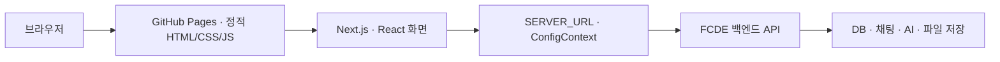
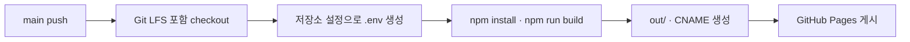

# Abrody Web · FCDE

**Abrody 서비스 소개부터 커뮤니티, 언어 학습·콘텐츠 기능과 관리 화면까지 제공하는 웹 프로젝트입니다.**

Next.js App Router와 React로 구성되어 있으며, 현재 배포 방식은 **정적 사이트 생성 → GitHub Pages 게시**입니다. 로그인·채팅·데이터 조회 등은 별도 FCDE 백엔드 API와 연결됩니다.

[전체 구조](#전체-구조) · [주요 화면](#주요-화면) · [개발 시작](#개발-시작) · [서버 연결](#서버-연결) · [빌드와 배포](#빌드와-배포) · [점검 가이드](#점검-가이드)

## 전체 구조

| 프로젝트 | 역할 |
| --- | --- |
| `website/` · 현재 프로젝트 | 서비스 소개, 브라우저 UI, 웹 관리 도구 |
| `frontend/` · 인접 프로젝트 | React Native·Expo 모바일 앱 |
| `backend/` · 인접 프로젝트 | 인증, 데이터, AI·채팅 API, 서버 인프라 |

인접 프로젝트는 전체 워크스페이스 기준이며, 웹 저장소 자체에 포함되는 것은 아닙니다.



웹 페이지가 열리는 것과 백엔드가 정상인 것은 별개입니다. 정적 파일을 제공하는 GitHub Pages가 EC2나 API 서버를 실행해 주지는 않습니다.

## 주요 화면

| 영역 | 대표 경로 | 내용 |
| --- | --- | --- |
| 서비스 소개 | `/`, `/about`, `/about-kr`, `/faq`, `/contact` | 제품 소개, 안내, 문의 |
| 계정 | `/signInLogIn`, `/signUpForm`, `/account`, `/myProfile` | 로그인·가입, 계정·프로필 |
| 커뮤니티 | `/posts`, `/fullPost`, `/events`, `/searchPage`, `/chatting-room` | 게시물, 모임 탐색, 대화 |
| 학습·분석 | `/analyze`, `/analytics`, `/owl-videos`, `/my-activity` | 분석, 학습 콘텐츠, 활동 |
| 콘텐츠 제작 | `/video-production`, `/video-task-list` | 영상 제작 및 작업 조회 |
| 관리 | `/adminDashboard`, `/adminReports`, `/adminPlan`, `/adminRetention` | 운영 화면과 관리 기능 |
| 추가 도구·콘텐츠 | `/graphic-statics`, `/canopy`, `/exterra-parametric`, `/diary` | 별도 시각화·설계 도구와 콘텐츠 |
| 정책·앱 연결 | `/terms`, `/child-safety`, `/ios-redirect`, `/android-beta-redirect` | 정책 안내와 앱 이동 |

전체 경로는 [src/app/](src/app/)에서 확인할 수 있습니다. 표는 코드에 존재하는 화면을 설명하며, 배포 상태나 사용자별 접근 권한을 의미하지는 않습니다.

## 기술 구성

| 용도 | 주요 기술 |
| --- | --- |
| 웹 프레임워크 | Next.js 15.2.2, React 19, TypeScript |
| 화면·스타일 | CSS Modules, Tailwind CSS 구성, Framer Motion, AOS |
| 상태·설정 | React Context, 브라우저 저장소 |
| 서버 통신 | Axios, fetch, Socket.IO Client |
| 다국어 | i18next 계열 설정, react-i18next, 번역 리소스 |
| 지도·시각화 | Leaflet, React Leaflet, Chart.js |
| 미디어·문서 | Lottie, Vosk Browser, jsPDF |
| 배포 | 정적 export, Git LFS, GitHub Actions, GitHub Pages |

의존성은 [package.json](package.json)과 [package-lock.json](package-lock.json)을 기준으로 확인하세요.

## 코드 탐색

```text
website/
├── src/
│   ├── app/
│   │   ├── layout.tsx        # 공통 레이아웃·Provider·초기화
│   │   ├── page.tsx          # 홈 페이지
│   │   └── .../page.tsx      # URL별 페이지
│   ├── components/          # 공통 UI
│   ├── context/             # 설정·데이터 Context
│   ├── config/              # API 주소·다국어 설정
│   ├── hooks/               # 공통 hook
│   ├── locales/             # 번역 리소스
│   ├── constants/           # 데이터·상수
│   ├── styles/              # 공통 스타일·CSS Modules
│   ├── overlays/            # 오버레이 UI
│   └── utils/               # 공통 처리
├── public/                  # 브라우저에 제공하는 정적 리소스
├── scripts/                 # 보조 스크립트
├── next.config.ts           # 정적 export·Next.js 설정
├── .gitattributes           # Git LFS 등 파일 관리 설정
├── CNAME                    # 도메인 관련 파일
└── .github/workflows/       # 빌드·Pages 배포
```

새 화면은 `src/app/<경로>/page.tsx`, 공통 UI는 `src/components/`, 서버 주소는 `src/config/config.ts`부터 확인하면 됩니다.

## 개발 시작

### 1. 의존성과 리소스 준비

Node.js·npm과 Git LFS를 준비합니다. 현재 workflow는 Node.js 18을 지정하고 있으므로, 개발 환경과 CI 버전을 맞출 때 이 설정을 확인하세요.

```bash
cd website

git lfs install
git lfs pull
npm ci
```

Git LFS 파일을 받지 않으면 이미지·미디어 대신 포인터 파일만 존재할 수 있습니다. 설치 버전의 기준은 lock 파일이며, 현재 CI의 의존성 설치 명령은 `npm install`입니다.

### 2. API 주소 설정

로컬 `.env.local`에 접속할 백엔드 주소를 지정합니다.

```dotenv
# 예시: 정상 배포된 서울 API를 사용할 경우
NEXT_PUBLIC_SERVER_URL=https://kr.fcde.app
```

로컬 백엔드를 사용한다면 해당 주소로 바꿉니다. 아래처럼 웹은 3001, 백엔드는 3000 포트를 사용하면 충돌을 피할 수 있습니다.

```bash
npm run dev -- --port 3001
```

브라우저에서 `http://localhost:3001`을 엽니다. 백엔드 CORS에 이 origin이 허용되어 있어야 하며, 로그인 시에는 쿠키·credentials 설정도 확인해야 합니다.

### 3. 주요 설정

| 변수 | 역할 |
| --- | --- |
| `NEXT_PUBLIC_SERVER_URL` | API 기본 주소; 미설정 시 `https://www.fcde.app` |
| `NEXT_PUBLIC_GOOGLE_MAPS_API_KEY` | CI에서 생성하는 지도 관련 공개 설정 |
| `NEXT_PUBLIC_APP_VERSION` | 클라이언트 버전 표시·설정 |
| `NEXT_PUBLIC_FEATURE_UNDER_DEV` | 개발 기능 관련 플래그 |
| `NEXT_PUBLIC_TEST_AD_MODE` | 테스트 광고 관련 플래그 |

`NEXT_PUBLIC_*` 값은 브라우저에 전달되는 설정입니다. 서버 비밀 키를 넣지 않습니다. 정적 배포의 API 주소를 바꿀 때는 환경변수를 수정한 뒤 **다시 빌드·배포**해야 합니다.

## 서버 연결

| 위치 | 역할 |
| --- | --- |
| [config/config.ts](src/config/config.ts) | `NEXT_PUBLIC_SERVER_URL`을 우선 사용하고, 없으면 `www.fcde.app` 사용 |
| [context/ConfigContext.tsx](src/context/ConfigContext.tsx) | 화면에 `SERVER_URL`과 공통 설정 전달 |
| [app/layout.tsx](src/app/layout.tsx) | 공통 초기화, 서버 상태 확인, Axios credentials·`x-region` 처리 |

현재 `getServerUrlAsync()`는 기본 URL을 반환합니다. 파일에 국가별 URL 매핑 함수가 있어도 **현재 웹 기본 경로가 국가별 서버를 자동 선택하는 구조는 아닙니다.**

브라우저의 `region` 값이나 `x-region` 헤더는 백엔드에서 처리할 데이터 리전을 지정합니다. API 목적지는 URL이 결정하므로, 한국 서버만 운영한다면 실제 요청이 서울 주소로 나가는지 개발자 도구의 Network 탭에서 확인하세요.

## 빌드와 배포

### 정적 출력

[next.config.ts](next.config.ts)에 `output: "export"`가 설정되어 있습니다.

```bash
npm run build
```

결과물은 `out/`에 생성됩니다. `package.json`에 `npm start`가 있더라도 현재 정적 배포 결과를 운영하는 방식은 `next start`가 아니라 **`out/`을 정적 호스팅에 게시하는 것**입니다. [Next.js 정적 export 안내](https://nextjs.org/docs/app/guides/static-exports)를 참고하세요.

현재 설정에는 `/api-beta/*`, `/api-dev/*` rewrite도 있지만, 정적 export에는 Next.js 서버의 rewrite 기능이 제공되지 않습니다. GitHub Pages에서 이 경로가 API 프록시로 동작한다고 가정하면 안 됩니다.

### main 브랜치 push 시

[deploy.yml](.github/workflows/deploy.yml)의 흐름입니다.



| GitHub 설정 | 종류 | 용도 |
| --- | --- | --- |
| `NEXT_PUBLIC_SERVER_URL` | Repository variable | 빌드에 포함할 API 주소 |
| `NEXT_PUBLIC_GOOGLE_MAPS_API_KEY` | Secret | 지도 관련 클라이언트 설정 |
| `MY_GITHUB_TOKEN` | Secret | Pages 게시에 사용하는 인증 정보 |

workflow는 `out/CNAME`에 **`website.fcde.app`**을 기록하고 `out/`을 게시합니다. 로컬 `.env.local`을 바꾸는 것만으로 GitHub Actions 설정이 바뀌지는 않습니다. 도메인·DNS·GitHub Pages 설정도 게시 대상과 일치해야 합니다.

웹 push는 웹 정적 파일을 배포합니다. 백엔드 코드 배포나 Terraform 실행은 별도 프로젝트의 작업입니다.

## 점검 가이드

| 증상 | 먼저 확인할 내용 |
| --- | --- |
| 웹은 열리는데 API가 실패 | 빌드 당시 `NEXT_PUBLIC_SERVER_URL`, 실제 요청 URL, 백엔드 상태 |
| 한국 서버를 켰는데 다른 리전으로 요청 | `www.fcde.app` fallback과 저장소 API 주소 변수 |
| 로컬에서 로그인 실패 | CORS origin, credentials, 쿠키의 도메인·보안 조건 |
| 이미지·미디어 누락 | Git LFS 다운로드 및 `public/` 파일 |
| `/api-beta`·`/api-dev`가 404 | 정적 호스팅에는 Next.js rewrite 서버가 없음 |
| API 주소 변경이 배포에 반영되지 않음 | CI 변수 수정 여부와 재빌드·재게시 결과 |
| 특정 URL 직접 진입이 실패 | 정적 HTML 출력 경로와 호스팅의 경로 처리 |

현재 `next.config.ts`는 빌드 중 ESLint 오류를 무시합니다. 따라서 빌드 성공과 lint 통과는 같은 의미가 아닙니다. `npm run lint`는 별도 확인하고, `package.json`에 자동 테스트 스크립트는 없습니다.

배포 전에는 주요 페이지, 로그인, API 요청, 모바일 화면 크기와 직접 URL 진입을 확인하세요. 페이지가 렌더링되더라도 연결된 백엔드의 DB·채팅·파일 기능까지 검증된 것은 아닙니다.

## 관련 파일과 권리 표기

[홈 페이지](src/app/page.tsx) · [공통 레이아웃](src/app/layout.tsx) · [API 설정](src/config/config.ts) · [Next.js 설정](next.config.ts) · [배포 workflow](.github/workflows/deploy.yml) · [LICENSE](LICENSE)

`LICENSE`에는 **Copyright © 2025 FacadeConnect Co., Ltd. All rights reserved.**가 명시되어 있습니다. 외부 이미지·폰트·미디어·데이터의 이용 조건은 각 자산의 출처를 별도로 확인하세요.
