# 의학

# 육안해부학

## 심장과 심낭의 입체 해부

### 학습목표

- 심장의 표면과 심장방의 관계를 설명한다.
- 판막과 섬유성 골격의 기능을 연결한다.
- 관상순환과 심장 전도계의 수술적 관계를 설명한다.

### 심장을 공간에 배치하기

심장(heart)은 두 폐 사이 종격동(mediastinum)에 놓인 근육성 기관이며, 심낭(pericardium)에 싸여 있다. 심장의 장축은 단순한 수직선이 아니라 뒤위쪽에서 앞아래쪽으로 기울어져 있다. 따라서 심방이 위에 있고 심실이 아래에 있다는 도식만 외우면 실제 단면영상을 해석하기 어렵다. 우심실(right ventricle)은 앞쪽 흉골에 가장 가까운 심장방의 대부분을 이루고, 좌심방(left atrium)은 뒤쪽에 놓여 식도와 가깝다. 좌심실(left ventricle)은 두꺼운 벽으로 심장끝(apex)을 이루며, 그 끝은 대개 왼쪽 앞아래쪽을 향한다. 영상에서 좌우는 화면의 좌우가 아니라 환자의 해부학적 좌우로 판단해야 한다.

흉골갈비면은 주로 우심실로 이루어지고, 가로막면은 주로 좌심실과 일부 우심실로 이루어진다. 심장바닥(base)은 주로 좌심방이 차지하는 뒤쪽 면이다. 심장바닥을 심장의 아래쪽이라고 해석하는 것은 일상어와 해부학 용어를 혼동한 결과다. 심장 외면의 방실고랑(coronary sulcus)은 심방과 심실의 경계를 표시하며, 앞뒤심실사이고랑은 심실 사이의 위치를 가늠하게 한다. 외부 고랑은 내부 중격의 위치와 관련되지만 모든 내부 구조의 경계를 그대로 투영하는 것은 아니다.

### 심낭과 인접 구조

섬유심낭(fibrous pericardium)은 심장을 둘러싸는 질긴 결합조직 주머니로, 아래쪽에서 가로막의 중심널힘줄과 이어진다. 장막심낭(serous pericardium)은 벽쪽층과 내장쪽층으로 나뉘며, 내장쪽층은 심장바깥막(epicardium)을 이룬다. 두 장막층 사이의 심낭강(pericardial cavity)에는 마찰을 줄이는 소량의 액체가 존재한다. 큰혈관 뿌리에서 장막층이 반사되면서 가로심낭굴과 빗심낭굴이 형성된다. 가로심낭굴은 동맥쪽 유출로와 정맥쪽 유입부 사이의 공간으로, 심장수술에서 큰혈관의 상대적 위치를 이해하는 데 중요하다.

가로막신경(phrenic nerve)은 섬유심낭 바깥면을 따라 내려가며 폐뿌리의 앞을 지난다. 반대로 미주신경(vagus nerve)은 폐뿌리 뒤를 지나는 관계가 중요하다. 벽쪽 심낭의 통증은 가로막신경이 담당하는 척수분절과 연관되어 어깨 부위로 연관통을 일으킬 수 있다. 심낭삼출이 있어도 압박의 심각도는 액체량만으로 결정되지 않는다. 천천히 증가한 액체에는 심낭이 적응할 수 있지만 급격한 축적은 적은 양으로도 심장방 충만을 제한한다. 이는 해부학적 주머니의 압력과 순응도가 생리적 정맥환류에 영향을 주는 사례다.

### 심장방 내부와 판막

우심방에는 위대정맥과 아래대정맥, 심장정맥굴이 열린다. 매끈한 정맥 유입부와 빗살근(pectinate muscles)이 발달한 부위는 분계능선(crista terminalis)을 기준으로 구분할 수 있다. 심방사이중격에는 태아기의 타원구멍이 닫힌 흔적인 타원오목(fossa ovalis)이 보인다. 우심실에는 불규칙한 근육기둥인 육주(trabeculae carneae), 유두근(papillary muscles), 힘줄끈(chordae tendineae)이 존재한다. 힘줄끈은 방실판막의 자유가장자리와 유두근을 연결하며, 심실 수축 중 판막이 심방으로 뒤집히는 것을 제한한다.

유두근은 판막을 당겨 여는 근육이 아니다. 판막의 개폐는 주로 양쪽 압력차에 의해 결정되고, 유두근과 힘줄끈은 닫힌 판막을 안정시킨다. 좌심실의 승모판(mitral valve)은 보통 앞뒤 두 판엽으로 이루어지며, 우심실의 삼첨판(tricuspid valve)은 전형적으로 세 판엽으로 설명한다. 반달판막인 대동맥판과 폐동맥판에는 방실판막과 같은 유두근-힘줄끈 장치가 없다. 이 차이는 급성 유두근 기능장애가 승모판역류를 유발할 수 있지만 같은 방식으로 대동맥판역류를 설명할 수 없다는 점과 연결된다.

좌심방은 폐정맥을 통해 산소화된 혈액을 받으며 내부 대부분은 비교적 매끈하다. 좌심실 벽은 높은 체순환 압력을 발생시키기 때문에 우심실보다 두껍다. 그러나 벽 두께만으로 수축 기능을 판단할 수는 없다. 확장, 섬유화, 허혈, 판막 부하와 같은 조건이 실제 기능을 바꾼다. 심실사이중격은 큰 근육부분과 작은 막부분으로 나뉜다. 작은 막부분은 방실 전도조직과 가까워 중격 결손이나 수술을 이해할 때 특히 중요하다.

### 혈액 공급과 전기적 연결

관상동맥(coronary arteries)은 대동맥뿌리에서 시작한다. 오른관상동맥과 왼관상동맥의 주행을 따라가면 심장 표면의 고랑이 혈관의 길잡이가 된다는 것을 알 수 있다. 왼관상동맥은 대개 앞심실사이가지와 휘돌이가지로 나뉜다. 관상동맥 우세성(dominance)은 뒤심실사이동맥을 어느 관상동맥계가 내는지에 따라 정하며, 단순히 어느 동맥이 더 굵은가를 뜻하지 않는다. 분지와 공급 영역에는 개인차가 있으므로 특정 혈관 폐색을 모든 사람에게 동일한 크기의 경색으로 연결해서는 안 된다.

심장정맥혈의 상당 부분은 심장정맥굴(coronary sinus)을 통해 우심방으로 돌아온다. 심장 림프는 심외막 아래 림프관을 통해 주로 기관기관지 림프절 방향으로 배액된다. 교감신경은 심박수와 수축력을 높이는 방향으로 작용하고, 미주신경성 부교감신경은 특히 동방결절과 방실결절의 활동에 영향을 준다. 동방결절(sinoatrial node)은 우심방의 위대정맥 유입부 가까이, 방실결절(atrioventricular node)은 우심방 중격쪽 아래 부위에 위치한다. 섬유성 심장골격은 판막을 지지하면서 심방과 심실 사이의 직접적인 전기 확산을 제한하고, 정상 전도는 방실다발을 통해 이어진다.

### 영상과 임상 해석

경흉부 심초음파의 각 창은 심장의 서로 다른 면과 장축을 절단한다. 심첨 네심장방 단면에서는 양쪽 심방과 심실, 방실판막과 중격의 관계를 관찰한다. 단면에서 구조가 보이지 않는다는 사실이 구조의 부재를 의미하지는 않는다. 탐촉자의 위치와 각도를 바꾸면 절단면에 포함되는 범위가 달라지기 때문이다. 심낭액은 심장 바깥의 공간에서, 판막 운동은 주기별 영상에서 평가하며, 형태 관찰과 혈류 평가를 구분한다. 도플러 신호의 방향과 속도는 초음파 빔과 흐름의 상대적 각도에 영향을 받으므로 영상의 색 하나를 산소 함량으로 해석해서는 안 된다.

### 확인 문제

유두근의 주된 판막 관련 기능은?

A. 수축기 판막 뒤집힘을 제한한다.
B. 판막을 당겨 직접 연다.

**정답: A**

압력차가 개폐를 만들고 유두근-건삭은 지지한다.

**오답 해설**

B: 유두근을 개방 장치로 이해하면 역할을 뒤바꾼다.

## 가슴벽·갈비사이공간·가로막

### 학습목표

- 가슴우리의 뼈 표지와 호흡 운동을 연결한다
- 갈비사이 신경혈관의 층을 설명한다
- 가로막의 구멍·신경지배·연관통을 구분한다

### 보호 구조이면서 움직이는 벽

가슴우리(thoracic cage)는 등뼈, 갈비뼈와 갈비연골 및 복장뼈를 포함하여 심장과 폐를 보호하고 호흡에 필요한 용적 변화를 만든다. 갈비뼈는 전형적으로 열두 쌍이며 위쪽 일곱 쌍은 자신의 갈비연골로 복장뼈와 연결된다. 아래쪽 일부는 연골을 통해 간접 연결되고 마지막 두 쌍은 앞쪽에서 같은 방식으로 붙지 않는다. 연결 형태 차이는 운동과 손상의 기계적 특성에 영향을 준다.

복장뼈는 자루, 몸통과 칼돌기로 구분한다. 복장각(sternal angle)은 둘째갈비연골을 찾고 갈비뼈를 세는 표지이며 가슴세로칸의 구분을 이해하는 기준과도 연결된다. 피부에서 만지는 위치와 내부 장기의 정확한 높이는 자세와 호흡 및 체형에 따라 달라질 수 있다. 하나의 표면선이 언제나 장기의 경계와 일치한다고 가정하지 않는다.

### 갈비뼈의 관절과 호흡

전형적 갈비뼈의 머리는 척추뼈몸통 부근, 결절은 가로돌기 부근과 관계되어 뒤쪽 관절을 만든다. 회전축과 갈비뼈 방향 때문에 위쪽과 아래쪽 가슴우리에서 용적 증가의 형태가 다르게 나타난다. 앞뒤 직경과 가로 직경의 변화가 함께 일어난다. 실제 호흡에서는 가로막과 갈비사이근 및 필요에 따른 보조근이 협동한다.

갈비뼈의 수나 관절면 형태에는 부위별 차이와 변이가 있다. 첫째갈비뼈는 목과 가슴의 연결에서 혈관·신경 관계가 중요하고 아래쪽 갈비뼈 손상은 가로막 아래 장기와도 연결될 수 있다. 가슴벽 통증과 골절을 평가할 때 손상 높이만으로 내부 손상의 범위를 좁게 정하지 않는다. 호흡 상태와 주변 장기의 징후를 함께 본다.

### 갈비사이근의 층

바깥갈비사이근과 속갈비사이근 및 가장속갈비사이근 등은 층과 섬유 방향이 다르다. 각 층이 가슴우리의 움직임과 안정화에 기여하는 방식은 위치와 호흡 단계에 따라 달라진다. 속갈비사이근의 모든 부위를 무조건 같은 호기 작용으로 묶는 것은 단순화이다. 근육성 부분과 막으로 바뀌는 구간도 구분하여 본다.

주된 갈비사이 신경혈관 다발은 속갈비사이근과 가장속갈비사이근 사이의 층에 있고 갈비뼈 아래모서리의 고랑과 관련된다. 정맥·동맥·신경의 위아래 배열을 함께 기억하되 곁가지가 있어 한 줄만 피하면 모든 혈관 손상 위험이 사라지는 것은 아니다. 흉강 접근은 해부 표지와 함께 실제 장기 위치 및 영상 확인과 안전 절차를 반영해야 한다.

### 신경·혈관과 가슴벽 통증

갈비사이신경은 주로 등척수신경의 앞가지이며 가슴벽의 감각과 근육 운동에 기여한다. 뒤가지는 등 깊은 근육과 피부의 다른 영역에 연결된다. 대상포진 같은 신경 관련 통증의 분포를 피부분절과 연결할 수 있지만 통증 하나로 원인을 확정하지 않는다. 갈비사이동맥은 앞뒤 공급원이 연결되고 정맥은 홀정맥 계통이나 속가슴정맥 등으로 회수된다.

속가슴동맥(internal thoracic artery)은 앞가슴벽의 중요한 혈관으로 복장뼈 가쪽을 따라 내려가 분지를 낸다. 수술과 외상에서 표면의 복장뼈 위치뿐 아니라 이 혈관의 상대 위치를 생각해야 한다. 가슴벽의 림프 배액은 겨드랑 및 복장뼈 주위 등 여러 경로에 연결되어 동맥 목록과 완전히 같은 구획으로 나누어지지 않는다.

### 가로막의 돔과 부착

가로막(diaphragm)은 가슴안과 배안을 나누는 돔 모양의 근육·힘줄 구조이다. 복장뼈, 갈비뼈와 허리뼈 부위에서 시작하는 근섬유가 중심힘줄로 이어진다. 수축하면 돔이 내려가 가슴안 용적을 늘리고 배안 압력과 장기 위치에도 영향을 준다. 오른쪽 돔이 간과 관련하여 더 높게 보이는 전형적 양상이 있지만 정상 높이는 호흡과 자세 및 개인차의 영향을 받는다.

가로막에는 아래대정맥, 식도와 대동맥이 지나는 서로 다른 통로가 있다. 대정맥 통로는 중심힘줄, 식도 통로는 근육성 부분, 대동맥 통로는 뒤쪽 다리와 관련된 관계를 구분한다. 대표 척추 높이는 위치를 외우는 보조 기준이며 고정된 피부 지점이나 모든 호흡 단계에서의 절대 높이가 아니다. 식도와 대동맥이 같은 구멍을 지나간다고 혼동하지 않는다.

### 신경지배와 연관통

가로막신경(phrenic nerve)은 주로 C3~C5 분절의 기여를 받아 운동 지배를 한다. 중심부 가로막과 관련 막의 감각도 이 경로에 연결되고 주변부 감각은 갈비사이신경 등의 기여를 받는다. 가로막 자극이 어깨 부위의 연관통으로 느껴질 수 있는 것은 공통 척수 분절 수준의 감각 처리와 관련된다. 어깨 통증의 원인을 항상 어깨관절 자체로 한정하지 않는 이유이다.

한쪽 가로막 기능 저하는 영상에서의 높이와 호흡 운동 변화로 단서를 얻을 수 있으나 높은 돔 하나만으로 신경 마비를 확정하지 않는다. 무기폐, 배안의 압력과 다른 원인도 고려한다. 정상 3D 모형의 가로막 위치는 들숨과 날숨의 실제 변형을 내장하지 않는다. 호흡 역학을 설명하려면 정적 구조와 별도의 운동 도식을 연결해야 한다.

### 확인 문제

주된 갈비사이 신경혈관 다발은 어디와 관련되는가?

A. 속갈비사이근과 가장속갈비사이근 사이의 층이다.
B. 항상 피부 바로 아래에만 있어 깊은 접근과 무관하다.

**정답: A**

다발은 깊은 근육층 사이 및 갈비뼈 고랑과 관계되며 곁가지와 실제 환자의 구조를 함께 고려한다.

**오답 해설**

B: 이 해석은 옳지 않다. 다발은 깊은 근육층 사이 및 갈비뼈 고랑과 관계되며 곁가지와 실제 환자의 구조를 함께 고려한다.

## 폐·허파문·가슴막과 폐구역

### 학습목표

- 좌우 폐의 엽·틈새·주변 구조 차이를 설명한다
- 폐순환·기관지순환과 림프 배액을 구분한다
- 가슴막의 층과 통증·기흉·흉수의 관계를 설명한다

### 좌우가 완전히 대칭인 장기가 아니다

폐(lung)는 가슴안 양쪽에서 기도와 혈관 및 림프관을 통해 몸의 다른 부분과 연결된다. 오른폐는 위·중간·아래엽, 왼폐는 위·아래엽으로 나뉘는 전형적 배열을 가진다. 오른쪽의 수평틈새와 양쪽의 빗틈새는 엽의 경계를 이룬다. 왼쪽의 심장패임과 혀구역은 심장과의 공간 관계를 반영한다. 좌우를 단순 거울상으로 취급하면 영상과 수술 해부를 잘못 이해할 수 있다.

폐의 꼭대기와 바닥, 갈비면과 가슴세로칸면은 주변 구조의 방향을 설명한다. 폐꼭대기는 가슴우리 위쪽 입구와 목의 깊은 구조에 가깝고, 바닥은 가로막에 놓인다. 앞가슴벽에서 보이는 폐의 영역과 뒤쪽에서 보이는 영역은 엽의 입체적 배열 때문에 다르다. 뒤쪽의 넓은 영역에서 아래엽이 차지하는 위치를 생각하면 청진과 영상 소견을 연결하기 쉽다.

### 허파문과 폐뿌리

허파문(hilum)은 가슴세로칸면에서 기관지와 폐혈관 등 구조가 드나드는 부위이며, 이 구조를 감싸는 연결을 폐뿌리(root of lung)로 이해한다. 기관지, 폐동맥과 폐정맥의 관계는 좌우가 다르다. 폐정맥은 전반적으로 앞아래 쪽 관계가 중요하고, 폐동맥과 기관지의 상대 위치는 각각 확인해야 한다. 한쪽의 단면을 외운 뒤 그대로 다른 쪽에 적용하지 않는다.

폐뿌리 주위에서 가로막신경은 앞쪽, 미주신경은 뒤쪽을 지나는 관계가 중요하다. 주변의 대동맥활, 홀정맥활과 식도 등은 좌우와 높이에 따라 다른 영상 표지를 제공한다. 종괴나 림프절 비대가 기관지·혈관·신경에 어떤 영향을 줄 수 있는지 생각할 때 이러한 관계가 필요하다. 허파문이 커 보인다는 소견은 혈관과 림프절 및 다른 원인을 구분하여 해석한다.

### 엽과 폐구역의 차이

기관지는 주기관지에서 엽기관지와 구역기관지로 분지한다. 기관지폐구역(bronchopulmonary segment)은 구역기관지와 해당 폐동맥 분지에 연결되는 해부학적 단위이다. 정맥은 구역 사이 경계를 따라 지나는 관계가 중요하여 동맥과 완전히 같은 방식으로 묶이지 않는다. 폐엽과 폐구역은 크기만 다른 동의어가 아니다.

구역의 이름과 수는 특히 왼쪽의 통합 여부와 분류 관례에 따라 기술이 달라질 수 있다. 실제 수술 계획에서는 환자의 기관지와 혈관 분지 및 변이를 확인한다. 정상 구역의 개념은 국소 절제와 병변 위치 설명에 유용하지만 모든 병변이 구역 경계에서 정확히 멈추는 것은 아니다. 감염, 기도 폐쇄와 종양은 서로 다른 확산 경로를 보일 수 있다.

### 두 순환과 회수

폐순환은 오른심실에서 온 혈액을 폐포 모세혈관으로 보내 가스교환 후 왼심방으로 돌려보낸다. 기관지순환(bronchial circulation)은 기도벽과 지지 조직 등에 산소화 혈액을 공급하는 체순환 계통이다. 기관지정맥의 배액 일부와 폐정맥으로 이어지는 연결은 두 순환이 완전히 독립된 닫힌 두 관이 아님을 보여 준다. 폐동맥의 산소 함량이 낮다고 폐 조직 전체가 산소 공급을 받지 못하는 것은 아니다.

림프관은 표면과 깊은 조직의 계통을 통해 허파문과 기관기관지 림프절 등으로 이어진다. 림프절의 위치와 연결은 감염과 종양의 평가에 중요하지만 동맥 분지 구역과 일대일로 일치하지 않는다. 일부 배액은 정중선을 넘어 연결될 수 있어 같은 쪽 림프절만을 확인하는 단순한 지도에는 한계가 있다. 병변의 위치와 실제 영상·검사 결과를 함께 본다.

### 장측과 벽측 가슴막

장측가슴막(visceral pleura)은 폐 표면과 틈새를 덮고, 벽측가슴막(parietal pleura)은 가슴벽과 가로막 및 가슴세로칸 쪽 경계를 덮는다. 두 층 사이의 가슴막안은 정상적으로 적은 액체가 있는 잠재 공간이며 폐 실질의 내부 공기 공간과 다르다. 폐가 가슴벽에 접착제로 붙어 움직이는 것이 아니라 압력과 액체층 및 조직의 탄성에 의해 운동이 연결된다.

벽측가슴막의 감각은 부위에 따라 갈비사이신경과 가로막신경 등에 연결된다. 장측층과 벽측층의 통증 민감도 및 경로를 구분하면 국소 흉통과 어깨 연관통의 차이를 이해할 수 있다. 숨 쉴 때 아프다는 증상은 가슴막 자극의 단서일 수 있지만 근골격 질환과 다른 흉부 원인도 고려한다. 통증의 성질 하나로 병인을 확정하지 않는다.

### 가슴막오목과 병적 공간 변화

갈비가로막오목(costodiaphragmatic recess)은 폐 가장자리와 벽측가슴막의 반전 사이에서 호흡에 따라 관계가 달라지는 공간이다. 액체는 중력과 자세의 영향을 받아 고이므로 서 있는 영상과 누운 영상의 흉수 모양이 다를 수 있다. 폐의 아래 경계와 가슴막의 아래 경계는 같은 선이 아니며 호흡 단계에 따라 위치가 변한다. 고정된 한 줄만으로 시술 위치를 정하지 않는다.

기흉에서는 가슴막안으로 공기가 들어가 폐와 가슴벽 사이의 압력 관계가 달라지고 폐가 줄어들 수 있다. 긴장 상태에서는 순환에도 영향을 줄 수 있어 단순히 폐의 크기만의 문제가 아니다. 흉수는 액체의 생성과 배액 불균형 또는 염증·손상 등 여러 원인에서 생긴다. 정상 3D 폐 모델은 병적 공기나 액체를 포함하지 않으며, 질환 표현에는 검증된 영상과 별도의 병태생리 도식이 필요하다.

### 확인 문제

폐구역의 동맥과 정맥은 항상 완전히 같은 경로인가?

A. 아니다. 구역 기관지·동맥과 구역 사이 정맥의 관계를 구분한다.
B. 그렇다. 모든 정맥은 구역기관지와 같은 중심 경로만 지난다.

**정답: A**

구역의 기능적 공급 단위와 구역 사이 회수 경로를 구분해야 국소 병변과 절제 해부를 이해할 수 있다.

**오답 해설**

B: 이 해석은 옳지 않다. 구역의 기능적 공급 단위와 구역 사이 회수 경로를 구분해야 국소 병변과 절제 해부를 이해할 수 있다.

## 해부학적 방향·단면·근막과 구획

### 학습목표

- 자세가 바뀌어도 해부학적 방향 용어를 일관되게 적용한다
- 근막과 근육 구획을 혈관·신경 주행과 연결한다
- 영상의 좌우 및 단면 정보를 실제 구조에 대응시킨다

### 표준 자세는 공간 설명의 좌표계이다

해부학적 자세(anatomical position)는 몸을 세우고 얼굴과 발을 앞쪽으로 향하며 팔을 몸 옆에 두고 손바닥이 앞을 향한 기준 자세이다. 실제 환자가 누워 있거나 팔을 회전해도 안쪽과 가쪽, 앞과 뒤의 해부학적 명칭은 이 기준을 바탕으로 사용한다. 손바닥이 뒤로 향하도록 팔을 돌렸다는 이유로 노뼈와 자뼈의 명칭이나 기본 안가쪽 관계를 새로 정하지 않는다. 관찰한 자세와 기준 방향을 구분해야 수술 기록과 영상 설명이 서로 통한다.

정중면(median plane)은 몸을 좌우로 나누는 중심의 시상면이다. 시상면(sagittal plane)은 이에 평행한 면, 관상면(coronal plane)은 앞뒤를 나누는 면, 가로면(transverse plane)은 위아래를 나누는 면이다. 실제 영상은 비스듬한 단면을 포함할 수 있으며 하나의 구조가 여러 연속 단면에 걸쳐 나타난다. 한 장에서 둥글게 보이는 구조가 구형 장기인지 길게 뻗은 관의 단면인지 구분하려면 앞뒤 영상을 이어서 추적한다.

### 방향 용어와 운동 용어

위·아래와 앞·뒤는 몸통에서 직관적이지만 굽은 중추신경계와 돌출된 팔다리에서는 부위별 관례를 확인해야 한다. 몸통에 가까운 쪽은 몸쪽(proximal), 먼 쪽은 먼쪽(distal)이라고 하며 손가락의 첫마디를 설명할 때도 기준이 된다. 얕은층(superficial)과 깊은층(deep)은 피부로부터의 상대적 거리이다. 두 구조가 깊이가 다르더라도 같은 단면에서 겹쳐 보여 앞뒤 관계를 잘못 추론할 수 있다.

굽힘과 폄, 벌림과 모음, 안쪽돌림과 가쪽돌림은 관절의 운동을 기술한다. 엄지는 다른 손가락과 다른 방향으로 놓여 움직임을 손바닥 평면과 관련하여 해석한다. 엎침(pronation)과 뒤침(supination)은 주로 아래팔에서 노뼈가 자뼈와 갖는 관계의 변화이며 어깨의 안쪽돌림과 같지 않다. 겉으로 손바닥의 방향이 비슷해져도 어느 관절에서 움직임이 생겼는지 구분한다.

### 피부·피하조직·깊은근막

피부 아래 피하조직에는 지방, 얕은정맥, 피부신경과 림프관이 분포한다. 깊은근막(deep fascia)은 근육과 다른 깊은 구조를 둘러싸고 사이막을 통해 뼈와 연결되어 구획을 만든다. 이 층은 단순한 포장지가 아니라 조직 사이 힘의 전달과 구조의 위치 유지 및 감염 확산 경로에 영향을 준다. 다만 근막면의 이름과 연속성은 부위에 따라 다르므로 전신에 동일한 한 장의 막이 있다는 식으로 단순화하지 않는다.

신경과 혈관은 근육 사이의 틈이나 근막의 통로를 따라 이동한다. 얕은 피부신경과 깊은 운동신경은 같은 이름의 넓은 구역을 지나더라도 깊이와 손상 위험이 다르다. 주사나 절개에서 표면의 한 지점을 아는 것만으로 안전한 깊이와 방향이 정해지는 것은 아니다. 인접 장기, 해부학적 변이 및 환자의 체격도 실제 경로를 바꾼다.

### 근육 구획이 갖는 기능적 의미

팔다리의 근육은 구획(compartment)별로 묶이며 같은 구획에서 작용이나 주요 신경지배가 비슷한 경우가 많다. 위팔 앞구획은 굽힘 관련 근육과 근육피부신경, 뒤구획은 폄 관련 근육과 노신경을 연결해 이해할 수 있다. 그러나 구획 규칙에는 예외와 경계가 있다. 신경은 한 구획을 지나 다른 구획으로 이동하기도 하므로 지나간다는 사실과 그곳의 모든 근육을 지배한다는 사실을 구분한다.

구획 안에 출혈이나 부종이 생기면 단단한 경계 때문에 압력이 상승하여 미세순환과 신경 기능을 해칠 수 있다. 이것이 구획증후군의 해부학적 배경이다. 큰 동맥의 맥박이 남아 있어도 작은 혈관의 관류가 충분하다는 뜻은 아니다. 손상 부위의 통증, 감각과 운동 및 시간 경과를 연결해야 한다. 해부학은 한 구조의 존재를 확인하는 데서 끝나지 않고 닫힌 공간에서의 압력과 조직 생존을 설명한다.

### 혈관·신경·림프의 서로 다른 지도

동맥은 유입, 정맥은 회수, 림프관은 조직액과 면역 관련 물질의 배출을 담당한다. 동맥과 깊은정맥이 함께 주행하는 경우가 많지만 얕은정맥은 다른 표면 경로를 이용할 수 있다. 림프 배액도 동맥의 분지 영역과 완전히 같은 지도로 대응하지 않는다. 감염이나 종양의 확산을 설명할 때 동맥 공급만 보고 림프절 위치를 추정해서는 안 된다.

피부분절(dermatome)은 척수신경 뿌리와 연관된 피부 감각 분포이고 말초신경의 피부 영역은 신경얼기를 거친 뒤의 분포이다. 한 신경뿌리의 섬유가 여러 말초신경에 나뉘므로 두 지도가 다르다. 감각 저하를 기록할 때 손가락 끝 하나의 소견과 팔 전체의 근력·반사 소견을 함께 보면 병변의 위치를 더 정확히 추론할 수 있다.

### 영상과 3D 모델을 연결하는 순서

영상의 왼쪽과 환자의 왼쪽은 표시 관례에 따라 다를 수 있다. 먼저 방향 표지와 촬영면을 확인하고 뼈, 큰 혈관 및 장기를 기준점으로 삼는다. 비슷하게 생긴 구조를 한 장의 모양으로만 맞추지 않고 인접 구조와 연속성을 확인한다. 정적 3D 모델은 공간 관계를 이해하는 데 유용하지만 자세 변화에 따른 근육 긴장이나 장기의 변형까지 자동으로 보여 주지는 않는다.

구조를 선택할 때에는 명칭, 좌우, 주변 구조 및 실제 메시를 함께 확인한다. 모델에서 보이지 않는 근막이나 작은 신경을 비슷한 모양의 다른 구조로 대신하면 학습자가 잘못된 관계를 기억할 수 있다. 보이지 않는 구조는 해당 층의 단면도나 별도의 도식으로 설명하고, 거시 구조를 통한 위치 학습과 미세구조 및 기능 학습을 연결한다.

### 확인 문제

피부분절 지도와 말초신경 감각 지도가 다른 이유는?

A. 피부의 모든 감각은 한 개 신경뿌리만 지배하기 때문이다.
B. 신경얼기에서 여러 분절의 섬유가 재배열되기 때문이다.

**정답: B**

하나의 말초신경에 여러 분절의 섬유가 섞여 두 지도의 단위가 다르다.

**오답 해설**

A: 이 선택지는 옳지 않다. 하나의 말초신경에 여러 분절의 섬유가 섞여 두 지도의 단위가 다르다.

## 빗장뼈·어깨뼈와 어깨이음부

### 학습목표

- 어깨이음부의 뼈 표지를 촉진 및 영상과 연결한다
- 어깨뼈 위치 조절 근육의 작용과 신경지배를 설명한다
- 빗장뼈·어깨뼈 손상의 인접 구조 위험을 추론한다

### 팔을 몸통에 연결하는 가동성 있는 바닥

어깨이음부(pectoral girdle)는 빗장뼈(clavicle)와 어깨뼈(scapula)를 중심으로 팔을 몸통과 연결한다. 가슴우리 뒤의 어깨뼈는 근육에 의해 지지되며 갈비뼈와 직접적인 뼈성 관절을 이루지 않는다. 복장빗장관절은 팔뼈대와 몸통뼈대 사이의 중요한 뼈성 연결이다. 따라서 위팔의 넓은 운동 범위는 위팔어깨관절만의 운동이 아니라 빗장뼈와 어깨뼈의 동반 움직임에 의존한다.

빗장뼈는 피부 가까이에 놓인 S자 형태의 뼈이다. 안쪽 끝은 복장뼈, 가쪽 끝은 어깨뼈의 봉우리와 관절한다. 빗장뼈는 팔을 가슴우리에서 떨어져 있게 하여 운동 공간을 확보하고 상지에서 전달되는 힘을 몸통으로 보낸다. 뼈의 표면만 외우기보다 아래에 지나가는 혈관과 신경, 근육의 부착 및 인대의 위치를 함께 봐야 한다.

### 빗장뼈의 인대와 손상

복장빗장관절은 관절원반과 주위 인대에 의해 안정화된다. 가쪽의 봉우리빗장관절은 어깨뼈와 빗장뼈의 작은 상대 운동을 허용하고, 부리빗장인대(coracoclavicular ligament)는 두 뼈 사이의 수직 안정성에 중요하다. 부리빗장인대는 원뿔인대와 마름인대로 구분된다. 봉우리빗장관절 손상에서 관절면의 어긋남뿐 아니라 이 인대 복합체의 손상 정도가 중요하다.

빗장뼈 골절에서는 부착 근육과 팔의 무게가 골편 위치에 영향을 준다. 아래쪽의 빗장밑혈관과 팔신경얼기 및 안쪽 주변의 가슴 구조는 인접 손상 평가에 중요하다. 특히 안쪽 끝의 뒤쪽 전위는 표면 변형보다 깊은 구조에 대한 위험이 더 클 수 있다. 변형의 크기만 보고 중요도를 정하지 않고 호흡, 혈관 및 신경 증상을 함께 평가한다.

### 어깨뼈의 면과 돌기

어깨뼈는 앞쪽 갈비면과 뒤쪽 면을 가진 넓은 뼈이다. 뒤쪽의 어깨뼈가시(spine)는 가시위오목과 가시아래오목을 나누고 가쪽으로 봉우리(acromion)에 이어진다. 앞면의 어깨밑오목에는 어깨밑근이 놓인다. 가쪽의 관절오목(glenoid cavity)은 위팔뼈머리와 관절하고, 앞위쪽의 부리돌기(coracoid process)는 인대와 근육의 부착점이다. 이 표지들은 단면 영상에서 근육의 위치를 확인하는 기준이 된다.

관절오목 위쪽에는 위팔두갈래근 긴갈래의 부착과 관련된 결절이 있고 아래쪽에는 위팔세갈래근 긴갈래의 부착 부위가 있다. 어깨뼈위패임 부근에서 어깨위신경과 혈관의 경로가 달라질 수 있어 구조 관계가 중요하다. 뼈의 작은 패임이나 돌기는 표면 장식이 아니라 신경 통로, 근육 부착 및 힘 전달의 흔적이다.

### 앞톱니근과 등세모근의 협동

앞톱니근(serratus anterior)은 위쪽 여러 갈비뼈에서 시작해 어깨뼈 안쪽모서리의 앞면에 닿는다. 어깨뼈를 가슴우리에 붙이고 앞으로 내밀며 위쪽돌림에 참여한다. 긴가슴신경(long thoracic nerve)이 지배한다. 이 신경이 손상되면 팔로 벽을 밀 때 어깨뼈 안쪽모서리가 뒤로 두드러질 수 있다. 어깨뼈가 가슴우리 위에서 안정되지 않으면 위팔의 거상도 제한될 수 있다.

등세모근(trapezius)은 뒤통수와 목·등의 정중 부위에서 어깨이음부로 이어지며 위·중간·아래 섬유의 방향에 따라 올림, 뒤당김과 아래당김에 기여한다. 위아래 섬유와 앞톱니근의 협동은 어깨뼈 위쪽돌림을 돕는다. 운동 지배에는 더부신경(accessory nerve)이 중요하고 목신경의 감각·고유감각 기여도 구분한다. 한 근육이 한 방향으로만 당긴다고 외우면 섬유별 기능 차이를 놓친다.

### 다른 위치 조절 근육

큰마름근과 작은마름근(rhomboid major and minor)은 척주에서 어깨뼈 안쪽모서리로 이어져 뒤당김과 아래쪽돌림 등에 기여하며 등쪽어깨신경이 지배한다. 어깨올림근(levator scapulae)은 위쪽 목뼈 부위에서 어깨뼈 위안쪽으로 이어져 올림과 관련된다. 작은가슴근(pectoralis minor)은 갈비뼈에서 부리돌기로 이어져 어깨뼈를 앞아래 방향으로 조절하며 안쪽가슴신경이 주요 지배를 한다. 각 근육은 움직이는 뼈가 무엇인지에 따라 기능 설명이 달라진다.

근육이 어깨뼈를 고정하는지 위팔뼈를 직접 움직이는지 구분한다. 작은가슴근과 큰가슴근은 이름이 비슷하지만 정지 부위와 주요 역할이 다르다. 팔이 고정되었을 때에는 흉곽 운동 등 다른 작용이 나타날 수 있다. 기시와 정지는 절대적으로 움직이지 않는 쪽과 움직이는 쪽을 뜻하기보다 표준적인 해부학적 부착 명칭임을 이해한다.

### 혈액 공급과 영상에서의 확인

어깨뼈 주위에는 어깨위동맥, 어깨휘돌이동맥 및 등쪽어깨동맥 계통이 연결되어 곁순환에 기여한다. 혈관 분지와 근육의 혈액 공급에는 변이가 있어 하나의 도식이 모든 사람의 실제 혈관을 대신하지는 못한다. 깊은정맥과 표면정맥의 회수 경로, 액와 림프절로 이어지는 림프 배액은 동맥의 연결과 별도로 살핀다.

일반 영상에서는 봉우리빗장관절과 관절오목 및 어깨뼈 몸통의 겹침을 고려한다. 어깨뼈 골절은 주변 흉부 손상과 함께 나타날 수 있어 뼈 자체만 보지 않는다. 신체진찰에서는 어깨뼈의 휴식 위치, 팔을 들 때의 회전과 가슴우리에서의 들림을 관찰한다. 통증으로 덜 움직이는 경우와 근육 또는 신경 기능이 실제로 저하된 경우를 나누어 평가한다.

### 확인 문제

앞톱니근 약화에서 어깨뼈가 들릴 수 있는 이유는?

A. 가슴우리에 어깨뼈를 붙이고 돌리는 작용이 저하되기 때문이다.
B. 어깨뼈와 갈비뼈의 뼈성 관절이 분리되기 때문이다.

**정답: A**

어깨가슴 움직임은 근육성 지지에 의존하며 직접 뼈성 관절의 탈구와 다르다.

**오답 해설**

B: 이 선택지는 옳지 않다. 어깨가슴 움직임은 근육성 지지에 의존하며 직접 뼈성 관절의 탈구와 다르다.

## 위팔어깨관절과 돌림근띠

### 학습목표

- 관절의 가동성과 안정성을 구조적으로 설명한다
- 돌림근띠 네 근육의 부착·작용·신경지배를 연결한다
- 탈구와 신경혈관 손상의 관계를 설명한다

### 큰 머리와 작은 오목의 조합

위팔어깨관절(glenohumeral joint)은 위팔뼈머리와 어깨뼈 관절오목 사이의 윤활관절이다. 넓은 위팔뼈머리에 비해 오목이 얕아 운동 범위가 크지만 뼈의 맞물림만으로 충분한 안정성을 얻지는 못한다. 관절테두리(labrum)는 오목의 가장자리를 보강하고 관절주머니와 인대 및 주변 근육이 안정성에 기여한다. 정상적인 움직임에는 구조를 조이는 힘뿐 아니라 적절한 느슨함과 관절면의 중심화가 필요하다.

위팔뼈머리는 운동 중 단순히 한 지점에서 회전하는 것이 아니라 관절면의 구름과 미끄러짐 및 어깨뼈의 이동을 동반한다. 팔 거상에서 위팔어깨관절과 어깨뼈의 기여 비율은 운동의 구간, 방향과 부하에 따라 달라질 수 있다. 일정한 비율 하나를 모든 자세에 고정하여 적용하면 정상 변이와 병적 운동을 잘못 구분할 수 있다.

### 네 근육의 공통 역할

돌림근띠(rotator cuff)는 가시위근(supraspinatus), 가시아래근(infraspinatus), 작은원근(teres minor)과 어깨밑근(subscapularis)의 힘줄이 관절주머니와 어우러진 복합체이다. 이 근육들은 회전이나 벌림을 만드는 동시에 위팔뼈머리를 관절오목 쪽으로 압박하고 위치를 유지한다. 큰 근육의 힘이 관절면에서 불필요한 이동을 만들지 않도록 조절하는 동적 안정화가 중요하다.

세모근이 팔을 들어 올릴 때 위팔뼈머리를 위로 옮기는 성분도 발생할 수 있다. 돌림근띠의 협동은 이러한 이동을 제어하며 관절면의 적절한 관계를 돕는다. 따라서 돌림근띠 손상을 단순한 한 방향 근력 저하로만 설명할 수 없다. 통증, 힘줄 연속성, 근육 위축 및 관절 운동의 변화를 함께 살펴야 한다.

### 근육별 부착과 신경지배

가시위근은 가시위오목에서 시작해 위팔뼈 큰결절의 위쪽 부위에 닿으며 어깨위신경(suprascapular nerve)이 지배한다. 팔 벌림과 머리 안정화에 참여하고 힘줄은 봉우리 아래를 지난다. 가시아래근은 가시아래오목에서 시작해 큰결절의 중간 부위에 닿으며 같은 어깨위신경이 지배한다. 주요 작용은 가쪽돌림과 안정화이다. 두 근육은 같은 신경을 공유하므로 신경 손상 위치에 따라 함께 약해질 수 있다.

작은원근은 어깨뼈 가쪽모서리 부근에서 큰결절 아래쪽 부위로 이어지며 겨드랑신경(axillary nerve)이 지배한다. 가쪽돌림과 관절 안정화에 기여한다. 어깨밑근은 어깨밑오목에서 작은결절로 이어지고 위·아래어깨밑신경이 지배한다. 안쪽돌림과 앞쪽 관절 안정화에 중요하다. 큰원근은 이름과 위치가 비슷해도 돌림근띠의 네 근육에는 포함되지 않는다.

### 세모근과 위팔두갈래근 긴갈래

세모근(deltoid)은 빗장뼈 가쪽 부분과 봉우리 및 어깨뼈가시에서 시작해 위팔뼈 세모근거친면에 닿는다. 앞·중간·뒤 섬유는 굽힘과 안쪽돌림, 벌림, 폄과 가쪽돌림에 서로 다르게 기여한다. 겨드랑신경이 지배하며 뒤위팔휘돌이동맥 등의 공급을 받는다. 실제 기능은 팔의 위치와 다른 근육의 협동에 따라 달라져 한 동작을 한 근육의 단독 검사로 완전히 분리하기 어렵다.

위팔두갈래근 긴갈래 힘줄은 관절오목 위쪽 부위에서 시작해 관절 안을 지나 결절사이고랑으로 이어진다. 관절 안에 있지만 윤활막과의 관계는 단순히 자유롭게 떠 있는 구조와 다르다. 관절테두리와 힘줄의 연결은 일부 어깨 병변을 설명하는 데 중요하다. 앞쪽 어깨 통증이 있다고 모두 긴갈래 힘줄 문제로 진단하지 않고 돌림근띠 및 관절과 목의 다른 원인을 평가한다.

### 네모공간과 인접 통로

네모공간(quadrangular space)은 뒤쪽에서 작은원근, 큰원근, 위팔세갈래근 긴갈래 및 위팔뼈 수술목과 관련된 경계로 이해한다. 겨드랑신경과 뒤위팔휘돌이동맥이 지나 위팔뼈 목 주위로 이어진다. 인접한 다른 삼각 공간과 삼각 틈은 지나는 구조가 다르므로 모양만 비슷하다고 같은 통로로 취급하지 않는다. 경계와 내용물을 묶어 기억하면 신경혈관 손상 위치를 추론하기 쉽다.

겨드랑신경 손상에서는 세모근 기능과 어깨 가쪽 일부의 감각을 평가한다. 그러나 통증이 심한 급성 손상에서는 적극적인 근력 검사가 어려울 수 있고 감각 하나만으로 기능 전체를 확정하지 않는다. 위팔뼈 수술목 골절과 어깨 탈구에서는 신경과 혈관 상태를 손상 전후 또는 처치 전후에 비교하는 것이 중요하다.

### 탈구·힘줄 손상·강직의 구별

관절의 앞쪽 탈구는 팔의 위치와 관절주머니의 취약 부위 및 외력 방향과 관련된다. 탈구는 관절면의 관계가 어긋난 상태이고 힘줄 파열이나 관절테두리 손상이 동반될 수 있다. 돌림근띠 질환에서는 능동 운동과 수동 운동의 차이가 평가에 도움을 줄 수 있지만 한 가지 징후가 확정 진단을 대신하지 않는다. 관절주머니의 강직은 수동 범위에도 영향을 주는 다른 설명이 될 수 있다.

초음파와 MRI는 힘줄과 연부조직 평가를 돕고 단순 영상은 뼈 정렬과 일부 퇴행 변화를 확인한다. 영상에서 보이는 힘줄 변화가 현재 통증의 유일한 원인인지 임상 소견과 대조한다. 정상 해부학적 3D 모델은 뼈와 근육의 위치를 보여 주지만 파열 크기, 염증 또는 실제 힘 전달을 재현하지 않는다. 이러한 기능은 별도의 움직임 도식과 검사 해석으로 보완한다.

### 확인 문제

돌림근띠의 공통 작용으로 옳은 것은?

A. 팔의 위치와 무관하게 모든 근육이 같은 방향으로만 당긴다.
B. 회전 등과 함께 위팔뼈머리의 중심화와 안정화에 참여한다.

**정답: B**

네 근육은 부착과 주작용이 다르지만 관절면을 안정화하는 데 협동한다.

**오답 해설**

A: 이 선택지는 옳지 않다. 네 근육은 부착과 주작용이 다르지만 관절면을 안정화하는 데 협동한다.

## 팔신경얼기의 구성과 병변 위치

### 학습목표

- 뿌리·줄기·갈래·다발·종말가지를 구분한다
- 척수신경 뿌리와 말초신경 분포의 차이를 설명한다
- 근력·감각·반사 조합으로 병변 위치를 추론한다

### 신경섬유가 다시 묶이는 이유

팔신경얼기(brachial plexus)는 주로 C5에서 T1 척수신경의 앞가지가 서로 섞여 상지의 여러 말초신경을 만드는 체계이다. 여기서 신경얼기의 뿌리(root)는 척수 앞뿌리나 뒤뿌리와 같은 구조를 뜻하지 않는다. 이미 감각과 운동 섬유가 합쳐진 척수신경의 앞가지가 신경얼기에 참여한다. 용어가 같다는 이유로 신경얼기 뿌리를 순수 운동 섬유로 이해하면 병변 해석이 틀어진다.

한 근육은 여러 척수 분절의 기여를 받으며 한 말초신경에도 여러 분절의 섬유가 섞인다. 이 재배열 때문에 신경뿌리 손상과 하나의 말초신경 손상이 다른 근력·감각 분포를 만든다. 교과서의 대표 분절은 주된 기여를 요약한 것이며 모든 사람에서 완전히 배타적인 한 분절 지배를 뜻하지 않는다. 경계가 겹치는 피부 감각 지도도 같은 관점에서 해석한다.

### 목에서 겨드랑으로 이어지는 구성

C5와 C6은 위줄기, C7은 중간줄기, C8과 T1은 아래줄기를 이루는 전형적 배열을 보인다. 각 줄기는 앞갈래와 뒤갈래로 나뉜다. 위·중간줄기의 앞갈래는 가쪽다발, 아래줄기의 앞갈래는 안쪽다발을 이루고 세 뒤갈래는 뒤다발로 합쳐진다. 다발 이름은 겨드랑동맥, 특히 그 둘째 부분에 대한 위치 관계를 기준으로 붙인다.

뿌리와 줄기는 목의 앞목갈비근과 중간목갈비근 사이 및 첫째갈비뼈 부근을 지나고, 갈래는 빗장뼈 뒤쪽 부근에서 다발로 이어진다. 빗장밑정맥은 동맥과 신경얼기와 같은 목갈비근 사이 통로에 놓인다고 단순화하지 않는다. 같은 좁은 부위의 압박이라도 정맥, 동맥 및 신경에 미치는 영향이 다를 수 있다. 자세와 해부학적 변이도 관계를 바꾼다.

### 다섯 종말가지

가쪽다발은 근육피부신경(musculocutaneous nerve)을 내고 정중신경의 가쪽 기여를 제공한다. 안쪽다발은 자신경(ulnar nerve)과 정중신경의 안쪽 기여 및 피부신경 등을 낸다. 뒤다발에서는 겨드랑신경과 노신경(radial nerve)이 나온다. 대표적인 다섯 종말가지만 외우면 신경얼기 중간에서 갈라지는 다른 신경을 놓치므로 뿌리·줄기·다발에서 일찍 나오는 가지도 함께 보아야 한다.

근육피부신경은 주로 위팔 앞쪽 근육의 운동과 아래팔 가쪽 피부 감각에 연결된다. 정중신경은 아래팔 굽힘·엎침의 많은 근육과 손의 일부 근육 및 피부에, 자신경은 일부 아래팔 근육과 손의 많은 속근육에 연결된다. 노신경은 뒤쪽 폄 근육과 관련 감각 영역에, 겨드랑신경은 세모근과 작은원근 및 어깨 가쪽 피부 일부에 기여한다. 실제 세부 분포는 각 신경의 분지 위치를 따라 확인한다.

### 중간에서 나오는 가지

등쪽어깨신경은 뿌리 수준에서 나와 마름근 등의 기능과 연결되고, 긴가슴신경은 여러 뿌리의 기여를 받아 앞톱니근으로 이어진다. 어깨위신경은 위줄기에서 나와 가시위근과 가시아래근을 지배한다. 이러한 신경은 겨드랑의 다섯 종말가지가 형성되기 전에 나뉘므로 손상 양상이 병변의 높이를 구분하는 단서가 된다.

뒤다발의 어깨밑신경들과 가슴등신경은 어깨밑근, 큰원근 또는 넓은등근 같은 근육에 연결된다. 가슴신경은 큰가슴근과 작은가슴근에 기여한다. 같은 어깨 주변 약화라도 어깨위신경 단독 병변인지, 뒤다발 병변인지, 더 근위부 신경얼기 병변인지에 따라 다른 근육과 감각 소견이 동반될 수 있다. 근육 하나의 이름보다 여러 가지의 분기 관계를 이용한다.

### 위쪽과 아래쪽 손상의 기능

위쪽 신경얼기 손상은 어깨 벌림·가쪽돌림과 팔꿈치 굽힘 등의 약화와 연결될 수 있다. 아래쪽 손상은 손의 속근육과 손가락 기능 및 안쪽 감각 변화가 중요할 수 있다. 그러나 실제 외상은 교과서의 순수한 위줄기 또는 아래줄기 병변보다 복잡할 수 있다. 견인 방향, 손상 세기 및 혈관·뼈 손상을 함께 확인한다.

손의 근육 위축과 안쪽 감각 변화가 있을 때는 아래줄기, 안쪽다발, 자신경 또는 경추 신경뿌리 병변 등을 감별한다. 정중신경 지배 근육의 동반 약화는 자신경 단독 손상으로 설명할 수 있는지를 시험하는 단서이다. 교감신경 경로와 가까운 근위부 손상에서는 관련 징후가 동반될 수 있으나 특정 징후만으로 신경얼기의 손상 범위를 완전히 결정하지 않는다.

### 전기생리와 영상의 의미

신경전도검사와 근전도는 감각 반응, 운동 축삭과 근육의 변화를 통해 병변 위치 및 생리적 손상 정도를 평가한다. 신경절의 몸쪽과 먼쪽 병변은 감각신경세포 몸체와 말초 축삭의 관계 때문에 검사 양상이 다를 수 있다. 다만 검사 시점과 동반 병변 및 기술적 조건을 고려해야 한다. 손상 직후 정상에 가까운 검사가 모든 축삭 손상을 배제하지는 않는다.

영상은 신경얼기와 주변 뼈·연부조직의 구조적 원인을 찾는 데 도움이 된다. 진찰은 특정 자세에서의 통증뿐 아니라 실제 근력, 감각과 반사를 분리하여 기록한다. 반복 평가에서 회복과 악화의 방향을 확인하고 서로 맞지 않는 소견은 다른 병변이나 검사 한계를 검토한다. 신경얼기 학습의 목적은 복잡한 도식을 외우는 데 그치지 않고 여러 신경의 이상을 하나의 병변 위치로 설명하는 것이다.

### 확인 문제

팔신경얼기의 뿌리라는 용어는 무엇을 가리키는가?

A. 통상 해당 척수신경의 앞가지이다.
B. 순수 운동성 척수 앞뿌리와 항상 같은 구조이다.

**정답: A**

신경얼기에 참여하는 앞가지는 감각·운동이 섞인 척수신경 이후의 구조이다.

**오답 해설**

B: 이 선택지는 옳지 않다. 신경얼기에 참여하는 앞가지는 감각·운동이 섞인 척수신경 이후의 구조이다.

## 겨드랑과 상지의 동맥·정맥·림프

### 학습목표

- 겨드랑의 벽과 신경혈관 내용물을 연결한다
- 동맥의 이름 변화와 주요 분지를 해부학적 경계로 설명한다
- 얕은정맥과 깊은정맥 및 림프 배액을 구분한다

### 통로이면서 연결 공간인 겨드랑

겨드랑(axilla)은 목과 상지 사이의 신경혈관이 지나는 공간이다. 앞벽은 큰가슴근과 작은가슴근 및 관련 근막, 뒤벽은 어깨밑근과 큰원근·넓은등근 부위, 안쪽벽은 가슴우리와 앞톱니근, 가쪽벽은 위팔뼈 쪽의 좁은 영역으로 이해한다. 바닥은 피부와 피하조직 및 겨드랑근막이며 꼭대기는 목과 이어진다. 경계 근육의 이름과 그 안을 통과하는 구조를 따로 외우기보다 공간을 실제로 둘러본다는 관점이 유용하다.

겨드랑에는 동맥·정맥과 팔신경얼기 다발 및 가지, 림프절과 지방조직이 있다. 팔 위치가 바뀌면 상대적인 긴장과 접근 방향도 바뀐다. 림프절 수술이나 혈관 접근에서 하나의 구조만 찾아 조작한다고 생각하면 인접한 긴가슴신경이나 가슴등신경 등의 위험을 놓칠 수 있다. 감각신경 손상과 운동신경 손상은 이후 불편과 기능 저하의 양상이 다르다.

### 겨드랑동맥의 세 부분

빗장밑동맥(subclavian artery)은 첫째갈비뼈 가쪽모서리를 지난 뒤 겨드랑동맥(axillary artery)으로 이어진다. 작은가슴근에 대한 위치를 기준으로 그 몸쪽, 뒤쪽 및 먼쪽의 세 부분으로 구분한다. 전형적인 분지 배열에서 첫 부분은 위가슴동맥, 둘째 부분은 가슴봉우리동맥과 가쪽가슴동맥, 셋째 부분은 어깨밑동맥 및 앞·뒤위팔휘돌이동맥과 연결된다. 분지 수의 규칙은 학습의 틀이며 개인별 변이가 있을 수 있다.

어깨밑동맥은 어깨휘돌이동맥과 가슴등동맥 계통으로 이어져 어깨뼈 주위와 넓은등근 등에 공급한다. 뒤위팔휘돌이동맥은 겨드랑신경과 가까이 주행하여 위팔뼈 수술목 및 어깨 주변 구조와 연결된다. 앞위팔휘돌이동맥과 다른 연결도 위팔뼈머리 혈액 공급에 참여한다. 어느 한 분지가 모든 부위의 공급을 독점한다고 단정하지 않고 실제 연결과 손상의 위치를 살핀다.

### 위팔과 아래팔의 동맥

큰원근 아래모서리 이후 겨드랑동맥은 위팔동맥(brachial artery)으로 이름이 바뀐다. 위팔동맥은 위팔 앞안쪽을 내려가 팔오금에서 노뼈동맥과 자동맥으로 나뉘는 전형적 경로를 보인다. 깊은위팔동맥은 노신경과 함께 뒤쪽 구획에 관계되고, 팔꿈치 주위의 곁가지와 되돌이동맥은 관절 주변 연결망을 만든다. 큰 혈관의 한 이름이 다음 구간으로 바뀌는 것은 혈액이 별도 혈관으로 갑자기 옮겨 간다는 뜻이 아니다.

노뼈동맥(radial artery)은 아래팔 가쪽을 따라 손목에서 맥박을 확인할 수 있는 표면 위치로 이어지고, 손등의 엄지 쪽을 돌아 깊은손바닥동맥활 형성에 중요하게 기여한다. 자동맥(ulnar artery)은 아래팔 앞안쪽을 지나 손으로 들어가 얕은손바닥동맥활에 주요하게 기여한다. 두 활의 연결 정도와 분지에는 변이가 있어 손의 혈류가 모든 사람에서 완전히 동일한 이중 공급을 갖는다고 가정하지 않는다.

### 깊은정맥과 얕은정맥

깊은정맥은 동맥과 나란히 동반정맥 형태로 주행하는 부분이 많고 위팔에서 겨드랑정맥으로 이어진다. 얕은정맥인 노쪽피부정맥(cephalic vein)은 상지 가쪽, 자쪽피부정맥(basilic vein)은 안쪽의 경로가 중요하다. 노쪽피부정맥은 세모가슴고랑 부근을 지나 깊은계로 들어가고, 자쪽피부정맥도 근막을 뚫고 깊은정맥과 연결된다. 표면 정맥을 보고 같은 이름의 동맥이 바로 아래 있을 것이라고 추정하지 않는다.

팔꿈치 부근의 팔오금중간정맥(median cubital vein)은 두 얕은정맥 사이를 연결하는 흔한 형태이지만 그 모양은 다양하다. 정맥 천자에서는 표면 혈관과 깊은 동맥·신경 및 이두근널힘줄의 관계를 이해해야 한다. 정상 해부 도식과 다르다는 이유만으로 비정상이라 판단하지 않되, 표면 표지만으로 깊은 구조가 안전하다고 단정하지 않는다. 혈관 접근은 실제 환자의 구조를 확인하는 과정과 함께 이루어진다.

### 겨드랑 림프절과 배액

겨드랑 림프절은 앞쪽 가슴근 부위, 뒤쪽 어깨밑 부위, 가쪽 위팔 부위 및 중심·꼭대기 군 등으로 나누어 이해할 수 있다. 상지뿐 아니라 가슴벽과 유방의 상당 부분에서 오는 림프를 받는다. 림프절의 위치는 동맥 분지 목록과 완전히 일치하는 구역이 아니다. 유방의 배액에는 다른 경로도 있어 겨드랑만으로 모든 전파를 설명하지 않는다.

상지의 얕은 림프관은 얕은정맥 경로와 관련되며 일부는 팔꿈치 안쪽 부위 림프절을 거쳐 올라간다. 림프절 절제나 방사선 치료 뒤에는 배액 능력이 제한되어 림프부종이 생길 수 있다. 부종은 정맥 폐쇄, 염증 또는 다른 체액 문제에서도 나타나므로 병력과 분포 및 피부 변화를 함께 살핀다. 림프부종을 단순히 동맥 혈류가 부족한 상태와 동일시하지 않는다.

### 곁순환과 임상 평가

어깨뼈와 팔꿈치의 혈관 연결은 주된 경로가 제한될 때 혈류를 보완할 수 있다. 그러나 곁순환이 있다는 사실이 급성 손상이 언제나 안전하다는 뜻은 아니다. 막힌 위치, 발생 속도와 기존 혈관 상태에 따라 보상 능력이 다르다. 손의 따뜻함이나 맥박 하나만으로 신경과 근육의 충분한 관류를 모두 확인할 수 없다.

손상에서는 피부색과 온도, 모세혈관 재충만, 맥박 및 신경 기능을 함께 평가하고 전후 변화를 기록한다. 동맥 손상과 신경 손상은 같은 외상에서 함께 발생할 수 있다. 영상과 3D 모델에서는 한쪽 혈관을 반대쪽으로 오인하지 않도록 좌우와 주변 근육을 확인한다. 원본 모델의 정적 혈관은 실제 혈류량이나 폐쇄 상태를 표시하는 자료가 아니므로 기능 평가는 별도로 해석한다.

### 확인 문제

곁순환이 있다는 사실만으로 급성 동맥 손상이 안전한가?

A. 그렇다. 모든 급성 폐색의 혈류를 언제나 완전히 보충한다.
B. 아니다. 손상 위치·속도와 기존 혈관 상태가 중요하다.

**정답: B**

연결망의 존재와 충분한 유량 확보는 다르며 신경·근육 관류를 평가해야 한다.

**오답 해설**

A: 이 선택지는 옳지 않다. 연결망의 존재와 충분한 유량 확보는 다르며 신경·근육 관류를 평가해야 한다.

## 위팔·팔오금·팔꿈치의 기능해부

### 학습목표

- 위팔 앞뒤 구획의 근육과 신경을 연결한다
- 팔오금의 경계와 깊이에 따른 내용물을 설명한다
- 골절과 신경 손상의 위치별 차이를 추론한다

### 위팔뼈와 두 근육 구획

위팔뼈(humerus)의 몸쪽 머리는 어깨 관절을, 먼쪽 작은머리와 도르래는 각각 노뼈 및 자뼈와 관절을 이룬다. 앞쪽의 노뼈오목·갈고리오목과 뒤쪽의 팔꿈치오목은 굽힘과 폄 때 인접 돌기가 들어갈 공간을 제공한다. 안쪽과 가쪽위관절융기는 근육과 인대의 부착점이며 관절면 자체와 구분한다. 뼈의 돌출과 오목은 운동 범위와 주변 연부조직의 관계로 이해한다.

깊은근막과 근육사이막은 위팔을 앞구획과 뒤구획으로 나눈다. 앞구획의 근육은 팔꿈치 굽힘에, 뒤구획은 폄에 중요하지만 각 근육이 모두 같은 관절만 움직이는 것은 아니다. 어깨를 가로지르는 근육은 위팔의 위치도 바꾸며 팔꿈치만 가로지르는 근육과 기능이 다르다. 신경이 구획을 이동하는 위치는 외상에서 손상 양상을 설명하는 기준이다.

### 앞구획의 세 근육

위팔두갈래근(biceps brachii)은 긴갈래가 관절오목 위쪽 부위, 짧은갈래가 부리돌기에서 시작하여 노뼈거친면과 널힘줄로 이어진다. 팔꿈치 굽힘과 아래팔 뒤침에 중요하며 근육피부신경이 지배한다. 정지가 노뼈에 있으므로 아래팔 회전에 기계적으로 기여한다. 같은 굽힘 동작이라도 아래팔 자세에 따라 기여가 달라질 수 있다.

위팔근(brachialis)은 위팔뼈 앞면에서 자뼈 쪽으로 이어져 팔꿈치 굽힘에 작용한다. 주로 근육피부신경이 지배하지만 일부 가쪽 부위의 노신경 기여를 구분할 수 있다. 부리위팔근(coracobrachialis)은 부리돌기에서 위팔뼈 안쪽으로 이어져 어깨 굽힘과 모음에 참여한다. 근육피부신경이 이 근육을 뚫고 내려가는 전형적 관계는 신경 주행을 확인하는 표지이다.

### 뒤구획과 노신경

위팔세갈래근(triceps brachii)의 긴갈래는 관절오목 아래쪽 부위, 다른 갈래들은 위팔뼈 뒤면에서 시작해 팔꿈치머리에 닿는다. 노신경이 지배하며 팔꿈치 폄이 주요 기능이다. 긴갈래는 어깨를 지나므로 위팔의 모음과 폄 및 안정화에도 기여할 수 있다. 팔꿈치근(anconeus)은 팔꿈치 폄과 안정화를 보완한다.

노신경은 깊은위팔동맥과 함께 위팔뼈 뒤쪽 노신경고랑 부근을 지나 가쪽 근육사이막을 통과하여 앞쪽으로 이동한다. 위팔뼈 몸통 골절에서는 이 관계 때문에 손상 위험이 있다. 손목과 손가락 폄 약화가 나타날 수 있지만 팔꿈치 폄의 보존 정도는 분지 위치와 손상 범위에 따라 다르다. 노신경 손상이라는 이름만으로 모든 폄 근육의 마비를 동일하게 예상하지 않는다.

### 팔오금의 경계와 층

팔오금(cubital fossa)은 앞쪽 팔꿈치의 삼각형 영역으로 가쪽의 위팔노근, 안쪽의 원엎침근 및 위관절융기를 잇는 위쪽 선과 관련된다. 바닥은 위팔근과 뒤침근, 덮개는 피부·근막 및 위팔두갈래근널힘줄 등으로 이해한다. 얕은정맥과 피부신경은 덮개의 층에 있고 깊은 동맥과 정중신경은 그 아래의 관계가 중요하다.

깊은 내용물에서 위팔두갈래근 힘줄, 위팔동맥 및 정중신경은 가쪽에서 안쪽으로 차례로 놓이는 전형적 배열을 보인다. 노신경은 더 가쪽에서 얕은가지와 깊은가지로 나뉘는 부위와 연결된다. 자신경은 안쪽위관절융기 뒤를 지나므로 팔오금 가운데 내용물로 넣어 외우지 않는다. 동맥의 분지 높이와 정맥 모양에는 변이가 있다.

### 관절 안정성과 회전

위팔자관절은 팔꿈치 굽힘과 폄의 뼈성 맞물림에 중요하고, 위팔노관절 및 몸쪽노자관절은 아래팔 회전과 연결된다. 노뼈머리는 자뼈의 패임과 머리띠인대(annular ligament) 관계 속에서 회전한다. 엎침·뒤침에서는 먼쪽 노자관절과 아래팔뼈사이막도 함께 작용한다. 팔꿈치를 경첩관절 하나로만 부르면 회전과 힘 전달을 충분히 설명하지 못한다.

안쪽 곁인대와 가쪽 인대 복합체 및 근육은 관절의 비정상적인 벌어짐과 회전에 저항한다. 반복 투구에서는 인대와 근육의 부하가 특정 방향으로 커질 수 있다. 소아의 노뼈머리와 머리띠인대 관계는 견인성 손상을 이해하는 데 중요하지만 성인 골절과 같은 방식으로 설명하지 않는다. 발달 상태에 따라 구조와 손상 형태가 달라진다.

### 신경혈관 손상의 위치

위팔뼈 먼쪽 손상에서는 위팔동맥과 정중신경, 특히 앞뼈사이신경 기능을 포함한 평가가 중요할 수 있다. 안쪽위관절융기 부위는 자신경의 주행과 가깝다. 각각 손가락의 굽힘, 벌림·모음 또는 감각 변화 등 다른 단서가 나타난다. 통증으로 힘을 쓰지 못하는 상황과 실제 운동신경 약화를 구분하려면 여러 동작과 감각을 종합한다.

손상의 이름만으로 병변을 확정하지 않고 맥박, 피부 상태 및 운동·감각을 반복 기록한다. 뼈의 정렬이 교정되어도 신경혈관 상태가 달라질 수 있으므로 처치 전후 비교가 중요하다. 정상 모델로는 뼈와 근육 및 혈관의 관계를 배울 수 있지만 골편 전위나 구획 압력은 별도 임상 자료로 판단해야 한다.

### 확인 문제

위팔뼈 몸통 골절 후 노신경 기능 평가에서 옳은 접근은?

A. 분지 수준을 고려해 손목·손가락·팔꿈치 기능과 감각을 평가한다.
B. 노신경이라는 이름이면 모든 폄 근육이 같은 정도로 마비된다.

**정답: A**

분지 전후 위치와 실제 손상 범위에 따라 보존되는 기능이 달라진다.

**오답 해설**

B: 이 선택지는 옳지 않다. 분지 전후 위치와 실제 손상 범위에 따라 보존되는 기능이 달라진다.

## 아래팔의 굽힘·폄 구획과 손목굴

### 학습목표

- 아래팔 근육군의 작용과 대표 신경지배를 구분한다
- 정중·자·노신경의 분지 수준을 기능과 연결한다
- 손목굴과 그 밖의 통로를 구별한다

### 두 뼈와 회전의 틀

해부학적 자세에서 노뼈(radius)는 엄지 쪽인 가쪽, 자뼈(ulna)는 안쪽에 놓인다. 뒤침에서 두 뼈가 비교적 나란하고 엎침에서는 노뼈가 자뼈를 가로지르는 관계가 된다. 이 운동은 몸쪽과 먼쪽 노자관절 및 뼈사이막의 협동에 의존한다. 손목이 돌아가는 것처럼 보여도 손목관절 하나에서 축회전이 일어나는 것으로 설명하지 않는다.

손에서 전달되는 하중은 노뼈와 뼈사이막 및 자뼈를 통해 위쪽으로 분산된다. 한 뼈의 손상에서도 다른 끝 관절의 불안정이나 뼈사이막 손상이 동반될 수 있다. 영상과 진찰에서 통증 부위만 좁게 확인하면 연결된 구조의 손상을 놓친다. 아래팔은 두 긴뼈를 따로 보는 영역이 아니라 하나의 회전·하중 전달 단위이다.

### 앞구획의 표층과 중간층

원엎침근(pronator teres), 노쪽손목굽힘근(flexor carpi radialis), 긴손바닥근(palmaris longus)과 자쪽손목굽힘근(flexor carpi ulnaris)은 앞구획 표층의 대표 근육이다. 공통적으로 위팔뼈 안쪽위관절융기 부근과 관련되지만 각 근육의 추가 기시와 정지는 다르다. 노쪽손목굽힘근은 손목 굽힘과 노쪽 치우침, 자쪽손목굽힘근은 굽힘과 자쪽 치우침에 기여한다. 비슷한 굽힘근도 함께 수축하는 조합에 따라 최종 방향이 달라진다.

얕은손가락굽힘근(flexor digitorum superficialis)은 여러 갈래의 힘줄로 가운데마디뼈에 이어져 몸쪽손가락뼈사이관절 굽힘에 중요하다. 앞구획의 많은 근육은 정중신경이 지배하지만 자쪽손목굽힘근은 자신경 지배라는 중요한 예외이다. 긴손바닥근은 없을 수 있어 손바닥 쪽 표면 힘줄이 모든 사람에서 같은 수와 배열을 보이지 않는다. 표면 표지만으로 깊은 신경의 위치를 확정하지 않는다.

### 깊은 굽힘근과 앞뼈사이신경

깊은손가락굽힘근(flexor digitorum profundus)은 끝마디뼈까지 이어져 먼쪽손가락뼈사이관절을 굽힌다. 가쪽 부분은 정중신경의 앞뼈사이신경(anterior interosseous nerve, AIN), 안쪽 부분은 자신경 지배가 중요하다. 긴엄지굽힘근(flexor pollicis longus)은 엄지 끝마디의 굽힘, 네모엎침근(pronator quadratus)은 아래팔 엎침과 먼쪽 안정화에 참여하며 AIN이 지배한다. 깊이와 분지 수준을 함께 기억한다.

AIN 병변에서는 엄지와 집게손가락 끝마디 굽힘을 이용한 집기 모양에 변화가 생길 수 있다. 이 신경의 운동 기능과 정중신경 본줄기의 피부 감각 분포는 구분한다. 손끝 감각이 유지된다고 모든 정중신경 계열 운동 기능이 정상인 것은 아니다. 또한 힘줄 파열도 유사한 동작 이상을 만들 수 있어 관절의 수동 범위와 다른 근육 기능을 함께 확인한다.

### 뒤구획과 노신경 가지

아래팔 뒤구획은 손목과 손가락의 폄 및 일부 엄지 운동과 관련된다. 긴·짧은노쪽손목폄근, 자쪽손목폄근과 손가락폄근 등은 최종 정지 부위에 따라 손목 또는 손가락에 힘을 전달한다. 위팔노근은 위치가 가쪽·뒤구획 계열과 연결되어도 팔꿈치 굽힘에 작용하는 예외이다. 구획의 위치와 동작을 완전히 같은 분류로 취급하지 않는다.

노신경의 깊은가지는 뒤침근 부위를 지나 뒤뼈사이신경(posterior interosseous nerve) 계통으로 이어지고 많은 폄근의 운동에 기여한다. 얕은가지는 주로 감각과 연결된다. 손가락 폄이 약하면서 손목 폄이 일부 남고 피부 감각이 뚜렷하게 변하지 않는 양상은 분지 수준을 생각하게 한다. 손목 처짐 하나만으로 모든 노신경 병변을 같은 위치에 놓지 않는다.

### 손목굴의 경계와 내용물

손목굴(carpal tunnel)은 손목뼈가 이루는 오목과 앞쪽 굽힘근지지띠(flexor retinaculum) 사이의 공간이다. 정중신경과 얕은·깊은손가락굽힘근 힘줄 여덟 개 및 긴엄지굽힘근 힘줄 하나가 지나는 전형적인 내용물이다. 노쪽손목굽힘근 힘줄은 별도의 통로 관계를 가지므로 이 아홉 힘줄에 단순히 더하지 않는다. 자신경과 자동맥도 정중신경과 같은 손목굴 안을 지나지 않는다.

정중신경의 손바닥피부가지는 손목 몸쪽에서 갈라져 굽힘근지지띠의 얕은쪽을 지나는 경로가 중요하다. 따라서 손목굴 내 압박에서 엄지두덩 피부 감각이 상대적으로 보존될 수 있다. 손목굴증후군의 감각과 근력 양상을 전체 정중신경의 몸쪽 병변과 비교하는 해부학적 근거이다. 실제 환자에서는 감각 경계가 겹치고 다른 병변이 동반될 수 있어 단일 증상만으로 확정하지 않는다.

### 손목뼈 표지와 손상

손목뼈는 몸쪽과 먼쪽의 두 줄로 배열되며 노뼈와의 관절 관계 및 손허리뼈 연결이 중요하다. 손배뼈(scaphoid)는 엄지 쪽의 손목 운동과 하중 전달에 참여한다. 일부 부위의 혈액 공급 방향은 골절 위치에 따른 치유 위험을 설명한다. 초기 단순 영상에 명확한 골절선이 없더라도 손상 기전과 압통이 의심스럽다면 그 임상적 의미를 따로 평가한다.

손목의 통증과 저림은 굴 안 신경 압박뿐 아니라 힘줄집, 관절, 뼈 및 목이나 더 몸쪽 신경의 문제에서도 생길 수 있다. 반복 동작과 자세에 따른 변화는 단서이지만 원인의 확정은 아니다. 해부학적 접근은 어느 통로의 어떤 구조가 영향을 받는지 가설을 세우고, 감각·운동과 적절한 검사로 서로 맞는 설명을 찾는 과정이다.

### 확인 문제

손목굴의 전형적 내용물은?

A. 자신경과 자동맥이 정중신경 대신 같은 굴의 중심을 지난다.
B. 정중신경과 손가락굽힘 힘줄 여덟 개 및 긴엄지굽힘 힘줄이다.

**정답: B**

자신경·자동맥의 손목 통로는 손목굴과 구분하며 노쪽손목굽힘힘줄도 별도 관계이다.

**오답 해설**

A: 이 선택지는 옳지 않다. 자신경·자동맥의 손목 통로는 손목굴과 구분하며 노쪽손목굽힘힘줄도 별도 관계이다.

## 손의 속근육·힘줄·감각 분포

### 학습목표

- 손의 속근육과 아래팔에서 오는 힘줄의 역할을 비교한다
- 벌레근·뼈사이근의 복합 작용을 설명한다
- 정중·자신경 병변의 수준별 차이를 추론한다

### 힘과 정밀 조절의 분업

손의 큰 굽힘·폄 힘은 아래팔에서 시작해 긴 힘줄로 전달되고 손 안의 속근육(intrinsic muscles)은 손가락의 자세와 정밀한 힘 조절에 기여한다. 손바닥널힘줄, 섬유성 힘줄집과 지지 구조는 힘줄이 뼈에서 지나치게 들리지 않게 하고 힘 전달을 유지한다. 힘줄이 이어져 있다는 사실과 신경에 의해 근육이 정상적으로 작동한다는 사실을 구분해야 손가락 운동 이상을 해석할 수 있다.

얕은손가락굽힘근 힘줄은 두 갈래로 갈라져 가운데마디뼈에 닿고, 깊은손가락굽힘근 힘줄은 그 사이를 지나 끝마디뼈로 이어진다. 따라서 두 관절의 굽힘을 나누어 보면 힘줄과 근육 기능의 서로 다른 부분을 평가할 수 있다. 그러나 통증이나 관절 강직 및 인접 손가락의 협동이 검사에 영향을 주므로 동작이 안 된다는 사실만으로 신경 손상을 확정하지 않는다.

### 엄지두덩과 맞섬

짧은엄지벌림근(abductor pollicis brevis), 엄지맞섬근(opponens pollicis)과 짧은엄지굽힘근(flexor pollicis brevis)은 엄지두덩의 주요 구성이다. 엄지를 손바닥에서 들어 올리고 손허리뼈를 돌려 다른 손가락과 마주 보게 하는 맞섬(opposition)은 단순한 한 관절 굽힘보다 복합적인 운동이다. 정중신경의 되돌이운동가지가 이 근육군의 중요한 지배를 한다.

짧은엄지굽힘근의 깊은 부분과 엄지모음근(adductor pollicis)은 자신경 지배를 포함하므로 모든 엄지 운동을 정중신경 하나로 묶지 않는다. 엄지모음근은 엄지를 집게손가락 쪽으로 당겨 종이 등을 집는 힘에 기여한다. 약해졌을 때 긴엄지굽힘근의 보상적 굽힘이 나타날 수 있어 검사에서는 손끝의 위치와 힘을 따로 관찰한다. 같은 집기라도 사용하는 근육의 조합이 달라질 수 있다.

### 새끼두덩과 뼈사이근

새끼두덩에는 새끼벌림근, 짧은새끼굽힘근과 새끼맞섬근 등이 있어 다섯째손가락의 위치와 손바닥의 형태를 조절한다. 주로 자신경의 깊은 운동가지와 연결된다. 손등뼈사이근(dorsal interossei)은 손가락을 중지의 축에서 벌리고 손바닥뼈사이근(palmar interossei)은 그 축 쪽으로 모은다. 벌림과 모음의 기준 축이 몸의 정중선이 아니라 손의 중지라는 점을 확인한다.

뼈사이근은 손허리손가락관절을 굽히고 폄근널힘줄에 작용하여 손가락뼈사이관절의 폄을 돕는다. 따라서 손가락을 옆으로 움직이는 기능만 가진 것이 아니다. 한 근육이 여러 관절에 서로 다른 방향의 힘을 만들 수 있는 이유는 힘줄이 관절의 회전축에 대해 지나가는 위치가 다르기 때문이다. 단순한 벌림·모음 표만으로 손의 변형을 설명하기 어렵다.

### 벌레근과 폄근널힘줄

벌레근(lumbricals)은 깊은손가락굽힘근 힘줄에서 시작해 폄근널힘줄(extensor expansion) 쪽으로 이어진다. 보통 가쪽 두 개는 정중신경, 안쪽 두 개는 자신경의 지배를 받는다. 손허리손가락관절 굽힘과 손가락뼈사이관절 폄을 돕는 작용이 뼈사이근과 협동한다. 뼈에서 시작하지 않는 특성과 긴 굽힘힘줄 및 폄 구조 사이의 연결이 중요하다.

폄근널힘줄은 긴 폄힘줄과 속근육의 힘을 여러 마디로 분배한다. 중앙과 가쪽 힘줄띠의 위치가 달라지거나 손상되면 특정한 굽힘·폄 변형이 생길 수 있다. 관절 하나의 변형을 보아도 더 몸쪽 힘줄과 속근육의 균형을 함께 생각해야 한다. 신경 마비에서 나타나는 갈퀴 모양은 속근육의 기능 상실과 긴 근육의 상대적 작용으로 설명할 수 있다.

### 자신경 손상의 높이

자신경이 손목 부근에서 손상되면 손의 속근육 약화와 함께 긴 굽힘근의 일부 기능이 남아 변형이 두드러질 수 있다. 더 몸쪽 손상에서는 깊은손가락굽힘근 안쪽 부분도 영향을 받아 같은 모양이 덜 두드러질 수 있다. 눈에 보이는 갈퀴 변형이 더 심하다고 반드시 더 많은 신경 기능이 손상되었다고 판단하지 않는다. 손상 높이와 남은 근육의 작용이 모양을 바꾼다.

자신경의 손등피부가지는 손목보다 몸쪽에서 나뉘는 경로가 중요하다. 따라서 손목 부근의 특정 통로 압박과 더 몸쪽 병변은 손등 감각의 보존 여부가 다를 수 있다. 정중신경에서도 손바닥피부가지와 되돌이운동가지의 분기를 함께 보아야 한다. 감각과 운동의 조합은 단순히 신경 이름 하나를 맞히는 것보다 병변의 위치를 좁히는 데 유용하다.

### 감각 지도와 혈류

정중신경은 손바닥의 가쪽 손가락들과 관련된 감각 및 일부 손끝 손등 영역에, 자신경은 안쪽 손가락 영역에 주요하게 기여한다. 노신경 얕은가지는 손등의 가쪽 영역과 연결되지만 손끝 전체를 지배하는 것은 아니다. 지도 사이에는 겹침과 개인차가 있어 좁은 구역 하나의 감각만으로 모든 병변을 분류하지 않는다. 여러 손가락의 손바닥과 손등을 비교하여 기록한다.

얕은·깊은손바닥동맥활과 손가락동맥은 손의 혈액 공급에 관여하고, 손등 및 손바닥의 정맥과 림프관은 서로 다른 깊이에서 회수와 배액을 한다. 작은 공간의 부종과 감염은 힘줄집 및 깊은 공간을 따라 확산될 수 있다. 표면 상처가 작아도 힘줄·신경·혈관의 손상 가능성을 배제하지 않고 깊이와 위치 및 실제 기능을 평가한다.

### 해부학적 기능을 진찰로 확인한다

손 검사에서는 손목과 손가락의 휴식 자세, 각 관절의 능동·수동 범위, 선택적 굽힘·폄, 맞섬과 벌림·모음 및 감각을 차례로 본다. 하나의 동작을 못 하는 이유가 통증인지 힘줄의 단절인지 신경 기능 저하인지 분리하려는 과정이다. 좌우를 비교하되 우세손과 기존 질환의 차이도 고려한다. 정상 정적 모델의 구조를 실제 운동으로 연결할 때 손의 복잡한 해부가 임상적 의미를 갖는다.

### 확인 문제

자신경의 더 먼쪽 손상에서 갈퀴 변형이 더 두드러질 수 있는 이유는?

A. 남은 긴 굽힘근과 상실된 속근육 작용의 조합이 다르기 때문이다.
B. 변형 크기만으로 더 많은 신경섬유의 손상을 확정할 수 있기 때문이다.

**정답: A**

눈에 보이는 모양은 손상량뿐 아니라 병변 높이와 남은 근육의 힘을 반영한다.

**오답 해설**

B: 이 선택지는 옳지 않다. 눈에 보이는 모양은 손상량뿐 아니라 병변 높이와 남은 근육의 힘을 반영한다.

## 척주·척추관·신경뿌리의 공간 관계

### 학습목표

- 부위별 척추뼈의 표지를 구분한다
- 추간판·인대·관절과 운동 제한을 연결한다
- 척수 분절과 척추뼈 높이의 차이를 설명한다

### 지지와 보호를 동시에 수행하는 기둥

척주(vertebral column)는 몸의 하중을 골반으로 전달하고 머리와 몸통의 운동을 허용하며 척수와 신경뿌리를 보호한다. 전형적으로 목뼈 일곱 개, 등뼈 열두 개와 허리뼈 다섯 개가 구분되고 엉치뼈와 꼬리뼈에서는 융합된 배열을 보인다. 분절 수와 이행부에는 변이가 있을 수 있어 영상에서 번호를 정할 때 단순히 가장 아래의 모양만 보고 확정하지 않는다. 수술과 시술에서는 정확한 높이의 확인이 중요하다.

정상적인 목과 허리의 앞굽음 및 등과 엉치의 뒤굽음은 하중과 자세에 관계된다. 굽음의 정도는 나이와 자세 및 개인차에 따라 다르다. 옆으로 휘어 보이는 모습은 회전과 자세 및 구조적 변화 등을 구별하여 평가한다. 정상 굽음의 존재와 병적인 과도한 변형은 같은 뜻이 아니며 통증의 원인을 한 번의 정적 모양으로 모두 설명할 수 없다.

### 전형적인 척추뼈의 부위

척추뼈몸통(vertebral body)은 앞쪽의 하중 지지 부위이고, 뒤쪽 척추뼈고리(vertebral arch)는 뿌리와 고리판 등으로 이루어져 척추구멍을 둘러싼다. 여러 척추구멍이 이어져 척추관을 만들고 인접 척추뼈 사이에는 신경과 혈관이 지나는 척추사이구멍이 형성된다. 가시돌기와 가로돌기는 근육·인대의 부착 및 관절 관계에 기여한다. 같은 돌기라도 부위에 따라 크기와 방향이 달라진다.

목뼈의 가로구멍, 등뼈의 갈비관절면 및 허리뼈의 큰 몸통은 부위 판별의 단서이다. 고리뼈(atlas, C1)는 두개골을 받치고, 중쇠뼈(axis, C2)의 치아돌기(dens)는 위쪽 목 회전의 중요한 구조이다. 고리뼈의 몸통이 일반 목뼈처럼 앞쪽에 있다는 전제로 영상을 해석하면 안 된다. 위쪽 목의 인대 손상은 뼈의 골절선이 뚜렷하지 않아도 안정성에 영향을 줄 수 있다.

### 추간판과 후관절의 분업

척추사이원반(intervertebral disc)은 바깥 섬유테(annulus fibrosus)와 중심의 속질핵(nucleus pulposus) 등을 통해 하중을 분산하고 운동을 허용한다. 섬유의 배열과 수분 보유가 기계적 성질을 만든다. 성숙 원반의 혈액 공급은 제한적이고 주변 조직을 통한 물질 이동이 중요하다. 나이와 퇴행에 따른 변화가 영상에서 흔히 보인다는 사실과 그 변화가 현재 통증의 원인이라는 판단은 구분한다.

뒤쪽 관절돌기 사이의 윤활관절은 움직임을 유도하고 제한한다. 관절면의 방향이 부위별로 달라 굽힘·폄·회전의 허용 범위도 다르다. 몸통과 원반의 앞쪽 기둥, 뒤쪽 관절 및 인대와 근육은 함께 안정성을 만든다. 척주가 움직일 때 하나의 원반만 변형되고 다른 구조는 고정되어 있다고 생각하지 않는다.

### 인대와 척추관의 경계

앞세로인대는 척추뼈몸통의 앞쪽을, 뒤세로인대는 척추관 안에서 몸통과 원반의 뒤쪽을 따라 이어진다. 황색인대(ligamentum flavum)는 인접 고리판 사이를 연결하고 가시사이·가시끝인대 등은 뒤쪽 구조를 보강한다. 인대의 두꺼워짐이나 원반 및 관절의 변화는 척추관과 신경 통로의 공간에 영향을 줄 수 있다. 압박은 한 구조의 변화만이 아니라 여러 요소의 합으로 발생하기도 한다.

척추관 안의 경막 바깥 공간에는 지방과 정맥얼기 등이 있다. 경막·거미막과 연질막의 관계를 이해해야 경막외 공간과 뇌척수액이 있는 거미막밑공간을 구분할 수 있다. 이 둘은 이름이 비슷한 빈 공간이 아니라 경계와 내용물 및 임상적 접근이 다르다. 바늘이 지나가는 층을 정확히 구분하는 것은 신경축 시술의 해부학적 기초이다.

### 뼈의 높이와 신경 분절

성인의 척수는 척추관의 끝까지 같은 길이로 내려가지 않으며 아래쪽 신경뿌리는 척수 끝 이후에도 내려가 말총(cauda equina)을 형성한다. 따라서 척추뼈의 번호와 같은 높이의 척수 분절을 언제나 일치시키면 안 된다. 척수끝의 높이에는 변이가 있고 성장 과정의 상대적 길이 변화가 이 관계를 만든다. 척추 영상과 신경학적 소견을 연결할 때 중요한 차이이다.

목 부위에서 신경의 출구 번호와 척추뼈 번호의 관계는 아래쪽 부위와 다른 관례를 포함한다. 허리의 원반 병변도 위치가 중앙·곁중앙인지 구멍 부위 또는 그 바깥인지에 따라 영향을 받는 신경뿌리가 다를 수 있다. 특정 원반 높이를 보았다는 이유로 하나의 신경만 무조건 손상되었다고 단정하지 않는다. 통증 분포와 근력·감각·반사를 함께 대조한다.

### 원반탈출과 협착의 해석

추간판탈출은 원반 물질의 변위와 관련되고 신경뿌리 자극 또는 압박을 일으킬 수 있다. 그러나 영상상 돌출이 있어도 증상이 없을 수 있다. 척추관협착은 중앙 통로, 가쪽 오목 및 구멍 부위의 좁아짐을 나누어 이해하며 자세와 운동에 따른 기능적 변화도 중요하다. 같은 영상 소견을 가진 환자의 증상과 기능이 다를 수 있다.

배뇨·배변 변화, 회음부 감각 이상이나 진행하는 근력 저하와 같은 소견은 단순한 국소 허리 통증과 구분하여 평가한다. 척수, 척수끝과 말총 병변은 상위·하위운동신경 소견 및 분포가 다를 수 있으나 복합 손상도 가능하다. 정상 3D 모델은 뼈와 통로의 관계를 익히는 자료이며 실제 신경 압박과 불안정성 및 염증을 확정하는 검사는 아니다.

### 확인 문제

척추뼈 높이와 같은 번호의 척수 분절은 언제나 일치하는가?

A. 아니다. 발달에 따른 상대 길이와 말총의 관계를 고려한다.
B. 그렇다. 모든 척수 분절은 같은 번호 뼈의 한가운데에 있다.

**정답: A**

척수와 척주의 상대 길이는 달라 아래쪽 신경뿌리가 내려가며 척수 분절과 뼈 높이를 분리해 해석한다.

**오답 해설**

B: 이 해석은 옳지 않다. 척수와 척주의 상대 길이는 달라 아래쪽 신경뿌리가 내려가며 척수 분절과 뼈 높이를 분리해 해석한다.

## 복벽의 층·근육·혈관과 신경

### 학습목표

- 배곧은근집의 높이별 구성을 설명한다
- 복벽 신경혈관의 주행을 근육층과 연결한다
- 배꼽주름과 탈장의 위치 관계를 구분한다

### 복벽은 압력을 조절하는 근육성 경계이다

앞가쪽복벽(anterolateral abdominal wall)은 배안 장기를 보호하면서 호흡, 배변과 배뇨 및 몸통 운동에 필요한 압력을 조절한다. 가슴우리와 달리 넓은 부분이 뼈로 둘러싸이지 않아 근육과 널힘줄의 배열이 특히 중요하다. 같은 부위라도 피부에서 안쪽으로 들어가는 경로와 배안에서 바깥을 보는 경로는 서로 반대이다. 표면의 흉터나 돌출을 해석하려면 어느 층의 연속성이 끊어졌는지 생각해야 한다.

배의 네 구역은 배꼽을 지나는 세로·가로 기준을 이용해 위치를 전달하는 방법이고, 아홉 구역은 두 세로면과 두 가로면으로 더 세분한 것이다. 구역은 장기의 고정된 상자와 같지 않다. 위와 장은 팽창 정도에 따라 위치가 바뀌고 간과 콩팥은 호흡에 따라 이동한다. 통증의 표면 위치는 장기의 실제 위치 및 감각 경로와 함께 해석해야 한다.

### 피부 아래에서 복막까지

피부 밑에는 지방을 포함한 피하조직이 있으며 특히 아래쪽 앞복벽에서 얕은 지방층과 깊은 막성층의 구분이 중요하다. 막성층인 Scarpa 근막은 아래쪽 샅 부위의 근막과 이어져 액체가 퍼지는 경로에 영향을 준다. 고환주머니와 음경 부위에서는 피하조직의 지방과 근막 구성이 복벽과 달라 단순히 같은 두께의 지방층이 연속된다고 설명하지 않는다.

가쪽에서는 배바깥빗근, 배속빗근과 배가로근이 겹친다. 더 안쪽에는 배가로근막(transversalis fascia), 복막앞 지방과 결합조직 및 벽측복막이 있다. 배가로근이라는 근육과 배가로근막이라는 결합조직층은 다른 구조이다. 복막앞 공간과 복막안도 같은 공간이 아니다. 층을 구분하면 복벽혈종, 복막앞 액체 및 배안 병변을 영상에서 다르게 추적할 수 있다.

### 세 넓은 근육과 널힘줄

배바깥빗근(external oblique)은 아래쪽 갈비뼈에서 시작해 골반과 정중부 널힘줄로 이어지며 섬유가 주로 아래안쪽을 향한다. 배속빗근(internal oblique)은 골반과 허리등근막 부위 등에서 시작하여 위안쪽 방향의 섬유와 아래쪽의 다른 배열을 보인다. 배가로근(transversus abdominis)은 섬유가 비교적 가로로 주행하여 복벽의 긴장과 압력 조절에 기여한다. 이들은 널힘줄을 통해 정중부와 반대쪽 근육의 힘을 연결한다.

한쪽 빗근의 수축은 몸통 돌림과 가쪽굽힘에 관여하고 양쪽 수축은 굽힘과 복압 증가에 참여한다. 배바깥빗근과 배속빗근은 돌림 방향의 기여가 같지 않아 서로 다른 쪽 근육이 협동할 수 있다. 배가로근은 큰 굽힘 운동을 만드는 것보다 복벽을 조이고 안정화하는 작용이 중요하다. 힘의 방향은 기시·정지와 고정된 부위 및 자세에 따라 달라진다.

### 배곧은근과 배곧은근집

배곧은근(rectus abdominis)은 두덩뼈 부위에서 위쪽의 칼돌기와 갈비연골 부위로 이어져 몸통 굽힘과 골반 위치 조절 및 복압 증가에 기여한다. 힘줄교차(tendinous intersections)는 근육을 여러 구획처럼 보이게 하지만 독립된 여러 근육이 줄지어 있는 것은 아니다. 정중부의 백색선(linea alba)은 양쪽 널힘줄이 얽히는 결합 부위이고, 가쪽의 반달선은 넓은 근육의 널힘줄과 배곧은근집 관계를 나타낸다.

갈비모서리 아래에서 활꼴선 위의 전형적인 높이에서는 배바깥빗근 널힘줄과 배속빗근 널힘줄의 앞층이 배곧은근 앞을, 배속빗근의 뒤층과 배가로근 널힘줄이 뒤를 이룬다. 활꼴선(arcuate line) 아래에서는 세 널힘줄이 모두 앞쪽으로 가므로 근육 뒤에 같은 형태의 널힘줄성 뒤집이 없다. 그 깊은쪽의 배가로근막과 복막앞 조직은 여전히 존재한다. 뒤집이 없다는 표현을 복벽의 모든 뒤쪽 층이 사라진 것으로 이해하지 않는다.

### 높이 차이가 만드는 임상적 관계

갈비모서리 위쪽에서도 배곧은근의 뒤쪽은 아래쪽과 같은 배곧은근집 배열이 아니며 갈비연골과 근육 사이의 관계를 확인한다. 활꼴선의 위치와 널힘줄 배열에는 개인차가 있다. 이러한 변화는 배곧은근집 안의 혈종이 퍼지는 범위와 복벽 절개의 층을 이해하는 데 중요하다. 겉에서 보이는 배꼽 높이를 모든 사람의 동일한 근막 경계로 사용할 수는 없다.

백색선에서 양쪽 근육이 벌어진 배곧은근벌어짐(rectus diastasis)과 실제 근막 결손을 통한 탈장은 구분한다. 두 상태는 돌출을 만들 수 있지만 같은 해부학적 변화는 아니다. 기침이나 복압 변화 때의 형태, 근막의 연속성 및 적절한 영상으로 관계를 확인한다. 근육이 양옆으로 떨어져 보인다는 한 가지 특징만으로 탈장 주머니의 존재를 확정하지 않는다.

### 신경의 층과 혈액 공급

복벽에는 아래쪽 가슴신경의 연속인 가슴배신경과 갈비밑신경, 엉덩아랫배신경 및 엉덩샅굴신경 등의 기여가 있다. 많은 주행 구간에서 신경과 혈관은 배속빗근과 배가로근 사이의 면에 놓인다. 근육 운동과 피부 감각을 모두 지닌 가지가 있으므로 절개 후 감각 저하와 국소 복벽 약화가 함께 생길 수 있다. 분절별 감각 구역에는 겹침이 있으며 배꼽의 대표 분절은 위치 이해의 기준이지 절대적인 경계선은 아니다.

위배벽동맥(superior epigastric artery)은 속가슴동맥 계통에서 내려오고 아래배벽동맥(inferior epigastric artery)은 바깥엉덩동맥 계통에서 올라와 배곧은근 깊은면 부근에서 연결된다. 가쪽에서는 깊은엉덩휘돌이동맥과 갈비사이·갈비밑 계통 등이 기여한다. 피부 가까운 얕은배벽동맥은 다른 층의 경로이다. 이름이 비슷한 얕은혈관과 깊은혈관을 같은 한 줄로 표시하면 출혈 위치와 시술 위험을 잘못 이해할 수 있다.

### 배꼽주름과 배액

복벽 안쪽의 정중배꼽주름은 태아의 요막관 잔여 구조, 안쪽배꼽주름은 주로 폐쇄된 배꼽동맥의 잔여 구조와 관련된다. 가쪽배꼽주름에는 아래배벽혈관이 관계된다. 정중·안쪽·가쪽이라는 세 명칭을 구분하면 샅굴 깊은고리 및 탈장 위치와의 관계를 설명할 수 있다. 모두 같은 태아 혈관의 잔재는 아니다.

얕은 림프 배액은 배꼽 위아래에서 겨드랑 또는 얕은샅림프절 방향의 대표적 차이를 보이고 깊은 경로는 깊은 혈관 및 림프절과 연결된다. 표면 정맥에는 위아래 체정맥계와 연결되는 경로가 있으며 배꼽 주위의 문맥 연결도 별도로 존재한다. 배꼽 주변 정맥 확장이나 부종을 해석할 때 동맥 공급과 정맥 회수 및 림프 배액을 하나의 동일 지도처럼 다루지 않는다.

### 확인 문제

활꼴선 아래의 배곧은근 뒤쪽 층에 관한 설명으로 옳은 것은?

A. 널힘줄성 뒤집은 없지만 배가로근막과 복막앞 조직은 남는다.
B. 복막을 포함한 뒤쪽 모든 층이 사라진다.
C. 세 널힘줄이 모두 근육 뒤로만 지난다.

**정답: A**

널힘줄의 재배열과 더 깊은 근막·복막의 존재를 구분해야 한다.

**오답 해설**

B: 이 선택지는 해당 구조의 관계를 잘못 설명한다. 널힘줄의 재배열과 더 깊은 근막·복막의 존재를 구분해야 한다.

C: 이 선택지는 해당 구조의 관계를 잘못 설명한다. 널힘줄의 재배열과 더 깊은 근막·복막의 존재를 구분해야 한다.

## 샅굴·정삭과 샅부위 탈장의 해부

### 학습목표

- 샅굴 네 벽과 두 고리의 층을 설명한다
- 직접·간접샅탈장을 아래배벽혈관과 연결한다
- 넙다리탈장과 샅굴 병변을 구분한다

### 근육성 벽을 비스듬히 지나는 통로

샅굴(inguinal canal)은 아래쪽 앞복벽을 가쪽 깊은 곳에서 안쪽 얕은 곳으로 비스듬히 지나는 통로이다. 남성에서는 정삭(spermatic cord), 여성에서는 자궁원인대(round ligament of uterus)가 주요 내용물이며 엉덩샅굴신경도 일부 구간을 지난다. 신경은 깊은고리를 통해 정삭과 똑같은 경로로 들어오는 구조가 아니므로 통로의 내용물이라는 말과 두 입구를 모두 통과한다는 말을 구별한다.

깊은샅굴고리(deep inguinal ring)는 배가로근막의 입구로 아래배벽혈관의 가쪽에 놓인다. 얕은샅굴고리(superficial inguinal ring)는 배바깥빗근 널힘줄이 갈라진 부위로 두덩뼈결절 근처에 있다. 두 고리가 서로 다른 근막·널힘줄층에 있다는 사실이 통로의 기울기와 벽을 이해하는 핵심이다. 복벽 전체를 곧게 뚫는 구멍 하나로 단순화하지 않는다.

### 네 벽과 강화 부위

앞벽은 주로 배바깥빗근 널힘줄이며 가쪽에서 배속빗근의 기여로 보강된다. 뒤벽은 주로 배가로근막이고 안쪽에서는 배속빗근과 배가로근 널힘줄의 결합 부위가 보강에 참여한다. 합동힘줄(conjoint tendon)의 형태와 발달 정도에는 변이가 있다. 뒤벽을 배가로근 자체와 동일시하면 직접샅탈장의 통과 층을 잘못 설명하게 된다.

지붕은 배속빗근과 배가로근의 활꼴로 지나는 아래쪽 섬유와 관련되고 바닥은 샅고랑인대(inguinal ligament)가 이루는 홈 및 안쪽의 열공인대와 관계된다. 샅고랑인대는 위앞엉덩뼈가시에서 두덩뼈결절로 이어지는 배바깥빗근 널힘줄의 아래쪽 경계이다. 근육 수축에 따른 통로의 형태 변화는 복압이 올라갈 때 내장의 돌출을 제한하는 데 기여한다.

### 기준점의 이름을 구분한다

샅고랑인대의 중점은 위앞엉덩뼈가시와 두덩뼈결절 사이의 중점이고, 샅중간점(mid-inguinal point)은 위앞엉덩뼈가시와 두덩결합 사이의 중점이다. 두덩뼈결절과 두덩결합은 다른 표지이므로 두 중점을 같은 위치로 쓰지 않는다. 깊은고리의 표면 위치를 설명하는 기준과 넙다리동맥의 경로를 설명하는 기준에서 이 차이가 중요하다.

표면 표지는 환자의 체형과 변이 및 과거 수술에 따라 실제 깊은 구조와의 대응이 달라질 수 있다. 복벽의 한 점이 같은 깊이에 항상 특정 혈관이나 신경을 가리키는 것은 아니다. 영상에서 아래배벽혈관과 샅고랑인대 및 돌출된 주머니의 관계를 함께 보면 단순한 표면 돌출보다 병변의 경로를 더 잘 파악할 수 있다.

### 정삭의 구성과 덮개

정삭에는 정관(ductus deferens), 고환동맥과 정관·고환올림근 관련 혈관, 덩굴정맥얼기(pampiniform plexus), 림프관과 자율신경 및 음부넙다리신경의 생식가지 등이 포함된다. 덮개는 복벽의 층에서 유래하여 안쪽정삭근막, 고환올림근과 그 근막 및 바깥정삭근막의 관계로 이해한다. 각각의 이름은 통과하면서 얻는 층과 연결된다.

고환은 발생 중 높은 위치에서 내려오므로 혈관과 림프 배액이 고환주머니 피부와 같지 않다. 고환의 림프는 배의 깊은 림프절 방향으로 이어지는 반면 고환주머니 피부는 주로 얕은샅림프절로 배액된다. 같은 고환주머니 안에서 발견한 병변이라도 발생 기원과 실제 조직에 따라 전파를 평가하는 경로가 달라진다. 정삭과 피부의 구조를 하나로 묶지 않는다.

### 질돌기와 간접샅탈장

발생 중 복막의 질돌기(processus vaginalis)가 샅굴을 따라 내려가며 이후 대부분 폐쇄되고 고환 주위의 고환집막과 관련된 부분이 남는다. 통로의 일부 또는 전부가 남으면 장기나 액체가 이동할 수 있는 해부학적 바탕이 된다. 열린 질돌기가 있다고 모든 사람에게 같은 임상 크기의 탈장이 생기는 것은 아니며 통로 크기와 복압 및 주변 지지가 영향을 준다.

간접샅탈장(indirect inguinal hernia)은 아래배벽혈관의 가쪽에서 깊은고리로 들어가 샅굴을 따르는 경로가 특징이다. 얕은고리를 지나 고환주머니 방향으로 내려갈 수 있다. 선천적인 통로의 지속과 관련될 수 있지만 성인에서도 발생할 수 있어 간접이라는 말이 곧 소아나 선천성만을 뜻하지 않는다. 주머니와 내용물을 구분하면 장 외의 지방조직이 돌출된 상황도 더 정확히 기술할 수 있다.

### 직접샅탈장과 넙다리탈장

직접샅탈장(direct inguinal hernia)은 아래배벽혈관의 안쪽에서 샅굴 뒤벽의 취약 부위를 통과하는 전형적 관계를 보인다. 샅굴삼각, 곧 Hesselbach 삼각의 안쪽 경계는 배곧은근 가쪽모서리, 가쪽 위 경계는 아래배벽혈관, 아래 경계는 샅고랑인대이다. 직접·간접의 구분은 크기나 통증의 정도보다 이 혈관과의 관계 및 통과 경로에 근거한다.

넙다리탈장(femoral hernia)은 샅고랑인대 아래의 넙다리고리와 넙다리관을 통해 나온다. 넙다리정맥의 안쪽에 있는 통로와 관계되며 샅굴을 통한 탈장과 다르다. 두덩뼈결절과 샅고랑인대에 대한 돌출의 위치가 단서가 될 수 있으나 실제 큰 병변은 표면에서 구분하기 어려울 수 있다. 좁은 경계와 내용물 압박은 감돈과 교액 위험을 이해하는 해부학적 배경이다.

### 정맥얼기·감각과 수술 후 증상

덩굴정맥얼기는 열 교환 및 정맥 회수에 관계되고 좌우 고환정맥의 유입 경로 차이는 정계정맥류의 해석에 중요하다. 왼고환정맥은 왼콩팥정맥, 오른고환정맥은 아래대정맥으로 유입되는 전형적 배열을 보인다. 표면 돌출이 모두 장 탈장은 아니므로 정맥 확장, 액체 저류와 다른 종괴를 구분한다.

샅굴 부근의 엉덩샅굴신경, 엉덩아랫배신경과 음부넙다리신경 가지는 수술 뒤 감각 변화와 통증 평가에 중요하다. 감각 분포가 겹치고 흉터 및 근막 장력이 함께 작용할 수 있어 증상 위치만으로 손상 신경을 단정하기 어렵다. 해부학적 층과 수술 경로를 확인하면 통로의 복원과 신경·혈관 보존이 서로 연결된 과제임을 이해할 수 있다.

### 확인 문제

아래배벽혈관의 가쪽에서 깊은샅굴고리로 들어가는 탈장은?

A. 직접샅탈장만의 필수 경로이다.
B. 넙다리정맥 안쪽의 넙다리탈장 경로이다.
C. 간접샅탈장의 전형적인 경로이다.

**정답: C**

간접은 깊은고리·혈관 가쪽, 직접은 뒤벽·혈관 안쪽, 넙다리탈장은 샅고랑인대 아래의 다른 통로이다.

**오답 해설**

A: 이 선택지는 해당 구조의 관계를 잘못 설명한다. 간접은 깊은고리·혈관 가쪽, 직접은 뒤벽·혈관 안쪽, 넙다리탈장은 샅고랑인대 아래의 다른 통로이다.

B: 이 선택지는 해당 구조의 관계를 잘못 설명한다. 간접은 깊은고리·혈관 가쪽, 직접은 뒤벽·혈관 안쪽, 넙다리탈장은 샅고랑인대 아래의 다른 통로이다.

## 복막·장간막·그물막과 배안의 구획

### 학습목표

- 복막안과 복막내장기의 관계를 정확히 설명한다
- 작은주머니와 그물막구멍의 경계를 연결한다
- 장간막과 배안 액체의 확산 경로를 설명한다

### 장기는 복막안의 액체 속에 떠 있지 않다

복막(peritoneum)은 중피와 그 아래 결합조직으로 이루어진 장막이며 배벽과 장기 표면을 연속적으로 덮는다. 벽측복막(parietal peritoneum)은 벽을, 장측복막(visceral peritoneum)은 장기 표면을 덮고 사이의 잠재 공간이 복막안(peritoneal cavity)이다. 복막내장기라는 표현은 장기가 복막으로 덮이고 장간막 등으로 연결되는 관계를 가리키며, 장기 자체가 두 층 사이의 잠재 공간 안에 담겨 있다는 뜻은 아니다.

복막은 미끄러짐을 돕는 표면인 동시에 혈관·신경·림프가 장기로 접근하는 결합조직의 통로를 형성한다. 장간막(mesentery)은 두 겹의 복막과 사이의 조직이 뒤배벽 등에서 장기로 이어지는 구조이다. 장기가 움직일 수 있는 범위는 장간막의 길이와 부착 및 인접 조직에 따라 달라진다. 움직임이 자유롭다는 것과 혈관·신경 연결이 없다는 것은 다른 말이다.

### 일차성과 이차성 뒤복막

콩팥과 부신 및 요관 등은 발생 과정에서 복막 뒤쪽에 놓인 일차성 뒤복막 구조의 대표 예이다. 샘창자와 이자 및 오름·내림잘록창자의 많은 부위는 발생 중 장간막과 뒤벽의 관계가 변하면서 이차성 뒤복막 위치를 얻는다. 이 구분은 성인 위치만 외우는 것보다 수술 박리면과 발생 이상을 이해하는 데 도움이 된다.

모든 샘창자 부위와 이자 전체를 예외 없이 같은 정도로 고정된 한 덩어리로 설명하지 않는다. 샘창자 몸쪽의 가동성 있는 부분과 이자꼬리의 지라콩팥인대 관계 등은 별도로 본다. 직장처럼 높이와 면에 따라 복막 덮임이 다른 구조도 있다. 복막내·뒤복막이라는 범주를 기관 이름 하나만으로 완전히 고정하면 절단면에서의 실제 관계를 놓칠 수 있다.

### 큰그물막과 작은그물막

큰그물막(greater omentum)은 위 큰굽이 부위에서 내려와 장 앞쪽을 덮고 다시 가로잘록창자 부근과 연결되는 복막 주름의 복합체이다. 발생 중 여러 층이 서로 붙어 성인에서 구분이 어려울 수 있다. 지방과 혈관 및 면역 관련 조직을 포함하고 염증 부위에 붙어 확산을 제한하는 데 기여할 수 있다. 모든 상황에서 감염을 완전히 막는 고정된 장벽은 아니다.

작은그물막(lesser omentum)은 간과 위 작은굽이 및 샘창자 몸쪽 사이를 연결한다. 간위인대와 간샘창자인대 부위를 구분하며, 간샘창자인대의 자유모서리에는 담관과 간동맥 및 문맥이 관계된다. 전형적으로 담관은 앞오른쪽, 동맥은 앞왼쪽, 문맥은 그 뒤쪽이라는 배열이 중요한 기준이다. 혈관과 담관의 변이가 있어 실제 환자에서는 개별 확인이 필요하다.

### 작은주머니와 그물막구멍

작은주머니(lesser sac, omental bursa)는 위와 작은그물막 뒤쪽에 있는 복막안의 구획으로 이자 앞쪽 등과 관계된다. 위 앞쪽의 큰주머니와는 그물막구멍(omental foramen)을 통해 연결된다. 작은주머니는 위의 속공간도, 이자 내부도 아니다. 위 뒤쪽의 염증이나 액체 저류를 영상에서 해석할 때 이 구획을 구분한다.

그물막구멍의 앞쪽은 간샘창자인대, 뒤쪽은 아래대정맥을 덮는 부위, 위쪽은 간 꼬리엽 부위, 아래쪽은 샘창자 첫 부분과 관계된다. 이 경계는 손가락이나 기구로 접근할 때 주변 구조를 이해하는 기초이다. 문맥 유입을 일시적으로 제한하는 조작의 해부학적 바탕과, 간정맥처럼 다른 경로의 출혈이 같은 방식으로 통제되지 않는 이유도 이 배열로 설명된다.

### 위·아래 구획과 액체의 이동

가로잘록창자와 그 장간막은 배안의 위쪽과 아래쪽 구획을 나누는 중요한 구조이다. 아래 구획에서는 작은창자 장간막 뿌리가 오른쪽과 왼쪽 공간의 관계에 영향을 준다. 잘록창자 가쪽의 잘록창자옆고랑(paracolic gutter)은 골반과 위쪽 공간 사이 액체 이동의 경로가 될 수 있다. 중력뿐 아니라 자세, 호흡, 유착과 염증이 실제 확산에 영향을 준다.

간 아래와 오른콩팥 앞쪽 사이의 간콩팥오목(hepatorenal recess)은 누운 환자에서 액체가 모일 수 있는 대표적 공간이다. 가로막 아래 공간과 골반의 깊은 오목도 중요하다. 초음파에서 어느 공간에 액체가 있는지 아는 것은 출혈·복수·염증의 평가를 돕지만 액체의 종류를 위치만으로 확정하지는 못한다. 구획은 독립된 여러 주머니처럼 완전히 밀폐되어 있지 않다.

### 장간막 뿌리와 꼬임

작은창자 장간막의 뿌리는 뒤배벽에 비스듬히 부착되어 혈관과 신경 및 림프관이 출입한다. 상대적으로 짧은 부착선에 비해 장 쪽의 긴 가장자리가 펼쳐져 작은창자가 움직일 수 있게 한다. 이 연결이 비틀리면 장관뿐 아니라 정맥 회수와 동맥 유입이 함께 영향을 받을 수 있다. 장꼬임을 단순히 속공간이 막히는 현상으로만 설명하면 혈류 손상을 놓친다.

장회전과 고정의 발생 과정이 달라지면 장간막 뿌리의 폭과 위치 및 장의 배열이 달라질 수 있다. 성인에서도 가동성이 큰 잘록창자 구간은 꼬임과 관련될 수 있다.  정상 장의 굴곡과 병적 회전은 혈관 배열 및 임상·영상 근거를 포함해 구분한다.

### 감각·유착·임상 연결

벽측복막의 자극은 체성 감각 경로를 통해 비교적 뚜렷한 위치의 통증과 근육 방어를 만들 수 있다. 장측복막과 장기의 내장감각은 팽창이나 허혈 등에 반응하며 초기 통증이 넓거나 정중 부근으로 느껴질 수 있다. 한 염증 과정에서 통증 위치가 바뀌는 현상은 병변 자체의 이동이 아니라 자극되는 구조와 감각 경로가 달라진 결과일 수 있다.

수술과 염증 뒤의 유착은 원래 미끄러지던 표면을 연결해 장운동과 통로 및 후속 수술 접근을 바꿀 수 있다. 복막의 표면 구조, 장간막 속 혈관 및 공간의 연결을 함께 이해하면 장폐색, 복수와 복막 전파를 서로 다른 기전으로 설명할 수 있다.

### 확인 문제

복막내장기라는 표현의 뜻으로 적절한 것은?

A. 혈관과 신경 연결이 없다는 뜻이다.
B. 장측복막으로 덮이고 장간막 등으로 연결되는 관계이다.
C. 장기가 두 복막층 사이의 액체 공간 안에 떠 있다는 뜻이다.

**정답: B**

복막안은 잠재 공간이며 장기와 장간막 속 연결은 그 공간 자체와 구별한다.

**오답 해설**

A: 이 선택지는 해당 구조의 관계를 잘못 설명한다. 복막안은 잠재 공간이며 장기와 장간막 속 연결은 그 공간 자체와 구별한다.

C: 이 선택지는 해당 구조의 관계를 잘못 설명한다. 복막안은 잠재 공간이며 장기와 장간막 속 연결은 그 공간 자체와 구별한다.

## 위·샘창자와 복강동맥 계통

### 학습목표

- 위의 구역·인접 구조·혈관을 연결한다
- 샘창자 네 부분과 이자·큰혈관 관계를 설명한다
- 앞창자와 중간창자의 경계를 혈액 공급과 연결한다

### 위의 위치와 구역

위(stomach)는 식도와 샘창자 사이에서 음식 저장, 혼합과 배출을 조절한다. 분문(cardia)은 식도 연결부, 위바닥(fundus)은 그 위가쪽으로 불룩한 부분, 몸통(body)은 주된 중앙부이며 날문부분은 날문방과 날문관 및 날문으로 이어진다. 작은굽이와 큰굽이는 근육 벽의 두 경계이면서 그물막과 혈관의 부착 경로이다. 위 모양은 내용물, 자세와 체격에 따라 변한다.

앞쪽에는 간의 왼쪽 부분과 가로막 및 앞복벽 등이 관계되고 뒤쪽에는 작은주머니를 사이에 둔 이자, 지라와 왼콩팥·부신 부위 및 혈관 등으로 이루어진 뒤쪽 접촉면(stomach bed) 관계가 중요하다. 뒤쪽 접촉 구조의 집합을 뜻하는 stomach bed와 위의 한 구역인 fundus를 혼동하지 않는다. 뒤벽 병변이 주변 장기에 영향을 줄 때는 이러한 뒤쪽 관계가 의미를 갖는다.

### 벽의 근육과 점막 표지

위벽은 점막과 점막밑층, 근육층 및 장막으로 구성된다. 근육층에는 긴축·돌림·빗방향의 섬유 배열이 있어 혼합과 배출 운동에 기여한다. 점막주름(rugae)은 위가 비었을 때 두드러지고 팽창하면 펴질 수 있으므로 영구적인 일정 높이의 능선이 아니다. 날문의 근육성 두꺼워짐은 위에서 샘창자로의 배출을 조절하는 구조와 연결된다.

위식도연결부의 역류 방지는 단순히 육안으로 보이는 하나의 고리만의 기능이 아니다. 식도 아래쪽의 생리적 괄약 기능, 가로막 다리와 위치 관계 등이 함께 관여한다. 위벽의 육안 구역과 분비세포의 조직학적 구역은 대응하지만 완전히 같은 경계선을 가진 것은 아니다. 구조, 분비와 운동을 각기 다른 수준에서 이해한 뒤 연결한다.

### 복강동맥의 분지와 위 혈액 공급

복강동맥줄기(celiac trunk)는 전형적으로 왼위동맥, 지라동맥과 온간동맥으로 나뉘어 앞창자 유래 장기의 많은 부위에 공급한다. 왼위동맥과 오른위동맥은 작은굽이에서, 왼·오른위그물막동맥은 큰굽이에서 연결된다. 짧은위동맥들은 지라동맥 계통에서 위바닥 쪽으로 이어진다. 위의 풍부한 연결은 한 동맥 분지만으로 장기 전체의 공급을 설명하지 않게 한다.

온간동맥은 위샘창자동맥과 고유간동맥 계통으로 이어지는 전형적 배열을 가지며 오른위동맥의 기원 등에는 변이가 있다. 위샘창자동맥은 샘창자 첫 부분 뒤쪽 관계가 중요하다. 샘창자 궤양의 위치에 따라 앞쪽 천공과 뒤쪽 혈관 침범이 서로 다른 합병증으로 나타날 수 있는 해부학적 배경이다. 실제 출혈 원인은 내시경과 영상 등으로 확인한다.

### 정맥·림프·자율신경

위의 정맥은 동맥 경로와 대체로 관련되지만 최종적으로 문맥계에 회수된다. 왼·오른위정맥 및 지라·위창자간막정맥 계통과의 연결을 구분한다. 식도 아래쪽의 문맥·체정맥 연결은 문맥압 상승 때 중요해질 수 있다. 동맥 공급이 여러 갈래라는 사실과 정맥압이 높아지는 현상은 별개의 문제이다.

림프는 굽이를 따라 놓인 림프절과 복강동맥 부근으로 이어지는 경로가 중요하다. 종양의 위치와 침범 깊이 및 실제 림프절 연결을 고려해야 하며 혈관 이름 하나로 전이를 단정하지 않는다. 부교감신경은 미주신경줄기를 통해, 교감 및 내장감각은 복강신경얼기 등을 통해 관계된다. 분비·운동 조절과 통증의 전달을 같은 한 가지 신경 기능으로 뭉뚱그리지 않는다.

### 샘창자의 네 부분

샘창자(duodenum)는 위 날문에서 시작해 이자머리를 C자 모양으로 둘러싸며 샘빈창자굽이로 이어진다. 첫 부분은 위쪽으로 향하는 구간을 포함하고, 둘째 부분은 아래로 내려가며 큰샘창자유두가 있다. 셋째 부분은 가로로 지나 큰혈관과 관계하고, 넷째 부분은 위로 올라가 빈창자와 연결된다. 각 구간은 인접 구조와 가동성이 달라 같은 관의 반복 구간으로 취급하지 않는다.

둘째 부분 안쪽 벽의 큰유두에는 일반적으로 담관과 주이자관이 합류하는 간이자팽대 부위가 열린다. 작은유두와 부이자관의 존재 및 배액 방식에는 변이가 있다. 이자머리 병변은 장관, 담관 및 이자관에 동시에 영향을 줄 수 있어 황달과 소화 증상 등을 함께 설명할 수 있다. 관의 개구 위치를 안다고 모든 관이 언제나 하나의 동일한 합류 형태를 보이는 것은 아니다.

### 큰혈관과의 입체 관계

샘창자 셋째 부분은 대동맥과 아래대정맥 앞쪽, 위창자간막혈관 뒤쪽을 지나는 관계가 중요하다. 넷째 부분과 샘빈창자굽이는 지지 구조를 통해 뒤벽에 연결된다. 영상에서는 앞뒤 관계와 혈관의 기시 높이 및 장의 연속성을 함께 확인한다. 이 구간의 압박 가능성을 설명할 수 있지만, 특정 혈관 사이에 장이 있다는 정상 관계 자체가 곧 증후군의 진단은 아니다.

이자와 샘창자 주위의 박리면은 발생 중 뒤벽에 붙은 과정과 관계된다. 이 부위 뒤에는 큰혈관과 콩팥 및 요관 계통 등 중요한 구조가 있어 장을 이동시키는 조작은 주변의 층을 이해하는 문제이다.

### 두 혈액 공급 영역의 연결

샘창자와 이자머리에는 위샘창자동맥 계통의 위이자샘창자동맥과 위창자간막동맥 계통의 아래이자샘창자동맥이 연결된다. 이 연결망은 앞창자와 중간창자의 혈관 영역이 만나는 부위를 보여 준다. 발생학적 경계는 큰샘창자유두 부근과 연관되어 설명되지만 성인 혈관 연결이 칼로 자른 듯 끊어진 두 반쪽이라는 뜻은 아니다.

위와 샘창자를 학습할 때에는 장관의 위치와 벽 구조, 공급과 배액 및 인접 이자·간담도 관계를 함께 연결한다. 식후 통증이나 구토, 출혈 및 황달은 서로 다른 경로에서 발생할 수 있다. 같은 위배 통증이라는 표현만으로 한 장기에서 모든 증상이 시작했다고 가정하지 않고 실제 구조와 기능의 연결을 따라 감별한다.

### 확인 문제

위샘창자동맥과 가까운 샘창자의 관계로 적절한 것은?

A. 샘창자 첫 부분 뒤쪽의 혈관 관계가 중요하다.
B. 모든 샘창자는 혈관과 떨어져 앞복벽 바로 아래에 고정되어 있다.
C. 샘창자는 이자와 연결된 인접 관계가 없다.

**정답: A**

첫 부분 뒤의 혈관과 둘째 부분·이자머리 및 셋째 부분·큰혈관의 서로 다른 관계를 구분한다.

**오답 해설**

B: 이 선택지는 해당 구조의 관계를 잘못 설명한다. 첫 부분 뒤의 혈관과 둘째 부분·이자머리 및 셋째 부분·큰혈관의 서로 다른 관계를 구분한다.

C: 이 선택지는 해당 구조의 관계를 잘못 설명한다. 첫 부분 뒤의 혈관과 둘째 부분·이자머리 및 셋째 부분·큰혈관의 서로 다른 관계를 구분한다.

## 간의 표면·기능 구역·문맥과 간정맥

### 학습목표

- 간의 겉모양에 따른 엽과 기능적 구역을 구분한다
- 문맥 유입과 간정맥 유출을 비교한다
- 간문과 복막 부착 및 인접 장기를 연결한다

### 큰 실질장기의 표면과 고정

간(liver)은 주로 오른위배에 놓이며 왼쪽으로 뻗어 가로막과 위 및 주변 장기와 관계한다. 가로막면은 매끈하고 돔 모양의 가로막과 맞닿으며 내장면에는 담낭과 콩팥·샘창자 및 위 등 주변 구조와의 접촉 흔적이 있다. 간의 아래모서리와 장기 크기를 평가할 때에는 호흡과 자세 및 체형을 고려한다. 촉진되는 모서리의 위치만으로 기능적 이상을 확정할 수는 없다.

간은 대부분 장측복막으로 덮이지만 맨구역(bare area), 간문 및 일부 부착 부위에서는 관계가 다르다. 낫인대(falciform ligament), 관상인대와 세모인대 등은 복막이 반전되는 구조이며 아래대정맥과 간정맥의 연결도 위치 유지에 중요하다. 간을 매다는 인대 이름만으로 모든 고정이 설명되는 것은 아니다. 가로막 아래의 액체 공간과 맨구역 뒤쪽의 복막외 경로도 구분한다.

### 겉모양의 엽과 기능적 좌우

낫인대와 간원인대 등의 표면 표지를 기준으로 오른엽과 왼엽을 나누는 육안적 구분은 내부 혈관 분포에 따른 기능적 구분과 일치하지 않는다. 담낭오목과 아래대정맥 부위를 잇는 기능적 경계는 문맥과 동맥 및 담관의 좌우 분포와 관련된다. 수술 해부에서 어느 구분을 사용하는지 명확히 해야 같은 엽이라는 말로 다른 범위를 가리키는 혼동을 피할 수 있다.

간의 기능 구역은 문맥·간동맥·담관의 분지와 간정맥의 경계를 이용해 설명한다. 문맥 가지 등은 주로 구역 내부의 공급과 배액관을 이루고 주요 간정맥은 구역 사이 평면과 관련된다. 간정맥의 위치가 문맥 가지의 경로와 똑같지 않은 이유이다. 표면에서 보이는 홈 하나가 모든 내부 경계를 그대로 표시하지는 않는다.

### 구역 분류의 입체적 이해

Couinaud 분류는 꼬리엽 관련 제1구역과 나머지 구역을 기능적 혈관 분포로 나누는 틀이다. 대표적으로 왼쪽 가쪽 구역의 위아래에 II·III, 왼쪽 안쪽에 IV, 오른쪽 앞쪽의 아래·위에 V·VIII, 오른쪽 뒤쪽의 아래·위에 VI·VII가 관계된다. IV는 위아래로 다시 구분하기도 한다. 숫자를 평면 원형 그림으로만 외우면 실제 뒤쪽·위쪽 구역의 위치를 잘못 상상할 수 있다.

제1구역은 다른 구역과 구별되는 유입 및 아래대정맥으로의 직접 유출 관계가 중요하다. 다만 구역별 혈관에는 변이가 있어 표준 번호가 실제 환자의 모든 분지 경로를 대신하지 않는다. 영상에서는 문맥의 분지면과 간정맥 및 아래대정맥을 함께 따라 구역을 확인한다.

### 간문으로 들어오는 구조

간문(porta hepatis)은 문맥과 간동맥 가지, 간관 및 림프·신경 구조가 드나드는 내장면의 영역이다. 간샘창자인대 속의 문맥삼합(portal triad)은 큰 구조 수준의 표현이며 현미경에서 보는 문맥공간의 작은 동맥·정맥·담관과 수준을 구별한다. 같은 삼합이라는 이름이 있어도 눈으로 확인하는 크기와 주변 조직이 다르다.

간문맥(hepatic portal vein)은 소화관과 지라 등에서 회수된 혈액을 간으로 들이고 간동맥은 산소화 혈액을 공급한다. 두 유입은 굴모양혈관으로 이어진 뒤 중심정맥과 더 큰 간정맥 계통으로 배출된다. 문맥은 정맥이라는 이름을 가졌지만 간에 대해서는 유입 혈관이다. 간정맥은 간에서 아래대정맥으로 나가는 유출 혈관이므로 두 정맥을 서로 바꾸어 설명하면 안 된다.

### 문맥의 형성과 간정맥

문맥은 전형적으로 이자목 뒤쪽에서 위창자간막정맥과 지라정맥이 합쳐져 형성된다. 아래창자간막정맥의 합류에는 변이가 있다. 문맥은 샘창자 첫 부분 뒤쪽과 간샘창자인대의 관계를 거쳐 간문에 도달한다. 이자와 간담도 부위 수술 또는 종괴에서 여러 소화 장기의 정맥 회수가 함께 영향을 받을 수 있는 해부학적 연결이다.

오른·중간·왼간정맥은 간 실질에서 아래대정맥으로 이어지고 작은 직접 유출 가지도 존재한다. 간문으로 들어오는 동맥과 문맥의 흐름을 제한해도 간정맥 또는 아래대정맥 쪽 출혈이 같은 방법으로 통제되지 않을 수 있다. 문맥압 상승과 간정맥 유출 폐쇄는 모두 간에 영향을 주지만 압력이 시작되는 위치와 관련 병태생리가 다르다.

### 담즙·림프·신경의 경로

간세포가 만든 담즙은 세포 사이의 작은 담세관에서 더 큰 관으로 모여 오른·왼간관 및 바깥 담도계로 이어진다. 작은엽 안에서 혈액이 중심정맥 쪽으로 흐르는 방향과 담즙이 문맥공간의 관 쪽으로 흐르는 방향은 다르다. 같은 간 속 흐름이라는 이유로 혈액과 담즙이 동일한 한 관 안에서 같은 방향으로 이동한다고 설명하지 않는다.

림프는 간문과 가로막 쪽 등 여러 경로로 배출되고 자율신경은 간신경얼기 등을 통해 관계된다. 간실질 자체, 피막과 인접 가로막의 자극은 통증 해석이 같지 않다. 피막의 늘어남이나 가로막 자극은 깊은 부위의 불편 또는 연관통에 기여할 수 있다. 오른위배 통증과 황달 및 혈액검사 변화는 각각 구조적·기능적 원인을 나누어 연결한다.

### 발생과 영상에서의 연결

간은 앞창자에서 나온 내배엽성 싹과 주변 중간엽의 상호작용으로 발달하며, 태아기의 배꼽정맥과 정맥관은 출생 후 간원인대와 정맥관인대 등과 관련된 잔여 구조를 남긴다. 이들 표면 표지는 성인 간의 엽과 고랑을 이해하는 데 도움이 된다. 태아 혈류 경로를 성인의 정상 개방 혈관으로 표시하지 않는다.

간의 CT나 MRI에서는 조영 시점에 따른 동맥·문맥·간정맥의 변화를 구분하고 종괴와 혈관 및 담관의 관계를 함께 본다. 기능 구역은 혈관 지도를 바탕으로 확인하며 겉모양의 엽과 혼용하지 않는다.

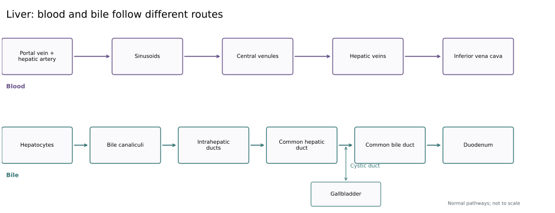

### 확인 문제

문맥과 간정맥의 관계로 옳은 것은?

A. 둘은 간문으로 들어오는 같은 유입 혈관의 두 이름이다.
B. 주요 간정맥은 문맥 가지와 항상 동일한 구역 중심을 지난다.
C. 문맥은 간 유입, 간정맥은 아래대정맥으로의 유출에 관여한다.

**정답: C**

간 구역 중심의 유입 구조와 구역 사이 유출 경로를 구별한다.

**오답 해설**

A: 이 선택지는 해당 구조의 관계를 잘못 설명한다. 간 구역 중심의 유입 구조와 구역 사이 유출 경로를 구별한다.

B: 이 선택지는 해당 구조의 관계를 잘못 설명한다. 간 구역 중심의 유입 구조와 구역 사이 유출 경로를 구별한다.

## 담낭·담관·이자의 관과 혈관 관계

### 학습목표

- 담즙 이동과 담관·이자관 합류를 설명한다
- 간담도삼각과 혈관 변이를 구분한다
- 이자 부위별 인접 혈관과 폐쇄 증상을 연결한다

### 간에서 장으로 이어지는 관

오른간관과 왼간관은 간 속 담즙을 모아 온간관(common hepatic duct)으로 이어지고, 담낭관(cystic duct)이 합류한 뒤 온담관(common bile duct)이 된다. 담낭관을 통한 이동은 담낭을 채울 때와 비울 때 방향이 달라질 수 있다. 담즙은 간에서 생성되며 담낭은 이를 저장·농축하고 필요할 때 배출한다. 담낭이 담즙을 처음 만들어 내는 기관은 아니다.

담낭(gallbladder)은 바닥·몸통·목으로 구분하며 간의 내장면 오목에 놓인다. 목과 담낭관의 형태, 담낭관의 합류 높이와 방향에는 변이가 있다. 담낭관의 주름과 국소 팽창을 고정된 단일 괄약근 구조처럼 해석하지 않는다. 담석의 위치가 담낭 안인지 담낭관인지 온담관인지에 따라 통증, 염증 및 폐쇄 양상이 달라질 수 있다.

### 간담도삼각의 경계

간담도삼각(hepatocystic triangle)은 담낭관, 온간관과 간의 아래면을 경계로 설명하는 수술 해부학적 영역이다. 원래 Calot 삼각의 정의에서 담낭동맥을 경계로 사용한 방식과 혼용되므로 어떤 경계를 뜻하는지 분명히 한다. 단순히 삼각이라는 이름을 외우는 것보다 실제 관과 동맥을 구분하는 것이 중요하다.

담낭동맥(cystic artery)은 흔히 오른간동맥 계통에서 나와 이 부위에 관계되지만 기원과 분지 및 경로에 변이가 있다. 염증과 유착은 평소의 관 위치를 바꾸거나 구조를 붙여 보이게 할 수 있다. 예상 위치에 관처럼 보이는 구조 하나가 있다는 이유만으로 담낭관을 확정해서는 안 된다. 담낭과 간의 접촉면 및 담도·혈관의 전체 연결을 확인하는 원리가 수술 중 구조 오인의 예방과 연결된다.

### 온담관과 샘창자

온담관은 간샘창자인대 속을 내려가 샘창자 첫 부분 뒤쪽을 지나 이자머리 부근과 관계한다. 흔히 주이자관과 합류해 간이자팽대(hepatopancreatic ampulla)를 이루고 샘창자 둘째 부분의 큰유두로 열린다. 합류 형태와 관이 함께 지나는 길이에는 차이가 있고 각각 열리는 형태도 가능하다. 정상 해부를 설명할 때 가장 흔한 형태와 필수적인 동일 형태를 구별한다.

팽대부와 관련 괄약 근육은 담즙과 이자액 배출을 조절한다. 이 부위의 돌이나 종괴는 담도와 이자관 양쪽의 흐름에 영향을 줄 수 있다. 담낭에만 문제가 있을 때와 온담관 또는 유두 부위가 막힐 때의 차이는 관의 합류 위치로 설명된다. 황달과 담관 확장이 있다고 폐쇄 원인과 위치가 자동으로 같은 질환으로 확정되는 것은 아니다.

### 이자의 네 부위

이자(pancreas)는 머리·목·몸통·꼬리로 구분되고 머리는 샘창자의 C자 굽이에 둘러싸인다. 갈고리돌기(uncinate process)는 위창자간막혈관 뒤쪽과 관계하고 목 뒤에는 문맥 형성 부위가 놓이는 전형적인 배열을 보인다. 몸통은 위 뒤쪽에서 왼쪽으로 뻗으며 꼬리는 지라문 방향으로 이어진다. 앞쪽 장기의 이름만 보지 않고 큰혈관에 대한 앞뒤 관계를 확인한다.

이자는 대부분 이차성 뒤복막 장기지만 꼬리의 지라콩팥인대 관계는 구별한다. 위와 이자 사이에는 작은주머니가 있어 위 뒤쪽 병변과 이자 앞쪽 액체가 같은 단면에서 가까이 보일 수 있다. 이자머리 주변의 아래대정맥과 오른콩팥혈관 부위, 몸통 뒤의 대동맥과 왼콩팥혈관 및 지라정맥은 종괴 범위와 염증 확산을 평가하는 데 중요하다.

### 관과 발생학적 연결

주이자관(main pancreatic duct)은 꼬리 쪽에서 머리로 배액을 모아 샘창자로 이어진다. 부이자관은 작은유두를 통해 배출될 수 있으나 개방 여부와 역할에는 변이가 있다. 내분비 이자는 혈액으로 호르몬을 분비하고 외분비 이자는 선방세포에서 만든 분비물을 관으로 내보낸다. 주이자관이 모든 이자 호르몬을 장으로 운반하는 것은 아니다.

등쪽과 배쪽 이자싹의 회전·합류는 성인 관과 조직의 배열을 만든다. 합류 과정의 차이는 관 분리나 샘창자를 둘러싼 조직 고리와 같은 발생 이상을 설명하는 바탕이다. 이러한 변이를 일반적인 종괴와 혼동하지 않고 관의 실제 연결을 확인한다. 발생 기전은 형태를 설명하지만 증상 유무와 치료 필요성을 단독으로 결정하지 않는다.

### 혈액 공급과 정맥 회수

이자머리와 샘창자에는 위·아래이자샘창자동맥의 연결망이 중요하다. 위쪽은 위샘창자동맥과 복강동맥 계통, 아래쪽은 위창자간막동맥 계통에 연결된다. 몸통과 꼬리는 지라동맥의 여러 이자 가지로 공급받는다. 따라서 이자 전체를 단일 끝동맥 영역으로 표시하는 도식은 실제 연결을 충분히 반영하지 못한다.

이자 정맥은 지라정맥과 위창자간막정맥 등 문맥계로 이어진다. 특히 지라정맥은 이자 뒤쪽과 가까워 염증이나 종괴에 영향을 받을 수 있다. 동맥 공급이 보존되어도 정맥 회수 장애가 생길 수 있으며, 문맥계의 어떤 구간이 막히는지에 따라 주변 정맥압의 범위가 달라진다. 혈관 이름뿐 아니라 합류 순서와 장기 접촉을 함께 이해한다.

### 림프·신경과 임상 연결

림프는 이자·지라 및 샘창자 주위 림프절과 복강·위창자간막 계통으로 이어진다. 자율신경은 관련 신경얼기를 통해 분비와 혈관 반응 등을 조절하고 내장감각은 위배와 등 쪽 불편에 연결될 수 있다. 통증이 등에 느껴진다는 이유만으로 척주 질환 또는 이자 질환 하나를 바로 확정하지 않는다. 감각 경로는 다른 장기와 겹치며 구조적 검사가 필요할 수 있다.

담낭·담관·이자는 각각 독립된 기관이지만 관의 합류와 공통 혈관 및 좁은 공간 때문에 한 부위의 병변이 여러 기능을 바꿀 수 있다. 학습에서는 혈액의 흐름, 담즙과 이자액의 흐름 및 림프 배액을 서로 다른 선으로 그려 본다.

### 확인 문제

담즙의 생성·저장에 관한 설명으로 옳은 것은?

A. 이자 내분비 호르몬은 온담관을 거쳐 장으로만 분비된다.
B. 간이 생성하고 담낭이 저장·농축 및 배출에 참여한다.
C. 담낭이 모든 담즙을 처음 합성한다.

**정답: B**

담즙 흐름과 이자액 흐름 및 혈중 호르몬 분비는 서로 다른 경로이다.

**오답 해설**

A: 이 선택지는 해당 구조의 관계를 잘못 설명한다. 담즙 흐름과 이자액 흐름 및 혈중 호르몬 분비는 서로 다른 경로이다.

C: 이 선택지는 해당 구조의 관계를 잘못 설명한다. 담즙 흐름과 이자액 흐름 및 혈중 호르몬 분비는 서로 다른 경로이다.

## 지라의 인대·혈관·주변 장기와 손상

### 학습목표

- 지라와 왼쪽 갈비뼈·이자꼬리의 관계를 설명한다
- 지라의 혈류와 문맥계 배액을 연결한다
- 림프기관의 기능과 외상·절제의 임상 의미를 연결한다

### 왼위배의 혈액성 림프기관

지라(spleen)는 왼위배에서 가로막 아래, 위와 왼콩팥 및 이자꼬리와 가까이 놓인 림프기관이다. 림프절이 림프를 받아 여과하는 구조라면 지라는 혈액 속 세포와 항원을 다루는 기능이 중요하다. 정상적으로 왼쪽 아래 갈비뼈 뒤에 보호되며 호흡에 따라 위치가 달라진다. 정상 크기와 촉진 여부는 체격과 검사 조건의 영향을 받는다.

가로막면은 볼록하고 내장면에는 위·콩팥·잘록창자 등과의 접촉 관계가 나타난다. 지라문(hilum)에는 혈관과 신경 및 림프관이 드나들고 이자꼬리가 가까이 온다. 지라를 주변 장기에서 분리할 때 짧은 연결만 보지 않고 지라문 뒤쪽과 인대 속 구조를 확인해야 하는 이유이다. 지라의 위치는 왼쪽 폐와 가슴막 및 가로막을 사이에 둔 흉부 손상과도 연결된다.

### 복막과 인대

지라는 복막내장기로 분류되며 지라문을 제외한 많은 표면이 장측복막으로 덮인다. 위지라인대(gastrosplenic ligament)는 위 큰굽이와 지라 사이를 연결하고 짧은위혈관 및 왼위그물막혈관과 관계된다. 지라콩팥인대(splenorenal ligament)는 뒤벽의 왼콩팥 부위와 연결되며 지라혈관과 이자꼬리의 관계가 중요하다. 이들 인대는 혈관이 없는 장식성 끈이 아니다.

발생 중 등쪽위간막 안에서 지라 조직이 형성되고 위의 회전과 주변 복막의 변형이 성인 위치에 기여한다. 지라는 간이나 이자의 분비상피처럼 앞창자의 내배엽성 싹에서 직접 만들어지는 기관으로 설명하지 않는다. 지라 주변의 복막과 위·이자 관계가 비슷하다고 세 기관의 발생 기원이 동일한 것은 아니다.

### 동맥의 굴곡과 구역

지라동맥(splenic artery)은 복강동맥 계통에서 나와 이자 위쪽 모서리 부근을 따라 굴곡진 경로로 왼쪽으로 간다. 이자 가지와 위 쪽의 가지를 내며 지라문 부근에서 여러 가지로 나뉜다. 실질 안의 분지 영역은 국소 절제와 경색을 이해하는 기준이 될 수 있으나 실제 분지에는 변이가 있다. 큰 한 동맥이 지라 전체를 공급한다는 것과 조직 내 모든 부위가 풍부하게 서로 대체 공급된다는 것은 다른 말이다.

동맥혈은 백색속질과 적색속질의 미세순환에 연결되어 혈액의 면역 감시와 노화·비정상 적혈구 처리에 관여한다.  거시 혈관 지도와 조직학적 여과 과정을 나누어 학습한 뒤 연결한다.

### 지라정맥과 문맥계

지라정맥(splenic vein)은 지라문에서 나와 이자 뒤쪽을 따라 오른쪽으로 가고 위창자간막정맥과 합쳐 문맥을 이루는 전형적 경로를 보인다. 위와 이자 및 아래창자간막 계통의 유입 관계에는 변이가 있다. 이자 병변이 지라정맥에 영향을 줄 수 있는 이유는 같은 뒤쪽 공간에서의 긴 접촉 관계에 있다.

문맥압 상승 또는 국소적인 정맥 회수 장애는 지라의 크기와 주변 정맥에 영향을 줄 수 있다. 지라가 크다고 모든 환자가 같은 혈구 감소를 보이는 것은 아니며, 혈액질환·감염과 침윤 등 다른 원인도 있다. 장기 크기, 혈구 변화 및 정맥압 문제를 연결하되 단일 소견을 곧바로 하나의 질환으로 바꾸지 않는다.

### 피막과 혈액세포 처리

지라는 결합조직 피막과 그 안으로 이어지는 섬유기둥 및 혈관을 가진다. 적색속질은 혈액세포 처리와 회수, 백색속질은 림프구 반응과 관련된다. 면역 기능과 여과 기능이 한 장기 안에 있어 비정상 적혈구의 제거, 특정 감염 방어와 장기 비대가 서로 연결될 수 있다. 혈구를 제거하는 기관이라는 설명만으로 정상 지라의 모든 기능을 포괄하지 않는다.

지라 기능이 소실되면 특정 세균 감염에 대한 방어가 약해질 수 있어 예방과 환자 교육이 중요해진다. 예방접종의 실제 종류와 시점 및 항균 예방 전략은 환자의 나이와 질환 및 적용 지침을 따로 확인해야 한다. 정상 위치를 배우는 해부학 절에서 미확인된 일정이나 용량을 고정해 제시하지 않는다.

### 외상과 주변 손상

왼쪽 아래 갈비뼈의 손상은 가로막 아래 지라 손상과 함께 나타날 수 있다. 피막과 실질의 손상 및 혈관 손상은 배안 출혈로 이어질 수 있고, 손상 후 순환 상태와 시간 경과가 중요하다. 표면 상처가 없다는 사실이나 초기 통증이 약하다는 사실만으로 내부 출혈을 배제하지 않는다. 실제 평가는 활력, 진찰과 적절한 영상 및 반복 관찰을 통합한다.

가로막 부근 자극이 왼쪽 어깨의 연관통으로 나타날 수 있지만 어깨 통증이 곧 지라 손상을 확정하는 징후는 아니다. 지라 절제나 주변 수술에서는 위지라인대 속 위혈관과 지라문 가까운 이자꼬리를 보존·처리하는 관계가 중요하다. 지라를 떼어내는 수술을 장기 한 덩어리만 분리하는 일로 생각하면 인접 장기의 위험을 놓친다.

### 변이와 영상

부지라(accessory spleen)는 정상 지라 조직이 별도 결절로 존재하는 발생 변이로 지라문 주변이나 관련 인대 부근 등에서 볼 수 있다. 림프절 또는 다른 종괴와 감별이 필요하고 특정 혈액질환 수술 후 잔여 기능을 평가할 때 의미가 있을 수 있다.  실제 조직과 영상 특성의 확인이 필요하다.

지라를 영상에서 찾을 때에는 가로막과 왼콩팥, 위 및 이자꼬리를 기준으로 삼고 조영 시점과 혈관 분포를 고려한다. 좌우 위치가 전형적이지 않은 환자에서는 다른 장기의 배열도 함께 확인한다. 정상 해부학은 대표 위치를 제공하지만 개인의 변이를 배제하는 규칙은 아니다.

### 확인 문제

지라 수술에서 이자꼬리의 관계가 중요한 이유는?

A. 지라문과 지라콩팥인대 속 혈관 부근에 가까이 놓이기 때문이다.
B. 이자꼬리가 정상적으로 지라 안의 소변길이기 때문이다.
C. 두 장기는 항상 넓은 뼈벽으로 완전히 분리되기 때문이다.

**정답: A**

지라의 혈관·인대와 이자꼬리의 가까운 관계가 인접 손상 위험을 설명한다.

**오답 해설**

B: 이 선택지는 해당 구조의 관계를 잘못 설명한다. 지라의 혈관·인대와 이자꼬리의 가까운 관계가 인접 손상 위험을 설명한다.

C: 이 선택지는 해당 구조의 관계를 잘못 설명한다. 지라의 혈관·인대와 이자꼬리의 가까운 관계가 인접 손상 위험을 설명한다.

## 빈창자·돌창자·잘록창자와 장간막혈관

### 학습목표

- 작은창자와 큰창자의 육안 특징을 비교한다
- 위·아래창자간막혈관의 영역과 연결을 설명한다
- 장관의 위치·벽·장간막과 폐쇄·허혈을 연결한다

### 작은창자의 연속성과 구역 차이

빈창자(jejunum)와 돌창자(ileum)는 샘빈창자굽이에서 돌막창자연결부로 이어지는 작은창자의 긴 구간이다. 두 구간 사이에 육안으로 하나의 명확한 경계선이 있는 것은 아니다. 전형적으로 빈창자에서는 벽과 돌림주름이 더 발달하고 장간막 지방과 혈관궁의 배열이 돌창자와 다르다. 위치와 혈관 모양을 한 가지 특징만으로 확정하지 않고 여러 단서를 종합한다.

장간막혈관에서 나오는 곧은혈관(vasa recta)은 장벽으로 들어가며 혈관궁(arterial arcade)은 장간막 안에서 연결된다. 빈창자는 비교적 적은 겹의 궁과 긴 곧은혈관, 돌창자는 더 많은 궁과 짧은 곧은혈관이라는 대표적 차이를 보인다. 이는 평균적인 경향이며 모든 고리에서 일정하지는 않다. 장벽으로 가는 최종 작은 혈관이 손상되면 몸쪽 궁이 남아 있어도 국소 관류가 제한될 수 있다.

### 장간막과 이동성

작은창자 장간막은 뒤배벽의 부착선에서 장의 긴 가장자리로 펼쳐져 동맥·정맥·신경과 림프관을 전달한다. 장 고리는 자유롭게 움직이지만 뿌리의 혈관과 연결되어 있다. 폐쇄에서 장이 늘어나면 벽과 장간막의 정맥 회수가 먼저 영향을 받을 수 있고, 심하면 동맥 유입과 장벽 생존도 손상된다. 단순한 속공간 막힘과 혈관이 함께 눌린 상황을 구분해야 한다.

돌창자에는 집합 림프소절과 면역 기능의 특징이 있고 말단부의 담즙산·비타민 B12 흡수는 기능적 위치와 연결된다. 장의 길이와 점막 표면적뿐 아니라 어떤 구간을 잃었는지도 흡수 장애를 결정한다. 같은 길이의 절제라도 기능적 영향이 같지 않은 이유이다. 장간막의 손상 범위와 남은 혈류도 함께 고려한다.

### 막창자·충수와 큰창자의 표지

막창자(cecum)는 돌창자 연결부 아래의 주머니 부위이고 충수(vermiform appendix)는 여기서 뻗는다. 잘록창자띠(taeniae coli), 주머니 모양의 팽대와 지방수(omental appendices)는 큰창자를 식별하는 대표 표지이다. 충수바닥은 잘록창자띠가 모이는 관계가 유용하지만 충수끝의 방향은 다양하다. 뒤쪽·골반 쪽 등 위치 차이가 염증의 통증과 진찰 소견에 영향을 줄 수 있다.

충수는 장간막의 작은 주름을 통해 혈관을 받고 충수동맥은 대체로 돌잘록창자동맥 계통과 연결된다. 장기 위치가 달라져도 초기 내장감각과 후기 벽측복막 자극의 경로는 구분한다. 오른아랫배에 통증이 없다는 이유만으로 모든 위치의 충수염을 배제할 수는 없으며 다른 원인도 함께 감별한다.

### 잘록창자의 고정과 굽이

오름·내림잘록창자는 전형적으로 뒤벽에 붙은 이차성 뒤복막 관계가 중요하고, 가로잘록창자와 구불잘록창자는 장간막을 가져 더 가동성이 있다. 오른·왼잘록창자굽이는 간 및 지라와의 위치 관계를 반영한다. 좌우 굽이의 높이와 고정 및 인대 관계는 같지 않다. 장의 팽창이나 수술 뒤에는 위치가 달라질 수 있다.

구불잘록창자는 가동성 있는 고리와 장간막 부착의 관계 때문에 꼬임이 생길 수 있는 부위이다. 직장으로 이어지면서 잘록창자띠와 지방수 등 대표 표지가 바뀐다. 직장을 잘록창자의 특징을 그대로 가진 곧은 마지막 구간으로만 이해하면 복막 덮임과 혈관·신경 및 골반 관계를 놓칠 수 있다.

### 위창자간막동맥 영역

위창자간막동맥(superior mesenteric artery, SMA)은 중간창자 영역의 대표 동맥으로 샘창자의 먼쪽 및 이자머리 일부와 작은창자, 막창자·충수 및 오른쪽 큰창자 영역 등에 공급한다. 아래이자샘창자, 빈창자·돌창자 가지와 돌잘록창자·오른잘록창자·중간잘록창자 계통을 구분한다. 오른잘록창자동맥 등의 기원과 존재 형태는 변이가 있어 전형적인 분지 수가 모든 사람에게 그대로 적용되지 않는다.

SMA는 이자목 뒤쪽 부근에서 앞으로 나와 샘창자 셋째 부분 및 장간막 뿌리와 관계된다. 위창자간막정맥은 동맥과 나란한 영역을 지나 문맥 형성에 참여한다. 동맥과 정맥의 앞뒤·좌우 관계를 영상에서 확인하는 것은 장회전 및 종괴 평가에 도움을 준다. 정상적인 가까운 위치와 병적인 침범·압박을 구분한다.

### 아래창자간막동맥과 곁순환

아래창자간막동맥(inferior mesenteric artery, IMA)은 왼잘록창자, 구불잘록창자 및 위직장동맥 계통으로 이어져 뒤창자 영역의 많은 부분을 공급한다. 변연동맥(marginal artery)은 잘록창자 가장자리를 따라 여러 가지를 연결한다. SMA와 IMA 영역의 연결 정도와 작은 혈관 분포는 개인에 따라 달라 한 몸쪽 혈관이 막혀도 항상 충분히 대체되는 것은 아니다.

왼잘록창자굽이와 직장구불 부근은 혈액 공급 경계와 관련하여 허혈 취약성을 논의하는 대표 부위이다. 그러나 실제 허혈의 범위는 저관류, 색전·혈전, 정맥 폐쇄와 곁순환 및 기저 혈관 상태에 좌우된다. 혈관 지도의 경계선 하나만으로 모든 허혈성 장질환의 위치를 예측하지 않는다.

### 정맥·림프·자율신경

작은창자와 잘록창자의 많은 정맥은 위·아래창자간막 계통을 거쳐 문맥계로 이어진다. 직장 아래쪽에서는 체정맥계와의 연결이 추가되어 위쪽과 동일한 회수만을 갖지 않는다. 림프는 장벽 주변과 장간막 림프절을 지나 큰혈관 기시 주변으로 이어지는 단계가 중요하다. 종양 수술에서 혈관과 림프의 해부를 함께 확인하는 이유이다.

미주신경과 골반내장신경의 부교감 기여 및 교감신경얼기는 발생학적 영역과 관련하여 분포가 달라진다. 내장감각과 체성 복막감각은 통증의 위치와 성격을 다르게 만들 수 있다. 장의 기능을 혈관 공급 영역만으로 설명하지 않고 신경·림프 및 장벽의 층을 함께 연결한다. 해부학적 위치와 실제 관류·운동 상태는 서로 보완하는 정보이다.

### 확인 문제

변연동맥의 존재가 뜻하는 것은?

A. 모든 장 부위의 허혈이 원천적으로 불가능하다.
B. 정맥 폐쇄는 장벽에 영향을 주지 않는다.
C. 잘록창자 혈관의 연결이 있지만 모든 급성 폐색을 보상하지는 못한다.

**정답: C**

연결의 정도와 유량 및 최종 분지·정맥 상태를 함께 보아야 실제 관류를 평가할 수 있다.

**오답 해설**

A: 이 선택지는 해당 구조의 관계를 잘못 설명한다. 연결의 정도와 유량 및 최종 분지·정맥 상태를 함께 보아야 실제 관류를 평가할 수 있다.

B: 이 선택지는 해당 구조의 관계를 잘못 설명한다. 연결의 정도와 유량 및 최종 분지·정맥 상태를 함께 보아야 실제 관류를 평가할 수 있다.

## 콩팥·부신·요관과 뒤배벽

### 학습목표

- 콩팥문·콩팥굴·요로의 연속을 설명한다
- 좌우 콩팥혈관과 요관의 인접 관계를 비교한다
- 요관의 혈액 공급과 수술 손상 위험을 연결한다

### 뒤복막에서의 좌우 위치

콩팥(kidney)은 척주 양쪽의 뒤복막에 놓이고 간의 관계 때문에 오른쪽이 왼쪽보다 낮은 전형적 배열을 보인다. 뒤쪽에는 가로막과 큰허리근·허리네모근 등의 구조가 관계하고 앞쪽 접촉 장기는 좌우가 다르다. 오른콩팥은 간과 샘창자 및 오른쪽 잘록창자, 왼콩팥은 위·지라·이자 및 왼쪽 장관 부위와의 관계가 중요하다. 장기 표면이 모두 같은 두께의 복막으로 둘러싸여 배안에 떠 있는 것은 아니다.

섬유성 피막과 콩팥 주위 지방 및 콩팥근막은 서로 다른 층이다. 지방은 완충과 위치 유지에 기여하고 근막과 주변 공간은 출혈이나 염증의 확산 범위에 영향을 준다. 정상 크기와 높이는 호흡, 체격과 변이에 따라 달라진다. 표면의 갈비척추각 압통은 콩팥·요로 문제의 단서가 될 수 있지만 그 부위의 다른 구조도 통증을 만들 수 있다.

### 콩팥문에서 소변길까지

안쪽 오목한 부위의 콩팥문(renal hilum)은 혈관과 신경·림프 및 콩팥깔때기(renal pelvis)가 출입하는 영역이다. 전형적으로 큰 정맥이 앞쪽, 동맥이 그 뒤, 깔때기 쪽이 더 뒤에 놓이는 관계가 학습 기준이 된다. 분지와 변이가 있어 모든 단면에서 세 구조가 하나씩 같은 순서로 보이는 것은 아니다. 콩팥굴(renal sinus)은 안쪽의 공간으로 지방과 혈관 및 작은·큰콩팥잔 등을 포함한다.

겉질(cortex)과 속질(medulla)은 육안과 조직학에서 구분된다. 콩팥피라미드 끝의 유두로 모인 소변은 작은콩팥잔, 큰콩팥잔과 콩팥깔때기를 거쳐 요관으로 이어진다. 피라미드 사이의 콩팥기둥은 단순한 섬유성 격벽이 아니라 겉질 조직이 안쪽으로 이어진 부분이다. 여과를 만드는 실질과 이미 형성된 소변이 모이는 공간을 구분한다.

### 동맥 분지와 끝혈관 영역

콩팥동맥은 배대동맥에서 나와 구역동맥과 그 아래 분지로 이어진다. 콩팥의 구역별 동맥은 기능적으로 끝동맥 성격이 중요해 한 분지가 막힐 때 국소 경색이 생길 수 있다. 부콩팥동맥이나 다수 동맥은 드문 예외로 무시할 수 없는 변이이며 수술·이식에서 확인이 필요하다. 작은 추가 동맥이라는 이유로 공급 영역이 중요하지 않다고 판단해서는 안 된다.

오른콩팥동맥은 아래대정맥 뒤쪽을 지나는 전형적 관계가 있고, 왼콩팥정맥은 대동맥 앞쪽을 가로질러 아래대정맥으로 간다. 왼콩팥정맥은 위창자간막동맥과 대동맥 사이 및 왼생식샘·부신정맥과의 유입 관계가 중요하다. 뒤쪽 대동맥 경로 또는 둘레 경로 같은 변이도 가능하다. 혈관이 압박될 수 있는 정상 위치를 안다는 사실과 실제 증후군을 진단하는 것은 구분한다.

### 부신은 콩팥의 한 부분이 아니다

부신(adrenal gland)은 콩팥 위쪽과 관계되지만 다른 발생·기능을 가진 별도 내분비기관이다. 여러 동맥 공급과 상대적으로 집중된 정맥 유출이 특징이며 오른부신정맥은 짧게 아래대정맥에, 왼쪽은 왼콩팥정맥 계통에 연결되는 대표적 차이를 보인다. 오른쪽과 왼쪽 수술에서 혈관 관계를 같은 거울상으로 단순화하지 않는다.

부신겉질과 속질은 각각 스테로이드 생성 및 카테콜아민 분비의 기능이 다르다. 겉질의 중배엽 기원과 속질의 신경능선 계통을 구분하면 다른 세포 성분과 종양의 기원을 이해할 수 있다. 콩팥 위에 있다는 위치 때문에 여과액이나 소변이 부신을 통과한다고 설명하지 않는다. 콩팥과 부신은 혈관·신경 및 호르몬 작용으로 연결된다.

### 요관의 주행과 인접 구조

요관(ureter)은 콩팥깔때기에서 시작해 큰허리근 앞쪽의 뒤복막을 내려가 골반 가장자리를 건너고 골반 가쪽벽을 따라 방광으로 들어간다. 생식샘혈관은 복부 구간에서 요관 앞을 가로지르는 관계가 중요하다. 골반 가장자리에서의 엉덩혈관과 요관의 교차 형태에는 변이가 있다. 한 점의 외형만으로 요관을 확정하기보다 위아래 연속성을 따라 확인한다.

여성 골반에서는 자궁동맥이 요관 위를 가로지르는 자궁목 부근 관계가 중요하고, 남성에서는 정관이 요관 위를 지나 방광 뒤쪽으로 이어지는 관계가 중요하다. 같은 골반 수술에서도 인접한 관과 혈관이 다르므로 두 성의 장기 위치를 무조건 같은 것으로 표시하지 않는다. 방광벽 속을 비스듬히 통과하는 요관 구간은 역류 억제에 기여한다.

### 생리적 좁은 부위와 혈액 공급

콩팥깔때기요관이음부, 골반 가장자리의 교차 구간 및 방광벽 진입부는 요관의 좁아짐을 설명할 때 사용하는 대표적 부위이다. 실제 결석의 걸림 위치와 협착은 개인의 구조 및 병적 변화에 따라 다르다. 세 지점만 외웠다고 모든 폐쇄를 예측할 수는 없다. 요관벽의 민무늬근 연동은 소변 이동에 기여하며 중력만으로 흐르는 단순 배수관과 다르다.

요관은 콩팥·대동맥·생식샘·엉덩·방광 및 자궁 쪽 혈관 등에서 구간별 가지를 받고 벽 주변에서 세로로 연결된다. 주변 조직을 과도하게 벗기면 이 공급을 해칠 수 있다. 혈액 공급을 보존하는 문제는 요관을 절단하지 않는 것만으로 끝나지 않는다. 정맥과 림프 배액도 구간에 따라 깊은 배·골반 림프절 계통과 관계된다.

### 발생과 증상 해석

콩팥의 위치 변화와 회전 및 혈관 재배열의 발생 과정은 말굽콩팥, 골반콩팥과 여러 혈관 변이를 이해하는 바탕이다. 요관싹과 뒤콩팥 중간엽의 상호작용은 집합계와 네프론의 다른 발생 기여를 만든다. 집합관과 여과·세뇨관 구조가 모두 같은 싹에서 동일하게 생긴다고 정리하지 않는다.

요관의 내장감각은 옆구리에서 아랫배·샅부위로 느껴지는 연관통과 연결될 수 있다. 통증 위치와 혈뇨는 단서이지만 결석만의 확정 증거는 아니다. 한쪽 폐쇄에서는 반대쪽 콩팥 때문에 혈액의 전체 기능 수치가 비교적 유지될 수도 있어 정상 크레아티닌이 국소 폐쇄를 배제하지 않는다. 거시 위치와 혈액·소변 검사 및 적절한 영상을 함께 연결한다.

### 확인 문제

요관의 혈액 공급에 관한 설명으로 옳은 것은?

A. 주변 결합조직을 모두 벗겨도 공급에는 영향이 없다.
B. 구간별 작은 가지와 벽 주변의 세로 연결을 보존하는 것이 중요하다.
C. 배 전체에서 하나의 독립 끝동맥만 받는다.

**정답: B**

요관을 끊지 않았더라도 주변 혈관망을 손상하면 허혈 위험이 생길 수 있다.

**오답 해설**

A: 이 선택지는 해당 구조의 관계를 잘못 설명한다. 요관을 끊지 않았더라도 주변 혈관망을 손상하면 허혈 위험이 생길 수 있다.

C: 이 선택지는 해당 구조의 관계를 잘못 설명한다. 요관을 끊지 않았더라도 주변 혈관망을 손상하면 허혈 위험이 생길 수 있다.

## 골반바닥·샅과 골반 장기의 지지

### 학습목표

- 골반가로막과 샅막·샅중심체를 구분한다
- 배설 조절의 체성·자율신경 경로를 비교한다
- 골반 장기의 위치와 지지 손상을 연결한다

### 바닥은 단단히 막힌 한 장의 막이 아니다

골반바닥(pelvic floor)은 근육과 근막 및 결합조직이 장기를 받치면서 요도·직장과 생식기관의 통로를 허용하는 복합체이다. 항문올림근(levator ani)과 꼬리근(coccygeus)을 중심으로 한 골반가로막(pelvic diaphragm)이 중요하며 그 아래의 샅막과 샅중심체는 다른 구조이다. 여러 층이 모두 같은 위치의 하나의 판이라는 인상을 주지 않도록 위아래 관계와 통과 기관을 구분한다.

복압이 증가할 때 지지 구조는 압력을 견디면서 배설 통로의 닫힘을 유지해야 한다. 배뇨와 배변에서는 반대로 적절한 이완과 장기의 수축이 협동해야 한다. 근육이 강하게 수축하는 것만이 모든 골반바닥 기능의 목표는 아니다. 과도한 긴장이나 이완의 협동 장애도 증상을 만들 수 있다.

### 항문올림근의 구성

항문올림근은 두덩곧창자근(puborectalis), 두덩꼬리근(pubococcygeus)과 엉덩꼬리근(iliococcygeus) 등의 부위로 구분한다. 이 구분은 유용하지만 섬유다발이 서로 겹치고 이름의 범위가 교재와 연구에서 일부 다를 수 있다. 두덩뼈 및 골반 가쪽벽의 힘줄활 부근에서 시작해 정중부와 꼬리뼈 및 통과 장기 주변의 연결로 이어진다. 뼈에서 뼈로 직선 하나가 달리는 근육과 다른 형태이다.

두덩곧창자근은 항문직장연결부 뒤를 감싸는 고리 모양의 작용으로 항문직장각과 변 유지에 기여한다. 이완과 골반바닥의 내려감은 배변 때 통로를 여는 과정에 참여한다. 꼬리근은 뒤쪽 지지에 기여하고 궁둥뼈가시 및 엉치·꼬리뼈와 관계된다. 관찰된 각도 하나만으로 변실금이나 배변장애를 모두 설명하지 않고 근육·신경과 다른 조직을 함께 본다.

### 샅의 두 삼각과 샅중심체

샅(perineum)은 골반 출구 아래의 영역으로 양쪽 궁둥뼈결절을 잇는 기준에 의해 앞의 비뇨생식삼각과 뒤의 항문삼각으로 나누어 설명한다. 샅막(perineal membrane)은 앞쪽 영역의 결합조직 지지에 중요하며 요도와 여성의 질 등 통로의 관계가 다르다. 오래된 비뇨생식가로막이라는 단일 판 모형만으로 성별·층별 실제 배열을 완전히 설명하기는 어렵다.

샅중심체(perineal body)는 정중부에서 여러 근육과 결합조직이 연결되는 지지 부위이다. 출산이나 외상 및 수술의 손상은 질·항문 부근 지지와 기능에 영향을 줄 수 있다. 하지만 모든 골반장기탈출이 샅중심체 하나의 파열로 발생하는 것은 아니다. 근육 부착, 신경과 장기 사이 결합조직의 복합적 상태가 중요하다.

### 음부신경과 직접 근육가지

음부신경(pudendal nerve)은 주로 S2~S4 기여를 받아 샅 감각과 바깥요도·바깥항문조임근 등 체성 기능에 관계된다. 큰궁둥구멍을 나와 궁둥뼈가시·엉치가시인대 부근을 돌아 작은궁둥구멍을 통해 샅으로 들어가는 경로 및 속폐쇄근막의 음부신경관이 중요한 표지이다. 골반에서 나오는 모든 신경이 같은 통로로 지나가는 것은 아니다.

항문올림근의 운동 지배에는 주로 엉치신경의 직접 가지와 항문올림근신경이 중요하며 음부신경 계통의 추가 기여와 변이도 구분한다. 골반바닥의 모든 가로무늬근을 음부신경 하나가 똑같이 지배한다고 단정하지 않는다. 장기 주변의 자율신경얼기가 가까이 있다는 사실과 가로무늬근의 체성 운동 지배는 다른 질문이다.

### 골반내장신경과 아래아랫배신경얼기

골반내장신경(pelvic splanchnic nerves)은 S2~S4에서 나오는 부교감 경로로 방광과 직장 및 생식 기능 등에 관여한다. 아랫배신경과 교감 계통 및 골반내장신경은 아래아랫배신경얼기(inferior hypogastric plexus) 부근에서 여러 장기로 연결된다. 이 얼기는 순수 교감신경만의 덩어리가 아니며 체성 음부신경과도 구별한다.

방광 저장·배출, 직장 운동과 성기능은 자율신경 및 체성 조임근의 협동을 필요로 한다. 골반 수술에서 장기 자체가 보존되어도 주변 신경이 손상되면 배뇨나 성기능이 달라질 수 있다. 신경을 도식의 한 줄로만 보고 수술면에서의 위치를 생각하지 않으면 장기 제거 범위와 기능 변화의 관계를 이해하기 어렵다.

### 장기 위치와 복막 오목

방광은 앞쪽 두덩결합 뒤에 놓이고 직장은 뒤쪽 엉치뼈 앞과 관계한다. 남성에서는 방광 아래 전립샘과 뒤쪽 정낭 등이, 여성에서는 방광과 직장 사이의 질·자궁 관계가 중요하다. 방광의 충만과 자궁의 자세 및 직장 내용물에 따라 인접 장기의 상대 위치가 변할 수 있다.

복막은 장기 사이에서 반전되어 남성의 직장방광오목, 여성의 방광자궁오목과 직장자궁오목 등을 만든다. 골반에서 액체가 고이는 위치는 성별과 자세 및 해부 변이에 영향을 받는다. 오목의 위치를 안다고 액체의 원인이 자동으로 결정되지는 않는다. 방광이나 직장의 일부 면이 복막 아래에 있다는 사실도 절개와 종양 확산의 층을 이해하는 데 중요하다.

### 혈관·림프와 지지 장애

속엉덩동맥 계통의 여러 가지가 골반 장기와 벽 및 샅을 공급하고, 속음부혈관은 음부신경과 가까운 통로로 샅에 이어진다. 분지의 순서와 공통줄기에는 변이가 많아 단일 고정 순서만으로 수술 해부를 판단하지 않는다. 정맥얼기와 림프 경로도 장기별로 달라 자궁몸통·자궁목 또는 직장과 항문관을 하나의 같은 배액 단위로 묶지 않는다.

골반장기탈출과 배설 장애를 평가할 때에는 장기의 위치뿐 아니라 지지 근육, 결합조직, 신경 및 통로의 기능을 나누어 본다. 증상이 있다고 모든 환자에게 동일한 지지 결손이 있는 것은 아니며 관찰된 하강과 실제 불편이 비례하지 않을 수 있다. 구조와 기능 및 환자의 경험을 함께 연결하는 것이 골반 해부의 임상적 적용이다.

### 확인 문제

항문올림근 운동 지배의 설명으로 적절한 것은?

A. 직접 엉치신경·항문올림근신경과 추가 기여를 구별한다.
B. 모든 골반바닥 근육은 순수 부교감신경만 지배한다.
C. 음부신경의 모든 가지는 내장감각만 전달한다.

**정답: A**

가로무늬근의 체성 운동과 장기 주변의 자율신경 및 샅의 음부신경 기능을 분리한다.

**오답 해설**

B: 이 선택지는 해당 구조의 관계를 잘못 설명한다. 가로무늬근의 체성 운동과 장기 주변의 자율신경 및 샅의 음부신경 기능을 분리한다.

C: 이 선택지는 해당 구조의 관계를 잘못 설명한다. 가로무늬근의 체성 운동과 장기 주변의 자율신경 및 샅의 음부신경 기능을 분리한다.

## 직장·항문관과 빗살선의 해부

### 학습목표

- 직장의 복막 덮임과 골반 관계를 설명한다
- 빗살선 위아래의 감각·혈관·림프 차이를 비교한다
- 조임근과 두덩곧창자근의 협동을 설명한다

### 직장은 단순히 곧은 잘록창자가 아니다

직장(rectum)은 구불잘록창자에서 항문관으로 이어지는 골반의 장관으로 엉치뼈의 굽이를 따르며 여러 굴곡을 보인다. 잘록창자의 세 띠는 직장에서 더 연속적인 바깥 근육층으로 이어지고 전형적 지방수와 주머니 배열도 달라진다. 속공간이 넓어지는 직장팽대는 변의 저장과 감각에 관계된다. 직장 길이의 정의와 시작점은 임상·영상의 기준에 차이가 있을 수 있어 사용하는 기준을 확인한다.

앞쪽 관계는 성별에 따라 다르다. 남성에서는 방광 뒤쪽과 정낭·전립샘 부위, 여성에서는 질과 자궁의 뒤쪽 관계가 중요하다. 뒤에는 엉치뼈와 앞엉치 공간 등이 있다. 주변 근막과 자율신경얼기는 수술에서 기능 보존 및 종양 범위 평가와 연결된다. 직장 벽의 종괴만 보고 주변의 결합조직·혈관·신경 경로를 생략하지 않는다.

### 복막 덮임과 직장간막

직장 위쪽은 앞·가쪽 면에 복막이 관계하고 더 아래로 갈수록 덮임이 줄어드는 전형적 배열을 보인다. 아래쪽 직장은 주로 복막 아래 공간에 놓인다. 따라서 병변의 높이에 따라 복막안으로의 확산과 골반 내 국소 관계가 달라질 수 있다. 직장 전체를 복막으로 완전히 싸인 동일한 원통이라고 생각하면 천공과 수술 접근을 잘못 이해한다.

직장간막(mesorectum)은 직장 주위의 지방·혈관·림프 및 결합조직을 포함하는 임상 해부학적 단위이다. 작은창자의 자유로운 장간막과 완전히 같은 모양의 막이라고 보지 않는다. 주변 근막의 평면과 신경 관계는 종양 수술에서 절제 범위와 기능 보존을 함께 이해하는 기준이 된다. 해부학적 경계와 실제 종양의 침범 경계는 영상과 병리로 대조한다.

### 항문관과 조임근

항문관(anal canal)은 직장과 피부의 연결 구간이며 해부학적·수술적 정의의 위쪽 경계가 다르게 기술될 수 있다. 속항문조임근(internal anal sphincter)은 민무늬근의 두꺼워진 부분이고, 바깥항문조임근(external anal sphincter)은 가로무늬근으로 체성 조절에 참여한다. 두 근육은 서로 다른 조직과 신경 조절을 가지며 한 개의 고리로 합쳐 생각하지 않는다.

두덩곧창자근은 항문직장연결부의 뒤를 감싸고 휴식 시 각도와 닫힘 유지에 기여한다. 변의 성질과 직장 감각, 조임근 및 골반바닥의 협동이 실금 방지에 중요하다. 근육 하나의 수축력만으로 모든 배변 기능을 설명할 수 없고 이완 시점의 조정도 필요하다. 배변 시 복압 증가와 직장 수축에 맞추어 출구가 적절히 이완해야 한다.

### 빗살선과 발생 기원의 전환

항문기둥 아래쪽의 판막들이 만드는 빗살선(pectinate line)은 위쪽 장관의 내배엽 계통과 아래쪽 항문오목의 외배엽 계통을 구분하는 중요한 표지이다. 주변 상피는 원주상피에서 이행부와 중층편평상피 및 피부로 바뀐다. 실제 현미경 경계와 점막의 기능은 한 눈금선처럼 완벽히 같은 위치에서 모든 성질이 동시에 전환되는 것은 아니다.

상피의 차이는 통증 감각과 혈관·림프 배액 차이를 학습하는 틀을 제공한다. 그러나 발생 기원 하나가 모든 환자의 혈관 가지나 신경 경계의 세부 변이를 결정하는 것은 아니다. 표지의 위아래라는 범주와 실제 중첩을 함께 생각해야 한다.

### 혈액 공급과 두 정맥계

위직장동맥은 아래창자간막동맥의 연속으로 직장과 위쪽 항문관에 중요한 공급을 한다. 중간직장동맥의 존재와 기원에는 변이가 있고, 아래직장동맥은 속음부동맥 계통에서 나와 아래쪽과 주변 구조에 공급한다. 이들 사이 연결은 있으나 각 부위의 주된 유입 경로를 구분한다. 표준 그림에서 모든 동맥이 같은 굵기와 대칭으로 존재하는 것은 아니다.

위직장정맥은 아래창자간막정맥을 통해 문맥계에, 중간·아래직장정맥 계통은 속엉덩정맥 쪽의 체정맥계에 연결된다. 이 부위의 문맥·체정맥 연결은 문맥압 상승과 관련된 정맥류를 설명한다. 치핵은 정상 항문쿠션의 혈관과 지지조직 변화에 관련된 질환으로 항문직장 정맥류와 동일한 병변이 아니다. 두 용어를 단순히 문맥압 상승의 결과 하나로 합치지 않는다.

### 감각과 림프의 차이

빗살선 아래는 아래직장신경과 음부신경 계통의 체성 감각이 중요하여 통증·접촉·온도 자극에 민감하다. 위쪽의 내장감각은 팽창 등 자극에 반응하고 국소 통증의 양상이 다를 수 있다. 위쪽 병변은 어떤 상황에서도 통증을 만들지 않는다는 뜻은 아니다. 염증의 확산이나 탈출·혈전 및 인접 구조 자극에 따라 증상이 달라진다.

위쪽 림프 배액은 위직장혈관과 관련된 깊은 경로 및 속엉덩 계통 등과 연결되고, 빗살선 아래 피부 쪽은 주로 얕은샅림프절로 향한다. 종양이나 감염의 전파를 평가할 때 병변의 실제 위치와 침범 범위를 확인한다. 직장과 항문이라는 장기 이름만으로 하나의 림프절 군을 고정해 적용하지 않는다.

### 궁둥항문오목과 감염 경로

궁둥항문오목(ischioanal fossa)은 항문관 가쪽의 지방이 풍부한 공간으로 배변 때의 확장과 이동을 허용한다. 가쪽의 속폐쇄근막과 음부신경관, 안위쪽의 항문올림근 및 항문조임근 관계가 중요하다. 아래직장신경과 혈관은 이 공간을 가로질러 관련 구조로 간다. 공간 안의 농양은 표면에 보이는 병변보다 깊고 넓게 퍼질 수 있다.

항문샘의 감염과 조임근 사이 공간 및 주변 오목의 연결은 일부 농양과 치루의 경로를 설명한다. 모든 치루를 단순한 피부 구멍으로 보고 치료 범위를 정하면 조임근과 기능 보존 문제를 놓친다.

### 확인 문제

치핵과 항문직장 정맥류는 같은 병변인가?

A. 그렇다. 모든 치핵은 문맥압 상승만으로 발생한다.
B. 둘은 해부 위치와 무관하게 같은 발생 경로로 정의한다.
C. 아니다. 항문쿠션·지지조직 변화와 문맥압 관련 정맥류를 구분한다.

**정답: C**

정맥계 연결을 안다는 사실만으로 다른 기전의 혈관·지지조직 질환을 동일시하지 않는다.

**오답 해설**

A: 이 선택지는 해당 구조의 관계를 잘못 설명한다. 정맥계 연결을 안다는 사실만으로 다른 기전의 혈관·지지조직 질환을 동일시하지 않는다.

B: 이 선택지는 해당 구조의 관계를 잘못 설명한다. 정맥계 연결을 안다는 사실만으로 다른 기전의 혈관·지지조직 질환을 동일시하지 않는다.

## 골반뼈·엉치엉덩관절과 하중 전달

### 학습목표

- 볼기뼈 세 부분의 표지를 구분한다
- 골반 고리와 인대의 안정화 기능을 설명한다
- 절구와 골반 출구의 공간 관계를 연결한다

### 몸통에서 다리로 이어지는 고리

뼈골반(bony pelvis)은 양쪽 볼기뼈와 엉치뼈 및 꼬리뼈로 이루어진 고리 구조이다. 위쪽 몸통의 하중은 척주에서 엉치뼈와 엉치엉덩관절을 지나 양쪽 볼기뼈 및 엉덩관절로 전달된다. 한쪽 다리로 설 때에는 지지 쪽 엉덩관절과 벌림근이 반대쪽 골반의 내려감을 제어한다. 골반은 단순히 배안 장기를 담는 그릇이 아니라 하중과 운동을 연결하는 구조이다.

볼기뼈(hip bone)는 엉덩뼈(ilium), 궁둥뼈(ischium)와 두덩뼈(pubis)의 발생학적 부분이 합쳐진 뼈이다. 이들은 절구(acetabulum) 형성에 함께 기여한다. 성장기의 연골 연결과 성인의 융합 상태를 구분해야 정상 성장선을 골절로 오인하지 않는다. 뼈고리의 한 지점이 손상되었을 때 다른 지점의 동반 손상을 생각하는 것은 연결된 구조에서 힘이 전달되기 때문이다.

### 엉덩뼈와 표면 표지

엉덩뼈능선(iliac crest)은 복벽과 등 및 다리 근육의 부착점이고 위앞·아래앞엉덩뼈가시는 근육과 인대의 방향을 확인하는 표지이다. 위앞엉덩뼈가시에는 넙다리빗근과 샅고랑인대의 관계가, 아래앞엉덩뼈가시에는 넙다리곧은근의 기시가 중요하다. 이 두 돌기를 같은 위치로 부르면 골반 앞쪽의 견열손상과 근육 작용을 잘못 연결하게 된다.

안쪽 엉덩뼈오목은 엉덩근이 놓이는 넓은 면이고, 뒤안쪽의 귀모양면은 엉치뼈와 관절한다. 바깥쪽의 볼기면과 볼기선은 볼기근의 부착 관계에 기여한다. 앞뒤 돌기와 오목은 절단면에서 방향을 확인하는 기준이다. 피부에서 표지가 잘 만져지지 않는 환자에게도 뼈 내부의 실제 관계가 사라지는 것은 아니며 필요하면 영상으로 확인한다.

### 궁둥뼈·두덩뼈와 구멍

궁둥뼈결절(ischial tuberosity)은 앉을 때의 하중과 뒤넙다리근 기시 등과 연결된다. 궁둥뼈가시(ischial spine)는 엉치가시인대와 음부신경 경로 및 골반 공간을 설명하는 중요한 표지이다. 큰·작은궁둥패임은 인대와 함께 구멍의 경계를 만들며 신경·혈관이 골반과 볼기·샅 사이를 이동한다.

두덩뼈의 위·아래가지는 폐쇄구멍(obturator foramen)의 앞쪽·아래쪽 경계와 관계되고 두덩결합은 양쪽을 잇는다. 폐쇄막은 구멍의 많은 부분을 막지만 위쪽에는 폐쇄신경과 혈관이 지나는 통로가 있다. 구멍이 크게 보인다는 이유로 그 전체가 내용물 없이 열린 공간이라고 이해하지 않는다. 골반면과 다리 안쪽 근육 사이의 연결 경로를 함께 확인한다.

### 절구와 넙다리뼈머리

절구는 넙다리뼈머리를 받는 깊은 관절오목으로 말굽 모양의 관절면과 비관절성 오목 및 아래쪽 패임을 구분한다. 절구테두리(labrum)와 가로절구인대 등은 가장자리와 패임의 관계를 보완한다. 엉덩관절은 어깨보다 깊은 뼈성 맞물림과 강한 인대가 하중 지지에 유리한 구조를 만든다. 가동성이 크다는 점은 공통이어도 안정성을 얻는 방식의 비중은 다르다.

넙다리뼈머리와 목 및 몸통 사이의 각과 회전 정렬은 보행과 근육의 지렛팔에 영향을 준다. 성장과 질환 및 골절로 이 관계가 바뀌면 다리 길이와 움직임이 달라질 수 있다. 영상에서 한 각도를 측정할 때 촬영 자세와 회전이 결과에 영향을 주는 점도 고려한다.

### 엉치엉덩관절과 인대

엉치엉덩관절(sacroiliac joint)은 관절면과 강한 인대 복합체가 함께 안정성을 만든다. 움직임은 제한적이지만 완전히 무운동인 융합뼈는 아니다. 엉치뼈와 볼기뼈 사이의 작은 운동 및 골반 고리의 형태는 하중 전달과 관련된다. 앞·뒤·뼈사이 엉치엉덩인대와 주변 근육·근막은 서로 보완한다.

엉치결절인대(sacrotuberous ligament)와 엉치가시인대(sacrospinous ligament)는 골반 뒤쪽의 안정화 및 궁둥구멍의 경계 형성에 중요하다. 신경과 혈관은 인대와 뼈 사이의 공간으로 이동하므로 손상의 위치가 여러 조직에 동시에 영향을 줄 수 있다. 골반 고리의 불안정성과 혈관 손상은 겉의 통증 크기만으로 평가할 수 없다.

### 골반 입구·출구와 변이

골반분계선 부근은 큰골반과 작은골반의 구분 및 골반입구의 경계와 관련된다. 골반출구는 두덩활과 궁둥뼈결절 및 엉치결절인대·꼬리뼈 부위의 관계로 이해한다. 뼈의 크기와 형태에는 성별 평균 차이가 있으나 개인 사이 겹침이 크며, 출산 기능이나 특정 환자의 통과 가능성을 외형 하나로 확정하지 않는다.

골반 CT에서는 앞뒤 고리의 연속성, 관절면 및 구멍을 확인한다. 골절이나 관절의 어긋남이 보이면 앞뒤 고리의 다른 손상과 인접 장기 및 혈관·신경 손상을 함께 평가한다. 뼈의 형태와 연부조직의 상태는 서로 보완하는 정보이다.

### 확인 문제

한쪽 다리로 설 때 골반의 하중과 근육 역할을 어떻게 이해하는가?

A. 지지 쪽 엉덩관절과 벌림근이 반대쪽 골반의 하강을 제어한다.
B. 반대쪽 골반 하강은 언제나 같은 쪽 근육의 단독 수축으로 만들어진다.
C. 뼈골반은 척주와 연결되지 않아 하중을 전달하지 않는다.

**정답: A**

엉치엉덩관절과 볼기뼈·엉덩관절은 하중을 연결하고 지지 쪽 근육은 균형을 유지한다.

**오답 해설**

B: 구조의 경계 또는 기능을 혼동한 설명이다. 엉치엉덩관절과 볼기뼈·엉덩관절은 하중을 연결하고 지지 쪽 근육은 균형을 유지한다.

C: 구조의 경계 또는 기능을 혼동한 설명이다. 엉치엉덩관절과 볼기뼈·엉덩관절은 하중을 연결하고 지지 쪽 근육은 균형을 유지한다.

## 엉덩관절·볼기근·궁둥신경의 관계

### 학습목표

- 엉덩관절 인대와 머리 혈액 공급을 연결한다
- 볼기근의 부착·작용·신경지배를 비교한다
- 보행과 볼기부 신경 손상을 해부학적으로 설명한다

### 하중을 받는 공모양 관절

엉덩관절(hip joint)은 넙다리뼈머리와 절구 사이의 윤활관절로 관절테두리와 주머니 및 강한 인대가 안정화에 참여한다. 엉덩넙다리인대, 두덩넙다리인대와 궁둥넙다리인대는 서로 다른 방향에서 과도한 운동을 제한한다. 관절이 펴진 상태에서 인대의 긴장이 안정성을 높이고, 굽힘과 회전에서는 긴장의 조합이 달라진다. 인대 하나를 특정 한 방향의 끈으로만 생각하지 않는다.

관절주머니의 부착은 앞뒤가 같지 않으며 넙다리뼈목과 혈관의 관계가 중요하다. 목을 따라 올라가는 지지띠혈관(retinacular vessels)은 성인 머리 공급에 중요한 역할을 한다. 넙다리뼈머리인대 속 혈관의 기여는 연령과 상태에 따라 달라 주된 공급 전체를 언제나 대신하지 못한다. 목 골절과 관절 탈구에서 무혈성 손상을 고려하는 해부학적 이유이다.

### 깊은 혈관과 주변 근육

안쪽넙다리휘돌이동맥의 가지들이 머리·목 공급에 중요하고 가쪽넙다리휘돌이동맥 및 주변 연결도 참여한다. 깊은넙다리동맥 계통과 위·아래볼기동맥 등의 연결은 엉덩 주위 곁순환을 이해하는 부분이다. 그러나 곁순환이 있다고 머리로 가는 가는 혈관의 손상이 언제나 완전히 보상되는 것은 아니다.

엉덩허리근(iliopsoas)은 엉덩근과 큰허리근이 합쳐 작은돌기 부위로 이어져 강한 엉덩 굽힘에 기여한다. 앞쪽에서는 넙다리신경과 혈관 등 인접 관계를, 뒤쪽에서는 깊은 가쪽돌림근과 궁둥신경의 관계를 함께 본다. 관절 주위 통증을 모두 관절연골의 문제로 한정하면 힘줄·주머니·신경의 다른 원인을 놓칠 수 있다.

### 큰볼기근의 기능

큰볼기근(gluteus maximus)은 뒤쪽 엉덩뼈와 엉치·꼬리뼈 부위 등에서 시작하여 엉덩정강근막띠와 넙다리뼈 볼기근거친면으로 이어진다. 아래볼기신경(inferior gluteal nerve)이 운동 지배를 하며 엉덩 폄과 가쪽돌림에 기여한다. 계단 오르기나 낮은 의자에서 일어서기처럼 큰 폄 힘이 필요한 상황에서 역할이 두드러질 수 있다.

넓은 정지와 섬유 방향 때문에 모든 섬유가 완전히 같은 기능만 하는 것은 아니다. 엉덩정강근막띠를 통한 힘 전달은 무릎 쪽의 안정화와도 연결된다. 큰 근육이 겉에 보인다는 이유로 그 아래의 혈관·신경이 같은 깊이에 놓인다고 가정하지 않는다. 깊은 구조를 이해하려면 큰볼기근을 경계 층으로 구분해야 한다.

### 중간·작은볼기근과 한발 서기

중간볼기근(gluteus medius)과 작은볼기근(gluteus minimus)은 엉덩뼈 바깥쪽에서 넙다리뼈 큰돌기로 이어지고 위볼기신경(superior gluteal nerve)이 지배한다. 주로 벌림과 골반 안정화에 중요하며 앞뒤 섬유와 자세에 따라 돌림 작용이 다르다. 넙다리근막긴장근(tensor fasciae latae)도 같은 신경 계통과 엉덩정강근막띠를 통해 안정화에 기여한다.

한발로 설 때 지지 쪽 벌림근은 반대쪽 골반이 내려가려는 힘에 저항한다. 그 기능이 저하되면 반대쪽 골반 하강이나 몸통의 보상 기울임이 나타날 수 있다. 약한 쪽과 내려가는 쪽을 같은 쪽으로 외우면 병변의 좌우를 바꾸어 해석하기 쉽다. 통증이나 관절의 기계적 문제도 유사한 보행을 만들 수 있어 신경 손상만으로 확정하지 않는다.

### 궁둥구멍과 이상근

이상근(piriformis)은 엉치뼈 앞쪽 부위에서 큰궁둥구멍을 통해 큰돌기 쪽으로 이어져 깊은 볼기부의 기준 구조가 된다. 위볼기신경·혈관은 보통 이상근 위쪽으로, 궁둥신경과 아래볼기 및 여러 샅부위로 가는 구조는 아래쪽 관계가 중요하다. 음부신경과 속음부혈관은 궁둥뼈가시 부근을 돌아 작은궁둥구멍을 통해 다시 샅으로 간다.

궁둥신경(sciatic nerve)은 정강신경과 온종아리신경 성분이 함께 묶인 큰 신경으로 뒤넙다리와 더 먼쪽 기능에 연결된다. 분리 높이와 이상근과의 관계에는 변이가 있다. 볼기 통증을 이상근 부근에서 느낀다는 이유만으로 특정 포착 증후군을 확정하지 않는다. 허리 신경뿌리·엉덩관절·힘줄과 다른 신경 경로를 함께 평가한다.

### 깊은 돌림근과 임상 연결

속폐쇄근과 쌍둥이근, 넙다리네모근 등 깊은 근육들은 부착과 신경지배가 서로 다르며 관절의 회전과 안정화에 참여한다. 속폐쇄근 힘줄은 작은궁둥구멍 부근을 돌아 주행하는 특성이 있다. 근육 이름과 신경 이름이 같거나 가까워도 궁둥신경 하나가 모두 직접 지배한다고 묶지 않는다. 각 가지의 분기와 통로를 확인한다.

볼기부 주사와 수술에서는 혈관·신경 및 환자의 실제 체형을 고려한 검증된 접근이 필요하다. 피부를 일정한 사분면으로 나누는 도식만으로 모든 사람의 신경 위치와 안전 깊이가 확정되는 것은 아니다.

### 확인 문제

넙다리뼈목 손상에서 머리 혈류가 중요한 이유는?

A. 성인 머리 전체는 언제나 머리인대 속 한 혈관만으로 충분히 공급된다.
B. 관절 탈구는 혈관에 영향을 줄 수 없다.
C. 목을 따라 가는 지지띠혈관이 손상될 수 있기 때문이다.

**정답: C**

혈액 공급은 연령과 분지에 좌우되며 목·관절주머니의 손상이 머리 공급을 제한할 수 있다.

**오답 해설**

A: 구조의 경계 또는 기능을 혼동한 설명이다. 혈액 공급은 연령과 분지에 좌우되며 목·관절주머니의 손상이 머리 공급을 제한할 수 있다.

B: 구조의 경계 또는 기능을 혼동한 설명이다. 혈액 공급은 연령과 분지에 좌우되며 목·관절주머니의 손상이 머리 공급을 제한할 수 있다.

## 넙다리 구획·넙다리삼각·모음근굴

### 학습목표

- 넙다리 앞·안쪽·뒤 구획과 주요 신경을 연결한다
- 넙다리삼각과 넙다리집의 차이를 설명한다
- 혈관과 두렁신경의 먼쪽 주행을 구분한다

### 세 구획과 대표적인 기능

넙다리는 넓은근막(fascia lata)과 근육사이막을 통해 앞·안쪽·뒤 구획으로 나누어 이해한다. 앞쪽은 넙다리네갈래근 등을 통한 무릎 폄과 넙다리신경, 안쪽은 모음근군과 폐쇄신경, 뒤쪽은 뒤넙다리근과 궁둥신경 계통이 대표적이다. 그러나 두덩근의 신경지배, 큰모음근의 서로 다른 부분 및 넙다리두갈래근 짧은갈래 등 중요한 예외를 함께 구분한다.

넙다리곧은근은 엉덩과 무릎을 모두 지나 굽힘과 폄에 관여하고, 넓은근들의 다른 갈래는 주로 무릎 폄에 작용한다. 넙다리네갈래근 힘줄은 무릎뼈를 거쳐 무릎인대와 정강뼈거친면의 연결로 힘을 전달한다. 무릎뼈는 단순히 힘줄 앞에 놓인 보호판만이 아니라 폄 기전의 지렛팔에도 기여한다. 근육과 힘줄·뼈의 연속성을 따라야 폄 장애의 원인을 나눌 수 있다.

### 넙다리삼각의 경계

넙다리삼각(femoral triangle)은 위쪽 샅고랑인대, 가쪽 넙다리빗근(sartorius)과 안쪽 긴모음근(adductor longus)이 만드는 앞위쪽의 공간이다. 바닥에는 엉덩허리근과 두덩근 등의 관계가 있고 위에는 피부·피하조직 및 넓은근막이 덮는다. 삼각형은 겉에서 보이는 빈 구멍이 아니라 여러 층과 중요한 내용물을 가진 영역이다.

대표적인 가쪽에서 안쪽의 배열은 넙다리신경, 넙다리동맥, 넙다리정맥과 림프 통로이다. 다만 혈관은 아래로 내려가며 상대 위치가 달라지고 신경도 분지한다. 한 높이의 가로 단면 순서를 넙다리 전체에 고정해 적용하면 먼쪽 정맥과 동맥 관계를 잘못 이해할 수 있다. 실제 접근에서는 영상으로 해당 높이와 개인의 배열을 확인한다.

### 넙다리집과 넙다리관

넙다리집(femoral sheath)은 샅고랑인대 아래에서 동맥·정맥과 안쪽 림프 구획을 둘러싸는 근막성 구조이다. 넙다리신경은 가쪽에서 지나지만 집 안의 내용물은 아니다. 따라서 넙다리삼각 안의 구조 목록과 넙다리집 안의 구조 목록은 다르다. 근처에 함께 있다는 사실이 같은 막으로 싸여 있다는 뜻은 아니다.

가장 안쪽의 넙다리관(femoral canal)과 위쪽 넙다리고리는 정맥 팽창 여유 및 림프 구조와 관계되고 넙다리탈장의 통로가 될 수 있다. 고리의 앞쪽 샅고랑인대와 뒤쪽 두덩 부위 및 안쪽 열공인대, 가쪽 넙다리정맥의 관계가 중요하다. 이 경계는 샅굴의 깊은고리와 다른 위치이다. 두 탈장을 모두 샅부위 돌출이라는 한 표면 소견으로만 분류하지 않는다.

### 동맥의 분지와 혈류

바깥엉덩동맥은 샅고랑인대 아래로 나와 넙다리동맥으로 이어진다. 깊은넙다리동맥(profunda femoris artery)은 근육과 넙다리뼈에 중요한 공급을 하고 여러 관통가지 및 안쪽·가쪽넙다리휘돌이동맥 계통과 연결된다. 휘돌이동맥이 나오는 위치에는 변이가 있다. 넙다리동맥의 표면적 맥박 부위와 실제 깊은 분지의 범위를 구분한다.

표층에는 얕은배벽·얕은엉덩휘돌이·바깥음부 계통 등 피부와 아래복벽에 관계되는 가지가 있다. 깊은 근육 공급과 피부 혈관을 같은 층으로 표시하지 않는다. 혈관의 한 구간이 손상되면 먼쪽 관류뿐 아니라 출혈과 인접 신경의 압박도 문제가 될 수 있다. 맥박이 만져진다는 사실만으로 모든 구획의 미세관류가 충분하다고 판단하지 않는다.

### 큰두렁정맥과 림프

큰두렁정맥(great saphenous vein)은 다리 안쪽의 얕은 경로를 따라 올라와 넓은근막의 두렁구멍 부근에서 넙다리정맥으로 합류한다. 동맥과 함께 깊게 주행하는 정맥계와 구분하며 관통정맥과 판막 및 근육 펌프가 회수에 참여한다. 표면의 정맥 확장과 깊은 정맥의 폐쇄는 다른 상황이지만 서로 영향을 줄 수 있다.

얕은샅림프절은 넓은근막의 얕은쪽, 깊은샅림프절은 더 깊은 혈관 부근에 놓인다. 아래다리의 얕은·깊은 조직과 샅·아래복벽 등에서 오는 배액이 다르게 연결된다. 고환 자체의 깊은 배액과 고환주머니 피부의 얕은 배액 차이를 이 부위에서도 적용한다. 림프절이 커졌을 때 그 영역의 모든 장기가 같은 경로로 배액된다고 가정하지 않는다.

### 모음근굴과 모음근구멍

모음근굴(adductor canal)은 넙다리삼각의 끝에서 무릎 안쪽 위 부근으로 이어지는 통로이다. 가쪽의 안쪽넓은근, 뒤쪽의 모음근과 표층의 넙다리빗근·근막 관계가 중요하다. 넙다리동맥과 정맥, 두렁신경(saphenous nerve) 및 관련 가지가 지나지만 모두 똑같은 출구로 나가는 것은 아니다.

혈관은 큰모음근의 모음근구멍(adductor hiatus)을 통해 뒤쪽으로 가 오금혈관으로 이어진다. 두렁신경은 이 구멍을 따라 오금 깊은 곳으로 들어가는 것이 아니라 표면 쪽으로 나와 다리 안쪽 감각과 연결된다. 따라서 두렁신경 손상에서 감각 변화가 있어도 다리의 모든 운동이 같은 신경으로 마비되는 것은 아니다. 통로의 내용물과 분기·출구를 묶어 학습하면 혈관과 신경의 다른 증상을 설명할 수 있다.

### 확인 문제

넙다리신경과 넙다리집의 관계로 옳은 것은?

A. 두렁신경은 혈관과 함께 반드시 모음근구멍으로 오금 깊이 들어간다.
B. 넙다리신경은 삼각 안을 지나지만 집 안의 내용물은 아니다.
C. 신경·동맥·정맥은 모두 집의 같은 한 구획에 들어 있다.

**정답: B**

가까이 지나는 구조라도 근막 경계와 먼쪽 출구가 다르다. 두렁신경은 혈관과 다른 표면 쪽 경로로 이어진다.

**오답 해설**

A: 구조의 경계 또는 기능을 혼동한 설명이다. 가까이 지나는 구조라도 근막 경계와 먼쪽 출구가 다르다. 두렁신경은 혈관과 다른 표면 쪽 경로로 이어진다.

C: 구조의 경계 또는 기능을 혼동한 설명이다. 가까이 지나는 구조라도 근막 경계와 먼쪽 출구가 다르다. 두렁신경은 혈관과 다른 표면 쪽 경로로 이어진다.

## 무릎관절·반달연골·십자인대와 오금

### 학습목표

- 관절면·반달연골·인대의 안정화 역할을 비교한다
- 움직이는 뼈를 기준으로 십자인대 기능을 설명한다
- 오금의 층과 신경혈관 관계를 손상 양상에 연결한다

### 하중 지지와 이동을 함께 하는 관절

무릎관절(knee joint)은 넙다리뼈와 정강뼈 사이의 관절 및 넙다리뼈와 무릎뼈 사이의 관절을 포함한다. 주된 운동은 굽힘과 폄이지만 관절면의 모양 때문에 구름·미끄러짐과 축회전이 함께 일어난다. 정강뼈 관절면은 넙다리뼈 관절융기의 곡면에 비해 평평하므로 뼈의 맞물림만으로 충분한 안정성을 얻지 못한다. 반달연골, 관절주머니와 인대 및 근육이 서로 다른 부하를 나누어 받는다.

무릎뼈(patella)는 넙다리네갈래근 힘줄 안에 있는 종자뼈이며 뒤쪽 관절면이 넙다리뼈와 만난다. 폄 기전은 근육에서 힘줄, 무릎뼈와 무릎인대를 거쳐 정강뼈거친면으로 이어진다. 무릎뼈는 관절 앞을 보호하는 데 더해 힘줄의 작용선과 지렛팔에 영향을 준다. 폄을 하지 못하는 환자에서 근육 약화와 신경 손상뿐 아니라 힘줄·무릎뼈·인대의 연속성도 살피는 이유이다.

### 관절주머니와 윤활막의 경계

관절주머니는 뼈와 연부조직을 연결하고 윤활막은 관절 안쪽에서 비관절면을 덮는다. 관절연골 표면 자체가 일반적인 윤활막으로 덮이는 것은 아니다. 십자인대는 섬유성 관절주머니 안에 있지만 윤활막의 배치상 관절액 공간과 구별되는 관계를 가진다. 따라서 관절주머니 안이라는 표현과 윤활막안이라는 표현은 같은 뜻이 아니다.

무릎 위쪽의 윤활막 오목과 주변 윤활주머니는 액체가 고이는 위치를 설명한다. 무릎뼈앞주머니나 거위발주머니의 염증은 관절강 삼출과 다른 층의 문제일 수 있다. 부은 부위가 앞쪽인지, 관절선인지, 무릎 뒤쪽인지 구분하면 가능한 구조를 좁힐 수 있다. 부종의 위치만으로 감염·출혈·염증의 원인을 확정할 수는 없지만 검사할 층을 정하는 데 도움이 된다.

### 반달연골이 힘을 나누는 방식

안쪽·가쪽반달연골(medial and lateral menisci)은 정강뼈 위의 섬유연골 구조로 접촉면의 적합성과 하중 분산 및 안정화에 기여한다. 단면은 쐐기 모양이며 바깥쪽이 두껍다. 둘레 방향 콜라겐의 연결은 압박을 원주 방향 장력으로 바꾸는 데 중요하다. 반달연골의 뿌리나 방사 방향 섬유 연결이 손상되면 일부 조직이 남아 있어도 하중 분산 기능이 크게 저하될 수 있다.

안쪽반달연골은 주머니와 안쪽곁인대의 깊은 부분에 관계되어 상대적으로 덜 움직이는 반면 가쪽반달연골은 오금근 힘줄의 관계 등으로 다른 가동성을 가진다. 가쪽곁인대가 가쪽반달연골과 안쪽에서처럼 직접 붙는다고 외우면 안 된다. 반달연골의 이동은 무릎 굽힘·폄과 회전에 맞추어 관절면 사이 끼임을 줄이는 데 기여한다.

주변부는 혈관 공급을 더 받지만 중심부는 상대적으로 무혈관성이고 윤활액을 통한 물질 교환의 비중이 크다. 파열의 위치·형태와 조직 상태가 치유 가능성에 영향을 주는 배경이다. 나이가 들며 생긴 퇴행성 파열과 급성 외상성 파열은 같은 영상상 선이 보여도 임상적 의미가 다를 수 있다. 반달연골 변화가 보인다는 사실만으로 현재 통증의 유일한 원인이라고 결론내리지 않는다.

### 앞십자인대와 뒤십자인대

앞십자인대(anterior cruciate ligament, ACL)는 정강뼈의 앞쪽 관절융기사이 영역에서 넙다리뼈 가쪽관절융기의 안쪽면으로 이어진다. 넙다리뼈에 대한 정강뼈의 과도한 앞쪽 이동을 제한하고 회전 안정성에 참여한다. 뒤십자인대(posterior cruciate ligament, PCL)는 정강뼈 뒤쪽 관절융기사이 영역에서 넙다리뼈 안쪽관절융기의 가쪽면으로 이어져 정강뼈의 뒤쪽 이동을 제한하는 역할이 중요하다.

기능을 설명할 때 어느 뼈가 움직이는지 명시해야 한다. 발을 바닥에 고정한 닫힌사슬 운동에서는 정강뼈가 고정되고 넙다리뼈가 움직이므로 상대 이동의 표현이 바뀐다. ACL이 정강뼈 앞 이동을 막는다는 설명과 넙다리뼈 뒤 이동에 저항한다는 설명은 같은 상대 관계를 서로 다른 기준으로 기술한 것일 수 있다. 관절 각도에 따라 각 인대 섬유다발의 긴장과 기여도 달라진다.

무릎을 끝까지 펼 때에는 관절면의 비대칭과 인대 긴장에 따른 작은 축회전이 안정화에 기여한다. 이를 나사잠김(screw-home) 기전으로 설명하며, 굽힘을 시작할 때 오금근(popliteus)이 잠김을 푸는 데 참여한다. 열린사슬에서의 정강뼈 움직임과 체중을 받는 상태의 넙다리뼈 움직임을 구분한다. 무릎은 단순한 문 경첩과 달리 운동 구간에 따라 안정화 방식이 변한다.

### 곁인대와 뒤가쪽 안정화

정강곁인대 또는 안쪽곁인대(tibial collateral ligament, MCL)는 무릎 안쪽의 벌어짐에 저항한다. 종아리곁인대 또는 가쪽곁인대(fibular collateral ligament, LCL)는 넙다리뼈에서 종아리뼈머리로 이어져 가쪽의 비정상적인 벌어짐에 저항한다. 가쪽에는 오금근 힘줄과 여러 인대·주머니 구조가 함께 뒤가쪽 안정화에 참여한다. LCL 한 줄만 정상이라고 뒤가쪽 전체의 기능이 보장되는 것은 아니다.

안쪽과 가쪽의 벌어짐 검사는 특정 인대에 부하를 주지만 관절 각도와 십자인대 및 주머니 손상이 결과에 영향을 준다. 통증에 의한 근육 방어는 불안정성을 가리거나 검사를 어렵게 만들 수 있다. 한 번의 검사에서 양성 또는 음성이라는 말만 전달하기보다 검사 자세, 통증과 느슨함 및 끝느낌을 구분하여 기록한다.

### 오금의 경계와 깊이

오금(popliteal fossa)은 무릎 뒤의 마름모꼴 영역으로 위가쪽에는 넙다리두갈래근, 위안쪽에는 반막근과 반힘줄근, 아래쪽에는 장딴지근 두 갈래 등이 경계를 이룬다. 바닥은 넙다리뼈 뒤면과 관절주머니 및 오금근 부위에 관계되고 덮개는 피부·피하조직과 오금근막이다. 뒤쪽으로 접근할 때 얕은층과 깊은층의 내용물을 나누어 이해한다.

중앙 부근에서 정강신경, 오금정맥, 오금동맥은 대체로 얕은쪽에서 깊은쪽의 중요한 관계를 이룬다. 동맥은 가장 깊어 관절주머니와 가까우며 신경과 혈관의 안가쪽 관계는 높이에 따라 달라진다. 한 단면의 순서를 오금 전체에 고정하지 않는다. 온종아리신경은 가쪽 경계를 따라 내려가 종아리뼈목을 감는 경로가 중요하다.

### 혈관·신경과 손상의 연결

넙다리동맥은 모음근구멍을 지난 뒤 오금동맥으로 이어지고 무릎 주위 가지를 낸 다음 종아리의 동맥 계통으로 나뉜다. 무릎 주위 연결망이 있어도 탈구나 심한 전위에서 동맥이 손상될 위험이 없어지는 것은 아니다. 혈관의 늘어남과 내막 손상은 뼈의 정렬이 돌아온 뒤에도 문제가 될 수 있어 먼쪽 관류와 신경 상태를 전후로 평가한다.

종아리뼈목의 온종아리신경 손상은 발등굽힘·가쪽번짐의 약화와 발등 감각 변화 등에 연결될 수 있다. 정강신경은 뒤구획과 발바닥 기능에 관계한다. 오금 부종은 관절과 연결된 낭성 팽창, 혈관 병변, 정맥질환 또는 다른 종괴 등 여러 원인에서 생긴다. 뒤무릎 통증을 모두 반달연골이나 단순한 근육 문제로 좁히지 않고 층과 내용물을 따라 평가한다.

### 확인 문제

무릎에서 관절주머니 안과 윤활강 안의 관계로 옳은 것은?

A. 십자인대는 관절주머니 안에 있으나 윤활막 밖에 놓인다.
B. 관절주머니 안의 모든 구조는 반드시 윤활강에 직접 노출된다.
C. 반달연골의 모든 부분에는 같은 밀도의 혈관이 분포한다.

**정답: A**

주머니의 경계와 윤활막의 반사는 다른 기준이다.

**오답 해설**

B: 윤활막이 접혀 십자인대를 윤활강에서 구분하므로 주머니 안과 윤활강 안은 동의어가 아니다.

C: 반달연골은 주변부와 안쪽의 혈관 분포가 달라 치유 가능성도 같지 않다.

## 종아리 구획·발목관절·발목굴

### 학습목표

- 세 근육 구획의 작용·신경·혈관을 비교한다
- 발목의 인대와 정강종아리인대결합의 역할을 구분한다
- 발목 주위 통로와 신경 손상을 연결한다

### 두 뼈와 근막 구획

종아리(leg)는 해부학적으로 무릎과 발목 사이를 가리킨다. 정강뼈(tibia)는 안쪽의 주된 하중 지지 뼈이고 종아리뼈(fibula)는 가쪽에 놓여 근육 부착과 발목의 가쪽 안정화에 기여한다. 두 뼈 사이의 뼈사이막과 깊은근막 및 사이막은 앞·가쪽·뒤 구획을 나누며 뒤구획은 다시 얕은층과 깊은층으로 구분된다. 같은 발의 움직임을 만드는 근육도 지나가는 구획과 신경이 다르다.

구획 경계가 단단하므로 출혈이나 부종으로 압력이 상승하면 미세관류와 신경 기능이 손상될 수 있다. 큰 동맥의 맥박과 근육 구획의 충분한 관류는 같은 질문이 아니다. 통증이 손상 정도에 비해 심하거나 수동 신장에서 악화되는 양상, 감각과 운동 변화 및 시간 경과가 중요하다. 근막 구획의 해부는 외형의 부종뿐 아니라 닫힌 공간의 압력을 이해하는 기초이다.

### 앞구획의 근육과 깊은종아리신경

앞정강근(tibialis anterior)은 주로 정강뼈 가쪽과 뼈사이막 부근에서 시작하여 안쪽쐐기뼈와 첫째발허리뼈 바닥으로 이어진다. 발등굽힘과 안쪽번짐에 기여한다. 긴엄지폄근(extensor hallucis longus)과 긴발가락폄근(extensor digitorum longus)은 각각 엄지와 다른 발가락의 폄 및 발등굽힘에 참여한다. 셋째종아리근(fibularis tertius)의 존재와 크기에는 변이가 있다.

앞구획은 깊은종아리신경(deep fibular nerve)이 지배하고 앞정강동맥 계통이 공급한다. 발등굽힘이 약하면 발을 내딛는 동안 발끝이 바닥에 걸리기 쉬워 보상적인 높은 발 들기가 나타날 수 있다. 첫째·둘째 발가락 사이의 발등 감각은 깊은종아리신경 평가의 대표 부위이지만 그 한 점이 정상이라는 사실만으로 모든 운동가지가 정상임을 보장하지 않는다.

### 가쪽구획과 얕은종아리신경

긴종아리근(fibularis longus)은 종아리뼈머리와 몸쪽 가쪽면에서, 짧은종아리근(fibularis brevis)은 더 먼쪽 가쪽면에서 시작한다. 두 힘줄은 가쪽복사 뒤쪽을 지나며 짧은종아리근은 다섯째발허리뼈 바닥에 닿는다. 긴종아리근 힘줄은 발바닥을 가로질러 첫째발허리뼈와 안쪽쐐기뼈 부위로 이어진다. 따라서 발의 가쪽번짐뿐 아니라 발바닥굽힘과 발허리 부위 안정화에 기여한다.

가쪽구획의 운동 지배는 얕은종아리신경(superficial fibular nerve)이 중요하다. 이 신경의 피부가지는 종아리 먼쪽과 발등의 넓은 부분에 분포하지만 첫 발가락사이공간과 발의 가쪽모서리 등에는 다른 신경의 기여가 있다. 발등 전체 감각이 하나의 신경 지도와 완전히 일치하지 않는 이유이다. 지배 영역의 겹침과 손상 높이를 함께 고려한다.

### 얕은 뒤구획과 장딴지근힘줄

장딴지근(gastrocnemius)은 넙다리뼈에서 시작해 무릎과 발목을 모두 지나며 가자미근(soleus)은 정강뼈·종아리뼈 쪽에서 시작해 발목을 지나는 대표적 차이가 있다. 두 근육은 장딴지근힘줄(calcaneal tendon, Achilles tendon)을 통해 발꿈치뼈에 힘을 전달한다. 무릎 자세에 따라 근육 길이와 발바닥굽힘 기여가 달라질 수 있어 두 근육을 완전히 같은 기능의 한 덩어리로만 보지 않는다.

정강신경(tibial nerve)이 뒤구획 운동을 지배한다. 장딴지근의 무릎 굽힘과 가자미근의 자세 유지 기능 및 정맥 회수에 대한 근육 펌프 작용은 힘줄의 부착과 혈관 관계를 통해 이해한다. 장딴지근힘줄이 파열되어도 다른 근육의 힘으로 약한 발바닥굽힘이 남을 수 있으므로 움직임이 조금 가능하다는 사실만으로 연속성을 배제하지 않는다.

### 깊은 뒤구획과 뒤정강근

뒤정강근(tibialis posterior)은 정강뼈·종아리뼈와 뼈사이막 뒤쪽에서 시작하여 힘줄이 안쪽복사 뒤를 지나 주로 발배뼈와 주변 발목·발허리 부위로 퍼진다. 발의 안쪽번짐과 발바닥굽힘 및 세로활 지지에 중요하다. 긴발가락굽힘근(flexor digitorum longus)은 가쪽 네 발가락의 끝마디, 긴엄지굽힘근(flexor hallucis longus)은 엄지 끝마디로 힘을 전달한다.

긴 굽힘힘줄은 발바닥의 짧은 근육 및 힘줄 연결과 협동한다. 뒤정강근 약화, 힘줄 손상과 발의 지지조직 변화는 발바닥의 하중 분포를 바꿀 수 있다. 평발처럼 보이는 외형이 있다고 모든 환자에게 같은 힘줄 파열이나 동일한 신경 손상이 있는 것은 아니다. 변형의 유연성, 통증과 기능 및 남은 근육 작용을 나누어 본다.

### 발목관절과 정강종아리 연결

발목관절(talocrural joint)은 정강뼈 아래면과 안쪽복사 및 종아리뼈 가쪽복사가 만드는 격자에 목말뼈가 들어가는 관계이다. 주된 운동은 발등굽힘과 발바닥굽힘이다. 목말뼈 위 관절면의 앞뒤 너비 차이 때문에 발등굽힘 시 뼈성 맞물림과 먼쪽 정강종아리 관계가 달라진다. 발목의 안정성은 단순한 가쪽 인대 세 개의 상태만으로 결정되지 않는다.

먼쪽 정강종아리인대결합(distal tibiofibular syndesmosis)은 두 뼈의 관계를 유지하여 목말뼈가 안정적으로 지지되도록 한다. 이 부위 손상은 전형적인 가쪽 인대 염좌와 위치 및 회전 기전이 다를 수 있다. 발이 고정된 상태에서의 외회전이나 비정상적인 벌어짐을 평가할 때 인대결합과 뼈 정렬을 함께 본다. 같은 발목 염좌라는 명칭이 동일한 조직 손상을 뜻하지 않는다.

### 안쪽·가쪽 인대

가쪽 인대 복합체는 앞목말종아리인대(ATFL), 발꿈치종아리인대(CFL)와 뒤목말종아리인대(PTFL) 등으로 구분한다. 발바닥굽힘·안쪽번짐 등의 기전에서 각 인대에 걸리는 힘이 달라질 수 있다. 안쪽의 세모인대(deltoid ligament)는 여러 섬유군으로 넓게 퍼져 가쪽번짐과 회전 및 목말뼈 위치에 저항한다. 강한 인대라는 사실이 모든 외상에서 절대로 파열되지 않는다는 뜻은 아니다.

발목의 안쪽번짐과 가쪽번짐은 목말밑관절과 가로발목관절 등 여러 관절의 협동을 포함한다. 발목관절의 굽힘·폄과 같은 한 회전축의 운동으로 묶지 않는다. 인대 검사와 영상에서는 통증 위치, 부하 자세 및 뼈의 손상을 함께 평가한다. 안쪽 통증이 있다고 인대만, 가쪽 통증이 있다고 ATFL만 확인하는 방식은 다른 병변을 놓칠 수 있다.

### 발목굴과 발등의 통로

안쪽복사 뒤쪽의 발목굴(tarsal tunnel)은 굽힘근지지띠와 안쪽 발목뼈들의 관계로 형성된다. 앞쪽에서 뒤쪽으로 뒤정강근힘줄, 긴발가락굽힘근힘줄, 뒤정강혈관, 정강신경 및 긴엄지굽힘근힘줄의 전형적인 배열을 확인한다. 정강신경과 가지의 분기 높이에는 변이가 있으며 발꿈치 감각이 모든 포착에서 같은 양상으로 나타나는 것은 아니다.

발등에서는 폄근지지띠가 힘줄이 과도하게 들리는 것을 막고 깊은종아리신경 및 발등동맥의 위치가 중요하다. 가쪽복사 뒤의 종아리근힘줄 통로와 안쪽 발목굴은 다른 공간이다. 앞·뒤정강혈관과 종아리동맥의 연결, 피부 감각 및 근육 기능을 함께 살피면 골절·포착·힘줄 질환을 구조별로 구분할 수 있다.

### 확인 문제

종아리 구획과 근육 기능의 연결로 옳은 것은?

A. 가쪽구획 근육은 주로 발의 안쪽번짐을 만든다.
B. 깊은 뒤구획의 모든 힘줄은 발목 앞쪽을 지난다.
C. 앞구획 근육의 주요 기능에는 발등굽힘이 포함된다.

**정답: C**

앞구획의 깊은종아리신경 지배와 발등굽힘을 함께 연결한다.

**오답 해설**

A: 긴·짧은종아리근은 주로 가쪽번짐에 기여한다.

B: 뒤정강근·긴발가락굽힘근·긴엄지굽힘근 힘줄은 안쪽복사 뒤의 굽힘근지지띠와 관련된다.

## 발의 뼈·발바닥 층·활과 보행

### 학습목표

- 발의 관절과 하중 전달을 연결한다
- 발바닥 속근육과 신경 분포를 비교한다
- 발바닥널힘줄의 권양기 기전과 활 지지를 설명한다

### 이동하는 지지면으로서의 발

발은 서 있을 때 체중을 받는 구조이면서 걸을 때 지면에 적응하고 마지막에는 추진력을 전달하는 구조이다. 뒤발의 목말뼈와 발꿈치뼈, 중간발의 발배뼈·입방뼈·쐐기뼈와 앞발의 발허리뼈·발가락뼈는 관절로 연결된다. 이 구분은 위치를 전달하는 틀이며 각 구역이 기계적으로 완전히 독립되어 있다는 뜻은 아니다. 한 부위의 정렬과 가동성은 다른 부위의 하중을 바꾼다.

목말뼈(talus)는 종아리에서 전달되는 힘을 발꿈치뼈와 앞쪽 발 쪽으로 나누며 넓은 부분이 관절연골로 덮여 있다. 근육 힘줄의 직접 부착이 없다는 특성과 주변 인대·혈관의 관계가 중요하다. 발꿈치뼈(calcaneus)는 뒤쪽 하중과 장딴지근힘줄의 힘을 받고 안쪽의 목말받침돌기(sustentaculum tali)는 주변 힘줄과 관절의 표지가 된다. 모든 발목뼈를 같은 작은 블록의 반복으로 보지 않는다.

### 관절의 협동과 발의 회전

목말밑관절(subtalar joint)과 목말발배관절 및 발꿈치입방관절 등은 발의 안쪽·가쪽번짐과 복합 회전에 참여한다. 발의 엎침·뒤침은 여러 평면 성분이 결합한 운동으로 아래팔의 엎침·뒤침과 같은 뼈 배열 변화가 아니다. 하중을 받는 상태와 공중에서 움직이는 상태는 고정된 분절이 달라 관찰되는 움직임도 다르게 설명해야 한다.

발목관절의 발등굽힘이 제한되면 보행 중 발의 다른 관절이나 무릎·엉덩에서 보상이 나타날 수 있다. 반대로 발의 강직이나 활 변화가 종아리와 무릎의 회전 요구를 바꿀 수 있다. 발바닥 한 부위의 굳은살이나 통증은 반복 하중의 단서이지만 특정 정렬 이상 하나를 확정하는 검사는 아니다. 관절별 가동성과 실제 걸음의 방향을 함께 본다.

### 발바닥널힘줄과 지방 패드

발바닥널힘줄(plantar aponeurosis)은 발꿈치뼈 부근에서 앞쪽으로 이어지는 두꺼운 결합조직으로 발바닥 피부 및 힘줄집·앞발 구조와 연결된다. 세로 방향의 장력을 통해 활 지지에 기여하고 표면 조직이 과도하게 미끄러지지 않도록 한다. 발꿈치 아래 지방 패드는 섬유성 격막 사이의 구조를 통해 압박을 분산한다. 단순히 지방의 두께만이 충격 흡수 성질을 정하는 것은 아니다.

발가락을 발등 쪽으로 펴면 널힘줄이 발허리뼈머리 둘레에서 감기며 장력이 증가하는 권양기(windlass) 기전이 나타난다. 이는 발꿈치와 앞발 사이의 관계와 활 높이 및 추진 단계의 단단함에 영향을 준다. 그러나 실제 보행은 널힘줄 하나가 자동으로 모든 힘을 처리하는 과정이 아니라 근육·인대·관절 및 지면 반력의 협동이다. 활이 높아지는 모습만으로 통증이나 추진 기능의 정상성을 확정하지 않는다.

### 세로활과 가로활

안쪽세로활(medial longitudinal arch)은 발꿈치뼈에서 목말뼈·발배뼈·쐐기뼈와 안쪽 발허리뼈 쪽으로 이어지는 구조이다. 목말뼈머리 아래의 발꿈치발배인대, 곧 spring ligament 복합체와 뒤정강근힘줄 및 널힘줄 등이 지지에 참여한다. 가쪽세로활은 발꿈치뼈·입방뼈와 가쪽 발허리뼈 쪽의 비교적 낮은 배열을 보이며 긴·짧은발바닥인대 등이 관계된다.

가로 방향의 아치형 배열은 발목·발허리뼈의 형태와 인대 및 긴종아리근·뒤정강근 등의 힘 전달과 연결된다. 뼈의 형태는 수동 지지의 틀을, 근육은 부하와 움직임에 따른 동적 지지를 제공한다. 평평한 발의 모양은 유연한 변이, 고정된 변형, 힘줄 기능 저하나 신경 문제 등 여러 배경에서 나타날 수 있다. 모양 자체와 증상을 구분해야 불필요한 단일 원인 설명을 피할 수 있다.

### 발바닥 첫째·둘째 층

발바닥의 얕은 근육층에는 엄지벌림근(abductor hallucis), 짧은발가락굽힘근(flexor digitorum brevis)과 새끼벌림근(abductor digiti minimi)이 있다. 각각 발의 안쪽·가운데·가쪽 영역에서 발가락 위치와 발바닥 기능에 기여한다. 긴 굽힘힘줄이 아래팔에서 손으로 오듯 발에서도 긴발가락굽힘근과 긴엄지굽힘근의 힘줄이 종아리에서 들어온다.

둘째 층의 발바닥네모근(quadratus plantae)은 긴발가락굽힘힘줄의 당김 방향을 조절하는 데 기여하고, 벌레근(lumbricals)은 긴 굽힘힘줄에서 시작해 폄근널힘줄 쪽으로 이어진다. 손과 마찬가지로 발허리발가락관절의 굽힘 및 발가락뼈사이관절의 폄을 보완한다. 힘줄이 지나는 위치와 정지가 다른 관절에서 다른 작용을 만드는 이유를 연결한다.

### 셋째·넷째 층과 발가락 축

짧은엄지굽힘근과 엄지모음근, 짧은새끼굽힘근 등은 깊은 발바닥에서 발가락 위치와 하중 전달을 조절한다. 엄지모음근은 빗갈래와 가로갈래를 포함하여 앞발의 배열과 엄지 모음에 기여한다. 엄지의 종자뼈는 힘줄과 발허리뼈머리의 관계 속에서 하중과 힘줄 작용선을 바꾼다. 통증이 있는 종자뼈 부위에서 뼈·힘줄·관절과 주변 조직을 나누어 평가한다.

발등뼈사이근(dorsal interossei)은 둘째발가락의 축에서 벌림을, 발바닥뼈사이근(plantar interossei)은 그 축 쪽 모음을 돕는다. 손의 중지 기준과 발의 둘째발가락 기준을 혼동하지 않는다. 이들 근육도 발허리발가락관절과 폄근널힘줄에 힘을 전달하므로 옆으로 움직이는 기능만 가진 것은 아니다. 긴 근육과 속근육의 균형 변화는 발가락 변형에 영향을 준다.

### 발바닥 신경과 감각 지도

안쪽발바닥신경(medial plantar nerve)은 엄지벌림근, 짧은발가락굽힘근과 짧은엄지굽힘근 및 첫째벌레근 등의 운동에 중요하며 안쪽 발바닥과 발가락 감각에 기여한다. 가쪽발바닥신경(lateral plantar nerve)은 나머지 많은 속근육과 가쪽 영역에 기여한다. 정강신경의 발꿈치가지가 나뉘는 위치와 영역에는 변이가 있으므로 발목굴 압박에서 발꿈치 감각이 언제나 같은 방식으로 변하는 것은 아니다.

발등에서는 얕은·깊은종아리신경, 발의 가쪽에서는 장딴지신경(sural nerve), 안쪽모서리에서는 두렁신경 등의 기여를 구분한다. 발바닥 저림과 발등 저림이 같은 신경 포착을 의미하지 않으며 신경뿌리 병변도 감별에 포함된다. 피부 감각 지도, 특정 근육의 힘과 반사 및 더 몸쪽 소견이 서로 맞는지 살핀다.

### 혈류·림프와 조직 손상

뒤정강동맥은 안쪽·가쪽발바닥동맥 계통으로 이어지고 발등동맥은 깊은 가지 등을 통해 발바닥 혈관과 연결된다. 혈관활과 발가락으로 가는 분지는 발의 여러 면을 공급하지만 변이와 말단 질환에 따라 실제 관류가 다르다. 발등동맥의 맥박 하나가 발바닥과 모든 발가락의 충분한 미세관류를 직접 보증하지는 않는다.

발의 림프는 얕은정맥 경로와 관련되어 안쪽 계통이 샅 쪽으로, 가쪽 뒤쪽의 일부가 오금 쪽으로 이어지는 대표 차이를 보인다. 감각 저하가 있으면 반복 압박과 작은 상처를 알아채지 못할 수 있고 혈류와 감염 문제가 더해져 회복이 어려워진다. 피부 손상의 위치를 뼈 돌출·관절 가동성·신발 압박 및 신경혈관 상태와 연결하면 발의 해부가 실제 위험 평가로 이어진다.

### 확인 문제

발가락 폄과 세로활의 관계를 가장 잘 설명한 것은?

A. 정상 활의 높이는 체중·인대·근육과 관계없이 고정된다.
B. 발가락 폄은 발허리뼈머리 주위의 발바닥널힘줄을 당겨 활의 강성을 높일 수 있다.
C. 발바닥널힘줄은 뼈를 통과하는 운동신경이다.

**정답: B**

감아올림 기전은 발바닥널힘줄의 부착과 발허리발가락관절의 관계에 근거한다.

**오답 해설**

A: 활은 하중과 수동·능동 지지의 상호작용으로 변형된다.

C: 널힘줄은 결합조직성 구조이며 운동신경이 아니다.

## 두개바닥·뇌신경 통로·얼굴뼈의 공간 관계

### 학습목표

- 앞·중간·뒤머리뼈우묵을 구분한다
- 주요 구멍과 뇌신경·혈관을 연결한다
- 두개바닥 병변의 복합 신경 증상을 설명한다

### 뇌를 받치는 바닥과 얼굴의 뼈대

머리뼈(skull)는 뇌를 둘러싼 부분과 얼굴뼈대를 이루는 부분으로 구분한다. 두개바닥(skull base)은 단순한 평평한 판이 아니라 여러 높이의 우묵과 통로가 있는 입체 구조이다. 눈확, 코안과 입안 및 귀의 구조가 가까이 놓이고 신경·동맥·정맥이 뼈의 구멍을 통해 머리 안팎을 연결한다. 구멍 이름을 외우는 목적은 그 통로가 어떤 두 공간을 잇고 무엇을 전달하는지 설명하는 데 있다.

봉합(suture)은 인접 뼈의 연결이고, 혈관고랑과 신경구멍 및 공기세포의 경계는 다른 선이다. 영상에서는 정상 봉합과 골절선이 비슷해 보일 수 있어 위치와 모양 및 연속성을 확인한다. 성인의 대표적인 뼈 배열과 성장기의 숫구멍·봉합 상태를 구분한다. 두개골이 닫힌 공간을 만든다는 성질은 외상과 종괴에서 압력 및 주변 구조 손상을 이해하는 기초이다.

### 앞머리뼈우묵과 벌집뼈

앞머리뼈우묵(anterior cranial fossa)은 주로 전두엽을 받치며 이마뼈의 눈확판, 벌집뼈와 나비뼈 일부가 관계된다. 벌집뼈의 체판(cribriform plate)을 통해 후각신경 섬유가 코안 점막에서 올라간다. 체판 부위의 손상은 후각 변화와 뇌척수액 누출 가능성을 함께 생각하게 한다. 코에서 맑은 액체가 나온다는 사실만으로 뇌척수액을 확정하지 않으며 실제 검사가 필요하다.

벌집뼈의 수직판과 보습뼈 및 연골은 코중격 형성에 기여하고, 벌집뼈의 얇은 눈확판은 눈확과 벌집굴 사이의 경계가 된다. 이 얇은 벽과 주변 정맥·림프 경로는 부비동 감염과 눈확 합병증의 해부학적 연결이다. 눈확의 여러 벽은 같은 두께와 같은 뼈로 만들어져 있지 않다. 손상이나 감염이 어느 방향으로 퍼지는지 판단할 때 벽별 인접 구조를 구분한다.

### 중간머리뼈우묵의 구멍

중간머리뼈우묵(middle cranial fossa)은 나비뼈와 관자뼈 등이 이루며 관자엽과 뇌하수체 부근을 받친다. 나비뼈의 터키안장(sella turcica)은 뇌하수체 위치의 기준이고, 시각신경관(optic canal)은 시각신경(CN II)과 눈동맥 등과 관계된다. 위눈확틈새(superior orbital fissure)는 눈돌림·도르래·갓돌림신경(CN III·IV·VI)과 눈신경(V1) 및 정맥 등의 통로이다.

원형구멍(foramen rotundum)은 위턱신경(V2), 타원구멍(foramen ovale)은 아래턱신경(V3)의 주요 통로이다. 가시구멍(foramen spinosum)은 중간뇌막동맥 등과 관계된다. 각각은 삼차신경의 다른 가지와 혈관을 전달하므로 한 구멍의 병변이 얼굴 전체 감각과 모든 씹기 근육을 같은 정도로 손상시킨다고 가정하지 않는다. 주된 내용물 외에 작은 가지와 변이도 있을 수 있다.

### 목동맥관과 파열구멍

속목동맥은 목동맥관(carotid canal)을 통해 두개바닥으로 들어오며 주위 교감신경얼기와 함께 복잡한 굽이를 이룬다. 성인의 파열구멍(foramen lacerum)은 연골성 조직과 관계되며 속목동맥이 그 구멍을 아래에서 위로 곧게 관통하는 것으로 그리면 부정확하다. 동맥은 그 위쪽 부근과의 관계를 따라 주행한다. 마른뼈에서 크게 빈 것처럼 보이는 구멍과 살아 있는 조직의 통로가 항상 같은 열린 공간은 아니다.

중간머리뼈우묵 가쪽의 얇은 뼈와 중간뇌막혈관의 관계는 경막외 출혈의 해부학적 바탕이다. 동맥 출혈, 정맥성 출혈 및 뇌 자체의 손상은 서로 다른 층과 경과를 가질 수 있다. 표면 충격 위치나 특정 골절 하나만으로 모든 두개강내 출혈의 종류를 정하지 않는다.

### 뒤머리뼈우묵과 큰구멍

뒤머리뼈우묵(posterior cranial fossa)은 주로 소뇌와 뇌줄기를 받친다. 속귀길(internal acoustic meatus)은 얼굴신경(CN VII)과 속귀신경(CN VIII) 등의 통로이다. 얼굴신경은 관자뼈 안을 더 주행한 뒤 붓꼭지구멍(stylomastoid foramen)을 통해 바깥으로 나오는 경로를 가진다. 속귀길 입구와 얼굴 근육으로 나가는 최종 출구를 같은 구멍으로 외우지 않는다.

목정맥구멍(jugular foramen)은 혀인두·미주·더부신경(CN IX·X·XI)과 주요 정맥 유출의 관계가 중요하다. 혀밑신경(CN XII)은 별도의 혀밑신경관을 지난다. 큰구멍(foramen magnum)에는 뇌줄기와 척수의 연결, 척추동맥 및 척수 쪽 더부신경 뿌리 등 여러 구조가 관계된다. 두개바닥의 작은 영역에 여러 기능이 모여 있어 한 병변이 삼킴·발성·어깨 또는 혀 움직임에 복합 이상을 만들 수 있다.

### 정맥굴과 뇌신경의 인접성

해면정맥굴(cavernous sinus)은 나비뼈 부근에서 속목동맥과 여러 뇌신경이 가까이 놓이는 정맥 공간이다. 일부 신경은 가쪽 벽, 갓돌림신경은 동맥에 가까운 내부 관계를 가지므로 모든 신경을 같은 단면의 한 줄로 표시하지 않는다. 얼굴·눈확의 정맥 연결과 이 부위 관계는 감염과 정맥혈전의 복합 증상을 설명한다. 단일 눈근육 마비와 여러 신경·정맥 증상이 함께 있는 경우를 구분한다.

머리뼈의 구멍은 병변 위치를 좁히는 지도이다. V1·V2 감각 변화와 눈운동 장애가 함께 있는지, 청각 변화와 얼굴마비가 함께 있는지, 혀 움직임과 삼킴이 동시에 영향을 받는지를 확인하면 가까운 통로의 병변을 생각할 수 있다. 실제 진단은 신경학적 진찰과 영상 및 원인 평가를 통합한다. 해부학적 인접성은 가능한 설명을 제공하지만 특정 종양이나 감염을 단독으로 확정하지 않는다.

### 확인 문제

뇌신경과 두개바닥 통로의 연결로 옳은 것은?

A. 시각신경은 시각신경관을 지난다.
B. 위턱신경 V2는 가시구멍을 지난다.
C. 얼굴신경은 머리뼈 안에서 곧바로 목정맥구멍으로 나온다.

**정답: A**

시각신경관은 II와 눈동맥의 통로이다.

**오답 해설**

B: V2는 원형구멍을 지나며 가시구멍은 중간뇌막동맥 등과 관련된다.

C: VII는 속귀길·얼굴신경관을 거쳐 붓꼭지구멍으로 나오는 경로를 가진다.

## 목의 삼각·깊은근막·목동맥집

### 학습목표

- 목의 앞·뒤삼각과 주요 통로를 구분한다
- 근막 구획과 감염·종괴 확산을 연결한다
- 목동맥집 내부와 인접 신경을 구별한다

### 근육 표지로 깊은 구조를 정리한다

목빗근(sternocleidomastoid, SCM)은 복장뼈·빗장뼈에서 꼭지돌기 부근으로 이어지며 목의 앞삼각과 뒤삼각을 나누는 표지이다. 앞삼각은 정중선과 아래턱 및 목빗근 앞모서리, 뒤삼각은 목빗근 뒤모서리와 등세모근 앞모서리 및 빗장뼈 부위로 설명한다. 표면의 경계는 깊은 신경혈관 위치를 이해하는 틀이지만 한 삼각 안의 모든 구조가 같은 깊이에 있는 것은 아니다.

목빗근은 한쪽에서 머리의 반대쪽 돌림과 같은 쪽 가쪽굽힘 등에, 양쪽에서 목 자세와 굽힘 등에 참여한다. 더부신경(CN XI)의 운동 지배와 목신경의 감각·고유감각 기여를 구분한다. 뒤삼각을 가로지르는 더부신경은 비교적 얕은 경로가 있어 수술이나 손상 뒤 어깨 올림·어깨뼈 운동 변화와 연결될 수 있다.

### 앞삼각의 세부 구역

두힘살근(digastric)과 어깨목뿔근(omohyoid) 등의 경계에 따라 턱밑삼각·턱끝밑삼각·목동맥삼각과 근육삼각 등을 구분한다. 턱밑샘과 관련 도관, 림프절, 얼굴혈관 및 혀밑신경의 서로 다른 층을 함께 본다. 목동맥삼각에서는 온목동맥 갈림과 목정맥 및 미주신경 관계가 중요하다. 같은 표면의 덩이가 샘·림프절·혈관 또는 다른 조직에서 기원할 수 있다.

목뿔위근과 목뿔아래근은 목뿔뼈·후두·아래턱을 연결하여 삼킴과 발성 및 턱 움직임에 기여한다. 목뿔아래근의 많은 부분은 목신경고리(ansa cervicalis), 방패목뿔근과 턱끝목뿔근은 혀밑신경을 따라가는 C1 섬유와 관련된다. 혀밑신경과 함께 주행한다고 모두 CN XII 자체의 운동섬유라고 부르지 않는다.

### 피부근막과 깊은근막

넓은목근(platysma)은 얕은 조직에 놓이고 얼굴신경 가지와 연결된다. 더 깊은 목근막은 표층의 둘러싸는 층, 내장·목뿔아래근 부위의 층 및 척주앞근육을 덮는 층 등으로 설명한다. 용어와 세부 경계는 자료마다 일부 차이가 있어 이름보다 어떤 구조를 싸고 어떤 공간과 이어지는지 명확히 한다. 근막을 보이지 않는 하나의 완전 밀봉 봉투로 생각하지 않는다.

표층의 둘러싸는 근막은 목빗근과 등세모근을 감싸고, 앞쪽 깊은 층은 기관·갑상샘과 인두·식도 부위의 결합 관계에 참여한다. 척주앞근막은 목뼈 주변 근육과 목갈비근 및 팔신경얼기 쪽 통로와 관계된다. 혈관·신경을 따라 이어지는 근막과 공간은 감염이 목에서 가슴으로 퍼질 수 있는 경로를 만든다.

### 인두뒤 공간과 확산

인두와 식도 뒤쪽, 척주 앞쪽 사이에는 여러 근막층과 잠재 공간이 있다. 인두뒤공간(retropharyngeal space)과 더 깊은 공간의 경계를 구분하며 아래쪽으로의 연결 범위가 다를 수 있다. 깊은목감염은 외부 피부의 발적이 크지 않아도 삼킴·호흡과 주변 혈관에 영향을 줄 수 있다. 표면에 만져지는 크기만으로 깊은 범위를 추정하지 않는다.

공간의 이름을 외우는 데서 끝내지 않고 감염의 출발점, 근막의 연속성과 영상에서 액체가 실제로 놓인 층을 추적한다. 종괴는 발생한 구획에 따라 목동맥과 목정맥 또는 기도의 위치를 서로 다르게 밀 수 있다. 혈관과 기도의 변위는 종괴의 기원에 대한 단서지만 영상 하나의 변위 방향만으로 원인을 확정하지 않는다.

### 목동맥집의 중심 구조

목동맥집(carotid sheath)에는 온목동맥 또는 속목동맥, 속목정맥과 미주신경이 주요하게 관계된다. 동맥은 상대적으로 안쪽, 정맥은 가쪽, 미주신경은 그 사이 뒤쪽의 관계가 전형적이지만 개인과 높이에 따라 달라진다. 바깥목동맥은 갈림 이후 목의 여러 가지로 나가므로 속목동맥과 같은 긴 집 경로를 그대로 유지하는 것으로 단순화하지 않는다.

목신경고리의 가지가 집의 앞벽에 붙어 지나거나 혀밑신경 등 다른 신경이 가까이 가로지르는 관계는 집의 주된 중심 내용물과 구분한다. 목교감줄기(cervical sympathetic trunk)는 보통 집의 뒤쪽·안쪽 부근 척주앞 영역에 관계하며 미주신경과 같은 구조가 아니다. 주위 동맥을 따르는 교감신경얼기와 교감줄기를 한 줄로 합치지 않는다.

### 동맥 갈림과 반사 구조

온목동맥은 속목동맥과 바깥목동맥으로 갈라진다. 속목동맥은 전형적으로 목에서 큰 가지를 내지 않고 머리 안으로 올라가며 바깥목동맥은 목과 얼굴·두피의 여러 부위로 분지한다. 갈림 높이와 분지에는 변이가 있어 피부의 한 지점을 모든 환자의 갈림 위치로 정하지 않는다. 목의 맥박을 확인하는 부위와 실제 혈관 기시·분지 지도를 구분한다.

목동맥팽대(carotid sinus)는 압력 변화 감지, 목동맥토리(carotid body)는 화학적 변화 감지와 관계된다. 두 구조는 위치가 가깝지만 같은 감각을 측정하는 장치가 아니다. 구심 경로와 뇌줄기 반사 회로를 통해 순환과 호흡 조절에 연결된다. 목의 압박이나 처치에 대한 반응은 이 구조와 기저 질환 및 약물 등에 영향을 받을 수 있어 임의 자극을 해부학 학습의 검사법으로 일반화하지 않는다.

### 정맥·림프와 뒤삼각

속목정맥은 두개강과 얼굴·목 깊은 영역의 회수를 받아 빗장밑정맥과 합쳐 팔머리정맥으로 이어진다. 바깥목정맥은 목빗근 위의 얕은 경로와 연결되고 피부에서 보이는 정맥의 상태는 깊은정맥의 정확한 위치 자체를 표시하는 것은 아니다. 목정맥 접근에서는 머리 회전과 호흡 및 실제 초음파 영상에 따라 동맥과 정맥의 관계가 바뀔 수 있다.

깊은목림프절은 속목정맥 주위 등 여러 경로에 분포하고 왼쪽 가슴림프관과 오른쪽의 배액 관계는 대칭적이지 않다. 뒤삼각에서는 목신경얼기의 피부가지, 더부신경과 팔신경얼기 및 빗장밑혈관 부위가 서로 다른 층을 지난다. 목의 한 부위 손상에서 감각·어깨 운동·상지 기능과 순환 변화가 다르게 나타나는 것은 이러한 층과 분기 관계 때문이다.

### 확인 문제

목동맥집의 핵심 내용물과 주변 관계로 옳은 것은?

A. 목교감신경줄기는 속목정맥 내강 안으로 주행한다.
B. 목신경고리의 위치와 집 안 핵심 내용물은 항상 같은 뜻이다.
C. 미주신경은 집 안에, 목교감신경줄기는 일반적으로 집 뒤쪽 바깥에 놓인다.

**정답: C**

신경이 가까이 지나더라도 근막 경계에 따른 안팎 관계를 구별한다.

**오답 해설**

A: 교감신경줄기는 정맥 내강 구조가 아니다.

B: 목신경고리는 집의 앞벽과 관계되며 동맥·정맥·미주신경과 같은 방식으로 묶지 않는다.

## 후두연골·성대·후두근과 신경지배

### 학습목표

- 후두연골과 성문 구조를 구분한다
- 성대 벌림·모음·긴장 조절의 근육을 비교한다
- 위·되돌이후두신경 손상의 기능 차이를 설명한다

### 호흡·발성·삼킴의 교차점

후두(larynx)는 인두와 기관 사이에서 공기 통로를 유지하고 발성 및 삼킴 중 기도 보호에 참여한다. 목뿔뼈와 여러 막·인대 및 바깥근육에 의해 목의 다른 구조와 연결된다. 삼킬 때 후두 전체가 움직이는 현상과 성대 자체의 벌림·모음은 다른 수준의 운동이다. 어느 구조가 어느 방향으로 움직이지 않는지 구분해야 신경·근육과 관절의 문제를 나눌 수 있다.

후두덮개가 내려오는 한 동작만으로 기도 보호가 완성되는 것은 아니다. 후두의 상승과 앞쪽 이동, 후두입구와 안뜰주름 및 성대의 닫힘과 인두의 조정이 함께 작용한다. 흡인은 감각 저하, 운동 약화와 협동 장애 등 여러 기전에서 생길 수 있다. 쉰목소리의 유무만으로 삼킴 안전을 모두 평가할 수 없다.

### 연골의 배열과 관절

방패연골(thyroid cartilage)은 앞쪽 큰 틀을, 반지연골(cricoid cartilage)은 그 아래에서 완전한 고리 모양의 지지를 이룬다. 반지연골은 앞쪽이 낮고 뒤쪽 판이 넓으며 그 위에 양쪽 모뿔연골(arytenoid cartilage)이 놓인다. 후두덮개연골(epiglottic cartilage)과 작은 짝연골들은 입구 및 주름의 구조에 기여한다. 방패연골과 갑상샘은 이름이 비슷해도 다른 조직과 기관이다.

반지방패관절(cricothyroid joint)과 반지모뿔관절(cricoarytenoid joint)은 성대 길이·장력 및 성문 너비 변화에 관여한다. 모뿔연골의 성대돌기는 성대인대의 뒤쪽 부착, 근육돌기는 여러 근육의 힘 전달과 관계된다. 단순히 모뿔연골이 제자리에서 회전만 하는 것이 아니라 미끄러짐과 상대 위치 변화가 함께 일어난다. 관절 고정도 신경 마비와 비슷한 움직임 제한을 만들 수 있다.

### 안뜰주름과 성대

안뜰주름(vestibular fold)은 위쪽, 진성 성대(vocal fold)는 아래쪽에 놓이며 사이에는 후두실이 있다. 성대는 상피와 고유판 및 성대인대·근육 등 복합 구조를 가진다. 성문(glottis)은 성대와 그 사이 틈새의 관계로 정의하며, 성문위·성문아래의 구역은 병변 위치와 전파를 설명하는 데 중요하다. 육안적 주름의 이름과 조직학적 진동층을 구분한다.

공기의 흐름에 따라 성대가 진동하는 현상은 매 주기마다 운동신경이 성대를 하나씩 여닫아 만드는 것이 아니다. 공기역학과 조직의 탄성 및 근육이 설정한 자세·긴장이 결합한다. 점막의 유연성과 층간 미끄러짐이 손상되면 육안적으로 큰 결절이 없어도 음성이 달라질 수 있다. 음높이와 음량도 같은 한 변수로 설명되지 않는다.

### 유일한 주된 벌림근과 모음근

뒤반지모뿔근(posterior cricoarytenoid muscle)은 모뿔연골의 근육돌기에 작용하여 성대를 벌리는 주된 속근육이다. 호흡 때 성문을 여는 데 중요하며 양측의 벌림 기능이 제한되면 목소리 변화가 심하지 않아도 기도 문제를 만들 수 있다. 성대 벌림이 안 되는 이유는 신경 손상 외에도 관절의 고정이나 기계적 병변일 수 있다.

가쪽반지모뿔근(lateral cricoarytenoid)과 모뿔사이근(interarytenoid)은 성대 모음과 뒤쪽 닫힘 등에 기여한다. 방패모뿔근(thyroarytenoid)과 그 일부인 성대근(vocalis)은 성대의 길이·두께 및 미세 장력 조절에 참여한다. 여러 근육이 동시에 작용하므로 한 근육의 수축 방향을 전체 음성의 단일 효과와 그대로 일치시키지 않는다.

### 반지방패근의 예외

반지방패근(cricothyroid muscle)은 방패·반지연골의 관계를 바꾸어 성대를 길게 하고 장력을 높이는 데 기여한다. 다른 많은 후두 속근육과 달리 위후두신경(superior laryngeal nerve)의 바깥가지가 운동 지배한다. 바깥가지 손상은 고음이나 음성 투사의 어려움과 연결될 수 있어 일상 대화의 목소리가 비교적 유지된다고 모든 후두 운동 기능이 정상은 아니다.

위후두신경의 속가지는 주로 성문 위쪽의 감각과 관련되고 방패목뿔막 부근에서 위후두혈관과 함께 관계한다. 바깥가지와 속가지는 감각·운동의 역할과 통로가 다르다. 위후두신경이라는 이름 하나로 모든 가지가 성대를 직접 움직인다고 설명하지 않는다. 감각이 저하되면 기도 보호 반응에도 영향을 줄 수 있다.

### 되돌이후두신경의 좌우 주행

되돌이후두신경(recurrent laryngeal nerve, RLN)은 미주신경 가지로 오른쪽은 빗장밑동맥 부근을, 왼쪽은 대동맥활 부근을 돌아 올라오는 전형적 차이를 가진다. 이후 기관과 식도 사이 고랑 부근 및 갑상샘 뒤쪽과 관계하며 후두로 들어간다. 왼쪽의 가슴안 주행이 더 길어 목 밖의 종격동 병변도 성대 기능에 영향을 줄 수 있다.

RLN은 반지방패근을 제외한 많은 후두 속근육의 운동과 성문 아래 감각에 중요하다. 후두 밖에서의 분지와 동맥과의 관계에는 변이가 있으며 비되돌이 신경 형태도 가능하다. 신경 한 줄이 모든 사람에서 같은 위치로 들어온다는 가정은 수술 해부에 충분하지 않다. 큰 혈관의 발생·배열 변이가 신경의 경로와 연결될 수 있다.

### 혈액 공급·림프와 임상 해석

위·아래후두동맥은 각각 위갑상샘·아래갑상샘 계통 등과 연결되어 공급하고 정맥은 주변 갑상샘·목정맥 계통으로 회수된다. 성문위와 성문아래 구역의 림프 배액은 진성 성대 자유모서리 부위와 차이가 있다. 후두 종양의 위치를 말할 때 성문위·성문·성문아래를 구분하는 것은 음성뿐 아니라 림프절 평가와도 관계된다.

한쪽 성대 움직임 저하에서는 소리의 기식성, 닫힘의 틈과 삼킴 기능 등이 달라질 수 있고, 양측 병변에서는 성대가 남은 위치에 따라 기도 위험이 달라진다. 쉰목소리만으로 RLN 손상을 확정하거나 양측 병변은 언제나 무성이라고 정리하지 않는다. 실제 후두 관찰과 신경·관절·점막 및 기계적 원인의 평가를 함께 수행한다.

### 확인 문제

성대의 벌림과 관련된 후두 속근육은?

A. 가쪽반지모뿔근은 뒤반지모뿔근과 같은 방향의 주된 벌림을 만든다.
B. 뒤반지모뿔근이 주된 성대 벌림근이다.
C. 반지방패근은 모든 다른 후두 속근육처럼 되돌이후두신경만으로 지배된다.

**정답: B**

뒤반지모뿔근의 기능과 반지방패근의 신경지배 예외를 구별한다.

**오답 해설**

A: 가쪽반지모뿔근은 모뿔연골의 회전을 통해 모음에 기여한다.

C: 반지방패근은 위후두신경 바깥가지의 지배를 받는다.

## 갑상샘·부갑상샘과 후두신경·혈관

### 학습목표

- 갑상샘의 층·부착·발생 경로를 설명한다
- 위·아래갑상샘혈관과 후두신경의 관계를 구분한다
- 부갑상샘의 위치·공급과 수술 후 기능 변화를 연결한다

### 기관 앞가쪽의 내분비기관

갑상샘(thyroid gland)은 후두와 기관의 앞가쪽에서 좌우 엽과 이를 잇는 잘록(isthmus)을 이루는 전형적 형태를 보인다. 기관 앞의 위치와 깊은 목근막 및 후두·기관에 대한 부착 때문에 삼킬 때 함께 움직일 수 있다. 위쪽에는 후두연골, 가쪽에는 목동맥집과 목빗근, 앞에는 목뿔아래근 등이 관계한다. 목의 표면 돌출만으로 샘 전체의 크기와 뒤쪽 범위를 정확히 판단하기는 어렵다.

샘의 피막과 주변 근막의 연결 및 뒤안쪽의 Berry 인대 부근은 후두신경의 인접성 때문에 중요하다. 엽의 뒤쪽과 식도·기관의 관계는 커진 샘이나 종괴가 삼킴과 호흡에 영향을 줄 수 있는 해부학적 바탕이다. 샘이 커졌다는 사실만으로 기능항진을 뜻하지 않으며 구조와 호르몬 기능은 별도로 평가한다.

### 발생 경로와 정상 변이

갑상샘은 혀의 막구멍(foramen cecum) 부근과 연결된 발생 경로를 따라 내려오며 갑상혀관(thyroglossal duct)은 보통 소실된다. 남은 관이나 조직은 정중목의 낭종과 이소성 갑상샘 등의 원인을 설명한다. 피라미드엽(pyramidal lobe)은 위쪽으로 뻗는 변이이며 모든 사람에서 같은 길이나 같은 쪽에 존재하지 않는다.

혀뿌리 등에서 발견한 갑상샘 조직이 그 사람의 유일한 기능 조직인지 여부는 따로 확인해야 한다. 정중 낭종의 위치와 삼킬 때 또는 혀를 움직일 때의 변화는 발생 경로를 생각하게 하는 단서이지만 하나의 징후가 확정 진단은 아니다. 목뿔뼈와 관의 관계가 영상과 수술 범위 이해에 중요하다.

### 동맥 공급과 정맥 배액

위갑상샘동맥(superior thyroid artery)은 대체로 바깥목동맥 계통에서 내려와 위극에 공급하고, 아래갑상샘동맥(inferior thyroid artery)은 갑상목동맥줄기(thyrocervical trunk) 계통에서 올라와 뒤쪽으로 관계한다. 갑상샘최하동맥(thyroid ima artery)이 별도로 존재할 수 있으며 기원과 주행이 다양하다. 앞기관 공간을 지나는 혈관 변이는 목의 접근에서 중요할 수 있다.

위·중간갑상샘정맥은 속목정맥 계통, 아래갑상샘정맥은 앞기관 정맥얼기와 팔머리정맥 계통의 관계가 중요하다. 동맥과 정맥이 모든 부위에서 한 쌍씩 같은 경로로만 다니는 것은 아니다. 샘이 커지거나 염증이 있으면 혈관과 조직의 관계도 달라질 수 있다. 출혈의 원인이 어느 혈관군인지에 따라 접근하는 층과 주변 위험이 다르다.

### 위극과 위후두신경 바깥가지

위극의 혈관과 위후두신경 바깥가지는 가까이 주행할 수 있어 위극 처리에서 반지방패근 기능과 관련된 위험을 생각해야 한다. 신경과 혈관의 교차 높이 및 샘의 크기에 따라 관계가 다르므로 고정된 한 위치만으로 설명하지 않는다. 바깥가지 손상에서는 고음과 장력 조절 또는 음성의 지구력이 영향을 받을 수 있다.

일상 대화가 가능하다는 사실만으로 이 신경의 기능이 보존되었다고 확정할 수 없다. 반대로 고음이 어렵다는 한 증상만으로 수술 중 특정 신경 절단을 단정하지 않는다. 후두 점막과 관절, 주변 근육 및 신경의 다른 원인도 평가한다. 해부학은 예상 가능한 기능 변화를 알려 주지만 개별 환자의 손상 기전은 검사와 경과로 확인한다.

### 아래갑상샘동맥과 되돌이후두신경

RLN은 갑상샘 뒤쪽과 기관식도고랑 부근에서 올라와 후두로 들어간다. 아래갑상샘동맥 및 그 가지의 앞·뒤 또는 사이를 지나는 관계에는 변이가 있다. 한쪽에서 본 관계가 반대쪽에도 그대로 재현된다고 가정하지 않는다. Berry 인대와 신경의 가까운 관계 및 후두로 들어가기 전 분지도 실제 수술 해부에 중요하다.

드물게 되돌아 도는 부분이 없는 신경은 큰혈관의 비전형적 배열과 연결될 수 있다. 신경을 예상 위치에서 찾지 못했다고 곧바로 없다고 판단하지 않고 변이를 고려해야 한다. 목의 출혈과 부종은 신경 손상과 별도로 기도에 영향을 줄 수 있다. 수술 후 목소리 변화와 호흡 곤란은 같은 원인 하나로 자동 설명되지 않는다.

### 부갑상샘의 위치와 혈류

부갑상샘(parathyroid glands)은 보통 갑상샘 뒤쪽에 여러 작은 샘으로 존재하지만 수와 위치의 변이가 있다. 위부갑상샘은 상대적으로 일정한 뒤쪽 관계를 보이는 경향이 있고, 아래부갑상샘은 가슴샘과 연결된 발생 이동 때문에 위치 변이가 더 클 수 있다. 셋째·넷째 인두주머니 유래와 이동을 구분하면 이소성 위치를 이해할 수 있다.

부갑상샘 혈액 공급에는 아래갑상샘동맥 계통의 가지가 중요하지만 개별 샘의 공급에는 차이가 있다. 샘 조직을 눈으로 남겼더라도 공급이 손상되면 기능이 저하될 수 있다. 따라서 장기 보존은 단순히 절제하지 않았다는 사실과 같은 말이 아니다. 혈관 연결과 주변 조직 및 실제 기능 평가를 함께 생각한다.

### 림프·조직과 임상 연결

갑상샘의 림프는 앞후두·앞기관·기관곁과 깊은목림프절 계통 등으로 연결되며 정중선을 넘는 연결도 있다. 엽의 위치와 종양 종류 및 침범 범위에 따라 실제 림프절 위험이 달라질 수 있다. 혈관 공급 영역과 림프 전파를 완전히 같은 지도로 쓰지 않는다. 작은 결절이라는 이유만으로 주변 구조와 배액 평가를 생략하지 않는다.

갑상샘의 여포세포와 콜로이드, 부여포 C세포 및 부갑상샘의 주세포는 서로 다른 분비 기능을 가진다. 수술 후 저칼슘혈증은 부갑상샘과 혈류 및 다른 원인을 평가하는 문제이고, 갑상샘호르몬 저하는 여포 기능과 관련된 별개의 축이다. 같은 목의 수술 뒤 생겼다는 이유로 모든 전해질·호르몬 변화를 한 샘의 동일 기능으로 묶지 않는다.

### 확인 문제

갑상샘 수술 해부에서 옳은 것은?

A. 아래갑상샘동맥 가지와 되돌이후두신경의 관계에는 변이가 있다.
B. 갑상샘과 부갑상샘은 같은 세포가 만드는 동일한 호르몬샘이다.
C. 정상 갑상연골이 보이면 그 자체가 갑상샘 실질이다.

**정답: A**

혈관과 신경의 관계를 한 가지 고정된 배열로 가정하지 않는다.

**오답 해설**

B: 소포세포의 T3·T4 계통과 부갑상샘 주세포의 PTH 계통은 다르다.

C: 갑상연골은 후두를 이루는 연골이며 갑상샘과 다른 구조이다.

## 구강·혀·침샘과 신경의 경로

### 학습목표

- 혀 근육의 부착과 기능을 신경지배에 연결한다
- 혀의 일반감각·미각·운동·분비 신경을 구별한다
- 주요 침샘의 관과 부교감신경 경로 및 주변 구조를 설명한다

### 구강의 경계와 바닥

구강(oral cavity)은 입술·볼과 치아 사이의 구강안뜰(oral vestibule), 치열 안쪽의 고유구강(oral cavity proper)으로 구별한다. 볼의 안쪽 표면을 덮는 점막과 볼근(buccinator)은 씹는 동안 음식이 치아 사이에 놓이도록 돕는다. 볼근은 표정근 계통으로 얼굴신경의 운동지배를 받으며, 저작근을 지배하는 아래턱신경의 운동분지와 구분한다. 볼의 일반감각을 전달하는 볼신경(buccal nerve)이 같은 이름의 근육 운동신경이라는 뜻은 아니다.

구강바닥의 주요 근육성 지지는 턱목뿔근(mylohyoid)이다. 아래턱뼈의 턱목뿔근선에서 시작하여 정중의 솔기와 목뿔뼈로 이어지며, 양쪽 근육은 혀와 침샘을 받치는 바닥을 형성한다. 턱목뿔근신경은 아래이틀신경이 아래턱뼈구멍에 들어가기 전에 갈라져 턱목뿔근과 두힘살근 앞힘살을 지배한다. 턱끝목뿔근(geniohyoid)은 아래턱뼈의 아래턱끝가시 부근에서 목뿔뼈로 이어지며, 혀밑신경을 따라 주행하는 C1 섬유의 지배를 받는다. 신경이 함께 주행한다는 사실과 그 운동섬유의 기원을 구별해야 한다.

### 혀의 형태와 근육

혀의 등면에서 분계고랑(terminal sulcus)은 앞쪽 구강부와 뒤쪽 인두부를 구분하는 표지이다. 그 꼭짓점 부근의 막구멍(foramen cecum)은 갑상샘의 발생 경로와 연결되는 흔적이다. 실유두(filiform papilla)는 기계적 기능이 중요하며 보통 미뢰가 없고, 버섯유두·성곽유두·잎새유두에는 미각과 관련된 구조가 분포한다. 혀의 앞부분이 모든 맛을 동일하게 한 구역씩 나누어 담당한다는 고정된 혀 지도는 적절하지 않다. 미각 수용세포의 분포와 신경 경로는 단순한 맛별 영역 구분과 다르다.

혀의 속근육(intrinsic muscle)은 혀 안에서 시작하고 끝나며 길이·폭·두께와 끝의 모양을 바꾼다. 가로근은 혀를 좁고 길게, 수직근은 납작하고 넓게 만드는 데 기여하고, 세로근은 혀를 짧게 하거나 끝의 굽힘을 조절한다. 실제 발음과 삼킴에서는 여러 근육이 함께 작용하므로 한 근육의 수축을 완성된 기능 전체와 동일시하지 않는다. 혀는 뼈관절의 회전만으로 움직이는 기관이 아니라 근육 덩이 자체의 형태 변화가 중요한 기관이다.

바깥근육(extrinsic muscle)은 주변 뼈나 입천장과 혀를 연결한다. 턱끝혀근(genioglossus)은 아래턱뼈의 위턱끝가시 부근에서 혀로 부채꼴로 퍼져 내밀기와 중앙부의 모양 조절에 관여한다. 목뿔혀근(hyoglossus)은 목뿔뼈에서 혀 가쪽으로 이어져 내리기·뒤당기기에, 붓혀근(styloglossus)은 붓돌기에서 혀 가쪽으로 이어져 뒤당기기와 가쪽 모서리의 올리기에 기여한다. 입천장혀근(palatoglossus)은 물렁입천장에서 혀의 가쪽으로 이어져 입천장혀활을 이루고 구강과 인두 사이 통로를 조절한다.

혀밑신경(hypoglossal nerve, CN XII)은 입천장혀근을 제외한 혀 속근육과 바깥근육의 주요 운동신경이다. 입천장혀근은 미주신경 계통의 인두신경얼기를 통해 지배된다. 한쪽 혀밑신경의 말초 운동섬유가 손상되면 해당 쪽의 위축·근력 저하가 나타날 수 있고, 혀를 내밀 때 약한 쪽으로 치우치는 소견이 생길 수 있다. 혀의 편위 방향만으로 중추·말초 병변을 모두 같은 방식으로 판단하지는 않는다. 위축·근다발수축과 다른 뇌신경·사지 소견을 함께 살펴야 한다.

### 감각과 미각의 서로 다른 경로

혀 앞쪽 약 3분의 2의 일반감각은 아래턱신경(V3)의 혀신경(lingual nerve)이 전달한다. 같은 영역의 미각은 얼굴신경(VII)의 고실끈신경(chorda tympani) 섬유가 혀신경에 합류하여 전달한다. 두 섬유가 말초에서 함께 달리더라도 뇌신경의 기원과 중추 연결은 다르다. 혀 뒤쪽 약 3분의 1의 일반감각과 미각은 주로 혀인두신경(IX)이 담당하며, 성곽유두는 분계고랑의 앞쪽에 있지만 주로 IX와 연결된다는 점이 단순한 앞뒤 구분의 예외이다. 후두덮개 부근은 미주신경의 속후두신경과 관련된다.

고실끈신경에는 미각 구심섬유와 함께 턱밑신경절로 가는 부교감신경 절전섬유가 포함된다. 따라서 혀신경 손상은 위치에 따라 일반감각만이 아니라 미각과 침샘 분비에도 영향을 줄 수 있다. 특히 고실끈신경과 합류한 뒤의 혀신경을 다룰 때 이러한 혼합 성분을 고려한다. 반대로 혀밑신경은 혀 근육의 운동과 관련되므로 이를 손상했다고 혀 앞부분의 미각이 반드시 소실된다고 설명할 수는 없다. 해부학적 신경 이름과 그 안에 포함된 기능 성분을 나누어 이해해야 한다.

### 혈관·림프와 혀밑 공간

혀동맥(lingual artery)은 바깥목동맥에서 나와 대체로 목뿔혀근의 깊은쪽으로 주행하며 혀와 구강바닥에 분지를 보낸다. 혀밑신경은 목뿔혀근의 얕은쪽에서 관찰되는 중요한 구조이다. 이 근육은 혀의 혈관과 신경의 깊이를 구별하는 표지이지만 분지와 위치 변이가 있어 모든 관계를 단일 평면의 그림으로 고정하지는 않는다. 혀의 정맥 배액은 목정맥 계통으로 이어지며, 혀밑 점막에서 보이는 정맥을 깊은 동맥의 위치와 동일시해서는 안 된다.

혀끝과 중앙부·가쪽부의 림프는 턱끝밑·턱밑 및 깊은목림프절 계통과 연결되고, 특히 중앙부와 뒤쪽에서는 양쪽으로 배액될 수 있다. 혀의 정중선이 모든 림프 흐름을 가르는 완전한 장벽은 아니다. 이 때문에 혀의 종양에서 반대쪽 목림프절의 상태도 중요해질 수 있다. 구강바닥의 감염은 턱목뿔근 위·아래 공간 및 그 뒤쪽의 연결을 따라 퍼질 수 있다. 국소 통증만이 아니라 혀의 거상, 삼킴곤란, 호흡에 미치는 영향을 해부학적으로 이해해야 한다.

### 큰침샘의 관과 자율신경

귀밑샘(parotid gland)은 귀 앞아래와 아래턱뼈가지 뒤쪽에 놓인다. 귀밑샘관은 깨물근 표면을 지나 앞모서리에서 안쪽으로 방향을 바꾸고 볼근을 관통하여 보통 위턱 둘째 큰어금니 맞은편 안뜰로 열린다. 얼굴신경은 샘을 통과하며 가지를 나누지만 귀밑샘의 분비를 조절하는 절전 부교감신경의 기원은 혀인두신경이다. 이 섬유는 고실신경얼기·작은바위신경을 거쳐 귀신경절에서 연접하고, 절후섬유는 귀관자신경을 따라 샘에 도달한다. 통과하는 운동신경과 분비신경을 구별하는 대표적인 예이다.

턱밑샘(submandibular gland)은 턱목뿔근의 뒤쪽 자유모서리를 감싸듯 얕은부분과 깊은부분이 이어진다. 턱밑샘관은 구강바닥을 앞쪽으로 달려 혀주름띠 양옆의 작은 융기 부근으로 열린다. 혀신경은 이 관과 가까우며 관의 아래쪽을 돌아가며 위치 관계가 달라지는 구간이 있어 관을 따라 일정한 가쪽 위치에만 있다고 외우면 안 된다. 혀밑샘(sublingual gland)은 구강바닥 점막 아래에 놓이고 여러 작은 관으로 열리며 큰 관의 연결에는 변이가 있다.

턱밑샘과 혀밑샘의 부교감신경 절전섬유는 얼굴신경에서 고실끈신경·혀신경을 거쳐 턱밑신경절로 전달된다. 절후섬유는 두 샘으로 분포하며, 교감신경은 주로 목의 교감신경절에서 혈관을 따라 도달한다. 침샘 분비는 단순한 한쪽 신경의 켜짐·꺼짐이 아니라 혈류와 선방·관세포의 반응이 결합된 과정이다. 귀밑샘, 턱밑샘, 혀밑샘의 관 출구와 신경 경로를 함께 정리하면 타석의 위치, 수술 중 손상, 기능 변화의 차이를 설명할 수 있다.

### 확인 문제

혀 앞부분의 신경 기능 구분으로 옳은 것은?

A. 일반감각은 혀신경 V3, 미각은 고실끈신경 VII 섬유와 관련된다.
B. 혀밑신경은 앞혀 미각의 주요 전달신경이다.
C. 귀밑샘 안을 지나가는 VII 운동분지가 귀밑샘의 절전 분비신경이다.

**정답: A**

동행하는 감각섬유도 기원 뇌신경과 기능 성분을 나누어 이해한다.

**오답 해설**

B: XII는 혀 근육의 운동과 관련된다.

C: 귀밑샘의 절전 부교감신경은 IX 계통이며 VII가 샘을 통과한다는 사실과 다르다.

## 인두·물렁입천장·삼킴의 공간 관계

### 학습목표

- 코인두·입인두·후두인두의 통로와 경계를 설명한다
- 입천장과 인두근의 운동지배 및 예외를 구별한다
- 삼킴의 기도 보호와 인두 주위 감염의 확산을 구조적으로 설명한다

### 서로 다른 통로가 만나는 인두

인두(pharynx)는 두개바닥에서 식도로 이어지는 근육성 통로이며 앞쪽으로 코안·구강·후두와 연결된다. 코인두(nasopharynx)는 물렁입천장 위에 놓이고 뒤콧구멍과 연결된다. 입인두(oropharynx)는 구강 뒤쪽에서 음식과 공기의 통로가 겹치는 부위이며, 후두인두(laryngopharynx)는 후두 입구의 뒤·가쪽에서 아래로 이어진다. 이 구획은 전면의 통로 및 주변 구조에 따른 구분으로, 근육 벽이 가로로 완전히 끊어져 각각 독립된 방을 이루는 것은 아니다.

코인두 가쪽벽의 귀관, 즉 인두고실관(pharyngotympanic tube) 입구는 중이와의 압력 조절 통로이다. 입구 주위의 융기와 인두편도·귀관편도 등 림프조직은 기도 방어와 관련된다. 소아에서 코인두의 림프조직과 귀관 기능의 관계를 이해하면 코막힘과 중이 문제의 동반을 해석할 수 있다. 귀관은 소리가 지나가는 귓바퀴·바깥귀길의 연속이 아니라 중이와 코인두를 연결하는 별도의 통로이다.

### 물렁입천장과 입천장근

단단입천장은 코안과 구강 사이의 뼈성 경계를 이루고, 그 뒤쪽 물렁입천장(soft palate)은 움직이는 섬유근육성 구조이다. 입천장긴장근(tensor veli palatini)의 힘줄은 날개갈고리 주위를 돌아 입천장널힘줄로 이어져 긴장을 만들고 귀관의 열림에 기여한다. 입천장올림근(levator veli palatini)은 물렁입천장을 올려 삼킴 중 코인두와 아래쪽 통로를 분리하는 데 중요하다. 따라서 긴장근과 올림근은 이름이 비슷하지만 힘줄의 경로와 주된 기계적 역할이 다르다.

입천장긴장근은 V3의 운동분지를 통해 지배되고, 입천장올림근·목젖근·입천장인두근·입천장혀근은 대체로 미주신경을 통한 인두신경얼기의 운동지배를 받는다. 입천장혀활은 앞쪽, 입천장인두활은 뒤쪽의 점막 융기를 이루며 입천장편도는 그 사이의 편도오목과 관련된다. 혀인두신경은 편도 부위의 감각과 가까운 깊은 관계 때문에 임상적으로 중요하지만 이 부위의 모든 근육을 지배하는 운동신경은 아니다.

### 수축근과 세로근

위·중간·아래인두수축근은 바깥쪽에서 인두 벽을 둘러싸며 뒤쪽의 인두솔기로 모인다. 위수축근은 날개아래턱솔기 등에서, 중간수축근은 목뿔뼈 부근에서, 아래수축근은 후두연골 부근에서 시작한다. 서로 일부 겹치는 배열로 음식덩이를 아래로 이동시키는 벽을 이룬다. 아래수축근의 반지인두부분(cricopharyngeal part)은 위식도조임근 영역의 중요한 구성 요소이다. 위식도조임근은 한 개의 독립된 고리만을 뜻하기보다 주변 인두·식도의 근육과 기능이 결합된 고압 영역으로 이해한다.

붓인두근(stylopharyngeus)은 붓돌기에서 시작하여 인두 벽 사이로 들어가 인두·후두의 올림과 길이 변화에 기여한다. 입천장인두근과 귀관인두근(salpingopharyngeus)도 세로 방향의 근육으로서 인두의 형태를 바꾼다. 붓인두근은 혀인두신경(IX)의 운동지배를 받는 중요한 예외이며 나머지 주요 인두근은 미주신경 계통의 지배를 받는다. 수축근의 벽을 통한 좁힘과 세로근의 올림을 각각 삼킴의 한 부분에 연결하되 실제 운동은 시간적으로 겹쳐 협동한다.

### 삼킴에서 통로가 바뀌는 과정

삼킴의 구강 단계에서는 혀가 음식덩이를 뒤쪽으로 이동시키고, 인두 단계에서는 물렁입천장의 상승과 인두·후두의 움직임이 기도와 음식 통로를 일시적으로 분리한다. 목뿔뼈와 후두가 위앞쪽으로 이동하고 성대와 후두 입구의 폐쇄가 조화를 이루며 위식도조임근 부위가 적절한 시점에 열려야 한다. 후두덮개가 뒤집히는 모습은 이 복합적인 운동의 일부이다. 후두덮개 한 장이 수동적으로 덮이는 것만으로 모든 흡인 방지가 완성된다고 설명하면 성대 폐쇄·감각·운동 협응의 역할을 놓치게 된다.

후두 입구 가쪽의 조롱박오목(piriform recess)은 음식덩이가 식도로 향하는 통로와 관련된다. 그 점막 깊이에 후두 감각신경이 가까이 주행하므로 이 부위의 날카로운 이물은 단순한 점막 자극 이상으로 중요할 수 있다. 인두의 감각은 구역에 따라 V2·IX·X 계통의 기여가 다르다. 구역반사를 흔히 IX의 구심로와 X의 원심로로 설명하지만 반사의 존재와 삼킴 안전성이 언제나 일치하지는 않는다. 하나의 반사만으로 복잡한 삼킴 기능을 완전히 평가할 수 없다.

### 인두벽 바깥 공간과 감염

인두 벽은 안쪽 점막·섬유성 지지와 근육층, 바깥쪽 근막의 관계로 이해한다. 인두뒤공간(retropharyngeal space)은 인두 뒤에서 이웃 근막 사이에 놓이며, 주변 근막층에 따라 구분되는 더 깊은 공간과 아래쪽 확산 경로가 다를 수 있다. 근막 공간의 명명은 자료와 영상 분류에 차이가 있으므로 단어만 외우기보다 각 공간의 앞뒤 경계와 연결을 확인해야 한다. 인두 뒤의 모든 고름집이 동일한 종격동 경로를 가진다고 일반화하지 않는다.

인두곁공간(parapharyngeal space)은 인두의 가쪽에서 큰 혈관·신경이 있는 영역과 가깝다. 입천장편도 주위의 감염, 깊은목 감염, 침샘 병변은 이 공간의 구조를 밀거나 침범할 수 있다. 목동맥집과 인두벽 사이의 관계를 알면 인두 안쪽에서 보이는 융기가 반드시 점막 자체에서 시작한 병변은 아니라는 점을 이해할 수 있다. 삼킴곤란, 목소리 변화, 입벌림 제한, 호흡 증상은 각각 다른 구조의 영향을 반영할 수 있어 위치를 연결하여 해석해야 한다.

### 혈관·림프와 신경 병변의 해석

인두와 편도 부위에는 바깥목동맥 계통의 여러 분지가 공급되며, 특히 오름인두동맥과 얼굴동맥 계통 등의 기여를 고려한다. 정맥은 인두정맥얼기에서 속목정맥 계통으로 연결된다. 코인두와 인두뒤 부위의 림프는 인두뒤림프절 및 깊은목림프절과 관련되며, 입천장편도는 위쪽 깊은목림프절 계통과 밀접하다. 머리·목의 림프 배액은 단순한 하나의 직선 관이 아니라 여러 연결을 가진 체계이므로 병변 위치와 양측 분포를 함께 검토한다.

한쪽 미주신경의 운동 기능이 저하되면 물렁입천장의 비대칭과 비음·삼킴 장애가 나타날 수 있다. 목젖은 강한 쪽으로 당겨져 보일 수 있지만 정상 변이와 관찰 조건도 있어 목젖 방향 하나로 병변을 확정하지 않는다. 혀인두신경의 감각 저하, 후두신경의 감각·운동 손상, 혀 운동의 장애는 삼킴에 서로 다른 방식으로 영향을 준다. 따라서 인두의 기능검사는 발성·입천장 거상·혀 운동·기침·음식 통과의 여러 정보를 결합해야 하며 해부학은 이 소견들을 하나의 병변 위치로 연결하는 근거가 된다.

### 확인 문제

입천장·인두의 운동지배 예외로 옳은 것은?

A. 인두의 모든 근육은 예외 없이 IX의 지배를 받는다.
B. 삼킴의 기도 보호는 후두덮개만 움직이면 항상 완성된다.
C. 붓인두근은 IX, 입천장긴장근은 V3 계통의 지배를 받는다.

**정답: C**

대부분의 관련 근육은 X 계통이지만 두 근육의 예외를 구별한다.

**오답 해설**

A: 붓인두근의 IX 지배를 다른 인두근 전체로 확대할 수 없다.

B: 성대·후두 입구 폐쇄와 목뿔후두 이동, 감각 및 시점 조절이 함께 필요하다.

## 안와·눈운동근·눈물길의 해부

### 학습목표

- 안와 벽과 주요 통로 및 주변 부비동의 관계를 설명한다
- 눈운동근의 부착·작용과 III·IV·VI 신경의 지배를 연결한다
- 눈꺼풀·눈물길·자율신경 기능의 서로 다른 경로를 구별한다

### 안와의 벽과 통로

안와(orbit)는 안구와 눈운동근·신경·혈관·지방조직을 담는 뼈 공간이다. 위벽은 주로 이마뼈, 가쪽벽은 광대뼈와 나비뼈, 아래벽은 주로 위턱뼈, 안쪽벽은 벌집뼈 등과 관련된다. 안쪽의 얇은 벌집뼈판과 아래쪽 위턱굴과의 관계는 감염의 확산과 골절의 양상을 이해하는 데 중요하다. 눈확바닥골절에서 겉으로 보이는 안와 가장자리가 보존될 수 있는 이유도 바닥과 테두리의 구조가 다르기 때문이다.

시각신경관(optic canal)은 시각신경(II)과 눈동맥이 지나는 중요한 통로이고, 위눈확틈새(superior orbital fissure)는 III·IV·VI 및 V1 계통의 신경과 정맥 통로를 포함한다. 안와 꼭대기의 공동힘줄고리(common tendinous ring)는 곧은근의 시작 부위이며 통과 구조의 안팎 관계를 구분하는 표지이다. 모든 신경이 같은 고리 안으로 들어오는 것은 아니다. 아래눈확틈새(inferior orbital fissure)는 눈확아래신경 등과 주변 공간의 연결에 관련된다. 안와 꼭대기의 병변과 해면정맥굴 병변은 일부 증상이 겹치지만 시각신경의 직접 침범 여부와 주변 신경 분포가 달라 구별할 수 있다.

### 곧은근과 빗근의 부착

안쪽·가쪽·위·아래곧은근(rectus muscles)은 안와 뒤쪽에서 시작하여 안구의 앞쪽 공막에 붙는다. 안쪽곧은근은 내전, 가쪽곧은근은 외전에 주로 작용한다. 위곧은근은 거상과 함께 내회선·내전 성분을, 아래곧은근은 하전과 함께 외회선·내전 성분을 가진다. 눈을 정면으로 둔 상태에서 위·아래곧은근의 힘 방향은 순수한 위아래 방향과 일치하지 않는다. 근육 이름의 위·아래라는 위치만으로 모든 작용을 판단할 수 없는 이유이다.

위빗근(superior oblique)의 힘줄은 안와 위안쪽의 도르래(trochlea)를 지나 방향을 바꾸고 안구의 위뒤쪽으로 이어진다. 아래빗근(inferior oblique)은 다른 눈운동근과 달리 안와 앞안쪽 바닥에서 시작하여 안구 아래를 가쪽뒤쪽으로 가로지른다. 위빗근은 내회선과 하전·외전 성분을, 아래빗근은 외회선과 거상·외전 성분을 가진다. 여기서 회선은 안구의 앞뒤축 주위 회전이며, 내전·외전과 같은 수평 방향 운동과 구별한다.

### 눈의 위치와 근육 검사

눈운동근의 효과는 안구가 놓인 위치에 따라 달라진다. 눈을 가쪽으로 향하게 하면 위·아래곧은근의 수직 운동 성분을 평가하기가 쉬워지고, 안쪽으로 향하게 하면 빗근의 수직 작용을 관찰하기가 쉬워진다. 따라서 안쪽으로 모은 눈의 하전 장애는 위빗근 기능과 관련하여 생각할 수 있다. 그러나 실제 진찰에서는 한 근육만 완전히 분리되는 것이 아니라 여러 근육의 작용·기계적 제한·중추 운동 명령이 함께 작용한다. 검사 방향을 아는 것과 병변의 원인을 확정하는 것은 다른 단계이다.

가쪽곧은근은 갓돌림신경(abducens nerve, VI), 위빗근은 도르래신경(trochlear nerve, IV), 나머지 세 곧은근·아래빗근은 눈돌림신경(oculomotor nerve, III)의 지배를 받는다. III는 위눈꺼풀올림근에도 운동섬유를 보낸다. 이 조합을 이용하면 외전만 약한 경우와 눈꺼풀처짐·여러 방향의 눈운동 장애가 함께 있는 경우의 해부학적 차이를 설명할 수 있다. 복시가 어느 방향에서 심해지는지, 머리 자세와 눈 정렬이 어떤지, 동공과 눈꺼풀 소견이 동반되는지를 함께 관찰해야 한다.

### 눈꺼풀과 동공은 다른 근육계이다

위눈꺼풀올림근(levator palpebrae superioris)은 위눈꺼풀을 들어 올리는 가로무늬근이며 III의 지배를 받는다. 위눈꺼풀판근(superior tarsal muscle)은 교감신경의 영향을 받는 평활근으로 눈꺼풀 높이 유지에 기여한다. 눈둘레근(orbicularis oculi)은 얼굴신경(VII)이 지배하는 표정근으로 눈꺼풀을 닫는다. 눈을 뜨는 근육과 감는 근육의 운동신경이 다르므로 얼굴신경 손상에서 눈을 감기 어려운 소견을 III 손상에 의한 눈꺼풀처짐과 구별한다.

동공조임근(sphincter pupillae)과 섬모체근은 III를 따라 섬모체신경절(ciliary ganglion)에 도달한 부교감신경 계통과 관련된다. 동공확대근(dilator pupillae)은 위목신경절에서 출발한 절후 교감섬유의 지배를 받는다. 이들은 안구를 움직이는 바깥 근육과 달리 안구 안의 평활근이다. 눈운동 장애와 동공 이상이 함께 있으면 신경섬유의 기능적 성분과 통과 경로를 고려해야 하며, 동공 소견 하나만으로 모든 압박성·허혈성 병변을 배제하거나 확정할 수는 없다.

### 눈물의 분비와 배출

눈물샘(lacrimal gland)은 안와 위가쪽에 놓여 눈 표면에 분비물을 공급한다. 눈물은 눈꺼풀의 움직임과 표면 흐름을 통해 안쪽으로 이동하고 눈물점·눈물소관·눈물주머니를 거쳐 코눈물관(nasolacrimal duct)으로 배출된다. 코눈물관은 아래콧길로 열린다. 분비가 증가한 상태와 배출길이 막힌 상태는 모두 눈물이 넘치는 증상을 만들 수 있으므로 눈물샘의 위치만으로 눈물흘림의 원인을 설명할 수는 없다.

눈물샘의 부교감신경 절전섬유는 얼굴신경의 큰바위신경 계통을 거쳐 날개입천장신경절에서 연접한 뒤 삼차신경 가지를 따라 샘으로 도달한다. 샘의 일반감각은 V1 계통의 눈물신경과 관련된다. 부교감섬유가 말초에서 삼차신경 가지를 타고 간다고 해서 그 절전 기원이 삼차신경이 되는 것은 아니다. 침샘과 마찬가지로 자율신경의 기원·연접 신경절·동행 경로를 분리하여 정리해야 한다.

### 혈관과 안와 질환의 공간적 이해

눈동맥(ophthalmic artery)은 속목동맥 계통에서 나와 안와와 안구에 분지를 보낸다. 망막중심동맥의 혈류와 눈운동근·눈꺼풀의 혈류는 동일한 한 분지만으로 설명되지 않는다. 눈정맥은 해면정맥굴 및 얼굴 정맥계와 연결되어 있어 안와 감염과 정맥 배액의 관계가 중요하다. 안와는 뼈로 둘러싸인 제한된 공간이므로 부종·출혈·종괴는 안구 위치와 시각신경 기능, 눈운동에 함께 영향을 줄 수 있다.

안와 안의 병변이 근육을 물리적으로 제한하는 경우와 뇌신경의 운동 명령을 차단하는 경우는 비슷한 운동 장애를 만들 수 있다. 눈확바닥과 아래곧은근 주변의 관계는 하전근 자체의 마비 여부와 별개로 상전 제한을 설명할 수 있다. 따라서 움직임의 방향과 지배신경 이름을 일대일로 곧바로 연결하기 전에 수동적 제한, 통증, 안구돌출·함몰, 감각 변화, 시력 소견을 함께 살펴야 한다. 해부학은 관찰을 정돈하는 근거이며 단일 증상에서 진단을 자동 결정하는 규칙은 아니다.

### 확인 문제

눈운동근의 지배와 기능에 관한 설명으로 옳은 것은?

A. 위빗근은 모든 안구 위치에서 수평 내전만 일으킨다.
B. 가쪽곧은근은 VI, 위빗근은 IV의 지배를 받는다.
C. 눈둘레근은 III가 지배하여 눈꺼풀을 닫는다.

**정답: B**

위치·작용·지배신경을 서로 구별하여 연결한다.

**오답 해설**

A: 위빗근은 내회선과 하전·외전 성분을 가지며 안구 위치에 따라 효과가 달라진다.

C: 눈둘레근은 VII 지배이며 눈꺼풀올림근의 III 지배와 다르다.

# 신경해부학

## 척수의 구조와 감각·운동 신경로

### 학습목표

- 척수분절과 척추뼈 높이를 구분한다.
- 뒤기둥·앞가쪽계통과 피질척수로의 교차 위치를 설명한다.
- 편측 척수 병변의 증후를 추론한다.

### 척수분절과 신경뿌리

척수(spinal cord)는 큰구멍 부근에서 연수와 이어지고, 성인에서는 보통 위쪽 허리척추 높이에서 척수원뿔(conus medullaris)로 끝난다. 척수보다 척주가 길게 성장하므로 아래쪽 척수분절은 같은 번호의 척추뼈보다 위에 놓인다. 허리·엉치신경뿌리는 척추관 안에서 아래로 주행한 뒤 해당 사이구멍으로 나가며 말총(cauda equina)을 이룬다. 척추 영상에서 손상된 뼈의 높이와 손상된 척수분절을 구분해야 하는 해부학적 근거다.

뒤뿌리(dorsal root)는 감각 구심섬유를, 앞뿌리(ventral root)는 운동 원심섬유를 주로 포함한다. 뒤뿌리신경절에는 일차감각신경세포의 세포체가 있다. 두 뿌리가 합쳐진 척수신경은 감각과 운동 성분을 함께 가지며 이후 앞가지와 뒤가지로 나뉜다. 신경의 뒤가지는 감각만, 앞가지는 운동만 전달하는 것이 아니다. 뿌리와 가지는 서로 다른 분지 수준의 명칭이다. 피부절(dermatome)은 주로 한 척수신경뿌리가 담당하는 피부 영역이며 인접 영역의 중첩이 있어 뿌리 하나가 손상되어도 완전한 감각 소실이 나타나지 않을 수 있다.

### 회색질과 백색질

척수 단면의 중심에는 회색질이, 주변에는 백색질이 배열된다. 뒤뿔은 감각 정보 처리에, 앞뿔은 골격근을 지배하는 아래운동신경세포와 연결된다. 중간부의 자율신경세포 분포는 분절에 따라 다르다. 교감신경 절전세포는 흉요부 척수에, 골반 장기를 향하는 부교감신경 절전세포는 엉치 척수에 위치한다. 상지와 하지에 많은 신경세포와 섬유를 보내는 부위에는 목팽대와 허리엉치팽대가 형성된다.

뒤기둥·가쪽기둥·앞기둥은 백색질의 위치 구획이며 각각 여러 신경로를 포함한다. 하나의 기둥을 한 종류의 감각이나 운동 기능과 일대일로 대응시킬 수는 없다. 위쪽 척수에서는 아래에서 올라온 감각섬유와 위에서 내려오는 운동섬유가 함께 지나므로 일반적으로 백색질의 양이 많다. 회색질의 크기와 형태도 분절별로 달라 단면을 비교할 때 분절의 기능적 요구를 고려한다.

### 뒤기둥-안쪽섬유띠계통

진동감각, 의식적 고유감각과 정밀촉각의 주요 경로는 뒤기둥-안쪽섬유띠계통(dorsal column-medial lemniscus pathway)이다. 일차감각섬유는 척수에서 같은 쪽 뒤기둥을 따라 올라가 연수의 얇은다발핵과 쐐기다발핵에서 시냅스한다. 두 번째 신경세포의 축삭은 연수에서 교차하여 안쪽섬유띠를 형성하고 시상으로 올라간다. 따라서 척수의 한쪽 뒤기둥이 손상되면 병변 아래 같은 쪽의 진동감각과 위치감각 장애가 나타날 수 있다.

아래몸통과 하지의 정보는 안쪽의 얇은다발(fasciculus gracilis)을, 위몸통과 상지의 정보는 보다 가쪽의 쐐기다발(fasciculus cuneatus)을 주로 이용한다. 시상을 거친 정보는 일차몸감각피질에 도달하며, 피질의 손상은 단순한 감각 검출 외에 식별과 통합 기능에도 영향을 줄 수 있다. 관절위치감각이 저하된 환자는 시각에 더 의존하므로 눈을 감으면 자세 불안정이 커질 수 있다. 이 현상은 소뇌성 협응장애와 감별하는 단서다.

### 앞가쪽계통과 통증

통증과 온도감각의 주요 상행로는 앞가쪽계통(anterolateral system)이다. 일차섬유는 뒤뿔에서 시냅스하고 일부는 Lissauer 다발을 따라 몇 분절 이동할 수 있다. 두 번째 신경세포 축삭은 앞백색질맞교차를 통해 반대쪽으로 넘어가 올라간다. 이 때문에 편측 척수 병변에서 반대쪽 통각·온도감각 저하의 시작 높이는 병변 분절보다 약간 아래에 나타날 수 있다. 손상의 높이를 피부절 하나로 과도하게 정밀하게 단정하지 않고 여러 감각검사를 종합한다.

중심 척수 병변이 교차하는 섬유를 양쪽에서 손상하면 해당 높이의 통각과 온도감각이 선택적으로 저하되는 양상이 가능하다. 뒤기둥 기능이 상대적으로 유지되는 해리성 감각장애는 신경로의 위치 차이로 설명된다. 실제 병변은 확대되면서 다른 회색질과 신경로도 침범할 수 있어 초기의 전형적 패턴이 경과 내내 유지되는 것은 아니다.

### 피질척수로와 운동 징후

피질척수로(corticospinal tract)는 대뇌피질에서 내려와 속섬유막과 뇌간을 지나며 많은 섬유가 연수 아래쪽의 피라미드교차에서 교차한다. 가쪽피질척수로의 척수 병변은 병변 아래 같은 쪽에서 위운동신경세포 징후를 일으킬 수 있다. 반면 병변 분절의 앞뿔이나 앞뿌리가 손상되면 해당 근육에 아래운동신경세포 징후가 나타날 수 있다. 따라서 한 환자에서 병변 높이의 근위축·저긴장과 그 아래의 경직·반사항진이 함께 존재할 수 있다.

급성 중증 척수손상 직후에는 척수쇼크로 반사가 저하되어 만성기 징후와 다를 수 있다. 척수 반쪽 손상의 전형적 조합은 병변 아래 같은 쪽 운동 및 뒤기둥 감각 장애, 반대쪽 통각·온도감각 장애다. 불완전 병변과 부종, 신경뿌리 손상은 이 조합을 변형한다. 방광·장기능과 회음부 감각을 함께 평가하면 척수원뿔 및 말총 침범과 자율신경 손상을 추론하는 데 도움이 된다.

#### 주요 척수 신경로

| 경로 | 주요 기능 | 주요 교차 | 편측 척수 손상 아래의 전형적 장애 |
|---|---|---|---|
| 뒤기둥-안쪽섬유띠 | 위치·진동·정밀촉각 | 연수 | 같은 쪽 |
| 앞가쪽계통 | 통각·온도감각 | 척수의 앞맞교차 부근 | 반대쪽; 시작 높이에 차이 가능 |
| 가쪽피질척수로 | 수의운동 조절 | 연수 피라미드교차 | 같은 쪽 위운동신경세포 징후 |

불완전 병변과 급성 척수쇼크는 전형적 소견을 바꿀 수 있다.

### 확인 문제

편측 척수의 뒤기둥 손상에서 병변 아래 위치감각 저하는 어느 쪽에 예상되는가?

A. 같은 쪽
B. 항상 반대쪽

**정답: A**

주요 뒤기둥 경로는 척수에서 같은 쪽으로 올라가 연수에서 교차한다.

**오답 해설**

B: 통각의 척수 교차 위치와 혼동한 설명이다.

## 뇌줄기의 단면·뇌신경핵·교차성 징후

### 학습목표

- 숨뇌·다리뇌·중간뇌의 표면과 단면 표지를 구별한다
- 뇌신경핵과 긴 신경로의 위치를 연결한다
- 교차성 운동·감각 소견을 병변의 높이와 좌우 판별에 적용한다

### 길을 통과시키는 구조와 고유한 핵

뇌줄기(brainstem)는 아래쪽부터 숨뇌(medulla oblongata), 다리뇌(pons), 중간뇌(midbrain)로 이어지며 척수와 대뇌·소뇌 사이의 통로를 이룬다. 그러나 단순한 케이블 묶음은 아니다. 뇌신경핵, 그물체, 자율신경 조절 회로와 눈운동 조절 구조가 내부에 포함되어 있다. 따라서 작은 병변도 몸통·사지의 긴 신경로 이상과 얼굴·눈·삼킴 기능의 이상을 함께 만들 수 있다. 병변의 높이를 정할 때에는 긴 신경로의 존재보다 해당 높이에 특징적인 뇌신경핵·출구를 먼저 찾는 것이 유용하다.

단면을 읽을 때에는 등쪽의 뇌실계, 앞쪽의 하행 운동섬유, 그 사이의 뒤판(tegmentum)을 기준으로 방향을 정한다. 중간뇌에서는 중간뇌수도관(cerebral aqueduct) 뒤쪽의 덮개(tectum), 수도관 주위 회색질과 뒤판, 앞쪽의 대뇌다리 구조를 구별한다. 다리뇌에서는 앞쪽 바닥부에 다리뇌핵과 가로섬유가 발달하고 뒤쪽에 넷째뇌실이 놓인다. 숨뇌에서는 아래쪽의 닫힌 중심관에서 위쪽의 열린 넷째뇌실 바닥으로 형태가 바뀐다. 같은 이름의 신경로라도 높이에 따라 모양과 상대 위치가 변한다.

### 숨뇌의 앞쪽과 안쪽 구조

숨뇌 앞면의 피라미드(pyramid)에는 대뇌겉질에서 내려온 운동섬유가 모인다. 많은 피라미드척수섬유는 아래숨뇌에서 반대쪽으로 교차하여 가쪽피라미드척수로로 이어진다. 뒤기둥을 통해 올라온 정교한 촉각·진동·의식적 고유감각 섬유는 얇은핵·쐐기핵에서 연접한 뒤 속활꼴섬유(internal arcuate fibers)로 교차하여 안쪽섬유띠(medial lemniscus)를 이룬다. 운동섬유의 교차와 감각섬유의 교차는 별개의 사건이며 서로 정확히 같은 한 평면에서 일어나는 것이 아니다.

혀밑신경핵과 그 섬유는 혀 운동에 관련되며 숨뇌 안쪽 구조의 손상을 해석하는 표지가 된다. 피라미드척수로와 안쪽섬유띠, 혀밑신경 섬유가 함께 영향을 받으면 한쪽 혀의 말초 운동 약화와 반대쪽 팔다리의 운동·깊은감각 이상이 조합될 수 있다. 여기서 몸의 반대쪽 이상은 병변보다 아래에서 이미 교차한 신경로인지 여부로 설명한다. 혀의 약화 방향과 팔·다리의 약화 방향이 다르다는 사실을 외우기보다 각각의 섬유가 어디서 교차하는지 추적해야 한다.

### 숨뇌 가쪽 구조와 감각의 분리

척수삼차신경로와 핵은 얼굴의 통증·온도감각 처리에 관여하며 다리뇌에서 아래쪽으로 길게 이어진다. 몸의 통증·온도감각을 전달하는 앞가쪽계통은 척수에서 이미 반대쪽으로 건너온 섬유이다. 따라서 숨뇌 가쪽 병변은 같은 쪽 얼굴과 반대쪽 몸의 통증·온도감각 이상을 함께 만들 수 있다. 얼굴 감각과 몸 감각이 서로 다른 경로를 거쳐 합류한다는 점이 교차성 감각 소견의 근거이다.

의문핵(nucleus ambiguus)은 인두·후두의 아가미운동 기능과 관련되어 삼킴곤란과 발성 변화를 이해하는 데 중요하다. 안뜰핵과 소뇌 연결의 침범은 어지럼·안진·협응 이상과 연결되고, 하행 교감신경섬유의 영향은 같은 쪽 눈꺼풀·동공 변화로 나타날 수 있다. 이 조합은 가쪽숨뇌 병변의 대표적인 양상이지만 모든 환자에게 모든 소견이 동시에 나타나는 것은 아니다. 혈관의 분지와 병변 범위가 달라지며 운동섬유가 비교적 보존될 수도 있다.

### 다리뇌와 수평 눈운동

다리뇌에서 갓돌림신경핵은 같은 쪽 가쪽곧은근을 지배하는 운동뉴런뿐 아니라 반대쪽 눈돌림신경핵의 안쪽곧은근 계통과 연결되는 사이뉴런을 포함한다. 이 사이뉴런은 안쪽세로다발(medial longitudinal fasciculus, MLF)을 통해 눈의 공동 수평운동을 연결한다. 따라서 갓돌림신경 자체의 병변은 주로 한 눈의 외전 약화를 만들지만, 갓돌림신경핵이나 인접 수평주시 회로의 병변은 같은 쪽으로 향하는 두 눈의 공동주시를 방해할 수 있다. 핵과 말초신경의 역할을 동일하게 설명하면 이 차이를 놓친다.

얼굴신경 운동섬유는 다리뇌 안에서 갓돌림신경핵 주위를 돌아가는 경로를 가져 넷째뇌실 바닥의 얼굴신경융기(facial colliculus)와 관련된다. 이 융기를 얼굴신경핵 자체가 표면으로 솟아오른 구조라고 보면 안 된다. 다리뇌 병변에서 얼굴신경의 말초성 약화와 눈운동 이상이 함께 나타나는 것은 이처럼 가까운 내부 경로로 설명할 수 있다. 앞쪽 운동섬유가 함께 침범되면 반대쪽 팔다리 약화도 동반될 수 있다.

삼차신경의 주감각핵과 운동핵은 다리뇌의 중요한 표지이다. 얼굴의 정교한 촉각 경로와 통증·온도감각 경로는 핵의 범위가 다르며, 중간뇌삼차신경핵에는 턱의 고유감각과 관련된 일차감각뉴런의 세포체가 들어 있다는 특수성이 있다. 따라서 삼차신경을 하나의 핵과 하나의 감각만으로 표현하지 않는다. 씹기 운동의 약화와 얼굴 감각의 종류별 변화가 같은지 다른지를 살피면 뿌리·핵·신경로의 침범을 더 구체적으로 나눌 수 있다.

### 중간뇌의 눈운동핵과 앞쪽 운동섬유

눈돌림신경핵군은 중간뇌의 위둔덕 높이 부근에, 도르래신경핵은 더 아래쪽의 아래둔덕 높이 부근에 놓인다. 도르래신경 섬유는 등쪽으로 돌아 교차한 뒤 뇌줄기 뒤면으로 나오는 독특한 경로를 가진다. 그러므로 도르래신경핵 병변의 눈운동 이상 방향과 이미 교차하여 나온 말초신경의 손상 방향을 구별한다. III의 핵군 역시 여러 세포군과 양측 연결을 가져 핵 손상을 단순한 한쪽 말초 III 마비와 완전히 같은 모습으로 기대해서는 안 된다.

중간뇌 앞쪽 대뇌다리의 하행 운동섬유와 III의 섬유가 함께 영향을 받으면 같은 쪽의 눈운동 장애와 반대쪽 사지 약화가 조합될 수 있다. 더 뒤쪽의 적색핵·소뇌 연결과 관련된 병변에서는 떨림이나 협응 이상 등이 추가될 수 있다. 검은질(substantia nigra)은 이 부근의 중요한 핵이지만 중간뇌의 모든 운동 장애를 검은질 도파민 결핍으로 설명할 수는 없다. 위치가 가까운 구조들의 역할과 연결을 각각 구분해야 한다.

### 혈관영역과 임상추론의 한계

뇌줄기의 혈액 공급은 척추동맥·뇌바닥동맥 계통의 관통가지와 둘레가지, 소뇌동맥 분지 등으로 이루어진다. 안쪽 관통가지와 가쪽·둘레가지의 분포는 병변의 위치를 설명하는 데 도움이 되지만 이름이 붙은 증후군 하나가 언제나 한 혈관 하나의 폐쇄만을 의미하지는 않는다. 예를 들어 가쪽숨뇌 병변은 뒤아래소뇌동맥뿐 아니라 척추동맥 병변과도 관련될 수 있다. 혈관 변이와 공급 영역의 중첩을 고려해야 한다.

교차성 징후는 뇌줄기 병변의 강한 단서이지만 그 부재가 뇌줄기 병변을 배제하지는 않는다. 작은 병변은 뇌신경핵만 또는 긴 신경로만 침범할 수 있고, 넓은 병변은 의식·호흡·여러 뇌신경을 함께 손상할 수 있다. 진찰에서는 증상의 시작과 경과를 확인한 뒤 뇌신경, 얼굴과 몸의 감각, 팔다리 운동, 협응·보행, 눈운동을 일관된 좌표에 배치한다. 그 조합이 한 단면의 한 부위에서 설명되는지를 검토하는 것이 신경해부학적 국소화의 핵심이다.

### 확인 문제

갓돌림신경핵과 말초 VI 병변을 구별하는 근거는?

A. 핵에는 반대쪽 눈의 안쪽곧은근 계통과 연결되는 사이뉴런이 있다.
B. 핵에는 한쪽 가쪽곧은근의 힘줄만 존재한다.
C. 얼굴신경융기는 얼굴신경핵이 표면에 직접 솟은 것이다.

**정답: A**

핵의 공동주시 연결은 한 눈의 외전 운동섬유만 포함한 말초신경과 다르다.

**오답 해설**

B: 핵은 뉴런 세포체 집단이며 힘줄 구조가 아니다.

C: 얼굴신경 섬유가 VI 핵 주위를 도는 내부 경로가 융기와 관련된다.

## 소뇌겉질·깊은핵·소뇌다리와 협응

### 학습목표

- 소뇌의 해부학적 구획과 기능적 구획을 구별한다
- 푸르키녜세포와 깊은핵을 중심으로 입력·출력 경로를 설명한다
- 소뇌 징후의 좌우와 감각실조의 차이를 해석한다

### 구획을 나누는 서로 다른 기준

소뇌(cerebellum)는 뇌줄기 뒤쪽에 놓이며 겉면에 가늘고 반복적인 잎(folia)이 나타난다. 정중의 벌레(vermis)와 양쪽 반구를 구별할 수 있고, 큰 틈새를 기준으로 앞엽·뒤엽·타래결절엽(flocculonodular lobe)을 나눈다. 한편 안뜰소뇌·척수소뇌·대뇌소뇌라는 기능적 구분은 입력·출력 연결을 기준으로 한다. 해부학적 엽과 기능적 영역은 서로 관련되지만 경계가 완전히 일치하는 세 가지 독립 칸으로 취급하지 않는다.

벌레와 중간영역은 몸통·사지의 자세 및 진행 중인 운동의 조절과 관련되고, 가쪽 반구는 대뇌겉질과의 회로를 통해 계획·시간 조절 등에 관여한다. 타래결절엽과 안뜰 연결은 평형과 시선 안정화에서 중요하다. 이러한 기능 분담은 절대적인 단독 담당표라기보다 연결의 차이를 반영한다. 소뇌는 운동신경으로 근육을 직접 지배하기보다 대뇌·뇌줄기의 운동계와 감각 입력을 이용하여 오차를 줄이고 적절한 시간 관계를 형성한다.

### 세 층의 세포 배열

소뇌겉질은 바깥에서 안쪽으로 분자층(molecular layer), 푸르키녜세포층(Purkinje cell layer), 과립층(granular layer)으로 구별한다. 분자층에는 푸르키녜세포의 넓게 펼쳐진 가지돌기와 과립세포의 평행섬유가 교차하며 억제성 사이뉴런도 존재한다. 푸르키녜세포의 세포체는 한 줄로 배열되고, 과립층에는 작은 과립세포가 조밀하게 분포한다. 이 세 층의 배열을 보면 세포가 많아 짙게 보이는 층과 신호가 공간적으로 확장되는 층의 역할을 연결할 수 있다.

과립세포는 흥분성 전달을 하는 작은 뉴런이다. 그 축삭은 분자층으로 올라가 두 갈래 평행섬유가 되어 여러 푸르키녜세포의 가지돌기와 연결된다. 푸르키녜세포는 GABA를 사용하는 억제성 뉴런이며 소뇌겉질의 주된 출력이다. 소뇌겉질의 출력이 억제성이라는 사실을 소뇌의 전체 출력이 언제나 운동을 억제한다는 뜻으로 해석해서는 안 된다. 깊은핵의 기본 활동과 다른 입력을 어떻게 조절하는지가 최종 효과를 결정한다.

### 이끼섬유·오름섬유와 깊은핵

이끼섬유(mossy fiber)는 다리뇌핵·척수·안뜰계 등 여러 경로의 정보를 받아 과립세포 계통으로 전달하며 깊은핵에도 곁가지를 보낸다. 오름섬유(climbing fiber)는 반대쪽 아래올리브핵 계통에서 와서 푸르키녜세포의 가지돌기에 강력한 입력을 제공한다. 두 입력은 단순히 운동 명령과 감각이라는 한 쌍으로 고정되지 않으며 운동 맥락과 오차·학습 관련 신호를 다양한 방식으로 반영한다. 평행섬유와 오름섬유가 같은 세포에 만나는 배치는 가소성을 통한 회로 조절의 기반이다.

소뇌 깊은핵은 안쪽부터 꼭지핵(fastigial nucleus), 중간위치핵(interposed nuclei), 치아핵(dentate nucleus)으로 묶어 설명할 수 있다. 중간위치핵은 마개핵(emboliform)과 둥근핵(globose)을 포함하므로 개별 이름으로 세면 네 쌍이라는 표현도 사용된다. 세 기능군과 네 개별 핵이라는 서로 다른 묶음 기준을 모순으로 보지 않는다. 깊은핵은 흥분성 입력의 곁가지와 푸르키녜세포의 억제를 결합하여 소뇌 밖으로 신호를 보낸다. 안뜰핵으로 직접 가는 일부 푸르키녜세포의 출력은 이 전형적 깊은핵 경로와 구분한다.

### 세 쌍의 소뇌다리

중간소뇌다리(middle cerebellar peduncle)는 다리뇌핵에서 교차하여 들어오는 다리뇌소뇌섬유가 중심을 이룬다. 대뇌겉질에서 다리뇌핵으로 전달된 정보가 반대쪽 소뇌에 도달하는 중요한 입력 통로이다. 아래소뇌다리(inferior cerebellar peduncle)는 척수·아래올리브·안뜰계와의 여러 입력 및 일부 출력이 지나는 혼합 통로이다. 위소뇌다리(superior cerebellar peduncle)는 깊은핵에서 적색핵·시상으로 향하는 주요 출력이 지나지만 입력섬유도 포함하므로 순수한 원심성 통로라고 단정하지 않는다.

위소뇌다리를 통한 많은 출력은 중간뇌에서 교차한다. 소뇌가 대뇌 운동계와 연결되고 그 운동계가 다시 교차하여 몸에 작용하는 관계 때문에 소뇌 반구의 병변은 흔히 같은 쪽 사지의 협응 이상으로 나타난다. 이 결과를 소뇌의 모든 연결이 한 번도 교차하지 않기 때문이라고 설명하면 잘못이다. 척수소뇌 경로 역시 섬유별 교차 방식이 달라 같은 쪽 몸의 정보를 표현하는 결과와 개별 축삭의 주행을 나누어 이해해야 한다.

### 운동 오차와 진찰 소견

소뇌 기능이 저하되면 목표에 맞추어 운동의 크기와 시간을 조절하기 어려워 운동거리조절이상(dysmetria), 빠른 교대운동의 장애(dysdiadochokinesia), 운동 분해가 나타날 수 있다. 목표에 가까워질수록 떨림이 커지는 의도떨림(intention tremor)은 안정 시 떨림과 발생 상황이 다르다. 근력이 어느 정도 유지되더라도 운동의 정확성이 떨어질 수 있으므로 힘이 약해서 목표를 못 맞추는 경우와 협응 자체의 장애를 구별해야 한다.

정중부와 안뜰 연결의 병변은 몸통 불안정·넓은 보행기저·눈운동 이상과 관련될 수 있다. 반구 병변에서는 같은 쪽 팔다리의 협응 장애가 두드러질 수 있지만 실제 병변은 기능 구획을 넘어 퍼질 수 있다. 말소리가 불규칙하게 분절되거나 시간 조절이 달라지는 소견도 운동 조정의 일부로 이해한다. 소뇌의 역할은 발화나 손가락 운동 한 종류에 한정되지 않으므로 여러 과제를 이용해 일관된 이상을 확인해야 한다.

고유감각 입력의 손상도 실조를 일으킬 수 있다. 감각실조에서는 시각으로 자신의 위치를 보완하다 눈을 감으면 균형이 특히 악화될 수 있으며, 진동·관절위치감각의 저하가 중요한 단서이다. 소뇌실조는 시각 보상만으로 충분히 교정되지 않을 수 있다. 다만 롬베르크검사를 양성·음성 한 항목으로만 읽어 모든 실조를 분류하지는 않는다. 안뜰 장애, 근력·관절 상태, 의식과 약물 영향까지 평가해야 한다.

### 혈관 공급과 회로 해석

위소뇌동맥, 앞아래소뇌동맥, 뒤아래소뇌동맥은 소뇌와 인접 뇌줄기에 분포한다. 공급 영역에는 변이와 중첩이 있으며 한 동맥 영역의 병변이 소뇌겉질뿐 아니라 소뇌다리·뇌신경 경로를 함께 침범할 수 있다. 소뇌의 부종은 뒤머리뼈우묵의 제한된 공간에서 넷째뇌실과 뇌줄기에 영향을 줄 수 있으므로 협응 이상만의 문제로 볼 수 없다. 회로 수준의 기능 장애와 종괴 효과는 서로 다른 방식으로 증상을 만든다.

소뇌 회로를 설명하는 단순한 입력·억제·출력 모형은 연결의 기본 방향을 이해하기 위한 도구이다. 실제 운동 학습에는 반복 경험에 따른 시냅스 변화, 깊은핵의 가소성, 뇌줄기와 대뇌의 다른 회로가 함께 참여한다. 따라서 푸르키녜세포의 발화가 증가했다는 한 정보만으로 특정 근육이 반드시 수축하거나 이완한다고 예측할 수는 없다. 해부학적 연결과 신경전달물질의 방향을 먼저 확인한 뒤 행동 수준의 결과를 논의해야 한다.

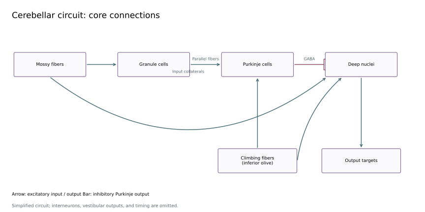

### 확인 문제

소뇌겉질의 주요 출력에 관한 설명으로 옳은 것은?

A. 과립세포의 평행섬유는 소뇌겉질에서 사라지며 어떤 연결도 만들지 않는다.
B. 소뇌 손상이 같은 쪽 협응 이상을 만드는 것은 모든 경로가 교차하지 않기 때문이다.
C. 푸르키녜세포의 출력은 억제성이다.

**정답: C**

겉질의 억제성 출력과 깊은핵의 통합된 최종 출력을 구별한다.

**오답 해설**

A: 평행섬유는 분자층에서 푸르키녜세포 등과 연결된다.

B: 여러 소뇌 연결과 운동계의 교차를 종합한 결과이며 개별 경로는 교차할 수 있다.

## 뇌막·정맥굴·뇌실과 뇌척수액 순환

### 학습목표

- 경막·거미막·연막과 정상 공간을 구별한다
- 뇌실의 연결과 뇌척수액의 생성·배출 경로를 설명한다
- 출혈·수두증·탈출의 위치를 뇌막과 압력 구획에 연결한다

### 세 겹의 막과 공간의 구별

중추신경계는 바깥쪽부터 경막(dura mater), 거미막(arachnoid mater), 연막(pia mater)에 의해 둘러싸인다. 머리뼈 안의 경막은 뼈막층과 뇌막층을 구별할 수 있으며 대부분 밀착하지만 일부에서 분리되어 정맥굴을 형성한다. 연막은 뇌 표면의 고랑을 따라 밀착하고, 거미막은 표면의 요철을 가로질러 놓여 그 아래에 뇌척수액이 흐르는 거미막밑공간(subarachnoid space)을 이룬다. 혈액과 뇌척수액이 흐르는 장소를 같은 막 사이의 빈 공간으로 통합해서는 안 된다.

머리뼈 안의 경막바깥공간(epidural space)은 보통 넓게 열려 있는 정상 공간이 아니라 뼈와 경막이 병적으로 벌어질 수 있는 잠재적 부위이다. 반면 척추관에서는 경막과 뼈 사이에 지방과 정맥얼기를 포함하는 실제 경막바깥공간이 존재한다. 경막밑공간(subdural space) 역시 정상에서 큰 액체 주머니로 열려 있지 않으며 출혈 등에 의해 경계층이 벌어질 수 있다. 거미막밑공간은 이들과 달리 정상에서 뇌척수액과 혈관이 존재하는 공간이다. 같은 이름의 공간을 머리뼈와 척추관에 기계적으로 적용하면 정상 해부가 달라지는 점을 놓친다.

### 경막주름과 정맥 배액

대뇌낫(falx cerebri)은 양쪽 대뇌반구 사이로 내려오고 소뇌천막(tentorium cerebelli)은 소뇌 위와 대뇌 뒤쪽 아래면 사이의 구획을 만든다. 소뇌천막의 패임(tentorial notch)은 중간뇌가 지나는 통로와 관련된다. 대뇌낫의 아래 자유모서리와 소뇌천막 패임은 서로 다른 구조이다. 경막주름은 뇌를 지지하지만 한 구획의 압력이 높아질 때 조직이 밀려 이동하는 경계가 되기도 한다.

위시상정맥굴(superior sagittal sinus), 아래시상정맥굴, 곧은정맥굴(straight sinus), 가로정맥굴, 구불정맥굴은 뇌의 정맥 혈액이 빠져나가는 주요 경로이다. 곧은정맥굴은 깊은대뇌정맥 계통과도 관련된다. 좌우 정맥굴의 크기와 연결에는 정상적인 비대칭이 있어 한쪽이 작다고 곧바로 폐쇄라고 단정할 수 없다. 뇌 표면의 정맥과 경막정맥굴을 연결하는 다리정맥(bridging vein)은 경막 경계 부근의 전단력에 취약할 수 있다. 정맥굴은 동맥처럼 벽의 평활근 수축으로 압력을 조절하는 관과 구조가 다르다.

### 뇌실의 연속성

가쪽뇌실(lateral ventricle)은 대뇌반구 안에서 C자 형태로 뻗고, 앞뿔·몸통·뒤뿔·아래뿔 등의 구역을 구별한다. 각 가쪽뇌실은 뇌실사이구멍(interventricular foramen)을 통해 셋째뇌실로 연결된다. 셋째뇌실은 양쪽 사이뇌 구조 사이의 좁은 정중 공간이고, 중간뇌수도관을 통해 넷째뇌실로 이어진다. 넷째뇌실은 다리뇌·위숨뇌의 뒤와 소뇌 사이에 놓인다. 이 연속성은 외부 뇌 표면의 주름과 다른 내부 공간의 지도이다.

넷째뇌실의 정중구멍(median aperture)과 양쪽 가쪽구멍(lateral apertures)은 거미막밑공간으로 통하는 중요한 출구이다. 아래쪽 중심관과의 연결도 있지만 성인에서 중심관을 뇌척수액 전체가 주로 배출되는 경로로 생각하면 안 된다. 큰수조, 다리뇌앞수조, 다리사이수조 등은 거미막밑공간이 넓어진 부위이다. 이 공간은 서로 연결되어 뇌와 척수 주변의 액체 이동에 참여하며 동맥·뇌신경과의 위치 관계를 가진다.

### 맥락얼기와 장벽

맥락얼기(choroid plexus)는 혈관성 기질과 그 표면을 덮는 상피로 구성된다. 맥락얼기 상피세포 사이의 치밀이음은 혈액과 뇌척수액 사이의 선택적 장벽에서 중요하다. 이 장벽은 뇌 모세혈관 내피의 치밀이음이 중심인 혈액뇌장벽(blood–brain barrier)과 위치가 다르다. 창문모세혈관이 포함된 맥락얼기의 혈관만 보고 뇌척수액이 혈장 여과액과 완전히 같다고 결론 내릴 수 없다. 상피의 수송과 이온 조절이 액체 조성 및 생성에 기여한다.

일반적인 뇌실막세포(ependymal cell)와 특수화된 맥락얼기 상피를 같은 기능으로 단순화하지 않는다. 뇌실막의 섬모는 국소적인 액체 움직임에 관여할 수 있지만 뇌척수액 생성과 장거리 이동을 전부 섬모의 힘으로 설명할 수는 없다. 동맥 박동·호흡·압력 변화와 조직·혈관 주변의 교환이 함께 관련된다. 뇌척수액은 뇌를 띄우는 기계적 효과뿐 아니라 화학적 환경 유지와 물질 교환에 기여하므로 하나의 일방향 관 속 액체와 완전히 동일한 모형은 아니다.

### 배출과 순환 장애

고전적인 배출 경로는 거미막융모·거미막과립을 거쳐 경막정맥굴 쪽으로 이어지는 흐름이다. 여기에 신경 주위 경로와 경막 림프관 등 다른 배출 경로도 관련된다. 각 경로의 기여는 연령·상태·연구 방법에 따라 평가가 달라질 수 있어 모든 배출이 한 구조에서만 이루어진다고 단정하지 않는다. 정맥 배액의 압력이 변해도 뇌척수액 순환과 압력에 영향을 줄 수 있다는 점에서 혈액과 뇌척수액의 순환은 연결되어 있다.

뇌실 안의 연결부가 막히면 그보다 위쪽 공간이 확장될 수 있다. 예를 들어 중간뇌수도관이 막히는 경우 가쪽뇌실과 셋째뇌실의 확장을 예상할 수 있지만 넷째뇌실의 반응은 같은 방향으로 단순히 일반화하지 않는다. 반대로 거미막밑공간의 배출 장애에서는 여러 뇌실의 확장이 함께 나타날 수 있다. 교통성·비교통성 수두증이라는 구분은 유용하지만 실제 원인은 출혈·염증·종양·발생 이상 등 다양하고 여러 기전이 겹칠 수 있다.

### 출혈의 위치를 구별하는 이유

머리뼈와 경막 사이의 출혈은 흔히 경막동맥 손상과 관련되지만 정맥성 원인도 가능하다. 경막밑 출혈은 다리정맥 손상과 관련되는 경우가 많다. 거미막밑출혈은 뇌척수액이 있는 공간에 혈액이 들어오는 현상으로, 뇌 표면·수조의 혈관과의 관계가 중요하다. 영상의 렌즈형·초승달형 같은 전형적인 모양은 경계와 확산 양상을 이해하는 데 도움이 되지만 예외가 있어 모양 한 가지로 모든 원인과 시기를 확정하지 않는다.

경막은 감각신경과 혈관이 풍부한 조직이며 뇌 실질의 통증 감지 특성과 다르다. 천막 위·아래 부위의 감각 전달 경로 차이는 통증의 위치와 연관통을 해석하는 데 기여한다. 중간뇌막동맥은 주로 경막을 공급하는 동맥이고 중간대뇌동맥은 대뇌 실질을 공급하는 주요 동맥이라는 점도 구별해야 한다. 이름의 ‘중간’이 같아도 두 혈관의 기원·경로·손상 결과는 다르다.

### 구획 사이 압력 차와 탈출

머리뼈 안에서 뇌·혈액·뇌척수액의 부피 관계는 압력 조절에 중요하다. 한 성분이 증가할 때 다른 성분의 이동으로 어느 정도 보상할 수 있지만 그 여유가 줄면 작은 추가 부피가 큰 압력 상승과 연결될 수 있다. 국소 병변은 전체 평균 압력뿐 아니라 구획 사이의 압력 차를 만들 수 있다. 대뇌낫 아래, 천막 패임, 큰구멍을 통한 조직 이동은 각각 다른 혈관·뇌신경·뇌줄기 구조를 압박할 수 있으므로 탈출(herniation)을 한 종류의 아래방향 이동으로만 생각하지 않는다.

소뇌편도가 큰구멍 쪽으로 밀리거나 천막 주위에서 뇌줄기가 압박되면 의식·눈운동·호흡 등 생명 유지 기능에 영향을 줄 수 있다. 뇌척수액을 채취하거나 배액하는 행위도 이러한 압력 구획과 무관하지 않다. 해부학적 학습에서는 바늘이 들어가는 층뿐 아니라 머리뼈 안의 종괴와 액체 흐름이 공간적으로 연결된다는 점을 이해해야 한다. 구체적인 검사 적응증과 금기는 환자 평가와 별도의 임상 기준으로 판단한다.

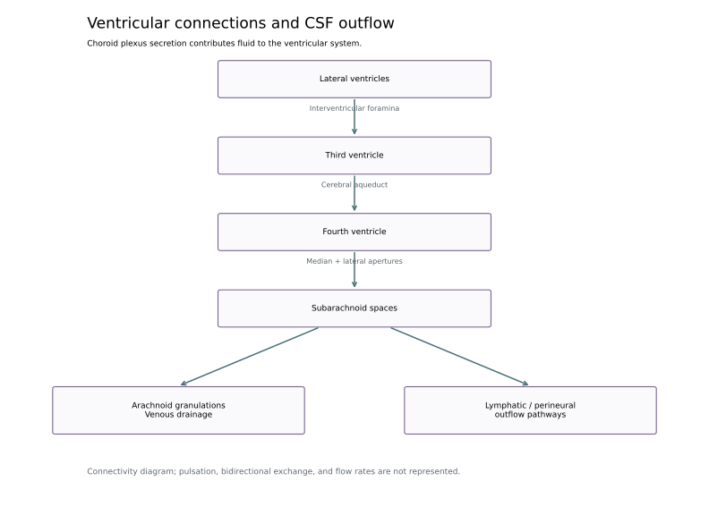

### 확인 문제

중간뇌수도관이 막혔을 때 연결 구조로 예상할 수 있는 것은?

A. 정상 머리뼈 안의 경막바깥공간은 척추관처럼 큰 지방 공간이다.
B. 가쪽뇌실과 셋째뇌실이 막힌 부위의 위쪽에 놓인다.
C. 중간뇌수도관은 가쪽뇌실에서 코안으로 직접 열린다.

**정답: B**

뇌실사이구멍→셋째뇌실→수도관→넷째뇌실의 순서를 이용한다.

**오답 해설**

A: 두개강 경막바깥 부위는 잠재 공간이며 척추관의 실제 경막바깥공간과 다르다.

C: 수도관은 셋째뇌실과 넷째뇌실을 연결한다.

# 영상해부학

## 단면해부와 영상 방향의 해석

### 학습목표

- 축상·관상·시상 단면의 관계를 설명한다
- 환자 방향과 화면 방향을 구별한다
- 연속 절편과 3D 표면의 정보를 통합한다

### 절편은 입체 구조의 일부이다

단면해부학(cross-sectional anatomy)은 입체적인 장기와 혈관, 공간을 절편에서 인식하는 학문이다. 같은 구조도 자르는 방향과 높이, 비스듬한 정도에 따라 원형이나 타원, 긴 띠처럼 보일 수 있다. 원형 구조를 보았다고 구형 장기라고 단정할 수 없는 이유이다. 한 절편의 형태에서 입체 구조를 추론하고 인접 절편으로 가설을 확인하는 과정이 기본이다. 장기 이름을 외우는 것과 해당 단면에서 그 장기의 경계 및 인접 관계를 알아보는 것은 서로 다른 학습 과제이다.

축상면(axial plane)은 몸의 위아래 방향에 대체로 수직인 단면, 관상면(coronal plane)은 앞뒤를 나누는 단면, 시상면(sagittal plane)은 좌우를 나누는 단면이다. 정중시상면은 정중선을 통과한다. 실제 영상에서는 환자 자세와 장기 축에 맞추어 비스듬한 재구성면을 사용할 수 있다. 심장의 장축 영상처럼 특정 장기의 방향을 기준으로 만든 면을 신체의 표준 세 면과 무조건 동일시하지 않는다.

### 환자의 왼쪽과 화면의 왼쪽

일반적인 축상 영상의 표시 관례는 환자를 발쪽에서 머리쪽으로 바라보는 방향이다. 이 경우 화면 왼쪽이 환자의 오른쪽에 해당한다. 그러나 모든 프로그램과 모든 3D 장면이 같은 방향으로 고정된다고 가정하면 안 된다. 실제 영상의 R과 L, A와 P, 머리와 발 방향 표지를 먼저 확인하고 환자의 자세와 재구성 정보를 함께 본다. 화면을 회전하거나 반전한 경우에도 환자 좌표의 의미를 보존해야 한다.

관상과 시상 영상에서도 방향 표지를 기준으로 해석한다. 여러 시퀀스의 영상이 같은 위치를 보여주는 것처럼 보여도 절편 두께와 경사, 환자의 움직임 때문에 정확히 일치하지 않을 수 있다. 좌우를 구별할 때에는 큰 장기의 전형적 배치가 도움이 되지만 장기역위나 수술 후 변화 같은 예외가 있다. 해부학적 예상은 방향 표지를 검증하는 보조수단이지 표지를 대신하는 절대 규칙이 아니다.

### 연속성과 랜드마크

혈관을 한 절편에서만 관찰하면 작은 림프절이나 관 구조와 혼동할 수 있다. 연속 절편을 따라 기원과 분지, 연결을 추적하면 정체를 더 확실히 판단할 수 있다. 장관 역시 어느 고리에서 다른 고리로 이어지는지 확인해야 한다. 한 장의 영상에서 가까이 보이는 두 부분이 실제로 직접 연결되어 있다고 보장할 수 없다. 부분용적 효과와 굽은 경로가 평면에서의 인상을 바꾼다.

뼈와 큰 혈관, 장기의 문(hilum), 근막과 근육은 단면의 높이와 위치를 잡는 랜드마크가 된다. 복부에서는 척추체와 큰 혈관, 간과 비장, 신장 및 췌장 등의 관계를 먼저 잡고 세부 구조로 들어갈 수 있다. 다만 장기 높이는 호흡과 체형, 자세에 따라 변하고 소화관 내용물과 수술은 위치를 바꾼다. 특정 척추 높이를 모든 사람의 장기 경계에 정확히 고정하는 방식은 실제 해부의 변이를 충분히 반영하지 못한다.

### CT의 감쇠와 창 설정

컴퓨터단층촬영(computed tomography, CT)은 X선 감쇠의 차이를 이용한다. Hounsfield unit(HU)은 물과 공기를 기준으로 상대적 감쇠를 표현하는 척도이다. 표시할 HU 범위를 창폭(window width)과 창높이(window level)로 바꾸면 같은 자료에서도 서로 다른 구조가 잘 보인다. 폐창과 연부조직창, 뼈창이 다른 검사로 새로 촬영한 자료가 아니라 같은 촬영에서 서로 다른 표시와 재구성을 이용한 영상일 수 있다는 점이 중요하다.

뼈와 석회화, 공기와 지방은 전형적인 감쇠 차이를 제공하지만 조영 시점과 부분용적, 금속 및 움직임은 측정과 관찰에 영향을 준다. 작은 병변의 HU를 한 점에서 측정한 값이 순수한 조직 성분을 그대로 대표하지 않을 수 있다. 관심영역의 크기와 위치, 잡음과 조영 전후 조건을 함께 고려한다. 화면에서 밝다는 표현은 어느 창과 어느 시점인지가 빠지면 불완전한 정보이다.

### 조영과 시간

조영증강 CT에서 동맥과 정맥, 실질의 밝기는 주입 후 시간과 순환 상태에 따라 바뀐다. 같은 구조라도 동맥기와 문맥기, 지연기에서 다르게 보일 수 있으므로 구조가 보이지 않는 이유가 해부학적 부재인지 아직 조영되지 않은 것인지 구별한다. 혈관과 장기 실질의 대비는 해부학적 경계를 찾는 데 도움을 주지만 조영의 양상이 조직의 실제 색이나 고정된 성질은 아니다.

영상 비교에서는 촬영 조건과 시점을 맞추어야 한다. 이전과 현재의 차이가 질환의 변화인지, 호흡과 체액 상태, 조영 시점이나 절편의 차이인지 검토한다. 병변의 크기를 서로 다른 경사면에서 측정하면 실제 변화 없이 값이 달라질 수 있다. 한 방향의 직경 외에 형태와 주변 침범, 여러 평면에서의 위치를 함께 확인하면 이런 오류를 줄일 수 있다.

### 3D 표면과 단면의 연결

해부학적 표면 메시는 장기 바깥 모양과 구조 사이 위치 관계를 이해하는 데 유용하다. 그러나 표면의 내부를 자른다고 실제 CT 감쇠나 MRI 신호, 미세구조가 새로 생성되는 것은 아니다. 표면 메시의 절단면은 기하학적으로 만든 면이며 실제 장기 내부의 영상 정보를 나타내려면 별도 자료가 필요하다. 3D 모델의 정상 장기 위치를 단면 해부의 틀로 이용하되 이를 실제 환자의 병변이나 검증된 영상 신호로 해석하지 않는다.

모델과 영상을 연결할 때에는 환자 좌표계와 모델 좌표계를 일치시키고, 모든 구조에 동일한 변환을 적용해야 한다. 장기마다 중심을 따로 원점으로 옮기면 원래의 위치 관계가 파괴된다. 카메라를 돌리는 것과 해부 구조 자체를 이동시키는 것도 구별한다. 화면의 보이는 방향을 바꾸어도 환자의 좌우와 구조 사이 관계는 유지되어야 한다. 공간 정보를 일관되게 보존하는 것이 단면과 3D를 오가며 학습하는 기본 조건이다.

### 확인 문제

정상 장기의 3D 표면 메시를 잘랐을 때 알 수 있는 것은?

A. 실제 환자의 조직학적 소견이다.
B. 실제 MRI의 ADC 값이다.
C. 표면 형상에 따른 기하학적 단면이며 영상 신호에는 별도 자료가 필요하다.

**정답: C**

표면의 공간 정보와 체적 영상의 조직 정보를 구별해야 한다.

**오답 해설**

A: 표면 메시는 조직학 정보를 포함하지 않는다.

B: 물 확산에 따른 MRI 신호는 표면 기하만으로 생성되지 않는다.

# 조직학

## 상피의 극성과 세포접합

### 학습목표

- 상피의 분류를 기능과 연결한다.
- 세포접합을 세포골격 및 분자와 연결한다.
- 조직 절단 방향이 현미경 소견에 미치는 영향을 설명한다.

### 경계 조직의 설계

상피조직(epithelium)은 몸의 표면과 관강을 덮고 샘을 형성하는 세포 집단이다. 세포가 촘촘히 배열되며 세포외기질이 비교적 적고, 꼭대기(apical)와 바닥가쪽(basolateral) 영역이 기능적으로 구분되는 극성(polarity)이 발달한다. 혈관은 대개 상피 내부로 직접 들어오지 않으므로 아래 결합조직의 혈관에서 확산으로 영양을 공급받는다. 상피와 결합조직 사이의 바닥막(basement membrane)은 지지대뿐 아니라 선택적 장벽과 재생 시의 길잡이 역할을 한다.

상피는 층 수와 표면 세포 모양에 따라 분류한다. 단층편평상피는 확산과 여과에 적합한 얇은 장벽을 만들고, 단층원주상피는 흡수·분비에 필요한 세포질 공간을 제공한다. 중층상피의 이름은 가장 바깥층 세포의 모양을 기준으로 붙인다. 거짓중층상피(pseudostratified epithelium)는 핵이 서로 다른 높이에 있어 여러 층처럼 보이지만 모든 세포가 바닥층판에 닿는다. 이행상피(urothelium)는 요로에서 팽창과 장벽 유지에 적응한 특수 상피이며 표면의 우산세포가 중요하다.

### 접합 복합체의 역할 분담

치밀이음(tight junction)은 인접 세포 사이의 통과 경로를 조절하고 막 단백질의 영역 구분을 유지하는 데 기여한다. Claudin과 occludin 등의 막 단백질, ZO 계열의 연결 단백질이 관여하며, claudin 조합은 조직별 이온 선택성에 영향을 준다. 치밀이라는 이름 때문에 완전히 불투과성인 벽이라고 생각하면 안 된다. 소장의 흡수상피와 방광상피는 서로 다른 통과 특성을 가져야 하므로 조직에 맞게 장벽 성질이 조절된다. 염증이나 독소가 이 접합을 바꾸면 투과성이 증가할 수 있다.

부착이음(adherens junction)은 cadherin과 세포내 catenin 등을 통해 액틴 세포골격을 연결한다. 데스모솜(desmosome)은 desmoglein과 desmocollin 같은 cadherin 계열 분자 및 연결 단백질을 통해 중간세사를 연결하여 기계적 강도를 제공한다. 반데스모솜(hemidesmosome)은 세포와 세포의 연결이 아니라 바닥쪽 세포를 바닥층판에 고정하는 장치이며 integrin이 중요하다. 따라서 항체가 어떤 접착분자를 공격하는지에 따라 물집이 생기는 조직 수준이 달라질 수 있다.

틈새이음(gap junction)은 connexin으로 구성된 통로를 통해 작은 물질과 이온의 세포간 이동을 허용한다. 영양소나 모든 단백질이 자유롭게 교환되는 큰 구멍은 아니다. 전기적 연결과 대사적 조정에 유용하지만 통로 개방은 조절될 수 있다. 상피의 형태를 유지하는 접합과 세포간 신호를 전달하는 접합은 서로 다른 주기능을 가지므로 하나의 접착 장치로 묶어 외우지 않는다. 암세포의 침윤에서도 접착과 극성의 변화가 중요하지만 단일 분자 감소만으로 전이를 확정하지 않는다.

### 표면 특수화와 샘

미세융모(microvilli)는 액틴을 중심 구조로 하며 표면적을 늘린다. 운동섬모(motile cilia)는 미세소관 기반 구조와 dynein 운동을 이용하여 점액이나 액체를 이동시킨다. 일차섬모(primary cilium)는 흔히 감각과 신호전달 기능을 가지므로 모든 섬모를 운동성 구조로 보면 안 된다. 부동섬모(stereocilia)는 이름과 달리 긴 미세융모에 해당하는 액틴 기반 구조다. 구조를 이름만으로 분류하지 말고 세포골격과 기능을 함께 확인해야 한다.

외분비샘(exocrine gland)은 관을 통해 표면이나 관강으로 분비하고, 내분비샘(endocrine gland)은 관 없이 간질과 혈액 쪽으로 호르몬을 전달한다. 장액세포는 단백질성 분비물과 관련되어 거친면소포체와 분비과립이 발달하고, 점액세포는 점액성 당단백질 분비에 적합하다. H&E 염색에서 보이는 색은 분자의 화학적 성질과 고정·처리 과정의 결과다. 샘의 빈 공간이나 옅은 세포질을 실제 생체 내의 빈 구조와 동일시하면 안 된다.

### 현미경 판독의 한계

얇은 조직절편은 3차원 구조를 2차원으로 자른 결과다. 관을 비스듬히 자르면 타원이나 길쭉한 모양이 되고, 같은 샘의 여러 단면이 서로 다른 구조처럼 보일 수 있다. 세포 핵이 모든 절편에 보이지 않는다고 그 세포가 무핵세포라고 할 수 없다. 조직 판독에서는 표면 방향, 바닥막, 관강, 주변 기질을 함께 추적해야 한다. 이 절의 도식은 정상 조직 원리를 설명하는 독립 제작 그림이며 실제 환자 조직사진으로 표시하지 않는다.

### 확인 문제

반데스모솜의 주된 연결 대상은?

A. 세포와 바닥층판
B. 두 인접 세포의 꼭대기막

**정답: A**

Integrin 등을 통해 세포를 기저 기질에 고정한다.

**오답 해설**

B: 세포간 접합과 세포-기질 접합을 구분해야 한다.

## 간의 미세구조와 기능적 구역

### 학습목표

- 혈액과 담즙의 이동 방향을 구별한다
- 간소엽과 간세엽 모형이 강조하는 기능을 설명한다
- 간의 주요 비실질세포를 손상과 섬유화에 연결한다

### 이중 혈액 공급과 간세포판

간은 간동맥과 문맥이라는 두 경로로 혈액을 받는다. 문맥은 위장관과 비장 등에서 온 혈액을 운반하고, 간동맥은 전신 동맥혈을 공급한다. 두 혈류는 간 실질의 굴모세혈관(sinusoid)에서 섞여 간세포와 물질을 교환한 뒤 간정맥 계통으로 나간다. 문맥혈은 산소가 전혀 없는 혈액이 아니며, 문맥의 영양분과 장 유래 물질은 간이 대사와 해독, 면역 감시를 수행하는 데 중요한 입력이다. 혈액 공급을 단순히 영양용 혈관과 산소용 혈관의 완전히 분리된 두 회로로 이해하지 않는다.

간세포(hepatocyte)는 판 모양으로 배열되고 그 사이에 굴모세혈관이 위치한다. 두꺼운 조직 절편의 평면 영상에서는 세포판이 줄이나 끈처럼 보일 수 있지만 실제로는 입체적인 배열이다. 간세포의 혈액 쪽 면은 굴모세혈관과의 교환에 관여하고, 인접한 간세포 사이에는 담세관(bile canaliculus)이 만들어진다. 한 세포가 혈액에서 물질을 받아 대사하고 담즙으로 배출하는 방향성을 갖는다는 점에서 간세포의 극성(polarity)은 기능적으로 중요하다.

### 혈류와 담즙 흐름은 반대 방향이다

고전적 간소엽(classic hepatic lobule)은 중심정맥을 중심에 두고 주변의 문맥역(portal tract)을 연결한 모형이다. 문맥역에는 문맥 가지, 간동맥 가지, 담관을 포함한 구조들이 관찰된다. 혈액은 주변의 유입 혈관에서 굴모세혈관을 따라 중심정맥 쪽으로 흐른다. 중심정맥은 간동맥의 중심 가지가 아니라 간의 정맥 유출에 연결되는 혈관이다. 이름에 있는 중심이라는 표현은 이 조직 모형에서의 위치를 가리킨다.

담즙은 간세포 사이의 담세관에서 시작하여 문맥역 쪽의 담도 계통으로 배출된다. 따라서 고전적 소엽 안에서 혈액의 큰 흐름과 담즙의 큰 흐름은 반대 방향이다. 담세관 자체에는 별도의 담관 상피벽이 없고 인접 간세포의 막과 세포 사이 접합이 경계를 만든다. 더 큰 담관에서는 담관상피세포(cholangiocyte)가 관을 둘러싸고 담즙 성분 조절에도 관여한다. 담즙 정체가 발생하면 배출 경로의 어느 수준이 손상되었는지 구별하는 것이 중요하다.

### 간세엽과 대사 구역

간세엽(hepatic acinus)은 혈액 공급과 기능 차이에 초점을 맞춘 모형이다. 유입 혈관에 가까운 구역 1과 유출 쪽의 구역 3 사이에는 산소와 기질의 농도 기울기가 형성된다. 구역 1은 대체로 더 높은 산소 공급을 받고 구역 3은 상대적으로 낮은 산소 환경에 놓인다. 구역 2는 그 사이에 위치한다. 실제 간의 구역 경계는 종이 위의 동심원처럼 날카롭게 끊어진 구조가 아니라 혈류와 유전자 발현에 따른 연속적 기능 차이이다.

간세포의 대사 효소 발현은 구역별로 다르다. 산소 요구와 기질 이용, 약물 대사 능력의 분포가 같지 않아 같은 독성물질이나 저산소증이 간 전체를 균일하게 손상시키지 않을 수 있다. 유출 쪽에 가까운 구역은 관류 저하에 상대적으로 취약할 수 있으며, 특정 대사효소가 독성 대사산물을 만드는 위치에서는 약물 손상도 더 두드러질 수 있다. 구역 3 손상이라는 소견은 원인 하나의 이름이 아니라 혈류와 대사 분포를 바탕으로 감별해야 하는 손상 패턴이다.

### 굴모세혈관과 비실질세포

간 굴모세혈관 내피에는 창(fenestration)이 있고 일반적인 연속모세혈관과 다른 교환 특성이 있다. 내피와 간세포 사이의 디세공간(space of Disse)은 혈장 성분과 간세포 사이 교환이 이루어지는 중요한 미세환경이다. 만성 손상에서 내피의 특성이 변하고 세포외기질이 축적되면 이 교환이 제한될 수 있다. 큰 혈관의 직경이 유지되더라도 미세환경의 구조 변화만으로 간 기능과 혈류 저항이 바뀔 수 있는 이유이다.

쿠퍼세포(Kupffer cell)는 간의 상주 대식세포로서 혈액을 통해 들어온 입자와 미생물 성분의 처리, 염증 조절에 관여한다. 장에서 유래한 물질이 문맥을 통해 간으로 먼저 유입되는 구조와 면역 감시 기능이 연결된다. 간성상세포(hepatic stellate cell)는 정상 상태에서 비타민 A 저장 등에 관여하며, 손상과 염증 신호에 반응하여 활성화되면 기질을 생성하는 근섬유모세포 유사 상태로 바뀔 수 있다. 섬유화는 콜라겐이 단순히 가라앉는 현상이 아니라 세포 활성과 기질 생성 및 분해의 균형 변화이다.

### 조직 소견을 임상에 연결하기

간 조직은 문맥역의 염증, 소엽 내 손상, 담관 손상, 지방 축적, 섬유화의 위치와 정도를 나누어 관찰한다. 서로 다른 원인이 비슷한 패턴을 만들 수 있고 하나의 질환이 시기별로 다른 소견을 보일 수 있다. 간 생검은 작은 부위의 표본이므로 병변의 분포가 불균일하면 전체 상태를 완전히 대표하지 못한다. 채취 위치와 표본 크기, 문맥역의 수, 임상 및 혈액검사 소견을 함께 고려하여 해석한다.

간 효소 상승은 세포 손상이나 담즙 정체의 단서이지만 남아 있는 간의 합성 기능과 정확히 같은 지표는 아니다. 조직의 섬유화와 혈관 구조 변화는 문맥압과 연결되고, 광범위한 기능 상실은 응고인자 합성이나 대사 기능에 영향을 줄 수 있다. 정상 미세구조를 이해하면 손상 지표, 기능 지표, 혈역학적 합병증이 왜 서로 다르게 움직이는지 설명할 수 있다. 소엽과 세엽은 경쟁하는 정답 모형이 아니라 서로 다른 질문에 답하는 관찰 틀이다.

### 확인 문제

고전적 간소엽에서 혈액과 담즙의 큰 흐름을 비교하면?

A. 담세관은 간동맥의 작은 분지이다.
B. 혈액은 중심정맥 쪽으로, 담즙은 문맥역의 담도 쪽으로 흐른다.
C. 혈액과 담즙은 같은 굴모세혈관 안에서 함께 흐른다.

**정답: B**

혈액의 유입·유출과 담즙의 배출은 서로 다른 구조와 방향을 가진다.

**오답 해설**

A: 담세관은 간세포 사이의 담즙 경로이며 동맥 분지가 아니다.

C: 혈액은 굴모세혈관을, 담즙은 별도의 담세관과 담도 경로를 따른다.

## 결합조직의 세포·섬유·바탕질

### 학습목표

- 결합조직의 기능을 세포외기질의 조성과 배열로 설명한다
- 주요 세포와 콜라겐 유형을 구분한다
- 조직 처리에 따른 관찰 한계를 이해한다

### 세포 사이 물질이 기능을 결정한다

결합조직(connective tissue)은 세포와 세포외기질(extracellular matrix, ECM)의 조합으로 지지, 연결, 물질 교환과 방어에 참여한다. 상피처럼 세포가 촘촘히 붙은 조직과 달리 기질의 양과 성질이 기능에 큰 비중을 차지한다. 기질은 섬유와 바탕질 및 물로 이루어지며 단단한 뼈에서 부드러운 느슨결합조직까지 다양한 성질을 만든다. 세포 수가 적어 보인다고 비활성 조직이라고 판단하지 않는다.

많은 결합조직은 발생 중 중간엽에서 유래하지만 머리 부위 일부의 결합조직에는 신경능선 유래 세포가 기여한다. 모든 결합조직을 예외 없이 중배엽 유래라고 묶으면 두개안면의 발생을 설명하기 어렵다. 형태학적으로 비슷한 성인 조직도 발생 위치와 세포 계통 및 주변 신호에 따라 다른 특성을 가질 수 있다.

### 섬유모세포와 조직 유지

섬유모세포(fibroblast)는 콜라겐과 다른 기질 성분의 생성 및 재형성에 중요한 세포이다. 단백질 합성이 활발하면 거친면소포체가 발달하고 핵이 비교적 밝게 보일 수 있다. 활동이 낮은 상태와 연속적인 차이가 있으므로 한 장의 염색에서 세포 이름을 지나치게 이분법적으로 결정하지 않는다. 상처에서는 일부 세포가 수축성과 기질 생성이 두드러지는 근육섬유모세포 성질을 얻을 수 있다.

대식세포는 조직 잔해와 병원체의 처리 및 염증·회복 조절에, 비만세포는 과립 매개물질을 통한 염증 반응에 참여한다. 형질세포는 항체 분비와 연결되며 치우친 핵과 발달된 분비 장치가 관찰 단서이다. 혈액에서 유입되는 여러 백혈구도 결합조직에서 작용한다. 고유 세포와 이동 세포의 구분은 유용하지만 조직 내 세포의 기원과 교체 양상은 기관마다 다를 수 있다.

### 콜라겐의 유형과 배열

제1형 콜라겐은 힘줄, 피부와 뼈의 유기기질 등에서 인장 강도에 기여한다. 제2형은 유리연골의 중요한 섬유 성분이고 제3형은 그물섬유와 연결된다. 제4형은 기저판의 망상 구조에 중요하여 굵은 섬유다발을 만드는 콜라겐과 구별한다. 콜라겐이라는 한 이름만으로 모든 조직의 섬유 형태와 질병 양상을 설명하지 않는다.

콜라겐 합성은 세포 내 번역과 변형, 분비 후 가공 및 세포외 교차결합을 포함한다. 수산화 반응과 비타민 C, 일부 교차결합 반응과 구리의 관계는 영양과 조직 강도의 연결을 설명한다. 어느 단계가 손상되었는지에 따라 단백질 양과 구조가 다르게 변한다. 콜라겐 생성 장애와 과도한 축적은 모두 정상 기능을 해칠 수 있다.

### 탄력섬유와 바탕질

탄력섬유(elastic fibre)는 늘어난 뒤 되돌아오는 성질을 제공하며 엘라스틴과 미세섬유 성분이 관련된다. 큰 동맥의 벽, 폐 및 일부 인대에서 콜라겐과 서로 다른 기계적 역할을 한다. 조직을 늘릴 때 처음의 유연성과 더 큰 변형에서의 저항은 섬유의 조합과 배열에 의존한다. 탄력섬유가 많다는 사실이 모든 방향으로 같은 강도를 뜻하지는 않는다.

바탕질에는 글리코사미노글리칸, 프로테오글리칸과 접착 당단백질 등이 포함된다. 음전하를 가진 사슬은 물과 이온의 분포에 영향을 주어 수화된 환경과 압박 저항을 만든다. 세포의 인테그린은 기질과 세포골격 및 신호전달을 연결한다. 기질은 세포를 받치는 수동 재료만이 아니라 성장인자의 저장, 이동 경로와 세포 운명에도 영향을 주는 환경이다.

### 느슨조직과 치밀조직

느슨결합조직은 비교적 풍부한 바탕질과 여러 세포 및 느슨한 섬유 배열을 보여 상피 아래의 교환과 면역 반응에 적합하다. 치밀규칙결합조직에서는 콜라겐 다발이 주된 힘 방향에 맞추어 정렬되어 힘줄과 일부 인대의 기능을 뒷받침한다. 치밀불규칙결합조직은 다양한 방향의 힘에 저항하도록 섬유가 엇갈린다. 염색의 진하기만이 아니라 배열과 위치를 함께 판단한다.

지방조직은 에너지 저장과 보온 및 내분비 기능을 가진 특수 결합조직이다. 일반 조직 처리에서 지질이 빠지면 큰 빈 공간처럼 보일 수 있어 실제 세포가 비어 있었다고 해석하지 않는다. 절단 방향에 따라 길쭉한 힘줄 다발도 둥근 단면으로 보일 수 있다. 표본의 처리 방식과 방향을 이해해야 그림의 모양을 실제 구조와 연결할 수 있다.

### 손상과 재형성

조직 손상 후 기질 분해와 합성은 세포 이동과 상처 회복을 가능하게 한다. 재형성이 끝나도 원래의 배열과 기계적 성질이 완전히 회복되지 않을 수 있다. 만성 염증에서는 기질 생성과 분해의 균형이 변해 섬유화가 진행하고 기관 기능을 제한할 수 있다. 콜라겐이 많아지는 현상을 언제나 튼튼해지는 변화로 해석하지 않는다.

결합조직 질환을 이해할 때에는 섬유 자체의 유전적 이상, 영양 결핍, 면역 염증 및 대사 환경을 나누어 본다. 비슷한 피부나 관절 증상도 손상된 분자와 조직이 다를 수 있다. 조직학적 학습은 대표 사진의 모양을 외우는 데서 나아가 세포·기질·힘과 물질 이동을 연결할 때 임상 의미를 갖는다.

### 확인 문제

결합조직의 바탕질은 수동적인 빈 공간인가?

A. 그렇다. 섬유 외의 세포외 성분은 조직 기능과 무관하다.
B. 아니다. 물 분포·세포 신호·이동 등에 관여한다.

**정답: B**

프로테오글리칸과 접착 성분 등은 수화와 기계적 성질 및 세포 행동을 조절한다.

**오답 해설**

A: 이 선택지는 옳지 않다. 프로테오글리칸과 접착 성분 등은 수화와 기계적 성질 및 세포 행동을 조절한다.

## 연골·뼈의 세포와 기질 재형성

### 학습목표

- 연골 세 유형과 뼈조직의 구조를 비교한다
- 뼈모세포·뼈세포·파골세포의 역할을 연결한다
- 석회화와 뼈 형성 및 뼈 재형성을 구분한다

### 연골의 압박 저항과 확산

연골(cartilage)은 연골세포가 세포외기질 속의 연골방(lacuna)에 놓이는 지지 조직이다. 프로테오글리칸이 물을 보유하고 콜라겐 망이 팽창을 제한하여 압박에 저항한다. 일반적인 연골은 자체 혈관이 없어 영양소가 기질을 통해 확산한다. 연골세포가 적게 보이더라도 기질을 합성·유지하는 활동이 중요하며 손상 뒤의 회복 능력은 혈관과 세포 공급의 제약을 받는다.

유리연골(hyaline cartilage)은 제2형 콜라겐과 풍부한 바탕질을 가지고 많은 관절면과 기도 및 성장판 등에 나타난다. 탄력연골(elastic cartilage)은 탄력섬유가 풍부하여 형태 복원에 유리하다. 섬유연골(fibrocartilage)은 굵은 콜라겐 다발과 연골세포가 함께 보여 인장과 압박이 결합한 환경에 적응한다. 세 유형을 세포 모양만으로 구분하기보다 섬유와 위치를 함께 본다.

### 연골막과 성장 방식

연골막(perichondrium)은 많은 연골의 바깥을 둘러싸는 결합조직으로 혈관과 연골 생성 세포 공급에 기여한다. 그러나 관절연골과 섬유연골의 전형적인 부위에서는 같은 형태의 연골막이 없다. 따라서 모든 연골이 바깥막에서 같은 방식으로 회복된다고 설명하지 않는다. 관절연골은 윤활액을 통한 물질 교환과 하중에 따른 체액 이동이 중요하다.

사이질성장(interstitial growth)은 기질 안 세포의 분열과 기질 생성에, 덧붙이성장(appositional growth)은 바깥에서 새 기질을 더하는 과정에 관련된다. 조직이 성숙하면서 세포와 기질의 반응은 달라진다. 연골의 석회화는 무기질 침착이며 그것만으로 정상적인 뼈조직이 형성되었다는 뜻은 아니다. 연골 틀이 뼈로 대체되는 과정에는 혈관과 뼈 형성 세포의 참여가 필요하다.

### 뼈의 유기기질과 무기질

뼈(bone)는 주로 제1형 콜라겐을 포함한 유기기질과 칼슘·인산염 기반 무기질이 결합한 조직이다. 콜라겐은 인장과 변형 저항에, 무기질은 압박과 강성에 중요한 역할을 한다. 무기질 양만으로 전체 강도가 결정되는 것은 아니며 구조, 미세손상과 재형성 상태도 중요하다. 탈회 표본에서는 무기질이 제거되어 보이는 모습과 실제 단단한 뼈의 성질을 구분해야 한다.

치밀뼈(compact bone)는 바깥의 조밀한 구조를, 해면뼈(spongy bone)는 뼈잔기둥과 그 사이 공간의 구조를 나타낸다. 서로 다른 재료로 만들어진 것이 아니라 같은 조직이 다른 거시 배열을 가진 것이다. 뼈잔기둥은 하중 방향과 관련된 배열을 보이고 그 사이에는 골수와 혈관이 존재한다. 뼈를 빈 공간 없는 돌처럼 생각하면 혈액 공급과 세포 활동을 이해하기 어렵다.

### 뼈모세포·뼈세포·파골세포

뼈모세포(osteoblast)는 뼈바탕질(osteoid)을 분비하고 무기질화에 관여한다. 일부는 자신이 만든 기질에 둘러싸여 뼈세포(osteocyte)가 된다. 뼈세포는 작은관(canaliculi)을 지나는 돌기를 통해 다른 세포와 연결되며 하중 감지와 재형성 조절에 참여한다. 깊이 묻힌 세포도 독립적으로 고립된 채 수동적으로 남아 있는 것이 아니다.

파골세포(osteoclast)는 단핵구·대식세포 계통과 관련된 다핵세포로 뼈 표면을 산성화하고 유기기질을 분해한다. 뼈모세포 계열과 뼈세포의 RANKL 및 OPG 등의 조절은 파골세포의 형성과 작용에 영향을 준다. 뼈 형성 세포가 뼈 흡수를 조절하는 신호를 제공하므로 두 세포군은 반대 방향으로 따로 작동하는 관계만은 아니다. 호르몬과 기계적 자극은 이 연결을 통해 효과를 낼 수 있다.

### 층판과 뼈단위

성숙 층판뼈(lamellar bone)는 콜라겐과 기질이 질서 있는 층으로 배열된다. 치밀뼈의 뼈단위(osteon)는 중심관 주위를 층판이 둘러싸는 구조이며 관에는 혈관과 신경이 지난다. 가로 방향의 연결 통로는 주변 혈관과 이어진다. 단면이 중심관을 직각으로 가르는지 비스듬히 가르는지에 따라 원형 또는 타원형으로 보일 수 있다.

초기 형성이나 빠른 회복 과정에서 나타나는 얼기뼈(woven bone)는 섬유 배열이 덜 정돈되어 있다. 이후 재형성으로 층판 구조가 늘어날 수 있다. 성인의 정상 뼈에서도 손상 회복과 특정 병적 상태를 구분하여 해석해야 한다. 조직 사진에서 불규칙한 배열을 보았다고 단순히 미성숙 개인의 뼈라고 결론내리지 않는다.

### 뼈막·뼈속막과 재형성

뼈막(periosteum)은 바깥면을 덮는 결합조직과 세포층으로 혈액 공급, 부착 및 회복에 관여한다. 뼈속막(endosteum)은 골수강과 뼈잔기둥 등 안쪽 표면에 관련된다. 관절연골로 덮인 면을 일반적인 뼈막과 같은 구조로 보지 않는다. 표면의 세포가 활성화되는 위치와 혈관 공급은 골절 치유의 조건에 영향을 준다.

모델링(modeling)은 형성과 흡수의 공간적 배치가 뼈의 크기와 모양을 바꾸는 과정이고, 리모델링(remodeling)은 기존 조직을 제거하고 새 조직으로 교체하는 연계 과정이다. 성인에서도 미세손상 복구와 무기질 항상성에 필요하다. 흡수와 형성의 균형이 지속적으로 어긋나면 뼈량과 구조가 변한다. 뼈다공증의 뼈량 감소와 뼈연화증의 무기질화 장애를 같은 변화로 취급하지 않는다.

### 확인 문제

연골의 석회화는 곧바로 정상 뼈 형성과 같은가?

A. 아니다. 뼈바탕질 생성과 세포·혈관 참여를 구분한다.
B. 그렇다. 무기질만 침착하면 모든 연골이 성숙 층판뼈이다.

**정답: A**

석회화는 무기질 침착이며 조직의 세포와 기질이 뼈로 형성되는 과정과 다르다.

**오답 해설**

B: 이 선택지는 옳지 않다. 석회화는 무기질 침착이며 조직의 세포와 기질이 뼈로 형성되는 과정과 다르다.

## 소화관 벽의 층과 위·장 점막의 구별

### 학습목표

- 소화관 벽 네 층과 신경얼기를 구분한다
- 위샘·융모·장샘의 세포를 기능과 연결한다
- 조직 절단 방향과 염색의 한계를 설명한다

### 공통 설계와 부위별 변형

소화관 벽은 안쪽부터 점막, 점막밑층, 고유근육층과 바깥 장막 또는 바깥막의 배열로 이해한다. 점막은 상피·고유판·점막근육판을 포함하며 고유근육층과 구분한다. 점막밑층은 비교적 큰 혈관과 림프관 및 신경이 지나는 결합조직이고, 고유근육층은 주로 안쪽 돌림층과 바깥 세로층이 장관 운동에 기여한다. 위에는 추가적인 빗방향 근육 배열이 중요하다.

장막(serosa)은 중피로 덮인 바깥 표면이고 바깥막(adventitia)은 주변 조직과 이어지는 결합조직이다. 한 장기에서도 면과 높이에 따라 바깥 경계가 달라질 수 있다. 점막이 온전해 보이는 생검은 깊은 근육이나 장벽 밖의 질환을 직접 평가하지 못한다. 표본에 포함된 층을 먼저 확인해야 정상과 병변을 적절한 수준에서 해석할 수 있다.

### 장신경계의 위치

근육층사이신경얼기(myenteric plexus)는 고유근육층의 주요 두 층 사이에서 운동 조절에 중요하고, 점막밑신경얼기(submucosal plexus)는 점막 분비와 국소 혈류 등에 관여한다. 이 구분은 위치와 주된 기능의 틀이며 실제 장신경계는 감각·사이·운동신경세포가 연결된 회로이다. 자율신경 자극은 이 국소 회로와 상호작용한다.

조직에서 신경절세포를 찾을 때는 큰 세포 몸체와 핵 및 주변 신경섬유의 위치를 본다. 점막만 있는 표본에서 신경절세포가 보이지 않는다는 사실을 장 전체의 신경절 결손으로 해석해서는 안 된다. 특정 질환의 검사는 적절한 깊이와 위치 및 염색을 전제로 한다. 구조가 없다는 결론에는 먼저 그것을 볼 수 있는 표본인지 확인하는 과정이 필요하다.

### 위오목과 위샘

위 점막의 표면과 위오목(gastric pit)은 점액을 분비하는 원주상피로 덮인다. 위몸통·위바닥 부위의 위샘에는 벽세포(parietal cell), 으뜸세포(chief cell), 점액목세포와 내분비세포 등이 서로 다른 분포를 보인다. 벽세포는 산과 내인자 생성에, 으뜸세포는 펩시노겐 등의 분비에 연결된다. 같은 위샘 안에서도 위치에 따라 세포의 색과 형태가 다르다.

벽세포의 호산성 세포질에는 풍부한 미토콘드리아와 산 분비 장치의 특성이 반영되고, 으뜸세포의 바닥쪽 호염기성은 단백질 합성 장치와 관련된다. 세포 꼭대기의 분비과립과 세포 내 막구조를 모두 일반 광학 현미경으로 뚜렷이 볼 수 있는 것은 아니다. 전자현미경 수준의 장치를 H&E 표본의 점 하나로 임의 대응하지 않는다.

### 위의 구역과 내분비 신호

분문과 날문 부위의 샘은 위몸통의 전형적인 산·효소 분비샘과 모양 및 세포 분포가 다르다. 날문 쪽의 깊은 오목과 점액성 샘, 가스트린 분비 G세포와 소마토스타틴 분비 D세포의 관계를 기능과 연결한다. ECL 세포의 히스타민은 벽세포 조절에 참여하지만 내분비세포의 모든 유형이 같은 호르몬을 분비하지 않는다.

위 점막의 샘 구역은 육안적 경계와 대체로 관계되지만 실제 이행이 단순한 직선은 아니다. 위축과 화생은 정상 구역별 차이와 구분해야 한다. 장상피화생에서 관찰되는 술잔세포와 정상 위의 점액세포는 같은 세포로 부르지 않는다. 조직의 위치 정보가 빠지면 정상 샘의 분포를 병적 변화로 오인할 수 있다.

### 작은창자의 표면 확대

작은창자의 돌림주름(circular fold)은 점막과 점막밑층을 포함하는 큰 주름, 융모(villus)는 점막이 솟은 구조, 미세융모(microvillus)는 개별 흡수세포의 꼭대기막 돌기이다. 세 구조는 크기와 구성 층이 다르다. 융모가 많이 보인다는 사실과 미세융모의 분자 기능이 정상이라는 사실도 같지 않다. 광학 현미경의 솔가장자리는 개별 미세융모의 배열을 합쳐 보여 주는 수준이다.

융모 고유판에는 모세혈관과 중심 림프관 및 면역세포가 관계되고, 장샘(crypt)은 아래로 들어가는 상피 구조이다. 흡수세포와 술잔세포, 내분비세포 및 줄기세포 계통이 위치별로 분포한다. 샘 바닥의 파네트세포(Paneth cell)는 분비과립과 장벽 방어 기능이 중요하다. 모든 세포가 융모 꼭대기에서 같은 역할로 살아가는 것이 아니다.

### 샘창자·빈창자·돌창자의 차이

샘창자 점막밑층의 Brunner 샘은 산을 완화하는 분비와 연결된다. 빈창자는 표면 확대 구조가 발달한 전형적 양상을 보이고, 돌창자에서는 집합림프소절(Peyer patch)이 중요한 단서이다. 그러나 한 작은 절편에 대표 구조가 없을 수 있어 단일 사진의 부재만으로 장 구간을 확정하지 않는다. 절단 방향과 표본의 폭 및 나이가 관찰에 영향을 준다.

집합 림프조직을 덮는 특수 상피와 항원 전달은 점막 면역을 이해하는 부분이다. 장샘과 융모 사이 세포 이동 및 세포 교체는 손상 회복에 기여한다. 증식은 많아도 분화와 위치가 무너지면 정상적인 흡수 장벽이 유지되지 않을 수 있다. 재생과 기능적 회복은 관련되지만 같은 시점에 완성되는 현상은 아니다.

### 큰창자와 표본 해석

큰창자의 전형적 점막에는 작은창자와 같은 융모가 없고 비교적 곧은 장샘과 풍부한 술잔세포가 보인다. 물·전해질 흡수와 점액을 통한 내용물 이동이 구조와 연결된다. 정상적으로 존재하는 면역세포와 활동성 염증을 구분하려면 세포의 종류뿐 아니라 위치와 양, 상피 손상 및 구조 변형을 함께 본다.

비스듬히 잘린 장샘은 분지하거나 서로 이어진 것처럼 보일 수 있고 수축한 점막은 비정상적으로 촘촘해 보일 수 있다. 연속 절편과 적절한 배율로 구조를 확인한다. 소화관 조직학은 대표 모양을 맞히는 문제를 넘어, 표본에 어떤 층이 있고 그 위치에서 어떤 세포와 기질이 기능해야 하는지를 설명하는 학문이다.

### 확인 문제

작은창자의 융모와 미세융모는 무엇이 다른가?

A. 융모는 오직 고유근육층으로만 만들어진다.
B. 융모는 점막의 돌출, 미세융모는 개별 상피세포의 막 돌기이다.
C. 두 용어는 같은 크기의 같은 구조를 가리킨다.

**정답: B**

돌림주름·융모·미세융모는 크기와 포함하는 조직 수준이 서로 다르다.

**오답 해설**

A: 이 선택지는 해당 구조의 관계를 잘못 설명한다. 돌림주름·융모·미세융모는 크기와 포함하는 조직 수준이 서로 다르다.

C: 이 선택지는 해당 구조의 관계를 잘못 설명한다. 돌림주름·융모·미세융모는 크기와 포함하는 조직 수준이 서로 다르다.

## 콩팥소체·세뇨관·집합관의 조직학

### 학습목표

- 겉질·속질과 각 세뇨관의 형태를 구분한다
- 여과장벽과 사이질·혈관의 관계를 설명한다
- 세포의 형태를 수송 기능과 연결한다

### 소변길과 혈액길이 교차하는 조직

콩팥 겉질에는 콩팥소체(renal corpuscle)와 굽이세뇨관 등이, 속질에는 곧은세뇨관과 고리 및 집합관과 혈관이 배열된다. 겉질의 속질방사(medullary ray)는 이름과 달리 겉질 안에서 곧게 배열된 관들의 영역이다. 어떤 표본에 둥근 콩팥소체가 보이는지는 겉질과 속질을 구분하는 중요한 단서이지만 절편의 작은 범위와 이행부를 고려한다.

여과액은 콩팥소체의 요극에서 몸쪽세뇨관으로 이어지고, 혈액은 수입세동맥으로 들어와 토리 모세혈관을 지나 수출세동맥으로 나간다. 하나의 조직 안에서 관의 속공간과 혈관의 속공간은 다른 계통이다. 적혈구가 없는 빈 원형 구조를 모두 같은 세뇨관으로 부르지 않고 상피와 주변 조직 및 혈관벽을 확인한다.

### 콩팥소체와 여과장벽

콩팥소체는 토리(glomerulus)와 이를 둘러싼 Bowman 주머니의 관계로 이해한다. 바깥 벽측층은 얇은 편평상피, 안쪽 장측층은 모세혈관을 덮는 발세포(podocyte)로 구성된다. 발세포의 발돌기 사이에는 틈새막이 있으며 모세혈관 내피와 토리바닥막 등과 함께 선택적 여과에 참여한다. 여과장벽을 단순히 크기만 같은 구멍을 가진 한 장의 체로 설명하지 않는다.

내피의 창, 바닥막과 발세포의 미세구조는 전자현미경 수준의 관찰이 필요하다. 일반 광학 표본에서 보이는 두꺼운 선이나 빈틈 하나가 곧 특정 미세층의 정상 또는 결손을 직접 증명하지는 않는다. 임상 병리에서는 광학, 면역형광과 전자현미경 정보가 서로 다른 질문에 답한다. 구조의 수준을 구분해야 단백뇨의 원인을 한 사진으로 과도하게 확정하지 않는다.

### 토리사이질과 혈관극

토리사이세포(mesangial cell)와 그 기질은 모세혈관 고리를 지지하고 기질 유지와 신호 반응에 관여한다. 내피세포나 발세포와는 위치와 기능이 다르다. 세포 증가와 기질 증가는 서로 다른 변화이며 실제 병변에서는 둘이 함께 나타날 수 있다. 토리 전체의 크기와 세포 수를 판단할 때 절단면이 중심을 지났는지도 고려한다.

혈관극에서는 수입·수출세동맥과 먼쪽 네프론의 치밀반(macula densa) 및 주변 세포가 토리곁장치(juxtaglomerular apparatus)를 이룬다. 수입세동맥 벽의 과립세포는 레닌 분비와 연결되고 치밀반은 관 속의 염분 전달 신호를 감지하는 역할과 관련된다. 치밀반을 내분비 레닌 과립세포와 같은 세포로 혼동하지 않는다.

### 몸쪽세뇨관의 솔가장자리

몸쪽세뇨관(proximal tubule)은 풍부한 미토콘드리아와 미세융모를 가진 상피로 대량 재흡수를 수행한다. 일반 표본에서는 솔가장자리 때문에 내강 경계가 덜 선명하거나 좁아 보일 수 있다. 호산성 세포질과 기저외측 막의 발달은 에너지와 수송 요구를 반영한다. 이 형태는 기능을 추론하는 단서이지 각 수송체의 활성을 직접 측정한 결과는 아니다.

먼쪽굽이세뇨관은 몸쪽보다 솔가장자리가 덜 발달하고 내강과 세포 경계가 다른 양상을 보일 수 있다. 같은 직경의 관을 비교해도 절단 방향과 수축 및 염색 차이가 영향을 준다. 상피의 높이, 세포질과 내강 및 주변 콩팥소체 관계를 함께 본다. 표본에서 밝다는 한 가지 이유만으로 집합관이라고 확정하지 않는다.

### 고리와 집합계

Henle 고리의 얇은 부분은 편평상피로, 두꺼운 부분은 더 발달한 수송 상피로 구분된다. 물과 염분의 이동 성질은 고리의 부분별로 달라 역류 증폭의 해부학적 바탕을 만든다. 겉질네프론과 토리곁속질네프론은 고리 길이와 혈관 관계가 달라 속질 농도 기울기 유지에 같은 비중으로 기여하지 않는다.

집합관(collecting duct)에는 주세포(principal cell)와 사이세포(intercalated cell) 등이 있어 나트륨·칼륨, 물 및 산염기 조절에 관여한다. 세포 유형의 비율과 형태는 위치에 따라 달라진다. 집합계는 여러 네프론에서 온 액체를 받으며 발생학적 기원도 네프론 상피의 상당 부분과 구별된다. 같은 소변 흐름에 연결된 관이라는 이유로 모두 동일한 세포 기능을 가진 것은 아니다.

### 세뇨관 주위 혈관과 곧은혈관

수출세동맥 이후의 세뇨관주위 모세혈관은 재흡수된 물질의 회수와 세뇨관 공급에 중요하다. 속질의 곧은혈관(vasa recta)은 고리와 나란한 관계 및 역류 교환을 통해 농도 기울기의 소실을 줄이는 데 기여한다. 혈류가 많을수록 농축 능력이 언제나 좋아지는 것은 아니며 과도한 씻김과 산소 공급 사이의 관계를 생각해야 한다.

콩팥 사이질은 단순한 빈 틈이 아니라 혈관과 기질 및 세포가 있는 환경으로 산소와 신호 전달 및 손상 반응에 관여한다. 만성 세뇨관사이질 손상은 토리 변화와 함께 기능 저하를 만들 수 있다. 토리만 정상에 가까워 보인다고 전체 콩팥 기능이 보장되는 것은 아니다. 조직 평가에서는 토리·세뇨관·사이질·혈관을 함께 살핀다.

### 확인 문제

치밀반과 레닌 과립세포의 구분으로 옳은 것은?

A. 치밀반은 관 상피, 과립세포는 관련 세동맥 벽의 특수 세포이다.
B. 둘은 같은 한 세포의 다른 염색명이다.
C. 둘 다 콩팥깔때기의 피부 상피이다.

**정답: A**

토리곁장치는 관·혈관·주변 세포의 복합체이며 각 성분의 위치와 기능이 다르다.

**오답 해설**

B: 이 선택지는 해당 구조의 관계를 잘못 설명한다. 토리곁장치는 관·혈관·주변 세포의 복합체이며 각 성분의 위치와 기능이 다르다.

C: 이 선택지는 해당 구조의 관계를 잘못 설명한다. 토리곁장치는 관·혈관·주변 세포의 복합체이며 각 성분의 위치와 기능이 다르다.

## 갑상샘·부갑상샘의 여포와 내분비세포

### 학습목표

- 여포상피의 극성과 갑상샘호르몬의 저장·방출 경로를 연결한다
- 소포세포·소포곁세포·부갑상샘 주세포의 형태와 분비 산물을 구별한다
- 조직 형태와 기능검사 결과가 일대일로 대응하지 않는 이유를 설명한다

### 여포를 중심으로 조직을 읽는 방법

갑상샘(thyroid gland)의 조직을 저배율에서 보면 크기와 모양이 다른 둥근 공간이 반복된다. 이 공간은 혈관이나 외분비샘의 배출관이 아니라 소포, 즉 여포(follicle)의 속공간이다. 각 여포는 단층의 소포세포(follicular cell)로 둘러싸이며 속에는 콜로이드(colloid)가 들어 있다. 여포 사이 결합조직에는 모세혈관과 림프관이 분포한다. 여포의 크기는 같은 정상 표본 안에서도 일정하지 않으므로, 한 여포의 지름만으로 질환이나 기능 상태를 판정해서는 안 된다. 조직의 기본 단위를 먼저 확인한 뒤 상피 높이, 콜로이드의 양상, 세포 배열, 기질을 함께 관찰한다.

소포세포의 바닥쪽 면은 기저막과 혈관 쪽을 향하고 꼭대기쪽 면은 콜로이드를 향한다. 이 극성(polarity)은 호르몬 합성에 필요한 재료를 받아들이는 면과 합성·저장이 이루어지는 면을 분리한다. 혈액에서 유입된 요오드화물이 세포를 거쳐 여포 속공간으로 이동하고, 소포세포가 합성한 갑상샘글로불린(thyroglobulin, Tg)도 그 공간으로 분비된다. 따라서 콜로이드는 단순한 배설물이나 조직 처리 과정에서 생긴 빈틈이 아니다. 세포 밖에서 호르몬 전구물질을 저장하는 특수한 기능 공간이다.

### 갑상샘글로불린과 호르몬의 구별

갑상샘글로불린은 소포세포의 거친면소포체와 골지체를 거쳐 분비되는 큰 당단백질이다. 여포 안에서 그 단백질의 타이로신 잔기에 요오드가 결합하고 잔기 사이의 짝지음이 이루어지면서 T3와 T4의 구조가 만들어진다. 저장 상태의 호르몬은 갑상샘글로불린에 결합한 부분으로 존재한다. 콜로이드 전체를 자유로운 T3 또는 T4라고 부르면 단백질 저장체와 혈액으로 방출되는 작은 호르몬 분자를 혼동하게 된다. 일반적인 헤마톡실린·에오신(hematoxylin and eosin, H&E) 염색에서 콜로이드가 호산성으로 보이는 것은 그 단백질 성분과 관련된다.

기저가쪽 막의 나트륨·요오드화물 공동수송체(sodium–iodide symporter, NIS)는 나트륨 기울기를 이용하여 요오드화물을 세포 안에 농축한다. 나트륨 기울기 자체는 Na+/K+-ATPase가 유지하므로 NIS의 작용은 이차능동수송이다. 꼭대기쪽 막을 통한 요오드화물 이동 뒤에는 갑상샘과산화효소(thyroid peroxidase, TPO)와 과산화수소 공급계가 관여하는 유기화·짝지음 반응이 이어진다. H&E 표본은 이러한 분자의 실제 이동을 직접 보여 주지는 않는다. 세포의 방향과 분비 공간을 확인하고 분자 기전을 대응시켜 해석해야 한다.

갑상샘자극호르몬(thyroid-stimulating hormone, TSH)의 자극은 합성 과정뿐 아니라 저장물의 회수에도 영향을 준다. 소포세포가 콜로이드의 일부를 세포 안으로 받아들인 뒤 단백질분해 과정을 거치면 T3와 T4가 유리되어 혈액 쪽으로 방출된다. 요오드가 붙었지만 호르몬으로 결합하지 않은 잔기에서는 요오드의 회수·재이용도 이루어진다. 갑상샘호르몬 분비를 일반적인 펩타이드호르몬 과립의 세포외배출과 동일한 한 단계 과정으로 설명할 수 없는 이유가 여기에 있다.

### 기능 활동과 형태의 관계

소포세포는 흔히 입방형이지만 기능 활동에 따라 낮고 편평한 형태에서 높이가 증가한 형태까지 보일 수 있다. 자극된 상피에서 콜로이드 가장자리의 재흡수 소견이 뚜렷해질 수 있으나, 가장자리의 작은 빈 공간을 모두 생체 내 재흡수 소포로 단정하지는 않는다. 고정과 절단에 의한 인공물도 형태를 바꾼다. 여포의 직경과 상피 높이, 콜로이드 양을 한 방향의 기능 척도로만 외우기보다 자극의 종류·지속기간과 조직 채취 상황을 고려해야 한다.

같은 혈중 갑상샘호르몬 증가라도 합성·분비가 증가한 상태와 이미 만들어진 호르몬이 조직 손상으로 누출된 상태는 다르다. 전자에서는 기능성 세포의 자극과 합성 과정이 중요하고 후자에서는 염증·여포 파괴의 양상이 중요하다. 따라서 조직학적 모양을 기능검사의 대용으로 삼을 수 없다. TSH와 유리호르몬, 항체, 임상 경과, 필요한 영상·섭취 검사와 형태를 함께 해석해야 병태생리를 구별할 수 있다. 이러한 구별은 질환별 치료가 달라지는 이유를 이해하는 출발점이다.

### 소포곁세포와 칼시토닌

소포곁세포(parafollicular cell), 또는 C세포는 소포세포와 다른 내분비세포이다. 여포 상피의 바닥쪽이나 여포 사이에서 관찰되며 보통 여포 속공간에 직접 접하지 않는다. 세포질이 상대적으로 옅게 보일 수 있지만 일상 염색만으로 모든 C세포를 정확히 구별할 수 있는 것은 아니다. 칼시토닌(calcitonin)은 C세포의 대표적인 분비 산물이며 펩타이드호르몬으로서 분비 과립과 관련된다. 콜로이드에 저장된 갑상샘글로불린과 C세포의 분비 과립은 서로 다른 저장 체계이다.

성인 사람의 칼슘 항상성에서 칼시토닌과 부갑상샘호르몬을 완전히 대칭적인 두 조절자로 취급하면 실제 생리를 지나치게 단순화한다. 혈중 이온화칼슘의 조절에서는 부갑상샘호르몬과 비타민 D, 콩팥·뼈·장관의 상호작용이 중심적이다. 칼시토닌은 파골세포 기능에 영향을 주지만 그 결핍이나 증가의 결과가 부갑상샘호르몬 결핍·과잉과 대칭적이지는 않다. C세포와 소포세포의 종양을 구별할 때에도 호르몬 계통과 세포 기원이 다르다는 점을 출발점으로 삼는다.

### 부갑상샘의 세포와 기질

부갑상샘(parathyroid gland)은 갑상샘 가까이에 있지만 콜로이드 여포로 구성된 기관이 아니다. 얇은 결합조직 피막 안에 내분비세포 무리와 풍부한 혈관이 분포한다. 주세포(chief cell)는 부갑상샘호르몬(parathyroid hormone, PTH)을 만드는 주요 세포이며 비교적 작은 둥근 핵과 많지 않은 세포질을 가진다. 혈관 주위 배열은 분비 산물을 혈액으로 전달하기에 유리하다. 부갑상샘을 판별할 때에는 여포의 유무, 세포 무리의 형태, 지방세포와 혈관의 분포를 함께 관찰한다.

호산성세포(oxyphil cell)는 주세포보다 크고 호산성 세포질이 뚜렷하며 미토콘드리아가 풍부하다. 나이에 따라 그 비중이 달라질 수 있다. 세포질이 진한 붉은색이라는 이유로 이를 적혈구 또는 염증세포와 혼동해서는 안 된다. 호산성세포의 존재만으로 분비 항진이나 종양을 판정할 수도 없다. 성인의 부갑상샘에서는 지방세포가 섞일 수 있으나 지방 함량은 연령·체격과 표본에 따라 변하므로 단일 비율을 모든 정상 조직의 기준으로 적용하지 않는다.

### 칼슘 감지와 표적기관

주세포 표면의 칼슘감지수용체(calcium-sensing receptor, CaSR)는 세포 밖 칼슘 농도의 변화를 감지하는 G단백질연결수용체이다. 세포 밖 이온화칼슘이 증가하면 수용체 신호가 PTH 분비를 억제하는 방향으로 작용한다. 칼슘이 낮아지면 이러한 억제가 줄어 분비가 증가한다. 낮은 칼슘이 CaSR를 더 강하게 활성화하여 PTH를 분비시킨다고 설명하면 수용체 활성과 호르몬 분비의 방향을 뒤집은 것이다. 혈중 총칼슘은 알부민 농도에도 영향을 받으므로 조절의 직접 신호인 이온화칼슘과 구별한다.

PTH는 콩팥의 칼슘 재흡수와 인산 배설, 활성 비타민 D 생성에 영향을 준다. 뼈에서는 조골세포 계열 등의 신호를 통해 파골세포의 형성과 기능을 조절하며, PTH가 파골세포에 직접 결합해 모든 뼈흡수를 일으킨다는 설명은 부정확하다. 장관의 칼슘 흡수 증가는 주로 활성 비타민 D를 매개로 연결된다. 같은 PTH라도 노출 양상과 표적기관 상태에 따라 뼈 대사의 결과가 달라질 수 있다. 미세조직의 세포 이름을 외우는 데서 그치지 않고 수용체가 있는 세포와 실제 반응하는 조직 사이의 관계를 구별해야 한다.

### 표본 해석의 한계와 임상 연결

면역조직화학검사는 갑상샘글로불린·칼시토닌·PTH 등 분비 계통을 확인하는 데 도움을 주지만, 양성 염색 하나가 모든 진단을 결정하지는 않는다. 표본의 위치, 세포 형태, 다른 표지자의 조합, 내부 대조와 임상 정보를 함께 판단해야 한다. 갑상샘 여포성 병변에서는 세포가 여포 형태를 만든다는 사실과 종양의 악성 여부도 별개의 문제이다. 세포검사에서 관찰한 구조만으로 피막·혈관 침범 전체를 평가할 수 없다는 점이 조직 채취 방식의 한계와 연결된다.

갑상샘 절제 뒤의 저칼슘혈증을 이해할 때에는 갑상샘호르몬 생성 감소와 부갑상샘 기능 저하를 분리한다. 가까이 있는 부갑상샘이 제거되거나 혈액 공급을 잃으면 PTH가 감소할 수 있다. 이때 나타나는 신경근 흥분성 변화는 갑상샘 콜로이드가 줄어든 현상으로 설명되지 않는다. 같은 수술 영역의 기관이라도 조직 구성과 분비물·되먹임 회로가 다르다는 것이 임상적으로 중요한 결론이다.

### 확인 문제

이온화칼슘 증가에 대한 부갑상샘 주세포의 반응으로 옳은 것은?

A. CaSR는 낮은 칼슘에서 더 활성화되어 PTH를 분비시킨다.
B. 갑상샘 콜로이드는 자유로운 PTH로 가득 찬 공간이다.
C. CaSR 활성에 의해 PTH 분비가 억제되는 방향으로 작용한다.

**정답: C**

CaSR 신호와 PTH 분비의 방향을 구별한다.

**오답 해설**

A: 칼슘이 낮아지면 높은 칼슘에 의한 억제가 줄어드는 방향이다.

B: 콜로이드는 갑상샘 여포의 갑상샘글로불린 저장 공간이며 PTH 저장소가 아니다.

## 기관·기관지·세기관지와 폐포의 조직학

### 학습목표

- 기도 벽의 연골·샘·상피 변화로 기관지와 세기관지를 구별한다
- 종말세기관지와 호흡세기관지의 경계를 설명한다
- 폐포 세포와 혈액공기장벽의 구성 요소를 기능과 연결한다

### 전도부와 호흡부의 경계

기도의 전도부(conducting portion)는 공기를 전달하면서 가온·가습하고 입자를 제거한다. 기관에서 기관지, 세기관지, 종말세기관지(terminal bronchiole)로 이어지는 동안 벽의 두께와 구성은 달라지지만 정상적인 가스교환을 담당하는 폐포가 벽에 열려 있지는 않다. 호흡세기관지(respiratory bronchiole)에서는 기도 벽의 일부에 폐포가 나타나므로 전도와 가스교환 기능이 함께 존재한다. 종말세기관지가 가장 먼쪽의 전도기도라는 말은 그 뒤에 더 작은 통로가 없다는 뜻이 아니다. 기능적 경계와 크기의 비교를 구분해야 한다.

폐를 관찰할 때 한 절편에 보이는 둥근 속공간만으로 기관지·혈관·폐포를 분류할 수는 없다. 벽의 상피, 연골이나 샘의 존재, 평활근 배열, 적혈구가 든 내강과 주변 혈관의 관계를 함께 확인한다. 사선으로 잘린 작은 기도는 실제보다 넓고 타원형으로 보이며, 수축한 평활근은 점막을 주름지게 한다. 정상 기도 구조와 절단 방향에 따른 모양의 차이를 먼저 이해해야 염증이나 확장·폐쇄를 올바르게 해석할 수 있다.

### 기관 벽과 점액섬모 청소

기관(trachea)의 점막은 대체로 거짓중층섬모원주상피(pseudostratified ciliated columnar epithelium)를 이룬다. 핵이 여러 높이에 놓여 겹층처럼 보이지만 세포가 기저막에 접한다는 점에서 진정한 중층상피와 다르다. 섬모세포의 꼭대기에는 운동섬모가 있고, 술잔세포(goblet cell)는 점액 성분을 분비한다. 바닥세포(basal cell)는 상피 유지·재생에 관여한다. 일반 염색에서 보이는 모든 세포를 핵의 높이만으로 확정하지 않으며, 세포 분화 상태는 표지자와 초미세구조를 통해 더 세밀하게 구별할 수 있다.

점액은 흡입 입자를 붙잡지만 점액이 존재하는 것만으로 청소가 완료되지는 않는다. 섬모 운동과 기도 표면액의 성질이 함께 유지되어야 점액이 인두 쪽으로 이동한다. 섬모 자체의 이상, 표면액 조절의 변화, 과도한 분비는 서로 다른 방식으로 이 기능을 저해한다. 따라서 기도 방어를 술잔세포 수 하나로 설명할 수 없다. 점막 고유판의 면역세포, 점막밑샘, 기침 반사와도 연결되는 통합된 방어 체계이다.

기관의 유리연골(hyaline cartilage)은 뒤쪽이 열려 있는 고리 형태로 내강을 지지한다. 뒤벽의 기관근(trachealis muscle)과 섬유탄성조직은 연골이 없는 부분을 연결하며 식도는 그 뒤쪽에 놓인다. 점막밑층의 장액점액샘은 표면액과 분비물에 기여한다. 연골·샘·상피를 하나의 층으로 묶어 외우기보다 안에서 밖으로 점막, 점막밑조직, 연골과 근육, 바깥 결합조직의 관계를 구별한다. 이 층 구분은 소화관의 근육층 배열을 그대로 옮긴 것이 아니다.

### 기관지에서 세기관지로

폐 안의 기관지에서는 기관의 연골 고리와 달리 불규칙한 연골판이 벽에 분포한다. 상피 아래의 평활근과 탄성조직은 내강의 형태 및 기도 저항 변화에 관여한다. 가지가 작아질수록 상피 높이가 낮아지고 연골판과 점막밑샘이 줄어든다. 기관지가 혈관과 함께 주행하는 모습을 관찰하면 폐 실질 안에서 기관지혈관 다발의 위치를 이해할 수 있다. 다만 폐정맥은 흔히 기관지·폐동맥과 같은 중심 다발을 그대로 따르지 않고 소엽 사이 경계와 관련되어 분포한다.

세기관지(bronchiole)는 정상 벽에 연골과 점막밑샘이 없다는 점이 중요한 구별 기준이다. 큰 세기관지에서는 섬모원주상피가 보이고 더 먼쪽에서는 입방형 상피와 비섬모성 분비세포의 비중이 커진다. 클럽세포(club cell)는 분비와 유해물질 대사, 상피 유지에 관여하는 세포이다. 병적인 술잔세포 화생이 생길 수 있으므로 정상 먼쪽 기도와 만성 손상 기도에서 세포 구성의 의미를 구분해야 한다. 특정 지름 하나만으로 모든 기도를 기관지 또는 세기관지로 나누는 방식은 조직학적 변화의 연속성을 충분히 설명하지 못한다.

세기관지는 연골 지지가 없지만 벽의 평활근과 주변 폐실질의 견인력이 내강을 유지하는 데 기여한다. 평활근 수축, 점막 부종, 내강 분비물은 각각 기도 저항을 높일 수 있다. 폐실질의 탄성 지지가 파괴되어도 기도 개방성에 영향을 준다. 이러한 관계는 천식의 가역적인 평활근 수축과 폐기종에서의 탄성 지지 소실이 같은 기전이 아님을 설명한다. 한 환자에서 여러 기전이 겹칠 수 있으므로 조직의 층별 변화와 기능을 연결해야 한다.

### 폐포가 시작되는 지점

종말세기관지의 벽은 연속적인 전도상피로 이루어져 있다. 호흡세기관지에서는 그 벽의 일부가 폐포 입구로 끊기고, 더 먼쪽의 폐포관(alveolar duct)은 거의 전체 벽이 폐포 입구와 연관된다. 폐포주머니(alveolar sac)는 여러 폐포가 공통 공간으로 열리는 말단 구성을 가리킨다. 이 용어들은 크기가 다른 빈 공간을 임의로 부르는 이름이 아니라 기도 벽에서 폐포가 차지하는 방식의 차이를 나타낸다. 절편 하나에서는 연결 경로 전체가 보이지 않으므로 연속성은 여러 시야와 구조적 관계로 추론한다.

호흡단위인 세엽(acinus)은 하나의 종말세기관지보다 먼쪽에서 가스교환에 참여하는 통로와 폐포들을 포함한다. 영상에서 사용하는 이차폐소엽(secondary pulmonary lobule)과 동일한 단위는 아니다. 이차폐소엽은 여러 세엽을 포함하며 결합조직 격막에 의해 경계지어질 수 있다. 중심의 작은 기도·폐동맥과 주변의 정맥·림프관 관계는 조직학과 고해상도 CT의 소엽 중심성 또는 격막성 분포를 연결하는 기초가 된다.

### I형·II형 폐포상피세포

I형 폐포세포(type I pneumocyte)는 매우 얇고 넓게 퍼진 세포질로 폐포 표면의 대부분을 덮는다. 핵 주변을 제외한 세포질이 너무 얇아 광학현미경에서 경계 전체를 따라가기 어렵다. II형 폐포세포(type II pneumocyte)는 상대적으로 입방형이며 모서리 부근에서 보일 수 있고 층판소체(lamellar body)에 저장한 표면활성제(surfactant) 성분을 분비한다. 세포 수의 비중과 표면을 덮는 면적의 비중은 같은 값이 아니므로 I형 세포가 표면 대부분을 덮는다는 사실을 모든 세포 수의 대부분이라는 뜻으로 바꾸지 않는다.

표면활성제는 인지질과 단백질 등으로 구성되어 폐포 공기·액체 경계의 표면장력을 낮추는 데 기여한다. 이로써 팽창에 필요한 힘과 호기 말 불안정성이 감소한다. 실제 폐포는 서로 연결된 격막 구조이며 독립적인 비누방울과 같지 않다. 단순 구형 모형으로 반지름과 압력의 관계를 이해할 수는 있지만, 그 모형만으로 살아 있는 폐의 모든 안정성을 설명할 수는 없다. II형 세포는 손상 뒤 상피 재생에도 관여하므로 그 증가는 분비 기능뿐 아니라 복구 과정의 맥락에서 해석한다.

### 혈액공기장벽과 폐포사이막

폐포 공기에서 혈액으로 가스가 이동하는 가장 얇은 경로는 표면액과 표면활성제, I형 폐포세포, 얇은 바닥판 부위, 모세혈관 내피를 거친다. 상피와 내피의 바닥판은 얇은 부위에서 밀접하게 맞닿거나 융합되어 확산 거리를 줄인다. 폐포사이막 전체가 언제나 같은 두께인 것은 아니다. 더 두꺼운 부분에는 결합조직, 탄성섬유, 섬유모세포 등이 있어 지지와 변형 회복에 기여한다. 얇은 장벽과 기계적 지지는 한 구조 안에서 서로 다른 부분이 담당한다.

폐모세혈관 안의 적혈구와 폐포 공간의 대식세포는 위치와 기능이 다르다. 폐포대식세포(alveolar macrophage)는 흡입 입자와 세포 잔해를 처리하며 폐포 표면이나 사이질에서 관찰될 수 있다. 색소를 가진 대식세포의 의미도 흡입 분진, 흡연, 출혈 등 상황에 따라 달라진다. 대식세포가 보인다는 사실만으로 세균성 폐렴을 확정할 수 없다. 호중구·삼출물·미생물의 존재와 분포, 임상 경과를 함께 판단해야 한다.

### 손상과 표본의 해석

간질의 섬유화는 확산 경로를 두껍게 하고 폐의 기계적 성질을 바꿀 수 있다. 폐포 안의 부종액이나 염증성 삼출물은 공기가 들어갈 공간과 가스교환을 방해하지만 간질성 변화와 위치가 같다거나 동일한 영상 양상을 만든다고 단정할 수는 없다. 조직을 읽을 때에는 병변이 기도 벽, 기도 내강, 폐포 공간, 폐포사이막, 혈관 가운데 어디에 집중되는지 먼저 서술한다. 위치를 정한 뒤 세포와 물질의 성질을 판단하면 질환명을 성급하게 붙이는 오류를 줄일 수 있다.

폐는 팽창 상태에 따라 같은 조직도 다르게 보인다. 충분히 팽창하지 않은 표본에서는 격막이 조밀하고 폐포 공간이 좁아 보여 실질 세포가 증가한 것으로 오해할 수 있다. 작은 생검에서는 폐포와 기도의 연속성이나 병변 분포 전체가 포함되지 않을 수 있다. 따라서 조직학적 한 장면을 정상 호흡의 동영상처럼 해석하지 않는다. 구조의 단위와 절편의 제한을 인식하는 것이 생리·영상·병리 소견을 일관되게 연결하는 기본이다.

### 확인 문제

전도기도와 호흡부의 경계로 옳은 것은?

A. I형 폐포세포는 층판소체에서 표면활성제를 분비하는 주된 세포이다.
B. 호흡세기관지에서는 벽 일부에 폐포가 열린다.
C. 정상 종말세기관지 벽에는 연골판과 점막밑샘이 존재한다.

**정답: B**

종말세기관지는 마지막 전도기도이고 그 뒤 호흡세기관지에 폐포가 나타난다.

**오답 해설**

A: 표면활성제의 주된 분비세포는 II형 폐포세포이다.

C: 세기관지에는 정상 연골과 점막밑샘이 없다.

# 발생학

## 낭배형성과 배엽의 조직화

### 학습목표

- 낭배형성에서 세 배엽의 기원을 설명한다.
- 신경관과 신경능선을 구분한다.
- 발생 시기와 선천기형의 관계를 해석한다.

### 발생을 시간과 위치의 과정으로 보기

발생학(embryology)은 완성된 장기의 작은 모형이 단순히 커지는 과정을 다루지 않는다. 세포의 이동, 증식, 분화, 사멸과 조직 사이 유도가 시간에 따라 조합되어 형태를 만든다. 발생 중 같은 세포도 위치와 신호 환경에 따라 다른 운명을 가질 수 있다. 임신주수는 흔히 마지막 월경 시작일을 기준으로 하고 수정 후 나이는 수정 시점을 기준으로 하므로 대략적인 차이가 있다. 문헌의 주수 기준을 확인하지 않으면 같은 사건을 서로 다른 시점으로 오해할 수 있다.

착상 후 초기 배아는 상배엽(epiblast)과 하배엽(hypoblast)을 포함하는 두층 구조로 설명된다. 낭배형성(gastrulation)에서는 상배엽 세포가 원시선(primitive streak)을 통해 이동하여 배아의 세 배엽을 형성한다. 먼저 이동한 일부 세포가 하배엽을 대체하여 확정내배엽을 만들고, 다음 세포들은 외배엽과 내배엽 사이에 중배엽을 이룬다. 표면에 남는 상배엽은 외배엽이 된다. 따라서 배아 몸체의 세 배엽은 상배엽에서 유래한다는 점이 핵심이며, 세 층이 서로 무관하게 따로 생긴다고 설명하지 않는다.

### 배엽과 장기의 연결

외배엽(ectoderm)은 표피와 신경계 등으로 이어진다. 중배엽(mesoderm)은 근육, 뼈와 결합조직의 상당 부분, 심혈관계, 비뇨생식계의 많은 구조를 형성한다. 내배엽(endoderm)은 소화관과 호흡기 상피, 간과 이자 등 여러 샘의 상피 성분과 연결된다. 그러나 장기 하나가 한 배엽에서만 생긴다는 식으로 외우면 틀린다. 장의 상피는 내배엽이지만 벽의 평활근과 결합조직은 주로 중배엽이며, 장신경계에는 신경능선 유래 세포가 기여한다. 장기의 세포 구성별 기원을 나누어 봐야 한다.

척삭(notochord)은 축성 중배엽의 구조로 배아의 축을 정하고 주변 조직에 유도 신호를 제공한다. 성인에서 척삭은 척추뼈 전체로 변하는 것이 아니며 일부 잔재가 추간판 속질핵과 연결된다. 척추뼈 등은 체절의 경절 성분이 중요한 기원이 된다. 척삭과 신경관, 체절의 상대적 위치를 단계별 단면으로 보면 성인 해부에서 서로 떨어진 구조들이 발생 당시에는 가까운 신호 환경을 공유했다는 사실을 이해할 수 있다.

### 신경관과 신경능선

신경유도 이후 외배엽의 일부가 신경판으로 변하고 접히면서 신경관(neural tube)을 형성한다. 신경관은 중추신경계의 기본 틀로 이어진다. 접힘의 가장자리 부근에서 발생하는 신경능선(neural crest) 세포는 이동성이 높으며 말초신경계의 여러 성분, 멜라닌세포, 부신속질 등 다양한 조직에 기여한다. 신경능선이 외배엽 기원이라는 사실과 여러 결합조직 형성에 기여한다는 사실은 양립한다. 배엽 분류만으로 최종 세포의 기능을 모두 예측할 수 없기 때문이다.

신경관 폐쇄와 세포 이동의 오류는 서로 다른 선천기형을 만들 수 있다. 선천기형은 구조적 이상, 기능 이상, 여러 장기의 결합 이상 등으로 나타나며, 한 증상이 하나의 발생 사건만을 의미하지는 않는다. 형태이상(malformation), 파괴(disruption), 변형(deformation), 이형성(dysplasia)은 발생 과정의 서로 다른 문제를 구분하는 용어다. 외부 힘에 의해 이미 형성 중인 구조가 변형되는 상황과 내재적 형성 과정 자체의 이상을 구분하면 원인과 재발 위험을 생각하는 방식도 달라진다.

### 접힘과 체강

머리-꼬리 방향과 가쪽 방향의 접힘은 평평한 배아원반을 입체적 몸체로 바꾸고 내배엽 일부를 장관 안으로 포함시킨다. 가쪽판중배엽은 두 층으로 나뉘어 체벽과 내장 주변 구조 및 배아내체강 형성에 기여한다. 장간막과 장기의 복막 관계는 이 발생적 배치와 이후 회전·융합의 결과다. 성인의 복막뒤 기관이 단순히 처음부터 복막 바깥에서 완성되었다고 생각하기보다 일차적·이차적 복막뒤 관계를 구분하는 것이 유용하다.

기형유발인자(teratogen)의 영향은 노출량뿐 아니라 시기, 유전적 감수성, 태반 통과와 대사에 따라 달라진다. 장기형성기에는 구조 형성의 취약성이 크지만, 그 이후 노출이 모두 안전하다는 뜻은 아니다. 신경계 성장과 기능 성숙은 오랫동안 계속된다.

### 확인 문제

배아 몸체의 세 배엽의 공통 기원은?

A. 하배엽만
B. 상배엽

**정답: B**

낭배형성에서 상배엽의 이동과 잔류로 세 배엽이 형성된다.

**오답 해설**

A: 확정내배엽이 하배엽을 대체한다는 점을 구분한다.

## 심장의 고리형성과 중격 형성

### 학습목표

- 심장관의 굽힘과 최종 방실 배치를 연결한다
- 심방 및 심실 분리의 주요 구조를 설명한다
- 태아 단락의 출생 후 변화를 압력차로 설명한다

### 관에서 네 개의 방으로

심장은 발생 초기에 단순한 관에 가까운 구조에서 출발하여 서로 다른 방향의 혈류를 분리하는 네 개의 방으로 재구성된다. 이 과정에는 세포의 운명 결정과 증식, 심장관의 길이 증가와 굽힘, 내부 융기의 형성과 융합, 판막과 혈관 연결의 재형성이 함께 필요하다. 성인 심장을 네 부분으로 나눈 뒤 각 부분이 독립적으로 자랐다고 생각하면 연결과 위치 변화를 설명하기 어렵다. 발생학은 만들어진 구조의 목록보다 시간에 따른 공간 관계의 변화를 다룬다.

배아의 굽힘과 심장 전구세포의 배치 변화로 양쪽의 초기 구조가 중앙에서 연결되고 심장관이 형성된다. 심장관은 계속 길어지며 고리형성(looping)을 통해 굽혀지고, 심방이 될 영역과 심실이 될 영역의 상대적 위치가 바뀐다. 정상적인 방향의 굽힘과 방실·유출로의 정렬은 이후 중격 형성과 연결된다. 좌우 축의 이상은 심장 위치만 바꾸는 것이 아니라 장기 배열과 정맥 환류, 혈관 연결 이상을 동반할 수 있다.

### 심방중격과 난원공

심방의 분리는 일차중격(septum primum)과 이차중격(septum secundum)의 발달 및 흡수·융합이 결합된 과정이다. 일차중격이 심방 천장에서 내려오면서 아래쪽의 일차공은 줄어들고, 닫히기 전 상부에 새로운 통로가 형성되어 혈류가 계속 지나갈 수 있게 된다. 이차중격은 완전한 벽을 만드는 대신 난원공(foramen ovale)의 경계를 형성한다. 일차중격의 일부는 난원공의 판막처럼 작동한다. 태아에서는 폐를 우회하는 혈류를 허용해야 하므로 출생 전 통로의 존재 자체가 비정상은 아니다.

태아의 심방 간 혈류는 압력과 유입 혈류의 방향에 영향을 받는다. 출생 후 폐가 팽창하고 폐혈관 저항이 감소하면 폐정맥 환류와 좌심방 충만이 증가한다. 태반 순환이 중단되는 변화도 순환을 재배치한다. 좌심방 압력이 우심방 압력보다 높아지면서 일차중격의 판막이 눌려 기능적으로 닫힌다. 이후의 해부학적 융합은 즉시 일어나는 기능적 폐쇄와 시간적으로 다르다. 난원공개존(patent foramen ovale)은 조직 결손에 의한 심방중격결손과 같은 구조적 상태로 취급하지 않는다.

### 방실관과 심실중격

방실관의 심장내막융기(endocardial cushion)는 방실 통로의 분리와 판막 및 인접 중격 형성에 기여한다. 이 구조의 형성이나 융합이 손상되면 단순한 심방 구멍 하나를 넘어 방실 연결과 판막 구조가 함께 영향을 받을 수 있다. 심방·심실의 중격과 방실판막은 서로 완전히 독립적으로 만들어지는 부품이 아니라 접점에서 공간적 조정을 거친다. 방실중격결손의 여러 구성 요소를 함께 관찰해야 하는 발생학적 배경이다.

심실중격은 심실의 근육성 부분이 자라는 과정과 상부 연결부의 폐쇄가 결합하여 형성된다. 상부에서는 유출로와 방실관의 정렬 및 조직 기여가 중요하다. 심실중격결손(ventricular septal defect)은 위치와 주변 구조에 따라 혈역학과 치료 접근이 달라질 수 있다. 크기만 같다고 모든 결손이 같은 임상 경과를 보이지 않는다. 결손을 통한 혈류 방향과 양은 출생 후 폐혈관 저항의 변화, 좌우 심실 압력, 동반 폐쇄 병변에 따라 달라진다.

### 유출로와 신경능선

심장의 유출로가 대동맥과 폐동맥 계통으로 분리되고 각 심실과 적절히 연결되려면 유출로의 성장, 재배열과 중격 형성이 조화를 이루어야 한다. 심장 신경능선세포(cardiac neural crest cell)는 유출로와 대혈관 발달에 중요한 역할을 한다. 그러나 모든 유출로 조직을 신경능선이 단독으로 만든다고 설명해서는 안 된다. 여러 전구세포 집단과 신호 경로가 함께 관여하며, 공간적 정렬의 변화는 대혈관의 연결과 심실 유출에 영향을 준다.

선천성 심장질환의 이름을 한 발생 사건과 언제나 일대일로 연결하는 단순화에는 한계가 있다. 비슷한 형태 이상이 서로 다른 유전적·환경적 원인에서 발생할 수 있고, 같은 원인이 여러 형태를 만들 수 있다. 형태, 혈류와 압력의 변화는 서로의 발달에도 영향을 준다. 발생 단계의 모형은 임상 해부를 이해하게 하는 설명이지만, 개별 환자의 정확한 연결은 실제 심장영상과 해부학적 평가로 확인해야 한다.

### 태아 순환에서 신생아 순환으로

태아에서는 태반이 가스교환을 수행하고 폐혈관 저항이 높다. 정맥관(ductus venosus), 난원공, 동맥관(ductus arteriosus)은 혈류를 재분배하는 경로를 제공한다. 폐로 전혀 혈액이 가지 않는 것은 아니며, 태아 순환은 단순한 직렬 회로보다 병렬적 성격이 크다. 동맥관은 폐동맥 계통과 대동맥을 연결하며, 출생 후 산소 환경과 프로스타글란딘 신호의 변화에 따라 수축과 폐쇄가 진행된다. 기능적 폐쇄와 섬유성 구조로의 전환은 구분한다.

일부 심장기형에서는 동맥관이 열려 있을 때 유지되던 전신 또는 폐 혈류가 폐쇄 뒤 급격히 감소할 수 있다. 출생 직후 잠시 안정적으로 보였던 신생아가 이후 악화할 수 있는 이유이다. 청색증의 정도만으로 심장기형의 중증도를 평가할 수 없고, 전신 관류 저하와 호흡 양상, 맥박 및 산소화 차이도 중요하다. 정상 발생과 정상 전환 순환을 배워야 구조적 이상이 어느 시점에 어떤 생리적 문제를 일으키는지 예측할 수 있다.

### 확인 문제

출생 후 난원공의 기능적 폐쇄를 설명하는 변화는?

A. 출생 순간 모든 심방 조직이 즉시 완전히 융합한다.
B. 난원공은 정상 태아에게 존재해서는 안 된다.
C. 폐정맥 환류 증가 등에 따라 좌심방 압력이 높아져 판막이 눌린다.

**정답: C**

기능적 폐쇄는 압력 변화에 따른 현상이며 이후 해부학적 융합과 구별한다.

**오답 해설**

A: 기능적 판막 폐쇄와 이후 조직 융합은 서로 다른 시간과 과정이다.

B: 정상 태아에서는 난원공이 폐 우회 혈류에 기여한다.

## 신경관 형성·구획화와 신경능선

### 학습목표

- 신경관과 신경능선의 발생 및 분화를 구분한다
- 배측·복측 신호와 감각·운동 영역을 연결한다
- 발생 과정의 장애를 임상 표현형과 연결한다

### 신경판에서 신경관으로

신경계의 초기 발생은 외배엽의 일부가 신경외배엽으로 지정되는 과정에서 시작한다. 척삭과 주변 조직의 유도 신호는 세포의 운명과 배열을 바꾸며 신경판(neural plate)을 형성한다. 신경판이 길어지고 굽어 신경고랑과 신경주름을 만들고, 주름이 서로 만나 신경관(neural tube)을 형성한다. 이것은 완성된 신경세포가 관 안으로 모이는 과정이 아니라 증식하는 전구세포층의 형태 변화와 운명 결정이 결합한 과정이다.

일차 신경관형성(primary neurulation)은 판이 접혀 관을 만드는 방식이고, 이차 신경관형성(secondary neurulation)은 꼬리 쪽 세포 집단의 응축과 관강 형성에 관여한다. 머리부터 꼬리까지 모든 부위가 동일한 방식으로 한 번에 닫히는 것은 아니다. 신경관의 내강은 뇌실과 척수 중심관으로 이어지며 주변 벽은 신경계 조직으로 발달한다. 성인에서 보이는 뇌실의 모양은 초기 관강의 확대와 굽힘 및 주변 조직의 성장에 연결된다.

### 신경능선의 분리와 이동

신경능선(neural crest)은 신경판 경계 부근에서 형성되는 세포 집단이다. 이 세포들은 상피와 같은 결합 상태에서 벗어나 이동할 수 있는 성질을 얻고 여러 경로를 따라 분포한다. 신경관 벽에 남아 중추신경계를 만드는 세포와 이동해 말초 조직을 만드는 세포를 구분해야 한다. 신경능선의 운명은 출발 위치, 이동 시기와 도착한 미세환경에 영향을 받는다.

신경능선 유래 세포는 감각신경절, 자율신경절, 슈반세포, 멜라닌세포 및 부신수질 등에 기여한다. 머리 부위에서는 일부 두개안면 결합조직과 골격에도 기여하고 심장 유출로 발달에도 참여한다. 따라서 신경능선 장애는 이름과 달리 신경계에만 한정되지 않는 복합 표현형을 만들 수 있다. 반대로 몸의 모든 결합조직이나 모든 말초 감각구조를 신경능선 유래라고 묶는 것은 정확하지 않다. 머리 감각기관의 발생에는 외배엽성 판 등 다른 기원도 참여한다.

### 복측과 배측의 신호

척삭과 바닥판(floor plate)에서 유래하는 Sonic hedgehog(SHH) 신호는 신경관 복측의 세포 운명 결정에 중요하다. 배측에서는 BMP 등의 신호가 다른 영역의 운명을 조절한다. 세포가 받는 신호의 농도와 지속시간은 전사인자의 조합을 바꾸어 서로 다른 신경 전구세포 영역을 형성한다. 하나의 신호가 단독으로 완성된 장기 전체를 지정하는 것이 아니라 여러 신호와 세포 간 상호작용이 경계를 만든다.

척수에서 날개판(alar plate)은 주로 감각 처리 영역, 바닥판과 구별되는 기저판(basal plate)은 운동 영역의 발달과 연결된다. 두 영역을 나누는 고랑은 발생학적 구획을 이해하는 기준이다. 뒤뿌리신경절의 감각신경세포 몸체는 신경능선에서 기원하므로 신경관 배측 벽의 세포가 그대로 말초 감각신경절로 이동한 것이라고 설명하지 않는다. 중추의 감각 처리 영역과 말초 일차감각신경세포는 기능적으로 연결되지만 발생 기원이 다르다.

### 세포 증식·이동·축삭 유도

신경관 내강에 가까운 전구세포는 증식하고, 생성된 세포는 위치와 시기에 따라 분화하거나 이동한다. 신경세포는 축삭을 뻗어 표적과 연결되며 유인·반발 신호와 세포접착이 경로 선택을 돕는다. 연결이 만들어진 뒤에도 활동 의존적 조정과 선택적 세포사멸이 회로를 다듬는다. 정상 발생은 세포가 많이 생기는 과정만이 아니라 적절한 위치와 비율 및 연결을 얻는 과정이다.

중추신경계의 수초를 만드는 희소돌기아교세포와 말초신경계의 슈반세포는 역할이 비슷해도 기원이 다르다. 미세아교세포는 다른 신경교세포처럼 단순히 신경관의 신경외배엽 계열로 묶지 않고 초기 골수계 계통의 기여를 구분한다. 기능이 유사한 세포를 발생 기원이 같은 것으로 추론하면 염증 반응과 재생 능력의 차이도 이해하기 어렵다.

### 신경관 닫힘의 장애

신경관 결손(neural tube defect)은 형성과 닫힘의 장애와 관련된 다양한 형태를 포함한다. 병변 위치와 덮개 조직, 신경조직의 노출 여부에 따라 임상적 영향이 다르다. 척추뼈의 결손과 신경조직의 결손은 연결될 수 있지만 같은 구조의 이상은 아니다. 피부에 덮인 잠재성 병변에서부터 신경조직이 노출되는 중증 병변까지 구조를 구분하여 이해한다.

위험에는 유전적 배경, 모체 대사 상태, 영양과 약물 등 여러 요인이 관여한다. 엽산과 발생의 관계는 핵산 합성 및 세포 증식과 연결되지만 모든 신경관 결손을 단일 영양소 부족으로 설명하지 않는다. 결손은 임신을 인지하기 전의 초기 발달 과정에서 시작할 수 있어 임신 전 건강 관리가 중요하다. 산전 선별과 확진 영상은 무엇을 검출하는지와 검사 시점의 한계를 구분하여 해석한다.

### 이동 장애와 복합 표현형

장 신경계의 신경절 형성이 손상되면 장운동 기능에 영향을 준다. 멜라닌세포와 감각기관 관련 세포의 발달 장애가 함께 나타나는 질환에서는 피부·모발 색소와 청각의 연관성이 발생 경로로 설명될 수 있다. 심장 유출로와 두개안면 구조에 이상이 함께 있는 경우에도 신경능선의 이동과 분화라는 공통 배경을 생각할 수 있다. 다만 표현형이 비슷하다고 모두 같은 분자 원인인 것은 아니다.

발생학적 설명은 정상 성인 모형을 비정상 배아 모형으로 취급해서 얻을 수 없다. 성인 척수나 말초신경의 위치를 확인하는 해부학 학습과, 신경주름의 닫힘이나 신경능선 이동을 시간에 따라 보는 학습은 서로 다른 시각자료가 필요하다. 구조의 최종 위치를 안 뒤 그 위치까지의 이동과 분화 과정을 되짚으면, 멀리 떨어진 장기의 동반 이상을 하나의 발생 과정으로 이해할 수 있다.

### 확인 문제

뒤뿌리신경절과 척수의 발생 관계로 적절한 것은?

A. 두 구조의 모든 세포는 성인 혈액에서 이동해 만들어진다.
B. 신경능선은 이동하지 않고 신경관 내강으로만 남는다.
C. 감각신경세포 몸체는 신경능선에서, 척수 주요 조직은 신경관에서 발생한다.

**정답: C**

기능적으로 연결된 구조도 발생 기원이 다를 수 있다.

**오답 해설**

A: 신경계의 초기 발생을 성인 혈액 이동으로 설명할 수 없다.

B: 신경능선 세포의 이동과 분화는 주요 특징이다.

## 뼈 발생·성장판과 길이 성장

### 학습목표

- 막속뼈되기와 연골속뼈되기를 비교한다
- 성장판의 세포 변화와 길이 성장을 연결한다
- 성장판 손상이 이후 변형에 미치는 영향을 설명한다

### 발생 기원과 뼈 형성 경로

뼈대는 부위에 따라 중배엽과 일부 신경능선 계통의 세포가 기여하여 형성된다. 중간엽 세포가 모여 분화하고 주변 조직과 신호를 주고받으며 장차 뼈의 위치와 형태를 만든다. 최종 뼈가 모두 같은 기원에서 같은 방식으로 만들어지는 것은 아니다. 몸통의 체절과 팔다리 및 두개안면 영역의 차이를 구분해야 발생 이상과 동반 기형을 이해할 수 있다.

막속뼈되기(intramembranous ossification)는 중간엽에서 뼈모세포가 분화하여 뼈바탕질을 만들고 무기질화하는 경로이다. 연골속뼈되기(endochondral ossification)는 먼저 연골 모형이 형성되고 이후 혈관 유입과 기질 제거 및 뼈 형성이 일어나 대체되는 경로이다. 형성 방식이 다르다고 최종 성숙 뼈의 기본 재료가 완전히 다른 것은 아니다. 한 뼈의 여러 부위에서 두 경로가 함께 기여할 수도 있다.

### 막속뼈되기의 구조 변화

세포가 모인 영역에서 뼈모세포는 콜라겐 등의 바탕질을 분비하고 무기질화가 진행된다. 초기의 뼈잔기둥과 혈관 공간이 연결되며 일부 세포는 뼈세포로 포함된다. 바깥 표면과 안쪽 공간에서 성장과 재형성이 이어져 치밀·해면 배열이 조정된다. 뼈가 만들어지는 과정은 세포 하나가 단단해져 돌이 되는 현상과 다르다. 세포가 분비한 기질과 주변 혈관 및 세포 집단이 조직을 형성한다.

머리뼈의 봉합과 숫구멍은 발달 중 머리와 뇌의 성장에 필요한 공간적 관계를 가진다. 이들 구조가 열린 채로 있다는 사실은 뼈 형성이 전혀 이루어지지 않았다는 뜻이 아니다. 성장과 닫힘의 시점은 부위별로 다르며 임상에서는 머리둘레와 형태 및 발달을 함께 평가한다. 조기 융합과 다른 원인의 머리 모양 변화를 구별해야 한다.

### 연골 모형과 뼈되기 중심

긴뼈의 연골 모형에서는 중심부 연골세포의 증식과 비대 및 기질 변화가 진행된다. 연골 주위의 뼈 형성과 혈관 유입, 기질 제거가 이어지면서 몸통의 일차 뼈되기 중심과 골수 공간이 형성된다. 뼈끝의 이차 중심은 다른 시기에 발달하고 사이의 성장판 연골 및 관절연골은 역할이 다르게 남는다. 몸통과 뼈끝의 영상 소견이 연령에 따라 달라지는 이유이다.

연골 기질의 석회화와 뼈바탕질의 생성은 연속되어 나타나도 같은 단계는 아니다. 세포 증식, 비대, 기질 분해와 혈관 유입 및 뼈 형성의 속도가 균형을 이루어야 길이와 구조가 적절하게 변한다. 어느 단계의 이상인지에 따라 성장 지연과 형태 변화 및 무기질화 양상이 달라진다. 연골세포가 보이는 영역과 이미 뼈세포가 포함된 영역을 구분하여 관찰한다.

### 성장판의 구역

성장판(epiphyseal plate)은 뼈끝과 몸통 사이에서 길이 성장에 기여하는 연골 조직이다. 뼈끝 쪽의 비교적 작은 연골세포 영역에서 증식 영역으로 이어지고, 세포가 기둥처럼 배열되며 이후 비대한다. 몸통 쪽에서는 기질의 변화와 제거 및 새 뼈의 형성이 이어진다. 구역 이름은 교재의 구분 방식에 차이가 있을 수 있으나 세포의 증식에서 비대와 대체로 이어지는 흐름이 핵심이다.

연골이 뼈끝 쪽에서 늘어나고 몸통 쪽에서 대체되는 균형은 뼈의 길이를 늘린다. 성장판 두께가 비교적 일정해 보여도 정지 상태라는 뜻은 아니다. 생산과 제거가 계속되기 때문이다. 성장판이 닫힌 뒤에는 이 경로로 긴뼈의 길이가 같은 방식으로 증가하지 않는다. 성인의 뼈가 하중에 반응해 두께와 내부 구조를 바꾸는 현상은 길이 성장과 구별한다.

### 호르몬·영양·국소 신호

성장호르몬과 IGF-1, 갑상샘호르몬 및 성호르몬 등은 성장판과 뼈의 발달에 서로 다른 방식으로 관여한다. 사춘기의 성장 촉진과 이후 성장판 성숙은 연결되지만 동일한 단일 단계가 아니다. 충분한 단백질과 에너지 및 무기질·비타민 상태도 중요하다. 키가 작다는 결과만으로 특정 호르몬 결핍을 확정하지 않고 성장 속도와 가족력 및 전신 상태를 평가한다.

국소적으로는 연골세포의 증식과 비대 전환을 조절하는 여러 신호가 공간적 구역을 유지한다. 유전적 변화가 이 조절을 바꾸면 같은 성장호르몬 수치에서도 뼈 길이와 비율이 달라질 수 있다. 몸통과 팔다리의 비율 및 머리·가슴 형태는 전신 성장 문제와 뼈대 자체의 분화 문제를 나누는 단서이다. 발생학적 기전은 질환을 단순한 영양 부족으로 잘못 설명하지 않게 한다.

### 성장판 손상과 영상 해석

성장판은 성인에서 완전히 뼈가 된 부위와 재료 및 배열이 달라 외상에서 취약할 수 있다. 손상의 위치와 남은 성장 잠재력에 따라 이후 길이 차이 또는 각 변형이 생길 수 있다. 관절면과 성장판 침범을 따로 확인하고 처음의 통증이 좋아진 뒤에도 성장에 미치는 영향을 추적해야 하는 이유가 여기에 있다. 모든 소아 골절이 성인 골절과 같은 경과를 보이는 것은 아니다.

영상에서는 정상 뼈되기 중심과 성장판의 선을 골절로 오인하거나 반대로 실제 손상을 정상 성장선으로 놓치지 않도록 연령과 위치를 고려한다. 성인 BodyParts3D 모델에는 성장판의 세포 구역과 시간에 따른 뼈되기 중심이 표현되어 있지 않다. 성인 뼈의 최종 위치를 확인하는 모델과 연령별 영상 및 독립적인 발생 도식을 함께 사용해야 발달 과정을 정확히 이해할 수 있다.

### 확인 문제

성장판의 두께가 일정하면 길이 성장이 멈춘 것인가?

A. 그렇다. 같은 두께에서는 세포 증식이 일어나지 않는다.
B. 아니다. 생성과 대체가 동시에 지속될 수 있다.

**정답: B**

생산과 제거가 균형을 이루면 두께를 유지하면서 뼈의 길이가 늘 수 있다.

**오답 해설**

A: 이 선택지는 옳지 않다. 생산과 제거가 균형을 이루면 두께를 유지하면서 뼈의 길이가 늘 수 있다.

## 장관의 형성·회전·고정과 선천 이상

### 학습목표

- 장관 상피·근육·신경의 발생 기원을 구분한다
- 중간창자의 회전과 장간막 고정을 설명한다
- 장회전 이상과 배벽 결손을 구분한다

### 여러 배엽이 함께 만드는 관

배아의 머리꼬리 및 가쪽 접힘은 내배엽 일부를 몸 안으로 포함하여 원시 장관을 만든다. 장관 상피와 많은 소화샘의 상피는 내배엽 계통이고, 주변 근육과 결합조직 및 장막에는 내장중배엽이 기여한다. 장신경계의 많은 세포는 신경능선 계통의 이동과 분화에 의존한다. 장관 전체가 한 배엽에서 동일한 방식으로 생긴다고 정리하면 벽의 서로 다른 구성 요소를 설명할 수 없다.

앞창자·중간창자·뒤창자라는 구분은 발생 구역과 성인의 혈액 공급 및 신경 관계를 연결하는 틀이다. 성인 경계는 혈관과 기능이 완전히 끊기는 선이 아니며 서로 연결과 중첩이 존재한다. 기관의 이름을 외운 뒤 공급 영역을 기계적으로 나누기보다 발생 중 길어지고 회전하며 주변 조직에 고정되는 과정을 함께 이해한다.

### 위 회전과 뒤쪽 공간

위의 서로 다른 부분이 성장하고 회전하면서 큰굽이와 작은굽이 및 앞뒤 면의 관계가 변한다. 식도에서 내려온 미주신경의 왼·오른 기여가 성인의 앞·뒤 줄기와 관계되는 것도 이러한 재배열과 연결된다. 위 뒤쪽의 장간막과 공간 변화는 작은주머니와 큰그물막의 형성에 기여한다. 성인 그물막의 여러 층이 어떤 경로로 생겼는지를 시간 순서로 볼 수 있다.

샘창자와 이자 계통도 위 및 주변 장기의 이동과 함께 뒤벽과의 관계가 바뀐다. 장간막의 두 표면이 뒤벽 부근에 붙어 성인의 이차성 뒤복막 배열이 형성된다. 이는 장기가 발생 초기에 애초부터 뒤복막에 있던 것과 다르다. 성인 수술에서 박리면으로 활용되는 관계는 이러한 발생 과정으로 이해할 수 있지만 실제 유착과 혈관 변이는 별도 확인이 필요하다.

### 중간창자 고리와 생리적 탈출

중간창자는 위창자간막동맥을 축으로 길어지는 고리를 만들며 난황관과 연결된다. 빠른 성장에 비해 배안 공간이 제한되는 발달 시기에 장 일부가 배꼽고리를 통해 일시적으로 나오는 생리적 탈출이 일어난다. 이는 정상 발생 과정이며 출생 뒤의 배꼽탈장 또는 선천성 배벽 결손과 그대로 같은 상태가 아니다. 관찰한 발생 시기와 덮개 및 장기의 위치가 해석을 바꾼다.

앞에서 배아를 바라보는 기준으로 중간창자 고리는 배꼽 부위로 나가고 다시 돌아오는 전체 과정에서 대표적으로 270도의 반시계 방향 재배열을 보인다. 방향을 말할 때 관찰 기준을 함께 명시해야 한다. 실제 조직은 단단한 평면 원판처럼 한 번에 회전하는 것이 아니라 서로 다른 부분이 길어지고 이동하는 과정이다. 숫자는 최종 관계를 설명하는 모델이지 모든 장의 움직임을 한 순간의 각도로 압축한 관찰값은 아니다.

### 복귀와 막창자의 위치

작은창자 쪽의 부분이 먼저 돌아와 중앙 쪽 배열을 이루고 큰창자 계통이 그 둘레의 위치를 얻는다. 막창자싹은 일시적으로 간 아래 부위에 놓였다가 오른아래 쪽으로 이동하는 대표 경로를 보인다. 충수는 막창자와 함께 위치를 얻지만 끝의 방향은 다양하다. 성인 충수의 위치 변이는 이 성장과 고정 과정의 차이와 연결될 수 있다.

장간막의 부착은 정상적으로 비교적 넓은 뿌리와 장관의 안정된 배열을 만든다. 일부 구간은 뒤벽에 붙고 가로·구불잘록창자와 작은창자는 다른 가동성을 유지한다. 모든 장간막이 사라지는 과정이 아니며, 완전히 자유로운 긴 관이 성인 배안에 놓이는 것도 아니다. 혈관과 고정이 함께 배열을 규정한다.

### 장회전 이상과 꼬임

장회전 이상(malrotation)은 회전과 고정의 다양한 비전형적 배열을 포함한다. 장간막 뿌리가 좁아지면 그 축 주위 꼬임으로 장의 통로뿐 아니라 혈류가 손상될 위험이 생길 수 있다. 비정상 고정띠는 샘창자 통과에 영향을 줄 수 있다. 장이 오른쪽 또는 왼쪽에 보인다는 한 장의 영상만으로 전체 회전 형태를 확정하지 않고 샘창자·장간막혈관 및 막창자의 관계를 함께 본다.

담즙성 구토가 있는 영아에서는 폐쇄와 혈류 문제를 포함한 신속한 평가가 중요하다. 발생 기전의 이해는 위험을 인식하는 바탕이며, 질환을 집에서 관찰해도 된다는 판단을 대신하지 않는다. 장회전 이상은 일부 성인에서도 발견될 수 있으나 증상과 위험은 개인의 실제 구조와 임상 상태에 따라 다르다.

### 난황관과 배벽 이상

난황관의 잔여 연결은 장과 배꼽 사이의 여러 형태를 남길 수 있다. 일부가 남은 Meckel 게실은 돌창자의 주머니 구조로 나타나며 이소성 조직이 있으면 출혈 등의 원인에 관여할 수 있다. 모든 돌창자 게실을 동일한 발생 잔여물로 부르거나 항상 같은 이소성 조직을 가진다고 단정하지 않는다. 실제 위치와 벽의 구성 및 병리 소견을 확인한다.

배꼽탈출(omphalocele)은 배꼽 부위의 결손과 막으로 덮인 탈출 내용물의 관계가 중요하고, 배벽갈림증(gastroschisis)은 전형적으로 배꼽 옆의 결손을 통해 장이 노출되는 다른 상태이다. 덮개 유무와 배꼽 연결 및 동반 이상을 구분한다. 두 상태를 단지 장이 배 밖으로 나왔다는 외형만으로 같은 질환이라고 설명하지 않는다.

### 확인 문제

중간창자 회전을 기술할 때 필요한 기준은?

A. 어느 방향에서 보아도 시계·반시계는 항상 같은 말이다.
B. 성인의 장이 한 순간에 평면 원판처럼 회전했다는 뜻이다.
C. 배아를 앞에서 보는 방향과 위창자간막동맥 축을 명시한다.

**정답: C**

관찰 기준에 따라 방향 표현이 달라지며 발생은 성장·이동·복귀·고정의 연속 과정이다.

**오답 해설**

A: 이 선택지는 해당 구조의 관계를 잘못 설명한다. 관찰 기준에 따라 방향 표현이 달라지며 발생은 성장·이동·복귀·고정의 연속 과정이다.

B: 이 선택지는 해당 구조의 관계를 잘못 설명한다. 관찰 기준에 따라 방향 표현이 달라지며 발생은 성장·이동·복귀·고정의 연속 과정이다.

# 생리학

## 심장주기와 압력-용적 관계

### 학습목표

- 압력차로 판막 상태를 예측한다.
- 압력-용적 고리에서 심실 일을 설명한다.
- 전부하·후부하·수축력의 변화를 구분한다.

### 주기를 정의하는 기준

심장주기(cardiac cycle)는 한 박동의 시작부터 다음 박동의 같은 시점까지 일어나는 전기적·기계적 사건의 연속이다. 심전도는 전기 활성의 합성 신호이고, 수축은 세포내 칼슘 변화와 가교 순환이 만들어 내는 기계적 반응이므로 두 사건은 동시에 시작하지 않는다. 이 절에서 수축기와 이완기는 특별한 언급이 없으면 심실을 기준으로 한다. 좌우 심장은 비슷한 사건 순서를 공유하지만 폐순환과 체순환의 압력과 저항은 다르다. 따라서 좌심실 압력 수치를 그대로 우심실에 적용해서는 안 된다.

판막은 압력차에 반응하는 수동 장치다. 좌심방압이 좌심실압보다 높을 때 승모판을 통한 유입이 가능하고, 좌심실압이 대동맥압을 넘어설 때 대동맥판이 열린다. 정상적인 순방향 유동을 설명할 때 이 압력관계가 출발점이다. 판막이 열려 있다는 사실이 곧 높은 유량을 뜻하는 것은 아니다. 유량은 압력차, 유효 개구면적, 유체 관성, 시간에 따라 달라지며 판막 협착에서는 작은 개구면적 때문에 큰 압력차가 생길 수 있다.

### 충만에서 박출까지

심실이 이완하여 심실압이 심방압 아래로 떨어지면 방실판막이 열리고 빠른 충만이 시작된다. 초기 충만은 심방의 수축만으로 설명되지 않으며 심실의 능동적 이완, 탄성 반동, 심방과 심실 사이 압력차가 관여한다. 이어 충만 속도가 감소하는 이완중기(diastasis)가 나타나고, 이완기 말 심방 수축이 추가 충만에 기여한다. 심방 기여도는 심박수, 연령, 심실 순응도, 리듬에 따라 변한다. 심방세동에서 심방의 조직적인 수축이 사라지면 뻣뻣한 심실을 가진 환자에서 충만이 특히 나빠질 수 있다.

심실이 수축하여 방실판막이 닫힌 뒤 반달판막이 아직 열리지 않은 시기를 등용적수축(isovolumetric contraction)이라 한다. 네 판막이 모두 닫혀 있기 때문에 정상적 조건에서는 심실 용적 변화가 작지만 압력은 빠르게 상승한다. 이후 심실압이 대동맥압을 넘어 대동맥판이 열리면 박출이 시작된다. 심실압은 박출 내내 계속 오르는 것이 아니며, 근육 활성과 혈액 유출이 변하면서 최고점 이후 감소한다. 박출이 끝나면 대동맥 쪽에서 심실로 향하는 압력차와 짧은 역류가 판막 닫힘에 관여한다.

대동맥판이 닫힌 뒤 승모판이 다시 열리기까지는 등용적이완(isovolumetric relaxation)이다. 이완은 ATP가 필요 없는 단순한 수동 정지가 아니다. 세포질 칼슘을 근소포체로 회수하는 SERCA와 세포 밖으로 제거하는 운반체, 액틴-미오신 가교의 분리에는 에너지 의존 과정이 포함된다. 허혈로 ATP 공급이 제한되면 수축뿐 아니라 이완도 손상될 수 있다. 이완 기능장애는 박출률이 보존된 상태에서도 충만압 상승과 폐울혈을 일으킬 수 있다.

### 용적과 심박출량

이완기말용적(end-diastolic volume, EDV)에서 수축기말용적(end-systolic volume, ESV)을 빼면 일회박출량(stroke volume, SV)을 얻는다. 박출률(ejection fraction, EF)은 일회박출량을 이완기말용적으로 나눈 값이다. 같은 박출률이라도 심실 용적이 다르면 실제 박출량은 달라진다. 예를 들어 EDV가 120 mL, ESV가 50 mL인 교육용 사례에서 SV는 70 mL이고 EF는 약 0.583이다. 이 숫자는 정의를 연습하기 위한 예시이며 개인의 정상·비정상 경계값을 정하는 지침이 아니다.

심박출량(cardiac output, CO)은 심박수(HR)와 SV의 곱이다. 단위를 맞추면 회/분과 mL/회의 곱이 mL/분이 된다. 심박수를 올리면 CO가 무한히 증가하는 것은 아니다. 빈맥이 심해지면 특히 이완기 시간이 짧아져 충만과 관상관류가 제한될 수 있다. 정상상태에서 전신 정맥환류량과 심박출량은 같아야 하지만, 짧은 과도기에는 혈액이 특정 구획에 축적될 수 있다. 따라서 정맥환류와 심장 펌프 기능은 서로 독립적인 두 숫자가 아니라 순환계 전체에서 함께 결정되는 변수다.

### 압력-용적 고리와 일

압력-용적 고리(pressure-volume loop)는 가로축에 심실 용적, 세로축에 심실압을 놓는다. 충만은 아래쪽에서 오른쪽으로, 등용적수축은 오른쪽에서 위로, 박출은 위쪽에서 왼쪽으로, 등용적이완은 왼쪽에서 아래로 진행한다. 고리 내부의 면적은 한 박동에서 혈액을 내보내는 외부 일의 근사치이며, 수학적으로 닫힌 경로의 적분 W=∮P dV로 나타낸다. 수직선 구간은 dV가 거의 0이므로 압력이 높아져도 이 정의의 외부 용적 일은 작다. 그렇다고 등용적수축에 산소나 ATP가 필요 없다는 뜻은 아니다.

전부하(preload)는 심근이 수축하기 직전 받는 신장 또는 벽응력과 관련된 개념이다. EDV나 이완기말압은 임상적 대리지표지만 전부하 그 자체와 항상 같은 것은 아니다. 같은 EDV에서도 벽 두께와 형상이 다르면 섬유 신장과 벽응력이 달라질 수 있다. 후부하(afterload)는 심실이 박출 중 극복해야 할 부하이며, 동맥압 외에도 유출로 협착, 혈관 임피던스, 심실 형상이 영향을 준다. 수축력(contractility)은 부하 조건과 구분하려는 심근 고유의 활성 상태로, 단일 박출률만으로 정확히 정량화하기 어렵다.

다른 조건이 비슷할 때 전부하 증가가 박출량 증가로 이어지는 현상을 Frank-Starling 관계로 설명한다. 이 현상은 단순히 필라멘트가 길어져 더 많이 겹친다는 말만으로 충분하지 않다. 근절 길이에 따른 칼슘 민감도와 근필라멘트 상호작용도 관여한다. 수축력이 증가하면 같은 전부하와 후부하에서 ESV가 줄고 SV가 증가하는 방향으로 고리가 변할 수 있다. 후부하가 갑자기 증가하면 처음에는 박출이 줄고 ESV가 커질 수 있다. 실제 환자에서는 반사성 변화와 체액 변화가 겹치므로 한 변수만 변하는 교육용 고리와 구분해야 한다.

### 심음과 오개념

제1심음(S1)은 방실판막 닫힘을 포함한 수축기 시작 무렵 심장 구조의 진동과 관련되고, 제2심음(S2)은 반달판막 닫힘 무렵의 진동과 관련된다. 심음을 단순한 판막 판엽끼리의 충돌 소리로만 이해하면 압력과 주변 조직의 역할을 놓친다. 들리는 잡음의 시기는 압력차가 형성되는 시기와 연결해야 한다. 수축기 잡음에는 대동맥판 협착과 승모판 역류처럼 서로 다른 기전이 포함된다.

$$
SV = EDV-ESV; \quad EF=SV/EDV; \quad CO=HR\cdot SV
$$

SV: 일회박출량; EDV: 이완기말용적; ESV: 수축기말용적; EF: 박출률; CO: 심박출량; HR: 심박수

### 확인 문제

EDV 120 mL, ESV 50 mL일 때 SV는?

A. 170 mL
B. 70 mL

**정답: B**

SV는 EDV에서 ESV를 뺀 값이다.

**오답 해설**

A: 두 용적을 합하면 박출량 정의와 다르다.

## 사구체 여과와 청소율의 해석

### 학습목표

- 청소율의 단위를 유도한다.
- 여과분획과 신혈장류를 구분한다.
- 혈관 저항 변화와 여과장벽 손상의 영향을 설명한다.

### 신장이 하는 분리 작업

사구체(glomerulus)는 들세동맥으로 들어온 혈액이 모세혈관망을 지난 뒤 날세동맥으로 나가는 독특한 혈관 구조다. 여과된 액체는 보먼주머니 공간으로 들어가 세뇨관을 따라 이동한다. 신장이 배설하는 최종 소변은 단순히 혈액을 체로 거른 결과가 아니다. 여과, 재흡수, 분비를 거치며 물과 용질의 양이 크게 달라진다. 물질 x의 배설률은 여과량에서 재흡수량을 빼고 분비량을 더한 값으로 표현할 수 있다. 이 질량보존 관계를 먼저 세우면 각 표지물질의 청소율을 해석하기 쉽다.

여과장벽은 유창내피, 사구체기저막, 발세포 사이의 세극막을 포함한다. 혈구는 정상적으로 통과하지 않으며 단백질의 통과도 크기, 형태, 전하 및 장벽의 통합된 성질에 의해 제한된다. 장벽을 분자량 하나의 날카로운 기준으로 설명하면 부정확하다. 혈장단백질에 결합한 약물은 자유형 분획과 결합형 분획을 나누어 생각해야 한다. 사구체 여과액의 포도당과 전해질 농도가 혈장 수분의 농도와 유사할 수 있어도 모든 혈장 성분이 자유롭게 여과된다고 말할 수는 없다.

### Starling 힘과 조절

단순화한 여과 모형은 GFR=Kf[(Pgc-Pbs)-(πgc-πbs)]로 쓴다. Pgc는 사구체 모세혈관 정수압, Pbs는 보먼주머니 정수압, πgc와 πbs는 각 구획의 교질삼투압이다. Kf는 수력전도도와 여과면적을 포함하는 계수다. 정상적으로 여과액의 단백질 농도는 낮아 πbs를 작게 볼 수 있다. 모세혈관을 따라 물이 여과되면 남은 혈장의 단백질이 농축되어 πgc가 상승하므로, 실제 여과압은 모세혈관 길이에 따라 일정하지 않다.

들세동맥 수축은 보통 혈류와 사구체압을 줄여 GFR을 감소시키는 방향으로 작용한다. 날세동맥의 중등도 수축은 사구체압을 유지하거나 높이면서 신혈장류를 줄일 수 있다. 그러나 날세동맥 수축이 아주 심해지면 혈장류 감소와 단백질 농축에 따른 교질삼투압 증가 때문에 GFR도 줄 수 있다. 그러므로 날세동맥 수축은 언제나 여과를 증가시킨다는 명제는 옳지 않다. 요로폐색으로 보먼주머니 쪽 압력이 상승하는 경우에는 혈류가 유지되어도 여과를 방해할 수 있다.

근원성 반응(myogenic response)은 혈관벽 신장에 대한 국소 평활근 반응으로 혈류의 변동을 완화한다. 세뇨관사구체되먹임(tubuloglomerular feedback)은 치밀반(macula densa)이 관강의 NaCl 전달을 감지하고 인접 혈관과 레닌 분비에 영향을 주는 조절 과정이다. 이 과정에서 관강의 전달량, 재흡수 정도, 수송체 기능은 서로 연결된다. 치밀반에 NaCl이 적게 도달했다는 사실만으로 몸 전체의 나트륨이 반드시 부족하다고 단정할 수 없다. 순환 상태와 약물, 상류 세뇨관의 기능을 함께 해석해야 한다.

### 청소율을 유도하기

청소율(clearance)은 단위 시간에 특정 물질이 완전히 제거된 것으로 환산되는 가상의 혈장 부피다. 실제 혈장이 통째로 사라진다는 뜻이 아니다. 소변 농도를 Ux, 분당 소변량을 V, 혈장 농도를 Px라 하면 소변으로 나가는 물질량은 UxV이고, 이를 Px로 나누면 Cx=UxV/Px를 얻는다. Ux와 Px의 농도 단위가 같으면 소거되어 청소율은 mL/min 같은 부피/시간 단위를 가진다. 분모 혈장 농도는 채뇨 기간의 상태를 적절히 대표해야 한다.

자유롭게 여과되고 재흡수·분비·대사가 없는 표지물질은 청소율이 GFR과 같다. 이눌린(inulin)은 이 원리를 설명하는 대표 물질이다. 크레아티닌(creatinine)은 체내 생성이라는 편의가 있으나 소량의 세뇨관 분비가 있고, 생성량도 근육량 등에 영향을 받는다. 따라서 크레아티닌 청소율은 GFR을 약간 높게 추정할 수 있다. 혈청 크레아티닌을 이용한 추정 GFR은 별도의 방정식이며 직접 측정값과 구분해야 한다. 급격히 신기능이 변할 때는 혈중 농도가 정상상태에 도달하지 않아 해석에 제한이 있다.

신혈장류(renal plasma flow, RPF)는 신혈류(RBF)에 혈장 분율을 곱한 RPF=RBF(1-적혈구용적률)로 계산한다. 여과분획(filtration fraction, FF)은 GFR/RPF이다. RBF를 분모에 넣으면 다른 양을 계산하는 것이므로 구분해야 한다. 파라아미노마뇨산(PAH)은 적절한 낮은 농도에서 여과와 분비를 통해 상당 부분 제거되어 유효 신혈장류 추정에 쓰이는 원리를 보여준다. 추출이 완전하지 않으며 수송체 포화가 생길 수 있으므로 PAH 청소율을 모든 농도에서 실제 RPF와 같다고 하면 틀린다.

### 임상적 연결

단백뇨는 장벽 이상뿐 아니라 여과된 단백질의 세뇨관 처리 장애나 과다생산으로도 생길 수 있다. 혈뇨 역시 사구체와 요로의 여러 부위에서 기원한다. 검사 결과는 신기능 저하의 원인과 병변 위치를 서로 다른 차원에서 제공한다.

$$
C_x=\frac{U_x\dot V}{P_x}
$$

C_x: 청소율; U_x: 소변 농도; P_x: 혈장 농도; dot V: 소변 유량

### 확인 문제

UxV/Px의 차원은?

A. 질량/시간
B. 부피/시간

**정답: B**

농도끼리 소거되어 부피/시간이 남는다.

**오답 해설**

A: 질량/시간은 배설률 UxV의 차원이다.

## 레닌-안지오텐신-알도스테론계의 통합 생리

### 학습목표

- 레닌 분비 자극과 호르몬 전달 경로를 설명한다.
- 알도스테론과 ADH의 작용을 구분한다.
- RAAS 억제 후 신기능 변화의 기전을 해석한다.

### 유효 순환량을 감지하는 계통

레닌-안지오텐신-알도스테론계(renin-angiotensin-aldosterone system, RAAS)는 신장 관류, 나트륨 취급, 혈관 긴장도를 연결한다. 유효동맥혈량(effective arterial blood volume)은 동맥 순환이 조직 관류에 얼마나 적절히 기여하는가를 표현하는 기능적 개념이다. 총체액량과 동의어가 아니다. 심부전이나 간경변에서는 부종이나 복수가 있어도 신장이 받아들이는 관류 신호가 부족하여 나트륨 보존 반응이 활성화될 수 있다. 따라서 부종이 있으니 모든 체액 보존 호르몬이 억제되어야 한다는 추론은 성립하지 않는다.

레닌(renin)은 들세동맥 벽의 과립세포에서 분비되는 단백분해효소다. 관류압 저하, 치밀반에 도달하는 NaCl 신호 감소, 교감신경 β1 수용체 자극은 레닌 분비를 촉진하는 주요 경로다. 이 신호들은 단순한 한 줄의 농도계가 아니라 혈관벽과 세뇨관, 자율신경을 통합한다. 치밀반 신호는 NKCC2를 통한 NaCl 감지와 인접 세포 사이의 국소 매개물질 전달에 의존한다. 고리이뇨제가 이 수송체를 차단하면 실제 체액 변화와 더불어 감지 과정에도 영향을 줄 수 있다.

### 효소 연쇄와 수용체

간에서 주로 합성된 안지오텐시노젠(angiotensinogen)은 레닌에 의해 절단되어 안지오텐신 I이 된다. 안지오텐신전환효소(angiotensin-converting enzyme, ACE)는 이를 안지오텐신 II로 전환한다. 폐혈관 내피가 중요한 반응 장소이지만 ACE가 폐에만 존재하는 것은 아니다. ACE는 브래디키닌 분해에도 관여하므로 ACE 억제제의 효과와 부작용을 안지오텐신 II 감소만으로 모두 설명할 수 없다. 국소 조직 RAAS와 ACE 외의 생성 경로도 있어 혈중 농도만으로 모든 조직 작용을 대변하기 어렵다.

안지오텐신 II는 AT1 수용체를 통해 혈관수축, 알도스테론 분비, 신장 나트륨 재흡수, 갈증과 바소프레신 분비에 영향을 준다. AT1은 G 단백질 연결수용체이며 여러 세포내 신호를 활성화한다. 급성 혈압 조절에 도움이 되는 반응이 만성 과활성 상태에서는 심혈관 재형성과 장기 손상에 기여할 수 있다. 한 생리계가 정상상태의 보상과 질환 상태의 악화에 모두 관여할 수 있다는 점이 중요하다. ACE2-안지오텐신-(1-7) 축 등은 고전적 RAAS와 다른 방향의 조절을 제공하지만, 이를 완전히 반대인 두 스위치로 단순화하면 조직별 복잡성을 놓친다.

### 부신과 원위 네프론

알도스테론(aldosterone)은 부신겉질의 토리층(zona glomerulosa)에서 합성되는 스테로이드호르몬이다. 안지오텐신 II와 혈중 칼륨 상승이 중요한 분비 자극이다. ACTH도 영향을 줄 수 있지만 장기 조절의 중심을 코르티솔과 똑같이 설명하지 않는다. 스테로이드 합성에는 콜레스테롤 공급과 여러 효소가 필요하며, 코르티솔과 알도스테론 합성의 차이는 부신겉질 층별 효소 발현과 연결된다. 부신 전체 모델은 이런 층별 효소 분포를 직접 보여주지 못한다.

알도스테론은 원위 네프론 주세포(principal cell)에서 미네랄코르티코이드수용체(mineralocorticoid receptor, MR)를 활성화하여 ENaC, Na+/K+-ATPase 및 관련 조절단백질의 기능에 영향을 준다. 관강에서 나트륨 재흡수가 증가하면 칼륨 분비를 촉진하는 전기화학적 조건이 형성될 수 있다. 그러나 칼륨 분비량은 알도스테론 농도만으로 정해지지 않는다. 원위 나트륨 전달량, 세뇨관 유량, 혈중 칼륨, ROMK와 BK 통로의 상태가 함께 관여한다. 사이세포(intercalated cell)의 산 분비도 알도스테론 작용과 연결된다.

미네랄코르티코이드수용체는 코르티솔에도 결합할 수 있다. 표적 조직의 11β-hydroxysteroid dehydrogenase type 2는 코르티솔을 코르티손으로 전환하여 수용체 선택성을 유지하는 데 기여한다. 이 효소가 억제되거나 기능이 떨어지면 알도스테론 자체가 높지 않아도 미네랄코르티코이드 과다와 유사한 양상이 나타날 수 있다. 따라서 고혈압과 저칼륨혈증에서 레닌과 알도스테론을 함께 보는 이유는 단순한 호르몬 수치 측정을 넘어 조절 경로의 위치를 추론하기 위해서다.

### 물 조절 및 약리와의 연결

알도스테론은 나트륨 보존을 조절하고, 항이뇨호르몬(antidiuretic hormone, ADH; vasopressin)은 집합관의 물 투과성을 조절하는 핵심 호르몬이다. ADH의 V2 수용체 자극은 aquaporin-2의 관강막 삽입을 촉진한다. 물은 삼투 기울기와 투과성이 허용하는 범위에서 이동하므로 나트륨 재흡수 증가가 항상 같은 정도의 자유수 보존을 뜻하지 않는다. 혈청 나트륨 농도는 체내 나트륨 총량만의 지표가 아니라 교환 가능한 양이온과 총체수분의 관계를 반영한다.

ACE 억제제와 안지오텐신수용체차단제(angiotensin receptor blocker, ARB)는 RAAS의 서로 다른 지점을 차단한다. 사구체의 날세동맥 긴장이 줄면 사구체내압이 낮아져 치료 초기에 여과 지표가 변할 수 있다. 이는 신실질의 직접 독성과 구분해야 하지만, 심한 저관류나 특정 혈관 질환 상황에서는 임상적으로 중요한 신기능 저하가 생길 수 있다. 알도스테론 효과 감소는 칼륨 배설도 줄일 수 있으므로 칼륨과 신기능 감시가 필요하다.

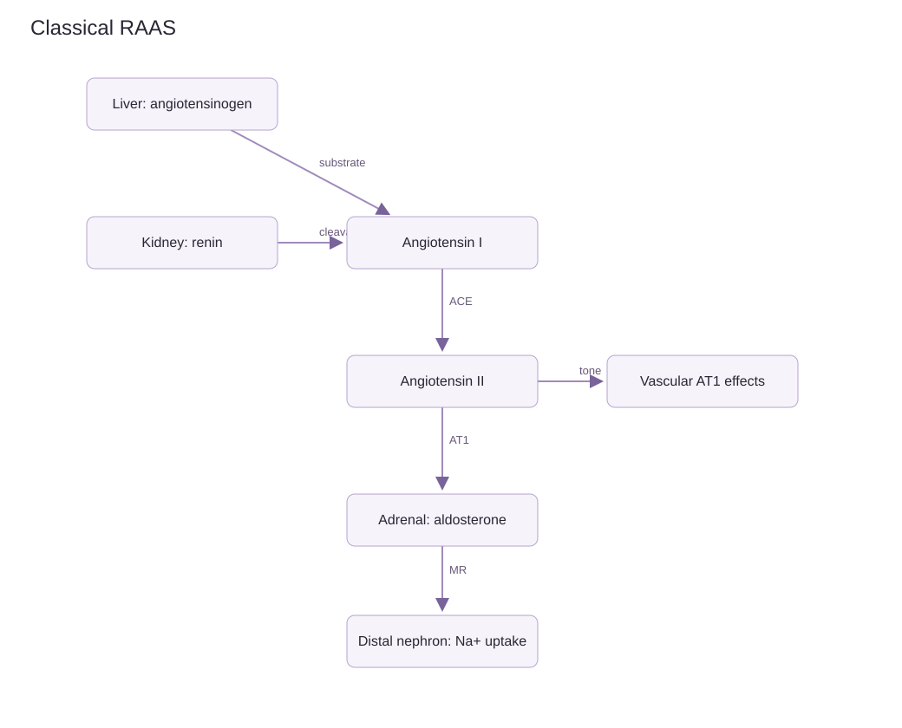

### 확인 문제

부종이 있으면 RAAS는 반드시 억제되는가?

A. 아니다.
B. 그렇다.

**정답: A**

유효동맥혈량은 총체액량과 다를 수 있다.

**오답 해설**

B: 총체액 증가만으로 신장 관류 신호를 정할 수 없다.

## 네프론 분절별 물질수송과 이뇨제 표적

### 학습목표

- 관강막·바닥가쪽막의 수송을 연결한다.
- 분절별 물·전해질 처리의 차이를 설명한다.
- 이뇨제 작용점에서 전해질 변화를 추론한다.

### 여과된 물질의 행방

사구체를 통과한 물질은 세뇨관에서 재흡수되거나 분비된다. 물질의 소변 배설률은 여과부하에서 재흡수량을 빼고 분비량을 더한 값이다. 여과부하는 혈장 농도와 사구체여과율의 곱으로 계산하되, 단백질 결합과 여과 가능 분율을 고려한다. 재흡수율은 여과량의 몇 퍼센트를 회수하는지, 재흡수량은 단위 시간에 실제로 얼마를 회수하는지 나타낸다. 여과율이 변하면 같은 분율을 회수하더라도 절대량은 달라진다.

상피를 통한 이동은 세포를 통과하는 경로와 세포 사이를 지나는 경로로 나뉜다. 세포를 통과하려면 관강막 유입과 바닥가쪽막 유출이 연결되어야 한다. 관강 쪽 수송체의 이름만 알아서는 전체 재흡수의 방향을 설명할 수 없다. 세포 사이 경로는 tight junction의 분자 구성과 전압·농도차, 물의 흐름에 영향을 받는다. 각 분절의 누출성과 선택성 차이는 그 분절이 대량 회수와 정밀 조절 중 어느 역할에 적합한지를 결정한다.

### Na+/K+-ATPase가 만드는 구동력

바닥가쪽막의 Na+/K+-ATPase는 ATP를 사용하여 Na+를 세포 밖으로, K+를 안으로 이동시킨다. 낮은 세포내 Na+ 농도는 관강에서 Na+가 들어오는 여러 이차능동수송의 에너지원이다. 이 기울기에 포도당·아미노산 공동수송과 Na+/H+ 교환 등이 연결된다. Na+가 재흡수되면 전하 균형과 삼투 조건에 따라 다른 이온과 물의 이동이 따라오지만, 그 결합 정도는 분절의 물 투과성과 수송체에 따라 달라진다.

세뇨관은 ATP를 소비하는 대사 조직이다. 신장 전체 혈류가 많아도 분절마다 산소 공급과 수요가 같지는 않다. 특히 수질의 산소 환경과 활발한 용질수송은 허혈·독성 손상의 취약성과 연결된다. 산소 소비가 감소했다는 사실이 언제나 기능 개선을 뜻하지는 않는다. 여과부하가 줄었거나 수송이 손상되어 소비가 낮아진 경우도 있기 때문이다.

### 근위세뇨관의 대량 회수

근위세뇨관(proximal tubule)은 여과된 Na+와 물의 큰 부분, 대부분의 중탄산과 포도당·아미노산을 회수한다. 높은 수송능력에 적합하게 솔가장자리와 많은 미토콘드리아, 넓은 바닥가쪽막이 발달한다. 비교적 높은 물 투과성 때문에 용질 재흡수와 물 이동이 함께 일어나 관강액의 삼투농도가 혈장과 크게 벌어지지 않는 방향으로 처리된다. 이는 모든 용질의 농도가 일정하다는 뜻은 아니다. 선택적 회수에 따라 관강의 조성은 계속 바뀐다.

포도당은 Na+와 공동수송되어 세포 안으로 들어오고 바닥가쪽막의 GLUT 계통을 통해 혈액 쪽으로 이동한다. 앞쪽과 뒤쪽 분절의 수송체는 용량과 친화도에 차이가 있다. 여과부하가 수송능력을 넘어가면 포도당이 소변에 나타날 수 있다. 개별 네프론의 수송능력이 균일하지 않고 수송의 포화가 점진적이어서, 전체 신장의 관찰 곡선은 날카로운 한 점에서 꺾이지 않고 splay를 보일 수 있다.

중탄산 재흡수는 여과된 HCO3−가 그대로 관강막을 통과하는 것으로만 설명되지 않는다. 세포가 분비한 H+가 관강의 HCO3−와 반응하고, 탄산무수화효소에 의해 생성된 CO2가 세포 안으로 들어온 뒤 HCO3−가 다시 형성되어 혈액 쪽으로 이동한다. 여기서 분비된 H+가 재활용되면 순산 배설과 같은 의미가 아니다. 여과된 염기를 회수하는 과정과 새로운 중탄산을 혈액에 공급하는 과정을 구분해야 한다.

근위세뇨관은 인산과 여러 유기물질도 처리하고, 유기 음이온·양이온의 분비를 통해 약물과 대사물 제거에 관여한다. 서로 다른 약물이 같은 수송체를 이용하면 경쟁과 노출 변화가 생길 수 있다. 혈장 단백질에 결합한 약물은 자유형 여과와 수송체 분비를 구분하여 해석한다. 근위세뇨관 기능이 넓게 손상되면 포도당·인산·아미노산과 중탄산의 손실이 함께 나타나는 양상이 가능하다.

### Henle 고리의 역할 분담

Henle 고리의 내림부분은 물과 용질 투과성이 분절에 따라 다르며, 주변 수질의 높은 삼투농도에 의해 관강액이 농축될 수 있다. 굵은오름부분(thick ascending limb)은 NKCC2를 통해 Na+, K+와 Cl−를 관강에서 세포 안으로 이동시킨다. 이 분절은 물 투과성이 낮아 소금을 회수하면서 관강액을 희석할 수 있다. 수질의 농도 기울기를 형성하는 능력과 묽은 소변을 만드는 능력에 모두 중요하다.

관강 쪽 K+ 재순환은 NKCC2 작동에 필요한 K+ 가용성과 관강 양전위 형성에 기여한다. 이 전위는 Ca2+와 Mg2+ 등 일부 양이온의 세포사이 재흡수에 영향을 준다. NKCC2를 억제하는 고리이뇨제는 NaCl 회수와 수질 기울기를 감소시키고 Ca2+·Mg2+ 배설에도 영향을 줄 수 있다. 효과는 투여량뿐 아니라 표적 부위로의 약물 전달, 여과와 혈류, 하류의 보상 재흡수에 좌우된다.

### 원위세뇨관과 집합계

원위굽은세뇨관의 NCC는 Na+와 Cl− 재흡수에 관여하며 thiazide 계열의 주요 표적이다. 이 부위의 Ca2+ 처리는 NaCl 수송과 같은 통로 하나로 이루어지지 않는다. 관강막의 Ca2+ 유입과 세포내 결합·이동, 바닥가쪽막 유출이 연결되고 호르몬이 이를 조절한다. 고리이뇨제와 thiazide가 칼슘 배설에 미치는 방향이 다른 것은 작용 분절과 전압·세포내 기울기가 다르기 때문이다.

연결세뇨관과 집합관의 주세포(principal cell)는 ENaC를 통한 Na+ 회수, K+ 분비 및 물 투과성 조절에 중요하다. ENaC를 통해 양전하가 흡수되면 관강이 상대적으로 음성이 되는 조건이 형성되어 K+ 분비에 영향을 준다. ROMK와 BK 통로, 원위 Na+ 전달과 유량, aldosterone 및 혈중 K+가 함께 배설량을 결정한다. K+ 보존 효과가 있는 이뇨제도 작용점에 따라 ENaC 차단과 mineralocorticoid 수용체 차단으로 구분된다.

사이세포(intercalated cell)는 산염기 처리에 특화된 기능을 가진다. 산 분비와 중탄산 분비에 관여하는 세포 유형의 막수송체 배치가 다르며, 혈액과 관강 사이에 어떤 방향으로 산·염기 상당량이 이동하는지를 따라가야 한다. 한 분절의 이름이 같아도 주세포와 사이세포의 기능을 같은 상피세포의 단일 작업으로 합치지 않는다.

### 분절 차단 후 나타나는 보상

상류에서 Na+ 재흡수를 억제하면 하류에 도달하는 Na+와 유량이 증가한다. 하류가 이를 회수할 여지가 있으면 이뇨 효과가 일부 상쇄될 수 있고, 장기간에는 수송체와 조직 기능이 적응할 수 있다. 서로 다른 분절을 차단하는 병용은 이 원리를 이용하지만 수분·전해질 및 신기능 변화도 커질 수 있다. 원위 Na+ 전달 증가와 RAAS 활성은 K+·H+ 배설 변화와 연결된다.

소변 Na+ 농도 한 번만으로 약물 효과와 전신 Na+ 균형을 모두 알 수는 없다. 농도와 배설량은 소변 유량을 통해 구분되고, 투약 시각과 채뇨 시점에 따라 결과가 달라진다. 부종이 줄어도 혈관 내 상태와 신장 관류는 별도로 평가한다. 분절별 수송을 이해하면 여러 이뇨제의 전해질 부작용과 보상 반응을 하나의 질량보존 틀 안에서 설명할 수 있다.

### 확인 문제

NKCC2 억제 후 소변 농축능이 감소할 수 있는 주된 기전은?

A. 수질 삼투 기울기 형성의 감소
B. ADH 합성의 필수적 완전 중단
C. 집합관의 모든 물 통로 영구 파괴

**정답: A**

굵은오름부분의 NaCl 재흡수 감소가 수질 기울기에 영향을 준다.

**오답 해설**

B: 이뇨제의 분절 작용에서 ADH 합성 중단을 필연적으로 추론할 수 없다.

C: 관강 수송 억제를 모든 물 통로의 구조적 파괴와 동일시할 수 없다.

## 역류계와 소변 농축·희석

### 학습목표

- 삼투농도와 등장성·긴장도를 구분한다.
- 역류증폭과 역류교환의 역할을 설명한다.
- ADH와 자유수청소율을 연결한다.

### 농축하려면 기울기와 투과성이 모두 필요하다

신장은 물 섭취와 용질 배설의 변화에 맞추어 소변 농도를 바꾼다. 농축 소변을 만들려면 수질의 높은 삼투농도와 집합관의 적절한 물 투과성이 함께 필요하다. 기울기가 있어도 물이 통과하지 못하면 관강액은 충분히 농축되지 않고, 물 투과성이 높아도 기울기가 소실되면 농축 능력이 제한된다. ADH 농도 하나만으로 전체 농축 기능을 설명할 수 없는 이유다.

삼투농도(osmolality)는 용매 질량당 삼투 입자 수를 표현하며, 긴장도(tonicity)는 세포막을 사이에 두고 지속적인 물 이동을 만드는 유효 삼투 입자의 영향을 가리킨다. Urea처럼 세포막을 통과하는 정도가 큰 용질은 총삼투농도에 기여하면서도 조직과 시간에 따라 긴장도에 대한 영향이 다를 수 있다. 삼투농도와 Na+ 농도, 체내 Na+ 총량을 서로 같은 양으로 취급하지 않는다.

### 역류증폭의 직관

Henle 고리의 내림부분과 오름부분은 흐름 방향과 막 특성이 다르다. 굵은오름부분은 물을 거의 따라오지 않게 하면서 NaCl을 재흡수하여 주변 간질과 관강 사이의 작은 횡방향 차이를 만든다. 인접한 내림부분에서는 물 이동 등으로 주변과의 평형을 향한 변화가 일어난다. 여기에 관강액의 지속적인 흐름이 겹치면 작은 국소 차이가 고리의 길이 방향으로 누적되어 더 큰 기울기를 만들 수 있다. 이를 역류증폭(countercurrent multiplication)으로 설명한다.

고리가 한 번에 수질 전체의 농도 차이를 펌프질해 만드는 것은 아니다. 각 위치에서의 수송과 투과, 흐름이 반복되면서 기울기가 유지된다. 바깥수질과 속수질은 기여하는 수송·용질과 구조가 달라 속수질 농축을 굵은오름부분의 NKCC2만으로 모두 설명할 수 없다. 긴 고리를 가진 네프론과 짧은 고리 네프론, 집합관 및 혈관의 배열을 함께 고려해야 한다.

### Urea 재순환과 곧은혈관

집합관에서 물이 빠져나가면 관강 urea 농도가 높아질 수 있다. 속수질 집합관의 urea 투과성과 다른 네프론 분절의 수송은 urea가 수질에 머무르며 재순환하는 데 기여한다. Urea는 단순히 버려지는 질소 부산물인 동시에 수질 삼투 기울기의 중요한 성분이다. 단백질 섭취와 urea 생성·배설, 호르몬과 유량 변화는 농축 능력에 영향을 줄 수 있다.

수질의 곧은혈관(vasa recta)은 혈류를 제공하면서 용질 기울기의 과도한 소실을 줄이는 역류교환(countercurrent exchange)을 수행한다. 내림·오름 혈관 사이에서 물과 용질이 교환되어, 들어오는 혈액이 수질 용질을 모두 씻어내지 않도록 돕는다. 역류교환은 기울기의 주된 생성 장치인 역류증폭과 다르다. 수질 혈류가 과도하게 증가하면 washout이 커질 수 있지만, 혈류가 너무 적으면 조직 산소 공급이 위협받으므로 두 요구 사이의 균형이 필요하다.

### ADH와 물 통로

Vasopressin은 집합관 주세포의 V2 수용체를 통해 cAMP 계통을 활성화하고 aquaporin-2의 관강막 삽입을 촉진한다. 물은 관강에서 세포로 들어온 뒤 바닥가쪽막의 물 통로 등을 통해 간질 쪽으로 이동한다. 저장 소포의 이동에 의한 빠른 조절과 물 통로 발현량의 장기 변화는 시간 규모가 다르다. ADH가 물을 능동적으로 끌어내는 펌프가 아니라 물이 삼투 기울기를 따라 이동할 수 있는 투과 경로를 바꾸는 신호라는 점이 핵심이다.

혈장 삼투 자극과 순환량·압력 신호는 vasopressin 분비를 함께 조절한다. 심한 유효 순환량 감소에서는 삼투 자극과 다른 방향의 물 보존 반응이 나타날 수 있다. 갈증은 물 섭취를 조절하여 배설 조절과 함께 균형을 유지한다. ADH 분비가 낮거나 신장이 반응하지 못하는 상태와, 이뇨로 수질 기울기가 손상된 상태는 모두 농축 장애를 만들 수 있으나 원인과 검사 반응은 다르다.

### 묽은 소변의 형성

물 투과성이 낮은 상태에서 오름부분과 원위 분절이 용질을 재흡수하면 관강액이 희석된다. 집합관도 물을 적게 통과시키면 희석액을 충분히 재농축하지 않고 배출할 수 있다. 반대로 용질 재흡수 자체가 손상되거나 원위 전달이 적으면 물을 많이 마셨더라도 배출 가능한 자유수량이 제한될 수 있다. 신장의 희석 능력은 ADH의 낮은 분비뿐 아니라 여과와 상류·원위 수송에도 의존한다.

소변으로 배출해야 하는 용질량을 일정하게 놓으면 소변 유량과 농도는 서로 연결된다. 배설량=농도×유량이므로 같은 용질을 매우 묽게 내보낼수록 많은 물이 필요하고, 농축할수록 필요한 물은 줄어든다. 하루 최소 소변량은 용질 부하와 최대 농축 능력의 관계에 따라 달라진다. 따라서 특정한 고정 소변량을 모든 식이와 모든 환자의 필수 배설량으로 일반화할 수 없다.

### 청소율로 물 처리를 표현하기

삼투청소율(Cosm)은 Uosm×V/Posm이다. Uosm은 소변 삼투농도, Posm은 혈장 삼투농도, V는 소변 유량이다. 자유수청소율(CH2O)은 V−Cosm으로 정의하며, 혈장과 등장성인 용질 운반에 필요한 부피를 제외한 물의 순배설을 표현한다. 양수이면 혈장보다 묽은 소변을 통해 자유수를 내보내는 방향이고 음수이면 용질에 비해 물을 보존하는 방향이다.

이 계산은 총삼투 입자를 사용하므로 urea 등 전해질과 다른 용질의 영향을 포함한다. 혈청 Na+ 변화와의 관계를 평가할 때는 소변 Na+와 K+를 이용한 전해질 자유수청소율이 다른 정보를 줄 수 있다. 어떤 정의를 쓰는지에 따라 같은 소변의 해석이 달라질 수 있으므로 기호와 분모를 명확히 한다. 순간 측정값은 투약과 수액, 섭취 및 배설의 시간 변화 속에서 해석해야 한다.

### 확인 문제

Uosm=600, Posm=300 mOsm/kg, 소변 유량이 1 mL/min이면 자유수청소율은?

A. +1 mL/min
B. 2 mL/min
C. −1 mL/min

**정답: C**

Cosm=600×1/300=2이므로 CH2O=1−2=−1이다.

**오답 해설**

A: 양수와 음수의 의미를 뒤바꾼 계산이다.

B: 2는 삼투청소율이며 자유수청소율과 다르다.

## 칼륨의 세포내 분포와 신장 배설

### 학습목표

- 세포간 이동과 총체내 칼륨 변화를 구분한다.
- 원위 네프론의 분비 조절을 설명한다.
- 칼륨·나트륨·체액량 조절의 연결을 해석한다.

### 농도와 총량을 분리한다

칼륨(K+)은 주된 세포내 양이온으로 막전위와 근육·신경 기능, 효소 반응에 관여한다. 몸 전체의 많은 칼륨이 세포 안에 있기 때문에 일부만 세포 밖으로 이동해도 혈중 농도가 크게 변할 수 있다. 혈청 K+가 높다는 사실은 총체내 K+가 반드시 증가했다는 뜻이 아니며, 낮은 농도도 총량 부족과 세포내 이동을 구분해야 한다. 두 과정이 동시에 존재할 수 있다.

섭취 후 칼륨을 모두 즉시 소변으로 배설하는 것은 아니다. Insulin과 β2-adrenergic 신호 등은 Na+/K+-ATPase 및 관련 과정을 통해 세포내 분포를 조정하여 초기 상승을 완충한다. 이후 신장 배설이 장기 균형을 맞춘다. 세포내 이동을 촉진하는 조치는 혈중 농도를 바꿀 수 있지만 체내에서 칼륨을 제거한 것과는 다르다. 일시적 농도 교정과 총량 처리의 시간 범위를 구분해야 한다.

### 산염기와 세포 손상

산염기 상태는 칼륨 분포와 신장 처리에 영향을 주지만 모든 산증이 같은 정도의 세포외 이동을 만드는 것은 아니다. 유기산과 무기산, insulin 상태와 삼투 변화 및 신기능이 함께 작용한다. 단순히 H+가 하나 들어가면 K+가 하나 나온다는 고정 교환식만으로 모든 임상 상황을 설명할 수는 없다. 산혈증의 원인과 다른 대사 조건을 확인해야 한다.

고삼투 상태에서는 세포의 물 이동과 농도 변화, 칼륨 이동이 연결될 수 있다. 근육과 다른 세포의 손상은 세포내 칼륨을 방출하고, 인체의 처리 능력에 따라 혈중 농도가 상승할 수 있다. 채혈 과정의 용혈은 시험관 안에서 비슷한 수치 변화를 만들 수 있어 실제 체내 이상과 구분한다. 검체 상태를 확인하되, 임상적으로 위험한 실제 고칼륨혈증을 단순한 채혈 오류로 단정하지 않는다.

### 근위부의 회수와 원위부의 결정

여과된 K+의 큰 부분은 근위세뇨관과 Henle 고리에서 회수된다. 이 회수는 Na+와 물의 이동, 전압과 분절 투과성에 연결된다. 최종 배설량의 조절에는 연결세뇨관과 집합관 등 원위 분절의 분비·재흡수가 중요하다. 사구체여과율이 낮아져도 남은 네프론이 단위당 분비를 늘려 어느 정도 보상할 수 있으므로 혈중 농도와 GFR이 단순 비례하는 것은 아니다.

주세포의 바닥가쪽 Na+/K+-ATPase는 세포 안으로 K+를 공급하고, 관강막의 K+ 통로를 통한 분비에 필요한 기울기를 유지한다. ENaC를 통한 Na+ 재흡수는 관강의 전기적 조건을 바꾸어 K+ 분비를 촉진할 수 있다. ROMK와 BK 통로는 상황별 기여가 다르며 특히 유량과 국소 기계적 신호가 분비에 영향을 줄 수 있다. 통로의 존재와 실제 순분비량은 구동력과 유량을 포함해 해석해야 한다.

### 원위 전달량과 유량

상류에서 Na+ 재흡수를 줄이거나 관강 유량을 늘리면 원위 K+ 분비가 증가하는 조건이 형성될 수 있다. 일부 이뇨제의 저칼륨 경향은 이 원리와 RAAS 반응을 함께 고려하면 설명된다. 그러나 전체 순환량이 감소하여 여과와 원위 전달이 크게 줄면 같은 호르몬 상태에서도 배설 결과가 달라질 수 있다. 농도, 유량과 호르몬을 각각 분리하지 않고 동시에 평가한다.

K+ 섭취가 적어지면 분비를 줄이고 필요한 재흡수를 늘리는 적응이 나타난다. 일부 사이세포의 H+/K+-ATPase 등은 K+ 보존과 산염기 처리를 연결한다. 신장은 많은 양의 K+를 배설할 수도 있고 부족할 때 손실을 줄일 수도 있지만 능력과 적응 속도에 한계가 있다. 초기 정상 혈중 농도가 지속적인 결핍의 부재를 보장하지는 않는다.

### Aldosterone을 넘는 조절

혈중 K+ 상승은 부신의 aldosterone 분비를 직접 자극할 수 있고, aldosterone은 원위 Na+·K+ 처리와 관련 단백질을 조절한다. Angiotensin II와 유효 순환량 신호도 원위 기능에 영향을 준다. 같은 aldosterone 상승이라도 K+ 과다 섭취에 대한 반응과 체액량 감소에 대한 반응은 Na+ 전달과 다른 신호가 달라 배설 패턴이 같지 않을 수 있다. Aldosterone의 이름 하나로 모든 K+ 배설 변화를 설명하지 않는다.

원위굽은세뇨관은 세포 바깥 K+ 상태를 감지하여 NCC 조절에 연결하는 경로를 가진다. K+가 부족할 때 NCC를 통한 NaCl 회수가 증가하면 더 하류로 가는 Na+가 줄어 K+ 손실을 제한하는 방향으로 작용할 수 있다. 반대로 K+가 많은 상태에서 상류 회수 조절과 원위 분비 증가는 배설에 기여한다. 세포의 막전위와 Cl− 신호, kinase 계통은 이 연결의 일부다.

### 소변 검사로 원인을 추론하기

소변 K+ 농도는 농축 정도의 영향을 받으므로 배설량과 구분한다. 하루 채뇨, K+/creatinine 비 등은 상황에 따라 다른 정보를 제공한다. 채뇨의 완전성, 투여한 K+와 이뇨제, 식이와 시간 경과가 결과에 영향을 준다. 저칼륨혈증에서 신장이 충분히 보존하는지, 고칼륨혈증에서 배설이 적절한지를 현재 생리적 상황에 비추어 판단해야 한다.

과거에 쓰인 일부 기울기 지표는 소변의 삼투·Na+ 조건과 수질 처리에 관한 가정이 필요하다. 계산값을 얻었다는 사실만으로 가정이 충족되었다고 볼 수 없으며, 실제 원인 평가에서 한 지표에 과도하게 의존하지 않는다. 혈압과 체액 상태, 산염기, Mg2+와 신기능, 약물력은 K+ 장애의 감별을 서로 다른 방향에서 좁혀 준다.

### 흥분성 조직에 미치는 결과

세포외 K+가 상승하면 K+ 평형전위가 덜 음성으로 이동하고 안정막전위가 탈분극하는 방향의 영향이 생긴다. 가벼운 변화와 심한 지속 변화는 흥분성에 다른 결과를 만들 수 있다. 심한 탈분극에서는 전압개폐성 Na+ 통로의 가용성이 감소하여 전도 장애와 근력 저하가 나타날 수 있다. 저칼륨에서도 막전위뿐 아니라 통로와 재분극 과정의 변화가 부정맥 위험에 영향을 준다.

심전도 소견과 혈중 K+ 사이의 관계는 개인과 발생 속도, 다른 전해질과 질환에 따라 달라진다. 전형적 심전도 변화가 없다는 사실만으로 위험한 수치를 안심시켜서는 안 된다. 임상 평가는 증상과 심전도, 검체 신뢰성 및 원인을 병행하여 다룬다. 혈중 농도를 일시적으로 이동시키는 치료와 심장막 안정화, 체내 제거 및 원인 교정은 서로 다른 목표다.

### 확인 문제

인슐린 투여 직후 혈중 칼륨이 감소한 현상의 해석으로 적절한 것은?

A. 혈중 칼륨은 세포 내 이동의 영향을 받지 않는다.
B. 세포 내 이동으로 농도가 감소했을 수 있으며 총체내 칼륨이 같은 양만큼 즉시 감소한 것은 아니다.
C. 혈중 농도가 줄어든 양만큼 반드시 소변으로 배출되었다.

**정답: B**

농도는 세포 안팎 분포와 총량에 모두 의존한다. 이동과 체외 제거를 구별해야 한다.

**오답 해설**

A: 칼륨은 세포내외 분포 변화에 따라 혈중 농도가 변한다.

C: 혈중 농도 감소는 세포 내 이동으로도 일어나며 즉시 소변 제거를 의미하지 않는다.

## 막전위의 전기화학적 기초

### 학습목표

- Nernst 식의 부호와 변수를 해석한다.
- 막전위와 평형전위를 구분한다.
- 활동전위와 Na+/K+ 펌프의 역할을 구별한다.

### 전하 분리와 농도 차이

막전위(membrane potential, Vm)는 관례적으로 세포 안 전위에서 바깥 전위를 뺀 값이다. Vm이 음수라는 것은 세포 안이 바깥에 비해 전기적으로 낮은 전위라는 뜻이다. 세포 안의 모든 물질이 음전하를 띤다는 뜻은 아니다. 양쪽 벌크 용액은 거의 전기적 중성을 유지하고, 막 가까이에 극히 적은 전하가 분리되어 전압을 형성한다. 지질이중층은 전하 이동을 제한하는 절연체에 가깝고, 이온통로는 특정 이온이 이동할 수 있는 전도 경로를 제공한다. 이 때문에 세포막은 저항과 축전기를 함께 갖는 회로로 근사할 수 있다.

이온의 이동에는 농도 기울기에 따른 화학적 힘과 전위차에 따른 전기적 힘이 함께 작용한다. 세포 안에 칼륨이 많고 칼륨통로가 열려 있으면 칼륨은 처음에 바깥으로 나가려 한다. 양전하 유출은 세포 안을 더 음성으로 만들어 칼륨을 다시 안으로 당기는 전기적 힘을 키운다. 두 힘이 정확히 균형을 이루면 그 이온의 순이동이 0이 된다. 하지만 개별 이온은 양방향으로 계속 움직일 수 있으므로 순이동 0과 분자 운동 정지를 구분해야 한다.

### Nernst 식의 유도와 부호

이온 X의 안쪽과 바깥쪽 전기화학퍼텐셜 차이는 Δμ=RT ln([X]in/[X]out)+zFVm으로 나타낸다. R은 기체상수, T는 절대온도, z는 이온의 전하수, F는 Faraday 상수다. 평형에서는 Δμ=0이므로 EX=(RT/zF)ln([X]out/[X]in)을 얻는다. 엄밀히 농도 대신 활동도를 사용하지만 희석 용액의 교육용 근사에서는 농도를 쓴다. 온도는 섭씨가 아니라 kelvin으로 넣어야 하며, 이가이온에는 z=2를 사용한다. 음이온은 z의 부호가 음수이므로 양이온과 같은 농도비에서 전위 부호가 반대로 바뀐다.

칼륨의 세포내 농도가 바깥보다 높으면 로그 항이 음수여서 EK는 음수가 된다. 나트륨은 보통 반대 농도분포를 가지므로 ENa는 양수가 된다. 여기서 EX는 그 이온이 평형에 있을 막전위이며 실제 Vm과 같다고 보장되지 않는다. 실제 세포에는 여러 이온의 투과 경로가 동시에 열려 있고, ATP를 사용하는 수송도 일어난다. 따라서 안정막전위를 특정 이온의 농도비만으로 항상 정확히 계산할 수는 없다.

### 여러 이온의 기여

Goldman-Hodgkin-Katz 전압식은 일정한 전기장 등 특정 가정 아래 여러 일가이온의 상대적 투과도를 이용해 막전위를 근사한다. 칼륨과 나트륨은 바깥 농도가 분자에, 안 농도가 분모에 들어가지만 염화물은 음이온이어서 반대 위치에 들어간다. 통로가 열릴수록 막전위가 그 이온의 평형전위 쪽으로 이동한다는 직관은 유용하다. 그러나 이온의 유동 방향은 농도 차이만이 아니라 Vm−EX라는 구동력과 전도도에 달려 있다. 통로가 열려 있어도 Vm=EX이면 그 이온의 순전류는 작을 수 있다.

단순한 옴성 근사에서 IX=gX(Vm−EX)로 쓴다. gX는 이온 전도도다. 전류의 부호는 전기생리학의 관례를 확인해야 하며, 양전하가 밖으로 흐르는 것을 양의 막전류로 정의하는 경우가 흔하다. 염화물처럼 음이온의 실제 이동 방향과 전류 방향은 서로 반대일 수 있다. 전도도와 투과도도 동일한 물리량은 아니다. 모든 통로가 선형 저항처럼 작동하지 않으므로 이 식은 특정 전압 범위에서의 근사임을 기억해야 한다.

### 펌프와 활동전위

Na+/K+-ATPase는 보통 ATP 1분자를 사용하여 Na+ 3개를 밖으로, K+ 2개를 안으로 이동시킨다. 순양전하 하나가 밖으로 나가므로 전기발생성이 있지만, 펌프의 핵심 역할은 장기간 이온 농도 기울기를 유지하는 것이다. 신경세포 활동전위의 빠른 상승과 하강을 펌프가 매번 직접 만들지는 않는다. 빠른 파형은 전압개폐성 Na+ 통로의 활성화와 불활성화, K+ 통로 개방 등의 시간 차이가 만든다. 펌프를 차단하면 농도 기울기가 점차 소실되고 결국 흥분성도 유지되지 못한다.

탈분극(depolarization)은 막전위가 덜 음성으로 변하는 것이며, 반드시 양전위가 된다는 뜻은 아니다. 역치(threshold)를 넘으면 나트륨 유입이 더 많은 통로 활성화를 유도하는 양성되먹임이 형성된다. 이후 Na+ 통로의 불활성화와 K+ 유출 증가가 재분극을 촉진한다. 절대불응기에는 많은 Na+ 통로가 회복되지 않아 새 활동전위를 일으키기 어렵고, 상대불응기에는 평소보다 큰 자극이 필요하다. 심근과 결절세포는 통로 구성이 달라 신경세포 파형을 그대로 적용할 수 없다.

### 임상으로 이어지는 추론

세포외 칼륨 상승은 보통 EK를 덜 음성으로 만들고 안정막전위를 탈분극시키는 방향으로 작용한다. 가벼운 변화는 흥분성을 높일 수 있지만 심한 지속 탈분극은 Na+ 통로 불활성화를 증가시켜 오히려 전도와 근력에 장애를 줄 수 있다. 따라서 탈분극은 항상 흥분성 증가라는 등식은 틀린다. 탈수초화에서는 전류 누출과 막의 전기적 특성이 바뀌어 도약전도가 손상된다. 이러한 현상은 거시적 신경 모델의 형태만으로 설명할 수 없으므로, 막회로와 이온통로 시간 경과를 별도 그래프로 제시해야 한다.

$$
E_X=\frac{RT}{zF}\ln\frac{[X]_{out}}{[X]_{in}}
$$

E_X: 이온 평형전위; R: 기체상수; T: 절대온도; z: 전하수; F: Faraday 상수

### 확인 문제

활동전위의 빠른 재분극을 펌프가 매번 직접 만드는가?

A. 아니다.
B. 그렇다.

**정답: A**

빠른 파형은 주로 통로 전도도와 불활성화의 시간 변화에 의한다.

**오답 해설**

B: 펌프의 장기 농도기울기 유지 기능과 파형 생성은 다르다.

## 폐환기와 가스교환 및 환기관류 관계

### 학습목표

- 분당환기량과 폐포환기량을 구분한다.
- 산소분압과 산소함량을 구분한다.
- 환기관류 불균형과 단락의 기전을 설명한다.

### 공기가 들어가는 조건

흡기 때 가로막이 수축하여 흉강의 용적이 증가하면 흉막강압이 더 낮아지고 폐가 팽창한다. 폐포압이 대기압보다 낮아지는 동안 공기가 기도로 들어온다. 안정 호기는 대개 탄성 반동에 의한 수동 과정이지만 운동이나 기도폐색에서는 호기근 활동이 중요해질 수 있다. 폐를 확장하는 압력인 경폐압(transpulmonary pressure)은 폐포압과 흉막강압의 차이다. 폐포압 하나만으로 팽창 상태를 판단하면 흉벽과 흉막 압력의 영향을 놓친다.

순응도(compliance)는 용적 변화량을 압력 변화량으로 나눈 값으로, 어느 구간에서 측정하는지에 따라 달라진다. 폐기종에서는 탄성 반동이 줄어 순응도가 커질 수 있고 섬유화에서는 감소할 수 있다. 순응도가 높다는 말이 언제나 좋은 폐 기능을 뜻하지 않는다. 표면활성물질(surfactant)은 표면장력을 낮추고 작은 폐포의 안정화와 호흡 일 감소에 기여한다. 기도 저항은 반지름에 민감하지만, 실제 기도는 분지와 난류, 동적 압박이 있는 구조이므로 한 개의 단단한 관에 대한 식을 그대로 전폐에 적용하지 않는다.

### 사강을 빼야 하는 이유

분당환기량은 일회호흡량(VT)과 호흡수(f)의 곱이지만, 모든 공기가 가스교환에 참여하는 것은 아니다. 해부학적 사강은 전도기도의 공간이고 폐포 사강은 환기는 되지만 관류가 충분하지 않은 폐포의 기여다. 폐포환기량은 단순화하여 VA=(VT−VD)f로 표현한다. 같은 분당환기량이라도 얕고 빠르게 호흡하면 사강에 쓰이는 비율이 커져 유효 폐포환기가 줄 수 있다. 따라서 호흡수가 많다는 사실만으로 충분한 CO2 제거를 보장할 수 없다.

정상상태에서 CO2 생성량이 일정하다면 PaCO2는 폐포환기량에 대략 반비례한다. 운동, 발열, 대사 변화로 CO2 생성량이 달라지면 환기가 같아도 PaCO2가 변할 수 있다. 기도폐색, 호흡근 약화, 중추 억제는 서로 다른 기전으로 환기 부족을 일으킨다. 산소를 투여하여 산소포화도가 개선되어도 CO2 배출 장애가 해결되었다고 판단할 수 없다. 환기와 산소화는 연결되어 있지만 별도로 평가해야 하는 기능이다.

### 분압과 함량

산소분압은 용해된 산소의 분자적 상태를 반영하고, 혈액의 산소함량은 헤모글로빈에 결합한 산소와 용해 산소의 합이다. 대부분의 산소는 헤모글로빈 결합 형태로 운반되므로 심한 빈혈에서는 PaO2가 유지되어도 총산소운반량이 감소할 수 있다. 반대로 산소포화도와 산소분압은 산소해리곡선을 통해 비선형 관계를 가진다. pH, CO2, 온도, 2,3-BPG 등은 헤모글로빈의 산소 친화도와 조직 방출에 영향을 준다. 산소 전달량은 심박출량과 동맥 산소함량의 곱으로 연결해야 한다.

확산은 분압차, 막의 면적과 두께, 기체 특성에 영향을 받는다. 정상적인 조건에서는 폐포와 모세혈관의 산소 교환이 비교적 빠르지만, 막이 두꺼워지거나 통과 시간이 짧아지면 제한이 드러날 수 있다. 확산능 검사와 안정 시 산소분압은 같은 정보를 주는 검사가 아니다. 폐기종은 가스교환 면적 손실, 간질성 질환은 장벽 변화 등을 통해 서로 다른 구조적 문제를 만들 수 있다. 거시적 폐 모델만으로 이 차이를 직접 시각화할 수는 없다.

### V/Q 스펙트럼

환기관류비(ventilation-perfusion ratio, V/Q)는 한 폐 단위에 도달하는 공기와 혈류의 상대적 양이다. V/Q가 낮으면 관류에 비해 공기 공급이 부족하고, 매우 낮아져 환기가 없으면 단락(shunt)에 가까워진다. V/Q가 높으면 공기에 비해 혈류가 부족하고, 관류가 없으면 사강에 해당한다. 실제 폐는 여러 비율의 단위가 섞여 있으며 중력과 질환에 따라 분포가 달라진다. 정상 전체 평균 하나를 모든 폐포의 실제 비율로 해석해서는 안 된다.

저산소성 폐혈관수축은 국소 폐포 산소가 낮을 때 혈류를 다른 부위로 돌리는 데 기여한다. 그러나 광범위한 저산소 상태에서는 폐혈관 저항 상승에 기여할 수도 있다. 단락 혈액은 환기되는 폐포를 통과하지 않으므로 흡입산소를 높여도 저산소혈증 교정에 제한이 있을 수 있다. 반면 많은 저 V/Q 단위에서는 산소 공급 증가가 도움이 된다. 산소 반응을 하나의 진단검사처럼 절대화하지 말고 폐포 환기, 확산, 순환, 기저 질환과 함께 해석해야 한다.

### 확인 문제

같은 분당환기량에서 더 얕고 빠른 호흡의 문제는?

A. 언제나 가스교환이 좋아진다.
B. 사강 비율이 증가해 폐포환기가 줄 수 있다.

**정답: B**

VA=(VT−VD)f에서 사강 기여를 제외해야 한다.

**오답 해설**

A: 분당환기량과 유효 폐포환기량은 다르다.

## 호흡 리듬과 화학적 조절

### 학습목표

- 호흡 리듬 생성과 화학수용체 조절을 구별한다
- 중추·말초 화학수용체의 신호를 설명한다
- 이산화탄소 저류와 산소 투여의 관계를 다요인으로 설명한다

### 리듬 생성과 가스 항상성

호흡근은 신경계의 주기적인 출력을 받아 흡기와 호기를 만든다. 뇌간의 여러 신경회로가 기본 리듬과 양상을 형성하고, 화학수용체와 기계수용체, 상위 중추의 입력이 이를 조절한다. 호흡은 폐가 산소 부족을 감지할 때마다 독립적으로 수축하는 반사만이 아니다. 수면 중에도 유지되는 기본 출력과 말하기·노래·자발적 숨참기 같은 행동 조절이 함께 존재한다. 의식이 없어도 리듬이 유지될 수 있는 현상과 의식적인 호흡 변화가 가능한 현상은 서로 다른 입력이 같은 운동 출력에 모이는 결과이다.

연수의 리듬 관련 회로는 흡기 활동과 호기 전환을 조정하고 교뇌와 다른 영역의 입력은 패턴을 바꾼다. 특정 핵 하나가 정상 호흡의 모든 측면을 독립적으로 지휘한다고 단순화하기보다 연결된 신경망의 활동으로 이해한다. 출력은 횡격막과 늑간근, 상기도 근육 및 필요한 보조근에 분배된다. 상기도의 개방과 호흡펌프의 움직임이 조화되지 않으면 호흡 노력이 있어도 유효 환기가 떨어질 수 있다.

### 중추 화학수용과 이산화탄소

이산화탄소는 혈액뇌장벽을 비교적 쉽게 통과하고 중추 주변의 산염기 환경을 바꾼다. 중추 화학수용체(central chemoreceptor)는 이 변화와 연결된 수소이온 신호 등에 반응하여 환기를 조절한다. 혈중 수소이온이 이산화탄소와 같은 속도로 자유롭게 장벽을 통과한다고 설명해서는 안 된다. 동맥혈 이산화탄소 상승이 중추의 산성화와 연결되는 과정이 정상 호흡 조절에서 중요한 자극이다.

이산화탄소 생성이 일정할 때 폐포환기가 감소하면 동맥혈 PaCO2가 증가하고, 조절 회로는 호흡 출력을 높여 이를 낮추려 한다. 반응의 크기는 각성 상태, 약물, 만성 가스 이상과 신경계 상태에 따라 달라진다. 만성 고탄산혈증에서는 신장과 중추 주변의 중탄산염 변화 등 적응이 일어나 같은 PaCO2 변화에 대한 반응이 급성 상태와 다를 수 있다. 그러나 만성 질환에서 이산화탄소 반응이 항상 완전히 사라진다고 일반화하지 않는다.

### 말초 화학수용체

경동맥소체(carotid body)와 대동맥소체(aortic body)는 말초 화학수용의 주요 구조이다. 경동맥소체의 신호는 주로 혀인두신경, 대동맥소체의 신호는 주로 미주신경 경로로 중추에 전달된다. 이들은 산소뿐 아니라 이산화탄소와 산염기 변화에도 반응한다. 경동맥소체와 목동맥굴(carotid sinus)의 압수용 기능은 위치가 가깝지만 감지 변수와 역할이 다르므로 구별해야 한다.

말초의 저산소 자극은 주로 동맥혈 산소분압과 관련된다. 헤모글로빈 농도가 줄어 산소함량이 감소했더라도 PaO2가 유지되면 같은 정도의 저산소분압 반응을 예상할 수 없다. 산소운반 능력의 감소와 저산소혈증을 구별해야 하는 또 다른 이유이다. 산소분압이 낮아지는 구간에서 환기 반응은 선형으로 일정하게 커지는 것이 아니라 비선형적인 양상을 보이며, 고탄산혈증과 산증이 반응을 강화할 수 있다.

### 대사산증과 호흡 보상

대사산증에서는 말초의 수소이온 반응 등이 환기 증가에 기여하여 PaCO2를 낮추고 pH 저하를 완화한다. 이 보상은 산을 없애는 신장 기능이나 원인 치료를 대신하지 않으며 pH를 반드시 완전히 정상화하는 것도 아니다. 심한 산증에 대한 큰 호흡 노력이 호흡근 피로와 의식 저하 등으로 유지되지 못하면 PaCO2가 올라가면서 상태가 급격히 악화할 수 있다. 호흡수가 감소한 것을 불편감의 호전으로만 해석하면 위험하다.

기도 처치나 진정으로 자발적인 보상 환기가 갑자기 감소하면 산증 환자의 가스 상태가 변할 수 있다. 산소포화도만 보아서는 이 변화를 알기 어렵다. 호흡 깊이와 분당환기 및 실제 폐포환기, 이산화탄소와 산염기 상태를 함께 고려해야 한다. 같은 호흡수라도 사강과 일회호흡량이 다르면 이산화탄소 제거가 달라진다는 점이 조절 신호와 실제 결과를 연결한다.

### 수면·운동·약물

수면은 각성에 의한 호흡 자극과 상기도 근육 긴장을 바꾸어, 정상 각성 상태와 다른 호흡 취약성을 만들 수 있다. 오피오이드와 여러 진정제는 호흡 구동 및 각성 반응에 영향을 줄 수 있고, 상기도 폐쇄와 저환기는 함께 존재할 수 있다. 호흡 노력이 있는지와 실제 공기가 이동하는지를 구별해야 한다. 구동이 줄어든 중추성 문제와 출력은 있지만 기도가 막힌 문제는 평가와 처치의 표적이 다르다.

운동 중 환기는 산소 소비와 이산화탄소 생성 증가에 맞추어 조정된다. 정상적인 중등도 운동에서 PaCO2가 크게 오르기 전에 환기가 증가할 수 있어 운동성 환기를 혈중 이산화탄소 축적만으로 설명하기 어렵다. 운동 중추와 근육·관절의 입력, 대사와 화학적 조절이 함께 작용한다. 호흡곤란의 주관적 느낌 역시 가스분압 하나보다 호흡 노력과 요구, 실제 환기 사이의 관계 및 감각 입력의 영향을 받는다.

### 산소 투여와 고탄산혈증

일부 환자에서 높은 산소 노출 뒤 PaCO2가 증가하는 현상은 저산소 호흡 구동 감소 하나로만 설명되지 않는다. 저산소성 폐혈관수축의 완화에 따른 환기-관류 불일치 변화, 헤모글로빈 산소화에 따른 이산화탄소 운반 특성 변화인 Haldane 효과, 환기 변화 등이 관여할 수 있다. 각각의 비중은 환자 상태에 따라 다르다. 이 현상을 이유로 필요한 저산소혈증 치료를 단순히 회피하는 결론을 내리지 않고 목표 산소화와 환기 및 가스 상태를 함께 조절해야 한다.

호흡 조절의 임상적 평가는 신경 구동, 기도 개방, 호흡펌프의 능력, 폐의 가스교환을 구별한 뒤 통합하는 과정이다. 의식과 근력, 호흡 노력, 산소화 및 PaCO2는 각각 다른 단서를 준다. 문제가 생긴 단계와 남아 있는 보상 능력을 알면 산소 투여만으로 해결되는 상황과 환기 지지가 필요한 상황을 더 정확히 구분할 수 있다. 정상적인 음성 되먹임 회로를 이해하는 것이 호흡부전의 안전한 해석에 선행한다.

### 확인 문제

정상 PaO2를 유지하는 심한 빈혈에서 말초 화학수용 반응을 해석하면?

A. 산소함량 감소는 같은 크기의 저산소분압 자극과 동일하다.
B. 산소함량 감소와 PaO2 감소는 구별해야 한다.
C. 경동맥소체는 혈압만 감지한다.

**정답: B**

헤모글로빈 감소로 함량이 낮아져도 PaO2가 유지될 수 있다.

**오답 해설**

A: 말초 저산소 반응은 주로 동맥혈 산소분압과 관련된다.

C: 경동맥소체의 화학수용과 경동맥굴의 압수용을 혼동했다.

## 칼슘·인산과 PTH·비타민 D의 통합

### 학습목표

- 총칼슘과 이온화칼슘을 구분한다.
- PTH·비타민 D·FGF23의 작용을 연결한다.
- 혈중 칼슘과 뼈의 물질수지를 나누어 해석한다.

### 세 구획과 두 가지 임무

칼슘은 뼈의 무기질 성분이면서 세포 신호와 신경근 흥분성, 분비와 응고 등 다양한 기능에 필요하다. 체내의 큰 저장량은 뼈에 있고 세포외액의 작은 분획이 빠르게 조절된다. 세포질의 자유 Ca2+도 세포외액과 소기관 저장소에 비해 낮게 유지되어 신호의 기울기를 만든다. 혈중 농도 조절과 뼈의 장기적인 강도·무기질 함량은 연결되어 있지만 같은 질문은 아니다.

혈중 총칼슘에는 단백질 결합형과 작은 음이온에 결합한 분획, 이온화된 자유형이 포함된다. 생리적 효과와 직접 연결되는 이온화 분획은 albumin과 pH 등 조건에 따라 총농도와 다른 방향을 보일 수 있다. Albumin이 낮으면 총칼슘이 낮아도 자유형 상태가 같은 정도로 낮지 않을 수 있다. pH 변화는 단백질 결합에 영향을 주므로 빠른 산염기 변화에서 총칼슘만으로 증상을 해석하기 어렵다.

### 감지와 PTH 분비

부갑상샘 세포의 calcium-sensing receptor(CaSR)는 세포외 Ca2+ 상태를 분비 조절에 연결한다. 이온화칼슘이 낮아지면 PTH 분비가 증가하는 방향의 반응이 나타난다. PTH는 신장과 뼈를 통해 혈중 Ca2+를 유지하고 비타민 D 활성화 경로를 조절하여 장의 흡수에도 간접 영향을 준다. 같은 호르몬의 단기 분비와 장기 합성·샘 증식은 시간 규모가 다르다.

Mg2+ 상태도 PTH 분비와 작용에 영향을 줄 수 있다. 심한 Mg2+ 결핍에서는 칼슘 저하에 대한 적절한 반응이 손상될 수 있어 단순히 PTH를 측정했다는 사실만으로 조절계를 모두 이해할 수는 없다. 유전적 수용체 기능 변화와 약물도 감지·분비의 관계를 바꾼다. 칼슘이 높은데 PTH가 참고범위 안에 있다는 결과는 정상 상황에서 기대되는 억제가 적절한지와 함께 판단해야 한다.

### 신장에서의 칼슘과 인산 처리

칼슘은 여러 네프론 분절에서 회수되며 근위와 Henle 고리의 세포사이 이동, 원위 분절의 능동적 조절이 각각 기여한다. PTH는 특히 조절 가능한 분절의 칼슘 재흡수에 영향을 주고, 인산의 근위 재흡수는 줄여 소변 배설을 늘리는 방향으로 작용한다. 칼슘과 인산이 뼈에서 함께 방출되어도 신장의 차등 처리가 혈중 최종 조합을 바꾼다. 한 장기의 반응만으로 전체 농도를 예측할 수 없는 이유다.

PTH는 신장의 1α-hydroxylase 계통을 조절하여 활성 비타민 D 생성에 기여한다. 신기능이 떨어지면 인산 배설과 비타민 D 대사, 조절호르몬의 균형이 함께 변한다. 단백질 결합과 GFR, 약물과 원위 수송 상태도 소변 칼슘을 바꿀 수 있다. 소변 칼슘이 적거나 많다는 결과는 식이·체액과 신기능, 호르몬 및 채뇨 상태를 함께 평가해야 한다.

### 뼈의 재형성과 호르몬

Osteoclast는 뼈 흡수에, osteoblast 계통은 기질 형성과 무기질화 및 세포간 조절에 관여한다. PTH의 osteoclast 효과는 골모세포 계통의 RANKL·OPG 등 신호를 통한 간접 연결이 중요하다. 흡수와 형성은 재형성 단위에서 연결되지만 시간과 균형이 달라질 수 있다. 지속적으로 높은 노출과 간헐적 약리 자극은 뼈에 다른 결과를 만들 수 있으므로 PTH는 언제나 같은 방향의 뼈 파괴 호르몬이라는 설명은 충분하지 않다.

뼈의 무기질화에는 칼슘과 인산 공급뿐 아니라 유기기질과 국소 효소·억제인자, 세포 기능이 필요하다. 뼈가 적어진 상태와 기질의 무기질화가 불충분한 상태는 원리상 구분된다. 영상에서 낮은 골밀도가 보인다는 사실만으로 모든 원인을 확정하지 않는다. 연령과 호르몬, 영양과 신장, 약물 및 유전적 원인을 임상 소견과 함께 검토한다.

### 비타민 D의 활성화와 작용

비타민 D는 피부 합성과 식이 공급을 거쳐 간의 25-hydroxylation, 신장의 1α-hydroxylation 등으로 활성 형태와 연결된다. 혈중 25-hydroxyvitamin D는 저장·공급 상태를 평가하는 지표로 흔히 쓰이고, 활성 1,25-dihydroxyvitamin D는 조절호르몬과 신기능의 영향을 받는다. 두 수치를 같은 검사의 다른 이름처럼 사용해서는 안 된다. 공급 부족에서도 보상성 호르몬 반응에 따라 활성형이 같은 정도로 낮아지지 않을 수 있다.

활성 비타민 D는 장의 칼슘·인산 흡수와 여러 표적의 유전자 발현에 영향을 준다. 동시에 PTH와 다른 조절계에 되먹임을 제공한다. 대사 효소와 불활성화 경로, 결합단백질과 수용체의 차이는 개별 상태를 바꾼다. 장 흡수와 신장 회수, 뼈의 유출입이 함께 혈중 농도를 결정하므로 비타민 D의 한 작용만으로 모든 임상 결과를 단정하지 않는다.

### FGF23과 인산의 조절

뼈세포 계통에서 유래하는 FGF23은 신장의 인산 처리와 비타민 D 대사에 중요한 조절 신호다. 수용체와 Klotho 계통의 상태가 작용에 관여하며, 인산 배설을 늘리고 활성 비타민 D 공급을 낮추는 방향의 효과가 있다. PTH와 FGF23은 일부 신장 효과의 방향을 공유하면서도 유도 신호와 다른 표적 작용이 달라 서로의 단순한 복제 호르몬은 아니다.

만성콩팥병에서는 인산 부하와 배설 능력, FGF23과 PTH 및 활성 비타민 D가 상호작용한다. 시간에 따라 보상 단계와 뚜렷한 농도 이상이 달라질 수 있고, 혈중 인산이 한 번 정상이라고 조절계의 부담이 모두 정상인 것은 아니다. 뼈의 turnover와 혈관·조직의 무기질 침착 등 전신 결과를 함께 평가해야 한다. 단일 혈중 농도로 뼈 조직 상태를 정확히 분류하는 데는 한계가 있다.

### Calcitonin과 검사 해석

갑상샘 C세포에서 분비되는 calcitonin은 뼈 흡수 등 일부 과정에 영향을 주지만 성인의 일상적 칼슘 항상성에서 PTH·비타민 D와 같은 중심 비중으로 설명하지 않는다. 혈중 calcitonin은 특정 임상 평가에서 다른 의미를 가지므로 항상성을 조절하는 작용과 종양표지자 등의 사용을 구분한다. 같은 장기에 존재하는 여포세포의 갑상샘호르몬과도 분비세포와 조절계가 다르다.

칼슘 이상에서는 이온화 또는 적절히 해석한 총칼슘과 PTH의 관계, 인산과 Mg2+, 신기능과 비타민 D, 약물 및 임상 상태를 통합한다. 보정 공식을 사용해 계산한 값은 직접 측정한 이온화칼슘과 완전히 같은 검사가 아니며 특정 환자군에서 오차가 클 수 있다. 현재의 혈중 농도와 장기 물질수지, 뼈와 신장의 기능을 별개의 축으로 나누어 해석하면 원인을 더 정확히 추론할 수 있다.

### 확인 문제

FGF23 증가의 대표적 신장 효과는?

A. 인산 재흡수와 활성 비타민 D를 언제나 모두 증가시킨다.
B. PTH와 이름만 다르고 모든 표적 작용이 동일하다.
C. 인산 재흡수를 줄이고 활성 비타민 D를 낮추는 방향으로 작용한다.

**정답: C**

FGF23은 근위 인산 수송과 비타민 D 대사에 영향을 주며 PTH와 모든 기능이 같지는 않다.

**오답 해설**

A: FGF23의 대표적 방향은 인산 배설 증가와 활성 비타민 D 감소이다.

B: PTH와 일부 효과를 공유해도 유도 신호와 표적 및 비타민 D 효과가 모두 같지는 않다.

## 골격근·심근·평활근의 흥분수축연결

### 학습목표

- 세 근육 유형의 칼슘 공급과 조절 표적을 비교한다.
- 가교 순환과 이완의 ATP 요구를 설명한다.
- 수축력 조절과 전기적 불응기를 연결한다.

### 공통 수축 장치와 서로 다른 조절

근육 수축은 actin과 myosin의 상호작용이 화학 에너지를 힘과 길이 변화로 바꾸는 과정이다. 세포의 전기·화학 신호를 세포질 Ca2+와 수축 장치의 활성으로 연결하는 단계를 흥분수축연결(excitation-contraction coupling)이라 한다. 골격근과 심근, 평활근은 이 공통 목적을 공유하지만 신호의 출발점과 칼슘 공급원, 칼슘이 작용하는 조절 단백질 및 이완 기전의 상대적 비중이 다르다.

힘을 내는 것과 실제로 길이가 줄어드는 것은 같은 현상이 아니다. 외부 부하가 크면 활성화되어 힘을 내면서도 길이가 거의 변하지 않을 수 있고, 부하와 조직 배열에 따라 단축 속도와 수행하는 일이 달라진다. 근절 길이와 filament 겹침, 수동 탄성과 직렬·병렬 구조가 관찰되는 힘에 영향을 준다. Ca2+ 농도가 같다고 모든 초기 길이와 부하에서 같은 힘·속도가 나오는 것은 아니다.

### 골격근의 막 신호

신경근접합부에서 acetylcholine이 근육형 nicotinic 수용체에 결합하면 종판전위가 형성되고, 역치에 도달한 근막의 전압개폐성 통로가 활동전위를 만든다. 활동전위는 근막과 T세관을 따라 전달되어 세포 깊은 곳의 수축 장치를 비교적 빠르고 동시적으로 활성화한다. 종판전위는 국소적이고 단계적인 반응인 반면 활동전위는 재생되는 전기 신호다. 두 사건을 같은 파형으로 취급하지 않는다.

골격근 T세관의 전압감지 장치인 CaV1.1 계통은 근소포체의 RyR1과 연결되어 저장된 Ca2+ 방출을 촉진한다. 성숙 골격근의 전형적 빠른 연결에서는 이 기계적 결합이 중요하여 심근처럼 매 박동의 작은 세포외 Ca2+ 유입이 방출의 직접 방아쇠가 되는 모형과 구분된다. 그렇다고 세포외 Ca2+와 막 수송이 골격근의 장기 칼슘 균형에 전혀 필요 없다는 뜻은 아니다.

### Troponin과 가교 순환

방출된 Ca2+가 troponin C에 결합하면 troponin-tropomyosin 복합체의 상태가 변하여 actin의 myosin 결합이 허용된다. Myosin 머리는 nucleotide 상태와 구조 변화를 따라 actin에 결합하고 힘을 발생시킨 뒤 떨어지는 순환을 반복한다. ATP가 myosin에 결합하는 단계는 actin에서의 분리에 필요하고, ATP 가수분해는 머리의 다음 작동 상태를 준비한다. 인산과 ADP 방출은 힘 발생과 주기의 전환에 연결된다.

ATP가 부족하면 가교 분리가 제한될 수 있어 ATP는 수축을 시작하는 연료일 뿐 아니라 분리와 이완에도 필요하다. 수축의 전체 에너지 비용에는 가교 ATPase 외에 Ca2+ 회수와 이온 기울기 유지도 포함된다. 같은 외부 일을 수행해도 수축 방식과 근섬유 유형, 속도와 부하에 따라 산소·ATP 요구가 달라질 수 있다. 등척성 수축의 외부 용적 일이 작다고 대사 비용이 0은 아니다.

### 골격근 힘의 조절

운동단위(motor unit)는 하나의 운동신경세포와 그 지배 근섬유로 구성된다. 힘은 운동단위의 동원과 발화 빈도, 근절 길이와 피로 등에 의해 조절된다. 개별 활동전위가 일정한 성질을 갖는다는 사실과 근육 전체의 수축력이 전부 아니면 전무라는 주장은 다르다. 서로 다른 크기와 특성의 운동단위가 단계적으로 참여하고 반복 자극 사이 Ca2+가 충분히 제거되지 않으면 시간적 수축 합산이 생긴다.

골격근의 활동전위와 불응기는 기계적 연축보다 짧아 반복 자극으로 강축이 가능하다. 단축 속도와 부하의 관계는 힘 발생 장치의 주기와 상태 분포를 반영하며, 매우 큰 부하에서는 단축이 줄어든다. 피로는 ATP가 완전히 없어지는 단일 사건이 아니라 무기인산과 대사물, 이온 변화와 Ca2+ 처리, 신경·중추 조건 등 여러 수준에서 생길 수 있다. 최대 힘과 지속 능력의 감소 원인을 같은 것으로 가정하지 않는다.

### 심근의 Ca2+ 유입과 방출

심근에서는 활동전위 동안 L형 Ca2+ 통로로 들어온 Ca2+가 근소포체 RyR2를 통한 추가 방출을 유도하는 calcium-induced calcium release가 중요하다. 유입과 저장량, 방출 민감도가 각 박동의 Ca2+ transient와 힘에 영향을 준다. 심근세포는 막 사이 연결을 통해 전기적으로 연계되지만 방·실과 전도계의 구조·성질은 달라 전체 심장이 한 덩어리의 무차별적 전선처럼 작동하지는 않는다.

심근 활동전위의 지속과 긴 불응기는 연속된 강축을 제한하여 박동과 충만을 번갈아 수행하는 데 기여한다. 골격근의 강축을 심박출을 늘리는 정상 방식으로 적용할 수는 없다. 교감신경 신호는 Ca2+ 유입과 근소포체 처리, 수축 장치의 반응을 바꾸어 수축력과 이완의 시간 경과에 영향을 준다. 박동이 빨라지는 효과와 같은 박동수에서 수축력이 변하는 효과는 구분한다.

### 심근의 이완과 전해질 교환

세포질 Ca2+는 SERCA에 의해 근소포체로 돌아가고 Na+/Ca2+ exchanger 등으로 세포 밖으로 제거된다. 세포막 Ca2+ 펌프 등 다른 경로도 기여한다. Na+/Ca2+ 교환의 방향과 크기는 Na+·Ca2+ 기울기와 전위에 좌우되어 고정된 한 방향 펌프로만 설명하면 부정확하다. 세포내 Na+ 변화는 간접적으로 Ca2+ 처리와 힘을 바꿀 수 있다.

이완은 Ca2+가 감소하는 속도뿐 아니라 troponin과 가교의 상태, 세포와 기질의 수동 특성에도 영향을 받는다. 허혈과 ATP 부족은 Ca2+ 회수와 가교 분리 모두를 손상시킬 수 있다. 조직의 섬유화와 비대가 더해지면 같은 세포내 신호에서도 충만압과 이완기 기능이 달라진다. 세포 수준의 이완과 심실 전체의 순응도를 관련시키되 완전히 같은 물리량으로 취급하지 않는다.

### 평활근의 myosin 조절

평활근은 일반적으로 troponin을 중심으로 한 조절 대신 Ca2+-calmodulin과 myosin light-chain kinase(MLCK)를 통해 myosin 조절사슬 인산화를 조정한다. Myosin light-chain phosphatase(MLCP)는 반대 방향으로 작용한다. 따라서 같은 세포질 Ca2+에서도 kinase와 phosphatase의 균형이 바뀌면 힘이 달라질 수 있다. Rho kinase 등 경로의 calcium sensitization은 이 원리와 연결된다.

평활근의 Ca2+는 세포막 전압개폐성 통로와 수용체·저장소 관련 경로를 통한 유입, IP3 수용체 등을 통한 세포내 방출에서 공급된다. 혈관과 기도, 장과 방광은 조절 신호와 통로의 상대적 기여가 다르다. 같은 평활근이라는 이유로 한 통로 차단의 효과가 모든 장기에 같다고 예측하지 않는다. 신경 신호뿐 아니라 호르몬과 국소 대사물, 내피와 기계적 신장도 수축을 조절한다.

### 지속 긴장과 기능적 의미

일부 평활근은 비교적 적은 에너지 소비로 긴장을 유지하는 latch 상태 등 특성을 보인다. 인산화와 가교 주기 상태의 조합이 빠른 힘 발생과 장기 유지 사이에서 바뀔 수 있다. 이는 ATP가 전혀 필요 없는 영구 잠금이라는 뜻은 아니다. 혈관 저항과 괄약근 기능을 유지하는 데 적합한 성질이지만, 실제 조직에서는 계속되는 이온·대사 조절도 필요하다.

근육계 약물의 효과를 해석할 때에는 막의 흥분성, Ca2+ 공급과 회수, 수축 장치의 민감도 및 신경 전달 중 어느 지점을 바꾸는지 구분한다. 신경근차단으로 근육 활성의 시작이 제한된 경우와 평활근 MLCK 신호가 낮아진 경우, 심근 Ca2+ 순환이 변한 경우는 겉으로 힘이 줄어들어도 기전이 다르다. 수축과 이완의 시간, 조직의 역할과 부하를 함께 고려해야 실제 기능 변화로 연결할 수 있다.

### 확인 문제

근육 가교 순환에서 ATP 결합의 역할은?

A. myosin이 actin에서 분리되는 단계에 필요하다.
B. ATP가 없을수록 가교 분리가 더 빨라진다.
C. ATP는 가교와 무관하며 신경에서만 사용된다.

**정답: A**

ATP는 가교 분리와 주기의 준비에 필요하며 칼슘 회수에도 에너지가 요구된다.

**오답 해설**

B: ATP 결합이 부족하면 myosin의 actin 분리가 제한될 수 있다.

C: 근육 가교 ATPase와 칼슘 회수도 ATP를 이용한다.

## 위산·췌장액·담즙 분비와 소화 조절

### 학습목표

- 위산 분비의 세 신호와 억제 조절을 설명한다
- 췌장 선방세포와 관세포의 역할을 구분한다
- 담즙산 순환을 지방 흡수 및 임상질환과 연결한다

### 음식의 성질에 맞추는 분비

소화관은 음식물을 이동시키는 동시에 화학적 분해에 적합한 환경을 만든다. 위에서는 산과 효소가 단백질 소화를 시작하고, 십이지장에서는 산이 중화되며 췌장 효소와 담즙이 작용한다. 분비는 음식의 양뿐 아니라 산도, 지방과 아미노산 등의 조성에 반응한다. 미주신경, 장신경계 및 내분비·측분비 신호가 서로 연결되어 앞 구간의 처리와 뒤 구간의 수용 능력을 맞춘다.

음식을 보기만 해도 신경성 분비가 시작될 수 있고, 위의 팽창과 영양소는 추가 반응을 일으킨다. 소장에 도달한 산과 지방은 위 배출과 다음 단계의 분비를 조절한다. 이러한 단계 구분은 편리하지만 실제 식사에서는 서로 겹친다. 소화관 호르몬 하나가 한 장기에만 한 가지 작용을 한다고 정리하면 통합 조절을 이해하기 어렵다.

### 벽세포의 산 분비

위 벽세포(parietal cell)는 H⁺/K⁺-ATPase를 이용해 수소이온을 내강으로 분비한다. 세포 안의 이산화탄소와 물에서 탄산무수화효소 반응을 통해 생성된 중탄산염은 기저외측으로 이동한다. 염소의 이동과 칼륨의 재순환 등이 함께 작용하여 내강에 염산이 형성된다. 식후 일시적인 혈액의 염기 변화는 이러한 이온 이동과 연결되지만 전신 산염기 상태는 다른 장기의 조절까지 포함한다.

아세틸콜린, 가스트린(gastrin)과 히스타민(histamine)은 산 분비를 촉진하는 중요한 신호이다. 히스타민은 장크롬친화유사세포(ECL cell)에서 나와 벽세포 H2 수용체를 통해 cAMP 경로에 작용한다. 아세틸콜린과 가스트린은 칼슘 관련 신호와 연결되며 ECL 세포를 통한 간접 작용도 중요하다. 서로 다른 신호가 협동하므로 한 경로 차단의 효과가 전체 분비 기전을 이해하는 단서가 된다.

### 산 억제와 점막 보호

위 내강의 산도 변화는 D세포의 소마토스타틴(somatostatin) 등 억제성 신호를 통해 가스트린과 산 분비를 제한한다. 점액과 중탄산염, 상피 장벽, 국소 혈류 및 세포 복구가 강한 산으로부터 점막을 보호한다. 정상 위가 산에 노출되어도 곧바로 소화되어 사라지지 않는 것은 이러한 방어계가 작동하기 때문이다. 산 생성과 점막 손상은 연결되지만 완전히 같은 개념은 아니다.

프로스타글란딘은 점막 방어와 산 조절에 관여한다. 비스테로이드항염증제는 프로스타글란딘 합성을 억제하여 방어를 약화시킬 수 있다. 헬리코박터 감염은 염증과 분비 조절 및 장기적인 점막 변화를 일으킨다. 위산 분비 억제제는 H2 수용체 또는 최종 양성자펌프 등을 표적으로 하며, 점막 손상의 원인을 모두 같은 방식으로 제거하는 약물은 아니다. 산 감소와 감염 원인의 제거를 구분한다.

### 췌장 선방과 관의 분업

췌장 선방세포(acinar cell)는 단백질, 지방과 탄수화물 소화에 필요한 효소를 분비한다. 일부 단백질분해효소는 비활성 전구체로 만들어져 조기 활성화에 따른 조직 손상을 줄인다. 십이지장 솔가장자리의 엔테로펩티다아제가 트립시노겐을 트립신으로 활성화하고, 트립신이 다른 전구체의 활성화를 이어 간다. 소화효소가 어디서 활성화되는지가 췌장염의 병태생리를 이해하는 출발점이다.

관세포(ductal cell)는 중탄산염이 풍부한 액체를 분비하여 위에서 내려온 산을 중화하고 효소가 작용할 환경을 제공한다. 세크레틴(secretin)은 십이지장 산 자극과 연결되어 관 분비를 촉진한다. 콜레시스토키닌(cholecystokinin, CCK)은 지방과 아미노산 등에 반응하며 효소 분비와 담낭 수축 및 위 배출 조절에 관여한다. 신경성 자극과 호르몬의 협동을 함께 고려한다.

### 담즙산의 재순환

담즙산(bile acid)은 간에서 콜레스테롤을 바탕으로 합성되고 포합되어 담즙으로 배설된다. 소장에서 지방 소화 산물과 혼합미셀을 형성하여 수용성 환경을 통과하는 이동을 돕는다. 담즙은 지방을 효소처럼 가수분해하는 것이 아니라 효소 작용과 흡수에 유리한 물리화학적 조건을 만든다. 담즙이 부족하면 지방과 지용성 비타민 흡수가 손상될 수 있다.

담즙산은 주로 말단 회장에서 재흡수되어 문맥을 거쳐 간으로 돌아오는 장간순환(enterohepatic circulation)을 한다. 회장 질환이나 절제로 재흡수가 줄면 대장에 도달한 담즙산이 설사에 기여할 수 있다. 손실이 더 커져 체내 담즙산 풀이 충분히 유지되지 않으면 지방 흡수도 저하된다. 회장 병변의 범위에 따라 같은 담즙산 손실이 다른 양상의 문제를 일으킬 수 있다.

### 분비 장애를 증상과 연결하기

췌장 외분비 기능이 부족하면 지방변, 체중 감소와 영양 결핍이 나타날 수 있지만 대변 변화만으로 원인을 확정하지 않는다. 담즙 전달 장애와 소장 점막 질환도 유사한 흡수 장애를 일으킨다. 진단은 효소의 공급, 산의 중화, 담즙산의 이용 및 점막 흡수 중 어느 단계가 제한되는지 나누어 접근한다. 효소를 보충하는 치료와 담즙 흐름을 회복하는 치료가 다른 이유이다.

식후 복부 불편감이 있는 환자에서 위산만을 원인으로 정하면 운동 기능, 담낭과 췌장 및 점막 질환을 놓칠 수 있다. 반대로 여러 효소와 호르몬 이름을 알고 있어도 음식이 어느 구간에서 어떻게 처리되는지 연결하지 못하면 검사 선택이 어려워진다. 소화 생리는 신호의 출발점, 분비 세포, 내강 환경 및 최종 흡수라는 순서로 이해할 때 임상적 설명으로 이어진다.

### 확인 문제

췌장 관세포와 선방세포의 역할로 적절한 것은?

A. 관세포는 오직 인슐린만 분비한다.
B. 담즙산은 단백질분해효소로 지방을 절단한다.
C. 관세포의 중탄산염 분비와 선방세포의 효소 분비가 소화 환경을 함께 만든다.

**정답: C**

산 중화와 효소 공급 및 담즙의 미셀 형성은 서로 다른 단계이다.

**오답 해설**

A: 인슐린은 내분비 세포의 기능이며 관의 외분비 기능과 구분한다.

B: 담즙산은 지방 가수분해효소가 아니라 혼합미셀 형성 등에 기여한다.

# 생화학

## 효소 반응속도론과 저해의 정량적 해석

### 학습목표

- 정상상태 근사에서 Michaelis-Menten 식을 유도한다.
- Km과 해리상수를 구분한다.
- 혼합 저해 모형으로 세 저해 형식을 설명한다.

### 속도와 평형은 다른 질문이다

효소(enzyme)는 활성화 장벽을 낮춰 반응 속도를 증가시키지만 반응물과 생성물 사이의 표준 자유에너지 차이나 평형상수를 바꾸지 않는다. 반응이 빨라진다는 말은 열역학적으로 불리한 반응이 저절로 유리해진다는 뜻이 아니다. 세포에서는 반응 결합, 물질 농도, 구획화와 생성물 제거가 순방향 흐름을 결정한다. 활성부위(active site)의 상보성은 단순한 딱딱한 열쇠-자물쇠만으로 설명되지 않으며, 기질 결합 전후의 구조 변화와 전이상태 안정화가 촉매에 중요하다.

반응속도 v는 단위 시간에 생성되는 생성물 농도 또는 감소하는 기질 농도다. 초기속도(initial velocity)는 생성물 축적과 역반응의 영향을 줄이기 위해 반응 초기의 기울기를 측정한 값이다. 실험에서 시간에 따른 흡광도 변화를 직접 얻었다면, 광경로 길이와 몰흡광계수를 이용해 농도 변화로 환산해야 한다. 효소활성이 온도와 pH에 따라 변하는 이유는 반응 빈도뿐 아니라 단백질 구조와 촉매 잔기의 이온화 상태가 달라지기 때문이다. 최적 조건은 측정 환경에 의존하므로 효소 이름에 고정된 절대 숫자처럼 취급하지 않는다.

### 단일 기질 모형의 유도

가장 단순한 반응은 E+S ⇌ ES → E+P이다. 결합 속도상수를 k1, 해리 속도상수를 k−1, 생성물 형성 속도상수를 kcat이라 두고 역방향 생성물 반응은 초기속도 조건에서 작다고 가정한다. 효소-기질 복합체의 변화율은 d[ES]/dt=k1[E][S]−(k−1+kcat)[ES]이다. 초기의 짧은 과도기가 지난 뒤 [ES]가 거의 일정하다는 정상상태 근사(steady-state approximation)를 적용하면 생성과 소멸 속도가 같아진다. 이는 전체 반응이 평형에 있다는 뜻이 아니다. 생성물은 계속 만들어지고 있다.

총효소농도는 [E]T=[E]+[ES]이므로 자유효소를 [E]T−[ES]로 치환한다. 이를 정리하면 [ES]=[E]T[S]/(Km+[S])이고 Km=(k−1+kcat)/k1이다. 생성 속도 v=kcat[ES]이므로 v=Vmax[S]/(Km+[S])를 얻으며 Vmax=kcat[E]T이다. 이 유도는 효소 총량이 기질에 비해 작고, 측정 동안 기질 감소가 크지 않으며, 단순한 반응 모형이 적절하다는 조건에 의존한다. 실제 효소의 다단계 촉매 과정에서는 측정된 상수의 해석이 더 복잡해질 수 있다.

[S]=Km이면 속도가 Vmax의 절반이 된다. 따라서 Km의 실험적 의미는 해당 모형의 반포화 기질농도다. 기질 해리상수 Kd=k−1/k1와 비교하면 Km에는 kcat이 추가되어 있다. 생성물 형성 단계가 해리에 비해 매우 느린 특수 조건에서만 Km≈Kd라고 근사할 수 있다. Km이 낮으니 언제나 기질 친화도가 높다고 말하면 촉매속도의 기여를 무시한다. 서로 다른 효소를 비교할 때는 반응기전과 실험 조건도 함께 확인해야 한다.

### 저농도와 포화 영역

[S]가 Km보다 훨씬 작으면 분모를 Km으로 근사하여 v≈(Vmax/Km)[S]를 얻는다. 이 영역에서는 기질농도에 거의 비례하는 일차 반응처럼 보인다. 반대로 [S]가 Km보다 충분히 크면 v≈Vmax가 되어 기질에 대한 영차 반응처럼 보인다. 이때 기질을 더 넣어도 효소의 회전 속도가 병목이 된다. 효소량을 늘리면 Vmax는 증가하지만, 동일한 효소와 조건이라면 Km은 효소량만 늘렸다는 이유로 변하지 않는다. 단위가 농도/시간인 Vmax와 시간의 역수인 kcat도 구분해야 한다.

촉매효율 kcat/Km은 낮은 기질농도에서 효소가 기질을 처리하는 능력을 비교하는 데 유용하다. 그러나 세포내 대사 흐름을 이 숫자 하나로 정할 수는 없다. 기질 공급, 생성물 억제, 다른 효소의 활성, 구획 사이 이동과 조절이 연결되어 있기 때문이다. 대사조절에서 속도결정 단계를 영구히 한 효소에 고정하는 표현도 조심해야 한다. 경로의 제어는 조건에 따라 여러 반응에 분산될 수 있다.

### 가역 저해의 통합 모형

저해제가 자유효소와 ES 복합체에 각각 결합할 수 있는 혼합 저해(mixed inhibition)에서 α=1+[I]/Ki, α′=1+[I]/Ki′라 두면 v=Vmax[S]/(αKm+α′[S])로 표현할 수 있다. 여기서 Ki와 Ki′는 각각 자유효소와 ES에 대한 저해제의 결합을 나타내는 모형 상수다. 식을 정리하면 겉보기 Vmax는 Vmax/α′이고 겉보기 Km은 αKm/α′이다. 따라서 같은 Vmax 감소라도 Km이 증가하는지 감소하는지는 두 결합 효과의 상대적 크기에 달려 있다.

경쟁적 저해(competitive inhibition)는 단순 모형에서 저해제가 자유효소에만 결합하여 α는 증가하고 α′는 1인 경우다. 겉보기 Km은 증가하고 Vmax는 유지된다. 충분한 기질을 넣으면 저해 효과를 극복할 수 있다는 설명은 이 가역 모형과 기질농도 범위에 한정된다. 불경쟁적 저해(uncompetitive inhibition)는 ES에만 결합하여 α=1, α′>1인 경우로, 겉보기 Km과 Vmax가 같은 비율로 감소한다. Km이 감소했다고 해서 저해제가 효소를 더 좋은 촉매로 만들었다고 해석하면 안 된다.

순수 비경쟁적 저해(pure noncompetitive inhibition)는 α=α′인 특수한 혼합 저해다. Vmax는 감소하고 Km은 유지된다. 활성부위 바깥에 결합한다는 사실만으로 이 형식을 확정할 수 없다. 알로스테릭 결합은 구조적 개념이고 경쟁·혼합·불경쟁 구분은 속도론적 패턴이기 때문이다. 비가역 저해는 활성효소의 양을 시간에 따라 줄일 수 있어 가역 저해 식을 그대로 적용하기 어렵다. 약물 연구에서는 결합 가역성, 시간 의존성, 공유결합 여부를 각각 검토해야 한다.

### 실험 해석의 함정

Lineweaver-Burk 도표는 1/v 대 1/[S]를 그려 절편과 기울기를 비교한다. 직선화는 개념 설명에 편리하지만 작은 기질농도에서의 측정 오차를 크게 확대한다. 정량 추정에는 적절한 오차 모형을 둔 비선형 회귀가 더 알맞은 경우가 많다. 여러 기질농도에서 초기속도를 측정하고 저해제 농도를 바꾸어 비교해야 하며, 한 농도에서 속도가 절반이 되었다는 사실만으로 Ki를 구할 수 없다. IC50 역시 기질농도와 실험 설계에 의존하므로 Ki와 무조건 같지 않다.

$$
v=\frac{V_{max}[S]}{\alpha K_m+\alpha^{\prime}[S]}
$$

v: 초기속도; S: 기질; Vmax: 최대속도; Km: 모형의 Michaelis 상수; alpha: 1+[I]/Ki; alpha-prime: 1+[I]/Ki-prime

#### 가역 저해의 단순 모형

| 유형 | 겉보기 Km | 겉보기 Vmax |
|---|---|---|
| 경쟁 | 증가 | 유지 |
| 불경쟁 | 감소 | 감소 |
| 순수 비경쟁 | 유지 | 감소 |
| 혼합 | 증가 또는 감소 | 감소 |

단일기질 가역 저해 및 해당 모형의 가정 아래 성립

### 확인 문제

Km은 항상 기질 해리상수와 같은가?

A. 아니다.
B. 같다.

**정답: A**

Km=(k−1+kcat)/k1로 촉매속도의 영향도 받는다.

**오답 해설**

B: Kd=k−1/k1와 일반적으로 같지 않다.

## 시트르산회로의 반응·에너지·물질수지

### 학습목표

- 회로 한 바퀴의 탄소와 전자 수지를 계산한다.
- 회로의 조절과 전자전달계 의존성을 설명한다.
- 보충반응과 생합성 분기점을 연결한다.

### 산화 경로이자 생합성 허브

시트르산회로(citric acid cycle, tricarboxylic acid cycle, TCA cycle)는 acetyl-CoA의 탄소를 산화하면서 환원력을 생성하는 중심 대사경로다. 진핵세포에서 대부분의 반응은 미토콘드리아 기질에서 일어나며 succinate dehydrogenase는 안쪽막에 위치하여 전자전달계의 복합체 II로도 작용한다. 회로는 에너지 생산뿐 아니라 아미노산, 헴과 포도당신생 등으로 이어지는 중간체를 공급한다. 이처럼 분해와 합성 양쪽에 기여하는 경로를 양쪽성(amphibolic)이라고 설명한다.

Acetyl-CoA는 pyruvate의 산화적 탈탄산, 지방산 β산화, 일부 아미노산 대사 등 여러 경로에서 공급된다. Pyruvate dehydrogenase complex는 pyruvate를 acetyl-CoA로 전환하면서 CO2와 NADH를 생성하지만 TCA 자체의 여덟 반응 중 하나는 아니다. 이 복합체의 조절과 보조인자 요구는 탄수화물의 산화와 연결되며, acetyl-CoA에서 pyruvate로 직접 돌아가는 단순한 역반응은 사람의 정상 대사에서 성립하지 않는다. 경로의 입구와 회로를 구분해야 전체 수지를 정확히 계산할 수 있다.

### 여덟 반응을 화학적으로 따라가기

Citrate synthase는 2탄소 acetyl-CoA와 4탄소 oxaloacetate를 결합하여 6탄소 citrate를 만든다. CoA의 thioester 가수분해와 결합된 반응은 순방향 진행에 기여한다. Aconitase는 citrate를 isocitrate로 이성화하여 이후 산화에 적합한 배치를 만든다. Isocitrate dehydrogenase는 산화적 탈탄산을 통해 5탄소 α-ketoglutarate와 CO2, NADH를 형성한다. 이어 α-ketoglutarate dehydrogenase complex가 다시 산화적 탈탄산하여 4탄소 succinyl-CoA와 CO2, NADH를 만든다.

Succinyl-CoA synthetase는 thioester의 에너지를 이용한 기질수준 인산화와 연결되며 조직과 isoenzyme에 따라 guanine 또는 adenine nucleotide 계열과 관련된다. Succinate dehydrogenase는 succinate를 fumarate로 산화하면서 효소 결합 FAD를 환원하고 전자를 ubiquinone 계통에 전달한다. Fumarase는 물을 첨가하여 malate를 만들고, malate dehydrogenase는 malate를 oxaloacetate로 산화하면서 NADH를 생성한다. Oxaloacetate는 다시 acetyl-CoA와 결합하므로 회로의 순수 생성물로 계속 축적되는 것이 아니다.

### 수지와 탄소 추적

Acetyl-CoA 한 분자가 완전히 산화되는 회로의 순수 수지에는 CO2 두 분자, NADH 세 분자, succinate dehydrogenase 반응의 환원력 한 쌍, 기질수준 인산화 산물 하나가 포함된다. 흔히 마지막 환원력을 FADH2 한 분자로 줄여 쓰지만 자유롭게 확산하는 FADH2가 혈장으로 나오는 것은 아니다. 표준 교육용 P/O 근사를 쓰면 NADH를 약 2.5 ATP, 복합체 II 쪽 전자 유입을 약 1.5 ATP로 환산하여 회로 한 바퀴를 약 10 ATP 상당량으로 계산한다. 실제 수율은 결합 효율과 운반, 누출 등 조건에 의존한다.

첫 회전에서 나오는 CO2 두 분자를 방금 들어온 acetyl기의 두 탄소와 즉시 동일시하면 안 된다. 탄소 원자의 경로는 회로 중간체의 배치와 대칭성을 통해 추적해야 하며, 동위원소 표지를 사용하면 서로 다른 회전의 탄소 분포를 관찰할 수 있다. 회로가 두 CO2를 만든다는 전체 물질수지와 첫 회전에 어느 탄소가 빠지는지는 서로 다른 질문이다. 이 구분은 생화학의 수지 계산과 실제 원자 추적을 연결하는 데 중요하다.

### 산소 의존성과 조절

TCA 반응식 자체가 산소 분자를 직접 소비하지 않아도 회로는 호기적 대사와 밀접하다. NADH가 전자전달계에서 산화되어 NAD+가 재생되어야 여러 탈수소효소 반응이 계속 진행될 수 있기 때문이다. 산소가 부족하여 전자 수용이 제한되면 환원형 보조인자 비율이 높아져 회로 흐름이 영향을 받는다. 따라서 직접 산소를 쓰지 않는다는 이유로 혐기적으로 정상 회전이 지속된다고 설명하면 틀린다.

조절에는 기질 공급, 생성물과 에너지 상태, NADH/NAD+ 비 및 칼슘 신호가 관여한다. Isocitrate dehydrogenase와 α-ketoglutarate dehydrogenase 등은 수요와 환원 상태를 연결하는 중요 지점이다. 근육 활동 때 칼슘은 수축의 신호이면서 산화 대사 수요를 연결하는 신호가 될 수 있다. 그러나 모든 조직에서 하나의 대사물질이 모든 효소를 같은 방향으로 조절하는 것은 아니다. 효소 발현과 구획, 대사상태에 따라 실제 제어가 달라진다.

### 중간체의 유출과 보충

회로 중간체가 생합성으로 빠져나가면 보충반응(anaplerosis)이 필요하다. Pyruvate carboxylase는 biotin 의존적으로 pyruvate에서 oxaloacetate를 만드는 대표 경로이며 acetyl-CoA가 조절에 관여한다. 아미노산 대사는 α-ketoglutarate나 succinyl-CoA 등 여러 지점으로 탄소골격을 공급할 수 있다. 반대로 citrate의 세포질 이동은 지방산 합성을 위한 acetyl-CoA 공급과 연결된다. 회로를 닫힌 고리 그림으로만 그리면 이런 실제 세포의 입출구를 놓친다.

포유류에서 짝수 지방산에서 유래한 acetyl-CoA의 탄소만으로 순수하게 포도당을 만들어내는 경로는 성립하지 않는다. Acetyl-CoA가 oxaloacetate와 결합하더라도 회로 한 바퀴에서 순수 oxaloacetate가 증가하지 않기 때문이다. 홀수 지방산의 propionyl-CoA가 succinyl-CoA로 들어오는 경우와 지방의 glycerol 성분은 구분해야 한다. 이 원리는 단식, 케톤 생성과 포도당신생의 관계를 이해하는 토대다.

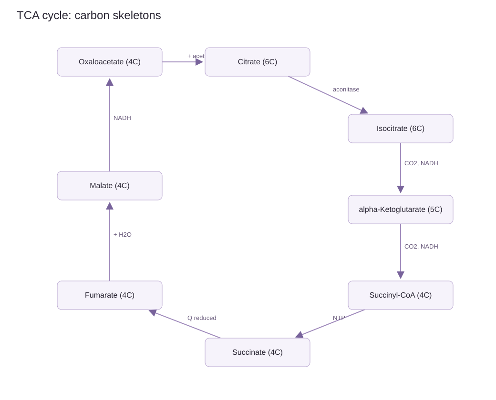

### 확인 문제

TCA가 산소를 직접 쓰지 않으면 산소 부족과 무관한가?

A. 그렇다.
B. 아니다.

**정답: B**

NAD+ 재생이 전자전달과 산소 수용에 의존한다.

**오답 해설**

A: 직접 반응물과 간접적 지속 조건은 다르다.

## 지단백질의 운반·대사와 지질검사

### 학습목표

- 킬로미크론·VLDL·LDL·HDL의 대사적 역할을 구분한다.
- apoB·apoC-II·apoE의 기능을 연결한다.
- 콜레스테롤 농도와 입자 수의 차이를 설명한다.

### 지질을 수용성 혈장에서 운반하기

중성지방과 cholesteryl ester는 물에 잘 녹지 않으므로 혈장에서 단백질과 인지질로 둘러싸인 지단백질(lipoprotein) 입자로 운반된다. 소수성 중심과 양친매성 표면이라는 배열은 수용성 환경에서 지질을 이동시키는 구조적 해결책이다. Apolipoprotein은 단순한 포장재가 아니라 입자의 구조 유지, 효소 조절과 수용체 인식에 관여한다. 입자의 밀도는 지질과 단백질의 상대적 구성과 관련되며 크기와 조성이 대사 중 계속 변한다.

지질검사에서 LDL-C와 HDL-C는 각각 그 분획에 담긴 콜레스테롤의 양을 뜻한다. LDL-C는 LDL 입자 수 자체가 아니며 HDL-C도 HDL 기능의 직접 측정값은 아니다. 중성지방이 많은 입자가 교환·분해되는 과정에서 입자당 콜레스테롤 양이 달라질 수 있다. 같은 콜레스테롤 농도라도 죽상경화성 입자의 수와 조성은 다를 수 있어, 임상 상황에 따라 non-HDL-C와 apoB 등 다른 지표가 추가 정보를 준다.

### 외인성 경로

소장 세포는 흡수한 지방산과 monoacylglycerol 등에서 중성지방을 다시 합성하고 apoB-48을 포함한 킬로미크론(chylomicron)을 조립한다. 식이지질은 림프를 거쳐 혈류로 전달된다. 모세혈관 내피 표면의 lipoprotein lipase(LPL)는 킬로미크론의 중성지방 분해를 도와 지방산을 조직에 공급한다. ApoC-II는 LPL 작용의 보조인자로 중요하고, 다른 조절단백질도 조직별 지방산 공급과 제거를 조정한다.

중성지방이 줄어든 잔여입자는 apoE 등의 인식을 통해 주로 간에서 제거된다. 지방을 먹은 뒤 혈중 중성지방이 증가하는 시간 경과는 섭취량과 흡수, 입자 생산 및 제거가 함께 결정한다. LPL 경로나 관련 조절의 장애에서는 중성지방이 풍부한 입자 제거가 손상될 수 있다. 심한 고중성지방혈증과 이자염의 관계를 평가할 때는 채혈 시점과 이차적 원인, 임상 양상을 함께 확인한다.

### 내인성 경로와 LDL

간은 중성지방과 콜레스테롤을 apoB-100을 포함한 VLDL로 분비한다. 혈중에서 중성지방을 잃으면서 IDL과 LDL 계통으로 전환되며 일부 잔여입자는 간에서 제거된다. LDL 수용체는 apoB-100을 포함한 입자 인식과 세포내 유입에 중요하다. 수용체의 수와 재활용, 입자 생산 및 다른 제거 경로의 변화가 혈중 농도를 바꾼다. 모든 VLDL 입자가 반드시 같은 비율로 LDL이 되는 단일 경로는 아니다.

세포내 콜레스테롤이 충분하면 합성과 유입을 줄이고 저장을 조절하는 되먹임이 작동한다. SREBP 계통과 HMG-CoA reductase, LDL 수용체 발현은 이 조절에 연결된다. Statin이 합성을 억제하면 간세포의 콜레스테롤 감지와 수용체 증가가 LDL 제거에 기여할 수 있다. PCSK9은 LDL 수용체의 분해와 관련되어 이 경로를 억제하는 치료의 표적이 된다. 합성 억제와 흡수 억제, 수용체 재활용 조절은 서로 다른 지점의 약리작용이다.

### HDL과 역방향 수송

HDL은 apoA-I와 지질을 포함하며 말초 세포에서 콜레스테롤을 받아 운반하는 과정에 관여한다. ABCA1 등을 통한 유출과 LCAT에 의한 에스터화, 간 수용체를 통한 선택적 지질 섭취 및 입자 사이 교환이 연결된다. 역콜레스테롤수송은 여러 구획과 경로의 흐름이며 혈중 HDL-C라는 저장량 하나와 같지 않다. 농도가 높아졌다는 사실만으로 수송 기능과 임상 이익이 같은 정도로 증가했다고 결론낼 수 없다.

죽상경화는 apoB 함유 입자의 동맥벽 유입과 잔류, 지질 변화와 면역반응을 포함한다. 지단백질을 좋음과 나쁨이라는 이름으로만 외우기보다, 어떤 입자가 어떤 경로로 생산되고 제거되며 동맥벽과 상호작용하는지 이해해야 한다. 유전적 수용체 결함, 갑상샘기능저하, 신증후군과 약물 등은 서로 다른 기전으로 지질 수치를 바꿀 수 있다. 검사 결과에서는 원발성 대사 이상과 이차적 원인을 함께 검토한다.

### 확인 문제

LDL-C는 LDL 입자 수 자체인가?

A. 그렇다.
B. 아니다.

**정답: B**

그 분획 입자에 포함된 콜레스테롤 양이다.

**오답 해설**

A: 입자당 콜레스테롤 양은 일정하지 않다.

## 지방산 산화·케톤체와 에너지 배분

### 학습목표

- 지방산 활성화와 카르니틴 회로를 설명한다
- 베타산화의 탄소·전자 수지를 계산한다
- 간의 케톤체 생성과 말초 이용을 연결한다

### 저장 지방에서 조직의 연료로

중성지방(triacylglycerol)은 환원도가 높은 지방산을 저장하며 같은 질량의 탄수화물보다 많은 에너지를 제공한다. 지방방울에 저장된 중성지방은 지방분해를 통해 지방산과 글리세롤로 분리된다. 유리 지방산은 혈액에서 주로 알부민과 결합하여 이동하고 조직에서 흡수되어 산화되거나 다시 에스터화된다. 글리세롤은 별도의 경로로 대사되므로 중성지방의 모든 탄소가 동일한 방식으로 처리되는 것은 아니다.

공복에서는 인슐린 감소와 관련 호르몬 신호가 지방산 동원에 유리한 조건을 만든다. 그러나 지방세포에서의 호르몬 작용을 다른 동물이나 다른 조직에서 관찰한 반응과 그대로 동일시하지 않는다. 실제 연료 공급은 지방산 방출, 조직 혈류, 흡수 및 세포 내 산화 능력의 조합이다. 혈중 지방산이 증가했다고 모든 조직이 같은 비율로 지방산 산화를 늘릴 수 있는 것은 아니다.

### 활성화와 미토콘드리아 진입

지방산은 아실-CoA 합성효소에 의해 지방아실-CoA로 활성화된다. ATP가 AMP와 피로인산으로 분해되는 반응이 결합하므로 고에너지 인산결합 두 개에 해당하는 비용을 고려한다. 장쇄 지방아실-CoA는 미토콘드리아 내막을 자유롭게 통과하지 못한다. 카르니틴팔미토일전달효소1(CPT1), 카르니틴-아실카르니틴 이동체 및 CPT2가 아실기를 전달하여 기질 안쪽의 아실-CoA를 재형성한다.

말로닐-CoA(malonyl-CoA)는 지방산 합성의 기질인 동시에 CPT1을 억제하는 조절 신호이다. 합성이 활발한 상태에서 새로 만든 지방산을 즉시 미토콘드리아로 넣어 분해하는 무익회로를 줄인다. 영양과 에너지 상태가 아세틸-CoA 카르복실화효소의 활성 및 말로닐-CoA 농도에 영향을 준다. 지방산 합성과 산화의 조절은 같은 효소를 역방향으로 돌리는 방식이 아니라 서로 다른 구획과 효소계를 연결하는 방식이다.

### 베타산화의 네 반응

미토콘드리아 베타산화(beta-oxidation)는 아실-CoA의 β탄소 부근을 산화하여 두 탄소 단위의 아세틸-CoA를 떼어 내는 반복 과정이다. 먼저 아실-CoA 탈수소효소가 이중결합을 만들며 전자를 전달한다. 이어 수화, NAD⁺ 의존 산화, 티올분해가 일어난다. 티올분해 후에는 아세틸-CoA와 두 탄소 짧아진 아실-CoA가 생겨 다음 회전에 들어간다. 첫 단계의 전자는 전자전달플라보단백질을 거쳐 호흡사슬로 전달된다.

탄소 수가 짝수인 포화 지방산의 경우 최종 네 탄소 아실-CoA가 두 아세틸-CoA로 갈라진다. 따라서 탄소 수가 16인 팔미트산에서는 일곱 번의 회전으로 여덟 아세틸-CoA가 형성된다. 회전 수와 아세틸-CoA 수를 같다고 세면 마지막 절단을 잘못 계산한다. ATP 수지를 추정할 때는 산화적 인산화의 전자 운반체당 수율에 대한 가정, TCA 회로의 수율 및 최초 활성화 비용을 명시해야 한다. 가정이 다른 수치를 섞으면 계산이 맞지 않는다.

### 불포화·홀수사슬 및 소기관의 차이

불포화 지방산의 기존 이중결합은 기본 베타산화 효소의 기질 형태와 맞지 않을 수 있어 이성질화효소나 환원효소가 추가로 필요하다. 일부 단계가 생략되거나 환원력이 소비되므로 같은 탄소 수의 포화 지방산과 수율이 다르다. 홀수사슬 지방산의 마지막에는 프로피오닐-CoA가 남으며, 비오틴과 비타민 B12 관련 반응을 거쳐 숙시닐-CoA로 전환될 수 있다. 모든 지방산이 오직 아세틸-CoA만 남기는 것은 아니다.

매우 긴 사슬 지방산의 초기 단축에는 과산화소체가 중요하다. 과산화소체의 첫 산화 단계에서 생기는 전자는 미토콘드리아처럼 직접 ATP 생성에 같은 방식으로 연결되지 않으며 과산화수소 처리도 필요하다. 가지친 지방산은 구조 때문에 추가 경로를 필요로 할 수 있다. 소기관별 기능 차이는 특정 선천 대사질환에서 신경계와 간 등 여러 장기가 손상되는 이유를 이해하는 데 중요하다.

### 간이 케톤체를 만드는 조건

간 미토콘드리아에서 지방산 산화가 증가하면 아세틸-CoA 공급이 늘어난다. 공복의 포도당신생과 산화환원 상태 변화는 TCA 회로의 처리와 기질 배분에 영향을 주어 케톤체 생성에 유리한 조건을 만든다. HMG-CoA 합성효소와 관련 반응을 통해 아세토아세트산(acetoacetate)이 생기고, 산화환원 상태에 따라 β-하이드록시부티르산(β-hydroxybutyrate)과 상호 전환된다. β-하이드록시부티르산은 화학적으로 케톤기가 없지만 생리적 연료군에서는 케톤체에 포함한다.

간은 케톤체를 혈액으로 내보내 다른 조직에 연료를 제공한다. 간은 케톤체 이용에 필요한 숙시닐-CoA:아세토아세트산 CoA 전달효소(SCOT)가 없어 자신이 생산한 케톤체를 같은 경로로 산화하지 못한다. 말초 조직은 케톤체를 아세틸-CoA로 바꾸어 이용할 수 있지만 미토콘드리아가 없는 적혈구는 이용하지 못한다. 뇌는 장기 공복에서 케톤체 이용을 늘릴 수 있어 포도당 요구와 단백질 분해 부담을 줄이는 데 도움이 된다.

### 포도당 생성과의 관계

사람에서 짝수사슬 지방산의 아세틸-CoA 탄소를 이용하여 포도당을 순생성하는 것은 일반적인 경로로 가능하지 않다. 피루브산탈수소효소 반응은 역방향으로 돌아가지 않으며 TCA 회로로 들어간 두 탄소가 순수한 옥살로아세트산 증가로 남는 것도 아니다. 그러나 지방산 산화가 제공하는 ATP와 환원력은 포도당신생을 지원한다. 지방산의 탄소가 포도당으로 바뀌는가와 지방산 산화가 포도당 생성을 돕는가는 서로 다른 질문이다.

지방산 산화 장애에서는 공복 시 에너지 공급과 케톤체 생성이 제한될 수 있다. 저혈당이 있는데 케톤 반응이 충분하지 않으면 인슐린 과다 등과 함께 지방산 이용 장애를 감별한다. 심근과 골격근의 연료 부족이나 독성 중간산물은 심근병증과 횡문근 손상으로 연결될 수 있다. 정상적인 공복 적응의 케톤체 증가와 인슐린 결핍에서 조절되지 않는 케톤산증은 생성 속도, 산 부담 및 임상 상태를 구분하여 이해한다.

$$
N_{acetyl-CoA}=\frac{n}{2},\qquad N_{cycles}=\frac{n}{2}-1
$$

n: 짝수 탄소 수의 직쇄 포화 지방산; 기본 베타산화에 적용; N_{acetyl-CoA}: 총 아세틸-CoA 생성 분자 수; N_{cycles}: 베타산화 반복 횟수

### 확인 문제

16탄소 포화 지방산의 기본 베타산화에서 회전 수와 아세틸-CoA 수는?

A. 7회전과 7분자이다.
B. 7회전과 8분자이다.
C. 8회전과 8분자이다.

**정답: B**

마지막 네 탄소 단위가 두 아세틸-CoA로 나뉘므로 회전 수는 생성물 수보다 하나 적다.

**오답 해설**

A: 마지막 절단에서 두 아세틸-CoA가 생성되는 점을 빠뜨렸다.

C: 마지막 네 탄소 절단 뒤 추가 회전이 필요하지 않다.

## 해당과정의 반응·에너지 수지와 조절

### 학습목표

- 10단계 반응의 탄소와 에너지 수지를 계산한다.
- 기질수준 인산화와 NAD+ 재생을 설명한다.
- 조직별 조절과 산소 조건을 구분한다.

### 포도당의 탄소를 분리하고 에너지를 회수한다

해당과정(glycolysis)은 세포질에서 6탄소 포도당을 두 분자의 3탄소 pyruvate로 전환하는 경로다. 초기에는 ATP를 사용하여 기질을 준비하고, 뒤에서는 두 개의 3탄소 분자에서 환원력과 ATP를 회수한다. 산소는 해당 반응의 직접 기질이 아니지만, 만들어진 NADH를 어떻게 산화하여 NAD+를 재생하는지에 따라 지속 가능한 흐름이 달라진다. 미토콘드리아가 없는 성숙 적혈구와 산화 대사가 활발한 조직은 같은 경로를 다른 맥락에서 이용한다.

경로의 전체 목적을 ATP 생성 하나로만 제한할 수는 없다. 중간체는 아미노산과 지질, 다른 생합성 경로의 탄소를 제공하고 대사 신호에도 연결된다. 포도당이 세포로 유입되는 정도, 인산화와 다른 경로로의 분배, 생성물 이용이 함께 흐름을 결정한다. 효소 하나의 발현 증가를 해당 전체 속도의 증가와 곧바로 동일시하지 않는다.

### 에너지 투자 단계

Hexokinase는 포도당을 glucose-6-phosphate로 인산화하여 ATP를 소비한다. 인산화된 당은 막을 통한 자유로운 이동이 제한되어 세포 안에 머물고, 해당과정 외에 glycogen 합성과 pentose phosphate pathway 등으로도 갈 수 있다. 간의 glucokinase는 다른 hexokinase와 조절·기질 농도 반응이 달라 식후 포도당 처리와 연결된다. 동일한 화학 반응을 촉매하더라도 isoenzyme과 조직 맥락이 기능을 바꾼다.

Phosphoglucose isomerase는 glucose-6-phosphate를 fructose-6-phosphate로 바꾼다. 이어 phosphofructokinase-1(PFK-1)이 두 번째 ATP를 사용하여 fructose-1,6-bisphosphate를 만든다. 이 단계는 해당의 조절에서 중요하다. 처음의 포도당 인산화 산물은 여러 경로로 나뉠 수 있는 반면, PFK-1 이후에는 해당 분해 방향으로의 연결이 더 뚜렷해진다. 다만 세포의 전체 대사 제어가 영구히 한 효소에만 집중되는 것은 아니다.

### 3탄소 분자로의 절단

Aldolase는 fructose-1,6-bisphosphate를 glyceraldehyde-3-phosphate와 dihydroxyacetone phosphate로 나눈다. Triose phosphate isomerase는 두 형태 사이의 전환을 촉매하여 뒤쪽 반응에 glyceraldehyde-3-phosphate가 공급되도록 한다. 따라서 포도당 한 분자에서 뒤쪽의 각 반응은 두 번 진행되는 수지를 가진다. 초기 ATP 두 분자를 소비하고 뒤쪽에서 ATP 두 개만 얻는다고 계산하면 이 대칭을 놓친 것이다.

Glyceraldehyde-3-phosphate dehydrogenase는 기질을 산화하면서 NAD+를 NADH로 환원하고 무기인산을 연결하여 1,3-bisphosphoglycerate를 만든다. ATP의 인산을 직접 떼어 붙이지 않고 산화 에너지를 고에너지 결합 형성에 연결하는 단계다. 뒤의 phosphoglycerate kinase는 이 인산을 ADP에 전달해 ATP를 만든다. 산화 반응과 인산 전달의 결합을 따라가면 ATP가 어디서 생기는지 화학적으로 이해할 수 있다.

### 두 번째 ATP와 순수지

Phosphoglycerate mutase와 enolase를 거쳐 phosphoenolpyruvate(PEP)가 형성된다. Pyruvate kinase는 PEP의 인산을 ADP에 전달하여 ATP와 pyruvate를 만든다. 생성물의 화학적 안정화가 순방향 진행에 기여한다. 두 ATP 생성 단계가 각각 3탄소 분자 두 개에서 일어나므로 총 네 ATP가 형성되고, 초기 소비 두 ATP를 빼면 포도당 한 분자당 순 ATP는 두 분자다.

Pyruvate까지의 순수지에는 NADH 두 분자도 포함된다. 그러나 세포질 NADH의 전자를 미토콘드리아로 옮기는 방식과 다른 소비 경로에 따라 산화적 ATP 회수는 달라진다. 해당 자체의 기질수준 인산화 ATP와, 해당에서 생긴 환원력의 산화로 얻는 ATP를 분리해 기록해야 한다. 포도당에서 젖산까지 진행하면 생성된 NADH가 lactate dehydrogenase 반응에서 소비되므로 두 NADH가 순수 축적되는 것은 아니다.

### NAD+ 재생과 lactate

Lactate dehydrogenase는 pyruvate를 lactate로 환원하면서 NADH를 NAD+로 되돌린다. 이 반응은 해당과정을 지속할 산화형 보조인자를 공급한다. Lactate 생성은 산소가 전혀 없을 때만 일어나는 전용 반응이 아니며, 산소가 있어도 해당 흐름과 미토콘드리아 산화, 세포간 기질 이동의 관계에 따라 발생한다. Lactate는 다른 조직의 산화 기질과 간의 포도당신생 재료로 이용될 수 있다.

혈중 lactate 농도는 생성률과 제거율의 결과다. 높은 농도를 즉시 모든 조직의 산소 결핍과 동일시하면 adrenergic 자극과 대사 변화, 간·신장 처리의 영향을 놓친다. 반대로 lactate가 정상이라고 국소 허혈을 모두 배제할 수도 없다. 산소 운반과 사용, 순환과 임상 경과를 함께 평가한다. 해당 수지의 단순 반응식과 실제 환자의 산염기 상태도 같은 차원의 설명은 아니다.

### 대사물질과 호르몬 조절

PFK-1은 에너지 상태와 여러 대사물질에 반응한다. ATP와 citrate는 특정 조건에서 억제 방향으로, AMP와 fructose-2,6-bisphosphate는 활성 방향으로 작용한다. Fructose-2,6-bisphosphate는 해당 중간체인 fructose-1,6-bisphosphate와 다른 조절물질이다. 간에서는 이를 만들고 분해하는 이중기능 효소의 조절이 insulin·glucagon 신호를 해당과 포도당신생의 상반된 조절에 연결한다.

Pyruvate kinase는 기질 공급과 feed-forward, 에너지 상태 및 조직에 따른 공유결합 조절의 영향을 받는다. 간의 공복 반응을 골격근의 모든 isoenzyme에 그대로 적용하지 않는다. 근육은 수축 수요와 Ca2+ 및 adenine nucleotide 변화에 따라 에너지 공급을 조정하고, 간은 전신 혈당 유지의 요구를 함께 수행한다. 같은 반응식이 다른 생리적 임무를 위해 조절되는 것이다.

### 특수 분기와 임상 연결

적혈구의 Rapoport-Luebering 분기는 1,3-bisphosphoglycerate에서 2,3-BPG를 형성하고 3-phosphoglycerate로 돌아갈 수 있다. 이 분기를 지나면 원래 phosphoglycerate kinase 단계에서 만들 수 있었던 ATP를 건너뛰는 비용이 있지만, 2,3-BPG는 헤모글로빈의 산소 친화도 조절에 기여한다. 에너지 최대 회수와 조직 수준의 산소 운반 조절 사이에 기능적 교환이 있는 사례다.

해당효소 결함은 적혈구의 에너지 유지와 용혈 등으로 드러날 수 있고 조직별 발현에 따라 다른 증상을 동반할 수 있다. 임상 결과는 효소 활성의 잔여량과 다른 경로의 보상, 세포 수명에 좌우된다. 대사경로 이상을 해석할 때에는 반응 앞쪽의 축적과 뒤쪽 산물의 부족, ATP와 환원력 변화 및 조직 특이성을 함께 추적한다.

### 확인 문제

포도당 한 분자에서 pyruvate 두 분자까지 해당과정의 순 ATP 수지는?

A. 0 ATP
B. 2 ATP
C. 4 ATP

**정답: B**

총 네 ATP 생성에서 초기 두 ATP 소비를 뺀다.

**오답 해설**

A: 초기 투자와 후기 기질수준 인산화를 모두 반영하지 않았다.

C: 생성량만 세고 투자량을 빼지 않은 결과다.

## 포도당신생과 공복 대사의 통합

### 학습목표

- 해당의 비가역 단계를 우회하는 반응을 설명한다.
- 주요 탄소 공급원과 에너지 비용을 계산한다.
- 간·근육·지방·신장의 역할을 연결한다.

### 공복에서도 혈당을 유지하는 이유

공복에는 외부에서 포도당이 공급되지 않아 간의 glycogen 분해와 포도당신생(gluconeogenesis)이 혈중 공급을 유지한다. 장기간의 공복과 산염기 상태 등 조건에 따라 신장의 기여도 중요해질 수 있다. 적혈구처럼 미토콘드리아가 없는 세포는 포도당 대사에 계속 의존하며, 뇌의 기질 이용은 공복 기간과 케톤 공급에 따라 달라진다. 전신 대사는 모든 조직을 한꺼번에 지방만 사용하는 상태로 바꾸는 것이 아니다.

포도당신생은 해당과정의 단순한 역반응이 아니다. 해당의 큰 자유에너지 감소와 연결되는 반응은 다른 효소와 에너지 투입을 이용해 우회한다. 두 경로는 많은 가역 반응을 공유하지만, 별도의 조절 단계가 있어 필요에 따라 서로 반대 방향의 흐름을 조정한다. 작은 기질 회로가 존재할 수는 있어도 대규모의 동시 정·역방향 흐름은 에너지를 소비하므로 생리적 조절이 필요하다.

### Pyruvate에서 PEP로

Pyruvate carboxylase는 미토콘드리아에서 pyruvate에 CO2 상당량을 붙여 oxaloacetate를 만든다. ATP와 biotin이 필요하며 acetyl-CoA가 활성 조절에 관여한다. 이 반응은 포도당신생의 입구이면서 TCA 중간체 보충반응이기도 하다. 같은 효소가 대사 상황에 따라 탄소를 다른 목적에 공급할 수 있어 효소 이름만으로 최종 경로를 확정하지 않는다.

Oxaloacetate는 안쪽막을 자유롭게 통과하지 못하므로 malate나 다른 운반 가능한 형태로 전환되거나, 구획에 따른 PEP carboxykinase(PEPCK) 경로를 통해 처리된다. PEPCK 반응은 GTP 사용과 탈탄산을 결합하여 PEP를 만든다. 탄소를 먼저 붙였다가 떼는 과정은 낭비가 아니라 불리한 pyruvate kinase 역반응을 우회하는 에너지적 설계의 일부다. 어떤 기질에서 시작하는지에 따라 세포질 환원력 요구와 운반 경로의 이용도 달라진다.

### 두 인산가수분해 우회

Fructose-1,6-bisphosphatase는 fructose-1,6-bisphosphate에서 인산을 제거하여 fructose-6-phosphate를 만든다. 이는 PFK-1 반응을 거꾸로 돌려 ATP를 생성하는 반응이 아니다. 마지막 glucose-6-phosphatase 단계도 glucose-6-phosphate를 가수분해하여 자유 포도당을 공급한다. 효소계의 조직·소기관 분포는 혈중 포도당 공급 능력을 결정한다. 골격근은 저장 glycogen을 자신의 에너지로 이용하는 데 적합하고 간처럼 자유 포도당을 혈액에 대량 방출하는 역할은 하지 않는다.

Glucose-6-phosphatase가 관여하는 처리에는 소포체 내강과 막수송도 필요하다. 따라서 세포질 대사 그림에 효소 하나만 적으면 실제 구획 이동을 놓칠 수 있다. 경로 결함은 저혈당뿐 아니라 기질 축적과 다른 경로로의 우회에 따른 대사 이상을 동반할 수 있다. 혈당 이상을 단독 현상으로 보기보다 lactate와 지질, urate 및 장기 크기 변화 등 관련 표현형을 함께 검토한다.

### 탄소 공급원과 비용

Lactate는 pyruvate로 전환되어 탄소를 공급하고, alanine 등 일부 아미노산도 pyruvate나 TCA 중간체를 통해 들어온다. 지방분해에서 나오는 glycerol은 glycerol-3-phosphate와 dihydroxyacetone phosphate를 거쳐 연결된다. 같은 지방분해에서 발생한 짝수 지방산의 acetyl-CoA 탄소는 사람에서 순수한 포도당 증가로 직접 전환되지 않지만, 지방산 산화는 필요한 ATP와 환원력 및 조절 신호를 제공한다.

Pyruvate 두 분자에서 포도당 한 분자를 만드는 표준 수지에는 ATP 네 분자와 GTP 두 분자, NADH 두 분자가 필요하다. 시작 기질이 glycerol이거나 lactate인 경우에는 경로 진입 위치와 환원력 공급이 달라 동일한 비용을 그대로 적용하지 않는다. 탄소수와 에너지, 전자 수지를 별도로 기록하면 어떤 조직이 비용을 지불하고 어떤 조직에 기질을 공급하는지 설명할 수 있다.

### Cori 회로와 alanine 이동

말초에서 포도당이 lactate로 전환되고 간에서 lactate 탄소가 포도당으로 돌아오는 연결을 Cori 회로로 설명한다. 말초는 해당으로 ATP를 얻고 간은 포도당 재합성에 더 많은 고에너지 인산을 사용한다. 전신적으로 순 ATP를 만들어내는 무상 순환이 아니라 에너지 부담과 탄소를 조직 사이에서 재배치하는 과정이다. Lactate가 간 이외 조직에서 산화되는 경로도 있으므로 모든 lactate가 반드시 이 회로를 도는 것은 아니다.

근육의 alanine은 탄소골격과 질소 이동을 연결한다. 간에서는 탄소가 포도당신생으로, 질소가 요소 대사 등으로 처리될 수 있다. 공복 기간에 따라 단백질 분해와 케톤 이용, 지방산 공급이 달라지며, 장기간의 적응은 단백질 손실을 제한하는 방향을 포함한다. 간과 신장, 근육과 지방의 기능을 별개 경로 목록이 아니라 장기간의 물질수지로 통합해야 한다.

### 상반 조절과 대사 상태

간에서 glucagon 신호는 포도당 공급을 늘리는 방향의 효소 조절과 유전자 발현에 관여하고 insulin은 식후 저장과 이용에 적합한 반응을 촉진한다. Fructose-2,6-bisphosphate는 PFK-1 활성과 fructose-1,6-bisphosphatase 억제를 연결하여 두 흐름의 조정에 중요하다. AMP가 높다는 신호는 에너지를 많이 소비하는 합성 흐름에 제약을 주고, 지방산 산화에서 생긴 acetyl-CoA는 pyruvate의 처리를 조절한다.

Ethanol 대사는 NADH/NAD+ 비를 높여 pyruvate-lactate와 oxaloacetate-malate 등 평형에 영향을 줄 수 있다. 공복과 glycogen 고갈이 겹치면 포도당신생의 탄소·산화환원 조건이 불리해져 저혈당 위험이 커질 수 있다. 영양과 간기능, 섭취 시점이 임상 결과를 바꾼다. 이 사례는 탄소 기질이 존재한다는 사실만으로 해당 탄소가 필요한 방향으로 흐를 수 있는 것은 아니라는 점을 보여준다.

### 확인 문제

Pyruvate 두 분자에서 glucose 한 분자를 합성하는 표준 에너지·환원력 요구는?

A. 4 ATP, 2 GTP, 2 NADH
B. 2 ATP 생성, NADH 순소비 없음
C. ATP 소비 없이 6 NADH만 소비

**정답: A**

우회 반응과 역방향의 환원·인산화 요구를 합친 수지다.

**오답 해설**

B: 해당의 순 ATP 생성과 포도당신생 비용을 혼동했다.

C: 기질수준의 인산 요구와 GTP 사용을 누락했다.

## 글리코젠 합성·분해와 조직별 조절

### 학습목표

- 분지 구조와 합성·분해 효소의 역할을 설명한다.
- 간과 근육의 조절 차이를 비교한다.
- 효소 결함의 대사 결과를 경로에서 추론한다.

### 저장 구조의 기능

글리코젠(glycogen)은 glucose가 주로 α-1,4 결합으로 연결되고 α-1,6 결합에서 분지하는 저장 고분자다. 많은 비환원 말단을 가지므로 여러 효소가 동시에 사슬을 늘리거나 줄일 수 있다. 분지 구조는 빠른 동원과 용해성에 기여한다. 같은 glucose 양을 자유 단당류로 저장할 때보다 삼투 입자 수를 줄일 수 있다는 이점도 있다. 그러나 글리코젠은 물과 함께 저장되므로 무게당 에너지 저장 효율은 중성지방과 다르다.

간은 혈당 유지를 위한 저장소로, 골격근은 수축에 필요한 자체 에너지 공급원으로 글리코젠을 이용한다. 단위 조직 질량당 농도와 몸 전체의 총량은 다른 양이다. 골격근의 총질량이 크기 때문에 근육 전체의 저장량은 간과 비교할 때 단순한 농도 순위와 다를 수 있다. 뇌의 성상세포 등 다른 세포에도 글리코젠이 존재하여 간과 근육에만 있는 물질은 아니다.

### 합성에 필요한 활성화

세포로 들어온 glucose는 glucose-6-phosphate로 인산화되고 phosphoglucomutase를 통해 glucose-1-phosphate로 전환된다. Glucose-1-phosphate와 UTP의 반응으로 UDP-glucose가 만들어지고, 생성된 pyrophosphate의 분해가 전체 반응의 진행에 기여한다. UDP-glucose는 glucose 단위를 전달하기에 적합한 활성화된 공여체다. 합성은 분해효소를 단순히 역방향으로 돌리는 반응이 아니다.

Glycogen synthase는 기존 사슬의 비환원 말단에 glucose를 α-1,4 결합으로 추가한다. 전형적인 합성 개시에는 glycogenin이 시작점 형성에 관여한다. Branching enzyme은 일정 길이의 사슬 일부를 옮겨 α-1,6 분지를 만든다. 따라서 synthase의 신장 기능과 branching enzyme의 가지 형성 기능을 구분해야 한다. 같은 양이 축적되어도 분지 구조가 비정상이면 용해성과 효소 접근, 세포 기능이 달라질 수 있다.

UDP-glucose 합성에 사용된 nucleotide를 재생하는 데 에너지가 필요하므로 저장에는 비용이 든다. 자유 glucose에서 시작하면 첫 인산화의 ATP 비용도 구분해야 한다. 수지를 계산할 때 출발 물질이 glucose인지 glucose-6-phosphate인지 명시하면 같은 과정에 서로 다른 ATP 수를 쓰는 혼동을 줄일 수 있다. 에너지 비용은 저장과 동원의 속도, 조절 가능성을 얻는 대가다.

### 분해와 분지 처리

Glycogen phosphorylase는 무기인산을 이용하여 α-1,4 결합을 절단하고 glucose-1-phosphate를 방출한다. 이 phosphorolysis는 물을 사용하는 단순 가수분해와 다르다. 생성물에 인산이 남아 있어 근육의 해당으로 들어갈 때 자유 glucose의 첫 ATP 소비를 피할 수 있다. 분해 산물 전체가 glucose-1-phosphate인 것은 아니며 분지점 처리에서 자유 glucose가 일부 생긴다.

Phosphorylase는 분지점 가까이에서 더 진행하지 못한다. Debranching enzyme의 transferase 기능이 사슬 일부를 옮기고 α-1,6-glucosidase 기능이 분지 결합을 처리하면 phosphorylase가 다시 접근할 수 있다. 하나의 이중기능 단백질 안의 서로 다른 촉매 작업을 구분하는 것이 중요하다. 분지 제거 결함에서는 정상 합성·분해의 중간 구조가 비정상적으로 남을 수 있다.

Glucose-1-phosphate는 glucose-6-phosphate로 전환되어 해당이나 다른 경로에 들어간다. 간은 glucose-6-phosphatase 계통을 통해 자유 glucose를 혈액에 공급할 수 있지만 근육은 저장 탄소를 주로 자체 대사에 이용한다. 혈액으로 공급되는 lactate나 alanine을 통해 근육 탄소가 간의 포도당신생과 연결될 수는 있으나 이는 근육이 저장 glucose를 그대로 혈중에 방출하는 것과 다르다.

### 공유결합 조절과 상반 반응

Glycogen synthase와 phosphorylase는 인산화 상태와 대사물질 신호에 의해 조절된다. 전형적으로 synthase는 탈인산화 상태에서, phosphorylase는 인산화된 a 형태에서 활성이 높아지는 방향의 조절을 받는다. 하지만 인산화 여부만으로 실제 속도를 완전히 정할 수는 없다. 기질과 생성물, AMP·ATP 등 조절물질, 단백질의 조직별 성질이 함께 영향을 준다.

Phosphorylase kinase는 phosphorylase를 활성화하는 인산화에 관여하고 Ca2+와 cAMP-PKA 계통의 신호를 연결한다. 근육 수축에서 Ca2+는 수축 단백질뿐 아니라 저장 에너지 동원을 촉진하는 신호가 된다. Phosphatase는 여러 표적의 인산을 제거하여 반대 방향 조절에 기여한다. 한 호르몬이 개별 효소 하나만 바꾸는 것이 아니라 합성과 분해의 여러 지점을 함께 조정할 수 있다.

### 간과 근육의 서로 다른 임무

Glucagon은 간의 저장 탄소를 혈중 공급으로 동원하는 데 관여한다. 근육에 간의 glucagon 반응을 그대로 적용해서는 안 된다. Epinephrine은 간과 근육의 adrenergic 신호를 통해 저장 동원에 기여하며, 근육에서는 수축에 따른 Ca2+와 에너지 상태가 추가 조절을 제공한다. 간에서는 혈당과 호르몬 상태가 전신의 요구를 반영하고, 근육에서는 자신의 ATP 수요가 핵심이다.

Insulin은 식후 glucose 이용과 저장을 촉진하는 여러 경로를 활성화한다. 근육의 glucose 유입 증가, 효소의 탈인산화 방향 조절과 glycogen synthase 조절 등이 연결된다. Glucose-6-phosphate는 기질인 동시에 효소 상태와 합성 흐름을 연결하는 신호가 될 수 있다. 식후 저장과 공복 동원은 분 단위의 효소 조절 외에 더 긴 시간 범위의 효소 발현과 영양 상태에도 영향을 받는다.

### 저장병의 기전적 해석

간의 자유 glucose 공급 단계가 손상되면 공복 저혈당과 저장물질 축적이 함께 나타날 수 있다. 다른 경로로의 우회는 lactate와 지질, urate 등의 변화를 동반할 수 있어 glucose만 따로 보지 않는다. 근육의 glycogen 동원 장애는 운동 시 ATP 공급 문제와 근육통, 경련이나 횡문근융해 등으로 드러날 수 있다. 평소 혈당이 유지된다는 사실과 운동근의 에너지 공급이 정상이라는 사실은 별개다.

Lysosome의 acid α-glucosidase 결함은 세포질 phosphorylase의 장애와 다른 분해 구획의 문제다. 심장과 골격근 등 조직 침범의 양상은 잔여 활성과 질환 경과에 따라 달라진다. 효소 이름이 비슷하거나 모두 glycogen이 축적된다는 이유로 같은 병태로 분류하면 임상 차이를 놓친다. 합성 구조, 세포내 위치, 분해 경로와 최종 산물의 이용을 함께 추적해야 한다.

### 확인 문제

간과 근육의 글리코젠 기능 차이를 가장 잘 설명한 것은?

A. 간은 유리 포도당을 혈중으로 공급할 수 있지만 근육의 글리코젠은 주로 해당 근육의 연료이다.
B. 근육이 간보다 항상 더 많은 유리 포도당을 혈중에 방출한다.
C. 두 조직은 공복 혈당 유지에 동일한 방식으로 기여한다.

**정답: A**

근육은 간의 glucose-6-phosphatase 계통과 같은 방식으로 저장 탄소를 혈중 유리 포도당으로 공급하지 않는다.

**오답 해설**

B: 근육은 간과 같은 유리 포도당 방출 기능을 주된 역할로 하지 않는다.

C: 간의 혈당 공급 역할과 근육 자체의 연료 이용 역할을 구별해야 한다.

## 전자전달계와 산화적 인산화의 결합

### 학습목표

- 전자 이동과 양성자 이동을 구분한다.
- 양성자구동력에서 ATP 합성으로의 에너지 전환을 설명한다.
- 억제와 탈결합의 실험적 결과를 비교한다.

### 산화환원 에너지를 막에 저장한다

산화적 인산화(oxidative phosphorylation)는 환원된 전자운반체의 전자를 산소에 전달하면서 방출되는 에너지를 막의 전기화학 기울기로 바꾸고, 그 기울기를 이용하여 ATP를 합성하는 과정이다. 전자전달계와 ATP synthase는 미토콘드리아 안쪽막에 배치되어 있다. 안쪽막이 작은 이온에 대해 무차별적으로 투과성이면 저장된 에너지가 빠르게 흩어지므로 막의 장벽 성질과 선택적 수송체가 필수적이다.

NADH가 산화되어 NAD+로 돌아가면 TCA와 여러 산화 경로에서 보조인자를 재사용할 수 있다. 이 과정에서 ATP 합성은 ADP와 무기인산 공급, 산소와 기질, 막전위 및 수송체에 의해 연결된다. 세포가 산소를 소비한다는 사실과 그 산소 소비가 모두 ATP 생성에 효율적으로 결합되었다는 사실은 다르다. 전자 흐름, 양성자 누출과 다른 산소 소비 경로를 구분해야 한다.

### 전자 운반체의 순서

복합체 I은 NADH에서 전자를 받아 FMN과 철-황 중심 등을 통해 ubiquinone으로 전달한다. 이 과정은 기질 쪽에서 막사이공간 쪽으로의 양성자 이동과 결합된다. Ubiquinone은 지용성 운반체로 안쪽막에서 움직이며 여러 전자 공급 경로를 모은다. 반면 cytochrome c는 막사이공간 쪽에서 복합체 III와 IV 사이의 전자를 전달하는 단백질이다. 두 이동성 운반체의 위치와 화학적 성질은 다르다.

복합체 II는 succinate dehydrogenase 반응에서 얻은 전자를 효소 결합 FAD와 철-황 중심 등을 거쳐 ubiquinone에 공급한다. 복합체 II 자체는 복합체 I과 같은 양성자 펌프를 수행하지 않는다. 따라서 전자가 복합체 I을 거쳐 들어오는지, 이를 건너뛰어 Q에 도달하는지에 따라 저장할 수 있는 양성자 기울기의 양이 달라진다. ATP 환산값이 NADH와 succinate 계통에서 다른 근거다.

복합체 III는 Q cycle을 포함한 전자 전달을 통해 cytochrome c를 환원하고 막을 사이에 둔 양성자 분포에 기여한다. 복합체 IV는 전달받은 전자를 최종적으로 산소에 제공하여 물을 만들고 양성자 이동과도 결합한다. 산소는 경로 전체에서 모든 효소가 직접 나누어 사용하는 반응물이라기보다 최종 전자 수용체다. 마지막 전자 수용이 막히면 앞쪽 운반체의 산화환원 상태와 다른 대사 반응까지 영향을 받는다.

### 양성자구동력의 두 성분

양성자구동력(proton-motive force)은 막을 사이에 둔 전위차와 pH 차이에 의한 에너지 성분을 포함한다. 안쪽막 바깥쪽에 양성자가 축적되면 기질은 상대적으로 음성이고 덜 산성인 상태를 유지한다. 양성자가 기질로 돌아오려는 경향에는 전기적 힘과 농도차가 함께 기여한다. 막전위만 측정하거나 pH만 측정하면 전체 에너지 저장의 한 성분만 본 것이 될 수 있다.

양성자 한 몰의 이동 자유에너지는 이동 방향에 맞춘 화학퍼텐셜 항과 전기적 항의 합으로 표현한다. 화학적 성분에는 RT ln(H+의 농도비), 전기적 성분에는 F와 전위차가 들어간다. 부호를 정할 때 어느 쪽을 출발점과 도착점으로 두었는지 먼저 명시해야 한다. 같은 물리적 현상을 막전위와 ΔpH의 정의를 바꾸어 표현하면 식의 부호는 달라질 수 있지만 예측되는 이동 방향과 에너지 보존은 같아야 한다.

### ATP synthase와 회전 촉매

ATP synthase의 막 부분 F0는 양성자 흐름과 회전을 연결하고, F1 부분은 ADP와 무기인산에서 ATP를 형성하는 촉매 부위를 가진다. 회전은 촉매 부위의 형태를 바꾸어 기질 결합, ATP 형성과 방출을 순환시킨다. 에너지를 단순히 ADP와 인산을 서로 밀어 붙이는 힘으로만 이해하기보다 단백질의 결합 상태와 생성물 방출을 포함한 촉매 주기에 연결해야 한다.

ATP를 세포질에 공급하려면 기질에서 만든 ATP와 바깥의 ADP를 교환하고 무기인산도 들여와야 한다. Adenine nucleotide translocase와 인산 수송은 막의 전기화학 조건과 연결되어 전체 비용에 영향을 준다. 이 때문에 회전 고리의 양성자 수만으로 세포질에서 얻는 ATP 수율을 완전히 계산하지 않는다. P/O 비는 사용한 정의와 가정, 전자 진입 경로 및 누출과 수송 비용을 포함한 근사량이다.

### 수요가 호흡을 조절한다

ADP가 충분히 공급되면 ATP synthase를 통한 양성자 회수가 증가하고, 전자전달계가 추가 기울기를 만드는 데 필요한 역학적 저항이 줄어 산소 소비가 증가할 수 있다. 반대로 ATP 수요가 낮고 ADP가 제한되면 기울기가 높아져 전자 흐름이 감소하는 방향으로 조절된다. 이를 기질과 산소가 충분한 실험 조건에서 호흡 조절로 관찰할 수 있다. 실제 세포에서는 Ca2+ 신호와 기질 공급, 수송 및 전사 변화도 수요에 반응한다.

미토콘드리아 기능은 산소 소비량 하나로 판단하지 않는다. 높은 소비가 효율적인 ATP 생산을 뜻할 수도 있지만 탈결합과 누출 때문일 수도 있다. 낮은 소비는 복합체 손상 외에 기질 부족이나 적은 ATP 수요, 수송 제한으로도 생긴다. 실험에서는 기초 호흡과 ATP 합성에 연결된 호흡, 누출과 최대 반응 등을 구분하고 세포 수와 생존, 정규화 방법을 확인해야 한다.

### 억제와 탈결합의 차이

전자전달을 직접 차단하면 차단점보다 앞쪽 운반체가 상대적으로 환원되고 뒤쪽은 산화되는 양상이 가능하다. 산소 소비와 ATP 형성이 감소하며 NADH 산화의 제약이 TCA와 다른 대사 흐름으로 이어진다. ATP synthase를 억제하면 양성자 회수의 주요 경로가 막혀 기울기가 올라가고, 결합된 전자 흐름도 제한될 수 있다. 두 억제는 모두 ATP를 줄이지만 일차 표적과 산화환원 변화가 다르다.

탈결합(uncoupling)은 전자전달이 만든 기울기가 ATP 합성 외의 경로로 소실되는 경우다. 적절한 기질과 산소가 있으면 전자 흐름과 산소 소비가 증가할 수 있지만 ATP 생산 효율은 낮아지고 열 발생이 커진다. 기질과 호흡계의 최대 능력, 세포 손상에 따라 실제 결과는 제한된다. 갈색지방의 UCP1은 조절된 열발생의 대표 사례이며 무제한적인 누출과 동일한 생리 상태가 아니다.

### 활성산소와 세포 운명

전자전달 중 일부 전자가 산소에 불완전하게 전달되면 superoxide 등 활성산소가 형성될 수 있다. 항산화 효소와 환원계는 이를 처리하며, 낮은 수준의 산화환원 신호와 과도한 손상은 구분해야 한다. 막전위와 전자 운반체의 환원 정도, 기질과 복합체 상태가 생성에 영향을 준다. 산소 소비가 많으면 항상 활성산소도 같은 비율로 증가한다고 단정할 수는 없다.

심한 미토콘드리아 손상은 ATP 부족, 칼슘 처리 장애와 막 투과성 변화 및 세포사멸 경로에 연결된다. 미토콘드리아는 에너지 생산 외에 대사 중간체와 신호, 세포사멸의 조절에도 관여한다. 산화적 인산화 결함의 임상 표현형이 근육과 신경계 등 에너지 요구가 큰 조직에서 두드러질 수 있지만 조직별 의존성과 유전적 배경, 잔여 기능에 따라 다양한 양상을 보인다.

### 확인 문제

기질과 산소가 충분할 때 양성자 누출 증가의 전형적인 결과 조합은?

A. ATP 효율과 P/O 비의 필수적 증가
B. 산소 소비의 모든 조건에서 완전 정지
C. ATP 효율 감소와 열발생 증가

**정답: C**

기울기가 ATP 합성 외의 경로로 소실되면 결합 효율이 낮아진다.

**오답 해설**

A: 전자전달이 유지되어도 ATP로 회수하는 비율은 낮아질 수 있다.

B: 탈결합과 전자전달 차단은 다른 기전이다.

## 아미노산 질소의 운반과 요소회로

### 학습목표

- 아미노기 전달과 암모니아 처리의 관계를 설명한다
- 요소회로의 구획과 질소·에너지 수지를 설명한다
- 고암모니아혈증을 대사 경로와 연결한다

### 탄소골격과 질소의 서로 다른 운명

아미노산은 단백질 합성의 재료이면서 에너지와 다른 분자의 전구체가 될 수 있다. 분해할 때 탄소골격은 해당과정이나 TCA 회로의 중간체, 케톤체 생성 경로 등으로 연결되지만 질소는 별도로 처리해야 한다. 탄수화물이나 지방과 달리 질소를 제거하는 부담이 있다는 점이 아미노산 대사의 중요한 특징이다. 아미노기가 남아 있는 채로 모든 탄소가 곧바로 산화되는 것은 아니며, 질소의 수집과 운반, 배설을 탄소 대사와 나누어 추적해야 한다.

아미노기전이효소(aminotransferase)는 아미노산과 α-케토산 사이에서 아미노기를 전달한다. 여러 아미노산의 질소가 글루탐산(glutamate) 계통으로 모이는 데 기여하며 피리독살인산(pyridoxal phosphate)이 보조인자로 작용한다. 아미노기전이는 그 자체가 모든 질소를 자유 암모니아로 방출하는 반응은 아니다. 글루탐산의 산화적 탈아미노화와 다른 질소 방출 반응이 이후 연결되어 간의 요소 합성 등에 질소를 제공한다. 효소가 혈중으로 유출되어 나타나는 간 손상 지표와 정상 세포 내 대사 기능도 구별한다.

### 안전한 운반 형태

암모니아와 암모늄의 분포는 pH에 따라 달라지며 과도한 축적은 특히 신경계에 해롭다. 말초 조직의 질소를 혈류로 운반할 때에는 글루타민과 알라닌 같은 형태가 중요하다. 글루타민합성효소는 글루탐산에 질소를 결합하여 글루타민을 만들고, 다른 조직의 글루타민분해효소는 이를 다시 이용할 수 있게 한다. 운반 형태로 만들었다고 질소가 사라지는 것은 아니며 최종적으로 간과 신장 등에서 처리와 배설이 필요하다.

근육에서는 아미노기의 일부를 피루브산에 전달하여 알라닌을 만들고 간으로 운반할 수 있다. 간은 알라닌의 탄소를 포도당신생 등에 이용하고 질소를 요소 생성과 연결한다. 이 포도당-알라닌 회로는 근육과 간 사이의 탄소·질소 교환을 설명한다. 글루타민은 여러 조직의 질소 운반과 생합성에도 쓰이며, 신장에서 암모늄 배설에 기여할 수 있다. 신장의 암모늄 배설은 질소 제거이면서 산 배설과 연결된 기능이므로 간의 요소 합성과 같은 반응으로 취급하지 않는다.

### 요소의 원자와 구획

요소(urea)의 두 질소는 하나가 암모니아 계통에서, 다른 하나가 아스파르트산(aspartate)에서 제공된다. 탄소는 중탄산염 계통에서 온다. 간세포의 요소회로는 미토콘드리아와 세포질에 나뉘어 진행되므로 효소만이 아니라 막을 가로지르는 중간체 운반도 필요하다. 회로라는 이름은 오르니틴(ornithine)이 재생되어 반복 사용된다는 뜻이다. 오르니틴을 매 회전마다 완전히 소모하여 요소 자체로 배설하는 과정이 아니다.

미토콘드리아의 카바모일인산합성효소 I(carbamoyl-phosphate synthetase I, CPS1)은 질소와 중탄산염을 이용하여 카바모일인산을 만드는 데 ATP를 사용한다. CPS1에는 N-아세틸글루탐산(N-acetylglutamate, NAG)의 활성화가 필요하다. NAG는 글루탐산과 acetyl-CoA에서 합성되어 질소 처리의 조절에 관여한다. 피리미딘 합성에 관여하는 세포질 CPS II와는 위치와 질소 공여체, 조절이 다르므로 이름이 비슷하다고 같은 효소로 보지 않는다.

오르니틴트랜스카바밀레이스(ornithine transcarbamylase, OTC)는 오르니틴과 카바모일인산을 시트룰린(citrulline) 생성으로 연결한다. 시트룰린이 세포질로 이동한 뒤 아스파르트산과 결합하여 아르기니노숙신산(argininosuccinate)이 만들어진다. 이 합성 단계에서는 ATP가 AMP 쪽으로 전환되는 에너지 지출이 있다. 이어 아르기니노숙신산분해효소가 아르기닌과 푸마르산(fumarate)을 만들고, 아르기네이스(arginase)는 아르기닌을 요소와 오르니틴으로 나눈다. 오르니틴은 미토콘드리아로 돌아가 회로를 계속한다.

### 에너지와 TCA 회로의 연결

요소 한 분자의 생성에는 ATP 세 분자가 사용되지만 고에너지 인산결합의 소비로 계산하면 네 개에 해당한다. 한 단계의 ATP가 AMP와 피로인산으로 전환되고 피로인산의 가수분해가 결합되기 때문이다. ATP 분자의 개수와 고에너지 결합 수를 같은 값으로 외우면 수지 계산이 어긋난다. 질소를 비교적 독성이 낮은 배설 형태로 바꾸는 과정에는 이런 에너지 비용이 필요하다.

회로에서 나오는 푸마르산은 말산과 옥살아세트산 계통으로 연결될 수 있고, 옥살아세트산의 아미노기전이는 다시 아스파르트산 공급과 연결된다. 따라서 요소회로는 TCA 회로와 완전히 분리된 폐쇄 고리가 아니다. 간의 에너지 상태와 중간체 공급, 단백질 섭취 및 이화 상태가 질소 처리 능력에 영향을 준다. 푸마르산이 나온다는 이유만으로 요소 생성의 전체 ATP 비용이 언제나 일정량 상쇄된다고 단순 계산하지 않고 실제 대사 경로와 구획을 고려한다.

### 고암모니아혈증과 경로의 위치

요소회로의 효소나 운반체 결함은 질소 처리의 병목을 만들어 고암모니아혈증을 일으킬 수 있다. 간부전이나 문맥전신단락도 다른 기전으로 간을 통한 질소 처리를 방해한다. 신생아의 수유 저하와 처짐, 구토, 의식 변화뿐 아니라 부분적인 기능 결함에서 성장 후 대사 스트레스에 의해 증상이 드러나는 경우도 가능하다. 연령 하나로 모든 유전성 대사질환을 배제하지 않는다.

고암모니아혈증은 성상세포의 글루타민 처리와 세포 부피, 신경전달 및 에너지 대사 등에 영향을 미칠 수 있다. 기전을 TCA 중간체 하나의 고갈로만 설명하면 복잡한 신경독성을 충분히 담지 못한다. 검사 해석에는 암모니아 검체 처리와 채혈 조건도 중요하다. 임상적으로 위험한 상승이 의심되면 측정의 오류 가능성과 실제 대사 응급을 함께 평가해야 하며 단순한 반복 채혈만으로 대응을 늦추어서는 안 된다.

어느 단계가 막혔는지에 따라 시트룰린과 아르기닌, 오로트산 등의 양상이 달라질 수 있다. OTC 결함에서 카바모일인산이 다른 대사 경로로 연결되어 오로트산 증가에 기여할 수 있는 현상은 구획과 기질의 흐름을 보여주는 예이다. 다만 단일 대사산물만으로 모든 진단을 확정하지 않고 아미노산 패턴과 임상, 효소·유전학적 평가를 통합한다. 정상 질소 대사를 배우는 목적은 효소 이름의 순서를 넘어 병목의 위치가 전체 대사와 환자의 증상에 미치는 영향을 이해하는 데 있다.

### 확인 문제

요소회로에서 ATP 분자 수와 고에너지 인산결합 소비 수의 관계는?

A. ATP 세 분자, 고에너지 인산결합 네 개이다.
B. 둘 다 항상 두 개이다.
C. ATP는 전혀 사용되지 않는다.

**정답: A**

CPS1 단계와 ATP→AMP 단계를 구별하면 이 수지를 얻는다.

**오답 해설**

B: ATP→AMP로 전환되는 단계의 비용을 놓쳤다.

C: 질소를 요소로 처리하는 데 에너지 비용이 필요하다.

## 퓨린·피리미딘의 합성·회수·분해

### 학습목표

- 두 염기 고리의 합성 방식을 구별한다
- 회수 경로와 신생합성의 조절을 연결한다
- 약물 표적과 질소·일탄소 대사를 설명한다

### 뉴클레오타이드의 여러 역할

뉴클레오타이드(nucleotide)는 핵산의 구성 단위이면서 에너지 전달과 신호, 활성화된 대사 중간체의 구성에 쓰인다. 염기와 당으로 이루어진 뉴클레오사이드에 인산이 연결된 구조를 구별해야 한다. ATP와 GTP, UTP와 CTP는 염기만 다른 이름이 아니라 여러 효소와 대사 반응에서 선택적으로 사용된다. DNA와 RNA의 합성에는 양뿐 아니라 각 전구체 사이의 균형이 중요하다.

세포는 신생합성(de novo synthesis)으로 염기를 만들거나 기존 염기와 뉴클레오사이드를 회수하여 이용한다. 회수(salvage)는 단순한 폐기물 처리가 아니라 에너지를 절약하고 조직별 공급을 유지하는 경로이다. 어느 경로에 의존하는지는 조직과 증식 상태, 공급과 효소 발현에 따라 다르다. 신생합성이 가능하다는 사실만으로 회수 효소의 결함이 임상적으로 중요하지 않다는 결론을 내릴 수 없다.

### PRPP와 퓨린 고리

리보스-5-인산은 오탄당인산경로와 연결되며 PRPP는 활성화된 리보스 인산으로 여러 합성·회수 반응의 기질이 된다. 퓨린 신생합성에서는 이 골격 위에 원자가 단계적으로 더해져 고리가 만들어진다. 글리신과 글루타민, 아스파르트산 및 일탄소 단위 등이 원자 공급에 관여한다. 퓨린 고리를 먼저 완성한 뒤 모든 당을 나중에 붙인다는 모형과 구별한다.

공통 중간체인 IMP에서 AMP와 GMP로 갈라지는 경로는 에너지와 질소 공급, 최종산물의 되먹임에 의해 조절된다. 각 가지가 같은 ATP 분자만을 같은 방식으로 사용하지는 않으며 가지 사이의 균형 유지가 중요하다. 공급이 늘면 전구체가 무조건 계속 쌓이는 것이 아니라 회수와 분해, 되먹임이 전체 흐름을 바꾼다. 한 효소의 활성만으로 세포 전체의 뉴클레오타이드 양을 예측하기 어렵다.

### 회수와 요산

HGPRT는 하이포잔틴과 구아닌의 회수에, 아데닌의 회수에는 다른 효소가 관여한다. 회수 반응은 PRPP를 이용하고 최종 뉴클레오타이드 공급과 신생합성의 되먹임에 영향을 준다. 회수 장애에서 단순히 사용 가능한 염기가 줄어드는 것 외에 PRPP와 신생합성의 흐름이 변할 수 있다. 효소 결함의 결과를 한 방향의 기질 축적만으로 설명하지 않는다.

퓨린 분해는 하이포잔틴과 잔틴 계통을 거쳐 사람에서 요산 생성으로 연결된다. 잔틴산화환원효소 계통은 이 과정의 중요한 표적이다. 혈중 요산은 생성과 신장·장관 배설의 균형이므로 높은 수치가 언제나 과도한 합성만을 뜻하지 않는다. 신장 기능과 약물, 식이와 세포 회전 및 대사가 함께 영향을 준다. 요산의 농도와 실제 결정 침착 질환도 동일한 정보는 아니다.

### 피리미딘의 다른 출발

피리미딘에서는 고리의 골격을 만든 뒤 PRPP와 연결하는 흐름이 중요하다. 세포질의 카바모일인산합성효소 II 계통은 글루타민을 질소 공급과 연결하며, 요소회로의 미토콘드리아 CPS1과 위치와 조절이 다르다. 비슷한 효소 이름을 같은 반응의 다른 표기처럼 외우면 질소 대사와 임상 결함을 혼동하기 쉽다.

오로트산 계통은 UMP로 연결되고 이후 다른 피리미딘 뉴클레오타이드가 만들어진다. 피리미딘 합성의 일부 반응은 미토콘드리아와 관련되므로 전체 경로를 세포질에만 존재한다고 단순화하지 않는다. 퓨린과 피리미딘의 합성과 분해는 서로 다른 중간체와 최종산물을 가지며, 모든 염기 분해가 요산을 만드는 것은 아니다. 고리 구조의 차이는 임상 대사산물 해석에도 중요하다.

### DNA 전구체와 일탄소 대사

리보뉴클레오타이드환원효소(ribonucleotide reductase)는 리보뉴클레오타이드를 디옥시 형태의 공급과 연결한다. 기질의 인산 상태와 조절은 효소의 특성에 따라 이해해야 하며, 단순히 DNA를 직접 RNA에서 변환하는 반응은 아니다. DNA 합성에 필요한 네 전구체의 균형이 깨지면 복제와 수선의 정확성에 영향을 줄 수 있다.

티미딜산합성효소(thymidylate synthase)는 dUMP를 dTMP 생성으로 연결하며 엽산 계통의 일탄소 단위와 관련된다. 산화된 엽산을 다시 환원하는 경로가 계속 작동해야 일탄소 공급이 유지된다. 엽산과 비타민 B12 상태가 DNA 합성과 혈구 형성에 영향을 주는 배경이다. 빈혈의 세포 크기라는 결과만 외우기보다 일탄소 대사와 전구체 공급의 연결을 이해한다.

### 약물과 대사 경로

항대사제는 엽산 대사와 티미딜산 합성, 퓨린 합성 및 DNA 전구체 공급의 여러 지점을 표적으로 한다. 빠르게 증식하는 종양뿐 아니라 골수와 점막 같은 정상 조직도 영향을 받을 수 있어 선택독성과 이상반응을 함께 이해해야 한다. 약물이 체내에서 활성형으로 바뀌는 과정과 불활성화 및 배설은 표적 억제만큼 실제 노출을 결정한다.

퓨린 유사체와 요산 생성 억제 약물의 병용처럼 대사 경로를 공유하는 조합은 중요한 상호작용을 만들 수 있다. 표적이 서로 다르다는 이유만으로 병용이 언제나 안전한 것은 아니다. 약물의 활성과 제거 경로 및 환자별 효소 기능을 함께 평가해야 한다. 핵산 대사는 효소 이름과 구조의 암기를 넘어 영양, 유전질환과 암 및 약리학을 연결하는 공통 기반이다.

### 확인 문제

퓨린과 피리미딘 분해가 모두 사람에서 요산 생성으로 끝나는가?

A. 아니다. 두 고리의 분해 경로와 최종산물을 구별한다.
B. 그렇다. 모든 뉴클레오타이드는 요산으로만 배설된다.

**정답: A**

퓨린의 요산 생성과 피리미딘 분해는 같은 경로가 아니다.

**오답 해설**

B: 퓨린의 요산 생성과 피리미딘 분해는 같은 경로가 아니다.

## 헴 합성·분해와 빌리루빈 대사

### 학습목표

- 헴 합성의 세포 내 구획과 조절을 설명한다
- 합성 중간산물 축적과 임상 표현형을 연결한다
- 비포합·포합 빌리루빈의 이동과 배설을 비교한다

### 헴은 여러 단백질의 기능기이다

헴(heme)은 포르피린 고리 중심에 철이 배위된 구조로 혈색소와 미오글로빈, 사이토크롬 및 여러 효소의 기능에 참여한다. 헴 합성과 철 이용 및 글로빈 합성은 서로 연결되지만 동일한 경로는 아니다. 어느 하나가 제한되어도 적혈구의 혈색소 생성이 감소할 수 있다. 헴은 필요한 기능기인 동시에 과량의 유리 형태에서는 산화적 손상에 기여할 수 있어 생산과 분해 및 운반이 조절된다.

주요 합성 조직에는 적혈구 전구세포와 간이 포함된다. 적혈구 계열은 산소 운반체를 대량 생산하고, 간은 약물 대사 효소 등 다양한 헴 단백질을 유지한다. 같은 합성 경로를 사용해도 조직별 조절이 다르므로 간에서의 유도 현상을 적혈구 계열의 조절과 완전히 동일하게 설명하지 않는다. 성숙 적혈구는 미토콘드리아가 없어 새 헴 합성을 지속하는 전구세포와 다르다.

### 미토콘드리아와 세포질을 오가는 합성

헴 합성의 첫 단계는 미토콘드리아에서 글리신과 숙시닐-CoA로 δ-아미노레불린산(ALA)을 만드는 반응이다. ALA 합성효소는 비타민 B6 유래 보조인자를 사용한다. 이후 세포질에서 ALA가 포르포빌리노겐 등으로 전환되고 고리 구조가 형성된다. 합성 후반에는 중간산물이 다시 미토콘드리아로 들어가 프로토포르피린IX가 되며 페로킬라타아제(ferrochelatase)가 철을 삽입한다. 구획 사이 이동도 합성의 일부이다.

간의 ALA 합성효소 조절에는 헴에 의한 음성 되먹임과 여러 대사 신호가 관여한다. 적혈구 계열의 조절은 철 공급과 연결된다. 합성이 막힌 위치에 따라 쌓이는 중간산물과 최종 헴 부족의 영향이 달라진다. 납은 ALA 탈수효소 및 페로킬라타아제 등 헴 경로에 영향을 줄 수 있어 빈혈과 대사 이상을 연결한다. 철이 충분하다는 사실만으로 헴이 정상적으로 합성된다고 볼 수 없다.

### 포르피린증의 표현형

포르피린증(porphyria)은 헴 합성 경로의 이상과 중간산물 축적으로 발생하는 질환군이다. 특정 유형에서는 신경내장 증상, 다른 유형에서는 광과민성 피부 증상이 중요하고 두 양상이 함께 나타날 수도 있다. 고리 구조를 가진 포르피린이 빛에 반응하여 조직 손상에 기여하는 기전과, 초기 전구물질 축적에 따른 신경계 문제를 구분한다. 모든 유형에 동일한 피부 소견이 나타나는 것은 아니다.

복통과 자율신경 증상 및 신경학적 이상이 반복되는 경우에는 임상 상황에 따라 급성 포르피린증을 고려할 수 있다. 그러나 복통만으로 드문 대사질환을 우선 확정하지 않는다. 발작 시점의 적절한 전구물질 검사, 검체 처리 및 유형별 확인이 필요하다. 일부 약물과 공복은 간의 헴 수요 및 경로 조절을 바꾸어 특정 유형의 발작을 유발할 수 있다. 유발 인자와 치료의 의미는 정확한 유형을 확인한 뒤 해석한다.

### 노화 적혈구와 빌리루빈 형성

노화한 적혈구가 대식세포에서 처리되면 글로빈은 아미노산으로 분해되고 철은 재활용된다. 헴 산소화효소(heme oxygenase)는 헴 고리를 열어 빌리베르딘, 철 및 일산화탄소를 만들고, 빌리베르딘 환원효소는 빌리루빈을 만든다. 철의 재활용과 고리 탄소의 배설은 서로 다른 경로이다. 적혈구 파괴가 늘면 간으로 들어오는 빌리루빈 부담이 증가한다.

비포합 빌리루빈(unconjugated bilirubin)은 물에 잘 녹지 않아 혈액에서 알부민과 결합하여 간으로 운반된다. 알부민 결합 상태는 콩팥 여과와 조직 이동을 제한한다. 따라서 비포합 빌리루빈 증가를 그대로 소변 빌리루빈 양성으로 연결하면 안 된다. 특정 취약 상태에서 결합되지 않은 분획과 조직 독성이 문제가 될 수 있으며, 총농도만으로 모든 위험을 똑같이 설명할 수는 없다.

### 간의 포합과 담즙 배설

간세포는 빌리루빈을 받아 UDP-글루쿠론산전달효소(UGT1A1) 등을 통해 글루쿠론산을 결합시킨다. 포합(conjugation)은 물에 대한 용해성을 높여 담즙 배설을 가능하게 한다. 이후 수송체를 통해 담세관으로 배출되고 장으로 이동한다. 생성, 간 흡수, 포합 및 배설의 어느 단계가 손상되었는지에 따라 빌리루빈 분획이 달라진다.

장에서는 빌리루빈 유래 물질이 미생물 대사를 거쳐 유로빌리노겐 등으로 변한다. 일부는 재흡수되어 간으로 돌아가고 일부는 소변이나 대변 색소 형성에 기여한다. 담즙 흐름이 막히면 장으로 전달되는 색소가 줄고 포합 빌리루빈이 혈액과 소변에 증가할 수 있다. 진한 소변과 옅은 대변의 조합은 이 흐름을 이해하면 설명할 수 있지만 증상만으로 폐쇄 위치를 확정하지 않는다.

### 황달 검사 해석

황달(jaundice)은 빌리루빈이 증가하여 피부와 공막이 노랗게 보이는 상태이다. 용혈 등 생성 증가, 포합 장애, 간세포 손상 및 담즙 정체를 나누어 생각한다. 비포합 분획이 우세하면 생성과 포합의 문제를, 포합 분획이 높으면 간세포 배설과 담즙 흐름을 검토하지만 혼합 양상도 흔하다. 직접·간접 빌리루빈은 임상 검사법의 구분으로 순수한 화학 종과 완벽히 일치하지 않을 수 있다.

AST·ALT는 주로 간세포 손상의 단서를 제공하고 ALP·GGT는 담즙 정체 평가를 보완하지만 어느 것도 간의 전체 기능을 하나로 대표하지 않는다. 알부민과 응고 관련 수치에는 합성 기능 외의 요인도 영향을 준다. 빈혈과 망상적혈구, 용혈 지표, 약물력 및 영상 결과를 함께 보면 빌리루빈의 증가가 어디서 시작되었는지 추론할 수 있다. 수치 하나를 질환 이름으로 바로 치환하는 방식보다 대사의 흐름을 따라가며 해석하는 것이 정확하다.

### 확인 문제

비포합 빌리루빈 증가와 소변 검사의 관계로 적절한 것은?

A. 알부민 결합과 낮은 수용성 때문에 증가가 곧 소변 빌리루빈 양성을 뜻하지 않는다.
B. 혈청 비포합 분획이 증가하면 반드시 그대로 많이 여과된다.
C. 포합 과정은 빌리루빈을 더 지용성으로만 만든다.

**정답: A**

간의 포합은 수용성을 높이며 비포합 분획의 혈중 운반과 여과 성질은 다르다.

**오답 해설**

B: 알부민 결합과 수용성이 여과와 배설을 제한한다.

C: 글루쿠론산 포합은 물에 대한 용해성을 높이는 방향이다.

# 세포생물학

## 수용체 신호전달과 조절의 원리

### 학습목표

- GPCR과 수용체 티로신인산화효소를 비교한다.
- 신호 증폭과 종료를 설명한다.
- 같은 전달자가 조직별로 다른 효과를 내는 이유를 설명한다.

### 결합 이후의 정보 처리

수용체(receptor)는 리간드의 존재를 세포내 변화로 연결한다. 리간드 결합과 수용체 활성화, 세포 반응은 구분해야 한다. 작용제는 활성 상태를 촉진하고 길항제는 특정 조건에서 작용제 효과를 방해하며, 수용체의 구성적 활성과 부분작용 같은 특성도 약리 해석에 중요하다. 같은 리간드가 있어도 수용체 아형, 발현량, 보조 단백질과 세포내 효소가 다르면 효과가 달라진다. 신호전달경로는 모든 세포에서 동일하게 작동하는 보편적 직선이 아니다.

막 수용체는 세포외 신호를 막을 가로질러 전달하고, 지용성 신호의 일부는 세포내 수용체를 통해 유전자 발현을 조절한다. 빠른 이온 흐름과 비교적 느린 전사 변화는 시간 규모가 다르지만 서로 연결될 수 있다. 수용체가 많다고 반응이 항상 비례해서 커지지는 않는다. 하류 효소와 기질, 피드백과 약물 노출이 제한 요인이 될 수 있다. 수용체 점유율과 최대 반응이 같은 곡선이 아닐 수 있는 이유다.

### GPCR의 전환 주기

G protein-coupled receptor(GPCR)는 막을 일곱 번 가로지르는 구조가 특징이며 이종삼합체 G 단백질과 연결된다. 활성 수용체는 Gα의 GDP-GTP 교환을 촉진하고 Gα 및 Gβγ의 신호 작용을 바꾼다. GTP 가수분해는 신호 종료의 중요한 단계이며 RGS 단백질 등이 이 과정을 조절한다. 모든 효과가 Gα 하나만으로 설명되는 것은 아니고 Gβγ도 이온통로와 효소 등에 영향을 준다. 활성화 뒤의 결합 상태와 재조립은 단순 스위치 그림보다 다양하다.

Gs는 adenylyl cyclase 활성과 cAMP 증가, PKA 활성화를 연결하는 대표 경로다. Gi 계열은 특정 상황에서 adenylyl cyclase 억제와 연결되고, Gq는 phospholipase Cβ를 통해 PIP2에서 IP3와 DAG 생성을 촉진한다. IP3는 세포내 저장소에서 칼슘 방출을, DAG와 칼슘은 PKC 등 하류 효과를 연결할 수 있다. cAMP를 만드는 효소와 분해하는 phosphodiesterase가 함께 농도와 공간 분포를 결정한다. 전달자 농도는 생산만으로 정해지지 않는다.

### 인산화효소와 세포내 네트워크

수용체 티로신인산화효소(receptor tyrosine kinase, RTK)는 활성화에 따라 티로신 인산화와 단백질 결합면을 형성한다. 여러 수용체에서 이량체화나 배열 변화가 중요하지만 인슐린수용체처럼 미리 조립된 구조를 가진 경우도 있어 모든 RTK가 똑같이 두 단량체가 만나는 방식이라고 설명하면 안 된다. 어댑터와 효소는 RAS-MAPK, PI3K-AKT 등 경로를 연결하여 증식과 생존, 대사를 조절한다. 특정 경로 활성 하나가 곧바로 특정 임상 표현형을 의미하지 않는다.

수용체 자체에 효소 활성이 없더라도 결합된 JAK 같은 효소를 통해 신호를 전달하는 수용체군이 있다. 이들은 RTK와 구분하며 STAT의 인산화와 핵 이동 등으로 전사 반응을 만들 수 있다. 핵수용체는 리간드 결합, 보조인자와 DNA 조절서열의 상호작용을 통해 유전자 발현을 조절한다. 이처럼 수용체를 막단백질 한 종류로만 이해하면 성장호르몬과 스테로이드호르몬의 작용 차이를 설명하기 어렵다.

### 증폭과 종료, 탈감작

효소 연쇄에서는 한 활성 분자가 여러 기질을 변환하여 신호가 증폭될 수 있다. 동시에 phosphatase, 전달자 분해와 격리, 수용체 내포와 재활용, 억제 단백질이 신호를 제한한다. GPCR에서는 GRK와 arrestin이 탈감작과 세포내 이동에 관여하고 arrestin 자체가 특정 신호 발판으로 작용할 수도 있다. 수용체가 내포되었다고 모든 신호가 즉시 끝나는 것은 아니다. 반복 자극에 대한 반응 감소와 약물 내성의 의미도 기전별로 구분해야 한다.

되먹임은 신호를 안정화하거나 특정 시간 패턴을 만든다. 경로 사이의 교차 연결은 하나의 표적을 억제했을 때 예상하지 못한 보상 활성화를 일으킬 수 있다. 암과 내분비 질환의 표적치료를 이해하려면 결합 표적뿐 아니라 세포의 네트워크 상태를 고려해야 한다.

### 확인 문제

cAMP 농도는 생성만으로 결정되는가?

A. 그렇다.
B. 아니다.

**정답: B**

Adenylyl cyclase에 의한 생성과 phosphodiesterase 등에 의한 분해가 함께 작용한다.

**오답 해설**

A: 분해와 구획화를 무시하면 시간·공간 신호를 설명할 수 없다.

# 분자생물학

## DNA 복제·복구와 유전체 안정성

### 학습목표

- 반보존적 복제와 방향성을 설명한다.
- 복제 오류 교정과 DNA 손상 복구를 구분한다.
- 수선 결함과 암 발생의 관계를 설명한다.

### 복제의 방향과 선도가닥

DNA polymerase는 주형에 상보적인 뉴클레오타이드를 새 가닥의 3′ 말단에 첨가하므로 합성 방향은 5′→3′이다. 두 주형 가닥이 역평행이고 복제분기점이 진행하기 때문에 한쪽은 비교적 연속적으로, 다른 쪽은 짧은 조각으로 합성된다. 선도가닥과 지연가닥의 구분은 특정 염기서열의 고유 성질이 아니라 분기점의 진행 방향과 주형의 방향 관계다. 각 새 이중가닥이 기존 가닥 하나와 새 가닥 하나를 포함하는 원리를 반보존적 복제라 한다.

Helicase는 이중가닥을 풀고, 단일가닥 결합 단백질은 노출된 주형을 안정화하며, topoisomerase는 앞쪽에 생기는 비틀림 문제를 완화한다. Primase가 제공하는 시작점과 복제 polymerase, sliding clamp 및 clamp loader는 효율적인 합성을 협력하여 수행한다. 지연가닥의 Okazaki 절편은 시작점 제거와 틈 메우기, ligase에 의한 연결을 거쳐 연속적인 가닥이 된다. 각각의 효소를 같은 기능의 복제효소로 묶지 않고 필요한 화학적 작업을 구분한다.

### 복제 개시와 말단 문제

진핵세포의 긴 염색체에는 여러 복제 시작점이 필요하며, 세포주기에 맞춘 허가와 활성화가 같은 구간의 반복 복제를 제한한다. 뉴클레오솜과 염색질 구조도 복제와 함께 재조정된다. 복제분기점의 진행이 방해받으면 손상반응과 분기점 보호, 재시작 과정이 필요하다. 복제 스트레스는 단순한 합성속도 저하를 넘어 염색체 불안정의 원인이 될 수 있다.

선형 염색체의 말단은 일반적인 시작점 제거와 보충 방식만으로 완전히 유지하기 어렵다. Telomere는 반복서열과 결합단백질로 말단을 보호하고, telomerase는 자체 RNA 주형을 이용하는 역전사효소로 말단 반복서열을 연장할 수 있다. Telomere가 짧아지는 현상과 실제 세포의 노화·사멸은 유전체 손상반응과 세포 종류, 조절 상태에 의존한다. Telomerase 활성만으로 한 세포의 악성 여부를 결정할 수는 없다.

### 오류와 손상은 기원이 다르다

복제 중 잘못 들어간 염기는 polymerase의 proofreading과 mismatch repair(MMR) 등으로 교정된다. MMR은 잘못 짝지은 염기와 일부 작은 삽입·결실을 인식하고 새 가닥의 해당 구간을 제거한 뒤 다시 합성하는 데 관여한다. 어떤 가닥을 수정할지 구분하는 과정이 중요하다. 수선이 실패하면 반복서열의 길이 변화 등이 축적될 수 있으며 특정 유전성 암과 일부 산발성 암의 분자적 특징에 연결된다.

DNA 손상은 자발적 염기 변화, 산화, 자외선, 방사선과 화학물질 등에 의해 발생한다. 손상 자체와 영구적으로 고정된 돌연변이는 구분한다. 염기가 손상되었어도 적절히 복구되면 서열 변화가 남지 않을 수 있고, 잘못 복제되거나 부정확하게 복구되면 변이가 고정될 수 있다. 손상에 대한 반응에는 수선 외에 세포주기 정지와 세포사멸도 포함되어 손상된 세포의 증식을 제한한다.

### 절제수선과 이중가닥 절단

염기절제수선(base excision repair)은 특정 손상염기를 glycosylase가 제거한 뒤 생긴 부위를 처리하고 재합성하는 경로다. 뉴클레오타이드절제수선(nucleotide excision repair)은 나선 구조를 크게 변형하는 손상 등을 포함한 구간을 절제하여 복구한다. 두 경로는 절제한다는 공통점이 있지만 손상 인식과 제거 단위가 다르다. 자외선 손상의 일부를 처리하는 수선 결함은 광과민성과 피부 종양 위험으로 드러날 수 있다.

이중가닥 절단은 상동재조합(homologous recombination, HR)이나 비상동말단연결(non-homologous end joining, NHEJ) 등으로 복구된다. HR은 상동 서열을 주형으로 이용하여 정확한 복구에 기여하고 세포주기의 주형 가용성과 관련된다. NHEJ는 말단을 직접 처리하여 연결하므로 특정 상황에서 작은 삽입·결실이 남을 수 있다. 어느 경로도 한 가지 분자로만 수행되지 않으며 손상 상태와 세포주기에 따라 선택과 결과가 달라진다.

### 암과 표적치료의 연결

수선 유전자 결함은 돌연변이 축적과 염색체 불안정을 통해 발암에 기여할 수 있다. 동시에 종양이 특정 대체 수선경로에 더 의존하게 되면 치료 표적이 생길 수 있다. 합성치사(synthetic lethality)는 두 기능 중 하나의 손실만으로는 생존하지만 둘을 함께 잃으면 생존이 제한되는 관계를 말한다. BRCA 관련 HR 장애와 PARP 억제의 관계는 이러한 개념을 임상적으로 연결하는 사례다. 실제 치료 적합성은 변이 종류와 종양, 기존 치료 및 검증된 적응을 함께 평가한다.

### 확인 문제

새 DNA 가닥의 합성 방향은?

A. 5′에서 3′
B. 3′에서 5′

**정답: A**

뉴클레오타이드는 새 가닥의 3′ 말단에 첨가된다.

**오답 해설**

B: 주형 읽기 방향과 새 가닥의 합성 방향은 다르다.

# 의학유전학 및 유전체의학

## 유전 양식과 변이 해석의 원리

### 학습목표

- 우성·열성과 병인 기전을 구분한다.
- 침투도와 표현도를 구별한다.
- 변이 검출과 질환 원인 확정을 구분한다.

### 가계도는 가설을 만드는 자료다

상염색체우성 유전은 질환 표현에 한 대립유전자의 영향이 중요한 양식을, 상염색체열성 유전은 보통 두 대립유전자의 병적 변화가 필요한 양식을 설명한다. 이 말은 우성 대립유전자가 물리적으로 더 강하거나 항상 더 흔하다는 뜻이 아니다. 우성 기전에는 haploinsufficiency, dominant-negative effect, 기능획득 등 서로 다른 분자 기전이 있다. 열성 질환도 효소 기능과 잔여 활성, 조직별 요구에 따라 표현형이 달라질 수 있다.

가계도에서 세대마다 환자가 있다고 언제나 우성이라고 확정할 수 없고, 형제에게만 나타난다고 언제나 열성인 것도 아니다. 작은 가족 크기, 새로 발생한 변이(de novo variant), 부모 생식세포 모자이크, 불완전 침투도, 입양과 정보 부족 등이 겉모습을 바꾼다. X연관 유전과 미토콘드리아 유전, 염색체 이상 등도 고려해야 한다. 유전 양식은 검사와 상담을 안내하지만 분자 검증과 임상평가를 대신하지 않는다.

### 침투도와 표현도

침투도(penetrance)는 특정 유전형을 가진 사람 중 정해진 표현형이 나타나는 비율이다. 표현도(expressivity)는 표현형이 나타난 사람에서 정도와 양상이 얼마나 다른지를 말한다. 나이에 따라 증상이 발현하면 연령의 영향을 고려한 침투도 해석이 필요하다. 임상적 질환이 아직 없다는 사실과 병적 변이가 없다는 사실을 구분해야 한다. 불완전 침투도는 단순한 예외 처리가 아니라 위험 추정과 가족 검사에 직접 영향을 준다.

환경과 다른 유전자의 수정 효과, 후성유전과 체세포 변화도 표현형을 바꿀 수 있다. 모자이크(mosaicism)는 한 수정란에서 유래한 개인 안에 유전적으로 다른 세포 집단이 존재하는 상태다. 혈액 검사에서 검출되는 변이 분율이 다른 조직의 분포를 그대로 보여주지는 않는다. 생식세포 모자이크는 부모 혈액 검사에서 변이가 보이지 않아도 재발 위험 논의에 관련될 수 있다. 정확한 위험 수치는 질환과 검사 민감도에 근거해야 하며 일괄 숫자를 부여하지 않는다.

### 변이와 병인성

유전체검사는 염기서열의 차이를 검출하지만 발견한 모든 차이가 질병 원인은 아니다. 인구 빈도, 분자 기전, 단백질 기능, 가족 내 분리, de novo 여부와 표현형 적합성 등 여러 근거를 종합한다. 의미불명변이(variant of uncertain significance, VUS)는 정보가 부족하다는 분류이지 약한 양성 또는 사실상 병적이라는 뜻이 아니다. 단일 예측 프로그램의 점수만으로 병인성을 확정하지 않는다. 분류 체계와 적용판, 증거 수준을 기록하고 재해석 가능성을 설명해야 한다.

열성 질환에서 두 변이가 검출되면 서로 다른 대립유전자에 있는 trans인지 같은 대립유전자에 있는 cis인지가 중요할 수 있다. 구조변이, 반복서열 확장, 깊은 intron 변이, 메틸화 이상 등은 일반적인 검사에서 충분히 검출되지 않을 수 있다. 음성 결과가 모든 유전적 원인의 부재를 의미하지 않는다. 검사 대상 범위와 기술적 한계, 임상 질문이 무엇이었는지를 명시해야 결과를 적절히 해석할 수 있다.

### 상담과 가족 정보

유전 정보는 개인의 진단뿐 아니라 가족과 생식 선택에 영향을 줄 수 있다. 검사 전후 상담에서는 목적, 가능한 결과와 한계, 우연히 발견될 수 있는 정보, 개인정보와 공유 문제를 논의한다. 환자의 동의와 선호는 중요하지만 구체적인 법적 의무와 검사실 정책은 적용 시점과 관할에 따라 검토해야 한다.

### 확인 문제

VUS는 사실상 병적 변이라는 뜻인가?

A. 그렇다.
B. 아니다.

**정답: B**

현재 증거가 불충분하다는 분류다.

**오답 해설**

A: 불확실성을 약한 양성으로 바꾸어 해석하면 안 된다.

## 멘델 유전과 가계도 뒤의 분자기전

### 학습목표

- 우성·열성 양상을 단백질 기능과 연결한다
- 침투도·표현도·모자이크가 가계도에 미치는 영향을 설명한다
- 조건에 따른 재발 위험 계산의 한계를 설명한다

### 유전 양상은 관찰한 표현형의 관계이다

사람은 대체로 상염색체 유전자의 사본을 부모에게서 하나씩 물려받는다. 같은 위치의 서로 다른 유전자 형태를 대립유전자(allele)라고 한다. 이형접합체(heterozygote)는 두 사본이 다르고, 동형접합체(homozygote)는 두 사본이 같다. 우성(dominant)과 열성(recessive)은 대립유전자가 물리적으로 강하거나 약하다는 뜻이 아니라 특정 유전자형에서 관찰되는 표현형의 관계이다. 임상 질환, 단백질 양, 효소 활성 등 무엇을 표현형으로 정했는지에 따라 기술 방식이 달라질 수 있다.

상염색체우성 질환에서는 한 사본의 병적 변화만으로 질환 표현형이 나타날 수 있다. 상염색체열성 질환에서는 통상 두 사본에 기능적으로 관련된 병적 변화가 필요하다. 두 변이가 꼭 같아야 하는 것은 아니다. 서로 다른 병적 변이가 부모에게서 하나씩 유래한 복합이형접합(compound heterozygosity)도 열성 질환을 일으킬 수 있다. 반대로 같은 염색체 사본에 두 변이가 있고 다른 사본이 정상이라면 두 개가 검출되었다는 이유만으로 열성 질환을 확정하지 않는다. 변이가 서로 반대 사본에 있는지인 위상(phase)이 중요하다.

### 기능상실이 우성일 때와 열성일 때

효소의 한 정상 사본이 필요한 대사 활성을 충분히 제공한다면 다른 사본의 기능상실이 임상적으로 드러나지 않을 수 있다. 이러한 상황은 많은 열성 효소 질환을 이해하는 출발점이다. 그러나 남은 정상 사본이 충분한 양의 산물을 만들지 못하면 반수체불충분(haploinsufficiency)이 생긴다. 필요한 단백질 양의 역치, 발달 시기 및 조직별 발현에 따라 하나의 기능상실 변이가 우성 표현형을 만들 수 있다.

우성음성(dominant-negative) 효과에서는 변이 산물이 정상 산물의 기능을 방해한다. 여러 소단위가 결합하는 복합체나 구조 단백질에서 정상과 변이 사슬이 함께 조립되면 단순히 정상 단백질이 절반으로 감소한 것보다 손상이 클 수 있다. 기능획득(gain of function)은 단백질의 과활성, 새로운 기능 또는 비정상적인 위치·시간의 작용을 포함한다. 따라서 우성 질환의 치료가 모두 정상 유전자 산물을 보충하는 방식으로 해결되는 것은 아니다. 독성 산물 억제와 부족한 산물 보충은 서로 다른 전략이다.

### 가계도의 기대 양상

상염색체우성 질환은 여러 세대에서 보이는 수직 전파 양상을 만들 수 있고 남녀 모두 영향을 받을 수 있다. 병적 변이의 이형접합자와 해당 변이가 없는 사람 사이에서는 각 임신에서 그 변이가 전달될 확률이 통상 절반이다. 이는 독립적인 임신마다 적용되는 확률이며 앞선 자녀의 결과가 다음 전달 확률을 바꾸지 않는다. 그러나 변이를 물려받을 확률과 실제 임상 발병 확률은 침투도가 불완전하면 같지 않다.

상염색체열성 질환에서 같은 질환 유전자의 보인자인 두 사람이 자녀를 가지면 각 임신의 유전자형은 두 병적 사본, 한 병적 사본, 병적 사본 없음으로 나뉜다. 단순 모델에서는 그 비가 1:2:1이다. 이미 환자가 아님을 안 자녀의 보인자 확률을 구할 때는 표본공간에서 환자 유전자형을 제외해야 한다. 건강한 형제의 확률을 전체 출생아의 절반으로 그대로 쓰는 오류는 조건부확률을 빠뜨린 결과이다. 실제 상담에는 나이별 침투도, 검사 범위 및 변이 분류의 확실성을 더한다.

### 침투도와 표현도

침투도(penetrance)는 특정 유전자형을 가진 사람 중 관련 표현형을 보이는 비율이다. 불완전 침투도에서는 병적 변이가 있어도 현재 관찰되는 질환 소견이 없을 수 있다. 발병이 성인기에 이르는 질환에서는 어린 보인자가 건강하다는 사실만으로 평생 비침투라고 부를 수 없다. 나이에 따른 누적 위험과 관찰 기간을 구분해야 한다. 음성 가족력은 유전 질환의 부재와 동일하지 않다.

표현도(expressivity)는 표현형이 나타난 사람들 사이에서 부위, 형태와 중증도가 얼마나 다르게 나타나는지를 뜻한다. 같은 가족의 동일 변이라도 다른 유전자, 환경 및 우연한 발달 과정이 임상 양상을 바꿀 수 있다. 침투도는 나타나는가의 문제이고 표현도는 어떻게 나타나는가의 문제이다. 둘은 구별되는 개념이지만 진료에서 동시에 작용하여 가족 구성원의 중증도를 그대로 다음 세대에 예측하기 어렵게 만든다.

### X연관 유전과 X 불활성화

X염색체의 상당 부분에서 전형적인 XY 개인은 한 사본만 가져 반접합(hemizygous) 상태이다. 따라서 X연관 열성 병적 변이가 다른 정상 사본에 의해 가려지지 않을 수 있다. 전형적인 X연관 전달에서는 아버지의 X염색체가 아들에게 전달되지 않는다. 부자 간 동일 질환이 보인다고 바로 X연관 유전을 부정하기 전에 우연한 동시 질환이나 다른 유전적 설명을 살피되, 가계도 추론의 중요한 단서로 사용한다.

XX 개인에서는 발달 초기에 X 불활성화가 일어나 세포 집단별로 주로 발현하는 X 사본이 달라진다. 편향된 불활성화와 조직별 차이 때문에 이형접합자가 증상을 보일 수 있다. 모든 X연관 질환을 남성만 발병하고 여성은 무증상이라고 정리하면 이러한 환자를 놓친다. X연관 우성과 열성의 구분 또한 모든 유전자와 표현형에서 완벽한 이분법은 아니며 실제 질환의 기전을 확인해야 한다.

### 새로운 변이와 모자이크

새로운 변이(de novo variant)는 부모 검사에서 확인되지 않으면서 자녀에게 발견되는 변이를 설명할 때 사용한다. 수정 전 생식세포에서 생기거나 수정 후 발생 과정에서 생길 수 있다. 부모 혈액에서 변이가 없더라도 생식세포 모자이크(germline mosaicism)가 있으면 재발 위험이 완전히 없어지지 않는다. 자녀의 변이가 새로운 것으로 보인다는 표현에는 부모의 어떤 조직을 어떤 민감도로 검사했는지가 포함되어야 한다.

모자이크(mosaicism)는 한 사람에게 서로 다른 유전자형의 세포 집단이 있는 상태이다. 초기 배아에서 변이가 발생하면 여러 조직에 넓게 분포할 수 있고, 나중에 발생하면 제한된 부위에 나타날 수 있다. 혈액 검사에서 낮은 변이 대립유전자 비율이 관찰될 때는 진성 모자이크뿐 아니라 기술적 오류나 후천적 혈액세포 클론을 구분한다. 검사한 조직과 실제 질환 조직의 차이는 결과 해석의 핵심이다.

### 유전 위험을 설명하는 방식

한 유전자형을 찾았다고 모든 친족의 질병 위험을 같은 숫자로 말하지 않는다. 먼저 해당 변이가 병적 원인으로 얼마나 확실한지, 어떤 유전 양상인지, 가족 구성원이 변이를 가졌는지 및 발병 연령을 확인한다. 불확실한 의미의 변이(variant of uncertain significance, VUS)는 병적 변이와 동일하게 취급하지 않는다. 유전 상담은 확률의 계산뿐 아니라 검사의 한계, 가족 내 정보의 의미 및 당사자의 선택을 이해할 수 있게 설명하는 과정이다.

### 확인 문제

침투도와 표현도의 차이를 적절히 설명한 것은?

A. 둘 다 변이의 염기서열 길이만을 뜻한다.
B. 불완전 침투도이면 병적 변이의 전달이 불가능하다.
C. 침투도는 표현형이 나타나는 비율, 표현도는 나타난 양상의 차이이다.

**정답: C**

변이의 전달, 임상적 발현의 유무 및 중증도를 구별해야 가계도를 해석할 수 있다.

**오답 해설**

A: 두 용어는 유전자형과 표현형의 관계를 설명한다.

B: 증상이 없는 보인자도 변이를 전달할 수 있다.

# 신경과학

## 화학시냅스의 전달·통합과 가소성

### 학습목표

- 활동전위를 전달물질 방출과 연결한다.
- 수용체 전류와 흥분·억제를 구분한다.
- 시간·공간 합산과 시냅스 가소성을 설명한다.

### 전기 신호를 화학 신호로 바꾸기

활동전위가 축삭 말단에 도달하면 전압개폐성 Ca2+ 통로가 열려 국소 세포질 Ca2+가 증가한다. Ca2+ 감지 단백질과 SNARE 계통은 이미 준비된 소포의 막융합을 촉진하여 전달물질을 시냅스 틈으로 방출한다. 말단 전체의 평균 Ca2+보다 방출 장치 가까이의 짧고 높은 국소 농도가 중요할 수 있다. 전기 신호와 소포 방출 사이의 이런 단계 때문에 화학시냅스에는 고유한 지연이 존재한다.

전달물질은 수용체에 결합한 뒤 재흡수와 효소 분해, 확산 등으로 제거된다. 소포막은 회수·재활용되고 전달물질도 다시 합성되거나 채워져야 한다. 지속적 자극에서 방출 가능한 소포와 보충 속도, 수용체의 반응과 시냅스 환경이 신호 크기를 바꾼다. 시냅스가 매 활동전위마다 항상 같은 양의 전달물질을 방출하는 고정된 릴레이는 아니다.

### 양자 방출과 관찰 신호

개별 소포의 내용물이 작은 단위로 방출되면 미세 시냅스 반응을 관찰할 수 있다. 유발 반응의 크기는 방출 지점 수와 방출 확률, 한 단위 방출에 대한 시냅스후 반응 등의 조합으로 해석할 수 있다. 한 번의 반응이 줄었다고 전달물질 합성이 감소했다고 바로 결론낼 수는 없다. Ca2+ 유입과 소포 준비, 수용체 수·민감도 및 막의 전기적 성질이 각각 원인이 될 수 있다.

일부 시냅스에서는 연속 자극에 facilitation이 나타나고 다른 경우에는 depression이 나타난다. 잔류 Ca2+와 소포 고갈·보충 등은 대표적 기전이지만 시냅스에 따라 기여가 다르다. 자극 사이 간격을 바꾼 실험은 시간 규모를 구분하는 데 도움이 된다. 전기생리적 관찰과 분자 발현 자료를 함께 해석하면 시냅스전과 시냅스후 변화의 위치를 추론할 수 있다.

### 이온성 수용체와 조절성 수용체

이온통로 연결수용체는 리간드 결합을 빠른 전도도 변화로 연결한다. G 단백질 연결수용체 등 대사성 수용체는 효소와 2차전달자, 통로 조절을 통해 보다 다양한 시간 경과의 반응을 만들 수 있다. 빠름과 느림의 구분은 대체적인 성질이며 작용 위치와 하류 회로에 따라 실제 신호가 달라진다. 같은 전달물질이 서로 다른 수용체를 통해 다른 기능을 수행할 수 있다.

수용체가 열릴 때 전류의 방향은 통과 이온과 역전전위, 당시 막전위에 달려 있다. Na+와 K+ 등 여러 양이온을 통과시키는 통로와 Cl− 중심 통로는 다른 역전전위를 가진다. 수용체 이름을 외운 것만으로 반응의 부호를 항상 결정할 수는 없다. 이온 농도와 수송체가 변하면 같은 수용체를 통한 반응도 달라질 수 있다.

### 흥분과 억제의 기준

흥분성 시냅스후전위(EPSP)는 활동전위 발생을 촉진하는 방향의 영향을, 억제성 시냅스후전위(IPSP)는 발생을 제한하는 방향의 영향을 설명한다. 억제는 반드시 큰 과분극 파형을 만들어야만 하는 것이 아니다. 막전위가 안정전위 가까이 유지되더라도 전도도가 증가하여 다른 흥분성 입력의 전압 변화가 작아질 수 있다. 이를 shunting inhibition으로 이해할 수 있다.

Cl−를 통과시키는 수용체의 효과는 세포내 Cl−를 조절하는 수송체와 발달·질환 상태에 영향을 받는다. 막이 약간 탈분극하더라도 역치와 전도도 변화의 관계에서 억제적 효과가 가능하다. 반대로 조건이 바뀌면 같은 수용체 활성의 기능적 결과도 달라진다. 전압 변화의 방향과 활동전위 확률에 대한 영향을 서로 같은 정의로 사용하지 않는 것이 중요하다.

### 뉴런의 시간·공간 통합

여러 시냅스 입력은 수상돌기와 세포체를 거치며 감쇠되고 시간적으로 겹친다. 같은 시냅스의 연속 입력이 겹치는 시간 합산과 서로 다른 위치의 입력이 결합하는 공간 합산을 구분한다. 막의 시간상수와 공간적 전기 특성, 입력 위치와 통로 분포는 축삭 시작부에 도달하는 효과를 바꾼다. 세포체에서 같은 크기로 보이는 두 전위도 발생 위치와 국소 전도도에 따라 전체 회로에서 다른 의미를 가질 수 있다.

수상돌기는 단순한 수동 전선만이 아니라 전압 의존 통로와 국소 비선형 반응을 가질 수 있다. 입력의 시각적 합과 실제 출력이 일치하지 않는 경우는 이런 비선형성과 억제 회로를 고려해야 한다. 같은 평균 발화율이라도 정확한 시간과 동기화, 집단 활동의 패턴이 정보를 다르게 전달할 수 있다. 뉴런 한 개의 막반응과 회로 수준의 기능 사이에는 여러 단계의 해석이 필요하다.

### Glutamate와 가소성

중추의 glutamate 수용체에는 AMPA와 NMDA 등 여러 유형이 있다. NMDA 수용체는 리간드 결합과 함께 막전위에 따른 Mg2+ 차단 해제가 반응에 관여하고, Ca2+ 유입을 통한 가소성 신호와 연결될 수 있다. 따라서 시냅스전 활동과 시냅스후 탈분극의 조합에 반응하는 성질이 학습 관련 모형에서 중요하다. 모든 시냅스의 장기 변화가 하나의 NMDA 기전만으로 발생하는 것은 아니다.

장기강화(long-term potentiation, LTP)와 장기억제(long-term depression, LTD)는 활동 경험 이후 전달 효율이 지속적으로 변하는 현상을 말한다. 수용체 이동과 인산화, 단백질 합성과 구조 변화, 시냅스전 방출 변화 등이 시냅스와 시간 범위에 따라 관여한다. 어떤 자극을 주면 어느 방향의 변화가 생기는지는 회로·연령·자극 패턴에 의존한다. 세포 실험의 LTP를 특정 기억 하나와 일대일로 동일시하지 않는다.

### 억제성 전달과 임상 연결

GABA와 glycine은 여러 중추 회로의 억제 조절에 중요하며 각각의 수용체와 위치가 다르다. 억제 회로는 신호를 무조건 약하게 하는 장식이 아니라 시간 창과 대비, 발화 순서를 조절한다. 억제 기능의 장애와 흥분성 신호의 과다는 발작 등 병적 동기화와 연결될 수 있으나 회로와 질환별 원인은 다양하다. 약물은 수용체를 직접 자극하거나 양성 알로스테릭 조절, 제거 억제 등 다른 방식으로 영향을 준다.

허혈이나 심한 대사 장애에서는 이온 기울기와 전달물질 처리, Ca2+ 조절이 동시에 손상될 수 있다. Glutamate 신호와 Ca2+ 과부하는 세포 손상의 일부 기전에 참여한다. 정상 전달에 필요한 물질이 병적 조건에서 손상을 증폭한다는 점이 중요하다. 신경학적 증상은 수용체 하나의 활성도만으로 설명하지 않고 에너지 상태와 구조, 여러 세포 및 회로의 상호작용을 함께 고려한다.

### 확인 문제

억제성 시냅스 작용에 대한 설명으로 적절한 것은?

A. 뚜렷한 과분극 없이 전도도 증가로 흥분성 입력을 약화시킬 수 있다.
B. 막전위가 조금이라도 탈분극하면 항상 흥분성이다.
C. Cl− 전도도와 세포내 Cl− 농도는 무관하다.

**정답: A**

역치와 역전전위 및 전도도 변화가 함께 기능적 결과를 결정한다.

**오답 해설**

B: 전압 변화의 부호와 활동전위 확률에 대한 효과는 같지 않다.

C: 이온 기울기와 수송체는 Cl− 관련 역전전위에 영향을 준다.

# 일반병리학

## 세포손상과 세포사멸의 기전

### 학습목표

- 가역적 손상과 비가역적 손상의 차이를 설명한다.
- 허혈과 재관류 손상을 연결한다.
- 세포자멸사의 내인성·외인성 경로를 구분한다.

### 스트레스에 대한 세포의 선택

세포손상(cell injury)은 유해 자극의 크기와 지속시간이 세포의 적응 능력을 넘어설 때 발생한다. 동일한 산소 부족이라도 심근세포, 신경세포, 섬유모세포가 견디는 정도는 다르다. 대사 요구량, 에너지 저장, 혈액 공급, 항산화 능력과 재생 잠재력이 다르기 때문이다. 손상의 원인을 산소 부족, 화학물질, 감염, 면역반응, 유전 이상 등으로 나누는 것은 유용하지만 실제 질환에서는 여러 원인이 겹친다. 예를 들어 감염은 미생물의 직접 손상과 숙주 염증반응, 미세순환 장애를 동시에 일으킬 수 있다.

세포가 크기나 수를 바꾸는 적응과 손상을 구분해야 한다. 비대(hypertrophy)는 개별 세포의 크기 증가, 과다형성(hyperplasia)은 세포 수 증가다. 위축(atrophy)은 크기 감소를 중심으로 하며, 화생(metaplasia)은 분화된 세포 유형이 다른 유형으로 바뀌는 현상이다. 화생은 지속 자극에 대한 보호적 이점을 줄 수 있지만 본래 기능을 잃거나 종양 발생과 관련된 환경을 만들 수 있다. 이형성(dysplasia)은 세포와 조직 배열의 비정상성을 뜻하며 화생과 동의어가 아니다. 적응이라는 이름이 붙었다고 장기적으로 무해한 것은 아니다.

### ATP 감소와 칼슘 항상성 붕괴

산화적 인산화가 억제되면 ATP가 감소한다. Na+/K+-ATPase 기능이 저하되어 세포내 나트륨이 증가하고 물이 유입되면서 세포와 소기관이 붓는다. 동시에 해당작용 의존도가 커지면 젖산 축적과 pH 감소가 일어날 수 있다. 리보솜이 거친면소포체에서 떨어지고 단백질 합성이 감소할 수 있으며, 세포막의 물집과 미세융모 소실도 보일 수 있다. 초기의 이런 변화는 원인이 제거되고 에너지 대사가 회복되면 되돌아갈 수 있어 가역적 손상으로 분류한다.

칼슘은 신호전달에 필수적이지만 세포질의 자유 칼슘 농도는 낮게 유지되어야 한다. 손상으로 세포 밖에서 칼슘이 들어오거나 소포체 저장 칼슘이 방출되면 인지질분해효소, 단백질분해효소, 핵산분해효소 등이 과도하게 활성화될 수 있다. 이들은 막과 세포골격, DNA를 손상시킨다. 미토콘드리아 기능장애는 ATP 생산 감소뿐 아니라 투과성 변화와 세포사멸 신호 방출로 이어질 수 있다. 따라서 에너지 고갈, 막손상, 칼슘 증가, 활성산소 생성은 독립된 체크리스트가 아니라 서로 강화하는 회로다.

### 비가역성과 괴사 형태

비가역적 손상의 핵심에는 회복되지 않는 미토콘드리아 기능장애와 심각한 막손상이 포함된다. 원형질막의 붕괴는 세포 성분 유출과 이온 조절 실패를 일으키고, 리소좀막 손상은 가수분해효소의 유출에 기여한다. 세포 안의 효소나 단백질이 혈액에서 측정되는 현상은 장기 손상을 추정하는 검사 원리와 연결된다. 그러나 혈중 지표 상승만으로 정확한 손상 원인, 발생 시간, 기능 상실 정도를 모두 알 수는 없다. 지표의 장기 특이성, 방출과 제거 속도, 임상 맥락을 함께 봐야 한다.

응고괴사(coagulative necrosis)는 단백질 변성으로 조직 윤곽이 한동안 보존되는 형태이며 여러 고형장기의 허혈성 손상에서 볼 수 있다. 액화괴사(liquefactive necrosis)는 효소적 소화가 우세하여 조직이 액상으로 변하는 형태로, 뇌의 허혈성 손상이나 화농성 감염과 연결된다. 건락괴사(caseous necrosis)는 결핵 등에서 관찰되는 부스러지는 형태를 가리키며, 지방괴사는 지방조직의 효소적 분해와 칼슘 비누 형성 등과 연결될 수 있다. 형태학적 이름은 병인을 추론하는 단서이지 한 질환에만 독점적으로 대응하는 바코드가 아니다.

### 세포자멸사의 두 경로

세포자멸사(apoptosis)는 세포를 비교적 질서 있게 제거하는 조절된 과정이다. 세포가 수축하고 염색질이 응축되며 막으로 둘러싸인 조각이 형성되고, 식세포가 이를 제거한다. 세포막의 인지질 비대칭성이 변하여 phosphatidylserine이 외측에 드러나는 것은 제거 신호의 하나다. 세포 내용물이 광범위하게 유출되지 않으면 주변 염증은 상대적으로 적다. 하지만 제거가 지연되면 이차적 막붕괴가 생길 수 있어 세포자멸사는 어떤 조건에서도 염증이 없다는 절대 명제는 피해야 한다.

내인성 경로(intrinsic pathway)는 성장인자 부족, DNA 손상, 소포체 스트레스 같은 세포내 신호를 미토콘드리아 경로에 연결한다. BCL-2 계열 단백질은 생존과 사멸의 균형을 조절하며, BAX와 BAK의 활성은 미토콘드리아 바깥막 투과화에 관여한다. 방출된 cytochrome c는 APAF1과 함께 apoptosome 형성을 촉진하고, 개시 caspase-9를 거쳐 실행 caspase가 활성화된다. 외인성 경로(extrinsic pathway)는 Fas 같은 사멸수용체에서 시작하여 어댑터 단백질과 caspase-8 등의 활성으로 이어진다. 두 경로는 BID 같은 연결 인자를 통해 상호작용할 수 있다.

괴사는 모두 비조절적이고 세포자멸사는 모두 생리적이라는 구분도 지나치게 단순하다. Necroptosis, pyroptosis, ferroptosis처럼 조절된 세포사멸 양식이 알려져 있으며 염증과 막손상, 철 의존성 지질과산화 등 서로 다른 특징을 가진다. 이 분류는 실제 조직에서 혼합되어 나타날 수 있고, 검사법에 따라 포착하는 과정도 다르다. TUNEL 양성이나 특정 단백질 하나의 발현만으로 모든 사멸 경로를 단정하는 것은 부적절하다.

### 재관류가 손상을 더할 수 있는 이유

허혈 조직에 혈류를 회복시키는 것은 생존 조직을 구하는 데 필수적이지만, 재관류 과정에서 활성산소, 칼슘 과부하, 염증세포 유입, 미토콘드리아 기능 변화가 추가 손상에 기여할 수 있다. 이는 혈류 회복이 필요 없다는 뜻이 아니다. 치료의 이익과 손상 기전을 서로 다른 수준에서 구분해야 한다.

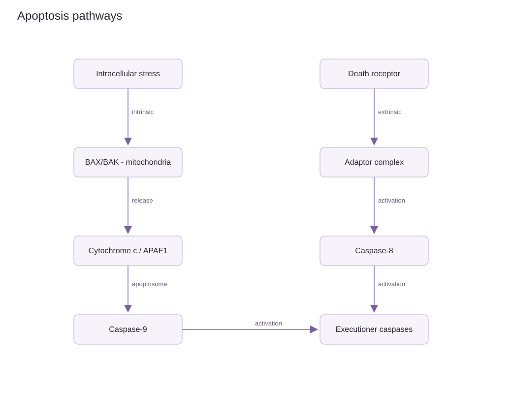

### 확인 문제

Apoptosome과 직접 연결되는 개시 caspase는?

A. Caspase-8
B. Caspase-9

**정답: B**

미토콘드리아 cytochrome c-APAF1 경로가 caspase-9 활성과 연결된다.

**오답 해설**

A: Caspase-8은 대표적 사멸수용체 경로의 개시 효소다.

## 급성·만성 염증과 조직 손상

### 학습목표

- 혈관반응과 백혈구 유출의 단계를 설명한다.
- 주요 염증매개물질의 작용을 연결한다.
- 육아종성 염증과 일반 만성염증을 구분한다.

### 염증의 생물학적 과제

염증(inflammation)은 감염이나 조직손상에 대응하여 원인과 손상조직을 제거하고 회복을 준비하는 반응이다. 병원체뿐 아니라 허혈, 외상, 결정과 면역반응도 이를 유발한다. 세포는 미생물 유래 분자양상과 손상 관련 분자양상을 여러 인식수용체로 감지한다. TLR과 일부 세포질 수용체, 보체와 항체는 서로 다른 위치에서 원인 인식에 관여하며, 같은 자극이 여러 경로를 동시에 활성화할 수 있다.

염증의 보호 효과와 손상 효과는 함께 존재한다. 백혈구의 살균효소와 활성산소는 미생물을 제거하지만 주변 조직도 손상시킬 수 있다. 혈관 투과성과 응고의 국소 변화는 원인을 제한하는 데 도움이 되나, 광범위하게 활성화되면 부종과 미세순환 장애를 악화시킬 수 있다. 염증의 결과는 자극의 지속성과 크기, 숙주 방어, 침범 조직의 재생능력 및 반응을 종료하는 기전에 따라 달라진다.

### 혈관확장과 투과성

급성염증 초기에 소동맥과 미세혈관이 확장되면 국소 혈류가 증가하여 발적과 열감이 생긴다. 혈관 투과성 증가로 단백질과 액체가 조직으로 이동하면 부종이 형성된다. 염증성 삼출액(exudate)은 단순한 압력 변화로 생기는 저단백성 여출액(transudate)과 기전이 다르지만, 실제 체액검사의 판정은 부위와 사용 기준을 함께 고려한다. 단백질 이동과 혈류 정체는 백혈구가 혈관벽 가까이에 모이는 조건에도 영향을 준다.

Histamine은 내피 반응과 투과성 변화에, prostaglandin은 혈관반응과 통증·발열에, leukotriene은 백혈구 유주와 기관지 및 혈관 반응에 관여한다. Bradykinin과 보체 조각, cytokine도 중요한 매개체다. 하나의 매개체가 하나의 증상만 담당하는 구조가 아니므로 특정 증상을 모두 한 물질의 과다로 환원하지 않는다. 동일한 지질 전구체에서 염증을 촉진하거나 종료에 기여하는 여러 매개체가 만들어질 수 있다.

### 백혈구의 유출과 이동

혈관 내 백혈구는 내피 표면에서 구르기(rolling), 활성화, 단단한 부착, 혈관벽 통과를 거쳐 조직으로 나간다. Selectin 계열은 구르기에, integrin의 친화도 변화와 내피 부착분자는 단단한 부착에 중요하다. Chemokine은 이동 방향을 안내하고 integrin 활성화에도 관여한다. 내피 사이를 통과한 백혈구는 기저막을 지나 화학주성 기울기를 따라 이동한다. 유출된 세포 수는 혈중 수뿐 아니라 부착과 이동 기능에도 좌우된다.

호중구는 많은 급성 세균성 염증에서 초기에 두드러지고, 단핵구·대식세포는 후속 처리와 조절에 기여한다. 그러나 자극 종류에 따라 우세 세포가 달라지고 호중구가 오래 지속되는 상황도 있다. 호산구는 기생충과 알레르기 반응의 일부에서, 림프구는 바이러스 감염과 면역반응 등에서 중요하다. 급성과 만성은 세포 종류 하나만으로 결정되는 이름이 아니라 경과와 조직반응을 함께 기술하는 분류다.

### 포식과 살균, 손상

Opsonin은 미생물 표면을 표시하여 식세포 수용체의 인식을 돕는다. 포식소체는 리소좀과 결합하고, NADPH oxidase가 만드는 활성산소와 다양한 효소가 미생물 제거에 관여한다. 호중구의 myeloperoxidase 경로와 대식세포의 질소산화물 경로 등은 서로 다른 살균 체계를 제공한다. 미생물이 세포내에서 생존하거나 포식소체의 성숙을 방해하면 지속 감염과 만성 반응이 생길 수 있다.

백혈구 내용물이 세포 밖으로 유출되거나 조절이 실패하면 숙주 기질과 세포가 손상된다. NET 형성도 미생물 포획에 기여하는 동시에 혈전과 조직손상에 관련될 수 있다. 이 반응을 무조건 유익하거나 유해하다고 분류하지 않고 위치와 지속시간, 제거 능력을 함께 살펴야 한다. 유전적 포식세포 기능장애는 반복 감염과 특유의 염증 양상으로 드러날 수 있다.

### 만성염증과 육아종

만성염증에서는 지속되는 염증세포 침윤, 조직 파괴와 수복이 함께 나타난다. 대식세포, 림프구와 형질세포의 상호작용이 원인을 제거하려는 반응과 섬유화를 연결한다. 대식세포 활성 상태는 조직 환경에 따라 연속적으로 변하며 두 종류의 고정된 세포로만 나누어 설명하기 어렵다. 반복되는 손상과 회복은 장기의 구조를 바꾸고 기능을 저하시킬 수 있다.

육아종(granuloma)은 활성화된 대식세포가 모인 조직화된 염증 패턴으로 상피양세포와 다핵거대세포, 주변 림프구 등이 관찰될 수 있다. 감염성 원인과 비감염성 원인이 모두 가능하다. 건락괴사가 결핵을 시사할 수 있지만 형태만으로 원인균을 확정하지 않고 특수염색, 배양과 분자검사 및 임상 맥락을 대조한다. 육아조직은 상처치유 과정의 혈관·기질 풍부 조직으로 육아종과 다르다.

염증의 종료에는 자극 제거, 호중구 사멸과 제거, 매개체 분해, 항염증성 신호와 배액이 관여한다. 완전 회복, 농양 형성, 섬유화 또는 만성화는 서로 다른 결과다. 염증 수치가 낮아졌다는 사실이 조직 기능과 구조가 모두 회복되었음을 의미하지 않으므로 증상과 장기 기능, 영상 및 필요한 조직평가를 함께 해석한다.

### 확인 문제

육아종과 육아조직은 같은 구조인가?

A. 같다.
B. 다르다.

**정답: B**

육아종은 조직화된 대식세포성 염증 패턴이고 육아조직은 치유 중의 혈관·기질 풍부 조직이다.

**오답 해설**

A: 이름의 유사성이 동일한 조직 반응을 뜻하지 않는다.

## 종양의 성장 조절과 유전체·미세환경

### 학습목표

- 종양유전자와 종양억제유전자의 작용을 구분한다.
- 증식·사멸·불안정성의 상호작용을 설명한다.
- 조직 이질성과 치료 선택압을 연결한다.

### 증식 이상과 종양의 정의

종양(neoplasm)은 세포의 성장 조절 이상과 클론성 변화 등을 바탕으로 지속되는 비정상 조직 증식이다. 반응성 과다형성은 자극에 대한 조절을 일부 유지하고 자극이 사라지면 감소할 수 있는 점에서 구분된다. 그러나 한 시점의 세포 수 증가만으로 이 경계를 항상 확정할 수는 없다. 조직 구조와 세포 형태, 분자적 특성과 경과를 통합한다. 종양은 상피·간엽·혈액림프 등 기원에 따라 다른 분류와 행동 양상을 가진다.

양성과 악성의 구분에는 침윤과 전이 가능성, 조직과 세포의 분화 및 임상 경과가 중요하다. 경계가 뚜렷하고 느리게 자라는 경향은 단서지만 모든 양성 종양이 무해한 것은 아니다. 위치에 따른 압박과 호르몬 분비, 출혈은 양성 병변에서도 큰 문제를 만들 수 있다. 악성 종양도 분화도와 성장속도가 다양하므로 나쁨의 정도를 크기 하나로 평가하지 않는다.

### 성장 신호의 지속

정상 세포는 성장인자와 수용체, 세포내 신호 및 주변 조직의 조건을 통합한다. Proto-oncogene의 활성화 변화는 수용체와 RAS-MAPK, PI3K-AKT 등 경로를 지속적으로 자극하거나 전사·세포주기 조절을 바꿀 수 있다. 유전자 증폭과 염색체 재배열, 특정 기능획득 변이는 서로 다른 활성화 방식이다. 유전자가 발현되었다는 사실과 병적 활성화가 있었다는 사실은 구분한다.

종양유전자의 기능획득은 세포 수준에서 한 대립유전자의 변화로도 효과가 나타날 수 있지만, 실제 종양의 성질은 다른 조절망과 유전체 배경의 영향을 받는다. 같은 변이라도 조직 계통과 동반 변화가 다르면 의존성과 치료 반응이 달라질 수 있다. 모든 암을 공통적인 하나의 스위치로 설명할 수는 없다. 발암에서 중요한 변화와 진행 중 뒤따라온 변화도 구분해야 한다.

### 세포주기 억제와 손상 반응

RB 계통은 E2F 등과 연결되어 세포주기 진행을 조절한다. Cyclin-CDK 활성과 억제단백질, RB의 인산화 상태가 증식 신호와 연결된다. 이 장치가 손상되면 정상적인 제한 조건에서도 세포주기를 진행하는 방향으로 바뀔 수 있다. TP53 계통은 DNA 손상과 여러 스트레스에 대응하여 정지와 수선, 세포사멸 등 반응에 관여한다. TP53를 모든 손상을 직접 고치는 단일 수선효소로 부르는 것은 부정확하다.

종양억제유전자 기능 상실은 두 대립유전자 손상이 관여하는 전형적 모형으로 설명할 수 있으나 모든 유전자와 상황이 정확히 같은 규칙을 따르지는 않는다. Haploinsufficiency와 dominant-negative 효과, 후성유전 억제 등 여러 방식이 있다. 유전성 소인은 첫 변화가 체세포 전체에 이미 존재하는 조건을 만들 수 있지만 종양 발생에는 추가 변화와 조직 환경이 관여한다. 유전적 위험과 출생 시부터 암이 완성되어 있다는 주장은 다르다.

### 세포사멸·복제수명과 불안정성

종양세포는 증식 신호 외에 사멸과 노화 반응을 피하는 능력을 획득할 수 있다. BCL-2 계통 등 생존·사멸 조절의 변화는 세포 수의 증가를 촉진할 수 있으며, 빠른 분열만이 종양 성장의 유일한 원인은 아니다. Telomere 유지와 말단 보호는 장기 증식과 염색체 안정성에 관련된다. 위기와 불안정성의 단계는 유전체의 추가 재편을 만들 수 있다.

DNA 수선과 염색체 분리, 복제 점검의 결함은 변이와 구조 이상이 축적될 기회를 늘린다. 이 모든 변화가 종양에 이익을 주는 것은 아니며 생존하지 못하는 세포도 많다. 클론의 선택은 영양과 산소, 면역과 치료 등 환경에서 상대적으로 잘 살아남는 집단을 바꾼다. 유전체 불안정성을 한 방향으로 끝없이 좋아지는 진화처럼 해석하면 안 된다.

### 혈관·대사·면역 환경

종양이 커지면 산소와 영양 공급, 대사물 제거의 제한에 직면한다. 혈관신생과 주변 조직의 재구성은 생존에 기여하지만 새 혈관의 기능이 정상 혈관처럼 균일하지는 않다. 낮은 산소와 불규칙한 관류는 세포 상태와 약물 전달을 바꾼다. 같은 종양 안의 영역들이 서로 다른 조건에 놓여 있어 한 번의 조직 채취가 전체의 모든 상태를 포괄하지 못할 수 있다.

종양세포와 면역세포, 섬유모세포 및 기질은 지속적으로 상호작용한다. 면역반응은 종양을 제거하거나 선택압을 만들고, 종양은 항원제시와 억제 신호 등을 바꾸어 회피할 수 있다. 일부 염증과 기질 반응은 성장·침윤을 돕기도 한다. 면역세포가 많이 보인다는 사실만으로 효과적인 항종양 반응이 이루어지고 있다고 판단하지 않는다. 세포의 종류와 위치, 활성 상태가 중요하다.

### 침윤과 전이

침윤은 조직의 경계와 기질을 넘어 국소 확산하는 과정이며, 전이는 떨어진 부위에서 종양이 형성되는 현상을 말한다. 세포접착과 운동성, 기질 처리와 혈관·림프관 접근, 이동 중 생존과 새로운 조직 정착 등 여러 장벽이 있다. 원발 종양에서 떨어진 세포가 검출되었다고 모든 세포가 임상적 전이를 완성하는 것은 아니다. 도달과 생존, 장기 증식의 조건이 서로 다르다.

전이의 분포는 해부학적 배액과 혈류뿐 아니라 표적 장기의 환경과 세포 상호작용에 영향을 받는다. 림프절 전이와 먼장기 전이는 병기와 예후 평가에 다른 정보를 제공한다. 병기는 퍼진 범위를, 등급은 형태와 분화·증식 등의 특성을 반영하는 체계로 구분한다. 장기와 종양 유형마다 적용 기준이 다르므로 용어를 다른 암에 그대로 옮겨 쓸 수는 없다.

### 이질성과 치료 반응

종양 안에는 유전적으로 다른 하위클론과, 같은 유전체라도 다른 분화·대사 상태의 세포가 공존할 수 있다. 치료는 감수성 집단을 줄이는 동시에 내성 집단의 상대적 비율을 바꾸는 선택압이 된다. 처음부터 드물게 존재한 내성과 치료 중 새로 생긴 변화, 비유전적 적응은 구분하면서도 함께 고려한다. 반응 후 재발이 있었다는 사실만으로 단일 기전을 확정하지 않는다.

분자검사에서 표적 변화가 확인되어도 약물이 그 조직과 환자에서 유효하다는 근거가 필요하다. 표적의 존재와 약물 도달, 실제 의존성 및 하류 우회경로가 모두 관련된다. 반대로 발현이 낮다는 결과도 검체 위치와 시점, 분석의 한계를 고려한다. 병리 진단과 분자 정보, 병기와 환자의 상태를 연결하는 것이 정밀 치료의 출발점이다.

### 확인 문제

종양억제유전자와 종양유전자의 작용을 해석할 때 적절한 것은?

A. 모든 종양 관련 변이는 동일한 약물에 반응한다.
B. 암세포는 DNA 손상과 세포주기 조절의 영향을 전혀 받지 않는다.
C. 성장 신호의 과활성과 성장 억제의 소실은 서로 다른 경로로 증식을 촉진할 수 있다.

**정답: C**

종양은 여러 조절 경로의 변화가 축적된 결과이므로 유전자 이름 하나로 모든 치료 반응을 예측할 수 없다.

**오답 해설**

A: 종양 변이는 서로 다른 경로와 내성 조건에 놓이므로 같은 약물 반응을 보장하지 않는다.

B: 암에서도 손상 반응과 세포주기 조절의 잔존 및 변화가 병태생리에 관여한다.

# 계통별 병리학

## 사구체 손상의 형태와 신염·신증후군

### 학습목표

- 사구체의 세 구성요소와 손상 양상을 연결한다.
- 면역형광·광학·전자현미경의 정보를 통합한다.
- 임상 증후군과 병리 진단을 구분한다.

### 여과장벽과 지지 구조

사구체 모세혈관의 내피와 사구체기저막, 발세포와 세극막은 혈액과 여과액 사이의 장벽을 이룬다. Mesangial 세포와 기질은 모세혈관 다발의 지지와 국소 반응에 관여한다. 이 요소들은 서로 영향을 주지만 손상이 시작되는 주된 위치와 기전이 다르면 단백뇨·혈뇨와 여과율 변화의 조합도 달라진다. 한 환자에게 여러 요소의 손상이 동시에 존재할 수 있어 순수한 세 칸 분류로 모든 질환을 설명할 수는 없다.

발세포의 발돌기와 세극막, 세포골격은 단백질 통과 제한에 중요하다. 발세포 손상은 단백뇨와 연결되고, 내피와 모세혈관벽의 염증·파괴는 혈구의 통과와 여과 감소를 만들 수 있다. Mesangial 증식과 기질 증가는 지지 구조와 모세혈관 표면의 기능을 바꾼다. 세포가 늘었다는 소견과 기질이 늘었다는 소견도 구분하여 형태를 기술한다.

### 임상 증후군의 틀

신염성 양상(nephritic presentation)은 혈뇨, 사구체 여과 감소와 체액·혈압 변화 등을 중심으로 접근한다. 소변의 적혈구원주와 변형 적혈구는 사구체 기원의 출혈을 시사하는 단서가 될 수 있다. 다만 검체와 판독의 영향을 받으므로 소견 하나만으로 모든 원인을 확정하지 않는다. 단백뇨도 동반될 수 있고 심한 경우 신증후군 수준의 손실이 겹칠 수 있다.

신증후군(nephrotic syndrome)은 상당한 단백뇨와 저알부민혈증, 부종 및 관련 대사 변화 등을 포함하는 임상 조합이다. 진단명 하나의 동의어가 아니라 여러 발세포·기저막 질환과 전신 질환에서 나타날 수 있는 결과다. 단백뇨의 양이 많다는 사실과 저알부민·부종의 발생에는 시간과 합성·분포·배설이 관여한다. 혈뇨가 조금 존재한다고 신증후군성 질환을 모두 배제하지 않는다.

빠르게 진행하는 신기능 저하는 임상 경과의 표현이고, 반달체(crescent)는 병리 소견이다. 두 개념은 밀접하게 연결되지만 완전히 같은 말은 아니다. 반달체는 사구체 모세혈관벽의 심한 손상과 보먼공간의 세포 반응에 관련되며 구성과 만성성에 따라 의미가 달라진다. 원인 기전을 구분하는 검사가 치료의 긴급성과 선택에 중요하다.

### 세 가지 현미경이 답하는 질문

광학현미경은 세포 증식과 기질, 모세혈관벽 두께와 괴사, 경화 및 반달체의 분포를 보여준다. 국소성(focal)과 미만성(diffuse)은 사구체 가운데 얼마나 많은 수가 침범되었는지, 분절성(segmental)과 전반성(global)은 한 사구체 안의 어느 범위가 침범되었는지를 기술한다. 두 쌍의 용어는 서로 다른 축이므로 같은 뜻으로 바꾸어 쓰면 안 된다.

면역형광은 immunoglobulin과 보체 등의 침착 양상과 위치를 평가한다. 선상(linear) 패턴과 과립상(granular) 패턴, 적은 면역반응 소견은 서로 다른 기전의 가설을 제공한다. 전자현미경은 침착물의 위치와 초미세구조, 기저막과 발돌기 변화를 추가로 보여준다. Mesangial, 내피하와 상피하 침착은 같은 면역물질이 보인다는 공통점이 있어도 염증 반응과 임상 표현이 달라질 수 있다.

한 검사에서 보이지 않았다는 결과는 검사 범위와 표본 상태를 함께 해석해야 한다. 조직 절편에 포함된 사구체 수가 적으면 국소 병변을 놓칠 수 있고, 진행된 경화는 초기 원인의 특징을 흐릴 수 있다. 생검 결과는 병력과 혈청·소변검사 및 시간 경과를 대조해야 하는 조직 표본의 정보다. 전체 신장의 모든 부위를 같은 깊이로 관찰한 결과는 아니다.

### 면역복합체와 항체 매개 손상

면역복합체는 순환에서 형성되어 침착하거나 조직의 항원과 항체가 국소적으로 결합하여 만들어질 수 있다. 보체와 염증세포의 활성은 손상 위치에 따라 다른 정도로 유도된다. 내피하 침착은 혈액의 염증성 성분과 접근이 쉬워 염증이 두드러질 수 있고, 상피하 병변은 다른 기전을 통해 여과장벽과 발세포에 영향을 줄 수 있다. 이 구분은 경향이며 원인별 세부 기전과 중증도를 함께 고려한다.

사구체기저막의 특정 항원을 향한 항체는 선상 패턴과 심한 손상을 만들 수 있다. 일부 전신 작은혈관염에서는 심한 괴사와 반달체가 있어도 면역침착이 적은 양상(pauci-immune)이 관찰될 수 있다. 혈중 항체검사는 원인 평가를 돕지만 모든 양성과 음성이 조직 손상을 완전히 대변하지는 않는다. 감염과 약물, 전신 증상을 포함하여 원인과 장기 침범을 함께 평가한다.

### 발세포 손상과 경화 패턴

미세변화병에서는 광학 소견이 크지 않아도 전자현미경의 발돌기 변화와 심한 단백뇨가 연결될 수 있다. 발돌기 소실이라는 형태 자체가 이 질환에만 특이적인 것은 아니다. 분절성 사구체경화는 원발성 질환 외에도 네프론 감소에 대한 과여과, 유전적 결함과 여러 이차 원인에서 생길 수 있는 패턴이다. 같은 형태명이 붙었다고 병인과 치료 반응이 모두 같다고 가정하지 않는다.

막성 패턴과 증식성 패턴 등은 모세혈관벽과 세포·기질의 반응을 기술하는 틀이다. 전신 자가면역질환, 만성 감염과 약물, 종양 및 대사 질환은 원인 평가에서 상황에 따라 중요하다. 성인 단백뇨를 신장에 국한된 문제로만 보면 관련 원인을 놓칠 수 있고, 반대로 우연히 함께 존재하는 질환을 원인으로 확정하는 것도 피해야 한다. 분포와 기전, 임상 확률을 함께 평가한다.

### 단백질 손실의 전신 영향

Albumin 감소와 신장의 Na+ 보존, 모세혈관·간질 조건은 부종 형성에 함께 관여한다. 혈관 내 유효량이 감소하는 경우와 신장 자체의 Na+ 보존이 두드러지는 경우를 한 가지 모형으로만 설명하지 않는다. 소변으로 여러 단백질이 소실되면 감염 방어와 호르몬·약물 운반, 혈전·출혈 균형 등에도 영향이 있을 수 있다. 혈전 위험은 개별 단백질 하나의 농도만이 아니라 질환과 심한 정도, 염증과 움직임 등 여러 요인의 결과다.

지질 대사 변화와 영양 상태, 만성 염증과 신기능 저하는 서로 영향을 준다. 단백뇨를 줄이는 목표와 원인 질환의 조절, 체액과 혈압 관리, 혈전·감염 등 합병증의 평가를 나누어 생각한다. 생검에서 보이는 활동성 염증과 만성 경화·위축의 비율은 회복 가능성과 위험을 이해하는 데 도움을 주지만 예후를 한 번에 확정하는 수치는 아니다.

### 확인 문제

신생검에서 국소성과 분절성이라는 표현의 차이는?

A. 국소성은 침범 사구체의 비율, 분절성은 한 사구체 안의 침범 범위에 관한 표현이다.
B. 두 용어는 같은 뜻이며 서로 바꾸어 쓸 수 있다.
C. 분절성은 반드시 신장 한쪽만 침범했다는 뜻이다.

**정답: A**

사구체 사이의 분포와 사구체 내부의 분포는 별개의 축이다.

**오답 해설**

B: 국소성은 사구체 사이, 분절성은 한 사구체 내부라는 별개의 분포 축이다.

C: 분절성은 한 사구체의 일부라는 뜻이며 신장 좌우 구분이 아니다.

# 일반약리학

## 약동학의 구획 모형과 투여 설계

### 학습목표

- 분포용적과 청소율의 물리적 의미를 설명한다.
- 반감기와 정상상태의 관계를 유도한다.
- 부하용량과 유지용량에 영향을 주는 변수를 구분한다.

### 농도 곡선을 읽는 관점

약동학(pharmacokinetics, PK)은 약물이 흡수·분포·대사·배설되는 시간 경과를 다룬다. 혈중 농도는 약효를 결정하는 중요한 정보지만 표적 부위 농도와 언제나 같지는 않다. 약물이 혈액과 조직 사이에서 이동하는 속도, 단백질 결합, 활성 대사체, 수용체 결합 이후의 지연이 영향을 준다. 약력학(pharmacodynamics, PD)은 농도와 효과의 관계를 다루므로 PK와 구분하되 연결해서 해석한다. 같은 혈중 농도라도 환자별 수용체 민감도와 질환 상태에 따라 효과는 달라질 수 있다.

한 구획 모형(one-compartment model)은 약물이 체내의 가상 공간에서 균일하게 섞인 것으로 가정한다. 실제 몸이 한 개의 물주머니라는 뜻은 아니다. 다구획 모형에서는 혈액과 빠르게 평형을 이루는 중심 구획, 더 천천히 분포하는 말초 구획을 구분한다. 정맥 투여 직후 농도가 빠르게 떨어지는 분포기와 이후의 소실기를 혼동하면 반감기나 분포용적을 잘못 추정할 수 있다. 어떤 모형을 사용하는지에 따라 같은 이름의 추정량도 해석이 달라질 수 있다.

### 분포용적의 가상성

겉보기 분포용적(volume of distribution, Vd)은 체내 약물량 A를 혈장 농도 C로 나눈 Vd=A/C이다. 단위는 L처럼 부피지만 실제 해부학적 공간의 크기는 아니다. 조직에 강하게 결합하여 혈장 농도가 낮으면 계산된 Vd는 총체수분보다 훨씬 클 수 있다. 혈장 단백질에 주로 결합하고 혈관 밖으로 잘 이동하지 않는 약물은 작은 Vd를 보일 수 있다. 혈중 농도를 전체 농도로 측정했는지 자유형 농도로 측정했는지에 따라서도 해석이 달라진다.

저알부민혈증에서 단백질 결합 약물의 자유형 분율이 증가하면 전체 농도가 낮아져도 자유형 노출이 같은 방향으로 변한다고 단정할 수 없다. 동시에 청소율과 분포가 변할 수 있기 때문이다. 비만, 부종, 임신, 중환자 상태는 지용성·수용성 약물의 분포에 서로 다른 영향을 준다. 체중만 곱해서 용량을 정하는 방식은 약물과 상황별 검증이 필요하다. 이러한 이유로 치료약물농도감시(therapeutic drug monitoring, TDM)에서는 채혈 시점과 측정 농도의 종류를 반드시 확인한다.

### 청소율과 반감기의 유도

청소율(clearance, CL)은 약물 제거 속도를 농도로 나눈 값이다. 일차 소실 모형에서 제거 속도는 CL·C이며, A=Vd·C이고 Vd가 일정하면 dC/dt=−(CL/Vd)C가 된다. 적분하면 C(t)=C0 exp(−kt), k=CL/Vd를 얻는다. C가 절반이 되는 시간은 t1/2=ln2/k=0.693Vd/CL이다. 이 식은 해당 모형의 가정 아래 성립하며 다구획 분포의 모든 시점에 하나의 Vd와 반감기를 무조건 적용해서는 안 된다.

청소율은 단위 시간의 약물 질량이 아니라 부피/시간이다. 혈장 농도가 두 배이면 같은 CL에서 제거되는 질량/시간도 두 배가 된다. 포화 제거에서는 이 비례관계가 깨질 수 있다. 대사효소나 수송체의 처리 능력이 포화되는 약물은 용량을 조금 올려도 농도가 예상보다 크게 증가할 수 있다. 이를 모든 약물에 일차 소실로 가정하면 위험하다. 한 기관의 청소율은 혈류와 추출률의 곱으로 생각할 수 있으며, 높은 추출률 약물과 낮은 추출률 약물은 혈류·효소활성·단백질 결합 변화에 대한 반응이 다르다.

### 반복 투여와 정상상태

일정 속도로 정맥 주입하면 약물이 들어오는 속도와 나가는 속도가 같아지는 농도가 정상상태 농도(Css)다. 선형 모형에서 Css=주입속도/CL이다. 정상상태에 접근하는 시간 경과는 반감기에 의해 결정되며, 시작 농도가 0인 단순 모형에서 네 반감기 후 약 93.75%, 다섯 반감기 후 약 96.875%에 도달한다. 이는 지수적 접근이어서 유한 시간에 수학적으로 정확한 100%가 되는 것은 아니다. 반감기가 길면 목표 노출에 도달하는 데 오래 걸리는 이유다.

반복 간헐 투여에서는 같은 평균 노출이라도 투여 간격에 따라 최고농도와 최저농도의 차이가 달라진다. 효과가 시간에 의존하는지 최고농도에 의존하는지, 독성이 어느 농도 범위와 연관되는지가 투여 전략에 영향을 준다. 혈액 채취가 투약 직전인지, 분포가 끝나기 전인지에 따라 의미가 크게 달라지므로 검사 결과만 따로 읽지 않는다. 정상상태라는 말은 매 순간 농도가 일정하다는 뜻이 아니라 반복되는 시간 경과가 주기적으로 같아졌다는 뜻으로도 사용된다.

### 부하용량과 유지용량

목표 농도에 빨리 접근하기 위한 부하용량(loading dose)은 단순 근사에서 목표농도×Vd/F로 계산한다. F는 전신순환에 도달한 분율인 생체이용률(bioavailability)이다. 평균 농도를 유지하기 위한 단위 시간당 투여량은 목표농도×CL/F에 비례한다. 따라서 신기능 저하로 CL이 감소한 경우 유지 투여는 조정이 필요할 수 있지만, Vd 변화까지 확인하지 않고 부하용량도 같은 비율로 줄인다고 단정하면 안 된다. 이 공식은 원리 교육용이며 실제 처방에는 해당 약물의 허가사항과 검증된 투여 지침이 필요하다.

경구 투여 F는 흡수되지 않은 분율, 장벽 대사, 간 초회통과 효과의 영향을 받는다. 효소 억제와 유도, 신장 분비 수송체 경쟁, 위장관 운동 변화는 서로 다른 지점에서 노출을 바꾼다. 전구약물(prodrug)에서는 활성화 감소가 원약물 농도 상승과 반대 방향의 임상 효과를 만들 수 있다. 약물 상호작용은 농도를 올린다 또는 내린다라는 한 문장보다 어느 분자가 활성 형태이고 어느 경로가 바뀌는지를 따라가야 한다.

$$
t_{1/2}=\frac{\ln 2\,V_d}{CL}
$$

Vd: 겉보기 분포용적; CL: 청소율; t1/2: 반감기

#### 단순 투여 설계의 주요 변수

| 항목 | 근사 관계 | 주요 변수 |
|---|---|---|
| 부하용량 | 목표농도 × Vd / F | 분포용적 |
| 유지 투여속도 | 목표농도 × CL / F | 청소율 |
| 반감기 | 0.693 × Vd / CL | 분포용적 및 청소율 |

선형 단일구획 근사; 실제 약물의 처방 지침이 아님

### 확인 문제

단순 모형에서 유지 투여속도를 주로 결정하는 PK 변수는?

A. 분포용적만
B. 청소율

**정답: B**

같은 목표농도와 F에서 유지속도는 CL에 비례한다.

**오답 해설**

A: Vd는 부하용량과 시간 경과에 관여하지만 유지속도를 단독 결정하지 않는다.

## 수용체·효능·역가와 농도반응

### 학습목표

- 결합 친화도와 기능 반응을 구별한다
- 효능과 역가 및 길항의 차이를 설명한다
- 개인 반응과 집단의 반응 분포를 구분한다

### 결합에서 효과까지

약력학(pharmacodynamics)은 약물이 생체에 어떤 효과를 어떻게 만드는지를 다룬다. 약물이 표적에 결합하는 사건과 세포 신호, 조직의 기능 변화 및 환자의 결과 사이에는 여러 단계가 있다. 수용체 결합이 높다고 임상적 이득이 언제나 큰 것은 아니며 표적이 발현된 조직과 신호 환경, 보상 반응 및 질환 상태가 결과를 바꾼다. 모든 약물이 수용체 작용제인 것도 아니고 효소와 이온통로, 수송체 및 다른 물리화학적 표적도 있다.

친화도(affinity)는 결합의 성질이고 효능(efficacy)은 해당 조건에서 표적을 통해 반응을 유발하는 능력과 관련된다. 단순한 평형 모형에서 해리상수는 결합 점유와 연결되지만 실제 기능 반응의 절반을 만드는 농도와 항상 같지 않다. 신호 증폭과 수용체 여유, 다른 경로 및 시간에 따른 조절이 점유와 반응의 관계를 바꾼다. 결합곡선을 그대로 환자의 치료반응 곡선으로 읽지 않는다.

### 농도반응과 역가

단계적 농도반응곡선은 한 생물학적 계에서 농도가 바뀔 때 반응의 크기가 어떻게 달라지는지 표현한다. 최대 반응과 그 일부를 만드는 농도는 서로 다른 특성이다. 역가(potency)가 높은 약물은 특정 반응에 더 낮은 농도나 용량이 필요할 수 있지만 최대 이득과 안전성이 더 우수하다는 보장은 아니다. 두 약물을 비교할 때 같은 반응과 조건을 평가했는지 확인해야 한다.

Emax와 EC50을 이용한 모형은 포화와 반응을 이해하는 데 유용하다. 그러나 실제 곡선은 기울기와 지연, 여러 표적 및 시간에 따라 달라질 수 있다. 혈장 농도와 효과 부위 농도가 같지 않거나 세포의 후속 변화가 오래 지속되면 같은 혈장 농도에서도 시점에 따라 반응이 다를 수 있다. 약동학과 약력학을 나누어 배우되 실제 투여에서는 두 과정이 연결된다는 점을 유지한다.

### 완전·부분·역작용

완전작용제와 부분작용제의 구분은 같은 기능 계에서 나타낼 수 있는 반응에 관련된다. 부분작용제는 결합하더라도 최대 반응이 낮을 수 있고, 완전작용제가 함께 있을 때는 경쟁하여 전체 반응을 낮출 수 있다. 따라서 부분작용제를 항상 약한 치료제 또는 언제나 길항제라고만 부르면 맥락을 놓친다. 기존의 자극과 수용체 환경에 따라 임상적 결과가 달라질 수 있다.

일부 수용체는 작용제가 없어도 기저 활성을 보일 수 있다. 역작용제(inverse agonist)는 그런 활성의 방향을 낮추는 효과를 가질 수 있으며 중성 길항제와 개념이 다르다. 다만 모든 수용체와 실험에서 이 차이가 같은 임상적 중요성을 갖는 것은 아니다. 측정한 기능과 조건을 명확히 해야 분자 수준의 용어를 과도하게 확대하지 않는다.

### 길항의 여러 형태

가역적인 경쟁적 길항은 단순한 평형 조건에서 작용제 농도를 높여 극복할 수 있는 양상을 만들 수 있다. 농도반응곡선의 이동은 이런 관계를 이해하는 데 도움이 된다. 비가역 결합과 비경쟁적 억제, 다른 부위의 조절은 최대 반응과 곡선에 다른 영향을 줄 수 있다. 수용체 여유가 있는 경우 초기에는 예상한 최대 반응 감소가 뚜렷하지 않을 수도 있다.

생리적 길항은 서로 다른 수용체와 경로가 장기 기능에서 반대 효과를 내는 경우를 설명하고, 화학적 길항은 직접적인 물질의 결합과 중화 등을 다룬다. 모든 길항이 같은 수용체 결합 자리를 놓고 경쟁하는 것은 아니다. 약물 상호작용을 해석할 때 표적에서의 관계와 흡수·대사 등 노출의 변화도 구별한다. 반응이 줄었다는 현상 하나만으로 기전을 확정할 수 없다.

### 반복 노출과 조절

수용체 탈감작과 내재화, 발현 변화 및 후속 신호의 조절은 반복 투여의 반응을 바꿀 수 있다. 내성은 표적 변화 외에도 약물 노출과 보상 생리 및 행동의 영향을 받는다. 같은 용량에서 효과가 감소했다는 이유로 무조건 증량하기보다 복용과 노출, 질환 변화 및 이상반응을 확인해야 한다. 중단 뒤 반동과 금단도 정상 조절계의 적응과 연결될 수 있다.

치료 효과와 독성은 다른 표적 또는 같은 표적의 다른 조직에서 발생할 수 있다. 선택성은 농도와 용량 범위에 의존하므로 낮은 노출에서의 표적 선호가 모든 용량에서 유지된다고 가정하지 않는다. 수용체 아형의 차이와 약물의 도달, 신호의 편향 및 조직 분포가 이득과 위해를 바꾼다. 선택적이라는 단어를 부작용이 없다는 뜻으로 사용하지 않는다.

### 집단과 개인의 반응

양자적 반응(quantal response)은 정해진 사건이나 기준을 충족한 사람의 비율을 용량과 연결한다. 한 조직에서 반응 크기가 절반인 것과 집단 절반에서 사건이 나타나는 것은 다른 개념이다. ED50과 독성 지표의 의미도 어떤 반응과 집단을 정의했는지에 따라 달라진다. 치료지수는 유용한 개요지만 개별 환자의 모든 안전 여유와 모니터링 필요성을 완전히 대표하지 못한다.

환자의 연령과 장기 기능, 동반 약물과 유전 및 질환 상태는 노출과 반응을 함께 바꾼다. 시작 용량과 증량, 효과 및 독성 감시는 이런 차이를 반복하여 반영하는 과정이다. 약력학의 곡선과 수용체 모형은 실제 치료를 단순한 공식으로 대체하는 것이 아니라 왜 같은 약과 용량이 서로 다른 결과를 만드는지 설명하는 공통 언어이다.

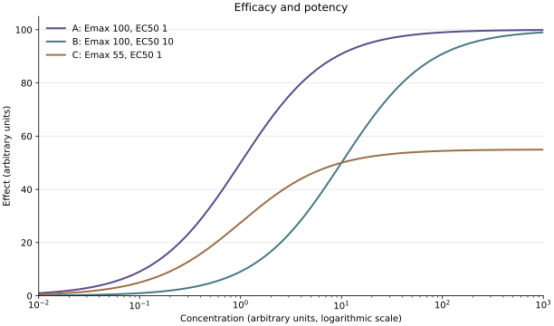

$$
\theta=\frac{[L]}{K_D+[L]}
$$

theta: 수용체 점유 분율; [L]: 유리 리간드 농도; K_D: 단일 비협동 결합 평형의 해리상수

### 확인 문제

EC50가 더 낮은 약물을 같은 실험계에서 비교할 때 타당한 해석은?

A. 임상적 안전성이 반드시 더 높다.
B. 그 반응에 대한 역가가 더 높을 수 있다.
C. 최대효과가 반드시 더 크다.

**정답: B**

EC50는 주어진 실험계에서 반최대 반응에 필요한 농도이며 최대효과나 안전성을 따로 평가해야 한다.

**오답 해설**

A: 독성 표적과 노출 및 환자 조건을 보지 않고 안전성을 결정할 수 없다.

C: 역가와 효능의 최대 크기는 구별한다.

## 자율신경 전달과 수용체 약리

### 학습목표

- 절전·절후 전달물질과 수용체를 연결한다.
- 수용체 선택성과 장기 효과·반사를 구분한다.
- 직접 작용과 전달물질 처리 조절을 비교한다.

### 두 신경세포 연결과 예외

자율신경의 원심경로는 대개 중추의 절전신경세포와 말초 신경절의 절후신경세포로 이어진다. 교감신경과 부교감신경의 절전 말단은 acetylcholine을 분비하고 신경절의 nicotinic 수용체를 자극한다. 표적 장기에서 부교감 절후 전달은 주로 acetylcholine과 muscarinic 수용체, 교감 절후 전달은 주로 norepinephrine과 adrenergic 수용체에 연결된다. 땀샘으로 가는 일부 교감 절후 경로는 cholinergic이라는 중요한 예외를 가진다.

부신속질은 절전 cholinergic 신호를 받아 catecholamine을 혈액에 방출하는 변형된 교감 계통으로 이해할 수 있다. 혈중 호르몬은 신경말단에서 국소 방출되는 전달물질과 공간·시간 조건이 다르다. 같은 catecholamine이라도 주입 경로와 농도, 제거와 장기별 수용체 분포에 따라 효과가 달라진다. 교감과 부교감을 모든 기관에서 정반대인 두 개의 같은 크기 신호로 생각하면 안 된다.

### Cholinergic 전달의 처리

Acetylcholine은 choline과 acetyl-CoA를 재료로 합성되어 소포에 저장되고, Ca2+ 의존성 막융합으로 방출된다. Acetylcholinesterase는 시냅스 틈에서 전달물질을 빠르게 분해하며 choline은 재흡수되어 재사용된다. 수용체 직접 작용제와 분해효소 억제제는 acetylcholine 작용을 늘린다는 공통점이 있어도 적용되는 시냅스와 시간 경과, nicotinic·muscarinic 효과의 조합이 다르다.

Nicotinic 수용체는 리간드개폐성 양이온 통로다. 자율신경절의 수용체와 신경근접합부의 수용체는 구분되며 약물 반응도 같지 않다. Muscarinic 수용체는 G 단백질 연결수용체로, M2의 심장 작용과 M3의 평활근·분비샘 작용 등 조직별 차이가 중요하다. M3 신호가 혈관 내피에서 NO 생성을 촉진하면 혈관 평활근 수축과 다른 방향의 효과가 나타날 수 있어 수용체가 발현된 세포를 확인해야 한다.

### Adrenergic 합성과 제거

Catecholamine 합성은 tyrosine에서 시작하여 DOPA와 dopamine을 거쳐 norepinephrine으로 이어진다. 효소의 위치와 소포 내 반응, 부신의 추가 전환 단계가 서로 다르다. 신경말단에서 방출된 norepinephrine의 작용 종료에는 신경말단 재흡수가 특히 중요하며, 확산과 세포내·외 대사도 관여한다. Acetylcholine처럼 동일한 틈의 한 분해효소가 종료를 전담하는 구조가 아니다.

MAO와 COMT는 catecholamine 및 관련 물질의 대사에 관여한다. 재흡수 억제와 저장·방출 변화, 직접 수용체 자극은 서로 다른 약리 전략이다. 간접 작용 약물은 신경말단의 저장량과 기능, 다른 약물의 영향을 받으므로 직접 작용제와 같은 조건에서 항상 같은 반응을 내지 않는다. 약물 상호작용을 이해하려면 수용체뿐 아니라 전달물질의 합성부터 제거까지 따라가야 한다.

### α와 β 수용체의 기능

α1 수용체는 많은 혈관 평활근과 요도 출구 등에서 수축 반응에 연결된다. α2 수용체는 시냅스전 전달물질 방출 억제와 중추 조절 등 여러 위치에서 작용한다. α2 작용제가 중추 교감 출력을 낮추는 효과와 말초의 직접 효과는 위치와 약물의 중추 접근성을 고려해야 한다. 수용체 명칭 하나를 혈압이 항상 오르거나 내리는 단일 결론으로 바꾸지 않는다.

β1 수용체는 심박수와 수축력, 신장의 renin 분비 등에, β2 수용체는 기도와 일부 혈관 등의 평활근 이완에 중요하다. β3 수용체는 지방조직과 방광 등에서 다른 역할을 가진다. 장기별 수용체 분포는 상대적이며, 약물의 선택성은 용량과 농도에 따라 약해질 수 있다. β1 선택적 차단제라고 어떤 조건에서도 β2 효과가 전혀 없다고 말할 수는 없다.

### 직접 효과와 압력반사

약물이 혈관을 수축시켜 혈압을 올리면 압력수용체 반사는 심박수와 자율신경 출력을 반대 방향으로 조정할 수 있다. 이때 관찰된 심박수는 심장 수용체에 대한 직접 작용과 반사 효과의 합이다. 심장에 직접 작용하지 않는 혈관 약물도 맥박을 바꿀 수 있다. 반대로 혈관확장 후 나타나는 빈맥을 약물이 심장 β1 수용체를 직접 자극했다는 증거로 해석하면 틀릴 수 있다.

안정된 반사와 정상적인 혈관내 용적을 가정한 교과서 반응은 자율신경 장애와 출혈, 중환자 상태에서 달라질 수 있다. 같은 혈압 변화라도 장기 관류와 산소전달의 결과가 같지 않다. Catecholamine 계열의 임상 사용에서는 심박출과 혈관저항, 리듬 및 원인 병태를 함께 판단한다. 수용체표의 플러스와 마이너스만으로 실제 환자의 전체 혈역학을 대신할 수 없다.

### 차단·탈감작과 임상 관찰

수용체 길항제는 해당 장기의 기저 자율신경 긴장도에 따라 다른 크기의 변화를 만든다. β차단은 심박수와 renin 등 여러 작용을 바꾸며 약물별 선택성과 부가 성질, 제거 경로가 다르다. α1 차단은 혈관과 요도 출구에 영향을 줄 수 있고 기립성 증상과도 연결된다. Muscarinic 차단은 분비와 동공, 심박수 및 방광·장운동 등 여러 계통에서 효과를 보일 수 있다.

지속 자극은 수용체의 인산화·내포와 하류 신호 변화를 통해 반응을 약화시킬 수 있고, 장기 차단 뒤에는 반응성이 변할 수 있다. 약물 중단과 증량의 결과는 분포·반감기뿐 아니라 이러한 적응에도 영향을 받는다. 약리학적 내성과 질환의 악화, 부적절한 사용과 다른 약물의 상호작용을 구분해야 한다. 증상이 변했다는 사실만으로 곧바로 표적 수용체의 숫자가 늘거나 줄었다고 확정하지 않는다.

### 확인 문제

β2 수용체 자극이 기도 평활근을 이완시킬 수 있는 기전은?

A. 모든 조직에서 cAMP는 반드시 수축을 유발한다.
B. β2는 골격근 종판의 니코틴 수용체이다.
C. Gs-cAMP 계통이 평활근 수축 조절에 영향을 준다.

**정답: C**

동일한 두 번째 전달자도 세포의 표적 단백질과 신호 환경에 따라 다른 효과를 낸다.

**오답 해설**

A: cAMP의 효과는 조직의 표적 단백질과 신호계에 따라 다르다.

B: β2는 아드레날린성 수용체이며 신경근접합부의 니코틴 수용체와 다르다.

# 계통별 약리학

## β-Lactam계 항균제의 작용·내성과 임상 약리

### 학습목표

- 세포벽 합성과 약물 표적을 연결한다.
- 내성 기전과 억제제의 범위를 구분한다.
- 노출·감염부위·이상반응을 통합해 해석한다.

### 공통 골격과 서로 다른 약물

β-Lactam계에는 penicillin, cephalosporin, carbapenem과 monobactam 등 여러 계열이 포함된다. 공통 고리는 표적 효소와의 상호작용에 중요하지만 곁사슬과 전체 구조는 표적 친화도와 효소 안정성, 세포외피 통과와 약동학을 바꾼다. 같은 계열명이라는 이유만으로 항균 범위와 투여 경로, 배설과 이상반응이 모두 같다고 생각해서는 안 된다. 개별 약물과 병원체의 감수성 자료를 구분해야 한다.

이 약물군의 핵심 표적은 세균의 penicillin-binding proteins(PBP)다. PBP는 peptidoglycan을 완성하고 재형성하는 여러 기능을 가진 효소군이며, 약물은 특정 PBP의 촉매 기능을 공유결합성 상호작용 등으로 억제하여 세포벽 합성을 방해한다. 같은 세균 안에도 PBP가 여러 개 존재하고 약물별 결합 양상이 다르다. 세포벽 합성 억제의 결과는 성장 상태와 자가용해·스트레스 반응, 약물 접근성에 따라 달라진다.

### 세포벽 표적의 선택성과 한계

사람 세포에는 peptidoglycan 세포벽이 없으므로 선택적 표적의 근거가 된다. 그러나 사람에게 직접 같은 벽 표적이 없다는 사실이 이상반응이 전혀 없다는 뜻은 아니다. 면역반응과 장내 미생물 변화, 신장·신경계 영향 등 다른 기전이 존재한다. 세포벽이 없는 미생물과, 약물이 접근하기 어려운 표적 또는 낮은 친화도의 PBP를 가진 균에서는 이론적 표적 설명만으로 감수성을 기대할 수 없다.

활발히 분열하는 세균과 매우 느리게 성장하거나 특수 환경에 놓인 세균은 반응이 다를 수 있다. Biofilm과 고접종량, 농양의 환경 및 숙주 방어는 실제 치료 결과에 영향을 준다. 시험관의 bactericidal이라는 분류를 모든 감염부위에서 같은 시간 내에 모든 균이 사라진다는 보증으로 사용하지 않는다. 감염원 조절과 적절한 노출, 환자의 상태가 함께 필요하다.

### β-Lactamase와 표적 변화

β-Lactamase는 고리를 가수분해하여 약물이 PBP를 억제하지 못하도록 할 수 있다. 효소는 활성부위 화학과 기질 범위가 다양하며 serine 효소와 metallo-β-lactamase 등은 억제 기전이 다르다. 어떤 효소가 있는지와 얼마나 발현되는지, 다른 장벽이 함께 존재하는지에 따라 표현형이 달라진다. Penicillinase, 광범위 효소와 carbapenemase 등의 이름은 일정한 기능 범위를 표현하지만 모든 효소를 하나의 약물 감수성 표로 환원하기 어렵다.

표적 PBP의 변화는 약물 친화도를 낮춰 내성을 만들 수 있다. 일부 내성은 새로운 표적 단백질의 획득과, 일부는 기존 단백질의 변화와 연결된다. 외막 porin 감소와 efflux 증가는 약물이 표적에 도달하는 양을 줄일 수 있다. 단일 균주가 효소 생성과 투과성 저하를 함께 가지면 각 기전만으로 예상한 것보다 복잡한 감수성을 보일 수 있다. 유전자의 검출과 실제 감수성 표현형을 상보적으로 해석한다.

### 억제제 조합의 논리

β-Lactamase 억제제를 함께 사용하면 특정 효소로부터 항균제를 보호할 수 있다. 억제제의 화학 구조와 효소별 범위는 서로 달라 한 조합이 다른 모든 조합의 역할을 대신하지는 못한다. 모든 metallo 효소나 모든 표적 변화, 투과성 장애를 같은 억제제로 해결할 수 있는 것은 아니다. 조합의 성분을 각각 알고 어떤 방어 기전을 제거하려는지 이해해야 한다.

억제제가 들어 있다는 사실과 해당 균·감염에서 임상적 효과가 입증되었다는 사실도 구분한다. 감수성 판독은 개별 약물·조합과 균종, 투여 노출을 반영한 기준을 사용한다. 새로운 내성 기전과 판독 기준은 달라질 수 있으므로 오래된 계열별 암기표만으로 현재 감염의 치료를 확정하지 않는다. 검체의 원인성, 감염부위와 환자의 중증도를 함께 검토한다.

### 약력학과 약물 전달

많은 β-lactam계의 약력학적 효과는 유리 약물 농도가 MIC를 초과하는 시간과 밀접하게 관련된다. 총농도와 유리 농도, 혈장과 실제 감염부위의 노출은 서로 다르다. 투여 간격과 주입 시간의 조절은 농도곡선을 바꾸는 방법이지만 약물 안정성과 환자별 청소율, 표적과 임상 근거를 함께 고려해야 한다. 연속 또는 연장 주입이 언제나 모든 상황에서 우월하다는 일괄 결론은 적절하지 않다.

많은 약물은 신장을 통해 제거되며 여과·분비와 신기능, 투석 등의 영향을 받을 수 있다. 약물별 예외와 간담도 배설도 있어 계열 전체를 동일하게 처리하지 않는다. 중환자에서는 분포용적 증가와 청소율의 감소 또는 증가가 노출에 영향을 줄 수 있다. 신기능이 급변할 때 단일 혈청 creatinine 기반 추정의 한계를 고려한다. 정상 수치처럼 보이는 검사가 약물 노출의 적절성을 자동으로 보장하지는 않는다.

중추신경계와 뼈, 인공물 감염 등에서는 전달과 부위의 특성이 중요하다. 염증 상태와 단백질 결합, 실제 용량·경로와 감염원 조절이 효과를 바꾼다. 시험관 MIC가 같더라도 약물이 도달하는 농도가 다르면 임상 결과가 달라질 수 있다. 따라서 약물의 항균 범위와 부위별 약동학, 임상적으로 검증된 사용을 연결해야 한다.

### 과민반응과 교차반응

β-Lactam 관련 이상반응에는 즉시형과 지연형 면역반응, 비면역성 부작용이 포함된다. 환자가 과거에 알레르기가 있었다고 말하면 실제 증상과 발생 시점, 노출과 재노출, 동반 약물을 구체적으로 확인한다. 단순 오심과 면역성 발진, 호흡·순환 장애는 같은 정보가 아니다. 기록이 불명확하다고 진짜 중증 반응을 무시하거나, 반대로 모든 관련 약물을 영구적으로 동일 위험으로 분류하지 않는다.

교차반응의 가능성에는 공통 고리뿐 아니라 곁사슬 구조와 반응의 종류가 중요하다. 계열명 하나만으로 일정한 고정 백분율을 모든 환자에 적용하는 방식은 부정확하다. 병력과 위험 분류, 필요한 알레르기 평가를 통해 실제 선택 범위를 판단한다. 특정한 중증 지연반응의 병력은 가벼운 즉시형 반응의 평가와 같은 경로로 기계적으로 처리해서는 안 된다.

### 다른 이상반응과 감시

위장관 증상과 미생물군 변화, C. difficile 감염 위험은 노출과 숙주 조건에 따라 달라진다. 일부 약물의 신경독성은 높은 노출과 신기능 저하 등에서 문제가 될 수 있고, 혈구 이상과 신장·간담도 반응 등도 약물별로 검토한다. 치료 중 새 발열이나 발진이 생기면 감염 지속과 약물반응, 다른 원인을 구분한다. 새로운 증상 하나를 곧바로 치료 실패로 판단해 범위를 넓히면 원인 평가가 흐려질 수 있다.

치료의 재평가는 배양·감수성 결과와 임상 반응, 감염원 처리 및 이상반응을 연결한다. 효과가 충분하면 필요한 범위와 경로·기간을 다시 검토하고, 반응이 부족하면 노출과 진단, 농양과 폐쇄 및 다른 감염부위 등을 확인한다. 약물이 알려진 표적에 잘 결합한다는 분자적 설명과 환자의 감염이 해결된다는 임상적 결과 사이에는 여러 조건이 존재한다.

### 확인 문제

β-lactam 치료 반응이 부족할 때 타당한 해석은?

A. 감수성 외에도 감염 부위 노출과 감염원 조절 등을 평가한다.
B. 시험관에서 감수성이면 모든 환자에서 감염이 반드시 제거된다.
C. 표적 결합이 가능하면 농양이나 폐쇄는 치료와 무관하다.

**정답: A**

분자 표적 억제와 임상적 감염 해결 사이에는 약물 노출과 숙주 및 감염원 조건이 있다.

**오답 해설**

B: 감수성 검사는 감염 부위의 실제 약물 농도와 숙주 조건을 모두 대표하지 못한다.

C: 농양과 폐쇄 등의 감염원은 표적 억제와 별도로 조절이 필요할 수 있다.

## 콜린성·아드레날린성 전달과 장기 반응

### 학습목표

- 신경절·효과기의 전달물질과 수용체를 연결한다
- 직접 작용제·간접 작용제·길항제를 구분한다
- 장기 반응과 반사 반응을 함께 설명한다

### 자율신경 회로에서 약물의 위치 찾기

자율신경계(autonomic nervous system)는 중추에서 말초 효과기로 이어지는 회로와 국소 조절을 통해 순환, 분비, 소화 및 배뇨 등을 조절한다. 교감·부교감 절전섬유는 모두 아세틸콜린(acetylcholine, ACh)을 방출하여 신경절의 니코틴성 수용체에 작용한다. 대부분의 부교감 절후섬유도 ACh를 방출하지만 효과기에서는 주로 무스카린성 수용체가 관여한다. 대부분의 교감 절후섬유는 노르에피네프린(norepinephrine)을 사용한다. 교감신경의 에크린땀샘 지배에서는 콜린성 전달이 중요하다는 예외를 함께 기억한다.

부신수질의 크롬친화세포는 교감 절전섬유의 자극을 받아 카테콜아민을 혈액으로 방출한다. 신경말단의 국소 방출과 내분비성 혈중 전달은 농도 변화와 작용 범위가 다르다. 약물이 교감 효과를 보인다는 말만으로 말단을 자극하는지, 수용체에 직접 결합하는지, 재흡수를 억제하는지 알 수 없다. 회로의 어느 단계를 바꾸는지 확인하면 신경이 손상되거나 저장량이 감소했을 때 약효가 달라지는 이유를 설명할 수 있다.

### 아세틸콜린의 합성과 제거

콜린성 말단은 콜린을 세포 안으로 들이고 콜린아세틸전달효소를 이용해 ACh를 만든다. 소포에 저장된 ACh는 활동전위에 따른 칼슘 유입과 소포 융합으로 방출된다. 시냅스의 ACh는 아세틸콜린에스테라아제(acetylcholinesterase)에 의해 빠르게 분해된다. 따라서 효소 억제는 수용체를 직접 자극하지 않아도 시냅스 ACh의 작용을 늘린다. 효과는 무스카린성 장기에만 국한되지 않고 신경절이나 신경근접합부에도 나타날 수 있다.

보툴리눔독소(botulinum toxin)는 소포 융합에 필요한 단백질의 기능을 손상시켜 ACh 방출을 억제한다. 이는 무스카린성 길항제처럼 수용체를 점유하는 방식과 다르다. 신경근접합부에서의 작용은 골격근 약화로 연결되고, 자율신경성 콜린성 말단에서는 분비 기능에도 영향을 줄 수 있다. 콜린성 전달이라는 공통점과 실제 표적 부위의 차이를 함께 보아야 약물의 치료 효과와 독성을 연결할 수 있다.

### 니코틴성과 무스카린성 수용체

니코틴성 ACh 수용체는 리간드개폐 양이온통로이다. 신경절의 수용체와 골격근 신경근접합부의 수용체는 소단위 구성 및 약물 반응이 달라 각각 신경형과 근육형으로 구분한다. 골격근 이완제가 신경근접합부를 차단한다고 해서 통상 같은 정도로 모든 자율신경절이 차단되는 것은 아니다. 효과를 수용체 이름 하나로 넓게 일반화하면 선택성과 용량 의존성을 놓친다.

무스카린성 수용체는 G단백질연결수용체이다. M1·M3·M5는 주로 Gq 경로, M2·M4는 주로 Gi 경로와 연결된다. 심장의 M2 자극은 동방결절의 박동과 방실결절 전도를 낮추는 방향으로 작용한다. 여러 평활근과 샘의 M3 자극은 수축과 분비를 촉진한다. 혈관 내피의 M3 활성화는 산화질소 생성을 통해 평활근을 이완시킬 수 있어, 모든 M3 반응을 수축이라고 외우는 방식은 맞지 않는다. 정상 혈관의 직접적인 부교감 신경지배 정도와 외인성 약물에 대한 반응도 구별한다.

### 콜린성 약물의 임상 연결

직접 무스카린성 작용제와 콜린에스테라아제 억제제는 작용 위치가 다르다. 후자는 가역성, 중추신경계 침투 및 지속시간에 따라 임상 적용이 달라진다. ACh 증가로 장운동과 분비, 기관지 평활근 및 심장 반응이 동시에 변할 수 있으므로 한 장기의 이득만으로 전체 효과를 판단하지 않는다. 신경근접합부의 전달 개선과 과도한 콜린성 독성이 서로 다른 농도 범위에서 문제가 될 수 있다.

무스카린성 길항제는 구강건조, 조절 장애, 배뇨 곤란 및 장운동 감소를 일으킬 수 있다. 중추로 잘 들어가는 약물은 특히 취약한 환자에서 혼돈 등의 문제에 기여한다. 과도한 콜린성 중독에서 무스카린성 증상을 완화하는 약물이 골격근의 니코틴성 기능 장애까지 직접 해결하는 것은 아니다. 기관지 분비, 호흡근 기능 및 중추 호흡 억제를 구분하여 호흡 부전의 원인을 평가해야 한다.

### 카테콜아민의 생성과 말단 조절

노르에피네프린은 티로신에서 도파민을 거치는 합성 경로로 만들어지고 소포에 저장된다. 분비된 전달물질의 작용은 재흡수와 대사 및 확산에 의해 제한된다. 말단의 α2 수용체는 전달물질 방출을 억제하는 되먹임에 참여한다. 재흡수 억제제나 저장 소포에 영향을 주는 약물은 수용체 직접 작용제와 다른 방식으로 전달 강도를 바꾼다. 반복 노출에 따른 반응 감소는 수용체 변화뿐 아니라 전달물질 저장량의 소모로도 생길 수 있다.

아드레날린성 수용체에서 α1은 주로 Gq, α2는 Gi, β 수용체는 Gs와 연결된다. 이 구분은 신호전달의 출발점이며 조직의 최종 반응을 모두 결정하지는 않는다. 심장 β1 자극은 박동과 수축을 늘리는 방향으로, 기관지와 일부 혈관 평활근의 β2 자극은 이완 방향으로 작용한다. 같은 cAMP 증가라도 심근과 평활근에서 조절되는 표적 단백질이 달라 최종 반응이 달라질 수 있다.

### 혈압 변화와 반사 반응

혈관 α1 자극으로 말초저항과 혈압이 증가하면 압수용체 반사가 심박수를 낮추는 방향으로 작동할 수 있다. 따라서 관찰된 심박수는 약물의 심장 직접 작용과 반사 작용의 합이다. 약물이 β1을 직접 자극하는 능력이 있어도 혈압 상승에 따른 반사가 그 변화를 상쇄할 수 있다. 반대로 혈관 확장으로 혈압이 내려가면 반사성 빈맥이 나타날 수 있다. 적출 조직의 반응과 온전한 환자의 반응이 다른 중요한 이유이다.

선택성(selectivity)은 절대적인 특이성이 아니다. β1 선택성이 있는 길항제도 농도가 증가하면 다른 수용체 효과가 커질 수 있다. 기관지 반응, 말초순환, 저혈당 인지 및 기존 전도 장애는 약물 선택에 영향을 준다. α와 β 효과를 함께 가진 약물에서는 용량, 투여 경로 및 기저 혈관 긴장이 전체 순환 반응을 바꾼다. 약물군 이름만으로 개인의 혈압·심박수 변화를 한 방향으로 단정하지 않는다.

### 수용체 차단의 목적과 한계

β 차단은 심박수와 수축력 및 레닌 분비 등을 낮추는 경로로 여러 질환에 활용된다. 약물 간에는 수용체 선택성, 내인성 교감신경흥분 활성, 지용성 및 추가적인 혈관 작용 차이가 있다. α1 차단은 혈관 및 요로 평활근 반응에 영향을 주지만 기립 시 혈압 유지가 약해질 수 있다. 중추 α2 작용은 교감신경 유출을 줄여 말초 α 수용체 자극이라는 이름만으로 예상한 것과 다른 혈압 반응을 만들 수 있다.

장기 복용 중단 후 나타나는 반응은 원래 약효의 단순한 소실만이 아닐 수 있다. 수용체 적응과 기저 질환의 재출현이 겹치므로 약물의 시작뿐 아니라 유지와 중단 과정도 약리학의 일부이다. 치료 반응을 평가할 때는 표적 수용체, 효과기 조직, 반사 회로, 약동학 및 환자의 동반 질환을 차례로 연결한다. 자율신경 약리의 핵심은 장기별 작용표를 외우는 데 더해 그 표가 성립하는 조건을 이해하는 것이다.

### 확인 문제

혈관 수축 약물 투여 후 심박수가 감소할 수 있는 이유는?

A. 자율신경 약물의 효과에는 반사가 전혀 참여하지 않는다.
B. 혈압 상승에 대한 압수용체 반사가 직접 심장 효과에 더해질 수 있다.
C. 혈관 약물은 언제나 심장 수용체를 파괴한다.

**정답: B**

온전한 순환계에서 관찰된 반응은 직접 작용과 반사 및 기저 상태의 합이다.

**오답 해설**

A: 반사는 적출 조직과 생체 반응이 달라지는 핵심 요인이다.

C: 수용체 파괴가 필요한 설명이 아니며 반사성 조절로 생길 수 있다.

# 독성학

## 중독의 시간경과와 독성증후군

### 학습목표

- 노출량과 표적 장기 독성을 연결하여 설명한다
- 주요 독성증후군을 생리기전으로 구별한다
- 음이온차와 삼투질농도차의 한계를 설명한다

### 노출에서 세포 손상까지

독성학(toxicology)은 물질의 이름을 위험 목록에 배열하는 학문에 그치지 않는다. 같은 물질도 흡수량, 흡수 속도, 체내 분포, 대사산물의 생성과 제거, 표적 조직의 감수성에 따라 다른 결과를 낳는다. 노출(exposure)은 물질이 신체와 접촉한 사건이고, 흡수량(absorbed dose)은 실제 체내에 들어온 양이다. 피부에 액체가 묻은 경우 접촉면적과 시간, 피부 손상, 물질의 지용성이 흡수량을 바꾼다. 흡입 노출에서는 공기 중 농도뿐 아니라 분당환기량과 노출 지속시간이 중요하다. 따라서 환자에게 물질명만 묻고 문진을 끝내면 실제 위험을 판단할 정보가 빠진다.

급성 노출 뒤 증상이 곧 나타나지 않는다고 독성이 없다고 판단할 수 없다. 서방형 제제는 흡수가 지연되고, 일부 물질은 간에서 독성 대사산물로 전환되어야 조직 손상을 일으킨다. 초기 의식과 활력징후가 정상이어도 대사산물의 축적에 따라 산증이나 장기 손상이 뒤늦게 나타날 수 있다. 반대로 혈중 모약물(parent compound) 농도가 감소하는 동안 대사산물에 의한 독성은 심해질 수 있다. 시간에 따른 임상 변화는 노출 시각, 제형, 동시 섭취 물질, 기저 간·신장 기능과 함께 해석한다.

세포 독성의 표적에는 수용체, 이온통로, 효소, 세포막, 미토콘드리아가 있다. 수용체를 과도하게 활성화하는 독성은 정상 신호의 증폭으로 이해할 수 있지만, 미토콘드리아 호흡을 방해하는 독성은 산소 공급이 충분해도 산소 이용을 막는다. 지질과 단백질에 대한 산화 손상, 공유결합성 대사산물의 형성, 칼슘 항상성 붕괴는 여러 독성물질에 공통된 세포 손상 경로이다. 서로 다른 독물이 비슷한 임상상을 보이는 이유는 최종적으로 손상되는 생리 기능이 겹치기 때문이다.

### 독성증후군을 읽는 순서

독성증후군(toxidrome)은 특정 약리 작용을 공유하는 물질들이 만드는 임상 소견의 묶음이다. 의식 수준, 호흡수와 환기, 체온, 심박수, 혈압, 동공, 피부의 습윤도, 장음, 근긴장과 반사를 함께 관찰한다. 개별 소견 하나의 진단적 가치는 제한된다. 예를 들어 작은 동공은 오피오이드 노출을 시사하지만 다른 뇌간 질환에서도 나타날 수 있고, 심한 저산소증이나 혼합 노출은 전형적인 동공 소견을 바꾼다. 환자를 먼저 생리학적으로 안정화하면서 가능한 원인을 좁히는 방식이 필요하다.

오피오이드 독성에서는 뇌간 호흡조절 회로의 억제로 호흡수와 일회호흡량이 감소할 수 있다. 산소포화도가 처음에는 유지되더라도 이산화탄소가 축적될 수 있으므로 산소포화도만으로 환기가 충분하다고 판단하지 않는다. 진정수면제 노출도 의식과 환기를 억제하지만 동공 소견은 일정하지 않다. 혼합 노출에서는 진정 효과가 더해지고, 흡인과 저체온 같은 이차 손상이 발생한다. 중독 환자의 임상적 중증도는 얼마나 깊이 잠들어 보이는가보다 기도 보호와 환기의 유지 여부에 직접 연결된다.

교감신경흥분성 독성(sympathomimetic toxicity)은 카테콜아민 작용이 과도해져 빈맥, 고혈압, 초조, 산동, 발한, 고체온이 나타나는 양상이다. 근육 활동과 대사열 생산이 증가하고 혈관수축은 열 방출을 제한한다. 항무스카린성 독성(antimuscarinic toxicity)도 빈맥, 산동, 섬망, 체온 상승을 만들 수 있지만 땀샘의 무스카린 수용체 차단으로 피부가 건조해지기 쉽고 장운동 저하와 요폐가 동반될 수 있다. 두 증후군의 구별에 피부 습윤도와 장음이 도움이 되는 이유는 땀샘과 소화관의 신경전달 방식이 다르기 때문이다.

콜린성 독성(cholinergic toxicity)에서는 아세틸콜린 작용이 과도해진다. 무스카린 효과에 따른 기관지 분비 증가, 기관지수축, 눈물과 침 분비, 설사와 축동이 나타날 수 있고, 니코틴성 효과로 근섬유다발수축과 근력저하가 함께 나타날 수 있다. 호흡부전은 분비물 증가와 기관지수축뿐 아니라 호흡근 약화 및 중추 효과가 합쳐져 발생한다. 따라서 분비물만 감소했다고 신경근 기능까지 회복되었다고 보아서는 안 된다. 심박수 역시 수용체별 효과와 저산소증, 동시 노출의 영향을 받아 언제나 서맥으로 고정되지는 않는다.

### 검사 결과가 제공하는 정보와 제공하지 못하는 정보

중독에서 심전도는 전도와 재분극에 미치는 영향을 관찰하는 검사이다. 나트륨통로 차단은 심실 내 전도를 늦춰 QRS를 넓힐 수 있고, 일부 칼륨전류 억제는 재분극을 지연시킨다. 간격의 변화는 전해질 이상이나 기저 심장질환으로도 발생한다. 노출 물질과 시간경과를 함께 해석하고 연속적인 변화가 있는지 평가해야 한다. 혈중 약물농도도 채혈 시각과 분포 단계에 따라 의미가 달라지므로 수치만으로 조직 농도와 임상 위험을 직접 동일시하지 않는다.

음이온차(anion gap, AG)는 흔히 나트륨 농도에서 염소와 중탄산염 농도의 합을 뺀 값으로 계산한다. 측정하지 않은 음이온이 늘어나는 대사산증에서 증가할 수 있지만, 정상 범위는 검사실과 계산식에 따라 다르고 알부민 감소는 기저 음이온차를 낮춘다. 독성알코올의 산성 대사산물, 젖산, 케톤체 등은 모두 증가 원인이 될 수 있다. 그러므로 높은 음이온차는 독물의 이름을 알려주는 검사가 아니라 추가 원인을 추적하게 하는 생리학적 단서이다.

삼투질농도차(osmolal gap)는 측정한 혈청 삼투질농도와 주요 용질로 계산한 값의 차이이다. 계산식의 단위와 에탄올 포함 여부를 먼저 확인한다. 메탄올이나 에틸렌글라이콜의 모물질은 삼투질농도차를 높일 수 있으나 대사되어 산성 물질로 바뀌면 그 차이는 줄면서 음이온차가 커질 수 있다. 정상 삼투질농도차가 늦은 시점의 독성알코올 노출을 배제하지 못하는 이유이다. 반대로 삼투질농도차 증가가 항상 독성알코올을 의미하지도 않는다.

소변 면역측정 선별검사는 특정 구조를 인식하는 항체를 이용하므로 검사 패널에 포함되지 않은 물질을 검출하지 못하고 교차반응에 따른 위양성도 발생한다. 양성 결과는 최근 노출의 흔적일 수 있으며 현재 증상의 원인과 같다는 보장이 없다. 음성 결과 역시 중독을 배제하지 못한다. 노출 가능성, 임상 소견, 장기 손상 지표, 적절한 시점의 표적 검사를 통합해야 한다. 중독의 평가와 치료는 결과를 기다리는 절차와 생명 유지 처치를 동시에 수행하는 과정이다.

### 확인 문제

항무스카린성 독성과 교감신경흥분성 독성을 구별하는 데 도움이 되는 소견은?

A. 소변 선별검사 음성이면 두 독성을 모두 배제한다.
B. 피부의 건조 여부와 장운동 등 자율신경 효과의 조합이다.
C. 산동 하나만으로 두 상태를 완전히 구별할 수 있다.

**정답: B**

산동과 빈맥은 겹치지만 발한과 장운동은 작용 기전의 차이를 반영할 수 있다.

**오답 해설**

A: 선별검사의 패널과 검출 한계 때문에 음성으로 중독 전체를 배제할 수 없다.

C: 산동은 두 증후군 모두에서 나타날 수 있어 단독 감별력이 제한된다.

# 면역학

## 항원 가공·제시와 T세포 활성화

### 학습목표

- MHC I과 MHC II 항원제시 경로를 비교한다.
- 교차제시의 필요성을 설명한다.
- 항원 인식과 공동자극 및 관용을 연결한다.

### 무엇을 인식하는가

항원(antigen)은 면역수용체가 인식할 수 있는 분자적 구조이고, 면역원성(immunogenicity)은 실제 면역반응을 유도하는 능력이다. 두 용어는 동의어가 아니다. B세포수용체와 항체는 입체구조를 유지한 항원의 표면에 결합할 수 있지만, 통상적인 αβ T세포수용체는 MHC 분자가 제시하는 펩타이드와 MHC의 복합 표면을 인식한다. 사람의 MHC를 HLA(human leukocyte antigen)라 부른다. HLA는 매우 다형적이며 한 사람이 여러 대립유전자를 공동우성으로 발현하기 때문에 제시 가능한 펩타이드의 범위가 넓어진다.

MHC 제한성(MHC restriction)은 T세포가 펩타이드를 MHC 맥락 속에서 인식한다는 뜻이다. 이것이 각 T세포가 오직 외래 단백질만 인식하도록 완벽하게 설계되어 있다는 뜻은 아니다. 흉선 선택과 말초 관용이 자가반응의 위험을 줄이며, 이 과정에 실패하면 자가면역이 생길 수 있다. 반대로 종양 면역과 이식 면역에서는 변형된 자가, 비정상 발현, 다른 HLA에 대한 인식이 임상적으로 중요하다. 면역계의 분별은 단순히 자기라는 이름표 하나를 읽는 과정이 아니다.

### MHC I 경로

MHC class I은 대부분의 유핵세포에서 발현되며 일반적으로 CD8 T세포에 펩타이드를 제시한다. 세포질 단백질이 proteasome 등에서 분해되고, 펩타이드는 TAP 수송체를 통해 소포체로 이동할 수 있다. MHC I의 무거운 사슬과 β2-microglobulin의 조립, 펩타이드 적재에는 여러 보조 단백질이 관여한다. 적절한 펩타이드를 결합한 복합체는 골지체를 거쳐 세포 표면으로 이동한다. 이 경로를 통해 바이러스에 감염된 세포나 비정상 단백질을 만드는 세포의 내부 상태가 면역계에 드러날 수 있다.

MHC I의 발현이 줄면 CD8 T세포의 인식을 피하는 데 도움이 될 수 있지만 자연살해세포(natural killer cell, NK cell)의 억제 신호도 감소할 수 있다. NK세포는 활성화 신호와 억제 신호를 통합하며, MHC I이 없으면 무조건 죽인다는 단일 조건문으로 작동하지 않는다. 감염과 종양이 여러 면역회피 전략을 발전시킨 이유도 이러한 복수의 감시 체계와 연결된다. 표적세포 사멸은 perforin과 granzyme 또는 사멸수용체 경로 등을 통해 일어날 수 있다.

### MHC II와 교차제시

MHC class II는 수지상세포, 대식세포, B세포 등 전문 항원제시세포에서 중요하다. 외부에서 섭취한 단백질은 엔도솜·리소좀 계통에서 분해된다. 새로 합성된 MHC II의 펩타이드 결합부위는 invariant chain에 의해 조절되고, 분해 후 남은 CLIP의 교환에는 HLA-DM이 관여한다. 적재된 복합체는 주로 CD4 T세포에 제시된다. 외부 항원과 MHC II, 내부 항원과 MHC I의 대응은 기본 규칙이지만 절대적 경계는 아니다. 자가포식과 교차제시 같은 경로가 이 경계를 연결한다.

교차제시(cross-presentation)는 일부 항원제시세포가 외부에서 얻은 항원을 MHC I 경로로 제시하는 현상이다. 수지상세포 자신이 감염되지 않아도 감염세포나 종양세포의 물질을 받아 CD8 T세포 반응을 시작할 수 있어 중요하다. 실제 미경험 CD8 T세포를 활성화하는 결과는 교차초회자극(cross-priming)이라고 구분할 수 있다. 항원 제시라는 분자적 사건이 있었다고 언제나 활성화가 성공하는 것은 아니다. 공동자극과 염증성 환경이 함께 필요하다.

### 세 가지 신호와 관용

미경험 T세포의 활성화는 TCR의 펩타이드-MHC 인식, 공동자극, 분화에 영향을 주는 사이토카인 신호를 통합한다. CD28과 항원제시세포의 B7 계열 분자는 대표적 공동자극 체계다. 항원 인식이 있어도 적절한 공동자극이 부족하면 무반응(anergy)이나 관용이 유도될 수 있다. 수지상세포는 선천면역의 위험 신호를 감지한 뒤 이동과 공동자극 분자 발현을 바꾸어 조직의 사건을 림프절의 T세포 활성화로 연결한다. 항원량만으로 백신의 효과를 예측할 수 없는 이유다.

활성화 후 T세포는 클론 증식과 분화를 거친다. CD4 T세포의 기능적 분화는 사이토카인과 전사인자에 의해 조절되고, CD8 T세포는 표적세포 제거 능력을 획득한다. 반응이 끝난 뒤 많은 효과세포는 감소하고 일부 기억세포가 남는다. CTLA-4와 PD-1 같은 억제 경로는 반응을 제한하지만 위치와 작용 맥락이 동일하지 않다. 면역관문억제제의 항종양 효과와 면역관련 이상반응은 이 조절을 완화한다는 원리로 연결되며, 모든 면역 억제가 나쁜 것이라는 해석은 옳지 않다.

### 실험과 시각화

유세포분석으로 CD4, CD8, HLA 발현과 활성 표지자를 측정할 수 있지만 표지자 발현만으로 항원 특이성과 기능을 모두 알 수는 없다. 펩타이드-MHC multimer, 사이토카인 측정, 세포독성 분석은 각각 다른 측면을 평가한다.

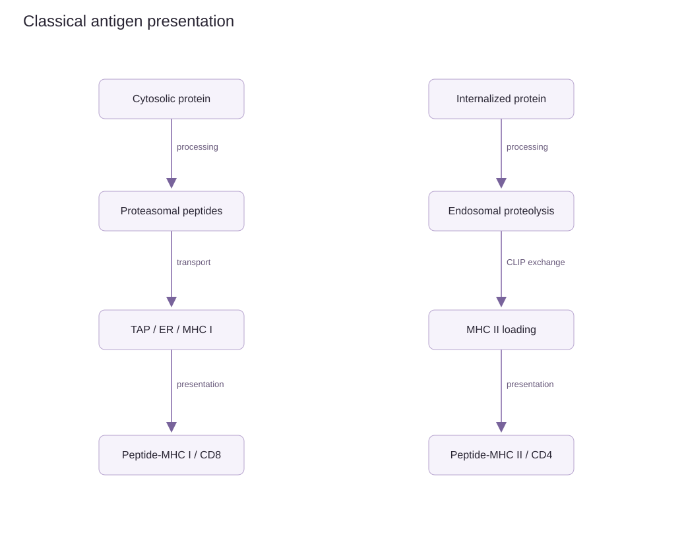

#### 통상적 항원제시 경로

| 항목 | MHC I | MHC II |
|---|---|---|
| 주된 펩타이드 기원 | 세포질 단백질 | 내포된 단백질 |
| 대표 수용 T세포 | CD8 | CD4 |
| 대표 적재 경로 | 소포체와 TAP 연계 | 엔도솜·리소좀 연계 |

교차제시·자가포식 등 예외와 공동자극을 별도 고려

### 확인 문제

교차제시란?

A. MHC I과 II의 이름을 서로 바꾸는 과정
B. 외부 항원을 MHC I에 제시하는 과정

**정답: B**

항원제시세포가 섭취한 항원을 CD8 반응과 연결할 수 있다.

**오답 해설**

A: 분자 이름의 변경이 아니라 항원 처리 경로의 특징이다.

## 보체의 활성·증폭과 숙주 보호

### 학습목표

- 고전·렉틴·대체경로의 진입점을 구분한다.
- C3와 C5 분해산물의 기능을 설명한다.
- 조절인자 결함과 임상 양상을 연결한다.

### 세 경로가 공통 효과기로 수렴한다

보체(complement)는 혈장과 세포 표면의 여러 단백질이 연결되어 미생물 제거와 염증, 면역복합체 처리에 기여하는 계통이다. 항체 작용을 보충하는 현상에서 이름이 붙었지만 항체가 형성되기 전에도 활성화될 수 있다. 비활성 전구체와 효소, 보조인자 및 수용체가 서로 작용하고, 활성화 과정에서 생성된 단백질 조각은 원래 분자와 다른 기능을 가진다. 모든 보체단백질이 같은 종류의 단백분해효소인 것은 아니다.

고전경로와 렉틴경로, 대체경로는 활성 시작의 인식 방식이 다르지만 C3 활성화와 이후의 공통 효과로 연결된다. 대체경로는 독립적인 시작뿐 아니라 다른 경로에서 생긴 C3b를 이용한 증폭에도 기여한다. 세 경로를 완전히 분리된 세 줄로 외우면 실제 반응의 증폭과 상호작용을 놓치게 된다. 숙주 손상을 피하려면 반응이 필요한 위치에 제한되고 적절한 속도로 종료되어야 한다.

### 고전경로와 렉틴경로

고전경로에서는 C1 복합체의 인식과 효소 활성화가 초기 절단을 시작한다. 항원에 결합한 항체의 배열과 종류는 C1q 결합에 영향을 주므로 자유 항체가 혈중에 존재한다는 이유만으로 같은 반응이 항상 시작되지는 않는다. C4와 C2의 처리를 거쳐 C3를 절단하는 전환효소가 형성된다. C2 조각의 명명 관례에는 차이가 있으므로 문헌의 표기 체계를 확인하고 효소 복합체의 실제 기능을 기준으로 비교한다.

렉틴경로에서는 mannose-binding lectin이나 ficolin 등이 미생물 표면의 당 배열 등을 인식하고 관련 serine protease가 활성화된다. C4와 C2를 이용하는 하류 구조는 고전경로와 공유하지만 출발점의 인식 분자는 다르다. 항체 없이도 작동할 수 있다는 사실은 모든 당이 붙은 숙주 표면을 무차별적으로 공격한다는 뜻이 아니다. 인식의 배열과 조절 환경이 선택성에 기여한다.

### 대체경로의 표면 증폭

C3의 낮은 수준의 자발적 변화와 초기 활성화는 지속적인 감시의 출발점이 될 수 있다. 표면에 결합한 C3b는 factor B와 factor D 등의 작용을 통해 대체경로 C3 전환효소 형성에 참여한다. Properdin은 관련 복합체의 안정화에 기여한다. 생성된 추가 C3b가 다시 반응 표면을 늘리면 작은 시작 신호가 빠르게 증폭될 수 있다.

숙주 표면에서는 factor H와 factor I, 막 결합 조절분자 등이 반응을 제한한다. 표면의 화학적 성질과 조절단백질의 결합은 미생물과 숙주의 차이를 만드는 데 중요하다. 일부 미생물은 숙주 조절인자를 끌어들이거나 보체 성분의 결합·분해를 바꾸어 회피할 수 있다. 따라서 활성화 단백질의 농도만으로 실제 살균 효과를 모두 예측하지 못한다.

### C3 조각과 opsonization

C3 전환효소가 C3를 절단하면 작은 염증 매개 조각과 표면에 결합할 수 있는 큰 조각이 생성된다. C3b와 그 처리산물은 보체수용체를 통한 식세포 인식과 제거를 돕는 opsonin으로 작용한다. 항체의 Fc 수용체 경로와 보체수용체 경로는 서로 다른 인식 체계로, 함께 작용하면 표적 제거가 강화될 수 있다. 표면에 보체가 붙었다는 사실과 세포가 즉시 용해된다는 결과는 구분한다.

면역복합체에 결합한 보체는 운반과 제거에도 관여한다. 이 기능이 손상되면 침착과 염증, 자가면역 관련 양상에 기여할 수 있다. 보체는 적응면역의 조절에도 연결되며 B세포의 보조수용체 신호는 항원 인식의 문턱에 영향을 줄 수 있다. 단순한 미생물 구멍뚫기 체계보다 넓은 생물학적 역할을 가진다.

### C5와 말단경로

표면의 활성화가 충분해지면 C5를 절단하는 복합체가 형성된다. C5a는 강력한 염증·백혈구 반응과 연결되고 C5b는 말단 성분 조립의 출발점이 된다. C5b부터 C9까지의 조립은 막공격복합체(membrane attack complex, MAC)를 형성하여 일부 표적의 막을 손상시킨다. 모든 미생물이 이 경로에 같은 정도로 취약한 것은 아니며 세포벽과 막 구조, 회피 전략이 결과를 바꾼다.

C3a와 C5a 등은 염증성 효과를 나타내지만 같은 수용체와 같은 효능을 가진 단일 물질은 아니다. 과도하거나 광범위한 활성은 혈관과 조직 손상에 기여할 수 있다. 보체의 생리적 방어와 병적 염증은 활성화 여부 하나보다 위치와 크기, 지속시간 및 조절 능력의 문제로 이해해야 한다.

### 조절인자가 없을 때

CD55는 전환효소의 해체를 촉진하고 CD59는 말단 복합체의 막 손상을 제한하는 데 중요하다. C1 inhibitor는 고전·렉틴계의 초기 효소와 다른 혈장 단백분해계 조절에 관여한다. 특정 조절 결함은 용혈이나 미세혈관 손상, 부종 등 서로 다른 임상 양상을 만들 수 있다. 혈관부종이 보체 관련 조절 결함과 연결되는 경우에도 매개체와 치료 표적은 histamine 중심 알레르기 반응과 다를 수 있다.

보체 조절과 관련된 질환을 단백질 하나의 낮은 수치로만 확정하지 않는다. 생성 감소와 소비 증가, 유전적 결함과 후천적 억제, 검체 처리의 영향을 구분해야 한다. 정상 농도로 측정되어도 기능이 떨어진 단백질이 존재할 수 있다. 기능검사와 개별 성분, 유전·면역 검사 및 임상 경과가 상보적인 정보를 제공한다.

### 결핍과 검사 패턴

초기 고전경로 성분의 결함은 면역복합체 처리 이상과 관련될 수 있고, C3의 심한 기능 저하는 넓은 opsonization 장애와 반복 감염으로 드러날 수 있다. 말단경로 결함은 특히 일부 Neisseria 감염과의 연관성이 중요하다. 단백질과 유전변이, 잔여 기능에 따라 위험은 달라져 한 결핍명으로 모든 환자의 경과를 동일하게 예측하지 않는다.

고전경로와 대체경로의 용혈성 기능검사는 여러 성분이 함께 작동하는 능력을 평가한다. 한 검사만 이상인지 둘 다 이상인지의 패턴은 결함 위치의 가설을 제공하지만, 실제 결과는 소비와 검체 상태에도 영향을 받는다. 항보체 치료 중에는 표적 경로의 기능검사 해석이 달라지고 감염 예방과 감시가 관리에 포함된다. 기능 억제가 치료 목표인 상황과 선천적 결핍의 위험을 구분하면서 공통된 방어 손실도 고려해야 한다.

### 확인 문제

C3b의 주요 기능으로 가장 적절한 것은?

A. 모든 표적을 단독으로 즉시 막용해
B. 표면 opsonization과 보체 증폭에 참여
C. 항체의 유전자 재배열을 직접 수행

**정답: B**

표면 인식과 식세포 수용체, 추가 전환효소 형성에 연결된다.

**오답 해설**

A: 말단 복합체 조립과 표적의 민감성 등 추가 조건이 필요하다.

C: 유전자 재배열은 다른 분자 장치의 역할이다.

## B세포 활성화와 배중심·항체반응

### 학습목표

- BCR 신호와 T세포 도움을 연결한다.
- 체성과변이와 동형전환을 구분한다.
- 기억 B세포와 장수 형질세포의 기능을 설명한다.

### 항원 인식에서 활성화까지

B세포수용체(B-cell receptor, BCR)는 막에 고정된 immunoglobulin과 신호 전달 성분으로 이루어진다. Immunoglobulin이 항원을 결합하면 관련 신호 단백질을 통해 세포내 반응이 전달된다. 항체가 인식하는 epitope는 단백질뿐 아니라 여러 분자 형태일 수 있고, 입체적인 항원 표면을 직접 결합할 수 있다. 일반적인 TCR의 peptide-MHC 인식과 같은 방식으로 제한되는 것은 아니다.

B세포는 결합한 항원을 내부로 들여와 가공하고 MHC II에 peptide를 제시할 수 있다. 이 과정은 B세포의 항원 특이성을 T세포 도움과 연결한다. 같은 단백질 또는 결합된 항원 복합체에서 유래한 peptide를 인식하는 도움 T세포와의 만남이 중요한 경우가 많다. T세포와 B세포가 반드시 항원의 동일한 작은 부분을 같은 형태로 인식해야 하는 것은 아니다.

### T세포 의존성과 비의존성

단백질 항원의 많은 반응에서는 여포 도움 T세포(Tfh)의 CD40L-CD40 연결과 cytokine이 B세포 증식·분화 및 배중심 반응을 지원한다. 이 도움은 항원 결합만으로 설명되지 않는 활성화의 추가 조건이다. 선천면역의 신호와 항원 형태, 항원제시세포와 조직 환경도 반응의 규모와 방향을 바꾼다. 항체가 검출되었다는 사실만으로 모든 기억과 친화도 성숙이 같은 수준으로 형성되었다고 볼 수 없다.

반복되는 항원 배열과 선천 신호 등으로 유도되는 T세포 비의존성 반응도 있다. 이 반응은 항원과 B세포 집단, 연령과 환경에 따라 다른 특성을 가지며 단순히 항체가 전혀 형성되지 않는 과정이 아니다. 다당류 항원을 단백질에 결합한 접합백신은 도움 T세포를 동원하는 논리와 연결된다. 화학적으로 결합된 항원 구성과 각각의 수용체가 인식하는 부분을 구분하면 접합의 의미를 이해하기 쉽다.

### 초기 반응과 배중심

활성 B세포의 일부는 비교적 빠른 형질세포 반응으로 분화하고, 일부는 여포 안에서 배중심(germinal center) 반응에 참여한다. 초기 항체 공급과 장기적인 반응의 질 향상은 시간 범위가 다르다. 배중심에서는 증식과 유전자 변화, 항원 포획과 도움 신호를 통한 선택이 연결된다. 어두운구역과 밝은구역의 이름은 전형적인 조직 구조와 활동 차이를 나타내며, 세포가 이동하면서 반응이 유지된다.

여포수지상세포(follicular dendritic cell)는 항원을 표면에 유지하여 B세포의 항원 획득과 선택에 기여한다. 일반적인 수지상세포가 미경험 T세포에 peptide를 제시하는 역할과 구분해야 한다. B세포는 표면 항원을 얻고 Tfh에 peptide를 제시하여 생존과 증식 신호를 경쟁적으로 획득할 수 있다. 단순히 가장 세게 결합하는 세포 하나가 자동으로 남는 과정이 아니라 항원 접근과 도움, 조절에 의존하는 선택이다.

### 체성과변이와 친화도 성숙

체성과변이(somatic hypermutation)는 활성 B세포의 immunoglobulin 가변영역에 변화를 도입한다. AID가 유발하는 염기 변화와 DNA 처리 과정이 관여한다. 만들어지는 모든 변화가 유익한 것은 아니고 결합을 약화시키거나 기능을 잃게 하는 변화도 존재한다. 변이가 생기는 과정과 높은 기능을 가진 세포를 선택하는 과정을 함께 생각해야 친화도 성숙(affinity maturation)을 설명할 수 있다.

혈중 항체의 평균 친화도가 시간이 지나면서 높아질 수 있지만, 검사의 결합 신호는 농도와 epitope, 다가 결합 및 측정 조건의 영향도 받는다. Affinity는 개별 결합 부위의 성질, avidity는 여러 결합이 합쳐진 전체적 결합 특성을 설명하는 데 사용된다. IgM의 높은 다가성에 의한 효과를 가변영역 하나의 친화도가 항상 높다는 말로 바꾸어서는 안 된다.

### 동형전환은 효과기 기능을 바꾼다

동형전환(class-switch recombination)은 항원의 인식을 담당하는 가변영역을 유지하면서 무거운사슬 상수영역을 바꾸어 항체의 효과기 기능과 분포를 변화시킨다. IgM에서 IgG·IgA·IgE 등으로의 전환은 cytokine과 도움 신호, 조직 환경의 영향을 받는다. 새 항원을 인식하도록 수용체를 완전히 다시 만드는 반응과는 다르다. 체성과변이와 동형전환은 서로 연결되지만 목적과 유전자 부위가 다른 과정이다.

상수영역은 Fc 수용체와 보체, 점막 수송 및 태반 이동 등에 영향을 준다. IgA의 점막 방어와 IgE의 비만세포·기생충·알레르기 관련 기능 등은 항체 농도만으로는 설명되지 않는다. 같은 항원에 결합하는 항체라도 isotype과 아형, 당화 및 결합 특성에 따라 다른 생물학적 결과를 만들 수 있다. 동형전환 장애에서는 항체 전체가 없기보다 특정 분포와 기능이 불균형해질 수 있다.

동형전환을 배중심이 완전히 형성된 뒤에만 시작되는 반응으로 제한해서는 안 된다. T세포 도움을 받은 초기 B세포 단계에서도 전환이 시작될 수 있으며, 성숙 배중심의 친화도 선택과 전환의 시공간적 분포는 같은 현상이 아니다. 배중심에서 체성과변이가 활발하다는 사실이 모든 동형전환도 반드시 같은 장소와 시점에서 일어난다는 뜻은 아니다.

### 형질세포와 기억

형질세포(plasma cell)는 많은 항체를 분비하는 데 적합한 세포 구조를 가진다. 일부는 골수 등의 생존 환경에서 오래 유지되어 혈중 항체를 공급할 수 있다. 기억 B세포는 항원 재노출 때 반응할 수 있는 세포 집단으로 남으며, 장수 형질세포와 같은 존재는 아니다. 현재 혈중 항체가 낮아졌다는 사실과 기억세포가 모두 사라졌다는 사실을 동일시하지 않는다.

재노출 반응의 속도와 크기는 항원과 경로, 기존 항체 및 기억세포의 상태에 따라 달라진다. 높은 항체가 항원을 빨리 제거하여 새로운 B세포 자극을 바꾸는 효과도 가능하다. 접종 후 항체가 상승했다는 결과를 장기 방어의 모든 측면으로 확대하지 않고, 중화와 효과기 기능 및 세포성 반응을 포함한 보호의 근거를 구분한다. 개인의 검사값을 비교할 때에는 사용한 표준과 분석법도 확인해야 한다.

### 관용과 임상 연결

B세포는 발생과 활성화의 여러 단계에서 자기반응을 제한하는 조절을 받는다. 자기반응성의 완전한 제거가 아니라 억제와 생존, 도움 신호의 통합이 중요하다. 이 조절의 실패는 자가항체와 조직손상에 기여할 수 있지만 모든 자가항체가 동일한 병인성을 가진 것은 아니다. 항체가 표적에 도달하는지, 표적 기능을 바꾸는지와 Fc 효과 및 보체가 관여하는지에 따라 결과가 달라진다.

CD40 계통과 AID, B세포 발생·생존의 결함 등은 항체반응의 서로 다른 단계를 손상시킨다. 검사에서는 총 immunoglobulin뿐 아니라 특정 항원 반응과 세포 집단, 임상 감염 양상을 함께 평가할 수 있다. 항-B세포 치료 뒤의 세포 감소와 이미 존재하는 장수 형질세포의 항체 유지도 별개의 과정이다. 표적 세포와 반응의 시간 경과를 알면 치료 효과와 감염 위험의 차이를 설명할 수 있다.

### 확인 문제

항체 동형전환이 직접 바꾸는 주된 부분은?

A. T세포수용체의 항원 결합 부위이다.
B. 무거운사슬 상수영역과 이에 따른 효과기 기능이다.
C. 새로운 항원을 인식하도록 가변영역을 반드시 전면 교체한다.

**정답: B**

동형전환은 항체의 상수영역을 바꾸며 체성과변이 및 T세포수용체 재배열과 구별된다.

**오답 해설**

A: 동형전환은 B세포 면역글로불린 유전자에 관한 과정이다.

C: 가변영역의 변이와 선택은 동형전환의 직접 표적과 다르다.

## 과민반응의 네 기전과 임상 표현

### 학습목표

- I~IV형 과민반응의 효과기를 구분한다.
- 감작과 실제 임상 반응을 분리한다.
- 한 질환에서 여러 면역기전이 겹치는 이유를 설명한다.

### 분류의 목적과 경계

과민반응(hypersensitivity)은 면역반응이 조직손상이나 임상적 불편을 일으키는 경우를 포함한다. I~IV형 분류는 주된 면역인식과 효과기를 정리하는 틀이며, 모든 환자의 질환을 배타적인 한 칸에 넣는 완벽한 분류표는 아니다. 같은 질환에서 항체·보체·T세포 및 비면역성 자극이 함께 작용할 수 있다. 임상 시간 경과도 투여 경로와 선행 감작, 기억반응 및 표적 조직의 조건에 따라 달라진다.

알레르기는 면역기전에 의한 과민반응이라는 의미로 사용되지만 실제 임상에서 환자가 말하는 알레르기는 다양한 비면역성 불편까지 포함할 수 있다. 증상 이름과 기전을 구분하여 병력과 검사로 확인한다. 검사에서 항원에 대한 반응이 검출된 감작 상태는 실제 노출에서 질환이 나타난다는 뜻과 다르다. 검사 전 확률과 노출·증상의 재현성이 해석에 중요하다.

### I형: IgE와 비만세포

I형 반응은 IgE와 비만세포·호염기구의 활성으로 설명되는 대표적인 즉시형 기전이다. 항원에 대한 반응에서 만들어진 IgE가 고친화도 수용체에 결합하고, 다시 들어온 항원이 적절한 방식으로 수용체 결합 IgE를 연결하면 세포 활성과 매개체 방출이 일어난다. Histamine과 지질매개체, cytokine 등은 혈관과 평활근, 점액과 다른 면역세포에 서로 다른 시간 규모로 작용한다.

빠른 반응 이후에도 세포 유입과 매개체 생성이 이어지는 후기 반응이 가능하다. 호산구와 T세포 등은 지속 염증과 조직 기능 변화에 기여할 수 있다. 비염과 천식, 일부 음식·약물 알레르기는 이런 기전을 포함하지만 모든 천식이나 모든 발진이 IgE 매개는 아니다. 특이 IgE 양성을 임상 원인 확정으로 바꾸지 않고 실제 증상과 노출 맥락을 확인한다.

전신적인 비만세포 매개체 효과는 여러 장기의 반응으로 나타날 수 있다. 피부 증상만이 아니라 기도와 호흡, 순환과 위장관 상태를 함께 평가한다. 증상의 심각도는 항원량 하나만으로 결정되지 않고 보조인자와 기저질환, 흡수와 시간 경과가 관여한다. 모든 반복 노출이 처음과 같은 양상으로 나타난다고 보장할 수 없다.

### II형: 세포·조직 결합 항체

II형 반응에서는 항체가 세포 표면이나 조직에 있는 표적과 결합하여 손상을 유발하거나 기능을 바꾼다. Opsonization과 식세포 제거, 보체와 Fc 수용체를 통한 염증이 중요한 효과기일 수 있다. 표적 항원이 적혈구에 있는지 기저막이나 다른 조직에 있는지에 따라 임상 표현이 다르다. 항체가 결합한 위치와 효과기의 접근성을 함께 추적해야 한다.

항체가 수용체를 자극하거나 차단하여 기능을 바꾸는 경우에는 세포가 직접 파괴되지 않아도 질환이 생길 수 있다. Graves병의 수용체 자극과 일부 신경근접합부 질환의 전달 장애는 이러한 기능 변화의 사례다. II형을 세포독성이라는 이름으로만 외우면 자극성·차단성 항체의 기전을 충분히 설명하지 못한다. 항체 농도와 기능적 효력, 임상 활동도가 항상 같은 비율로 움직이지 않는 점도 고려한다.

### III형: 면역복합체

III형 반응은 항원-항체 복합체가 형성·침착되고 보체와 염증세포를 활성화하여 손상으로 이어지는 기전이다. 항원의 양과 지속성, 항체 특성 및 제거 능력은 복합체의 분포와 결과를 바꾼다. 신장과 혈관, 관절 등은 서로 다른 방식으로 침범될 수 있다. II형의 조직 고정 표적 항체와 III형의 복합체 형성·침착이라는 틀을 구분하되 실제 질환의 국소 형성까지 고려한다.

감염과 외래 단백질, 자가항원 등이 복합체의 재료가 될 수 있다. 보체 성분 감소는 소비를 시사할 수 있으나 합성 감소와 선천적 결함, 측정과 검체 조건도 다른 설명이다. 정상 농도라고 면역복합체 질환을 모두 배제할 수 없고, 낮은 농도만으로 원인을 확정할 수도 없다. 조직의 침착 양상과 혈청·소변, 전신 소견을 통합한다.

### IV형: T세포 매개 손상

IV형 반응은 T세포의 cytokine 및 세포독성 효과 등을 통해 염증과 손상을 일으킨다. 전형적인 지연형 반응의 시간 경과는 이미 감작된 세포의 활성과 유입, 조직 반응에 관련된다. CD4 T세포가 대식세포 등 다른 효과기를 동원하거나 CD8 T세포가 직접 표적세포를 제거하는 등 기전은 다양하다. 항체가 주된 효과기가 아니라는 공통점만으로 모든 세포반응이 동일한 형태를 보이는 것은 아니다.

접촉피부염과 일부 약물반응, 감염 관련 육아종성 염증 등은 다른 항원과 T세포 환경에서 발생한다. 같은 물질도 분자 자체와 단백질 결합, 대사물에 따라 인식 방식이 달라질 수 있다. 피부시험의 종류와 노출 경로에 따라 평가하는 면역반응이 다르므로 하나의 검사 음성으로 모든 형태의 알레르기를 배제하지 않는다. 위험한 과거 반응이 있는 환자에서 재노출의 문제는 별도의 임상 판단을 필요로 한다.

### 검사와 분류를 연결하기

즉시형 피부반응과 특이 IgE, patch test 및 세포·항체 기능검사는 서로 다른 질문에 답한다. 민감도와 특이도, 사용한 항원과 시점, 선행 치료와 피부 상태가 결과를 바꿀 수 있다. 여러 검사를 무작위로 시행하면 낮은 사전확률에서 우연한 양성을 원인으로 오해하기 쉽다. 병력으로 가능한 기전과 원인을 좁힌 뒤 목적이 분명한 검사를 선택한다.

반응의 시간만으로 분류를 확정할 수도 없다. 혈중 항체가 이미 존재하는 상황, 반복 노출과 높은 노출량, 장기 내 대사와 축적 및 기억세포의 상태가 임상 발현을 바꾼다. 원인 후보와 시간 관계, 장기 침범과 검사 근거를 함께 기록하면 불확실성을 보존하면서도 실제 위험을 관리할 수 있다. 질환명과 면역기전, 검사 결과는 관련되지만 서로의 완전한 동의어는 아니다.

### 확인 문제

수용체를 자극하는 항체에 의한 질환을 II형 기전으로 설명할 수 있는 이유는?

A. II형은 항체 없이 T세포만 작용하는 반응이기 때문이다.
B. 세포 표면의 고정 표적과 결합하여 기능을 바꿀 수 있기 때문이다.
C. II형 반응은 반드시 모든 표적세포를 직접 용해해야 하기 때문이다.

**정답: B**

항체 매개 기능 변화는 직접 세포 파괴가 없어도 발생할 수 있다.

**오답 해설**

A: T세포가 주된 효과기인 IV형과 항체 매개 II형을 혼동한 설명이다.

C: II형에는 직접 용해뿐 아니라 수용체 자극과 차단 같은 기능 변화도 포함된다.

# 세균학

## 세균 세포외피와 병원성·약물표적

### 학습목표

- 그람양성균과 음성균의 외피를 비교한다.
- 세포벽·외막·협막의 기능을 구분한다.
- 항균제 표적과 내성 기전을 연결한다.

### 세균을 단순한 작은 세포로 보지 않기

세균(bacteria)은 핵막으로 둘러싸인 핵이 없으며 유전체와 세포질막, 리보솜 등으로 생명활동을 수행한다. 그러나 모든 세균이 같은 세포벽과 모양, 대사능을 가지는 것은 아니다. 진단과 치료에서 형태는 첫 단서이며 균종, 병원성과 감수성을 완전히 결정하는 정보는 아니다. 같은 종 안에서도 독소 유전자와 내성 인자, 숙주와의 관계에 따라 임상적 의미가 달라질 수 있다. 배양 조건과 염색 상태가 형태 관찰에 영향을 준다는 점도 중요하다.

세포질막은 선택적 투과 장벽이자 물질수송과 에너지 대사의 장소다. 사람의 미토콘드리아에 있는 것과 유사한 에너지 전환 기능이 세균에서는 세포질막에 배치될 수 있다. 펩티도글리칸(peptidoglycan)은 당사슬과 펩타이드 연결을 가진 망상 구조로 삼투압에 맞서는 세포벽의 기계적 강도에 기여한다. 사람 세포에는 같은 벽이 없으므로 선택적 항균 표적이 된다. 하지만 벽이 약물표적이라는 사실만으로 모든 세균이 해당 약물에 감수성이라는 뜻은 아니다.

### 외피 구조의 차이

전형적인 그람양성균은 두꺼운 펩티도글리칸과 teichoic acid 계열 성분을 가지며, 전형적 그람음성균은 상대적으로 얇은 펩티도글리칸 바깥에 외막(outer membrane)이 있다. 그람염색은 염색액과 매염, 탈색·대조염색에 대한 외피의 반응을 이용한다. 오래된 배양이나 손상 세포, 염색 조건에 따라 결과가 달라질 수 있다. 항산균, 세포벽이 없는 Mycoplasma와 세포내 병원체 등은 이 두 범주의 단순 도식만으로 충분히 설명되지 않는다.

그람음성균 외막의 porin은 일부 친수성 물질 통과에 관여하고 외막 자체는 약물 접근의 장벽이 될 수 있다. 내막과 외막 사이의 주변세포질(periplasm)에는 여러 효소와 수송 관련 단백질이 존재한다. Lipopolysaccharide(LPS)의 lipid A는 숙주 선천면역의 중요한 자극으로 작용한다. 내독소라는 용어를 살아 있는 균이 능동적으로 분비하는 단백독소와 혼동하지 않는다. 세균 성분과 숙주 반응의 상호작용이 염증과 순환 이상을 연결한다.

### 협막·부착·생물막

협막(capsule)은 세포 외부의 구조로 식균 회피와 생존에 기여할 수 있다. 많은 협막이 다당류지만 모두 같은 화학적 성분인 것은 아니다. 항체와 보체에 의한 opsonization은 식세포가 표적을 제거하는 데 도움을 주며, 일부 협막 항원은 백신 설계와 관련된다. 부착소(adhesin)와 섬모·선모 등은 특정 숙주 표면에 결합하는 데 기여한다. 부착 능력은 감염 시작의 중요한 요소지만 해당 균이 검출되었다는 사실이 곧 조직 침범을 증명하지는 않는다.

생물막(biofilm)은 세균과 세포외기질이 표면에 형성하는 구조화된 군집이다. 인공물과 만성 감염에서 중요하며, 확산 장벽과 성장 상태의 이질성, 휴면과 스트레스 반응 등이 치료 반응에 영향을 준다. 생물막에서 치료가 어려운 현상을 모두 유전적 항균제 내성으로 부르면 부정확하다. 감수성 검사에서 측정하는 부유 세균의 MIC와 생물막 환경의 실제 노출·생존은 다를 수 있다. 감염된 기구 제거와 배액 같은 감염원 조절이 중요해지는 이유다.

### 표적과 내성의 연결

β-lactam 계열은 penicillin-binding proteins의 기능을 방해하여 펩티도글리칸 교차연결에 영향을 준다. 내성은 β-lactamase에 의한 분해, 표적 변화, 외막 투과 감소와 유출 증가 등 여러 기전으로 생길 수 있다. Glycopeptide는 다른 방식으로 세포벽 합성 과정에 작용하며 외막 접근성과 표적 말단 변화가 중요하다. 같은 벽 합성 억제제라고 작용 지점을 하나로 묶지 않는다. 약물의 시험관 효과와 환자에서의 효과는 감염부위 노출과 숙주 조건을 함께 봐야 한다.

세균은 돌연변이뿐 아니라 형질전환, 형질도입, 접합 등을 통해 유전 정보를 획득할 수 있다. Plasmid, transposon과 integron 등은 서로 다른 유전 요소이며 내성 인자의 이동과 발현을 이해하는 데 중요하다. 항균제는 내성 돌연변이가 필요에 맞춰 생기도록 명령하는 것이 아니라, 기존 또는 새로 생긴 변이 가운데 생존에 유리한 집단을 선택할 수 있다. 선택 압력과 전파가 함께 내성 역학을 바꾸므로 환자 단위의 적절한 사용과 감염관리가 연결된다.

### 확인 문제

그람음성균 외막의 존재가 치료에 영향을 줄 수 있는가?

A. 없다.
B. 있다.

**정답: B**

외막 투과와 porin, 유출 등은 약물 접근에 영향을 준다.

**오답 해설**

A: 모든 세균에 같은 투과성을 가정하면 안 된다.

## 세균 유전체 변화와 항균제 내성

### 학습목표

- 돌연변이와 수평 유전자 전달을 구분한다
- 약물 유입·배출·불활성화·표적 변화 기전을 비교한다
- 감수성 결과와 임상 실패의 관계를 설명한다

### 내성의 주체와 선택

항균제 내성(antimicrobial resistance)은 병원체가 특정 약물의 억제 또는 사멸 작용을 견디는 성질이다. 환자의 몸이 약에 익숙해졌다는 의미와 구별한다. 항균제 노출 전부터 존재하던 내성 세포가 선택될 수 있고, 집단 증식 중 새로 발생한 변이나 다른 세포에서 얻은 유전자가 기여할 수도 있다. 약물이 필요에 맞추어 세균에게 특정 변이를 만들도록 지시하는 것이 아니라, 생존과 증식의 조건을 바꾸어 집단 구성을 변화시킨다.

내재 내성(intrinsic resistance)은 특정 세균군이 본래 지닌 구조나 표적의 특성과 관련된다. 후천 내성(acquired resistance)은 원래 감수성이 있던 집단에서 변이나 유전자 획득으로 생긴다. 외막의 존재, 표적의 부재 및 약물이 세포 안으로 들어가는 방식은 약물군의 기본 항균 범위를 결정한다. 개별 균주의 후천 내성을 해석하려면 먼저 그 균종의 기본 생물학을 알아야 한다.

### 수직 전달과 수평 전달

돌연변이로 생긴 내성은 자손에게 수직으로 전달될 수 있다. 접합(conjugation)은 세균 사이의 접촉을 통해 플라스미드 등 유전물질이 이동하는 과정이다. 형질전환(transformation)은 주변의 유리 DNA를 받아들이는 방식이고, 형질도입(transduction)은 박테리오파지가 유전자 전달에 관여하는 방식이다. 이들 과정의 범위와 효율은 세균과 유전요소의 특성에 따라 다르다.

플라스미드에는 여러 내성 유전자가 함께 존재할 수 있다. 한 약물을 사용하는 선택압이 같은 유전요소에 실린 다른 내성의 유지에도 유리하게 작용할 수 있는 이유이다. 트랜스포존은 유전체 안이나 유전요소 사이에서 이동할 수 있으며, 인테그론은 유전자 카세트를 포획하고 발현하는 체계이다. 이 용어들은 모두 같은 종류의 독립 복제체를 뜻하지 않는다. 내성 유전자가 어디에 있고 어떻게 이동하는지 구분하면 병원 내 확산을 이해하는 데 도움이 된다.

### 표적까지 도달하는 농도의 감소

그람음성균의 외막은 약물이 표적에 도달하기 전에 통과해야 할 장벽이다. 포린(porin)의 감소나 구조 변화는 특정 약물의 유입을 줄일 수 있다. 유출펌프(efflux pump)는 들어온 약물을 밖으로 배출하여 세포 내 유효 농도를 낮춘다. 한 펌프가 여러 약물에 영향을 줄 수 있어 서로 다른 항균제군의 감수성이 함께 변하기도 한다. 다만 모든 교차내성을 하나의 펌프로 설명하지는 않는다.

약물 분해효소와 유입 감소가 함께 있으면 각각만 있을 때보다 내성이 커질 수 있다. 예를 들어 외막 투과성이 낮아져 적은 약물만 들어오면 주변세포질의 효소가 그 약물을 더 효과적으로 불활성화할 수 있다. 따라서 동일한 내성 유전자를 검출한 두 균주가 항상 같은 최소억제농도를 보이는 것은 아니다. 발현량, 복제수, 외막 및 다른 기전의 조합이 실제 표현형을 만든다.

### 약물 불활성화와 표적 변화

β-락타마아제(beta-lactamase)는 β-락탐 고리를 가수분해하여 약물의 활성을 낮춘다. 효소별로 분해 가능한 기질과 억제제에 대한 반응이 다르므로 β-락타마아제라는 이름만으로 모든 β-락탐약이 같은 결과를 보인다고 할 수 없다. 카바페넴 내성에도 카바페넴분해효소뿐 아니라 다른 효소와 포린 변화의 조합이 관여할 수 있다. 유전자 검사와 표현형 감수성 검사는 서로 보완한다.

표적 단백질이 변하면 약물이 결합하기 어려워진다. 페니실린결합단백질, 리보솜, DNA 회전효소 등은 해당 약물군의 작용과 내성을 연결하는 표적이다. 세균이 표적 경로를 우회하거나 대체 효소를 쓰는 방식도 있다. 이런 기전은 약물 자체를 파괴하는 것과 다르므로 분해효소 억제제를 더해도 해결되지 않을 수 있다. 병합요법의 논리는 기전의 상보성을 확인해야 성립한다.

### 감수성 검사의 질문

최소억제농도(minimum inhibitory concentration, MIC)는 정해진 실험 조건에서 육안적 증식을 억제하는 최소 농도이다. 임상적 감수성 판정은 MIC뿐 아니라 약물 노출, 투여 방식, 균종 및 감염 부위 등을 고려한 기준점에 의존한다. MIC가 낮은 약물이 모든 환자와 모든 부위에서 더 우수하다는 뜻은 아니다. 서로 다른 약물의 숫자를 단순히 크기순으로 비교하는 것도 적절하지 않다.

검사실에서 감수성으로 보고되어도 농양의 배액이 되지 않거나 감염된 기구가 남아 있으면 임상 실패가 발생할 수 있다. 약물이 해당 부위에 도달하지 못하거나 숙주 방어가 크게 손상되어도 결과가 달라진다. 반대로 검체에서 자란 균이 실제 병원체인지 집락화 또는 오염인지가 먼저 불분명할 수도 있다. 항균제 선택 전에는 배양 결과가 설명하는 감염 증후군이 실제로 존재하는지 확인한다.

### 내성과 관용을 구별하기

내성은 통상 증식 억제에 필요한 농도의 변화와 관련되지만 관용(tolerance)은 일정 농도에 노출되었을 때 사멸이 늦어지는 성질을 가리킨다. 지속생존세포(persister)는 집단의 일부가 일시적인 상태로 살아남는 현상과 연결된다. 생물막(biofilm)은 기질과 국소 환경 및 세포 상태의 이질성을 통해 약물과 숙주 방어의 효과를 떨어뜨릴 수 있다. 이러한 현상을 모두 동일한 유전적 내성으로 부르면 재발의 원인을 잘못 이해할 수 있다.

내성 관리에는 적절한 항균제 사용과 함께 감염 예방, 손 위생, 기구 관리, 검체 확보 및 전파 경로 차단이 필요하다. 경험적 치료는 환자의 중증도와 예상 병원체 및 지역 역학을 반영하고, 결과가 나오면 실제 병원체와 감수성에 맞추어 재평가한다. 넓은 범위의 약물을 계속 유지하는 것과 적절한 치료는 같은 말이 아니다. 치료의 충분성과 불필요한 선택압의 감소를 함께 판단한다.

### 확인 문제

MIC가 낮은 약물을 서로 다른 약물군 사이에서 비교할 때 옳은 것은?

A. 숫자만으로 우열을 정하지 않고 약물 노출과 감염 부위를 고려한다.
B. 숫자가 가장 작으면 항상 치료에 성공한다.
C. 감염원 조절 여부는 임상 결과에 영향을 주지 않는다.

**정답: A**

MIC는 표준 실험 조건의 지표이며 약동학·약력학과 숙주 및 감염원 조절이 임상 반응을 바꾼다.

**오답 해설**

B: 표준 검사 값은 조직 도달과 농양·숙주 조건을 모두 반영하지 않는다.

C: 농양이나 감염 기구가 남으면 감수성 약물로도 실패할 수 있다.

# 바이러스학

## 바이러스 유전체와 복제 전략

### 학습목표

- 유전체 유형에서 mRNA 생성 전략을 추론한다.
- 외피와 수용체가 감염성에 미치는 영향을 설명한다.
- 잠복·지속감염과 급성 감염을 구분한다.

### 숙주 의존성의 의미

바이러스(virus)는 독립적인 번역 체계를 갖지 않아 숙주세포의 기능을 이용해 증식한다. 유전체, capsid 및 일부 바이러스의 지질 외피가 감염 입자를 이룬다. 외피가 있다고 언제나 더 강한 병원체라는 뜻은 아니다. 외피는 진입과 면역회피에 기여할 수 있지만 환경에서의 안정성과 소독제 민감성에도 영향을 준다. 감염 부위와 전파 경로를 생각할 때 입자의 물리적 특성, 배출 양상과 숙주 행동을 함께 고려해야 한다.

숙주 범위와 조직 친화성(tropism)은 수용체 존재만으로 모두 정해지지 않는다. 진입 보조인자, 세포내 복제 허용성, 선천면역과 온도 등도 중요하다. 수용체에 결합한 뒤 세포막 융합이나 내포, 탈외피 과정을 거쳐 유전체가 복제 장소로 전달된다. 같은 수용체가 있는 모든 조직이 같은 정도로 감염되거나 손상된다고 가정하면 안 된다. 감염에 의한 직접 세포손상과 숙주 면역반응에 의한 손상을 구분하는 것도 중요하다.

### 중심 질문은 mRNA를 만드는 방법이다

모든 바이러스는 궁극적으로 숙주 리보솜이 읽을 수 있는 mRNA를 만들어야 한다. 양성가닥 RNA 바이러스의 유전체는 일반적으로 mRNA 역할을 할 수 있어 진입 후 번역을 시작하는 전략을 가진다. 음성가닥 RNA 바이러스는 먼저 상보적인 mRNA를 만들어야 하므로 기능적 RNA-dependent RNA polymerase를 감염 입자에 포함해야 한다. 이중가닥 RNA 바이러스도 전사를 위한 효소가 중요하다. 다만 구체적인 유전자 발현과 복제 과정은 바이러스군마다 달라 단순한 한 줄의 도식을 모든 군에 적용하지 않는다.

DNA 바이러스는 DNA에서 mRNA를 전사하고 유전체를 복제한다. 많은 DNA 바이러스가 핵을 이용하지만 예외가 있으며 세포질에서의 복제를 위해 필요한 효소를 더 많이 갖추는 전략도 존재한다. Retrovirus는 RNA 유전체에서 역전사효소를 이용해 DNA를 만들고 숙주 유전체에 통합된 형태를 거쳐 발현한다. Hepadnavirus는 DNA 유전체를 가지면서 RNA 중간체의 역전사를 이용하므로, 역전사라는 단어를 retrovirus에만 독점적으로 연결하면 틀린다.

### 조립·방출과 시간 경과

새 유전체와 구조단백질이 조립된 뒤 입자는 세포용해나 출아 등으로 방출된다. 외피 바이러스의 출아 위치는 바이러스 단백질의 막 이동과 숙주 막체계 이용에 연결된다. 세포 밖으로 나왔다는 사실만으로 모든 입자가 감염성을 갖는 것은 아니다. 유전체 사본 수, 입자 수와 감염성 단위는 서로 다른 측정량이다. 핵산검사 양성이 곧 같은 정도의 전염성을 의미한다고 단정하면 안 되는 이유다.

잠복(latency)은 바이러스 유전정보가 유지되지만 생산성 감염이 제한되는 상태 등을 말하며, 만성 생산성 감염과 구분한다. 재활성화는 면역 상태와 세포 환경 변화 등과 연결될 수 있다. 바이러스별 저장소와 지속 전략이 달라 혈액에서 핵산이 검출되지 않는다는 사실만으로 체내 모든 유전체가 사라졌다고 주장할 수 없다. 항바이러스 약물은 유전체 복제나 진입 등 특정 단계를 겨냥하므로 어떤 생활사 단계가 남는지를 이해해야 치료의 한계를 설명할 수 있다.

유전체 분절화는 같은 세포에서 서로 다른 계통이 감염될 때 재분절(reassortment)의 기회를 제공할 수 있고, 재조합(recombination)과는 기전이 다르다. 돌연변이 축적과 선택은 항원 변화, 약제 내성과 숙주 적응에 관여한다. 변화가 관찰되었다고 전파력이나 중증도가 자동으로 증가했다고 판단하지 않는다. 유전적 변화와 표현형, 임상 역학을 각각 검증해야 한다.

### 확인 문제

음성가닥 RNA 바이러스는 초기 mRNA 전사를 위한 효소가 필요한가?

A. 항상 숙주 리보솜이 RNA를 바로 복사한다.
B. 필요하다.

**정답: B**

숙주 리보솜은 음성가닥 유전체를 mRNA로 직접 바꾸지 못한다.

**오답 해설**

A: 번역과 RNA 전사·복제는 서로 다른 과정이다.

# 진균학

## 진균의 구조와 숙주 방어

### 학습목표

- 진균의 세포 구조를 항진균제 표적과 연결한다
- 집락화와 침습성 감염을 구별한다
- 면역결함의 종류에 따른 진균 감염 양상을 설명한다

### 진핵 병원체로서의 진균

진균(fungus)은 핵과 세포소기관을 갖는 진핵생물이다. 세균과 달리 세포막에 에르고스테롤(ergosterol)을 포함하고 세포벽에는 글루칸, 키틴, 만난 등의 성분이 있다. 사람 세포도 진핵세포이므로 진균의 대사와 숙주의 대사가 공유하는 부분이 많다. 항진균제의 선택독성이 항세균제보다 확보하기 어려운 배경이다. 에르고스테롤이나 그 합성효소, 세포벽 글루칸 합성효소처럼 숙주와 차이가 있는 구조는 치료 표적이 된다. 다만 같은 표적을 갖는 진균이라도 약물 감수성이 동일하지는 않다.

효모(yeast)는 주로 단세포 형태로 증식하고, 사상균(mold)은 균사(hypha)를 형성한다. 균사의 집합이 균사체(mycelium)이다. 일부 진균은 환경 조건과 숙주 내 조건에 따라 형태를 바꾸는 이형성(dimorphism)을 보인다. 형태는 현미경 관찰과 병인 이해에 유용하지만 형태만으로 모든 종을 확정할 수는 없다. 배양, 항원검사, 핵산검사 등을 목적에 맞게 결합한다. 조직에서 관찰한 형태와 배양 결과가 다를 때에는 배양 오염, 검체 위치, 조직 손상과의 관련성을 다시 검토한다.

### 장벽과 선천면역

정상 피부와 점막은 진균의 침입을 막는 물리적 장벽이다. 점액, 섬모 청소, 상피의 연속성, 미생물 군집의 경쟁은 노출이 곧 질병으로 이어지지 않게 한다. 피부 상재 진균이나 점막의 칸디다(Candida)는 일정 조건에서 증상 없이 존재할 수 있다. 광범위 항균제 사용은 경쟁 미생물을 바꾸고, 점막 손상은 진균이 조직으로 들어갈 통로를 만든다. 혈관 내 카테터와 인공물은 생물막(biofilm)이 형성될 표면을 제공한다. 진균 감염은 외부에서 새 병원체를 얻는 사건뿐 아니라 기존 집락의 위치와 숙주 환경이 바뀌는 사건이기도 하다.

진균 세포벽의 성분은 패턴인식수용체(pattern recognition receptor)에 의해 인식된다. 예를 들어 β-글루칸의 인식은 식세포의 활성화와 염증성 반응에 기여한다. 호중구는 균사를 포함한 진균 방어에서 중요하며 식작용, 탈과립, 산화성 살균 등을 이용한다. 대식세포는 흡입한 포자의 초기 처리와 사이토카인 생성에 관여한다. T세포 반응은 감염 부위와 병원체에 따라 중요도가 달라지고, 점막에서의 Th17 반응과 만성적인 세포내 병원체 제어에 관여하는 세포매개 면역을 구분하여 이해해야 한다.

면역저하를 하나의 상태로 묶으면 진균 감염의 위험을 정확히 설명하기 어렵다. 장기간의 중증 호중구감소는 침습성 사상균 감염의 위험을 높이고, T세포 기능 저하는 특정 기회감염에 취약하게 만든다. 스테로이드는 여러 면역 기능을 함께 억제하며, 장기이식 후 면역억제의 강도와 기간도 위험을 바꾼다. 같은 약제를 쓰더라도 점막 손상, 당뇨병, 신장 기능, 환경 노출에 따라 임상상이 달라진다. 위험 인자를 열거하는 데서 나아가 어떤 방어선이 손상되었는지 연결하는 것이 중요하다.

### 칸디다와 아스페르길루스의 대비

칸디다는 점막의 집락화에서 표재성 감염, 혈류감염과 심부 장기 감염까지 서로 다른 상태를 만들 수 있다. 중심정맥관, 복부 수술과 점막 장벽 파괴, 광범위 항균제 노출은 침습성 감염을 고려하게 하는 맥락이다. 객담이나 소변에서 칸디다가 배양되었다고 언제나 침습성 질환을 의미하지는 않는다. 검체가 채취된 부위, 환자의 증상, 숙주 위험, 다른 침범 근거를 함께 보아야 한다. 반면 혈액처럼 정상적으로 무균인 부위에서의 검출은 전혀 다른 무게로 평가된다.

아스페르길루스(Aspergillus)의 포자는 환경에서 흡입될 수 있다. 흡입한 포자가 제거되지 않고 발아하면 균사가 조직으로 퍼질 수 있으며, 침습성 질환에서는 혈관 침범으로 혈전, 허혈, 출혈이 발생할 수 있다. 그러나 아스페르길루스와 관련된 모든 질환이 침습성 감염은 아니다. 기존 폐공동 안에서 균구가 형성되거나, 기도 질환을 가진 환자에서 알레르기 반응이 중심이 되는 임상상도 있다. 동일한 진균명이 확인되어도 숙주의 구조적 폐질환과 면역 상태에 따라 병인의 중심이 달라진다.

조직병리검사는 진균의 존재뿐 아니라 조직 침범과 염증 반응을 볼 수 있다는 장점이 있다. 배양은 종 동정과 감수성 평가에 도움을 주지만 시간이 걸리고 항상 양성인 것은 아니다. 혈중 β-D-글루칸이나 갈락토만난 같은 검사는 특정 임상 맥락에서 진단에 기여하나 민감도와 특이도가 일정하지 않고 모든 진균을 같은 정도로 검출하지 않는다. 검사 양성만으로 병원체와 감염 부위를 단정하거나 검사 음성만으로 모든 침습성 진균증을 배제하는 해석을 피한다.

### 항진균제 표적과 내성의 의미

아졸계(azole)는 에르고스테롤 합성 과정의 효소를 억제하고, 폴리엔계(polyene)는 에르고스테롤과 상호작용하여 세포막 기능을 손상시킨다. 에키노칸딘계(echinocandin)는 β-1,3-D-글루칸 합성을 억제하여 세포벽에 영향을 준다. 플루시토신(flucytosine)은 진균 내에서 대사되어 핵산 대사를 방해한다. 이런 기전은 약물 선택의 출발점이지만 실제 선택에는 진균 종, 감수성, 감염 부위 도달성, 장기 기능, 약물 상호작용을 포함해야 한다.

내성은 표적의 변화, 표적 발현 증가, 유출펌프 활성 증가 등으로 발생할 수 있다. 생물막 상태는 부유하는 세포와 다른 약물 반응을 보일 수 있다. 감염된 인공물이나 장벽 손상이 유지되는 경우 약물만으로 원인이 해결되지 않을 수 있는 이유이다. 항진균 치료를 이해할 때에는 병원체의 제거, 감염원 관리, 숙주 방어의 회복이라는 세 축을 함께 생각한다. 표재성 피부 감염과 혈류감염을 동일한 치료 강도로 다루어서는 안 되는 이유도 이 세 축의 차이에서 나온다.

### 확인 문제

객담에서 Candida가 배양되었을 때 적절한 해석은?

A. 배양 양성은 항상 칸디다 폐렴의 확진이다.
B. Candida는 정상 점막에 존재할 수 없다.
C. 검체 부위와 증상, 숙주 위험 및 침습 근거를 함께 평가한다.

**정답: C**

집락화와 침습성 감염은 구별해야 하며 배양 결과의 의미는 검체와 임상 상황에 따라 다르다.

**오답 해설**

A: 객담 양성은 집락화를 반영할 수 있으므로 조직 침습을 자동 확정하지 못한다.

B: Candida는 정상 피부와 점막에 집락할 수 있다.

# 기생충학

## 말라리아 생활사와 질병 발생

### 학습목표

- 사람과 모기에서의 원충 발달 단계를 구별한다
- 재발과 혈중 원충의 지속을 구별한다
- 적혈구 침범을 빈혈 및 미세순환 장애와 연결한다

### 숙주가 바뀌면 발달 단계도 바뀐다

말라리아(malaria)는 열원충(Plasmodium)에 의한 감염병이다. 생활사에는 사람과 얼룩날개모기(Anopheles)가 관여한다. 기생충학에서 종숙주(definitive host)는 성적 생식이 일어나는 숙주를 의미하므로 열원충의 종숙주는 모기이고 사람은 중간숙주이다. 이는 어느 숙주가 더 큰 고통을 받는지나 어느 숙주에서 원충이 더 많이 증식하는지를 뜻하는 분류가 아니다. 생활사의 각 단계는 침입하는 세포, 증식 방식, 치료 표적이 다르므로 단계의 구별이 병태생리 이해에 직접 연결된다.

감염된 모기가 흡혈할 때 포자소체(sporozoite)가 사람에게 들어와 간세포를 침범한다. 간세포 내에서 증식한 뒤 분열소체(merozoite)가 혈류로 나와 적혈구를 감염시킨다. 이 초기 간 단계와 적혈구 단계는 같은 복제 과정의 장소만 바뀐 것이 아니라 세포 침입 방식과 발달 상태가 다른 단계이다. 혈액도말에서 관찰하는 원충은 주로 적혈구 내 발달 단계이며, 간에 원충이 있다는 사실을 말초혈액도말로 직접 관찰하는 것은 아니다.

적혈구 내에서는 어린 영양형인 반지형(ring form), 성숙한 영양형(trophozoite), 분열체(schizont)로 발달한다. 적혈구가 파괴되며 방출된 분열소체는 다른 적혈구를 침범한다. 일부 원충은 생식모세포(gametocyte)로 분화하여 다음 모기의 흡혈 때 옮겨갈 준비를 한다. 모기에서는 수정과 이후 발달 과정을 거쳐 다시 포자소체가 만들어져 침샘으로 이동한다. 사람에서 증상을 만드는 무성 적혈구 단계와 모기로 전파되는 생식모세포 단계를 구별하면 감염자의 증상과 전파 가능성이 항상 나란히 움직이지 않는 이유를 이해할 수 있다.

### 발열과 빈혈의 발생

적혈구 단계의 증식과 파괴는 염증매개물질의 방출을 유발하고 오한, 발열, 발한 등의 증상을 만든다. 원충의 적혈구 주기가 동기화되면 발열에 주기성이 나타날 수 있지만 초기 감염, 혼합 감염, 부분 치료, 개별 환자의 면역반응에 따라 일정하지 않다. 전형적인 주기열이 없다는 이유로 말라리아를 배제할 수 없는 이유이다. 비유행 지역에서 발열 환자를 평가할 때에는 해외 체류뿐 아니라 국내 노출 지역, 마지막 노출 시점, 예방약 복용과 수혈력 등의 맥락을 확인한다.

빈혈은 감염된 적혈구의 파괴만으로 설명되지 않는다. 비장에서 감염 적혈구와 비감염 적혈구의 제거가 증가할 수 있고, 염증에 따른 조혈 억제도 기여한다. 비장은 비정상 적혈구를 제거하는 방어기관이면서 감염 과정에서 커질 수 있는 장기이다. 혈소판 감소 역시 관찰될 수 있으나 그 소견만으로 특정 원충 종을 확정할 수는 없다. 헤모글로빈, 혈소판 수, 용혈 지표, 간·신장 기능은 원충 확인 검사와 다른 정보를 제공하며 중증도와 장기 손상을 평가하는 데 이용된다.

### 종 차이와 지속 감염

삼일열원충(P. vivax)과 난형열원충(P. ovale)은 간에 휴면소체(hypnozoite)를 남길 수 있다. 휴면소체가 다시 활성화되어 혈중 감염을 일으키는 현상을 재발(relapse)이라고 한다. 혈액 속 원충이 완전히 제거되지 않아 다시 증가하는 재연(recrudescence)과는 원인이 다르다. 새 모기 노출에 의한 재감염(reinfection)도 구별해야 한다. 치료 후 발열이 다시 나타났을 때 시간 간격 하나만으로 이들을 확정하지 않고 원충 종, 치료 내용, 약물 흡수와 순응도, 새로운 노출 가능성을 함께 평가한다.

열대열원충(P. falciparum) 감염에서는 감염 적혈구 표면 변화에 따른 혈관내피 부착과 미세혈관 내 격리(sequestration)가 중요한 병태생리이다. 순환 혈액에서 측정한 원충혈증이 조직 미세혈관에 존재하는 전체 원충 부담을 완전히 대표하지 못할 수 있다. 미세순환 장애와 염증, 대사 이상이 함께 작용하여 뇌, 신장, 폐 등의 기능 장애를 만들 수 있다. 다만 다른 원충 종도 중증 질환을 일으킬 수 있으므로 종의 이름만으로 환자의 안전성을 판단하지 않는다.

### 검사와 치료를 생활사에 연결하기

후층도말(thick smear)은 혈액을 두껍게 모아 원충을 검출하는 데 유리하고, 박층도말(thin smear)은 적혈구 형태와 원충 형태를 관찰하여 종 동정과 원충혈증 평가에 도움을 준다. 검체 제작과 판독 숙련도는 결과에 큰 영향을 미친다. 신속항원검사는 상황에 따라 빠른 단서를 제공하지만 검사 표적의 특성 때문에 종 구별과 민감도에 한계가 있고, 치료 뒤 항원 지속은 현재의 살아 있는 원충 부담과 결과가 일치하지 않게 만들 수 있다. 임상적 의심이 높은 경우 단 한 번의 음성 검사만으로 진단을 종결하지 않는다.

치료는 혈중 무성 원충의 제거, 특정 종의 간 휴면 단계 제거, 중증 장기 기능 장애의 관리라는 서로 다른 목적을 가질 수 있다. 혈중 원충을 줄이는 약제가 간 휴면소체도 반드시 제거하는 것은 아니다. 일부 간 단계 치료 약물은 G6PD 결핍에서 용혈 위험이 있어 투여 전 효소 기능 평가와 환자별 고려가 필요하다. 임신, 연령, 중증도, 감염 지역의 내성 양상은 약제 선택을 바꾼다. 생활사를 외우는 목적은 약물 이름을 단계 옆에 붙이는 데 있지 않고, 임상적 회복과 기생충학적 제거가 왜 다른 과제인지를 이해하는 데 있다.

### 확인 문제

삼일열원충의 재발을 설명하는 간 단계는?

A. 휴면소체이다.
B. 적혈구 속의 모든 원충이 곧 간 휴면소체이다.
C. 모기의 침샘에만 존재하는 사람의 간세포이다.

**정답: A**

간 휴면소체의 재활성화는 혈중 원충의 지속에 따른 재연 및 새로운 노출에 의한 재감염과 구별한다.

**오답 해설**

B: 휴면소체는 간의 별도 단계이며 적혈구 무성 단계와 다르다.

C: 모기의 침샘 단계와 사람 간의 휴면 단계를 혼동한 설명이다.

# 내과 총론 및 임상진단학

## 진단검사와 확률의 갱신

### 학습목표

- 사전확률과 검사후확률의 관계를 설명한다
- 우도비를 이용하여 검사 결과를 해석한다
- 검사 역치와 치료 역치의 의미를 임상 상황에 적용한다

### 진단은 정보가 추가될 때마다 갱신된다

환자가 호소하는 증상은 하나의 질환과 일대일로 대응하지 않는다. 흉통은 심근허혈, 폐와 흉막 질환, 식도 질환, 근골격계 문제 등에서 나타날 수 있다. 진단은 문진과 진찰, 검사에서 얻은 정보를 이용하여 가능한 원인들의 확률을 바꾸는 과정이다. 사전확률(pretest probability)은 특정 검사를 시행하기 직전 그 질환이 있을 것으로 추정하는 확률이다. 이는 그 환자가 속한 집단의 유병률에서 출발하더라도 연령, 위험 인자, 증상 양상, 선행 정보에 따라 달라진다.

사전확률을 숫자로 완벽하게 표현하지 못하더라도 낮음, 중간, 높음으로 구분하는 사고는 검사 선택에 영향을 준다. 다만 이런 범주는 질환과 검증된 진단경로에 따라 정의가 다르다. 어떤 질환의 점수체계를 다른 질환이나 다른 환자군에 그대로 적용해서는 안 된다. 특히 외래의 안정된 환자에서 검증한 경로가 혈역학적으로 불안정한 응급환자에게 같은 의미를 갖는 것은 아니다. 확률 추정은 환자의 긴급도 평가를 대체하지 않는다.

### 민감도와 특이도에서 예측도로

민감도(sensitivity)는 실제 질환이 있는 사람 중 검사 양성인 비율이고, 특이도(specificity)는 질환이 없는 사람 중 검사 음성인 비율이다. 검사 결과를 받아든 환자에게 중요한 질문은 양성인 경우 실제 질환이 있을 확률, 음성인 경우 질환이 없을 확률이다. 이들은 각각 양성예측도와 음성예측도이며 사전확률의 영향을 직접 받는다. 민감도가 높다는 설명만으로 양성 결과가 곧 확진이라고 해석하는 것은 서로 다른 조건부확률을 바꿔 읽는 오류이다.

가령 유병률이 1%인 집단에서 민감도 90%, 특이도 95%인 검사를 10,000명에게 시행한다고 하자. 질환이 있는 100명 중 약 90명이 양성이 되고, 질환이 없는 9,900명 중 약 495명이 양성이 된다. 양성인 사람 전체 585명 중 실제 질환자는 약 15.4%이다. 검사의 성능이 변하지 않아도 유병률이 낮은 집단에서는 위양성 수가 참양성 수보다 많을 수 있다. 무증상 인구에 검사를 넓힐수록 임상적 해석이 쉬워진다는 생각이 성립하지 않는 이유이다.

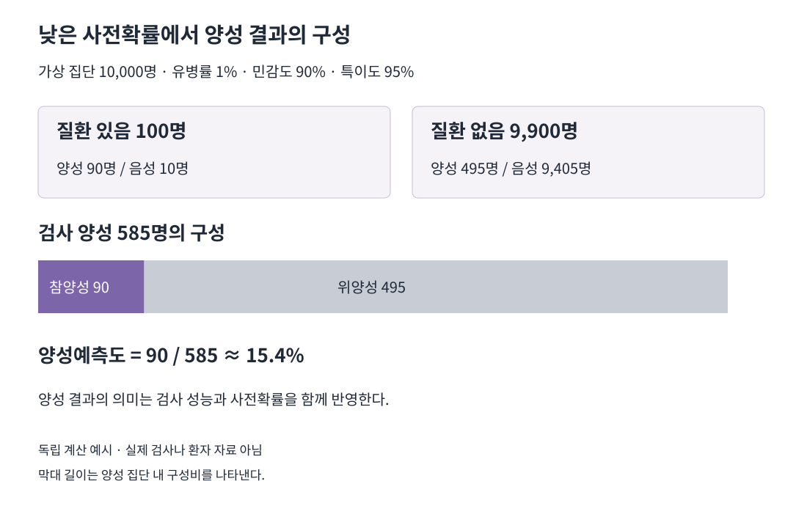

민감도와 특이도 역시 모든 환경에서 변하지 않는 물리 상수는 아니다. 환자군의 중증도, 동반 질환, 기준검사의 정의, 검사 역치와 표본 처리 방식이 관찰된 성능에 영향을 준다. 중증 질환자와 명백한 건강인만을 비교한 연구는 실제 경계선 환자가 많은 진료 환경보다 우수한 성능을 보일 수 있다. 진단 연구를 읽을 때에는 검사 숫자와 함께 연구 대상, 참조표준(reference standard), 맹검 여부, 대상자 누락을 검토한다.

### 우도비와 베이즈 정리

양성우도비(positive likelihood ratio, LR+)는 민감도를 1에서 특이도를 뺀 값으로 나눈 것이다. 음성우도비(LR−)는 1에서 민감도를 뺀 값을 특이도로 나눈 것이다. 이 값은 검사 결과가 질환이 있을 때와 없을 때 얼마나 다르게 나타나는지를 비교한다. 우도비를 이용하려면 확률을 오즈(odds)로 바꾸어야 한다. 확률을 p라고 하면 오즈는 p/(1−p)이며, 검사후오즈는 사전오즈에 해당 결과의 우도비를 곱해 구한다. 마지막으로 오즈를 1에 오즈를 더한 값으로 나누면 확률로 돌아온다.

사전확률이 20%라면 사전오즈는 0.25이다. 어떤 검사 결과의 우도비가 5라면 검사후오즈는 1.25이고 검사후확률은 약 55.6%이다. 같은 결과를 사전확률 1%인 환자에게 적용하면 검사후확률은 약 4.8%에 그친다. 반대로 사전확률 50%에서 음성우도비가 0.1인 결과를 얻어도 검사후확률은 약 9.1%이다. 음성이라는 단어 자체보다 그 결과가 얼마나 확률을 낮추었고 남은 위험이 임상적으로 수용 가능한지가 중요하다.

여러 검사의 우도비를 단순히 연속해서 곱하려면 질환 상태를 조건으로 각 검사 결과가 독립이라는 가정이 필요하다. 같은 생물학적 현상을 거의 동일한 방법으로 측정하는 검사들은 정보가 겹친다. 하나의 영상 소견과 그 소견을 바탕으로 작성한 판독 점수를 독립된 두 증거처럼 계산하면 확신을 과장한다. 반복검사의 시점이 바뀌면서 질환 자체가 진행하는 경우에도 첫 검사와 두 번째 검사가 동일한 상태를 평가한다고 볼 수 없다.

### 검사 역치와 치료 역치

질환 가능성이 매우 낮고 검사 자체의 위해가 이득보다 크다면 검사를 하지 않는 선택이 합리적일 수 있다. 이 경계가 검사 역치(test threshold)이다. 반대로 가능성이 충분히 높고 지연의 위해가 크며 치료의 순이득이 예상되면 확진 전 치료를 시작할 수 있는데, 그 경계를 치료 역치(treatment threshold)라고 한다. 두 역치는 질환의 중증도, 치료 부작용, 시간 민감성, 환자의 선호에 따라 달라진다. 모든 질환에 적용되는 고정 백분율이 존재하는 것은 아니다.

검사는 결과에 따라 실제 행동이 달라질 때 가치가 크다. 어느 결과가 나와도 같은 결정을 내릴 상황이라면 검사 목적을 다시 확인해야 한다. 한편 진단명 결정 외에도 병기 평가, 예후 추정, 치료 부작용 감시처럼 다른 목적의 검사가 있다. 검사를 주문하기 전에 묻는 임상 질문을 명확히 하면 양성 결과의 과잉 해석과 불필요한 연쇄검사를 줄일 수 있다. 진단의 종료는 가능한 모든 질환이 사라지는 순간이 아니라, 남은 불확실성과 후속 관찰 계획을 포함하여 안전한 의사결정을 할 수 있는 시점이다.

### 확인 문제

사전확률 20%, 양성우도비 5에서 검사후확률은 약 얼마인가?

A. 25%이다.
B. 55.6%이다.
C. 100%이다.

**정답: B**

사전오즈 0.2/0.8=0.25에 5를 곱하면 1.25이고 확률은 1.25/2.25이다.

**오답 해설**

A: 0.25는 사전오즈이며 검사후확률로 환산하는 단계가 남아 있다.

C: 양성우도비는 확률에 직접 곱하지 않으며 결과도 100%가 아니다.

# 순환기내과

## 심부전의 병태생리와 임상평가

### 학습목표

- 울혈과 저관류를 구분한다.
- 박출률 분류와 충만압을 연결한다.
- 증상·진찰·영상·생체표지자를 통합한다.

### 심부전은 임상증후군이다

심부전(heart failure, HF)은 심장의 구조 또는 기능 이상으로 증상과 징후가 나타나는 임상증후군이다. 심박출을 유지하기 위해 비정상적으로 높은 충만압이 필요하거나, 조직 요구에 맞는 혈류를 제공하기 어려운 상태를 포함한다. 박출률이 낮다는 영상 소견과 증상이 있는 심부전은 구분하며, 박출률이 보존되어도 심부전이 존재할 수 있다. 진단은 증상만이 아니라 심장 이상과 울혈 또는 충만압 증가의 근거를 연결해야 한다.

허혈성 심장질환, 고혈압, 판막질환과 심근질환, 독성·대사성 손상 등 원인은 다양하다. 빈혈과 갑상샘질환, 빈맥과 감염은 새로운 악화를 유발하거나 기존 질환의 부담을 드러낼 수 있다. 원인 질환과 현재 악화의 유발요인을 구분하면 치료 가능한 문제를 찾는 데 도움이 된다. 같은 증후군이라도 원인과 부하, 시간 경과에 따라 구조와 치료 반응은 달라진다.

### 울혈과 신경호르몬 보상

좌심실 충만압 상승은 좌심방과 폐정맥계의 압력 증가로 이어져 호흡곤란과 폐울혈에 기여한다. 우심계 압력 상승은 전신 정맥울혈과 간울혈, 말초부종에 연결될 수 있다. 좌심실과 우심실은 중격과 심낭, 폐순환을 통해 상호작용하므로 양쪽 문제를 완전히 독립된 질환으로 취급하지 않는다. 부종의 정도만으로 심박출량이나 전체 체액량을 정확히 알 수는 없다.

교감신경과 RAAS 활성은 단기적으로 혈압과 관류를 보상하지만 지속되면 혈관수축, 나트륨 보존과 재형성 부담을 늘릴 수 있다. 심근의 비대와 섬유화, 세포 기능 변화는 장기 경과에 관여한다. Natriuretic peptide 계통은 벽응력 증가에 반응하여 혈관과 신장의 조절에 참여한다. 반응이 존재하더라도 병적 보상을 충분히 상쇄하지 못할 수 있다. 심부전 약물치료가 즉각적인 수축력 증가 외에 만성 조절계의 부담을 줄이는 방향을 포함하는 이유다.

### 박출률과 기능의 여러 축

박출률은 일회박출량을 이완기말용적으로 나눈 값으로 부하와 심실 형상의 영향을 받는다. 좌심실 박출률에 따른 분류에서는 40% 이하를 HFrEF, 41~49%를 HFmrEF, 50% 이상을 HFpEF 범주로 나눈다. 범주 명칭만으로 임상증후군이 확진되는 것은 아니며, 특히 박출률이 낮지 않은 경우 충만압 증가의 객관적 근거가 중요하다. 이전에 낮았던 박출률이 호전된 경우도 과거 질환 경과를 함께 기록한다.

이완 기능은 능동적 이완과 수동적인 탄성, 충만 시간과 심방 기능에 영향을 받는다. 작은 용적의 뻣뻣한 심실은 박출률을 유지하면서도 충만압이 높을 수 있다. 판막 역류에서는 총박출량과 실제 앞쪽 순환으로 나가는 양의 관계가 달라질 수 있다. 따라서 EF를 심장 전체 건강의 단일 점수로 해석하지 않고 심실 크기와 벽, 판막 및 우심실, 이완기 지표와 임상 상태를 함께 평가한다.

### 증상과 신체진찰

운동 시 호흡곤란과 피로는 흔하지만 비특이적이다. 기좌호흡과 야간 발작성 호흡곤란, 체중 변화와 부종의 경과는 울혈을 추론하는 단서다. 폐질환과 비만, 운동 저하와 빈혈도 비슷한 증상을 만들 수 있어 호흡곤란의 원인을 하나로 단정하지 않는다. 갑작스러운 악화에서는 급성 관상동맥질환, 부정맥, 혈압 변화와 감염, 폐색전증 및 약물·식이·복약 문제 등을 검토한다.

목정맥압은 우심방압을 추정하는 진찰 소견이며 폐수포음과 부종, 심음 및 말초 관류가 서로 다른 정보를 준다. 정상 청진만으로 만성 심부전을 배제하지 못하고, 수포음만으로 심인성 부종을 확정할 수도 없다. 차가운 말단과 의식 변화, 소변량 감소 등은 저관류 평가에 중요하다. 혈압이 유지되어도 장기 관류가 충분하지 않을 수 있으므로 울혈과 관류의 두 축을 함께 판단한다.

### 검사와 감별

심전도는 리듬과 전도, 허혈·과거 손상 등의 단서를 제공하고 흉부영상은 심장 크기와 폐울혈 및 다른 폐질환 평가에 기여한다. 심초음파는 수축·이완 기능, 판막과 심낭, 압력 추정 및 우심실 정보를 제공한다. 필요한 경우 원인 확인을 위한 관상동맥 평가와 심장 MRI, 침윤성 질환이나 유전성 원인 검사를 선택한다. 모든 환자에게 동일한 정밀검사를 일괄 시행하기보다 임상 질문을 명확히 한다.

BNP와 NT-proBNP는 벽응력과 연관된 지표로 진단을 보조한다. 나이, 신기능과 심방세동 등에서 높아질 수 있고 비만에서는 낮게 측정될 수 있어 값 하나로 모든 상황을 확정하거나 배제하지 않는다. 신기능과 전해질, 혈색소와 철 상태, 간기능 및 원인에 맞는 내분비 평가도 관리에 중요하다. 검사 결과는 이뇨와 약물 조정 전후의 시간 경과를 함께 기록한다.

### 치료 목표와 장기 관리

치료 목표는 증상과 울혈 완화, 입원·사망 위험 감소, 기능과 삶의 질 유지 및 원인 교정이다. 박출률 감소 심부전 치료의 핵심 약물군은 ARNI를 중심으로 한 RAAS 조절, 근거가 있는 β차단제, MRA와 SGLT2 억제제다. 각 계열의 적응과 금기, 혈압·신기능·칼륨 및 임상 안정성을 평가하며, 한 계열의 최대용량 도달 여부만으로 나머지 계열의 필요성을 판단하지 않는다. 급성 불안정 상태의 조치와 안정된 만성기의 시작·증량은 구분한다.

이뇨는 울혈 완화에 기여하지만 제거되는 체액량과 장기적인 예후 개선 기전은 같지 않다. 판막·허혈·부정맥 치료와 기기치료, 재활 및 진행성 심부전 평가가 필요한 환자도 있다. 퇴원과 외래 추적에서는 증상과 체중, 혈압과 복약, 검사 결과 및 악화 시 행동 계획을 연결한다. 박출률이나 증상이 개선되어도 원인과 재발 위험을 재평가하고 지속 관리의 필요성을 함께 판단한다.

### 확인 문제

박출률이 보존되면 심부전이 배제되는가?

A. 아니다.
B. 그렇다.

**정답: A**

높은 충만압과 이완 기능 문제로 심부전이 존재할 수 있다.

**오답 해설**

B: EF는 심장 기능의 모든 측면을 대표하지 않는다.

## 심부전의 혈역학·진단과 치료 표적

### 학습목표

- 박출률과 충만압·심박출량을 구분한다
- 울혈과 저관류의 기전을 진찰 및 검사와 연결한다
- 증상 완화와 질병 경과 개선 치료의 목적을 비교한다

### 심부전은 원인이 다양한 임상 증후군이다

심부전(heart failure, HF)은 심장의 구조적 또는 기능적 이상으로 적절한 혈액 공급을 유지하지 못하거나, 이를 유지하기 위해 비정상적으로 높은 충만압이 필요한 임상 증후군이다. 심장이 완전히 멈춘 상태를 뜻하지 않는다. 안정 시 심박출량이 유지되어도 운동 시 필요한 증가가 제한되거나 폐정맥압이 상승하여 증상이 생길 수 있다. 같은 호흡곤란이라도 좌심실의 수축 기능, 이완 기능, 판막, 심낭 및 우심실 중 어떤 요소가 중요한지 다르다.

허혈성 심장질환, 고혈압, 판막질환, 심근병증, 빈맥 및 독성 손상 등은 서로 다른 경로로 심부전에 이를 수 있다. 원인을 찾는 작업은 증후군을 진단한 뒤의 부가 절차가 아니다. 교정할 수 있는 허혈, 판막 이상 또는 지속 빈맥을 발견하면 질병 경과가 달라질 수 있다. 가족력이나 전도 장애와 심실부정맥의 양상은 유전성 심근병증을 생각하게 하는 단서가 될 수 있다.

### 박출률·충만압·심박출량

좌심실 박출률(left ventricular ejection fraction, LVEF)은 이완기말용적 중 한 번의 수축으로 박출되는 비율이다. 절대 박출량이나 조직에 실제 전달되는 유량과 같지 않다. 작은 심실은 박출률이 보존되어도 일회박출량이 적을 수 있고, 확장된 심실은 박출률이 낮더라도 안정 시 일정한 일회박출량을 유지할 수 있다. 전부하와 후부하 및 판막 역류는 측정된 박출률에도 영향을 준다.

박출률감소 심부전(HFrEF)과 박출률보존 심부전(HFpEF)의 구분은 예후와 치료 근거를 정리하는 데 유용하지만 기전 전체를 양분하지는 않는다. HFrEF에서도 이완 장애가 흔하고 HFpEF에서도 심근 기능, 혈관 반응 및 우심실의 이상이 관여한다. HFpEF에서는 심실 순응도 감소와 이완 지연으로 작은 용적 증가에도 충만압이 크게 오를 수 있다. 비만, 고혈압, 심방세동, 콩팥 기능 저하와 운동 시 혈역학이 함께 영향을 준다.

### 보상 기전이 장기 손상으로 이어지는 과정

심박출량이 감소하면 교감신경과 RAAS가 활성화되어 심박수, 혈관 긴장 및 나트륨·물 보존이 증가한다. 초기에는 혈압과 관류 유지에 도움이 되지만 지속되면 후부하와 울혈 및 심근 산소 요구량을 늘릴 수 있다. 안지오텐신과 알도스테론의 신호는 섬유화와 구조 재형성에도 관여한다. 이러한 장기 효과는 신경호르몬계를 억제하는 치료가 단순한 혈압 저하 이상의 목적을 갖는 이유이다.

심실벽 응력과 용적 변화는 심근의 형태와 유전자 발현 및 세포외기질을 바꾼다. 나트륨이뇨펩타이드는 벽의 늘어남에 반응하여 나트륨 배설과 혈관 작용에 참여하지만 질환이 진행하면 그 보상만으로 균형을 회복하지 못한다. 울혈 자체도 콩팥정맥압과 복압을 높여 콩팥 기능을 악화시킬 수 있다. 심장과 콩팥의 상호작용을 오직 동맥 관류 저하만으로 설명하면 정맥 울혈의 역할을 놓친다.

### 증상과 진찰에서 압력과 관류를 추정한다

운동 시 호흡곤란, 기좌호흡과 야간 발작성 호흡곤란은 폐순환의 압력 변화와 관련될 수 있다. 말초 부종, 체중 증가, 경정맥압 상승 및 간 울혈은 전신 정맥계의 부담을 시사한다. 그러나 부종은 정맥질환이나 저알부민혈증에서도 발생하고, 폐 수포음은 모든 만성 심부전에서 뚜렷하지 않다. 하나의 소견으로 확정하기보다 시간 경과와 여러 근거가 같은 혈역학적 설명을 지지하는지 본다.

저관류에서는 차가운 말초, 의식 변화, 소변 감소 또는 좁아진 맥압 등이 나타날 수 있다. 혈압이 정상 범위라고 모든 장기의 관류가 충분하다는 뜻은 아니다. 급성 악화에서는 울혈의 유무와 저관류의 유무를 각각 평가한다. 이 두 축은 수액, 이뇨, 혈관 작용 및 순환 보조가 필요한 이유를 구분하는 데 도움을 준다. 울혈이 있는 환자의 크레아티닌 상승을 곧바로 수액 부족으로 해석하면 부담을 더할 수 있다.

### 검사 선택과 해석

심전도는 허혈, 빈맥, 전도 장애 및 심실 비대 등의 단서를 제공한다. 심초음파는 박출률과 심장 방의 크기, 판막, 우심실 및 충만 관련 지표를 통합한다. 정상 박출률만 확인하고 심부전을 배제하지 않는다. 흉부 영상은 폐 울혈과 흉수 및 다른 호흡곤란 원인을 평가하고, 혈액검사는 빈혈, 전해질, 콩팥·간 기능과 유발 요인을 살핀다. 필요에 따라 심근의 침윤성 질환이나 허혈 및 혈역학을 추가 평가한다.

BNP와 NT-proBNP는 심장벽 스트레스와 관련된 표지자이며 진단과 위험 평가를 돕는다. 콩팥 기능, 연령, 심방세동 및 비만 등이 수치 해석에 영향을 준다. 수치 상승은 증후군의 맥락 없이 곧바로 좌심실 수축부전으로 확정되는 것이 아니고, 낮은 값의 배제력도 환자 조건에 따라 달라진다. 네프릴리신 억제가 BNP의 대사에 영향을 줄 수 있으므로 치료 중 표지자 변화의 의미도 구분한다.

### 만성 HFrEF의 치료 표적

만성 HFrEF 치료에서는 울혈 완화와 장기 예후 개선을 함께 추구한다. 이뇨제는 나트륨과 물을 배출하여 호흡곤란과 부종을 줄이는 데 중요하다. 그러나 부종 감소만으로 심근 재형성과 질병 경과를 개선하는 치료가 충분히 제공되었다고 볼 수 없다. 체중, 증상과 진찰뿐 아니라 혈압, 콩팥 기능 및 전해질을 추적하여 이득과 부작용을 평가한다.

질병 경과 개선의 주요 약물군에는 안지오텐신 경로 조절 약물, 근거가 있는 β 차단제, 미네랄코르티코이드 수용체 길항제 및 SGLT2 억제제가 포함된다. ARNI는 안지오텐신 수용체 차단과 네프릴리신 억제를 결합한다. 약물군마다 혈압, 칼륨, 콩팥 기능 및 체액량에 미치는 영향이 달라 환자의 상태에 맞는 시작과 조정이 필요하다. 한 계열의 목표 용량에 도달할 때까지 다른 모든 계열을 반드시 미루어야 한다는 식의 기계적 순서는 약물군의 상보적 목적을 반영하지 못한다.

급성 쇼크나 심한 저관류에서의 약물 조정은 안정된 만성 외래 환자의 치료와 다르다. 안정 시 예후를 개선하는 약물이 어떤 급성 상태에서도 즉시 같은 방식으로 투여되어야 하는 것은 아니다. 전도 장애, 지속적인 낮은 박출률과 부정맥 위험 등에서는 적절한 환자에 대해 기기 치료를 평가한다. 재혈관화, 판막 중재 및 진행성 심부전 치료 역시 원인과 기대 이득을 검토하여 선택한다.

### HFpEF와 회복된 박출률의 해석

HFpEF에서는 울혈 관리, 혈압 및 동반 질환의 치료와 함께 해당 환자군에서 효과가 입증된 약물을 고려한다. HFrEF에서 유익했던 모든 약물을 같은 근거 수준으로 그대로 옮기지 않는다. 호흡곤란에는 비만, 폐 질환, 빈혈과 운동 능력 저하가 함께 기여할 수 있어 심장 외 요소를 교정하는 것도 중요하다. 반복 입원과 생활 기능을 포함하여 치료 목표를 정한다.

치료 후 박출률이 개선된 환자는 처음부터 정상 심장을 가졌던 사람과 같지 않다. 개선은 치료 효과일 수 있으며 기저 질환이나 재발 위험이 남을 수 있다. 증상이 없어졌거나 초음파 수치가 좋아졌다는 이유만으로 모든 약물이 더 이상 필요 없다고 판단하지 않는다. 장기 추적에서는 원인, 심장 구조, 부정맥, 기능과 약물 내약성을 함께 평가한다.

### 악화의 유발 요인과 학습 증례

안정적이던 환자에게 급격한 체중 증가와 기좌호흡이 생기면 복약·식이 변화뿐 아니라 감염, 허혈, 부정맥, 혈압 변화 및 콩팥 기능 저하를 살핀다. 증상이 같은 울혈이라도 원인에 따라 추가 치료가 달라진다. 진통제 등 새 약물이 나트륨 보존이나 콩팥 기능에 영향을 주었는지도 확인한다. 환자가 집에서 관찰할 변화와 진료를 받아야 할 증상을 이해하도록 설명하는 일은 재입원 예방의 일부이다.

호흡곤란과 발목 부종이 있는 고령 환자에서 박출률이 보존되고 심방세동과 고혈압이 동반되었다면, 박출률 하나만으로 심부전을 배제하거나 곧바로 HFpEF로 확정하지 않는다. 충만압을 지지하는 근거, 판막과 우심실 상태, 나트륨이뇨펩타이드 및 폐·콩팥·빈혈의 기여를 평가한다. 최종 진단은 증상을 실제 구조와 기능 이상으로 설명하고 다른 원인을 검토한 결과이어야 한다.

### 확인 문제

박출률이 보존된 호흡곤란 환자에서 적절한 판단은?

A. 충만압과 구조·기능 이상 및 다른 호흡곤란 원인을 함께 평가한다.
B. 박출률만으로 심부전을 배제한다.
C. 박출률만으로 HFpEF를 확정한다.

**정답: A**

박출률은 용적의 비율이며 증후군의 존재와 원인을 단독으로 결정하지 않는다.

**오답 해설**

B: 충만압 상승과 운동 시 기능 제한은 박출률 보존 상태에서도 가능하다.

C: 증상과 충만압을 뒷받침하는 근거 및 감별이 필요하다.

## 급성관상동맥증후군의 기전과 초기 판단

### 학습목표

- 심근손상과 심근경색을 구별한다
- 혈전과 허혈의 시간경과를 연결한다
- 심전도·트로포닌·혈역학을 통합한다

### 공급 감소와 세포 손상

급성관상동맥증후군(acute coronary syndrome, ACS)은 급성 관상동맥 허혈과 관련된 임상 상태들을 다룬다. 전형적으로 죽상경화판의 파열이나 미란 뒤 혈소판 활성과 응고가 촉진되어 혈류가 감소한다. 그러나 혈관의 연축과 색전, 자발성 박리 등 다른 기전도 급성 허혈을 만들 수 있다. 흉통의 존재와 혈관이 막힌 기전, 심근세포의 손상을 각각 구별하여 평가해야 한다.

혈류 감소는 산소 공급과 에너지 생성의 불균형을 만든다. 수축과 이완의 변화, 전기적 불안정과 세포막 손상은 시간과 정도에 따라 나타날 수 있다. 통증이 줄었다는 사실만으로 혈류가 완전히 회복되거나 손상이 끝났다고 확정할 수 없다. 심근의 생존은 폐색 위치와 범위, 측부순환과 요구량 및 경과 시간의 영향을 받는다. 처음부터 모든 영역이 같은 속도로 괴사하는 것은 아니다.

### 심근손상과 경색

심장 트로포닌(cardiac troponin)은 심근세포 손상의 중요한 지표이다. 상승은 급성 허혈 외에도 심부전과 심근염, 심한 전신 질환 등에서 나타날 수 있다. 급성 손상을 판단하는 시간적 변화와, 그 손상이 허혈 때문에 발생했다는 근거는 다른 질문이다. 트로포닌 양성을 곧바로 혈전성 관상동맥 폐색의 확진으로 바꾸어서는 안 된다.

심근경색(myocardial infarction)은 심근손상과 함께 허혈을 지지하는 임상·심전도·영상 등의 근거를 통합하여 판단한다. 산소 공급과 수요의 불균형에 따른 경색과 급성 죽상혈전성 사건은 원인 치료와 항혈전 전략이 다를 수 있다. 기저 신장질환에서 수치가 높게 유지되는 상황도 기준과 변화, 증상을 함께 해석한다. 검사의 이름보다 채혈 시점과 사용한 분석법, 검사실 기준이 중요하다.

### 증상과 긴급도

가슴의 압박과 조임, 운동과 관련된 악화 및 팔과 턱 등으로의 불편이 단서가 될 수 있지만 모든 환자가 전형적인 흉통을 호소하지는 않는다. 호흡곤란과 식은땀, 오심과 실신 및 기능 저하로 나타날 수 있다. 고령과 당뇨병, 의사소통의 제한 등은 표현과 인지에 영향을 준다. 비전형적이라는 표현을 낮은 위험이라는 뜻으로 사용하지 않는다.

저혈압과 의식 변화, 지속 흉통과 심한 호흡곤란, 새 부정맥은 초기 우선순위를 바꾸는 소견이다. 관상동맥질환의 과거력이 있어도 대동맥질환과 폐색전증 등 다른 위험 원인을 놓치지 않아야 한다. 흉벽을 누르면 아프다는 소견 하나나 제산제 반응만으로 허혈을 배제하는 방식은 불충분하다. 병력과 위험, 실제 생리적 안정성을 함께 평가한다.

### 심전도의 시간과 해부

심전도는 손상 전류와 재분극 변화, 전도와 리듬의 정보를 준다. ST분절 상승과 그 밖의 변화는 허혈의 위치와 긴급한 재관류 판단에 중요하지만 한 장의 정상 심전도가 모든 ACS를 배제하지는 않는다. 증상과 시간에 따라 변화가 나타날 수 있어 반복 평가가 필요할 수 있다. 추가 유도와 이전 심전도의 비교는 임상 상황에 맞는 정보를 제공한다.

ST분절 상승이 없는 상태에서도 심각한 허혈과 혈역학적 위험이 있을 수 있다. 반대로 ST 상승은 심근경색 외의 원인에서도 가능하다. 증후군 분류는 검사를 기다리는 순서표만이 아니라 현재의 위험과 개입의 긴급도를 정하는 과정이다. 재관류가 긴급하게 필요한 상황에서 트로포닌 결과의 완성만을 기다려 판단을 늦추지 않는다.

### 치료 원리의 구별

항혈소판제는 혈소판 활성과 응집에, 항응고제는 응고 경로에 작용하며 서로 완전한 대체제가 아니다. 효과와 출혈 위험, 다른 항응고 적응과 신장 기능 및 계획하는 시술을 함께 고려한다. 두 약물군을 사용한다는 일반 원칙만으로 모든 환자에서 약제와 기간이 같다고 가정해서는 안 된다. 출혈과 허혈의 위험은 치료 과정에서도 변할 수 있다.

재관류와 재혈관화는 혈류의 회복을 목표로 하며 혈관 해부와 임상 분류, 시간과 시설 및 환자 상태에 따라 전략이 달라진다. 관상동맥중재술과 우회수술, 특정 상황의 혈전용해는 같은 방법이 아니다. 적응과 금기, 실제 시행 가능성을 검토해야 한다. 쇼크에서 원인 혈관을 다루는 판단과 안정된 다혈관질환의 계획을 기계적으로 동일하게 적용하지 않는다.

### 합병증과 이후 관리

심실 부정맥과 전도 이상, 심부전과 쇼크 및 기계적 합병증은 서로 다른 기전과 대응을 요구한다. 새 심잡음과 급격한 순환 악화, 재발 흉통 등은 원인 재평가의 단서이다. 혈관을 성공적으로 열었다는 사실만으로 모든 심근과 순환 기능이 즉시 회복되는 것은 아니다. 감시와 영상, 장기 기능 및 치료 반응을 계속 통합한다.

퇴원 이후에는 지질과 혈압, 당뇨병과 흡연 등 위험인자 관리, 약물의 효과와 위해 및 심장재활이 연결된다. 처방 목록을 전달하는 것과 환자가 실제로 복용하고 기능을 회복하는 것은 다르다. 증상 재발의 대응과 출혈 및 이상반응, 추적 검사와 진료의 책임을 구체적으로 설명한다. 급성 사건의 치료와 장기적인 이차예방은 하나의 연속된 진료 과정이다.

### 확인 문제

트로포닌 상승만으로 급성 죽상혈전성 폐색이 확정되는가?

A. 아니다. 급성 손상과 허혈 근거 및 다른 원인을 통합한다.
B. 그렇다. 모든 상승은 같은 기전의 관상동맥 혈전이다.

**정답: A**

심근손상의 표지자와 허혈성 원인 확정은 다른 질문이다.

**오답 해설**

B: 심근손상의 표지자와 허혈성 원인 확정은 다른 질문이다.

# 호흡기내과

## 천식의 염증·기도역학과 진단

### 학습목표

- 가변적 기류제한과 기도과민성을 설명한다.
- 임상 증상과 객관적 기능평가를 연결한다.
- 증상조절과 악화위험, 중증도를 구분한다.

### 가변적인 기도질환

천식(asthma)은 만성 기도염증을 배경으로 다양한 시간과 강도의 호흡기 증상 및 가변적 호기 기류제한을 보이는 이질적인 질환이다. 천명, 호흡곤란과 가슴답답함, 기침이 밤이나 운동·감염·알레르겐 노출에 따라 달라질 수 있다. 모든 환자가 같은 염증 유형을 가지거나 항상 천명음을 보이는 것은 아니다. 증상이 없는 시점의 진찰과 폐기능이 뚜렷한 이상을 보이지 않을 수 있어 시간적 양상이 중요하다.

기도 평활근 수축, 점막 부종과 점액은 기도 내경과 저항을 변화시킨다. 만성 경과에서 기도벽 구조가 변하는 재형성(remodeling)은 지속적 기류제한에 기여할 수 있다. 기도과민성은 자극에 대한 수축 반응이 증가한 성질로, 증상과 염증 및 구조 변화와 관련되지만 이들 개념과 완전히 같은 뜻은 아니다. 한 기능검사 결과만으로 전체 병태를 대표하지 않는다.

### 염증 표현형과 유발인자

일부 환자에서는 type 2 염증과 IL-4, IL-5, IL-13 및 IgE·호산구 관련 경로가 중요하다. 기도 상피의 alarmin 신호와 선천림프구, 적응면역이 서로 연결된다. 다른 환자에서는 호중구성 또는 적은 과립구의 양상이 관찰될 수 있고, 흡연과 비만, 감염과 직업 노출 등 여러 맥락이 영향을 준다. 혈액 호산구와 호기산화질소는 특정 염증의 단서를 주지만 검사 조건과 치료에 따라 변할 수 있다.

알레르겐 감작은 관련 노출에서 증상이 유발될 가능성을 해석하는 자료이며 감작검사 양성만으로 모든 증상의 원인을 확정하지 않는다. 운동과 찬 공기, 바이러스 감염과 자극성 연기, 일부 약물은 서로 다른 기전으로 증상을 악화시킬 수 있다. 직업 관련성은 작업일과 휴일, 특정 공정과 보호조치, 증상 시작의 시간 관계를 살핀다. 유발인자를 발견하면 노출 관리와 치료 반응 평가를 연결할 수 있다.

### 폐기능과 진단의 확인

Spirometry에서는 호기 유량과 용적, FEV1과 FVC의 관계 및 곡선의 질을 평가한다. 기관지확장제 전후 변화는 가변적 기류제한을 입증하는 방법의 하나다. 반응이 한 번 없었다고 천식을 배제하지는 않으며, 증상 시점이나 반복 검사, 최고호기유량 변동과 상황에 맞는 유발검사 등을 고려한다. 검사마다 적용 조건과 판정 기준이 달라 동일한 변화율을 모든 연령과 검사에 그대로 적용하지 않는다.

기침만 두드러지는 환자에서는 상기도 질환, 역류, 약물과 다른 호산구성 기도질환을 포함하여 감별한다. 성대·후두의 유도성 폐쇄, 심장질환과 기관지확장증 등도 비슷한 증상을 만들 수 있다. 진단명이 오래전에 붙었다는 이유만으로 확인 과정을 생략하지 않고 기존의 객관적 근거와 현재 양상을 대조한다. 이미 치료 중인 경우에는 치료가 가변성을 줄였을 가능성을 감안한다.

### 조절 상태와 중증도

현재의 증상 빈도와 야간 각성, 활동 제한 및 증상완화제 사용은 조절 상태의 여러 측면이다. 향후 악화 위험은 현재 증상이 적어도 존재할 수 있다. 이전 중증 악화와 폐기능, 염증 및 약물 사용 방식, 흡연과 동반질환 등이 추가 정보를 준다. 조절이 나쁘다는 말이 곧 처음부터 중증 천식이라는 뜻은 아니다. 흡입기 사용과 순응도, 진단과 노출 및 동반질환 문제를 먼저 검토해야 한다.

중증도는 적절한 치료와 관리 아래 조절을 유지하는 데 필요한 부담과 반응을 바탕으로 평가한다. 상기도 질환과 비만, 수면 문제와 심리사회적 요인은 증상과 관리에 영향을 줄 수 있다. 환자가 약물을 처방받았다는 사실과 실제로 적절하게 사용한다는 사실은 다르므로 기구를 직접 사용하는 모습을 관찰하는 것이 유용하다. 의사소통과 비용, 접근성도 치료 실패의 원인을 이해하는 데 포함된다.

### 치료의 기전적 구분

흡입 corticosteroid는 기도염증을 조절하는 중심 약물군이고, β2 작용제는 평활근 이완을 통해 기류제한과 증상을 완화한다. 지속시간이 긴 약물과 빠른 완화용 약물은 역할과 조합이 다르며, 각 성분의 작용만으로 특정 흡입기 조합의 사용법을 임의로 결정할 수 없다. 항무스카린제, leukotriene 경로 약물과 일부 생물학적 제제는 환자 특성과 치료 단계에 따라 다른 표적을 제공한다.

악화에서는 말하기와 호흡 노력, 의식과 산소화, 호기 유량 및 초기 반응으로 상태를 평가한다. 심한 폐색에서 공기 이동이 매우 감소하면 천명음이 오히려 약해질 수 있어 조용한 청진을 호전으로 오해하지 않는다. 장기 관리에서는 환자 교육, 흡입기 기술과 노출 관리, 개별 행동계획 및 추적평가를 연결한다. 약물 단계의 변경은 진단과 실제 사용, 악화 위험 및 반응을 재검토한 뒤 결정한다.

### 확인 문제

심한 호흡곤란에서 천명음이 약하면 항상 호전인가?

A. 그렇다.
B. 아니다.

**정답: B**

공기 이동이 매우 적어져 천명이 약해질 수도 있다.

**오답 해설**

A: 청진 소리만으로 중증도를 결정하면 안 된다.

## COPD의 기도·폐실질 변화와 기능 평가

### 학습목표

- 작은기도 병변과 폐기종을 호기 유량에 연결한다
- 폐활량검사와 증상·악화 위험을 구별한다
- 기관지확장과 재활 및 예방의 목적을 설명한다

### 같은 유량 제한의 다른 구조

만성폐쇄성폐질환(chronic obstructive pulmonary disease, COPD)은 만성 호흡기 증상과 지속적인 기류 제한을 중심으로 평가하는 이질적인 질환이다. 작은기도의 염증과 재형성, 점액 및 폐포 구조의 손상은 서로 다른 비중으로 함께 존재할 수 있다. 기침과 가래가 많다는 임상 표현과 폐기종이라는 조직·영상의 변화는 같은 개념이 아니다. 환자마다 어떤 구조와 기능이 중심적으로 손상되었는지를 평가한다.

폐기종(emphysema)에서는 폐포벽과 지지 구조의 소실로 탄성 반동과 가스교환 표면이 영향을 받는다. 호기 때 기도를 열어 두는 주변의 견인도 줄어 기도가 쉽게 좁아질 수 있다. 작은기도 저항 증가와 반동 감소가 결합하면 특히 강한 호기에서 유량이 제한된다. 힘을 더 주어 내쉬어도 같은 비율로 유량이 늘지 않는 생리적 배경이다.

### 공기 가둠과 호흡 부담

호기 시간이 충분하지 않거나 기도가 일찍 닫히면 공기가 남아 폐용적이 증가할 수 있다. 운동 중 호흡수가 늘면 다음 흡기 전 배출 시간이 짧아져 동적 과팽창(dynamic hyperinflation)이 심해질 수 있다. 횡격막의 길이와 작동 조건이 불리해지고 흡기 전에 극복해야 할 부담이 커질 수 있다. 운동 중 숨참은 산소포화도 하나만으로 설명되지 않는다.

환기와 관류의 불일치, 가스교환 표면과 폐혈관 변화는 저산소혈증에 기여할 수 있다. 환기 능력과 부하, 중추 조절 및 대사 요구의 관계가 이산화탄소 상태에 영향을 준다. 모든 COPD 환자가 같은 정도의 이산화탄소 저류를 갖는 것은 아니다. 심한 호흡곤란이 있어도 산소화가 유지될 수 있고, 증상 표현이 적어도 중요한 가스 이상이 있을 수 있다.

### 노출과 개인의 경과

흡연은 중요한 위험이지만 모든 환자가 흡연자이거나 모든 흡연자가 같은 질환 경과를 보이는 것은 아니다. 직업성 분진과 연기, 실내외 오염과 폐 발달 및 유전적 요인이 관여할 수 있다. 성장기의 폐기능 수준과 이후 감소 속도가 함께 성인의 기능을 결정한다. 노출력과 증상, 가족력 및 다른 질환을 포함하여 원인과 감별을 평가한다.

천식과 기관지확장증, 심부전과 다른 폐질환은 증상과 검사 소견이 겹칠 수 있다. 기관지확장제에 대한 반응이 있다는 이유만으로 COPD를 배제하거나 반응이 없다는 이유로 천식을 모두 배제하는 단순화는 적절하지 않다. 한 번의 가역성 검사와 장기적인 질환 분류를 동일시하지 않는다. 병력과 기능의 변화, 영상과 임상적 특징을 통합한다.

### 진단과 다차원 평가

폐활량검사(spirometry)는 지속적인 기류 제한을 확인하는 중심 검사이다. 기관지확장제 후의 FEV1/FVC를 적절한 증상과 위험 맥락에서 해석한다. 사용한 진단 기준의 판본과 고정비율의 연령 관련 한계, 경계값과 반복 측정의 문제를 알아야 한다. 검사의 노력과 기술이 부적절하면 진단 자체가 왜곡될 수 있어 수치만 복사하지 않고 품질을 확인한다.

FEV1의 저하 정도는 중요한 기능 정보지만 증상과 악화 및 전신 부담 전체를 대표하지 않는다. 운동 능력과 호흡곤란, 악화 병력과 입원, 산소화와 동반 질환을 별도로 평가한다. 영상의 폐기종과 유량 저하, 환자가 느끼는 제한이 일치하지 않을 때에는 폐용적과 확산능 및 다른 원인을 추가로 고려할 수 있다. 검사 사이의 불일치를 잘못된 환자 표현으로 취급하지 않는다.

### 안정기 관리

흡연 중단과 유해노출 감소는 원인 환경을 다루며, 기관지확장제는 기도 긴장과 호흡 부담에 작용한다. 흡입치료의 효과는 약물 선택뿐 아니라 실제 흡입기 조작과 흡기 능력, 접근성과 복용에 영향을 받는다. 처방을 늘리기 전에 사용법과 실행을 확인해야 한다. 약의 이름이 같아도 장치와 투여 조건이 다르면 실제 노출이 달라질 수 있다.

흡입 스테로이드는 모든 환자에게 같은 이득을 주는 기본 약제로 단순화할 수 없다. 악화 위험과 관련 지표, 천식의 동반 및 폐렴 등 위해를 고려하여 선택한다. 구체적인 조합과 변경은 적용 지침과 환자의 반응 및 부작용에 따라 조정한다. 기관지확장과 항염증, 악화 예방의 목표를 구별하면 약물 역할을 더 정확히 이해할 수 있다.

폐재활과 영양, 신체활동 및 예방접종과 동반 질환의 관리는 약물 외의 중요한 치료이다. 호흡곤란 때문에 활동을 줄이면 근력과 지구력이 저하되어 같은 활동이 더 힘들어지는 악순환이 생길 수 있다. 재활은 이런 기능 제한과 대처를 다루며 단순히 폐기능 수치만 바꾸려는 과정이 아니다. 장기 산소치료는 특정한 저산소 상태에서 평가하는 치료로 모든 숨참에 동일하게 적용하지 않는다.

### 급성 악화와 추적

평소보다 호흡곤란과 기침·가래가 악화한 경우에는 감염과 환경, 복약 문제뿐 아니라 폐렴과 심부전, 폐색전증 등 다른 원인을 고려한다. 기존 COPD라는 진단이 새 급성 원인을 배제하지 않는다. 호흡 노력과 의식, 산소화와 환기 및 순환을 평가하여 호흡 지지와 치료의 강도를 정한다. 산소를 투여한 뒤에도 이산화탄소와 환기의 평가가 필요할 수 있다.

악화 이후에는 치료 반응과 기능 회복, 재발 위험과 실제 흡입치료를 다시 평가한다. 입원 중 좋아진 상태가 집의 활동과 돌봄 조건에서도 유지되는지 확인한다. COPD의 관리는 기류 제한의 진단에서 끝나지 않고 노출과 구조, 기능과 악화 및 삶의 질을 장기적으로 연결하는 과정이다.

### 확인 문제

FEV1 저하 정도가 COPD의 모든 부담을 대표하는가?

A. 그렇다. 같은 FEV1이면 모든 환자의 치료 요구가 같다.
B. 아니다. 증상·악화·기능·동반 질환을 별도로 평가한다.

**정답: B**

유량 제한과 실제 증상·악화 위험은 서로 다른 평가 축이다.

**오답 해설**

A: 유량 제한과 실제 증상·악화 위험은 서로 다른 평가 축이다.

# 소화기내과

## 소화와 흡수장애의 기전

### 학습목표

- 관강 내 소화와 점막 흡수 및 흡수 후 운반의 장애를 구별한다
- 회장 질환이 담즙산과 비타민 B12 대사에 미치는 영향을 설명한다
- 흡수장애 검사 결과를 생리학적으로 해석한다

### 영양분이 혈액에 이르기까지

음식물의 섭취와 영양분의 흡수는 같은 과정이 아니다. 섭취한 고분자는 위장관 내에서 분해되고, 소장 표면에 접근하여 상피세포로 들어간 뒤 혈관이나 림프관으로 운반되어야 한다. 소화장애(maldigestion)는 관강 내 또는 솔가장자리에서 영양분을 흡수 가능한 형태로 만드는 과정의 장애이고, 흡수장애(malabsorption)는 상피를 통한 이동과 이후 운반을 포함한 장애를 가리킨다. 임상에서는 두 현상이 함께 나타나므로 원인을 관강, 점막, 흡수 후 운반으로 나누어 생각하면 병인을 정리하기 쉽다.

소장의 넓은 흡수면적은 윤상주름, 융모(villus), 미세융모(microvillus)의 여러 수준에서 만들어진다. 성숙 상피세포는 융모 쪽으로 이동하면서 소화효소와 수송체 기능을 갖추고, 음와(crypt)에는 증식과 분비 기능이 두드러지는 세포가 존재한다. 융모 손상과 표면적 감소는 여러 영양분의 흡수를 동시에 떨어뜨릴 수 있지만, 특정 솔가장자리 효소의 부족은 비교적 선택적인 흡수장애를 일으킨다. 면적, 효소, 수송체라는 서로 다른 요소를 한 가지 기능으로 합치지 않는다.

### 지방 소화의 연속 과정

지방은 수용성 환경에서 효소와 접촉해야 하므로 지방 방울의 분산과 담즙산의 작용이 중요하다. 췌장 리파아제와 보조인자는 중성지방을 분해하고, 담즙산은 분해산물과 지용성 물질이 혼합미셀을 이루게 하여 상피 표면에 도달하도록 돕는다. 미셀 전체가 그대로 림프관으로 들어가는 것은 아니다. 지방산과 모노아실글리세롤 등이 상피세포로 이동한 뒤 재합성되고, 긴사슬 지방은 주로 지질단백 형태로 포장되어 림프 경로로 운반된다.

췌장 외분비 기능이 부족하면 지방을 분해하는 효소 공급이 감소하여 지방변(steatorrhea), 체중 감소, 지용성 비타민 결핍이 발생할 수 있다. 담즙 분비의 심한 저하나 담즙산 풀의 감소도 효소 자체가 정상이더라도 지방 흡수를 방해한다. 림프 흐름이 막히는 질환에서는 상피에 들어간 지방의 운반이 문제가 된다. 지방변이라는 같은 결과를 관찰해도 췌장, 간담도, 소장 점막, 림프계 중 어느 단계가 손상되었는지는 별도로 확인해야 한다.

### 담즙산과 회장

담즙산의 상당 부분은 말단 회장에서 재흡수되어 간으로 돌아오는 장간순환(enterohepatic circulation)을 이룬다. 회장 질환이나 절제는 이 회수를 방해한다. 재흡수되지 않은 담즙산이 대장에 도달하면 수분·전해질 분비를 촉진하여 설사를 일으킬 수 있다. 회장 기능 손실이 크고 담즙산의 손실을 간 합성이 보충하지 못하면 담즙산 풀이 줄어 지방 흡수까지 손상된다. 따라서 같은 회장 손상에서도 담즙산이 대장에 과도하게 도달하는 효과와 관강 내 담즙산 부족의 효과가 서로 다른 비중으로 나타날 수 있다.

비타민 B12는 위에서 분비되는 내인자(intrinsic factor)와 결합한 상태로 말단 회장의 수용체를 통해 흡수된다. 위의 내인자 생성 장애와 회장 질환은 서로 다른 위치에서 같은 영양소 결핍을 만들 수 있다. 간 저장량이 있어 결핍 증상은 원인 발생 직후보다 늦게 드러날 수 있다. 위 수술, 자가면역성 위 질환, 회장 절제 같은 병력은 빈혈과 신경학적 증상을 함께 해석하는 단서이다. 소장 흡수 부위의 차이는 왜 특정 수술 후 특정 영양소를 장기간 관찰해야 하는지를 설명한다.

### 탄수화물과 단백질

이당류는 솔가장자리 효소에 의해 단당류로 분해된 뒤 흡수된다. 락타아제(lactase)가 부족하면 분해되지 않은 유당이 관강의 삼투질 부하를 높이고 대장 미생물에 의해 발효되어 가스와 유기산을 만든다. 복부 팽만과 설사는 이 두 과정의 결과이다. 유당 흡수장애가 있어도 섭취량, 다른 음식과의 동시 섭취, 개인의 감수성에 따라 증상은 다르다. 효소 활성의 감소와 실제 증상인 불내성(intolerance)을 동일하게 취급하지 않는 이유이다.

단백질 소화는 위와 췌장의 단백분해효소, 소장 표면과 세포 내 펩티다아제의 연속 작용으로 진행된다. 흡수는 유리 아미노산만의 통로로 이루어지지 않으며 작은 펩티드의 수송과 세포 내 분해도 중요하다. 전반적인 점막 손상에서는 단백질 흡수 저하뿐 아니라 장관으로 단백질이 소실되는 단백소실장병증이 동반될 수 있다. 혈청 알부민 감소를 보면 섭취, 합성, 신장 소실, 염증과 분포 변화까지 비교해야 하며 낮은 알부민을 바로 소장 흡수장애로 확정할 수 없다.

### 검사와 영양 상태의 해석

대변 지방 검사는 지방 소화·흡수 장애의 존재를 평가하는 데 도움을 주지만 원인 장기를 단독으로 확정하지 못한다. 대변 엘라스타아제는 췌장 외분비 기능을 평가하는 단서이며, 묽은 변에서는 희석으로 낮게 측정될 수 있으므로 검체 성상에 주의한다. 내시경에서 점막이 육안으로 정상처럼 보여도 조직 수준의 변화가 존재할 수 있다. 반대로 점막 생검만으로 췌장의 효소 분비나 림프 운반 기능을 충분히 평가할 수는 없다.

체중 변화와 근육량, 빈혈의 양상, 철·엽산·B12, 지용성 비타민 및 전해질 상태는 기능적 영향을 드러낸다. 검사 하나를 정상화하는 것과 원인을 해결하는 것은 다르다. 영양소를 보충하면서도 관강 내 소화가 충분한지, 점막 질환이 지속되는지, 수술 후 해부학적 변화가 어떤지를 평가해야 한다. 흡수장애는 설사의 동의어가 아니며 설사가 뚜렷하지 않아도 영양결핍으로 나타날 수 있다. 증상의 강도와 장기적인 영양 손상을 별도로 관찰하는 것이 중요하다.

### 확인 문제

회장 손상 뒤 설사와 지방 흡수장애가 생길 수 있는 이유는?

A. 회장은 담즙산 순환에 전혀 관여하지 않는다.
B. 모든 지방은 미셀 전체의 형태로 그대로 림프관에 들어간다.
C. 담즙산의 대장 유입과 담즙산 풀의 감소가 서로 다른 비중으로 기여할 수 있다.

**정답: C**

회장 담즙산 회수의 장애는 대장 분비와 관강 내 지방 처리에 각각 영향을 줄 수 있다.

**오답 해설**

A: 말단 회장은 담즙산 재흡수와 장간순환에 중요하다.

B: 지방 분해산물의 상피 이동과 세포 내 재합성·지질단백 운반을 미셀 통째 흡수와 구별한다.

## 크론병과 궤양성 대장염의 기전·평가

### 학습목표

- 침범 위치와 염증 깊이에 따른 증상을 설명한다
- 활동성 염증·합병증·기능성 증상을 구분한다
- 관해 유도와 유지 및 수술의 목적을 비교한다

### 점막 장벽과 만성 면역 반응

염증성 장질환(inflammatory bowel disease, IBD)은 크론병(Crohn disease)과 궤양성 대장염(ulcerative colitis)을 중심으로 하는 만성 염증 질환군이다. 유전적 감수성, 장내 미생물, 상피 장벽 및 면역 반응이 상호작용한다. 특정 음식 하나나 단순한 심리적 스트레스만으로 전체 병인을 설명하지 않는다. 스트레스가 증상과 생활 기능에 영향을 줄 수 있다는 사실과 만성 염증의 발생 원인은 구분해야 한다.

정상 장은 많은 미생물과 음식 항원에 노출되면서도 장벽을 유지하고 필요한 방어를 수행한다. IBD에서는 장벽 손상과 염증 반응이 서로 증폭될 수 있다. 염증세포의 사이토카인, 상피세포 손상 및 회복 과정의 변화가 궤양과 출혈, 흡수 장애로 연결된다. 장내 미생물의 차이가 관찰된다고 해서 언제나 단일 병원체의 감염과 같은 질환이라고 볼 수는 없다.

### 침범 위치와 깊이

궤양성 대장염은 통상 직장에서 시작해 대장에 연속적인 점막 염증을 보이는 양상이 특징이다. 혈변, 점액변, 배변 절박감과 잔변감은 점막의 염증 및 직장 기능 변화와 연결된다. 치료와 병력에 따라 전형적 분포가 달라 보일 수 있으므로 모든 예외를 즉시 다른 질환으로 분류하지 않는다. 심한 염증에서는 장의 확장과 전신 독성 같은 합병증이 문제가 될 수 있다.

크론병은 입에서 항문까지 여러 부위를 침범할 수 있고 병변 사이에 상대적으로 보존된 구간이 존재할 수 있다. 장벽 전층의 염증은 누공, 농양과 협착을 설명하는 중요한 특징이다. 회장 침범이나 절제는 담즙산 및 비타민 B12 관련 문제와 연결될 수 있다. 장관의 염증 위치뿐 아니라 항문주위 병변과 장관 밖 합병증을 확인해야 전체 질환 부담을 이해할 수 있다.

### 증상과 염증이 일치하지 않는 경우

설사, 복통과 체중 감소는 염증의 활동성을 시사할 수 있지만 증상 강도가 염증 정도와 항상 비례하지 않는다. 섬유성 협착, 담즙산 흡수 장애, 수술 후 구조 변화 및 기능성 장 증상이 남을 수 있다. 반대로 증상이 비교적 약해도 점막 염증이나 영양 문제가 진행할 수 있다. 증상만을 근거로 면역억제 치료를 계속 강화하거나, 증상이 좋아졌다는 이유로 염증 평가를 끝내지 않는다.

장관 밖에서는 관절, 피부와 눈의 염증이 동반될 수 있다. 일부는 장 염증과 함께 변하고 일부는 별도의 경과를 보인다. 체중 감소와 빈혈은 출혈, 섭취 감소, 흡수 장애 및 만성 염증이 함께 만드는 결과일 수 있다. 청소년에서는 성장과 사춘기 진행을 관찰해야 하며, 성인에서도 근육량과 영양 결핍이 질환 부담의 중요한 부분이다.

### 진단 검사의 조합

진단에는 병력, 혈액·대변 검사, 내시경과 조직검사 및 적절한 영상이 필요하다. 감염성 장염, 장결핵, 약물 손상, 허혈성 질환 및 다른 염증성 질환을 감별한다. 특히 면역억제 치료 전에는 감염 가능성을 검토해야 한다. 임상 배경에 따라 병변 분포와 조직 소견이 비슷하게 나타날 수 있어 단일 검사 결과만으로 모든 감별이 끝나지 않는다.

대변 칼프로텍틴(calprotectin)은 장관 염증을 평가하는 비침습적 지표로 사용할 수 있지만 IBD에만 특이적인 검사는 아니다. 감염이나 다른 염증도 영향을 줄 수 있으며 병변의 위치와 검사 조건에 따라 해석이 달라진다. CRP와 빈혈·알부민 역시 활동성과 합병증을 보완하지만 정상 결과가 모든 국소 염증을 배제하지는 않는다. 검사 수치의 변화가 임상 경과와 같은 방향인지 함께 평가한다.

내시경은 점막 분포와 궤양 및 치유 상태를 보여 주고 조직검사는 만성 염증의 구조적 특징과 다른 원인을 평가한다. 육아종은 크론병을 지지할 수 있지만 모든 환자에서 발견되지 않으며 결핵 등 감별이 필요하다. 소장이나 장벽 밖의 농양·누공을 평가하려면 단면 영상이 추가될 수 있다. 심한 급성 대장염에서 검사의 범위와 방식은 천공 위험 등 환자의 상태를 반영해야 한다.

### 치료 목표와 약물군

관해 유도(induction)는 현재의 활동성 염증을 가라앉히는 목표이고, 관해 유지(maintenance)는 재발과 합병증을 줄이는 목표이다. 같은 약물이 두 목적에 모두 적합한 것은 아니다. 스테로이드는 특정 상황의 염증 억제에 유용하지만 장기 유지 치료의 위험을 따로 고려해야 한다. 증상 호전과 함께 객관적 염증 조절 및 삶의 질, 성장과 영양 상태를 목표로 삼는다.

아미노살리실산 제제, 면역조절제, 생물학적 제제 및 표적 소분자 약물 등은 질환 종류와 위치, 중증도 및 이전 반응에 따라 역할이 다르다. 궤양성 대장염에서의 효과를 크론병의 모든 형태에 그대로 적용하지 않는다. 항TNF, 세포 이동 경로 및 사이토카인 신호를 표적으로 하는 치료는 각각의 면역기전에 연결되지만 감염과 다른 부작용을 함께 평가해야 한다. 약물의 선택은 가장 강하다는 인상보다 환자의 질환 위험과 근거 및 내약성에 기반한다.

### 협착·농양·수술

복통과 구토가 있는 크론병 환자에서는 활동성 염증에 의한 부종과 섬유성 협착을 구분하려고 노력한다. 이미 형성된 고정 섬유성 협착은 염증 억제만으로 충분히 해결되지 않을 수 있다. 농양에서는 감염원 조절과 항균 치료 및 시술·수술의 필요성을 평가한다. 합병증을 확인하지 않은 채 면역억제만 강화하면 다른 위험을 만들 수 있다.

크론병 수술은 필요한 병변과 합병증을 치료하지만 질환의 평생 재발 가능성을 없애는 것은 아니다. 궤양성 대장염에서 대장을 제거하는 수술은 대장 염증의 원천을 없앨 수 있으나 수술 후 기능과 일부 장외 질환 및 합병증은 별도로 평가한다. 수술을 약물 치료의 단순 실패로만 설명하지 않고 삶의 질과 장기 위험을 함께 고려하는 치료 선택으로 다룬다.

### 장기 추적과 학습 증례

추적에서는 재발, 영양, 빈혈, 골 건강, 감염 위험 및 치료 독성을 평가한다. 만성 대장 염증의 범위와 기간 및 동반 위험에 따라 종양 감시가 필요할 수 있다. 예방접종과 잠복 감염 평가 등은 면역억제의 시작과 연계해 검토한다. 임신을 계획하는 환자에서는 임의 중단의 위험과 약물별 근거를 개별적으로 살펴야 한다.

오래된 크론병 환자에게 복통이 생겼지만 염증 표지자가 뚜렷이 상승하지 않았다면, 정상 수치를 이유로 증상을 무시하거나 무조건 염증 재발로 진단하지 않는다. 협착, 농양, 담즙산 관련 설사, 기능성 증상 및 약물·감염 등을 병력과 적절한 검사로 나누어 평가한다. IBD 진료의 핵심은 증상이 생겼을 때마다 같은 치료를 반복하는 것이 아니라 현재 증상의 기전을 다시 확인하는 것이다.

### 확인 문제

크론병에서 복통이 지속될 때 적절한 접근은?

A. 모든 복통은 반드시 점막 염증의 증가이다.
B. 혈액 염증 표지자가 정상이면 증상 원인은 존재하지 않는다.
C. 염증뿐 아니라 협착·농양·흡수 및 기능성 원인을 나누어 평가한다.

**정답: C**

증상과 염증은 항상 비례하지 않으므로 기전에 맞는 검사가 필요하다.

**오답 해설**

A: 섬유성 협착 등은 다른 설명을 필요로 한다.

B: 국소 병변과 비염증성 원인이 있어 정상 수치가 모든 문제를 배제하지 않는다.

# 간담췌 질환

## 간경변과 문맥고혈압의 병태생리

### 학습목표

- 섬유화·재생과 간내 저항의 관계를 설명한다.
- 복수·정맥류·간성뇌증의 기전을 구분한다.
- 간세포 손상과 합성기능 검사를 나누어 해석한다.

### 구조 재편이 혈류와 기능을 바꾼다

간경변(cirrhosis)은 만성 손상에 따른 섬유화와 재생결절, 정상 구조의 재편을 특징으로 한다. 만성 바이러스간염, 알코올과 대사성 간질환, 담즙정체와 면역성 질환 등 다양한 원인으로 진행할 수 있다. 염증과 세포 손상은 별세포 활성화와 세포외기질 축적, 혈관 변화로 연결된다. 섬유화는 단순히 정상 간세포가 줄어든 빈 공간을 채우는 현상보다 복잡한 재구성 과정이다.

간내 혈류 저항에는 구조적 장애와 가역적 긴장 변화가 모두 관여한다. 내장혈관 확장과 혈류 유입의 변화는 문맥계의 부담을 더한다. 문맥압 증가와 간 기능 저하는 관련되지만 같은 축이 아니므로 합성기능이 상대적으로 보존된 상태에서도 중요한 문맥고혈압이 존재할 수 있다. 문맥고혈압은 간경변 외의 앞·뒤 문맥계 또는 혈관 질환에서도 생길 수 있어 혈류 경로에 따라 원인을 구분한다.

### 보상과 비보상

보상 상태에서는 임상적으로 큰 합병증 없이 기능을 유지할 수 있지만 문맥고혈압과 장기 위험은 남을 수 있다. 복수와 정맥류 출혈, 간성뇌증 등 비보상을 나타내는 사건은 예후와 관리 전략에 중요한 전환점이다. 원인 제거와 질환 조절로 경과가 달라질 수 있으므로 간경변 진단을 받았다는 사실만으로 이후 과정이 모두 고정되어 있다고 보지 않는다. 간암과 감염, 신장 및 영양 문제의 평가가 장기 관리에 포함된다.

황달과 근육량 감소, 피부 소견과 비장비대 등은 진단의 단서지만 단독으로 확진하지 않는다. 혈소판 감소는 비장과 문맥 변화 외에도 골수 억제와 약물, 감염 등으로 생길 수 있다. 초음파와 다른 영상, 탄성도 및 원인검사를 임상 상황에 맞추어 결합한다. 비침습적 검사로 평가할 수 있는 범위와 조직검사가 답할 수 있는 질문을 구분한다.

### 복수와 순환·신장 반응

간경변의 복수는 문맥압과 내장혈관 확장, 유효동맥혈량 감소에 대한 신장 나트륨 보존 등 여러 기전이 연결되어 생긴다. 저알부민혈증은 기여하지만 복수를 혈장 단백질 저하 하나로 모두 설명할 수는 없다. RAAS와 교감신경, 바소프레신 반응은 나트륨과 수분 처리를 바꾸고 저나트륨혈증이나 신장 기능 변화에 연결될 수 있다. 체액이 많아 보이면서 유효 관류가 부족한 상태가 공존한다.

새 복수나 임상 악화에서는 체액의 성상과 감염 여부를 포함한 원인 평가가 필요하다. 복수액의 세포와 배양, albumin 등은 각각 다른 정보를 제공한다. 자발성 세균성복막염은 전형적인 심한 복통과 발열 없이도 신기능 저하와 의식 변화 등으로 나타날 수 있다. 복수 관리에서는 나트륨 조절과 이뇨, 필요한 배액 및 원인·합병증 치료의 균형을 맞추고 신기능과 전해질 경과를 확인한다.

### 정맥류와 출혈

문맥계와 전신정맥계 사이의 측부혈행은 압력을 우회하지만 식도·위 등의 정맥류를 형성할 수 있다. 크기와 형태, 압력과 임상 상태 등은 출혈 위험에 영향을 준다. 식도정맥류가 있다고 모든 상부위장관 출혈이 정맥류성인 것은 아니므로 다른 원인을 함께 평가한다. 출혈의 급성 안정화와 원인 지혈, 감염과 재출혈 예방 및 장기 문맥압 관리는 서로 연결되지만 구분되는 치료 목표다.

비선택적 β차단과 내시경 결찰은 특정 상황에서 문맥고혈압과 정맥류 관리에 사용되는 서로 다른 접근이다. 혈관작용 약물과 내시경, 선택적 문맥전신단락 시술 등은 출혈과 위험도에 따라 역할이 달라진다. 단락은 문맥압을 낮추는 대신 간을 우회하는 혈류를 늘릴 수 있어 간성뇌증 등 결과를 함께 고려한다. 모든 환자에게 한 가지 전략을 동일하게 적용할 수는 없다.

### 간성뇌증과 검사 해석

간성뇌증은 간 기능과 문맥전신우회에 관련된 신경정신 증후군으로, 암모니아를 비롯한 여러 물질과 염증·뇌 기능 변화가 관여한다. 의식 변화가 있으면 출혈과 감염, 변비와 약물, 탈수와 전해질 이상 등 유발인자를 평가하고 다른 뇌·대사 원인도 검토한다. 혈중 암모니아 수치 하나로 임상 중증도를 정밀하게 결정하거나 모든 의식 변화를 간성뇌증으로 확정할 수는 없다.

AST·ALT는 주로 세포 손상의 정보를, albumin과 PT/INR 등은 합성 및 다른 생리적 영향을 포함한 정보를 준다. 진행된 질환에서 aminotransferase가 크게 높지 않아도 기능 손상이 심할 수 있다. INR 연장을 전체 혈전·출혈 균형의 단일 지표로 사용하기도 어렵다. 간경변에서는 응고촉진과 억제 성분이 함께 변하고 혈소판과 내피, 흐름도 영향을 주어 출혈과 혈전 위험이 공존할 수 있다.

### 확인 문제

간경변의 복수는 저알부민혈증만으로 설명되는가?

A. 아니다.
B. 그렇다.

**정답: A**

문맥압·내장순환·신장 나트륨 보존이 함께 관여한다.

**오답 해설**

B: 한 기전만으로 순환과 신장 변화를 설명할 수 없다.

# 신장내과

## 만성콩팥병의 평가와 위험 층화

### 학습목표

- 만성성과 신장손상 지표를 구분한다.
- GFR과 알부민뇨를 함께 해석한다.
- 원인·합병증·진행위험을 별개의 축으로 평가한다.

### 만성 질환을 증명하기

만성콩팥병(chronic kidney disease, CKD)은 건강에 영향을 주는 신장 구조 또는 기능의 이상이 만성적으로 존재하는 상태다. 만성콩팥병은 원인과 사구체여과율, 알부민뇨를 함께 분류한다. 최소 3개월의 만성성 확인이 중요하며, 한 번 낮은 eGFR이나 높은 알부민뇨가 나왔다는 사실만으로 만성이라고 단정하지 않는다. 급성신손상이나 급성 신장질환이 겹칠 수 있기 때문이다. 과거 검사, 영상, 병리와 병력, 반복 측정이 만성성을 판단하는 근거가 된다.

GFR 60 mL/min/1.73 m² 미만의 지속적 저하 또는 알부민뇨 등 신장손상의 근거는 CKD 평가의 중심이다. GFR이 60 이상이어도 지속적인 구조 이상이나 손상 지표가 있으면 CKD일 수 있다. 반대로 G1·G2 범주에 해당하는 GFR 수치만으로 다른 손상 근거 없이 CKD라고 부르면 안 된다. 원인(cause), GFR 범주(G), 알부민뇨 범주(A)를 함께 기술하는 CGA 접근은 하나의 숫자보다 환자의 질환과 위험을 더 잘 표현한다.

### 추정 지표의 한계

크레아티닌은 근육량, 식이, 생성과 분비의 영향을 받는다. 근육량이 적은 환자에서 혈청 크레아티닌이 낮다고 신기능이 반드시 좋다고 할 수 없다. Cystatin C도 신기능 외 영향을 받을 수 있으므로 완벽한 단독 표지자는 아니다. 적절한 상황에서 두 표지자를 결합한 추정은 정확도를 개선할 수 있다. 약물 용량 조절이나 특수 체격에서는 체표면적 보정된 eGFR과 실제 mL/min 단위의 여과 추정값을 구분할 필요가 있다. 식과 단위를 확인하지 않고 숫자를 그대로 옮기면 오류가 생긴다.

소변 알부민-크레아티닌비(urine albumin-to-creatinine ratio, ACR)는 소변 농축 정도의 영향을 일부 보정해 알부민 배설을 평가한다. 그러나 분모의 크레아티닌 배설량 자체도 개인차가 있고, 운동·발열·감염 등 일시적 요인이 결과에 영향을 줄 수 있다. 단백뇨와 알부민뇨는 완전히 같은 용어가 아니며, 경쇄 등 비알부민 단백질이 중요한 질환에서는 추가 평가가 필요하다. 반복 측정과 원인에 맞는 검사 선택이 중요하다.

### 네프론 감소와 진행

네프론 수가 줄면 남은 네프론의 단일 네프론 여과가 증가하여 전체 기능을 보상할 수 있다. 장기적으로 사구체내압 증가와 단백질 누출, 염증·섬유화가 추가 손상에 기여할 수 있다. 모든 CKD가 같은 속도로 악화되는 것은 아니다. 원인, 알부민뇨, 혈압, 대사 상태, 반복 급성 손상, 치료 반응이 경과를 바꾼다. 작은 신장이 만성성의 단서가 될 수 있으나 일부 질환에서는 크기가 유지되거나 커질 수 있어 영상 크기 하나로 원인과 시기를 확정하지 않는다.

기능 저하는 수분·전해질 배설뿐 아니라 내분비 기능에도 영향을 준다. Erythropoietin 생성 감소와 철 이용 이상은 빈혈에, 인산 처리와 활성 비타민 D 및 PTH 변화는 CKD-무기질골장애에 연결된다. 대사성 산증, 체액 과다, 고칼륨혈증은 중증도와 상황에 따라 나타날 수 있다. 각각은 별도의 감별과 치료 평가가 필요하며 단순히 신장이 나빠서라는 이유로 모든 이상을 설명하면 다른 질환을 놓칠 수 있다.

### 치료와 관리

치료는 원인 질환, 진행 억제, 심혈관 위험 감소, 합병증 관리, 신대체요법 준비를 함께 고려한다. RAAS 차단과 SGLT2 억제 등은 특정 환자군에서 중요한 근거를 갖지만 적용 조건과 감시, 금기는 개별 지침 검증이 필요하다. 투석 시작은 eGFR 하나의 고정값만으로 결정하는 것이 아니라 증상, 조절되지 않는 합병증, 영양과 전반적 상태 및 환자 가치가 관련된다.

만성 신손상의 조직학적 소견에는 사구체 경화, 세뇨관 위축과 간질 섬유화 등이 포함된다. 이러한 소견은 기능 저하의 만성성을 뒷받침하지만 병변의 분포와 특수 소견에 따라 원인 해석이 달라진다. 영상에서 신장의 크기와 피질 두께를 평가할 때에는 좌우 차이와 폐쇄, 낭종 및 혈관 이상을 함께 관찰한다. 정상 크기의 신장이라고 만성 질환을 배제할 수 없고, 작은 신장이라고 특정 원인을 단정할 수도 없다.

### 확인 문제

한 번 낮은 eGFR만으로 만성성을 확정할 수 있는가?

A. 있다.
B. 없다.

**정답: B**

최소 3개월의 경과 또는 만성성을 뒷받침하는 근거가 중요하다.

**오답 해설**

A: 급성신손상과 급성 신장질환을 구분해야 한다.

## 급성콩팥손상의 기능·구조와 원인 평가

### 학습목표

- 크레아티닌과 소변량의 시간적 한계를 설명한다
- 관류·실질·폐쇄 원인을 통합한다
- 합병증과 원인 치료의 우선순위를 구별한다

### 급성 변화의 기준점

급성콩팥손상(acute kidney injury, AKI)은 짧은 시간에 신장 기능이 나빠지는 임상 상태를 평가하는 개념이다. 혈청 크레아티닌의 변화와 소변량은 중요한 지표지만 신장의 모든 구조 손상을 직접 보여주는 검사는 아니다. 과거의 신기능과 변화한 시간, 급성 질환의 맥락을 확인해야 한다. 한 번의 높은 크레아티닌만으로 급성과 만성을 확정할 수 없고 만성콩팥병에 급성 손상이 겹칠 수도 있다.

크레아티닌은 생성과 분포, 여과와 일부 세뇨관 처리의 영향을 받는다. 여과율이 갑자기 감소해도 혈중 농도가 새 평형에 도달하기까지 시간이 걸릴 수 있다. 급격히 변하는 상태에서 평형을 가정한 추정 사구체여과율을 실제 현재 여과율처럼 정밀하게 해석하지 않는다. 근육량과 체액 변화, 특정 약물은 수치에 영향을 주어 손상과 농도 사이의 관계를 바꿀 수 있다.

### 소변량과 체액

소변량 감소는 신장 관류와 여과, 세뇨관의 수분 처리 및 배출 경로에 영향을 받는다. 소변이 적다고 모두 세뇨관 괴사인 것은 아니고, 소변이 유지된다고 중요한 손상이 없는 것도 아니다. 도뇨관의 막힘과 측정 누락 등 기술적 문제도 확인해야 한다. 시간당 소변과 누적 체액, 섭취와 다른 손실을 함께 해석한다.

체액 과다는 폐와 심장, 조직의 상태에 영향을 줄 수 있고, 저혈량은 관류를 제한할 수 있다. 부종이 보이는 환자도 혈역학적으로 유효한 순환이 부족할 수 있어 몸 전체의 수분과 관류를 동일시하지 않는다. 혈압과 정맥 울혈, 심장 기능과 호흡, 실제 손실을 통합한다. AKI라는 이름만으로 모든 환자에게 같은 양의 수액을 투여하는 접근은 적절하지 않다.

### 관류와 실질 손상의 연속성

신전성 요인은 신장에 도달하는 유효 관류의 감소를 중심으로 설명한다. 그러나 관류 문제가 오래 지속되면 실질 손상이 겹칠 수 있어 완전히 분리된 칸만으로 모든 환자를 분류하기 어렵다. 패혈증의 신장 손상은 거시적 혈압 저하 하나 외에도 미세순환과 염증, 세포 대사 및 다른 요인의 영향을 받는다. 혈압이 정상이라는 이유로 모든 관류와 신장 상태가 정상이라고 판단하지 않는다.

실질 원인에는 세뇨관과 간질, 사구체와 혈관의 손상이 포함된다. 허혈과 독성 노출, 면역과 감염 및 약물은 서로 다른 위치에서 손상을 만들 수 있다. 최근 약제와 조영제, 수술과 저혈압, 전신 증상 및 소변 소견은 원인 평가의 단서이다. 특정 노출 뒤 수치가 올랐다는 시간적 연관과 그 노출이 실제 원인이라는 확정은 구별해야 한다.

### 폐쇄와 영상

요로 폐쇄는 신장 이후의 배출을 방해하며 위치와 양측성, 남은 신장 기능에 따라 결과가 달라진다. 방광과 전립선, 요관과 골반의 원인 및 이전 수술 등을 고려한다. 초기 폐쇄와 특정 조건에서는 확장이 뚜렷하지 않을 수 있으므로 영상 하나의 정상 소견을 임상적 의심과 비교해야 한다. 반대로 수신증이 보인다고 현재 모든 기능저하가 폐쇄 때문이라고 자동 확정하지 않는다.

폐쇄가 의심되면 방광의 팽만과 배출, 도뇨관 상태 및 필요한 초음파 등을 평가한다. 감염이 동반된 폐쇄는 배출 경로 확보와 감염 치료를 함께 고려해야 하는 상황이다. 원인과 위치, 환자 상태에 맞는 전문 평가를 연결한다. 배액 뒤에는 소변량과 체액·전해질의 변화를 관찰해야 하며 관을 넣었다는 사실만으로 후속 관리가 끝나는 것은 아니다.

### 소변과 검사 해석

혈뇨와 단백뇨, 원주 및 침사 소견은 손상 위치와 원인의 가설을 좁히는 데 도움을 준다. 검체의 신선도와 채취 방식, 오염과 판독의 한계를 고려한다. 적혈구원주와 전신 소견이 있으면 단순 탈수 외의 사구체 원인을 검토해야 한다. 소변 소견이 적다는 이유만으로 모든 실질 손상을 배제할 수도 없다.

소변 나트륨과 분획배설률 등의 지표는 세뇨관 처리에 관한 단서를 제공하지만 이뇨제와 만성 신기능, 패혈증과 원인 질환 등에 영향을 받는다. 하나의 경계값을 신전성과 실질 손상의 완벽한 확진 기준으로 쓰면 오류가 생긴다. 선택한 검사가 어떤 가정 아래 의미가 있는지 확인하고 병력과 진찰, 소변 및 영상의 조합으로 판단한다.

### 관리와 회복

관리는 원인과 혈역학의 교정, 신독성 노출과 약물 용량의 재검토, 체액과 전해질 및 산염기 이상을 함께 다룬다. 빠르게 변하는 신기능에서는 평소 용량과 일반적인 계산값이 실제 약물 제거를 충분히 반영하지 못할 수 있다. 필요한 약물은 효과와 독성 및 농도 감시를 고려하여 조정한다. 이뇨로 소변량이 늘었다는 사실이 신장 조직의 회복과 같지는 않다.

위험한 고칼륨혈증과 심한 산염기 이상, 조절되지 않는 체액 과다 및 요독성 합병증 등은 긴급한 대응과 신대체요법의 평가에 영향을 준다. 크레아티닌 한 수치만으로 모든 시작 시점을 결정하지 않는다. 회복 뒤에도 기준 신기능으로 돌아왔는지와 잔여 단백뇨, 혈압 및 이후 만성 위험을 추적한다. 급성 사건의 종료와 장기적인 신장 건강의 회복은 구별하여 확인해야 한다.

### 확인 문제

급성 질환에서 크레아티닌이 아직 크게 오르지 않았다는 사실의 해석으로 적절한 것은?

A. 초기 손상에서도 변화가 지연될 수 있어 시간 경과와 소변량·임상 상태를 함께 본다.
B. 급성콩팥손상을 확실히 배제한다.
C. 콩팥의 모든 구조가 정상임을 증명한다.

**정답: A**

크레아티닌은 기능 변화와 생성·분포 등의 영향을 받으며 손상 직후 즉시 평형에 도달하지 않는다.

**오답 해설**

B: 초기 기능 저하가 수치에 늦게 반영될 수 있으므로 단일 값으로 배제하지 않는다.

C: 기능 표지자의 정상 범위 값이 미세 구조의 정상성을 직접 증명하지 않는다.

# 체액·전해질 및 산염기 평형

## 산염기 장애의 기전과 단계적 해석

### 학습목표

- 산혈증과 산증을 구분한다.
- 완충계와 호흡·신장 조절의 역할을 설명한다.
- 음이온차와 보상 반응으로 혼합장애를 추론한다.

### 상태와 과정을 구분하기

산혈증(acidemia)은 혈액 pH가 기준 범위 아래로 내려간 상태이며, 산증(acidosis)은 pH를 낮추는 방향으로 작용하는 생리적 과정이다. 알칼리혈증과 알칼리증도 같은 방식으로 구분한다. 서로 반대 방향의 과정이 동시에 존재하면 pH가 기준 범위에 있어도 중요한 혼합장애가 있을 수 있다. 그러므로 pH가 정상인지 확인하는 것만으로 분석을 끝내서는 안 된다. 검체가 동맥혈인지 정맥혈인지, 채혈과 분석 사이 지연이나 공기 혼입이 있었는지, 측정값과 계산값이 무엇인지도 먼저 확인한다.

중탄산 완충계는 CO2+H2O ⇌ H2CO3 ⇌ H++HCO3−로 나타낸다. 탄산무수화효소(carbonic anhydrase)는 반응 속도를 높이며 폐와 신장은 각각 CO2와 비휘발성 산 배설에 관여한다. 완충은 산을 영원히 없애는 작업이 아니라 즉각적인 자유 수소이온 변화를 줄이는 과정이다. 장기적인 균형에는 산의 생성과 배설이 맞아야 한다. 혈액의 단백질과 인산, 세포내 완충과 뼈도 관여하므로 혈장 중탄산만이 유일한 완충제인 것은 아니다.

### Henderson-Hasselbalch 관계

일반 완충식은 pH=pKa+log([염기형]/[산형])이다. 혈액의 중탄산계에서는 적절한 단위와 온도 조건에서 pH≈6.1+log([HCO3−]/(0.03×PaCO2))로 나타낸다. HCO3−는 보통 mmol/L, PaCO2는 mmHg로 넣고, 0.03은 해당 조건의 CO2 용해계수 근사다. 분모는 기체압 그 자체가 아니라 용해된 CO2 농도를 표현한다. 이 식은 세 변수의 화학적 관계를 보여주지만 장애의 원인을 자동으로 알려주지는 않는다. 혈액가스 기기의 HCO3−가 계산값인 경우 세 값이 서로 완전히 독립된 측정치라고 생각하면 안 된다.

환기가 감소하여 PaCO2가 상승하면 호흡성 산증 방향으로, 과환기로 PaCO2가 감소하면 호흡성 알칼리증 방향으로 움직인다. 신장은 여과된 중탄산을 재흡수하고, 적정산과 암모늄 배설을 통해 새로운 중탄산을 공급한다. 여과된 중탄산의 회수는 이미 존재하던 염기를 잃지 않는 과정이고 순산 배설에 따른 새 중탄산 공급은 별개의 회계 항목이다. 암모늄 배설에는 근위세뇨관 대사, 수질 재순환, 집합관 수송이 연결되므로 한 종류의 수소펌프만으로 설명할 수 없다.

### 일차 장애와 보상

분석은 pH의 방향을 확인한 뒤 HCO3−와 PaCO2 중 어느 변화가 그 방향을 설명하는지 판단하는 데서 시작한다. 이어 예상되는 보상 범위와 실제 값을 비교한다. 보상은 일차 장애를 일으킨 원인을 제거하는 치료가 아니며, 적절한 보상만으로 pH가 반대쪽 장애 방향까지 넘어갔다면 추가 일차 장애를 의심해야 한다. 급성 호흡성 변화와 만성 변화는 신장 적응 시간이 달라 동일한 PaCO2 상승에도 중탄산 변화가 다를 수 있다. 보상 공식을 적용할 때는 급성·만성 기준과 검증된 오차 범위를 명시해야 한다.

대사성 산증에서 과환기가 나타나더라도 PaCO2가 낮다는 이유만으로 독립적인 호흡성 알칼리증이라고 부르면 안 된다. 반대로 PaCO2가 정상범위에 있다는 사실이 적절한 반응이라는 뜻도 아니다. 중탄산이 크게 낮아졌는데 환기 반응이 부족하면 혼합 호흡성 산증이 동반될 수 있다. 호흡근 피로, 중추신경 억제, 기도질환과 인공호흡기 설정이 이 판단에 영향을 준다. 숫자는 환자의 호흡 노력과 의식 상태를 대신하지 못한다.

### 음이온차와 알부민

혈장의 전기적 중성에 따라 측정된 양이온과 음이온의 차이는 측정하지 않은 이온의 순효과를 반영한다. 흔히 쓰는 음이온차(anion gap, AG)는 Na+−(Cl−+HCO3−)이며 칼륨을 포함하는 정의도 있다. 따라서 참고범위를 비교할 때 정의와 검사실 방법을 확인해야 한다. 알부민은 주요 비측정 음이온이므로 저알부민혈증에서는 AG가 낮아지고, 산 축적이 있어도 증가가 덜 두드러질 수 있다. 보정 AG는 이 영향을 고려하는 도구지만 실제 검체와 임상 맥락을 대체하지 않는다.

젖산이나 케톤 같은 비측정 음이온이 축적되면 높은 AG 대사성 산증이 생길 수 있다. 중탄산이 장관이나 신장으로 소실되고 염화물이 상대적으로 증가하면 정상 AG 또는 고염소성 대사성 산증을 설명할 수 있다. 두 과정이 동시에 존재할 수 있으므로 AG 증가량과 중탄산 감소량의 관계를 보는 것이 도움이 된다. 다만 기저 중탄산, 시간 경과, 수액 투여, 신장 배설의 변화 때문에 고정된 비율만으로 혼합장애를 확정하지 않는다.

### 사례를 통한 통합

교육용 사례에서 지속 설사 환자의 중탄산이 낮고 염화물이 높다면 장관 염기 소실을 고려한다. 같은 환자에게 순환저하와 젖산 상승이 겹치면 AG가 증가하는 추가 기전이 생길 수 있다. 환자가 더 졸려지고 호흡이 얕아진다면 보상 실패도 함께 평가해야 한다. 이처럼 원인, 보상, 합병증은 여러 축으로 나누어 해석한다.

#### 증례: 설사 후 산염기 변화

지속 설사 후 어지럼과 빈맥 낮은 HCO3−와 상대적 Cl− 상승 순환저하와 젖산 상승 동반

장관 염기 소실과 추가 젖산 축적을 구분하여 혼합 기전을 고려한다. 수치만으로 모든 원인과 치료를 확정하지 않는다.

### 확인 문제

pH가 참고범위이면 혼합 산염기 장애가 없는가?

A. 없다.
B. 아니다.

**정답: B**

반대 방향의 과정이 동시에 있으면 pH 변화가 상쇄될 수 있다.

**오답 해설**

A: 상태값 하나로 여러 생리적 과정을 배제할 수 없다.

## 산염기 평형의 기전과 혈액가스 해석

### 학습목표

- 완충·환기·콩팥 조절의 시간척도를 비교한다
- 일차 장애와 보상 및 혼합 장애를 구분한다
- 음이온차와 소변검사의 한계를 설명한다

### 수소이온 농도를 일정하게 유지하는 세 단계

산염기 평형(acid–base balance)은 대사로 발생한 산을 처리하면서 단백질과 세포 기능에 적합한 수소이온 농도를 유지하는 과정이다. pH는 수소이온 활성도의 음의 상용로그이므로 수치의 변화가 작아 보여도 수소이온의 비율 변화는 작지 않을 수 있다. 효소의 촉매부위, 혈색소, 막통로는 이온화 상태에 따라 기능이 달라진다. 혈액 pH 이상은 특정 장기의 수치 변화에 그치지 않고 심근 수축, 혈관 긴장, 신경 흥분성 및 약물의 조직 분포에 영향을 준다.

화학적 완충은 산을 없애는 과정이 아니다. 완충계(buffer system)는 유리 수소이온을 결합하거나 방출하여 즉각적인 pH 변화를 줄인다. 중탄산염, 혈색소, 단백질 및 인산염이 여기에 참여한다. 이후 폐가 이산화탄소를 배출하고 콩팥이 비휘발성 산을 배설하며 소모된 중탄산염을 보충해야 산 부담이 해소된다. 따라서 완충액이 충분해 초기 pH가 비교적 보존되었다고 해서 산 생성이나 배설 장애가 없다는 결론을 내릴 수 없다.

### 중탄산염과 이산화탄소의 비

혈액에서 이산화탄소는 물과 반응해 탄산을 형성하고 수소이온과 중탄산염으로 해리한다. 탄산무수화효소(carbonic anhydrase)는 이 반응의 평형에 도달하는 속도를 높인다. Henderson–Hasselbalch 관계는 pH가 중탄산염 농도와 용해된 이산화탄소 농도의 비에 의해 결정됨을 보여 준다. 중탄산염이 감소하면 같은 이산화탄소분압에서 pH가 낮아지고, 환기가 증가해 이산화탄소분압이 내려가면 그 하강이 완화된다. 동맥혈 이산화탄소분압은 이산화탄소 생성과 폐포환기의 균형으로 결정되므로 단순한 호흡수만으로 예측할 수 없다.

혈액가스 장비는 pH와 이산화탄소분압을 측정하고 이 관계로 중탄산염을 계산하는 경우가 많다. 생화학 검사에서 측정한 총 이산화탄소는 대부분 중탄산염을 반영하지만 동일한 측정값은 아니다. 두 결과가 크게 다르면 채혈 시간, 검체 처리, 동맥혈과 정맥혈의 차이 및 계산·측정 방식을 살펴본다. 세 값이 서로 독립적인 세 근거라고 생각하면 같은 관계를 중복하여 해석하게 된다.

### 중탄산염 회수와 새로운 염기의 생성

콩팥은 여과된 중탄산염 대부분을 세뇨관에서 회수한다. 근위세뇨관 내강으로 분비된 수소이온은 여과된 중탄산염과 반응하고, 생성된 이산화탄소가 세포 안으로 들어가 다시 중탄산염을 형성한다. 이때 혈액으로 돌아가는 중탄산염은 이미 여과된 것을 되찾는 것이므로 새로운 중탄산염의 순생성과 구분한다. 여과 중탄산염을 소변으로 잃으면 그만큼 체내 염기 저장량이 줄어든다.

새로운 중탄산염을 체내에 보충하려면 수소이온이 적정산(titratable acid)이나 암모늄(ammonium) 형태로 소변에 실제 배설되어야 한다. 근위세뇨관의 글루타민 대사는 암모늄 생성과 연결되고, 수질의 암모니아 재순환 및 집합관의 수소이온 분비가 최종 배설을 돕는다. 소변의 유리 수소이온 양은 제한적이므로 산성 소변을 만들었다는 사실만으로 충분한 총 산 배설을 입증할 수 없다. 소변 pH가 낮더라도 암모늄 배설이 부족하면 대사산증이 지속될 수 있다.

### 일차 장애와 보상을 읽는 순서

혈액의 산성화인 산혈증(acidemia)은 측정 상태이고, 산증(acidosis)은 pH를 낮추는 병태생리 과정이다. 서로 반대되는 장애가 동반되면 pH가 정상에 가까울 수도 있다. 먼저 pH 방향을 확인한 뒤 중탄산염과 이산화탄소분압 중 어느 변화가 그 방향을 설명하는지 판단한다. 중탄산염 감소가 일차이면 대사산증, 이산화탄소분압 상승이 일차이면 호흡산증을 생각한다. 이어 나머지 변수의 변화가 예상되는 보상 방향과 크기에 맞는지 살펴본다.

보상은 원인 질환을 없애지 않는다. 대사산증의 과호흡은 혈액을 덜 산성으로 만들지만 조직 저관류나 케톤 생성을 해결하지 못한다. 단순 장애에서 보상은 일반적으로 반대 방향의 일차 장애가 생긴 것처럼 pH를 과도하게 넘어 교정하지 않는다. 보상 범위를 벗어나는 값은 혼합 장애, 발생 시점의 차이 또는 예측식 적용 조건의 불일치를 시사한다. 급성 호흡산증의 화학적 완충과 만성 호흡산증의 콩팥 적응은 시간척도가 달라 같은 이산화탄소분압에서도 중탄산염이 다를 수 있다.

### 음이온차와 혼합 대사 장애

혈장에는 측정되지 않는 이온이 있어도 전체 양전하와 음전하가 균형을 이룬다. 음이온차(anion gap)는 통상 나트륨 농도에서 염소와 중탄산염 농도의 합을 뺀 값이다. 젖산이나 케톤 음이온이 축적되면 중탄산염 감소를 염소 증가가 모두 대신하지 못하여 차이가 커진다. 반대로 장관으로 중탄산염을 잃거나 콩팥의 산 배설에 문제가 생기면 염소가 상대적으로 증가하는 정상 음이온차 대사산증이 나타날 수 있다.

알부민은 중요한 미측정 음이온이다. 저알부민혈증에서는 기저 음이온차가 낮아져 병적 산 음이온의 증가가 가려질 수 있다. 검사실의 기준 범위와 알부민을 함께 고려하며, 음이온차 상승을 곧바로 특정 원인으로 확정하지 않는다. 음이온차 증가와 중탄산염 감소의 상대적 크기는 다른 대사 장애의 동반 여부를 추정하는 데 도움이 되지만 기준값, 수액 투여 및 배설의 변화에 영향을 받는다. 임상 경과와 무관하게 하나의 비율만으로 혼합 장애를 진단하지 않는다.

### 정상 음이온차 산증의 감별

설사에 의한 중탄산염 소실에서는 정상 콩팥이 암모늄 배설을 증가시켜 산 부담에 대응한다. 콩팥세뇨관산증(renal tubular acidosis, RTA)은 여과 기능 저하만으로 설명되지 않는 중탄산염 회수 또는 산 배설의 장애이다. 근위형에서는 중탄산염 회수 역치가 낮아지고, 원위형에서는 원위 산성화가 손상된다. 제4형에서는 알도스테론의 부족이나 작용 저하 및 고칼륨혈증과 연관된 암모늄 배설 저하가 중요하다. 칼륨 방향과 임상 배경을 함께 보아야 한다.

소변 음이온차는 소변 나트륨과 칼륨의 합에서 염소를 뺀 간접 지표로 사용할 수 있다. 암모늄이 염소와 함께 많이 배설되는 조건에서는 음의 값이 신장성 보상을 시사한다. 그러나 암모늄이 케톤 음이온 등 다른 음이온과 함께 배설되거나 원위 나트륨 전달이 매우 낮으면 이 추론이 흔들린다. 소변검사 한 항목이 직접 측정한 암모늄 배설량을 언제나 대신하는 것은 아니다.

### 임상 통합

구토와 설사가 함께 있는 환자에서는 위산 소실에 의한 알칼리증과 장관 중탄산염 소실에 의한 산증이 동시에 작용할 수 있다. 감염성 쇼크에서는 젖산 생성, 콩팥 배설 장애, 환기 변화 및 수액의 염소 부담이 시간에 따라 바뀐다. 최초 혈액가스만 해석하고 끝내면 치료 중 새로 발생하는 장애를 놓친다. 산염기 평가는 검체의 정확성, 임상 상황, 일차 과정, 보상, 음이온차 및 시간 경과를 하나의 설명으로 연결하는 작업이다.

$$
AG=[Na^+]-([Cl^-]+[HCO_3^-])
$$

AG: 칼륨을 포함하지 않는 관례의 음이온차; [Na^+], [Cl^-], [HCO_3^-]: 같은 농도 단위로 표현한 혈장 이온 농도

### 확인 문제

소변 pH가 낮으면 산 배설을 어떻게 해석하는가?

A. 산성화는 확인되지만 총 암모늄 배설이 충분한지는 별도로 평가한다.
B. 콩팥의 순산 배설이 언제나 정상이다.
C. 모든 콩팥세뇨관산증이 배제된다.

**정답: A**

유리 수소이온 농도와 하루 배설되는 산의 총량은 같지 않다.

**오답 해설**

B: 적은 양의 산성 소변도 가능하여 pH만으로 충분한 총량을 입증하지 못한다.

C: 제4형 등에서는 소변 pH가 낮아도 암모늄 배설 저하가 있을 수 있다.

## 나트륨 농도와 물 균형 장애

### 학습목표

- 나트륨 농도와 체내 나트륨 양을 구분한다
- 삼투질농도와 긴장도의 차이를 설명한다
- 저나트륨혈증의 소변검사와 체액 평가를 통합한다

### 농도와 총량을 구분하는 출발점

혈청 나트륨 농도는 체내 나트륨 저장량을 직접 나타내는 계기판이 아니다. 물에 비해 교환 가능한 나트륨과 칼륨이 어느 정도 존재하는지에 영향을 받는 농도이다. 부종이 있는 심부전 환자는 체내 나트륨 총량이 증가해도 물이 더 많이 축적되면 저나트륨혈증(hyponatremia)을 보일 수 있다. 반대로 물을 충분히 마시지 못한 환자는 체내 나트륨이 늘지 않아도 고나트륨혈증(hypernatremia)이 생긴다. 농도 장애와 세포외액량 장애를 구분한 뒤 서로 연결해야 한다.

나트륨염은 세포외액의 주요 유효 삼투질이므로 나트륨 농도 변화는 세포 안팎의 물 이동에 큰 영향을 준다. 그러나 혈당이 크게 오르면 세포외 포도당이 물을 세포 밖으로 이동시켜 나트륨 농도를 낮출 수 있다. 이때 낮은 나트륨 수치만 보고 저긴장성 상태로 판단하면 안 된다. 특정 측정법에서 심한 고지질혈증이나 고단백혈증이 물 분획 추정에 영향을 주는 가성저나트륨혈증도 실제 물 이동과 구별한다.

### 삼투질농도와 긴장도

삼투질농도(osmolality)는 용매 질량당 삼투 입자의 수를 나타내며 입자의 종류를 가리지 않는다. 긴장도(tonicity)는 세포막을 사이에 두고 지속적인 물 이동을 일으키는 유효 삼투질의 효과이다. 요소는 측정 삼투질농도에 기여하지만 많은 조직에서 막을 통과하므로 정상 상태의 지속적인 세포 용적 효과는 나트륨염이나 세포외 포도당과 다르다. 따라서 측정 삼투질농도가 높다는 정보만으로 뇌세포가 어떤 방향으로 부피 변화를 겪는지 완전히 설명할 수 없다.

급격한 저긴장성 상태에서는 물이 뇌세포로 들어가 두통, 구역, 의식 변화 또는 발작이 생길 수 있다. 시간이 지나면 뇌세포가 전해질과 유기 삼투질을 줄여 부피를 조절한다. 이 적응은 만성 저나트륨혈증의 초기 부종을 완화하지만, 세포외 긴장도가 급격히 올라갈 때 세포가 물을 잃기 쉬운 상태를 만든다. 증상의 유무뿐 아니라 발생 속도와 지속 기간을 평가하는 이유가 여기에 있다.

### 항이뇨호르몬과 갈증

항이뇨호르몬인 바소프레신(arginine vasopressin, AVP)은 집합관의 V2 수용체를 통해 수분 통과성을 높인다. 물을 보존하는 능력은 호르몬 분비뿐 아니라 콩팥 수질의 농도 기울기, 세뇨관 기능 및 충분한 용질 배설에 의존한다. 혈장 긴장도가 낮아지면 정상적으로 AVP가 억제되어 묽은 소변을 배출한다. 통증, 구역, 저혈압 또는 유효 동맥혈량 감소는 삼투 자극과 별개로 분비를 촉진할 수 있다.

물을 배출하려면 희석 가능한 소변의 양뿐 아니라 하루 배설할 용질도 필요하다. 단백질과 염분 섭취가 매우 적으면 최대한 묽은 소변을 만들어도 배설할 물의 총량이 제한될 수 있다. 이러한 환자에게 용질이 공급되거나 AVP 자극이 해소되면 소변이 갑자기 많아져 나트륨 농도가 예상보다 빠르게 변할 수 있다. 처방한 수액량만으로 교정 속도를 계산하는 방식은 이 동적인 소변 변화를 충분히 반영하지 못한다.

### 저나트륨혈증의 해석

저나트륨혈증을 평가할 때는 먼저 실제 저긴장성 상태인지 확인하고, 신경학적 증상과 순환 상태를 동시에 살핀다. 소변 삼투질농도는 콩팥이 물을 희석하여 배출하고 있는지 보여 준다. 충분히 묽어지지 않은 소변은 AVP 작용이나 희석 기능의 제약을 시사하지만 원인을 단독으로 정하지는 못한다. 이후 소변 나트륨, 약물, 식사, 콩팥 기능 및 내분비 상태를 종합한다.

소변 나트륨이 낮으면 콩팥이 나트륨을 보존하고 있을 가능성이 있으나, 그 배경은 출혈이나 구토에 의한 실제 체액 감소일 수도 있고 심부전과 같은 유효 동맥혈량 감소일 수도 있다. 이뇨제, 최근 수액 투여, 콩팥 기능 장애 및 섭취량은 해석을 바꾼다. 부종이나 피부 긴장도 같은 진찰 소견도 단독으로 정확한 분류를 보장하지 않는다. 병력과 반복 측정에서 서로 맞는 설명을 찾는다.

### 부적절한 항이뇨와 감별

부적절항이뇨증후군(syndrome of inappropriate antidiuresis, SIAD)은 저긴장성 상태에서 적절히 억제되어야 할 항이뇨가 지속되는 상황을 설명한다. 중추신경계 질환, 폐 질환, 악성 종양 및 약물 등이 배경이 될 수 있다. 진단 전에 부신 기능 저하, 관련 갑상샘 기능 이상, 콩팥 기능 장애와 체액 상태를 평가해야 한다. 혈액과 소변 수치가 한 번 비슷하게 보인다는 이유로 모든 저나트륨혈증을 SIAD로 부르지 않는다.

부신 기능 저하에서는 코르티솔 결핍에 따른 AVP 조절 변화가 물 배설을 제한할 수 있다. 원발성 부신 기능 저하에서 동반되는 미네랄코르티코이드 부족은 나트륨 소실과 칼륨 증가에도 기여한다. 반면 이차성 부신 기능 저하에서는 알도스테론 조절이 상대적으로 보존될 수 있다. 같은 저나트륨혈증이라도 원인과 동반 전해질 양상이 달라지므로 내분비 축의 위치까지 생각해야 한다.

### 고나트륨혈증과 물 접근성

고나트륨혈증은 물의 순소실, 불충분한 섭취 또는 드물게 과도한 나트륨 공급으로 발생한다. 의식이 명료하고 갈증이 정상이며 물을 자유롭게 얻을 수 있는 사람에서는 갈증이 중요한 방어기전이다. 영유아, 인지장애 환자, 중환자에서는 물에 접근하는 능력이 제한되어 같은 수분 손실이 더 큰 문제를 일으킨다. 콩팥 외 수분 손실과 소변을 통한 손실을 나누어 살핀다.

소변량이 많다고 모두 요붕증은 아니다. 고혈당이나 요소 배설 증가에 의한 삼투성 이뇨에서는 용질이 물을 끌고 나간다. AVP 분비 또는 반응의 장애에서는 적절히 농축되지 않은 소변이 특징이지만, 물 섭취와 콩팥 기능 및 치료의 영향을 함께 봐야 한다. 물 부족 추정식은 출발점이며 진행 중인 발한, 호흡, 소변 손실을 대신하지 못한다. 치료 과정의 핵심은 신경학적 상태와 반복 측정으로 실제 변화 속도를 확인하는 것이다.

### 확인 문제

부종이 있는 심부전 환자의 저나트륨혈증을 설명할 수 있는 것은?

A. 체내 나트륨 총량은 반드시 감소한다.
B. 나트륨 농도는 물의 양과 무관하다.
C. 체내 나트륨이 늘어도 그에 비해 물이 더 증가할 수 있다.

**정답: C**

나트륨 농도와 저장량을 구분하고 물 보존과 유효 동맥혈량을 함께 평가한다.

**오답 해설**

A: 부종 환자에서는 나트륨 총량 증가와 저농도가 공존할 수 있다.

B: 나트륨 농도는 교환 가능한 양과 체내 물의 관계에 영향을 받는다.

## 칼륨의 분포·배설과 농도 이상

### 학습목표

- 세포내외 이동과 체내 칼륨 총량 변화를 구분한다
- 원위 네프론의 칼륨 분비 조절을 설명한다
- 검체 오류와 임상 위험을 함께 평가한다

### 작은 세포외 구획의 의미

칼륨(potassium, K)은 대부분 세포 안에 존재하며 세포외액의 작은 분획이 신경과 근육의 전기적 성질에 큰 영향을 준다. 혈청 칼륨은 체내 총량뿐 아니라 세포내외 분포에 좌우된다. 설사나 이뇨제로 총량이 부족한 사람도 산증, 인슐린 결핍 또는 조직 손상으로 일시적으로 높은 혈청 농도를 보일 수 있다. 정상 수치가 충분한 저장량을 보증하지 않으며, 높은 수치가 항상 과도한 섭취를 뜻하지도 않는다.

안정막전위는 여러 이온의 투과성과 농도 차에 의해 결정되며 안정 시 칼륨 투과성이 중요하다. 세포외 칼륨이 증가하면 칼륨의 평형전위가 덜 음성이 되는 방향으로 변한다. 심한 지속 탈분극은 전압의존 나트륨통로의 이용 가능성을 낮춰 전도 장애와 근력 저하를 일으킬 수 있다. 단순히 칼륨이 높으면 모든 세포가 더 잘 흥분한다고 설명하면 중증 고칼륨혈증의 전도 억제를 이해하기 어렵다.

### 빠른 분포 조절

Na⁺/K⁺-ATPase는 에너지를 사용해 나트륨을 밖으로, 칼륨을 안으로 운반한다. 식후 인슐린 분비는 섭취된 칼륨을 일시적으로 세포 안에 수용하게 하여 콩팥 배설이 이루어질 시간을 확보한다. β2 아드레날린 수용체 자극도 세포 내 이동을 촉진할 수 있다. 세포 안으로 이동시켜 혈중 농도를 낮추는 조치는 체내 칼륨을 제거하는 조치와 구별한다. 효과가 소실되거나 세포에서 다시 나오면 농도가 재상승할 수 있다.

산염기 상태와 칼륨 이동은 서로 연결되지만 모든 산증이 같은 칼륨 이동을 일으키는 것은 아니다. 산의 종류, 인슐린, 삼투압, 조직 파괴 및 콩팥 배설이 함께 작용한다. 고혈당 위기에서는 삼투성 이뇨로 총 칼륨이 손실되면서도 세포외 이동으로 혈청 농도가 높아질 수 있다. 수소이온과 칼륨이 언제나 단순한 일대일 교환을 한다는 규칙은 실제 환자의 수치를 설명하기에 부족하다.

### 콩팥을 통한 최종 조절

여과된 칼륨은 근위세뇨관과 헨레고리에서 상당 부분 재흡수된다. 최종 배설량의 가변적인 조절은 후기 원위세뇨관과 집합관에서 중요하다. 주세포(principal cell)의 기저외측 Na⁺/K⁺-ATPase가 칼륨을 세포 안으로 들이고, 내강측 칼륨통로가 분비 경로를 제공한다. 상피나트륨통로(ENaC)를 통한 나트륨 흡수는 내강을 상대적으로 음성으로 만들어 칼륨 분비에 유리한 전기적 조건을 만든다.

알도스테론은 이러한 수송계의 발현과 활성을 조절한다. 그러나 호르몬이 충분해도 원위부로 전달되는 나트륨과 소변 유량이 크게 감소하면 칼륨 배설 능력이 제한될 수 있다. 반대로 원위 나트륨 전달과 유량이 증가하면 분비가 촉진될 수 있다. 루프이뇨제와 티아지드이뇨제에 의한 칼륨 소실은 원위 전달, 체액 감소 및 호르몬 반응이 결합한 결과이다. 칼륨보존이뇨제는 ENaC 또는 미네랄코르티코이드 수용체를 억제하여 이 과정을 줄인다.

### 저칼륨혈증의 원인 추론

저칼륨혈증(hypokalemia)은 섭취 부족, 세포 내 이동, 장관 소실 및 콩팥 소실로 나누어 생각한다. 섭취 부족만으로 심한 저하가 생기는 경우에는 흔히 다른 손실 요인이 함께 있다. 설사는 직접 장관 손실을 일으키며, 구토에서는 위액의 칼륨 손실 외에도 체액 감소와 알칼리증 및 이차적인 콩팥 소실이 중요할 수 있다. 같은 위장관 증상이라도 산염기 양상과 소변 칼륨의 의미가 달라진다.

소변 칼륨 검사는 저칼륨혈증 상황에서 콩팥이 적절히 보존하고 있는지 판단하는 데 도움을 준다. 농도만 보면 소변 희석 정도에 영향을 받으므로 채뇨 조건과 크레아티닌 대비 값 또는 일정 시간 배설량의 의미를 이해한다. 이뇨제의 최근 사용, 수액, 섭취량과 치료가 결과를 바꿀 수 있다. 저마그네슘혈증은 칼륨의 콩팥 소실을 지속시켜 칼륨만 보충했을 때 교정이 잘 되지 않는 배경이 된다.

### 고칼륨혈증과 검체 확인

고칼륨혈증(hyperkalemia)에서는 배설 장애, 세포외 이동, 과도한 공급 및 검체에서 생긴 가성 상승을 구분한다. 용혈된 검체에서는 세포의 칼륨이 혈청으로 유출된다. 채혈 과정, 심한 혈소판증가나 백혈구증가 및 검체 처리 지연도 특정 조건에서 영향을 줄 수 있다. 결과가 임상 상황과 맞지 않으면 적절한 검체로 확인하되, 위험한 심전도 변화나 불안정성이 있으면 재검 결과만 기다리며 대응을 지연하지 않는다.

심전도 변화는 칼륨 농도만으로 결정되지 않는다. 변화 속도, 칼슘과 산염기 상태, 기저 심장질환 및 약물이 관여한다. 전형적인 모양이 없다고 안전하다고 단정하지 않으며, 혈중 농도와 신경근 증상 및 순환 상태를 함께 평가한다. 치료는 심근막 안정화, 세포 내 이동, 체외 제거 및 원인 교정이라는 서로 다른 목적을 가진다. 혈액에서 칼륨이 내려갔다는 한 번의 결과만으로 최종 제거가 끝났다고 해석해서는 안 된다.

### 약물과 질환의 연결

RAAS 억제제, 미네랄코르티코이드 수용체 길항제 및 일부 항균제는 서로 다른 경로로 칼륨 배설을 낮출 수 있다. 콩팥 기능 저하, 탈수 또는 다른 약물이 겹치면 평소 안정적이던 처방에서도 농도가 변할 수 있다. 약물 목록에는 처방약뿐 아니라 보충제와 염분 대체제도 포함한다. 칼륨 장애의 재발을 막으려면 현재 수치의 교정과 함께 변화의 원인을 설명할 수 있어야 한다.

### 확인 문제

고칼륨혈증에서 칼륨을 세포 안으로 이동시킨 후 필요한 판단은?

A. 원인 약물과 콩팥 기능은 더 확인할 필요가 없다.
B. 실제 체외 제거와 재상승 가능성을 별도로 평가한다.
C. 체내 칼륨이 모두 제거되었다고 결론낸다.

**정답: B**

세포 내 이동은 빠르게 혈중 농도를 바꾸지만 총량을 제거하지 않는다.

**오답 해설**

A: 배설 장애와 약물의 영향이 남으면 재발할 수 있다.

C: 분포 변화와 배설은 다른 과정이므로 다시 올라갈 수 있다.

# 내분비내과

## 당뇨병의 병태생리와 진단 원리

### 학습목표

- 인슐린 분비와 인슐린 저항성을 구분한다.
- 진단검사의 생리적 차이와 한계를 설명한다.
- 고혈당의 급성·만성 영향을 연결한다.

### 정상 포도당 조절의 출발점

당뇨병(diabetes mellitus)은 인슐린 분비나 작용의 장애 등으로 만성 고혈당이 나타나는 이질적인 질환군이다. 식후에는 이자 β세포의 인슐린 분비가 증가하여 간의 포도당 생성을 억제하고 근육과 지방조직에서 포도당 이용 및 저장을 촉진한다. 공복에는 간의 글리코젠분해와 포도당신생이 혈중 공급을 유지하며, 글루카곤과 여러 길항호르몬이 조절에 관여한다. 식후 혈당은 음식의 탄수화물 양만으로 정해지지 않고 위배출, 장호르몬, 간대사, 인슐린 감수성과 분비의 시간적 조합에 의해 결정된다.

β세포에서 포도당 대사가 증가하면 ATP/ADP 비가 변하고 ATP 민감성 K+ 통로의 활성 감소, 막 탈분극, 전압개폐성 Ca2+ 통로 개방을 통해 인슐린 과립 방출이 촉진된다. 실제 분비에는 대사성 증폭 경로와 incretin 효과도 기여한다. 인슐린수용체는 수용체 티로신인산화효소 계열로, IRS-PI3K-AKT 등의 경로를 통해 여러 대사 작용을 연결한다. 근육과 지방조직에서 GLUT4의 막 이동은 중요한 기전이지만 모든 조직의 포도당 유입이 인슐린 의존적이라는 뜻은 아니다.

### 분류와 질환의 이질성

1형당뇨병에서는 대개 면역매개 β세포 파괴에 의해 인슐린 결핍이 진행한다. 2형당뇨병에서는 인슐린 저항성과 상대적 분비 부족이 함께 관여하며 시간에 따라 β세포 기능이 변한다. 나이, 비만 여부 하나만으로 유형을 확정하면 성인 발병 자가면역성 당뇨병이나 단일유전자 질환 등을 놓칠 수 있다. 이자질환, 내분비질환, 약물, 임신과 관련된 고혈당도 구분해야 한다. C-peptide와 자가항체 검사는 분류를 돕지만 채혈 당시 혈당과 질병 경과, 검사 특성을 함께 해석한다.

인슐린 저항성은 근육의 포도당 처리 감소만을 뜻하지 않는다. 간 포도당 생성 억제의 실패, 지방분해 증가, 이소성 지방 축적과 염증성 신호 등 여러 장기의 변화가 연결된다. β세포는 초기에는 더 많은 인슐린을 분비하여 혈당을 보상할 수 있으므로 인슐린 농도가 높다는 사실이 정상 조절을 보장하지 않는다. 또한 혈중 인슐린 농도는 분비와 제거의 결과이므로 한 번의 농도로 저항성 정도를 정확히 정할 수 없다.

### 진단 기준과 검사의 차이

당뇨병의 진단에는 혈장포도당과 표준화된 당화혈색소를 사용한다. 비임신 성인의 대표 진단 기준은 표준화된 HbA1c 6.5% 이상, 공복혈장포도당 126 mg/dL 이상, 75 g 경구포도당부하 2시간 혈장포도당 200 mg/dL 이상, 또는 전형적 고혈당 증상을 동반한 무작위혈장포도당 200 mg/dL 이상이다. 명백한 고혈당 상태가 아닌 경우에는 반복 또는 다른 진단검사를 통한 확인 원칙을 적용한다. 임신성 당뇨병은 별도 기준을 사용한다. 이 수치를 치료 목표나 응급치료 시작 수치와 혼동해서는 안 된다.

HbA1c는 적혈구의 당화 정도를 이용한 시간 통합 지표이므로 즉시 혈당과 다르다. 적혈구 수명이 변하는 용혈이나 최근 출혈·수혈, 특정 혈색소 이상 등에서는 해석이 달라질 수 있다. 공복혈당은 간 포도당 생성과 공복 조절을, 부하 후 혈당은 분비와 말초 처리의 동적 반응을 추가로 반영한다. 서로 다른 검사가 항상 같은 사람을 진단하는 것은 아니다. 수치가 불일치하면 오류로 단정하지 말고 검체, 검사조건, 교란요인과 반복 확인을 고려한다.

### 합병증의 기전과 통합 치료 사고

심한 고혈당은 소변 포도당 배설과 삼투이뇨를 통해 다뇨·갈증·탈수를 일으킬 수 있다. 인슐린 결핍이 심하면 지방분해와 케톤 생성이 증가하여 산증으로 이어질 수 있고, 다른 경우에는 현저한 고삼투 상태가 중요하다. 만성 고혈당은 단백질 당화, 산화스트레스, 대사 및 염증 경로를 통해 미세혈관 손상에 기여한다. 그러나 대혈관 위험은 혈당만으로 결정되지 않고 혈압, 지질, 흡연, 콩팥 상태 등 여러 요인에 좌우된다.

치료는 혈당 숫자 하나를 낮추는 작업보다 넓다. 영양·신체활동·자가관리교육과 함께 저혈당 위험, 심혈관질환, 심부전, 만성콩팥병, 체중, 비용과 접근성을 고려해야 한다. 인슐린과 경구·주사 약물은 기전과 적응이 다르며 실제 선택 순서는 최신 국내 지침과 허가사항을 대조해야 한다.

### 확인 문제

최근 수혈이 HbA1c 해석에 영향을 줄 수 있는가?

A. 전혀 없다.
B. 있다.

**정답: B**

적혈구의 구성과 수명 변화는 당화 지표에 영향을 준다.

**오답 해설**

A: HbA1c가 모든 상황에서 혈당을 완벽히 반영하는 것은 아니다.

## 당뇨병 케톤산증과 고삼투압 위기

### 학습목표

- 인슐린 결핍과 케톤·고혈당의 발생을 연결한다
- 혈중 칼륨과 총체내 저장의 차이를 설명한다
- 수액·인슐린·전해질과 유발요인 치료의 역할을 구별한다

### 서로 연결되지만 다른 대사 상태

당뇨병케톤산증(diabetic ketoacidosis, DKA)은 인슐린의 부족과 길항호르몬 증가가 지방분해와 간의 케톤 생성, 고혈당과 대사산증을 만드는 상태이다. 고삼투압고혈당상태(hyperosmolar hyperglycemic state, HHS)는 심한 고혈당과 고삼투압 및 탈수를 중심으로 하며, 케톤 생성을 충분히 억제할 잔여 인슐린 작용이 있을 수 있다. 실제 환자에게는 두 양상이 겹칠 수 있어 배타적인 두 칸만으로 분류하지 않는다.

인슐린 결핍은 말초의 포도당 이용과 간의 생성 억제를 제한한다. 지방조직의 지방분해로 나온 지방산은 간에서 케톤체 생성으로 연결된다. 케톤은 에너지 기질이지만 과도한 산성 물질의 생성과 처리 불균형은 산증을 만든다. 혈당이 얼마나 높은지와 산증의 심함은 같은 변수는 아니다. 특정 약물과 임신 등에서는 혈당이 전형적으로 높지 않은 상황에서도 케톤산증이 가능하다.

### 삼투성 이뇨와 악순환

포도당의 요중 배설은 삼투성 이뇨를 일으켜 수분과 전해질 손실을 증가시킨다. 구토와 섭취 감소, 갈증을 충족하기 어려운 환경은 탈수를 가중한다. 관류와 신장 기능이 나빠지면 포도당과 산성 물질의 처리도 영향을 받아 대사 이상이 악화할 수 있다. 고혈당을 혈액 속 당의 숫자만으로 보면 순환과 신장의 위험을 놓치게 된다.

고삼투압은 세포 안팎의 물 이동에 영향을 주며 의식과 신경학적 상태를 바꿀 수 있다. 측정 나트륨은 고혈당에 따른 물 이동과 실제 수분·전해질 손실을 함께 반영한다. 치료 중 혈당이 내려가면서 나트륨이 변하는 현상도 이 관계 안에서 해석해야 한다. 단일 수치의 증가나 감소를 언제나 같은 의미의 호전과 악화로 읽지 않는다.

### 칼륨과 치료의 순서

소변과 구토 등으로 총체내 칼륨은 부족해질 수 있지만 인슐린 결핍과 세포외 이동, 산염기 및 신장 기능의 영향으로 혈중 칼륨은 정상 또는 높게 나타날 수 있다. 초기 혈중 농도가 높다는 사실이 저장량이 충분하다는 증거는 아니다. 수액과 인슐린 치료 및 신장 기능 변화가 세포 이동과 배설을 바꾸면 혈중 농도가 빠르게 떨어질 수 있다.

칼륨이 심하게 낮은 상태에서는 인슐린에 따른 추가 세포 내 이동이 부정맥과 근육 기능의 위험을 키울 수 있다. 따라서 인슐린의 필요성과 전해질 안전을 함께 평가하여 투여 순서와 보충, 감시를 정한다. 정상처럼 보이는 초기 수치 하나만 확인하고 이후 관찰을 끝내면 안 된다. 신장 기능과 소변량, 심전도 및 반복 전해질 검사가 다른 정보를 준다.

### 진단과 감별

진단에서는 혈당과 케톤, 산염기 및 삼투 상태를 통합한다. 혈중 β-하이드록시부티르산과 소변의 니트로프루시드 반응은 측정하는 케톤 성분이 달라 같은 검사가 아니다. 치료 중 케톤의 비율이 바뀌면 소변 결과가 실제 회복과 다르게 보일 수 있다. 검사의 기전과 채취 시점, 임상 반응을 함께 해석한다.

음이온차 증가와 산증은 젖산과 신부전, 독성 노출 및 다른 케톤산증에서도 가능하다. 혼합 산염기 장애가 있으면 pH 하나만으로 상태를 단순 분류하기 어렵다. 고혈당이 있다고 모든 의식 변화의 원인이 대사 위기라고 확정하지 않고 감염과 뇌혈관질환, 약물과 다른 원인을 고려한다. 증상과 생리적 이상을 충분히 설명하는지 확인해야 한다.

### 치료의 여러 목적

수액은 순환과 수분 부족을 다루고 신장의 배설 조건을 개선한다. 인슐린은 포도당뿐 아니라 지방분해와 케톤 생성을 억제하는 데 중요하다. 전해질 보충과 감시는 치료 중 변화의 안전을 확보하며 감염과 복약 중단, 급성 심혈관질환 등 유발요인의 치료가 함께 필요하다. 어느 한 요소가 나머지를 모두 대신하지 않는다.

혈당이 내려왔다고 케톤산증과 고삼투압이 모두 해결된 것은 아니다. 케톤 생성 억제를 유지하면서 저혈당을 피하기 위해 포도당 공급을 조정하는 단계가 필요할 수 있다. 수액과 인슐린의 속도, 전해질 및 의식과 삼투 변화는 검증된 프로토콜과 환자 상태에 맞추어 반복 조정한다. 심장과 신장 기능이 제한된 환자에게 모든 일반 처방을 같은 양으로 적용해서는 안 된다.

### 회복과 재발 예방

정맥 치료에서 유지 치료로 전환할 때에는 대사 위기의 해소와 실제 섭취, 기저 인슐린 및 투여의 연속성을 고려한다. 공백이 생기면 다시 케톤 생성과 고혈당이 나타날 수 있다. 환자가 구토를 멈추었다는 사실과 안전한 퇴원이 가능하다는 판단은 다르다. 원인과 치료의 실행 가능성, 재악화의 위험을 함께 평가한다.

인슐린과 측정기기의 접근성, 주사 방법과 비용, 질병 때의 대응 및 심리사회적 장벽을 확인한다. 복약 누락을 비난하는 것만으로 재발 위험이 해결되지는 않는다. 새 증상과 케톤 확인, 도움을 요청할 조건 및 추적 진료를 구체적으로 설명한다. 대사 위기의 치료는 급성 수치를 정상화하는 과정과 다시 같은 위기에 빠지지 않도록 조건을 바꾸는 과정을 함께 포함한다.

### 확인 문제

당뇨병 케톤산증에서 혈청 칼륨이 높을 때 체내 칼륨 총량의 해석은?

A. 총량이 반드시 과다하다.
B. 인슐린 치료를 시작해도 혈청 칼륨은 변하지 않는다.
C. 소변 손실 때문에 총량이 감소한 상태일 수 있다.

**정답: C**

세포외 이동과 총량 손실이 동시에 일어나며 치료 중 세포 내 이동으로 농도가 내려갈 수 있다.

**오답 해설**

A: 혈청 농도와 총량은 서로 다른 변수이다.

B: 인슐린과 산염기·삼투 상태 변화는 칼륨 분포를 바꾼다.

## 시상하부-뇌하수체 축과 되먹임

### 학습목표

- 전엽과 후엽의 해부·분비 차이를 설명한다.
- 말초호르몬과 조절호르몬을 함께 해석한다.
- 박동성·일주기 분비의 검사 영향을 설명한다.

### 전엽과 후엽은 연결 방식이 다르다

뇌하수체(pituitary gland)는 시상하부와 밀접하게 연결되지만 전엽과 후엽은 발생과 조직, 전달 방식이 다르다. 전엽은 시상하부 조절인자가 문맥혈관계를 통해 도달하여 내분비세포의 분비를 조절한다. 후엽에서 방출되는 vasopressin과 oxytocin은 주로 시상하부 신경세포에서 합성되어 축삭을 통해 이동하고 신경말단에서 방출된다. 따라서 후엽을 두 호르몬의 주된 합성 장소라고 표현하면 부정확하다. 저장과 방출 장소, 합성 장소를 구분해야 한다.

전엽의 ACTH, TSH, LH와 FSH는 말초 내분비기관을 조절하는 축을 이룬다. GH는 여러 조직과 간의 IGF-1 등을 통해 성장·대사 효과를 나타내며, prolactin은 유즙 생성과 관련된다. 모든 호르몬이 완전히 같은 세 단계 구조를 가지는 것은 아니다. 특히 prolactin은 시상하부 dopamine의 지속적 억제 조절이 특징적이어서 뇌하수체줄기 장애가 다른 호르몬 결핍과 함께 prolactin 상승을 일으킬 수 있다.

### 음성되먹임으로 위치를 추론하기

말초호르몬은 대개 시상하부와 뇌하수체에 음성되먹임을 제공한다. 말초기관 자체의 기능 저하에서는 말초호르몬이 낮아지고 해당 조절호르몬이 높아지는 방향을 기대할 수 있다. 반면 중추 조절의 장애에서는 말초호르몬이 낮은데 조절호르몬이 충분히 상승하지 않을 수 있다. 이때 조절호르몬 수치가 참고범위 안에 있어도 생리적으로 적절하다는 뜻은 아니다. 현재 말초호르몬 상태에 비추어 부적절하게 정상인 값을 인식하는 것이 중요하다.

이 관계를 한 번의 검사에 기계적으로 적용해서는 안 된다. 급성질환, 약물, 분석 간섭과 단백질 결합 변화, 분비의 시간 패턴이 결과에 영향을 준다. 총호르몬과 자유호르몬의 의미도 다르다. 검사 항체가 인식하는 면역반응성과 실제 생물학적 활성이 완전히 일치하지 않는 상황도 있을 수 있다. 임상상과 검사 결과가 크게 어긋나면 드문 질환을 확정하기 전에 검체와 측정 문제를 함께 검토한다.

### 시간 패턴과 동적 검사

호르몬은 일정한 수도꼭지처럼 분비되지 않는다. GnRH의 박동성은 생식축 유지에 중요하고 지속 자극과 박동 자극은 다른 결과를 만들 수 있다. ACTH-코르티솔 축은 일주기와 스트레스의 영향을 받으며 GH도 박동성 분비가 뚜렷하다. 따라서 무작위 단일 농도가 하루 전체 분비나 기능을 잘 대표하지 못하는 경우가 있다. 검사 시각과 수면, 급성 스트레스와 투약을 기록해야 한다.

동적 검사는 축을 자극하거나 억제한 뒤 반응을 평가하여 기저 농도만으로 알기 어려운 예비능과 조절 상태를 살핀다. 각 검사에는 적응과 금기, 검체 채취 시점, 분석법에 따른 판정 기준이 있다.

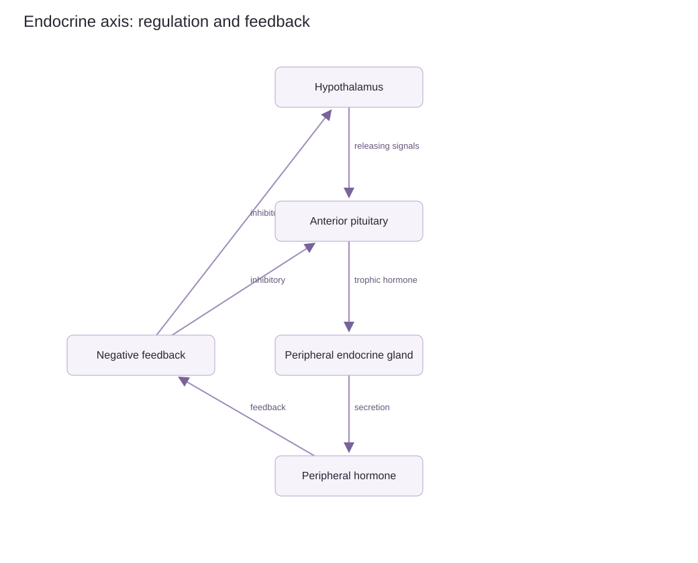

### 확인 문제

후엽에서 방출되는 ADH의 주요 합성 장소는?

A. 후엽의 독립 내분비세포
B. 시상하부 신경세포

**정답: B**

합성 후 축삭으로 이동하여 후엽에서 방출된다.

**오답 해설**

A: 저장·방출 장소와 합성 장소를 혼동한 설명이다.

## 갑상샘호르몬의 합성·작용과 조절

### 학습목표

- 여포세포의 극성과 호르몬 합성 단계를 설명한다.
- 혈중 결합단백질과 탈요오드효소의 역할을 구분한다.
- 갑상샘기능항진과 갑상샘중독증을 구분한다.

### 여포는 세포 바깥에 호르몬을 저장한다

갑상샘(thyroid gland)은 여포세포가 둘러싼 구형 여포로 조직된다. 여포의 안쪽에는 thyroglobulin이 풍부한 콜로이드가 있으며, 세포의 바닥가쪽 면은 모세혈관과, 꼭대기 면은 여포강과 접한다. 이 극성은 혈액에서 요오드를 받아 여포강에서 단백질을 요오드화한 뒤 호르몬을 혈액으로 내보내는 방향성을 만든다. 여포사이의 C세포가 분비하는 calcitonin은 여포세포의 T3·T4와 다른 세포 및 조절 체계에 속한다.

갑상샘호르몬의 주요 분자는 thyroxine(T4)과 triiodothyronine(T3)이다. T4는 요오드 네 개, T3는 세 개를 가진다. 혈중 공급과 조직 활성의 관계에는 말초 전환이 중요하여 갑상샘에서 분비되는 양만으로 각 조직의 활성호르몬 노출이 정해지지 않는다. 갑상샘호르몬은 발생과 성장, 신경계 성숙 및 성인의 에너지 대사와 심혈관 기능 등 광범위한 과정에 영향을 준다.

### 요오드 포획과 유기화

혈액의 iodide는 여포세포 바닥가쪽 막의 sodium-iodide symporter(NIS)를 통해 유입된다. 이 이차능동수송은 Na+/K+-ATPase가 유지하는 나트륨 기울기에 의존한다. 꼭대기 면을 통한 여포강 이동에는 pendrin 등 운반체가 관여한다. 여포강 쪽에서 thyroid peroxidase(TPO)와 과산화수소 생성계가 iodide 산화와 thyroglobulin의 tyrosine 잔기 요오드화를 연결한다. 단백질에 결합하는 이 과정을 유기화(organification)라 한다.

Tyrosine에 요오드가 하나 붙으면 monoiodotyrosine(MIT), 두 개 붙으면 diiodotyrosine(DIT)이 된다. 요오드화 잔기의 결합으로 T3 또는 T4에 해당하는 부분이 형성되지만 이때도 thyroglobulin에 연결되어 저장된다. 필요에 따라 콜로이드가 세포 안으로 흡수되고 단백질분해를 거쳐 자유로운 호르몬이 방출된다. 남은 MIT와 DIT에서 요오드를 회수하는 반응은 T4를 T3로 바꾸는 말초 탈요오드 반응과 구분한다.

### 혈중 수송과 조직 활성

T3와 T4의 대부분은 thyroxine-binding globulin, transthyretin과 albumin 등 단백질에 결합한다. 결합형은 저장·완충 역할을 하며 자유형과 평형을 이룬다. 결합단백질의 양이 변하면 총호르몬 농도가 변해도 자유형과 생리 상태가 같은 정도로 변하지 않을 수 있다. 임신이나 특정 약물, 간 상태에서 총농도를 해석할 때 이 점이 중요하다. 자유호르몬 검사도 분석법과 간섭의 영향을 받을 수 있어 임상상과 불일치하는 값은 재검토한다.

탈요오드효소(deiodinase)는 T4의 활성화와 불활성화에 관여한다. Type 1과 type 2는 T3 생성에 기여하고 type 3은 불활성화 방향의 반응에 중요하다. 조직별 효소 발현과 수송체, 수용체가 다르므로 혈중 호르몬 하나가 모든 조직의 신호를 완전히 대표하지는 않는다. T3는 핵수용체를 통해 전사 조절에 영향을 주며, 효과의 시간 경과에는 유전자 발현과 단백질 교체가 관련된다.

### 되먹임과 요오드의 조절

시상하부 TRH는 뇌하수체 TSH 분비를 자극하고, TSH는 여포세포 수용체를 통해 호르몬 합성과 분비 및 샘의 성장에 영향을 준다. 말초 호르몬은 음성되먹임을 제공한다. 원발성 기능저하에서는 자유호르몬 감소에 대한 TSH 상승이 예상되지만 중추성 장애에서는 그러한 반응이 부족할 수 있다. 정상범위 안의 TSH가 모든 상황에서 기능 정상의 증거가 되는 것은 아니다.

요오드 공급 부족과 과다는 서로 다른 방식으로 기능에 영향을 준다. 급격한 과다 요오드는 유기화를 일시적으로 억제할 수 있고, 정상 조직은 적응을 통해 기능을 유지할 수 있다. 자율적으로 기능하는 조직이나 특정 기저질환에서는 요오드 노출 후 호르몬 과다가 나타날 수도 있다. 따라서 요오드는 많을수록 항상 기능항진을, 적을수록 항상 같은 정도의 기능저하를 만드는 선형 자극이 아니다.

### 호르몬 과다의 발생 위치

갑상샘중독증(thyrotoxicosis)은 조직에 과도한 갑상샘호르몬 효과가 있는 상태를 뜻한다. 갑상샘기능항진증(hyperthyroidism)은 샘 자체의 합성과 분비가 증가한 경우로 그 원인의 일부다. Graves병과 자율기능 결절은 합성 증가를, 파괴성 갑상샘염은 저장호르몬의 유출을 통해 중독증을 만들 수 있다. 외부 호르몬 섭취도 다른 원인이 된다. 기전 차이는 방사성요오드 섭취와 혈류, 항체 및 치료 반응의 해석에 연결된다.

Thionamide 계열은 합성 경로를 억제하므로 이미 만들어져 유출되는 호르몬만이 주된 문제인 상황에서는 효과가 다르다. 교감신경 증상 완화와 호르몬 생성 억제, 원인 치료는 각각 다른 목표다. 갑상샘 비대의 유무와 기능 상태도 별개여서 큰 샘이 반드시 기능항진이라는 뜻은 아니다. 진찰, TSH와 자유호르몬, 원인에 맞는 항체·영상 검사를 통합하여 기능과 구조를 나누어 평가한다.

### 확인 문제

파괴성 갑상샘염의 호르몬 유출은 반드시 합성 증가를 뜻하는가?

A. 아니다.
B. 그렇다.

**정답: A**

저장된 호르몬의 유출도 갑상샘중독증을 만들 수 있다.

**오답 해설**

B: 기능항진과 중독증은 구분해야 한다.

# 혈액내과

## 빈혈의 기전별 접근과 망상적혈구

### 학습목표

- 농도와 적혈구 총량을 구분한다.
- 생산 감소와 손실·파괴 증가를 구분한다.
- MCV와 망상적혈구를 함께 해석한다.

### 빈혈은 원인명이 아니다

빈혈(anemia)은 혈액의 산소운반과 관련된 적혈구 또는 혈색소의 감소 상태를 표현하며 원인 질환을 뜻하지 않는다. 혈색소 농도는 적혈구량뿐 아니라 혈장량의 영향을 받는다. 급성 출혈 직후에는 혈액과 혈장이 함께 소실되어 농도 변화가 처음부터 손실량을 그대로 반영하지 않을 수 있고, 수액과 시간 경과에 따라 달라진다. 반대로 탈수는 농축 때문에 감소를 가릴 수 있다. 나이, 성별, 임신과 검사실 기준을 확인하고 숫자와 순환 상태를 함께 평가한다.

증상은 빈혈의 정도 외에도 발생 속도, 심폐 예비능과 동반질환에 좌우된다. 만성적으로 적응한 환자와 갑자기 출혈한 환자는 같은 혈색소에서 다른 모습을 보일 수 있다. 창백, 빈맥, 운동 시 호흡곤란 등은 비특이적이며, 황달·비장비대·출혈 징후·신경학적 소견은 원인 추론에 도움을 준다. 혈색소 수치만 보고 출혈 원인이나 골수 질환을 대신 진단해서는 안 된다.

### 골수 반응을 먼저 보기

망상적혈구(reticulocyte)는 최근 골수에서 나온 미성숙 적혈구로, 적혈구 생산 반응을 추정하는 데 유용하다. 빈혈에서 적혈구 총수가 줄면 단순 백분율이 상대적으로 높아 보일 수 있으므로 절대수와 상황에 맞는 보정을 고려한다. 심한 빈혈에서는 조기 방출과 말초 성숙 시간 변화도 해석에 영향을 준다. 급성 출혈이나 용혈 직후에는 골수 반응이 나타날 시간이 필요하므로 처음 낮은 값이라고 생산 장애로 즉시 확정하지 않는다.

적절히 증가한 골수 반응은 손실이나 파괴 증가를, 부족한 반응은 생산 감소를 시사할 수 있다. 그러나 용혈과 철 결핍, 신장질환 등이 함께 있으면 전형적 반응이 약해질 수 있다. 신장의 erythropoietin, 철과 비타민 공급, 염증과 골수 환경이 생산을 결정한다.

### 크기 지표와 원인

평균적혈구용적(mean corpuscular volume, MCV)은 평균 크기를 보여준다. 소구성에서는 철 결핍과 thalassemia 등, 대구성에서는 DNA 합성 장애와 간질환·약물 등 여러 원인을 고려한다. 하지만 평균값은 서로 다른 세포 집단의 혼합을 가릴 수 있다. 철 결핍과 비타민 B12 결핍이 함께 있으면 MCV가 참고범위에 놓일 수도 있다. 적혈구 분포폭과 말초도말, 다른 혈구계열의 이상을 함께 확인하면 평균값의 한계를 보완할 수 있다.

철 검사는 저장량뿐 아니라 염증과 이용 가능성에 영향을 받는다. Ferritin은 저장 철을 반영하는 단서이지만 급성기 반응물질이므로 염증에서 상승할 수 있다. 낮은 transferrin saturation의 의미도 다른 지표와 맥락을 함께 봐야 한다. 용혈에서는 LDH, bilirubin, haptoglobin과 도말 소견 등을 종합하지만 각각 다른 이유로 변할 수 있다. 원인을 확인하지 않고 철분이나 수혈로 수치만 교정하면 출혈 병변과 기저 질환을 놓칠 수 있다. 구체 치료 문턱과 용량은 별도 지침 대조가 필요한 범위다.

#### 증례: 정상 MCV의 혼합 결핍

영양섭취 부족과 만성 출혈 가능성 빈혈이 있지만 MCV는 참고범위 정상 MCV가 철 및 B12 결핍을 배제하는가?

평균값에서 작은 적혈구와 큰 적혈구가 상쇄될 수 있다. 골수반응, 도말과 적절한 추가 검사로 원인을 평가한다.

### 확인 문제

혼합 결핍에서 정상 MCV가 원인 부재를 보장하는가?

A. 그렇다.
B. 아니다.

**정답: B**

작고 큰 세포 집단이 평균값에서 상쇄될 수 있다.

**오답 해설**

A: 평균 크기가 모든 적혈구의 크기를 나타내지 않는다.

## 혈소판·응고·섬유소용해의 통합

### 학습목표

- 혈소판 부착·활성화·응집을 구분한다.
- 세포 표면의 응고효소 복합체 형성을 설명한다.
- PT·aPTT와 임상 출혈 양상의 관계를 해석한다.

### 지혈과 혈전의 경계

지혈(hemostasis)은 혈관 손상 부위를 막으면서 나머지 혈관의 흐름은 유지하는 조절된 반응이다. 혈관벽, 혈소판, 응고인자와 항응고·섬유소용해 체계가 서로 영향을 준다. 일차지혈과 이차지혈의 구분은 혈소판 마개와 fibrin 형성을 이해하는 데 유용하지만 생체에서는 순차적으로 완전히 분리되지 않는다. 활성 혈소판은 응고 반응의 표면을 제공하고 thrombin은 혈소판을 다시 활성화한다.

정상 내피는 nitric oxide와 prostacyclin, 여러 항응고 표면분자 등을 통해 불필요한 혈전 형성을 제한한다. 손상으로 내피 아래 기질이 드러나면 혈소판 부착이 시작되고 tissue factor에 대한 혈액 노출은 응고 개시와 연결된다. 병적 혈전은 이러한 반응이 부적절한 위치와 범위에서 발생한 경우다. 혈소판 수와 응고시간이 각각 정상이어도 내피·흐름·기능 이상에 따라 혈전이나 출혈이 생길 수 있다.

### 부착에서 응집까지

Von Willebrand factor(vWF)는 손상 기질과 혈소판 GPIb-IX-V 복합체의 연결에 관여하며 높은 전단 조건에서 특히 중요하다. 콜라겐과 그 수용체 등의 자극은 혈소판의 형태 변화와 과립 방출, integrin 활성화를 유도한다. ADP와 thromboxane A2, thrombin 등은 반응을 증폭한다. 활성화된 GPIIb/IIIa, 즉 integrin αIIbβ3는 fibrinogen 등 리간드를 통해 혈소판 사이의 연결을 돕는다. 따라서 부착 수용체와 응집 수용체의 장애는 구분해야 한다.

혈소판의 막 인지질 재배열은 음전하 표면을 제공하여 칼슘 의존적인 응고 복합체 형성을 돕는다. 과립 내용물과 막수용체, 세포골격 및 대사 이상은 수가 유지되어도 기능 장애를 일으킬 수 있다. Aspirin은 cyclooxygenase 경로를, P2Y12 억제제는 ADP 수용체 경로를 표적으로 하므로 약물성 기능장애를 평가할 때 실제 복용력을 확인한다. 항혈소판제와 항응고제는 표적이 다르지만 병용하면 출혈 위험이 함께 변한다.

### Thrombin 생성의 증폭

Tissue factor와 활성 VII 인자의 복합체는 X 인자와 IX 인자의 활성화에 기여한다. 활성 IX와 보조인자 VIII, 활성 X와 보조인자 V는 각각 적절한 인지질 표면에서 효율적인 복합체를 형성한다. 활성 X를 포함한 prothrombinase는 prothrombin을 thrombin으로 전환한다. Thrombin은 fibrinogen을 fibrin으로 전환하고 혈소판과 여러 인자를 활성화하여 반응을 증폭한다. XIII 인자 활성화에 따른 교차결합은 fibrin 망의 안정성에 기여한다.

전통적인 내인성·외인성 경로 그림은 검사실의 PT와 aPTT를 해석하는 데 유용하지만 생체 지혈을 두 독립된 파이프로 설명하지는 못한다. 예를 들어 XII 인자 결핍은 aPTT를 연장할 수 있어도 전형적인 중증 출혈을 일으키는 인자 결핍과 임상상이 다르다. VIII·IX 인자의 부족은 표면에서의 효율적 증폭을 손상시켜 혈우병성 출혈과 연결된다. 반응을 시작할 수 있는지와 충분한 thrombin을 유지할 수 있는지는 다른 문제다.

### 항응고와 용해

Antithrombin은 thrombin과 활성 X 등 여러 효소의 활성을 제한한다. Thrombin이 thrombomodulin과 결합하면 protein C 활성화를 촉진하고, 활성 protein C는 protein S 등의 도움을 받아 V와 VIII 보조인자를 불활성화한다. Tissue factor pathway inhibitor도 개시 단계의 조절에 관여한다. 이러한 억제는 혈액이 손상 부위를 넘어 광범위하게 굳는 것을 제한하는 데 필요하다.

Plasminogen은 tPA 등에 의해 plasmin으로 전환되어 fibrin을 분해한다. 반응은 PAI 계열과 α2-antiplasmin 등 억제체에 의해 조절된다. D-dimer는 교차결합된 fibrin의 분해와 관련된 산물이며 혈전이 만들어지고 처리된다는 단서를 제공한다. 그러나 감염, 수술, 임신과 여러 염증 상태에서도 상승할 수 있어 양성만으로 특정 혈전을 확정하지 않는다. 임상확률과 검사의 적용 조건이 필요하다.

### 출혈 양상과 검사

혈소판·vWF 관련 장애는 점막 출혈, 점상출혈과 쉽게 드는 멍으로, 중증 응고인자 장애는 깊은 혈종과 관절출혈로 나타나는 경향이 있다. 이 구분은 절대적이지 않으며 복합 장애와 중증도에 따라 겹친다. PT와 aPTT는 정해진 시약 조건에서 fibrin 형성까지의 시간을 측정하므로 혈소판 기능과 모든 응고 장애를 포함하지 않는다. XIII 인자 결핍처럼 통상 응고시간이 뚜렷하게 연장되지 않을 수 있는 질환도 있다.

혼합검사에서는 환자 혈장과 정상 혈장을 섞어 시간의 교정 여부를 살핀다. 교정은 인자 부족을, 불충분한 교정은 억제인자나 약물 효과를 시사할 수 있으나 시간 의존성과 검사 조건을 고려해야 한다. Lupus anticoagulant처럼 시험관 응고시간을 연장하면서 임상적으로 혈전 위험과 관련되는 상황도 있어 검사명과 생체 효과를 혼동하지 않는다. 출혈 부위와 시점, 가족력, 약물력 및 추가 인자·기능 검사를 통합한다.

#### 지혈 기능과 검사

| 과정 | 주요 요소 | 관련 평가의 예 |
|---|---|---|
| 혈소판 부착 | vWF와 GPIb 계열 | vWF 및 혈소판 기능 평가 |
| 혈소판 응집 | 활성 αIIbβ3와 fibrinogen | 응집 기능 검사 |
| 응고효소 복합체 | 효소·보조인자·인지질·칼슘 | PT·aPTT 및 개별 인자 평가 |
| fibrin 안정화 | 활성 XIII 인자 | 통상 응고시간과 별도 평가가 필요할 수 있음 |
| 섬유소용해 | plasminogen·plasmin과 조절인자 | 임상 맥락을 포함한 fibrin 분해 지표 |

검사 하나가 지혈 기능 전체를 대표하지 않는다.

### 확인 문제

정상 PT·aPTT는 모든 출혈성 질환을 배제하는가?

A. 그렇다.
B. 아니다.

**정답: B**

혈소판 기능과 일부 인자 장애는 통상 응고시간으로 충분히 평가되지 않는다.

**오답 해설**

A: 검사실 응고시간은 지혈의 일부 조건만 평가한다.

# 종양내과

## 암의 병기·분화도·치료반응

### 학습목표

- 병기와 조직학적 분화도의 차이를 설명한다
- 예후인자와 예측인자를 구별한다
- 종양 반응과 환자 중심 치료목표의 관계를 설명한다

### 암 진단의 여러 차원

암이라는 진단은 출발점이다. 치료를 결정하려면 종양의 기원 장기와 조직형, 퍼진 범위, 생물학적 특성, 환자의 전신 상태를 알아야 한다. 같은 장기에서 발생한 종양도 조직형과 분자적 특성이 다르면 약물 반응과 자연경과가 달라질 수 있다. 반대로 서로 다른 장기의 종양에서 같은 분자 표적이 관찰될 수 있다. 그러나 특정 유전자 이상이 있다는 사실만으로 모든 장기와 상황에서 같은 치료 효과를 가정할 수는 없다. 표적의 존재와 실제 치료 효과 사이에는 암의 계통, 동반 이상, 약물 도달과 내성 경로가 개입한다.

조직검사는 악성 여부와 조직형을 판단하고 추가 검사를 위한 검체를 제공한다. 생검 위치는 대표성뿐 아니라 시술 위험과 이후 수술 계획에 영향을 준다. 괴사 부위만 채취하면 진단이 어려울 수 있고, 작은 검체는 종양 내부의 이질성(heterogeneity)을 충분히 반영하지 못할 수 있다. 병리 결과가 영상이나 임상 경과와 맞지 않는다면 어느 한쪽을 무조건 버리는 대신 검체의 대표성, 판독, 감별진단과 추가 평가 필요성을 검토한다.

### 병기와 등급

병기(stage)는 종양이 해부학적으로 어느 범위까지 퍼졌는지를 표현하는 틀이다. TNM 체계에서 T는 원발종양의 크기나 국소 침범 범위, N은 국소 림프절 침범, M은 원격 전이를 나타낸다. T가 언제나 단순한 직경 순서만을 의미하지는 않고, N도 모든 암에서 양성 림프절 개수만으로 정해지지 않는다. 장기별 규칙과 적용 판본을 확인해야 한다. 혈액암이나 일부 중추신경계 종양처럼 다른 분류 체계를 쓰는 경우도 있으므로 모든 악성종양을 같은 TNM 표에 억지로 넣지 않는다.

조직학적 등급(grade)은 세포와 조직의 분화, 핵의 이상, 유사분열, 괴사 등 종양별 기준에 따라 생물학적 특성을 평가한다. 저분화는 대체로 정상 조직의 구조와 기능을 덜 유지하는 상태를 의미한다. 병기는 퍼진 범위이고 등급은 현미경적 성격이라는 차이가 있다. 작은 범위의 고등급 암과 넓게 퍼진 저등급 암은 모두 가능하다. 일부 예후 병기에는 분자표지자나 등급이 함께 반영되지만, 그 사실이 두 개념의 정의를 같게 만들지는 않는다.

임상병기(clinical stage)는 치료 전 진찰, 영상, 생검 등으로 평가하고, 병리병기(pathologic stage)는 절제한 종양과 림프절에서 얻은 정보를 추가하여 평가한다. 수술 전 치료를 받은 뒤의 평가는 치료 이전과 다른 상태를 반영하므로 그 사실을 구분하여 기록한다. 진단 당시 병기와 치료 뒤 반응 평가, 이후 재발의 범위 역시 서로 다른 시간축의 정보이다. 기록에서 시점이 사라지면 치료 전 종양 부담과 현재 상태가 섞여 예후와 치료 효과를 잘못 해석하게 된다.

### 예후인자와 예측인자

예후인자(prognostic factor)는 질환의 결과와 관련된 특성이며, 예측인자(predictive factor)는 특정 치료의 상대적 효과와 관련된 특성이다. 어떤 표지자가 전체적으로 나쁜 경과와 관련되면서 동시에 표적치료의 이득을 예측할 수 있다. 한 연구에서 치료받은 환자들의 결과만 비교하여 표지자가 치료 효과를 예측한다고 단정하면 예후의 영향과 치료 반응의 영향을 구별하기 어렵다. 치료군과 비교군 사이에서 표지자에 따라 효과 차이가 달라지는지를 검토해야 한다.

종양표지자(tumor marker)는 암세포나 숙주 반응과 관련된 물질 또는 분자적 특성이다. 혈중 수치가 증가해도 양성 질환이 원인일 수 있고, 암이 있어도 증가하지 않을 수 있다. 따라서 하나의 혈중 표지자를 모든 암의 선별검사나 확진검사로 사용할 수 없다. 치료 전 증가되어 있던 표지자의 연속 측정은 경과 판단에 도움이 될 수 있지만 검사 방법, 장기 기능, 염증과 다른 원인의 영향을 고려해야 한다. 표지자의 변화와 영상 및 증상의 변화가 일치하지 않는 경우 그 이유를 검토한다.

### 국소치료와 전신치료의 목적

수술과 방사선치료는 특정 부위의 종양을 제어하는 국소치료이다. 전신치료는 혈류를 통해 약물이 도달하는 부위의 종양을 표적으로 하지만 모든 전이 부위와 세포에 동일하게 작용하는 것은 아니다. 종양의 약물 감수성, 혈관 분포, 장벽, 미세환경과 내성이 효과를 제한한다. 영상에서 모든 병변을 제거한 뒤에도 보이지 않는 미세전이가 남아 있을 수 있어 수술 후 보조치료(adjuvant therapy)를 고려하는 생물학적 근거가 된다.

선행치료(neoadjuvant therapy)는 수술 등의 확정적 국소치료 전에 시행하여 종양 축소, 절제 가능성 향상, 전신질환 조기 제어 등의 목적을 추구한다. 치료 순서는 단순히 약을 먼저 쓰는가의 문제가 아니라 어떤 정보를 얻고 어떤 위험을 먼저 줄이려는가에 관한 결정이다. 완치를 목표로 하는 치료와 질병 조절 및 증상 완화를 목표로 하는 치료는 기대하는 이득과 허용 가능한 위해가 다를 수 있다. 완화의료는 어느 시점에서든 증상과 삶의 질을 다루며 항암치료가 끝난 뒤에만 시작되는 개념이 아니다.

### 반응평가와 환자에게 중요한 결과

영상에서 종양 크기가 줄어드는 반응은 중요한 정보지만 생존 연장이나 삶의 질 개선과 언제나 같은 뜻은 아니다. 세포 사멸 뒤 섬유화가 남아 크기 변화가 작을 수 있고, 치료 종류에 따라 염증성 변화가 측정을 복잡하게 할 수 있다. 재현 가능한 반응평가를 위해서는 같은 병변과 검사 방법, 평가 시점을 일관되게 다루어야 한다. 영상 반응, 재발까지의 시간, 전체 생존, 증상 부담은 각각 다른 결과변수이며 하나의 지표가 나머지를 완전히 대신하지 않는다.

치료 계획에는 종양의 특성뿐 아니라 수행능력(performance status), 장기 기능, 동반 질환, 약물 상호작용, 환자의 목표가 포함된다. 종양을 더 많이 줄이는 치료가 모든 환자에게 더 큰 순이득을 제공하는 것은 아니다. 예상 효과의 크기와 발생 가능성, 부작용의 강도와 회복성, 통원과 입원 부담을 함께 설명해야 한다. 종양학의 의사결정은 병기표의 한 칸에 약제를 자동 연결하는 과정이 아니라 암의 생물학과 환자의 상태를 함께 해석하는 과정이다.

### 확인 문제

암의 병기와 등급을 구별한 설명은?

A. 병기는 퍼진 범위, 등급은 종양별 기준에 따른 조직학적 성격을 다룬다.
B. 높은 등급은 반드시 원격전이가 있다는 뜻이다.
C. 작은 종양은 언제나 저등급이다.

**정답: A**

해부학적 범위와 현미경적 성격은 별개의 축이며 일부 예후 병기에서는 함께 반영될 수 있다.

**오답 해설**

B: 등급은 조직학적 성격이며 원격전이의 존재를 직접 정의하지 않는다.

C: 작은 종양도 고등급일 수 있어 크기와 등급을 동일시할 수 없다.

## DNA 손상복구와 종양의 유전체 불안정성

### 학습목표

- 손상 유형에 따른 복구 경로를 비교한다
- 생식세포 변이와 종양 체세포 변이의 의미를 구분한다
- 합성치사와 치료 내성의 원리를 설명한다

### DNA 손상과 돌연변이는 다르다

DNA 손상(damage)은 염기의 화학적 변화, 가닥 절단 또는 구조적 이상을 포함한다. 돌연변이(mutation)는 복제 후 유지되는 염기서열 등의 변화이다. 손상이 정확히 복구되면 영구적인 서열 변화가 남지 않을 수 있고, 손상을 통과하는 복제나 잘못된 복구는 변이를 고정할 수 있다. 종양의 유전체 불안정성은 손상의 발생률뿐 아니라 복구, 세포주기 점검 및 손상된 세포의 생존 선택이 함께 만든 결과이다.

세포에는 내인성 활성산소, 복제 오류 및 외인성 자극 등 다양한 손상원이 존재한다. 모든 손상을 한 경로로 처리하지 않는다. 손상의 크기와 형태, 복제 시점 및 자매염색분체의 사용 가능성이 복구 방법에 영향을 준다. 복구 단백질이 하나 줄었다는 사실만으로 모든 종류의 DNA 손상이 같은 정도로 축적된다고 추론하지 않는다.

### 작은 염기 손상과 부피가 큰 손상

염기절제복구(base excision repair, BER)는 손상 염기를 인식하는 DNA 글리코실화효소에서 시작해 염기가 빠진 자리의 처리, 재합성 및 연결로 이어진다. 산화나 탈아미노화로 변한 일부 염기와 같은 비교적 작은 손상이 대상이 된다. 뉴클레오타이드절제복구(nucleotide excision repair, NER)는 DNA 나선을 왜곡하는 부피가 큰 손상을 포함한 짧은 구간을 제거한 뒤 채운다. 두 경로는 이름이 비슷해도 최초 인식과 절제 단위가 다르다.

복제 중 틀리게 짝지어진 염기나 작은 삽입·결실 고리는 불일치복구(mismatch repair, MMR)의 대상이다. 이 경로가 손상되면 반복서열에서 길이 변화가 축적되는 미세부수체불안정성(microsatellite instability, MSI)이 나타날 수 있다. MMR 단백질 발현 소실과 MSI 검사는 관련되어 있지만 같은 측정법은 아니다. 단백질 염색은 발현 여부를 보고, 분자검사는 반복서열의 변화를 평가한다.

### 이중가닥 절단과 복구 선택

DNA 이중가닥 절단은 양 가닥의 연속성이 끊어진 상태로 염색체 안정성에 큰 위협이 된다. 상동재조합복구(homologous recombination repair)는 자매염색분체 등 상동 주형의 정보를 이용할 수 있을 때 정확한 복구에 유리하다. BRCA1·BRCA2를 포함한 여러 단백질이 손상 처리와 재조합 과정에 관여한다. 세포주기의 위치가 중요하므로 모든 세포에서 언제나 같은 방식으로 이용되는 경로가 아니다.

비상동말단연결(non-homologous end joining, NHEJ)은 긴 상동 주형 없이 절단 말단을 연결한다. 신속한 연결에 도움이 되지만 말단 처리 과정에서 서열의 손실이나 변화가 생길 수 있다. 이 경로를 항상 완전히 부정확하다고 단정하는 것도 지나치다. 복구 결과는 말단의 상태와 처리 방식에 따라 달라진다. 잘못된 염색체 사이의 연결은 전좌와 같은 구조 변화를 만들 수 있어 종양 발생의 기전과 연결된다.

### 점검점과 종양 선택

DNA 손상 신호는 세포주기 진행을 늦추고 복구 시간을 확보하며, 손상이 심하면 세포사멸이나 노화를 유도할 수 있다. 이 점검 기능이 손상되면 변이가 많은 세포가 증식할 가능성이 높아진다. 그러나 복구 결함이 있는 모든 세포가 종양으로 자라는 것은 아니다. 생존에 필요한 최소 기능, 주변 미세환경 및 추가적인 증식 조절 변화가 함께 선택된다.

종양억제유전자의 한 병적 사본을 생식세포 수준에서 가진 사람은 각 세포가 이미 하나의 위험 요인을 가진 상태에서 출발할 수 있다. 종양 세포에서 반대 사본의 소실이나 다른 기능 억제가 추가되면 해당 경로가 크게 저하될 수 있다. 가족에서는 우성 위험 전달처럼 보여도 세포 수준에서는 두 사본의 기능 소실이 중요한 경우가 있다는 점을 구분한다. 모든 유전성 종양이 동일한 두 단계 모델로 설명되는 것은 아니다.

### 유전성 위험과 종양 검사

종양 조직에서 BRCA 변이를 찾았다고 그 변이가 반드시 전신의 생식세포 계열에 존재한다고 말할 수 없다. 종양 발생 중 생긴 체세포 변이일 수 있으며, 정상 조직을 이용한 적절한 검사가 유전성 여부의 확인에 필요할 수 있다. 반대로 생식세포 병적 변이를 가진 사람의 모든 종양이 언제나 같은 복구 결함을 보이는 것도 아니다. 환자의 유전 위험과 현재 종양의 기능 상태는 연결되지만 서로 다른 질문이다.

MMR 결함 역시 유전성 원인과 후천적인 유전자 발현 억제 등으로 발생할 수 있다. 따라서 MSI 또는 단백질 소실을 확인한 뒤에는 나이, 가족력, 소실 패턴과 추가 검사를 통합한다. 종양 검사 결과를 바로 가족 전체의 확정 진단으로 옮기지 않는다. 변이의 병원성 분류와 검체의 종양 함량 및 검사 범위도 결과의 신뢰도를 바꾼다.

### 합성치사의 논리

합성치사(synthetic lethality)는 각각의 단일 기능 저하에서는 세포가 생존할 수 있지만 두 기능의 손상이 결합하면 생존이 어려워지는 관계이다. 특정 복구 경로가 손상된 종양에서 보완 경로를 억제하면 상대적으로 큰 약물 효과를 얻을 수 있다. PARP 억제와 상동재조합복구 결함의 관계가 대표적인 임상 연결이다. 이 효과는 단순히 정상 세포에는 DNA 손상이 전혀 없다는 전제에서 성립하는 것은 아니다.

약물 반응에는 실제 복구 기능의 손상 정도, 약물의 작용 및 종양의 다른 변화가 관여한다. 치료 도중 복구 기능을 되살리는 추가 변이, 약물 유출 또는 대체 경로 변화로 내성이 생길 수 있다. 처음의 유전체 표지가 치료 전 기간의 반응을 보장하지 않는 이유이다. 분자 표지를 치료 선택에 이용할 때에는 검출된 변화, 기능적 결과 및 해당 임상 상황의 근거를 구분해 판단한다.

### 확인 문제

종양에서 BRCA 병적 변이를 검출했을 때 적절한 해석은?

A. 모든 DNA 복구 경로가 완전히 소실되었다는 뜻이다.
B. 유전성 여부와 종양의 복구 기능을 구분하여 추가 평가한다.
C. 모든 친족이 같은 변이를 가졌다는 확정이다.

**정답: B**

종양 체세포 변화와 생식세포 변화는 다르며 BRCA는 모든 복구 경로를 하나로 대표하지 않는다.

**오답 해설**

A: 복구 경로는 손상 종류별로 나뉘며 다른 경로가 남을 수 있다.

C: 정상 조직 검사와 가족 평가 없이 친족의 유전자형을 확정할 수 없다.

# 감염내과

## 항균제 선택과 미생물검사의 통합

### 학습목표

- 감염과 집락화를 구분한다.
- 경험적 치료와 표적 치료를 연결한다.
- 감수성 결과와 실제 치료 성공의 차이를 설명한다.

### 균이 검출되었다는 사실의 의미

감염(infection)은 미생물의 존재와 숙주 손상 및 반응을 임상적으로 연결해 판단한다. 집락화(colonization)는 미생물이 존재하지만 해당 부위의 질환 원인이라는 근거가 없는 상태를 포함하고, 오염(contamination)은 채취나 처리 과정에서 검체에 섞인 경우를 말한다. 배양 양성만으로 항균제 적응을 확정하지 않는다. 검체가 어느 부위에서 어떤 방식으로 얻어졌는지, 원래 무균 부위인지, 염증과 증상이 맞는지 확인해야 한다. 반대로 배양 음성도 항균제 선행이나 채취 문제 때문에 감염을 배제하지 못할 수 있다.

좋은 검체는 치료 선택의 출발점이다. 가능하고 치료를 지연시키지 않는 상황에서는 항균제 투여 전에 적절한 검체를 얻는 것이 원인 확인에 도움이 된다. 그러나 심각한 감염에서 모든 검사가 끝날 때까지 필요한 치료를 지연하는 것은 별개의 위해다. 임상적 긴급도와 검사 수율을 함께 고려해야 한다. 채취 시각과 선행 투약, 의심 감염부위를 기록하면 미생물 결과를 더 정확히 해석할 수 있다.

### 경험적 선택의 논리

경험적 항균제는 추정 감염부위, 가능한 병원체, 환자의 중증도와 면역 상태, 최근 항균제와 의료 노출, 지역 내성 자료를 바탕으로 고른다. 광범위라는 말이 항상 더 효과적이라는 뜻은 아니다. 필요한 병원체를 포괄하면서 불필요한 독성과 내성 선택 압력을 줄이는 것이 목적이다. 농양, 감염된 기구와 폐쇄가 있으면 감염원 조절(source control)이 중요하며 약제 교체만으로 해결되지 않을 수 있다.

약물이 시험관에서 균을 억제하더라도 실제 감염부위에 충분한 노출이 도달해야 한다. 중추신경계, 뼈, 전립샘 등 부위 특성과 단백질 결합, 배설, 신기능 변화가 영향을 준다. 최소억제농도(minimum inhibitory concentration, MIC)는 표준 조건에서의 억제 지표이며 환자의 투여량 자체가 아니다. 감수성 범주의 해석에는 균종과 약물, 투여 노출, 판독 기준의 판이 관련된다. 검사 결과를 기준 없이 숫자 크기만 비교하면 안 된다.

### 재평가와 축소

배양과 감수성, 영상, 임상 경과가 나오면 진단과 치료를 다시 검토한다. 원인과 감염부위가 명확해지면 더 좁은 표적 치료로 조정할 수 있고, 감염 근거가 약해지면 중단도 고려해야 한다. 이는 초기 선택이 틀렸다는 비난이 아니라 새 정보를 반영하는 과정이다. 발열이 지속된다는 이유만으로 무조건 범위를 넓히기보다 농양과 다른 감염원, 비감염성 발열, 약물반응, 적절한 노출과 시간 경과를 확인한다.

치료 기간은 병원체 이름 하나보다 감염부위와 감염원 조절, 환자 상태와 반응에 따라 달라진다. 경구 전환 가능성, 치료 관련 이상반응과 C. difficile 감염, 상호작용도 검토한다. 이 절에서는 실제 처방에 필요한 약물별 용량·기간과 국내 내성률을 미검증 상태로 남긴다. 항균제 관리의 핵심은 덜 쓰는 것 자체가 아니라 필요한 환자에게 적절한 약을 적절한 노출과 기간으로 사용하는 것이다.

### 확인 문제

배양 양성만으로 항균제 적응을 확정하는가?

A. 아니다.
B. 그렇다.

**정답: A**

집락화·오염과 실제 감염을 구분해야 한다.

**오답 해설**

B: 균의 검출과 질환의 원인임은 다른 판단이다.

## 결핵의 감염·면역·활동성 질환

### 학습목표

- 잠복 감염과 활동성 결핵의 차이를 설명한다
- 면역학적 검사와 병원체 검사의 질문을 구분한다
- 육아종 및 공동 형성의 임상적 의미를 해석한다

### 균의 진입과 숙주 반응

결핵(tuberculosis, TB)은 결핵균군의 감염으로 발생하며 폐뿐 아니라 여러 장기를 침범할 수 있다. 공기 중으로 배출된 감염성 입자가 흡입되어 폐포에 도달하면 대식세포가 균을 포식한다. 결핵균은 세포 내 생존에 유리한 성질을 지녀 초기 포식이 곧바로 제거를 의미하지 않는다. 이후 항원 제시와 T세포 반응이 형성되면서 숙주의 억제 능력과 균의 지속 사이에 다양한 상태가 생긴다.

세포매개면역은 감염 억제에 중요하지만 염증성 조직 손상에도 관여한다. 대식세포가 상피모양세포와 거대세포를 포함하는 육아종(granuloma)을 형성하고 주변 림프구가 반응한다. 건락괴사(caseous necrosis)는 중요한 병리 소견이지만 모든 검체에서 보이는 것은 아니며 다른 질환에서도 유사한 양상이 나타날 수 있다. 조직 모양을 병원체의 직접 증거와 구분하면서 미생물 검사 및 임상 상황과 연결한다.

### 잠복과 활동성의 차이

잠복결핵감염(latent tuberculosis infection, LTBI)은 감염의 면역학적 근거가 있으나 활동성 질환을 시사하는 임상적 증거가 없는 상태를 가리킨다. 활동성 결핵은 균 증식과 조직 침범으로 임상 질환이 발생한 상태이다. 잠복 상태의 사람을 활동성 폐결핵 환자와 같은 전염원으로 취급하지 않는다. 반면 활동성 질환의 증상은 서서히 시작하거나 뚜렷하지 않을 수 있어 증상이 약하다는 이유만으로 배제하지 않는다.

감염 후 발병 위험은 숙주 면역 상태와 시간에 따라 달라진다. HIV 감염, 면역억제 치료 및 일부 만성 질환은 위험 평가에 중요하다. TNF는 육아종의 유지와 관련되므로 TNF 억제 치료 전후의 결핵 평가는 단순한 검사 행정이 아니라 면역기전과 연결된다. 초기 감염 직후 발병하는 경우와 억제되어 있던 감염이 후에 발병하는 경우 모두 가능하며 가계 내 접촉력, 이전 치료 및 노출 환경을 묻는다.

### 폐와 폐외 결핵

폐결핵에서는 기침, 객담, 발열, 식은땀, 체중 감소 또는 객혈이 나타날 수 있다. 공동(cavity)은 괴사 조직이 기도와 연결되어 배출되면서 형성될 수 있고, 기도와 연결된 병변의 균 배출은 전파 평가에 중요하다. 영상에서 특정 부위의 병변이 전형적일 수 있어도 면역 상태나 연령에 따라 양상이 달라진다. 영상 소견만으로 결핵을 확정하거나 배제하기보다 병원체 검사와 연결한다.

혈행성 전파는 여러 장기의 병변과 속립성 양상을 만들 수 있다. 결핵수막염에서는 중추신경계 합병증, 척추결핵에서는 뼈 파괴와 신경 압박, 비뇨생식기 결핵에서는 요로 증상이 문제가 된다. 폐외 결핵은 침범 부위에 적합한 검체를 얻는 것이 중요하다. 폐외라는 이유만으로 동반 폐병변이나 후두 침범에 따른 전파 가능성 평가를 생략하지 않는다.

### 면역학적 검사가 답하는 질문

투베르쿨린피부검사(tuberculin skin test, TST)와 인터페론감마분비검사(interferon-gamma release assay, IGRA)는 결핵 항원에 대한 숙주 면역 반응을 이용한다. 양성은 감염 평가의 근거가 되지만 살아 있는 균의 위치와 양, 활동성 질환 여부 또는 약제 감수성을 직접 알려 주지 않는다. 감염 가능성이 낮은 사람에게 무분별하게 검사하면 양성 결과의 해석이 어려워질 수 있다.

BCG 접종과 비결핵항산균은 검사 종류에 따라 해석에 다른 영향을 줄 수 있다. 면역억제 상태나 감염 초기에는 음성이 활동성 결핵을 배제하지 못한다. 특히 활동성 질환이 의심되는 환자에서는 면역학적 검사 결과만으로 검체 검사와 영상 평가를 중단하지 않는다. 잠복 감염의 치료를 고려할 때 활동성 질환을 먼저 평가하는 이유는 질환 상태에 따라 필요한 치료가 다르기 때문이다.

### 도말·배양·분자검사의 역할

항산균 도말은 신속하게 균을 시각화하지만 검체 내 균량의 영향을 받으며 결핵균과 비결핵항산균을 확실히 구별하지 못한다. 배양은 살아 있는 균을 검출하고 균 동정 및 약제감수성 평가에 연결되지만 시간이 걸린다. 핵산증폭검사(nucleic acid amplification test, NAAT)는 결핵균 유전물질과 일부 내성 관련 표지를 빠르게 찾을 수 있다. 각 검사가 양성일 때 의미하는 대상이 서로 다르다.

음성 결과의 해석에는 검체의 질, 채취 부위와 시기, 균량 및 선행 치료를 고려한다. 객담이 적절하지 않거나 폐외 병변만 있다면 단일 음성 검사가 질환 전체를 배제하기 어렵다. 반대로 유전물질의 검출은 특정 상황에서 생존 균의 존재와 완전히 동일하지 않다. 검사를 반복하거나 다른 검체를 선택할 때는 같은 정보를 늘리는지, 다른 질문에 답하는지 구분한다.

### 치료 원리와 추적의 목표

활동성 결핵 치료에 여러 약제를 조합하는 이유는 서로 다른 균 집단에 작용하고 내성균의 선택을 억제하기 위해서이다. 특정 약제의 내성 여부, 이전 치료력, 침범 부위, 상호작용 및 숙주 상태가 치료 구성에 영향을 준다. 증상이 좋아졌다고 균 제거가 완료되었다고 볼 수 없으며, 복약 지속과 부작용 관리가 치료 효과에 직결된다. 약제 감수성을 모른 채 단일 약제만 덧붙이는 접근은 내성 문제를 악화시킬 수 있다.

추적에서는 증상과 체중, 검체 검사, 약물 독성 및 실제 복약을 함께 살핀다. 간질환, 임신, 콩팥 기능 저하, HIV 치료 등은 약제 선택과 모니터링을 바꿀 수 있다. 감염 관리에서는 환자의 치료와 함께 전파 가능성, 환경 및 접촉자의 위험을 평가한다. 결핵 진료는 한 사람의 영상 개선만을 목표로 하는 과정이 아니라 재발과 내성 및 추가 감염을 줄이는 연속적인 관리이다.

### 확인 문제

IGRA 양성 결과가 직접 알려 주는 것은?

A. 결핵 항원에 대한 면역 반응의 근거이다.
B. 활동성 폐결핵의 확정이다.
C. 원인 균의 약제 감수성이다.

**정답: A**

면역 반응 검사는 감염 평가를 돕지만 활동성과 약제 감수성을 직접 측정하지 않는다.

**오답 해설**

B: 활동성은 임상·영상 및 적절한 병원체 검사를 통합한다.

C: 감수성 평가는 균 또는 내성 표지를 대상으로 한 별도 검사이다.

# 류마티스내과

## 관절염의 패턴과 염증성 질환 접근

### 학습목표

- 관절통과 관절염, 관절주위 통증을 구분한다.
- 급성 단관절염에서 감염과 결정질환을 평가한다.
- 분포·기간·관절외 소견으로 감별을 구성한다.

### 통증의 해부학적 위치

관절통(arthralgia)은 환자의 통증 경험이고 관절염(arthritis)은 활막 염증 등 관절의 염증성 상태를 포함한다. 힘줄과 점액낭, 인대와 근육의 통증은 관절 주변에서 비슷하게 느껴질 수 있다. 능동운동과 수동운동의 차이, 국소 압통과 부종, 운동 범위 및 저항운동을 함께 관찰하면 발생 위치를 추론하는 데 도움이 된다. 방사통과 신경병성 통증도 감별에 포함한다.

염증성 양상에서는 부종과 열감, 안정 시 통증과 아침 강직 등이 단서가 될 수 있고, 기계적 부하는 다른 패턴을 만들 수 있다. 그러나 강직 시간 하나로 모든 염증성·퇴행성 질환을 나누지는 못한다. 증상의 기간과 일중 변화, 사용과 휴식의 관계 및 실제 관찰 소견을 함께 기술한다. 고령이나 면역저하에서는 감염의 전형적 염증 소견이 덜 뚜렷할 수 있다.

### 수와 분포가 주는 정보

단관절·소수관절·다관절의 구분, 대칭성과 상하지의 크고 작은 관절 분포, 축성 침범은 감별의 틀을 제공한다. 류마티스관절염은 전형적인 손 관절과 대칭성 활막염 등으로 접근할 수 있지만 모든 환자가 처음부터 완전한 패턴을 보이지 않는다. 척추관절염에서는 염증성 허리통증과 부착부염, 손발가락염 및 피부·장·눈 소견이 연결될 수 있다. 발병 초기에는 시간에 따른 진화가 진단 정보를 추가한다.

발진과 건선, 구강궤양, 광과민, Raynaud 현상과 근력 저하, 안구·구강 건조와 전신증상은 관절 외 질환 범위를 평가하는 단서다. 감염 전후의 시간 관계와 성접촉, 여행과 직업·약물력도 상황에 따라 중요하다. 한 소견이 특정 질환에 흔하더라도 전체 증후군과 맞는지 검토하고 흔한 동반질환을 모두 한 자가면역질환에 귀속시키지 않는다.

### 급성 단관절염

갑자기 붓고 아픈 관절에서는 감염성 관절염과 결정관절염 등 신속한 평가가 필요한 원인을 고려한다. 외상과 관절 내 출혈, 기존 관절질환 악화도 가능하다. 인공관절, 면역억제와 최근 시술, 피부 감염과 균혈증 위험은 검사 전 확률을 바꾼다. 발열이 없거나 혈액 염증 수치가 낮다는 이유만으로 감염을 배제하지 않는다.

관절천자액의 세포수와 감별, Gram 염색과 배양, 결정 검사는 서로 다른 질문에 답한다. 염증성 액체의 백혈구 수는 여러 원인에서 겹치며 단일 수치로 감염 여부를 완벽히 분리할 수 없다. 결정을 발견해도 감염이 동시에 존재할 수 있다. 배양 음성도 선행 항균제와 검체량, 균의 특성 등에 영향을 받으므로 임상 상태와 함께 해석한다.

### 면역검사의 사용

류마티스인자와 anti-CCP, ANA 및 질환 관련 항체는 임상 의심에 맞추어 선택한다. 자가항체가 있다는 사실과 활동성 자가면역질환 진단은 같지 않다. 사전확률이 낮은 집단에서 많은 검사를 시행하면 우연한 양성으로 불필요한 후속 평가가 생길 수 있다. 항체 역가와 패턴, 검사법 및 다른 임상·검사 근거를 통합한다. 음성 결과도 모든 염증성 관절질환을 배제하지 못한다.

CRP와 ESR은 염증을 보조적으로 평가하지만 감염과 종양, 빈혈과 연령 등 여러 요인의 영향을 받는다. 초음파는 활막과 삼출, 힘줄·부착부의 평가를, MRI는 연부조직과 뼈속 변화 등을 추가로 보여줄 수 있다. 영상의 민감한 이상이 곧 현재 증상의 원인 또는 확정 진단이라는 뜻은 아니다. 장기 경과에서는 환자의 기능과 증상, 진찰과 검사 변화를 함께 추적한다.

### 치료를 결정하는 축

통증 완화와 염증 조절, 구조 손상 예방과 기능 보존은 서로 다른 치료 목표다. 감염을 평가하지 않은 급성 관절염에서 면역억제를 기계적으로 적용하면 원인 치료가 지연될 수 있다. 만성 염증성 질환에서는 질환조절약물과 동반질환 관리, 운동·재활과 예방조치가 연결된다. 약물 선택은 질환의 유형과 활동도, 장기 침범, 감염과 생식 관련 고려 및 환자의 선호를 함께 반영한다.

### 확인 문제

관절액에서 결정이 보이면 감염이 배제되는가?

A. 그렇다.
B. 아니다.

**정답: B**

결정관절염과 감염이 함께 존재할 수 있다.

**오답 해설**

A: 결정 소견을 배양과 임상평가의 대체로 사용할 수 없다.

# 알레르기내과

## 아나필락시스의 전신 반응과 인지

### 학습목표

- 국소 알레르기와 전신 생명위협 반응을 구별한다
- 피부 소견이 없는 반응도 설명한다
- 치료 우선순위와 재평가의 필요성을 설명한다

### 전신적 매개체 효과

아나필락시스(anaphylaxis)는 빠르게 발생하여 생명을 위협할 수 있는 전신 과민반응이다. 비만세포와 호염기구 등의 활성으로 나온 매개체는 혈관 확장과 투과성 증가, 기도 및 평활근과 점막에 영향을 준다. 혈압과 기도, 환기의 이상이 동시에 또는 다른 순서로 나타날 수 있다. 피부 발진이 심하다는 사실만으로 중증도를 판단하거나 피부 소견이 없다는 이유로 반응을 배제해서는 안 된다.

IgE 매개 반응은 항원에 의한 수용체 결합 IgE의 교차연결과 세포 활성으로 설명할 수 있다. 그러나 임상적 아나필락시스가 모두 같은 면역 인식 경로만으로 발생하는 것은 아니다. 급성기의 인지와 치료는 기전 검사가 완성되기를 기다리는 과정이 아니다. 원인 후보와 노출 경로, 시간 관계 및 장기 증상을 함께 보면서 즉시 위험을 평가한다.

### 기도·호흡·순환

상기도의 부종은 목소리 변화와 삼킴 및 호흡의 어려움으로, 하기도의 수축은 천명과 호흡곤란으로 나타날 수 있다. 혈관 확장과 혈장 유출은 유효 순환량과 정맥 환류를 낮추어 어지럼과 저혈압, 의식 변화를 만들 수 있다. 복통과 구토 같은 위장관 증상도 반응의 일부일 수 있다. 환자가 말할 수 있다는 사실만으로 이후 기도 악화의 가능성을 모두 배제하지 않는다.

노출 뒤 두드러기만 생긴 경우와 기도 또는 순환 이상이 생긴 경우는 같은 위험 상태로 취급하지 않는다. 반응의 진행 속도와 장기 침범, 기저질환 및 치료 반응을 반복하여 평가한다. 실신과 천식 악화, 다른 쇼크 및 비면역성 반응은 감별에 포함되지만 감별 목록을 정리하느라 필요한 초기 처치를 늦추어서는 안 된다. 피부 증상이 없더라도 노출과 급성 기도·순환 소견의 조합은 중요하다.

### 치료의 우선순위

에피네프린(epinephrine)은 아나필락시스에서 중심적인 응급 약물이며, 혈관과 심장 및 기도에 대한 작용이 생명위협 생리를 다룬다. 항히스타민제는 일부 피부 증상에 도움을 줄 수 있지만 기도 폐쇄와 쇼크를 치료하는 에피네프린의 대체제가 아니다. 스테로이드 역시 즉각적인 기도·순환 회복을 보장하는 약물이 아니다. 보조 약물의 투여가 핵심 치료와 도움 요청을 지연시키지 않도록 한다.

원인 노출의 중단과 도움 요청, 적절한 자세 및 기도·산소화와 순환 지지가 함께 필요하다. 갑자기 일어서거나 걷는 행동은 순환이 불안정한 환자에게 위험할 수 있다. 호흡 상태와 임신 및 구토 등 상황에 맞는 자세를 선택하면서 혈역학을 유지한다. 구체적인 투여량과 반복, 고급 기도 및 정맥 치료는 환자와 상황에 맞는 응급 프로토콜과 숙련된 진료로 연결해야 한다.

초기 에피네프린은 대퇴 전외측의 근육내 투여가 우선되는 경로이다. 정맥 일시주입은 농도와 용량 오류 및 심혈관 위해의 위험이 있어 일반적인 초기 근육내 투여와 같은 방법으로 취급하지 않는다. 지속되거나 반복되는 생명위협 반응은 감시와 전문적인 소생 치료가 가능한 환경에서 재평가한다.

### 호전 뒤의 위험

초기 증상이 줄어도 재발하거나 지속되는 반응이 가능하다. 관찰의 강도와 기간은 초기 중증도와 치료 요구, 기저질환과 실제 재진료 접근성 등에 따라 판단한다. 모든 환자가 같은 시간 뒤 안전하다고 단정할 수는 없다. 피부 증상의 호전만으로 순환과 기도의 안정이 확인된 것은 아니므로 여러 장기의 반응을 함께 재평가한다.

혈중 트립타아제(tryptase)는 적절한 시점의 검사에서 비만세포 활성 평가에 도움이 될 수 있지만 정상 결과가 모든 아나필락시스를 배제하지는 않는다. 발생 후 시간과 기저값, 원인과 반응의 특성이 결과에 영향을 준다. 검사는 임상 진단과 응급 처치를 대신하지 않으며 후속 원인 평가의 자료로 이용한다. 원인이 확정되지 않은 상태를 확정된 알레르기 표지로 영구 기록하지 않도록 근거를 구분한다.

### 재발 예방과 교육

퇴원과 후속 진료에서는 가능한 원인과 회피의 범위, 재노출 위험 및 추가 알레르기 평가를 연결한다. 식품과 약물, 곤충 등 원인에 따라 확인 방법과 예방 전략이 다르다. 무작위로 많은 알레르기 검사를 시행하여 양성 항목을 모두 원인으로 간주하면 불필요한 제한과 실제 위험 누락이 함께 생길 수 있다. 노출과 증상의 시간 및 재현성을 중심으로 평가한다.

필요한 환자에게는 응급 약물의 소지와 실제 사용법, 주변 사람의 도움 및 응급 연락 계획을 교육한다. 기구를 처방했다는 사실만으로 사용할 수 있다고 보장하지 않으므로 보관과 유효기간, 조작을 확인한다. 환자와 보호자가 다시 자기 말과 동작으로 설명하도록 하면 오해를 찾을 수 있다. 예방은 원인명을 알려주는 데서 끝나지 않고 다음 반응에서 적절한 행동이 가능하도록 준비하는 과정이다.

### 확인 문제

항히스타민제가 아나필락시스의 에피네프린을 대신하는가?

A. 그렇다. 발진이 줄면 쇼크 치료도 끝난다.
B. 아니다. 피부 증상 완화와 기도·순환 응급치료는 다르다.

**정답: B**

항히스타민제는 생명위협 기도·순환 이상을 치료하는 에피네프린의 대체제가 아니다.

**오답 해설**

A: 항히스타민제는 생명위협 기도·순환 이상을 치료하는 에피네프린의 대체제가 아니다.

# 외과 총론

## 상처치유의 단계와 실패 기전

### 학습목표

- 염증·증식·재형성의 중첩을 설명한다.
- 혈류와 감염·장력이 치유에 미치는 영향을 설명한다.
- 일차치유와 이차치유를 구분한다.

### 단계는 겹쳐서 진행된다

상처치유(wound healing)는 지혈, 염증, 증식과 재형성이 시간적으로 중첩되는 과정이다. 손상 직후 혈소판과 응고계가 혈액 손실을 제한하고 임시 기질을 제공한다. 염증세포는 오염과 손상조직을 처리하면서 성장인자와 사이토카인을 통해 후속 과정을 조절한다. 단계별 이름은 학습을 돕지만 어느 날 염증이 완전히 끝나고 다음 날 증식이 시작하는 식의 분리된 일정표가 아니다. 감염과 반복 손상은 이 균형을 바꿀 수 있다.

대식세포는 이물 제거와 조직수복 신호를 연결하며, 섬유모세포와 혈관내피세포, 상피세포는 새로운 기질과 혈관, 표면 장벽 형성에 기여한다. 육아조직(granulation tissue)은 새 모세혈관과 섬유모세포, 기질이 풍부한 치유 조직이다. 만성 육아종성 염증의 육아종(granuloma)과 이름이 비슷하지만 같은 구조가 아니다. 두 용어를 혼동하면 조직 소견과 임상적 의미를 잘못 연결하게 된다.

### 기질과 장력의 변화

초기 기질이 형성된 뒤 콜라겐의 양과 배열, 가교가 변하면서 조직 강도가 증가한다. 상처가 겉으로 닫혔다고 원래 조직의 기계적 성질이 완전히 회복된 것은 아니다. 섬유화 흉터는 정상 조직과 세포·기질 구성 및 기능이 다를 수 있다. 콜라겐 합성에 필요한 영양과 보조인자, 산소화가 영향을 주며, 분해와 합성의 균형도 중요하다. 상처 강도를 시간에 따른 고정 백분율 하나로 모든 조직에 적용해서는 안 된다.

근섬유모세포(myofibroblast)는 상처 수축에 기여한다. 수축은 열린 면적을 줄이는 데 도움이 되지만 위치에 따라 관절 운동이나 기능을 제한하는 구축을 일으킬 수 있다. 흉터의 비후와 켈로이드는 기질 생성과 조절의 차이를 포함하며 단순히 봉합을 잘못해서만 생기는 현상은 아니다. 개인과 부위의 특성, 장력과 염증 등이 관련된다. 재건에서는 형태와 함께 기능, 혈류와 조직 생존을 고려해야 한다.

### 일차치유와 이차치유

상처 가장자리가 잘 맞는 비교적 깨끗한 상처는 일차치유(primary intention)를 설명하는 전형적 예다. 조직 결손이 크거나 가장자리가 떨어져 있으면 육아조직 형성과 수축, 재상피화가 더 많이 필요한 이차치유(secondary intention)의 특징이 두드러질 수 있다. 오염과 감염 위험에 따라 지연 봉합 등 다른 전략을 고려하는 상황도 있다. 봉합 여부는 상처 나이만의 함수가 아니라 위치, 오염, 혈류와 조직 손상, 환자 조건에 따라 판단한다.

상처 감염은 조직 파괴와 염증 지속을 통해 치유를 방해할 수 있다. 저관류, 지속 압력과 부종, 당뇨와 흡연, 영양 부족 및 특정 약물도 각기 다른 기전으로 영향을 준다. 혈당 이상이 있다고 모든 상처 문제의 원인을 하나로 확정하지 말고 혈관과 감염, 압박과 관리 환경을 함께 평가해야 한다. 이물과 죽은 조직, 농양이 남아 있으면 표면 소독만 반복해도 근본 문제가 해결되지 않을 수 있다.

### 열개와 만성 상처의 해석

상처열개(dehiscence)는 장력이 조직의 지지 능력을 넘어설 때 생길 수 있으며 감염과 기술적 요인, 전신 상태가 함께 관여한다. 상처가 벌어졌다는 관찰과 그 원인을 구분해야 한다. 만성 상처에서는 혈관성, 신경병성, 압박성 원인이 서로 다른 관리 전략을 요구하므로 분류와 기저 원인 평가가 중요하다.

### 확인 문제

육아조직과 육아종은 같은가?

A. 같다.
B. 다르다.

**정답: B**

육아조직은 새 혈관·섬유모세포 등이 풍부한 치유 조직이다.

**오답 해설**

A: 육아종은 별도의 염증 조직 패턴이다.

## 창상치유의 세포와 역학

### 학습목표

- 지혈·염증·증식·재형성의 중첩을 설명한다
- 재상피화와 수축 및 인장강도를 구별한다
- 치유 지연의 국소·전신 원인을 연결한다

### 조직 손상 뒤의 연속 반응

창상치유(wound healing)는 손상된 조직의 연속성과 기능을 회복하려는 반응이다. 지혈, 염증, 증식, 재형성으로 나누어 설명하지만 각 단계가 달력의 날짜에 맞추어 완전히 끝난 뒤 다음 단계가 시작되는 것은 아니다. 같은 창상의 한쪽에서는 상피가 이동하고 다른 부위에서는 염증과 기질 분해가 지속될 수 있다. 세포와 기질, 혈류와 기계적 힘의 상호작용을 시간축으로 이해해야 한다.

초기 혈전은 출혈을 줄이면서 세포가 이동할 임시 기질을 제공한다. 혈소판과 손상 조직에서 나오는 신호는 염증세포와 섬유모세포, 내피세포의 반응을 연결한다. 지혈이 필요하다고 해서 혈전이 많을수록 항상 치유에 좋은 것은 아니다. 혈종은 조직 사이를 벌리고 관류를 방해하거나 감염과 연결될 수 있다. 출혈을 멈추는 것과 조직에 충분한 혈류를 유지하는 것은 함께 달성해야 하는 조건이다.

### 염증의 기능과 종료

호중구와 단핵구·대식세포는 미생물과 손상 잔해의 처리에 관여하고 후속 세포 반응을 조절한다. 염증은 제거해야 할 불필요한 소음이 아니라 방어와 수복을 연결하는 과정이다. 그러나 지속되는 감염과 이물, 반복 손상은 염증을 유지하여 정상적인 다음 반응을 방해할 수 있다. 염증이 크다는 소견이 곧 좋은 방어 또는 좋은 치유를 뜻하지 않고, 염증이 적다고 감염이 없다고 확정할 수도 없다.

대식세포의 기능은 초기의 잔해 처리와 염증성 신호에서 조직 회복과 기질 조절로 변할 수 있다. 실제 세포 상태는 두 가지 고정 유형으로만 나뉘지 않으며 주변 자극에 따른 연속적인 특성을 가진다. 면역억제와 당뇨병 등은 미생물 처리와 세포 기능에 영향을 줄 수 있다. 감염된 창상의 문제를 세균 수 하나로 환원하지 않고 숙주의 방어와 관류, 기질 상태를 함께 평가한다.

### 육아조직과 재상피화

증식 반응에서는 섬유모세포가 기질을 만들고 새로운 혈관이 자라 육아조직(granulation tissue)이 형성된다. 이는 만성 육아종성 염증의 육아종(granuloma)과 다른 개념이다. 붉고 혈관이 풍부한 바닥은 치유의 한 요소를 보여주지만 깊은 결손과 감염, 압력과 허혈이 모두 해결되었다는 증거는 아니다. 겉모양과 실제 깊이, 삼출과 주변 조직을 함께 관찰한다.

재상피화(reepithelialization)는 창상 가장자리와 남아 있는 피부 부속기 등의 상피세포가 이동하고 증식하여 표면 장벽을 회복하는 과정이다. 피부 손상이 깊어 부속기까지 소실되면 회복 경로와 시간이 달라질 수 있다. 표면이 덮였다는 사실과 아래 기질의 충분한 강도 회복은 다르다. 초기에는 얇은 상피 아래의 조직이 기계적 하중을 충분히 견디지 못할 수 있으므로 겉으로 닫힌 창상도 시간에 따른 보호가 필요하다.

### 콜라겐과 인장강도

섬유모세포는 콜라겐과 다른 세포외기질을 합성하며, 기존 기질의 분해와 새 기질의 축적이 동시에 진행된다. 콜라겐 합성과 성숙에는 산소, 영양과 여러 효소 및 보조인자의 조건이 중요하다. 비타민 C 결핍은 콜라겐의 수산화 과정과 결합조직의 안정성에 영향을 줄 수 있다. 다만 모든 치유 지연을 단일 비타민 부족으로 설명하거나 충분한 환자에게 무조건 더 공급하면 문제가 해결된다고 가정하지 않는다.

인장강도(tensile strength)는 콜라겐 양뿐 아니라 배열과 교차결합, 조직의 구조와 하중 방향에 영향을 받는다. 재형성에서는 기질이 교체되고 섬유가 기계적 환경에 따라 재배열된다. 반흔이 성숙해도 원래 조직의 모든 구조와 기능이 그대로 재현되는 것은 아니다. 창상 표면적과 색, 통증의 감소와 강도 회복은 같은 속도로 변하지 않으므로 한 지표만으로 운동과 하중의 안전성을 확정하지 않는다.

### 수축과 닫힘 방식

근섬유모세포(myofibroblast)는 세포의 수축 장치와 기질의 연결을 통해 창상 면적 감소에 기여한다. 수축(contraction)은 조직 결손을 줄이지만 관절 주변과 넓은 피부 결손에서는 기능을 제한하는 구축으로 이어질 수 있다. 재상피화와 수축은 서로 돕지만 다른 기전이다. 표면이 줄어든 것이 모두 새 피부가 동일한 성질로 재생되었다는 의미는 아니다.

일차유합(primary intention)은 가장자리를 가까이 맞춘 창상의 치유이고, 이차유합(secondary intention)은 더 큰 결손을 육아조직과 수축·상피화로 채우는 경과를 다룬다. 오염과 조직 상태를 고려하여 처음에는 열어 두었다가 나중에 닫는 접근도 있다. 닫는 속도만이 좋은 결과의 기준은 아니며, 부적절하게 오염과 괴사를 가둔 경우 합병증을 늘릴 수 있다. 봉합 방법과 시점은 조직의 생존성과 장력, 오염 및 위치에 맞추어 판단한다.

### 치유 지연과 과도한 반흔

국소 허혈, 압력과 반복 전단, 괴사조직과 이물, 감염은 치유를 지연시킬 수 있다. 전신적으로는 영양결핍과 심한 질환, 당뇨병과 흡연, 일부 약물 등이 영향을 준다. 산소가 중요하더라도 거시적 산소포화도가 정상이라는 사실만으로 창상 가장자리의 관류가 충분하다고 볼 수 없다. 부종과 정맥 고혈압, 동맥 공급 및 압박을 구별하여 실제 병목을 찾아야 한다.

만성 창상은 어느 한 단계가 단순히 멈춘 것이 아니라 지속적인 손상과 염증, 기질 분해 및 회복 신호의 불균형이 얽힌 상태일 수 있다. 드레싱의 종류만 바꾸면서 압력과 관류, 감염 및 대사 상태를 평가하지 않으면 원인 해결이 어렵다. 반대로 과도한 기질 축적은 비후성 반흔과 켈로이드 같은 문제로 나타날 수 있다. 기능과 통증, 외관 및 재발 경향을 함께 평가하며 모든 두꺼운 반흔을 같은 상태로 분류하지 않는다.

창상 평가는 크기와 깊이, 바닥 조직, 삼출과 주변 피부, 통증과 악취 및 전신 소견을 반복하여 기록한다. 수술 뒤 열개(dehiscence)는 봉합 실 자체의 문제만이 아니라 감염, 장력, 조직 질과 전신 상태가 연결된 결과일 수 있다. 치료의 목표는 사진에서 상처가 작아지는 것뿐 아니라 장벽의 회복과 감염 조절, 기능 보존과 재손상 예방이다. 세포 수준의 정상 치유와 환자가 실제로 받는 기계적 부하를 함께 이해해야 한다.

### 확인 문제

창상 표면의 상피화가 의미하는 것은?

A. 아래 기질의 인장강도가 원래 수준으로 완전히 회복되었다.
B. 표면 장벽의 회복이며 기질 강도와는 구별해야 한다.

**정답: B**

표면의 닫힘과 콜라겐 성숙 및 하중 지지는 다른 속도로 변한다.

**오답 해설**

A: 상피화만으로 깊은 조직의 강도 회복을 확정할 수 없다.

## 수술부위감염과 감염원 조절

### 학습목표

- 수술부위감염의 깊이와 범위를 구별한다
- 항균제와 감염원 조절의 서로 다른 역할을 설명한다
- 정상 염증과 감염을 시간경과로 평가한다

### 수술 뒤 염증과 감염

수술은 의도된 조직 손상을 만들고 정상 치유 과정에서도 통증, 국소 열감과 부종, 염증성 검사 변화가 나타날 수 있다. 수술부위감염(surgical site infection, SSI)은 수술과 관련된 부위에 미생물 침입과 증식이 조직 반응 및 임상 문제를 일으키는 상태이다. 정상 반응과 감염은 소견이 겹치므로 발적 하나나 백혈구 수 하나로 구분하지 않는다. 통증의 진행, 분비물의 성격, 상처 벌어짐과 전신 상태, 수술 종류와 경과 시간을 함께 평가한다.

표재 절개부의 감염과 깊은 근막·근육층의 감염, 수술한 장기나 공간의 감염은 범위와 필요한 처치가 다를 수 있다. 피부가 깨끗해 보이는 경우에도 깊은 공간에 감염이 존재할 수 있고, 반대로 피부의 작은 발적이 곧 복강 내 감염을 뜻하지는 않는다. 수술 기록에서 절개와 박리 범위, 문합 및 인공물, 오염과 배액관을 확인하면 가능한 감염 부위를 구체화할 수 있다. 감염을 상처 표면만의 문제로 제한하지 않는다.

### 병원체와 숙주 조건

미생물의 종류는 수술 부위와 환자 집락, 주변 환경 및 이전 항균제 노출에 영향을 받는다. 피부를 통한 수술과 장관 내용물이 관련된 수술에서 예상 병원체 구성이 같지는 않다. 같은 수술에서도 입원과 재수술, 기존 감염, 내성균 보유 상태가 달라질 수 있다. 병원체의 이름을 외우는 것보다 어떤 장벽이 열렸고 어떤 미생물 생태계가 노출되었는지 생각하는 것이 경험적 치료의 근거가 된다.

관류 저하와 괴사, 혈종과 이물은 숙주 방어와 약물 도달을 제한할 수 있다. 당뇨병과 흡연, 영양 상태와 면역억제는 여러 단계의 치유와 방어에 영향을 준다. 외부에서 유입된 균의 양만으로 감염 위험을 설명할 수 없는 이유이다. 인공물 표면에 형성되는 생물막(biofilm)은 부유하는 세균과 다른 생존 환경을 제공하여 면역 제거와 항균제 반응을 복잡하게 만든다. 감수성 결과만으로 인공물 관련 감염의 해결을 보장하지 않는다.

### 감염원 조절의 뜻

감염원 조절(source control)은 농양의 배액, 괴사조직 제거, 오염의 지속 원인 차단, 필요한 경우 감염된 인공물의 처리 등을 포함한다. 항균제는 미생물의 증식과 생존을 억제하지만 막힌 공간의 고름을 물리적으로 모두 제거하거나 누출되는 장관을 닫는 작용을 하지 않는다. 농양과 지속 누출이 있는 환자에게 항균제만 계속 넓히는 접근은 문제의 핵심을 놓칠 수 있다. 원인의 해부학과 조직의 생존성을 함께 평가해야 한다.

배액관이 있다는 사실과 감염 공간이 충분히 배액된다는 사실도 다르다. 관이 막히거나 위치가 맞지 않으면 일부 공간이 남을 수 있고, 배액량이 줄어든 것이 반드시 호전을 의미하지 않는다. 새 통증과 발열, 장기 기능 변화가 생기면 관의 기능과 남은 병변을 재평가한다. 배액액의 배양은 채취 위치와 관의 유지기간에 따라 의미가 달라지므로 표면 집락 결과를 깊은 조직의 병원체로 무조건 동일시하지 않는다.

### 검체와 영상

가능하면 감염이 의심되는 실제 조직이나 체액에서 적절한 검체를 얻는다. 표면에서 채취한 면봉 검체는 깊은 감염의 원인을 충분히 대표하지 못할 수 있다. 선행 항균제는 배양 결과에 영향을 주며, 음성 배양이 모든 감염을 배제하는 것은 아니다. 중증 환자에서 검체 채취를 이유로 필요한 치료와 안정화가 부당하게 지연되지 않도록 평가와 처치를 연결한다.

초음파와 CT 등은 깊은 액체 저류와 기체, 주변 염증 및 문합부 문제를 평가하는 데 도움을 준다. 수술 직후의 정상적인 기체와 액체, 조직 변화가 감염과 겹칠 수 있어 촬영 시점과 수술 내용을 알아야 한다. 영상의 액체 공간이 모두 농양인 것도 아니고 농양이 항상 전형적인 벽을 가진 것도 아니다. 판독 소견을 환자의 경과와 비교하고, 필요한 경우 배액과 검체 평가를 통해 가설을 확인한다.

### 예방과 치료의 구별

예방적 항균제는 수술 중 오염에 대비하여 적절한 시간에 조직에 유효 농도를 확보하려는 목적을 가진다. 이미 생긴 감염의 치료와는 적응과 기간의 논리가 다르다. 배액관이 남아 있다는 이유만으로 모든 환자에서 예방 항균제를 무기한 유지하는 것은 감염의 병인과 내성·이상반응을 충분히 고려하지 않은 판단이다. 구체적인 선택과 투여 시점은 수술 종류와 환자 위험, 기관의 검증된 기준에 맞춘다.

손 위생과 무균술, 피부 준비와 적절한 체온 및 대사 상태의 관리, 불필요한 조직 손상과 이물의 최소화는 서로 다른 경로로 감염 위험을 줄인다. 예방을 약제 하나의 문제로 한정하면 수술 전후 과정의 약점을 놓칠 수 있다. 퇴원 뒤 감염이 드러날 수도 있으므로 상처 관리와 악화 소견, 연락과 재평가 경로를 환자가 이해하도록 설명한다. 치료 반응은 열의 감소뿐 아니라 감염원 해결과 상처 상태, 전신 기능 및 부작용을 함께 추적한다.

### 확인 문제

농양과 지속 누출이 있을 때 항균제만 넓히면 충분한가?

A. 아니다. 배액과 누출 차단 등 감염원 조절을 함께 평가한다.
B. 그렇다. 약물 감수성이면 모든 공간 문제가 자동으로 해결된다.

**정답: A**

항균제는 고름 배액과 구조적 누출 차단을 대신하지 않는다.

**오답 해설**

B: 항균제는 고름 배액과 구조적 누출 차단을 대신하지 않는다.

# 위장관외과

## 기계적 장폐색과 장관 관류

### 학습목표

- 기계적 폐색과 장운동 저하를 구별한다
- 폐쇄고리와 교액의 혈역학을 설명한다
- 진찰과 영상·검사를 통합하여 위험을 평가한다

### 내용물의 진행이 막힐 때

장폐색(bowel obstruction)은 장 내용물의 진행이 방해되는 상태를 다룬다. 기계적 장폐색에서는 유착과 탈장, 종양과 염전 등 물리적 원인이 통로를 제한한다. 마비성 장폐색과 같은 장운동 저하에서는 뚜렷한 물리적 폐쇄 없이도 내용물이 정체될 수 있다. 배가 부풀고 구토한다는 결과가 같아도 원인과 치료의 방향은 다르다. 이전 수술과 탈장, 종양 및 약물과 전신 질환의 병력을 함께 확인해야 한다.

폐쇄 근위부에는 섭취한 내용물뿐 아니라 소화관에서 분비되는 액체와 기체가 축적된다. 장관 확장은 통증과 구토, 흡수 장애를 만들고 정맥과 림프 흐름 및 장벽의 기능에 영향을 줄 수 있다. 구토와 관강 내 액체 정체, 섭취 감소는 혈관 내 유효량과 전해질을 변화시킨다. 장폐색을 단지 대변이 나오지 않는 문제로 이해하면 순환과 신장 기능의 위험을 놓칠 수 있다.

### 위치와 완전성

폐쇄의 높이와 정도는 증상의 양상을 바꾼다. 높은 소장 폐쇄에서는 구토가 일찍 두드러질 수 있고, 더 원위의 폐쇄에서는 팽만이 커질 수 있다. 그러나 개인의 해부와 부분 폐쇄, 이전의 내용물과 시간경과에 따라 전형적이지 않을 수 있다. 초기의 대변이나 가스 배출은 폐쇄 원위부에 남아 있던 내용물 때문일 수 있어 그 사실만으로 모든 폐쇄를 배제하지 않는다.

부분 폐쇄와 완전 폐쇄, 하나의 지점이 막힌 상태와 두 지점 사이의 장이 갇힌 폐쇄고리(closed loop)는 구별해야 한다. 갇힌 장에서는 압력과 팽창이 빠르게 심해지고 혈관이 함께 영향을 받을 수 있다. 염전과 탈장 같은 원인은 장의 통로뿐 아니라 장간막의 혈관 경로도 왜곡할 수 있다. 폐쇄의 존재와 혈류 위협의 존재를 각각 평가해야 한다.

### 교액과 허혈

정맥 유출이 먼저 제한되면 장벽 부종과 울혈이 증가하고, 압력이 더 올라가거나 혈관이 심하게 꼬이면 동맥 유입도 손상될 수 있다. 이 과정을 통해 허혈과 괴사, 장벽 장벽 기능의 붕괴 및 천공이 발생할 수 있다. 장 내용물이 막힌 정도와 조직의 생존 위협이 항상 같은 속도로 진행하지 않는다. 통증의 변화와 전신 상태를 반복하여 평가하는 이유이다.

심한 지속 통증과 복막 자극, 발열과 빈맥 및 전신 불안정은 위험 신호일 수 있지만 모든 초기 허혈에서 전형적인 소견이 완성되어 있지는 않다. 진통을 받았거나 의사표현이 어려운 환자에서는 관찰의 한계를 고려한다. 젖산과 염증 지표도 시간과 전신 순환의 영향을 받으므로 정상 수치 하나만으로 장관 허혈을 안전하게 배제하지 않는다. 검사 결과와 진찰이 불일치하면 그 이유를 검토한다.

### 영상과 원인 평가

CT 등은 장의 확장과 전환점(transition point), 원인 병변과 폐쇄고리, 장벽 및 장간막의 변화와 복강 내 액체를 평가하는 데 도움을 준다. 장벽 조영의 변화와 기체 등 특정 소견은 위험 평가에 중요하지만 단일 소견의 유무로 모든 상황을 확정할 수는 없다. 촬영 조건과 시간, 임상 경과 및 판독을 통합한다. 단순한 확장만 보고 마비성인지 기계적 원인인지 자동 분류하지 않는다.

신체진찰에서는 탈장 부위와 수술 흉터, 팽만과 압통 및 복막 소견을 확인한다. 장음은 참고 정보이지만 들리는 양상만으로 허혈과 수술 필요성을 결정하는 신뢰할 만한 단독 기준은 아니다. 신장 기능과 전해질, 산염기 및 체액 상태는 치료와 검사 선택에 영향을 준다. 원인 진단과 동시에 구토와 흡인, 저혈량 및 장기 기능의 위험을 다룬다.

### 보존적 치료와 수술의 판단

장관 감압과 체액·전해질 교정, 적절한 관찰은 선택된 상황에서 중요한 치료이다. 그러나 감압이 되었다는 사실만으로 교액과 허혈이 해결된다는 보장은 없다. 지속되는 조직 위협과 천공, 복막염 및 특정 원인은 신속한 외과적 판단을 필요로 한다. 환자의 상태와 원인 및 시간에 따른 반응을 보며 치료 경로를 조정해야 한다.

관찰은 아무것도 하지 않고 기다리는 것이 아니라 통증과 진찰, 배출과 구토, 활력징후와 소변 및 필요한 검사를 반복하여 변화를 확인하는 과정이다. 호전하지 않거나 악화할 때의 전환 조건을 정해 두어야 한다. 이전에 유착성 폐색이 호전된 병력이 있어도 이번 사건의 원인과 위험이 같다고 가정하지 않는다. 장폐색의 관리에서는 통로를 회복하는 목표와 장관 생존 및 전신 안정의 목표를 함께 유지해야 한다.

### 확인 문제

장폐색에서 내용물 통과와 장관 생존은 같은 질문인가?

A. 그렇다. 가스가 일부 나오면 허혈은 원리적으로 불가능하다.
B. 아니다. 폐쇄의 정도와 관류 위협을 각각 평가한다.

**정답: B**

부분 배출과 초기 잔여 내용물은 혈류 안전을 보장하지 않는다.

**오답 해설**

A: 부분 배출과 초기 잔여 내용물은 혈류 안전을 보장하지 않는다.

# 대장항문외과

## 급성 충수염의 해부학과 임상추론

### 학습목표

- 내장통과 벽쪽복막 통증의 차이로 통증 이동을 설명한다.
- 충수 위치 변이와 증상 차이를 연결한다.
- 영상과 감별진단의 역할을 설명한다.

### 충수의 위치가 중요한 이유

충수(vermiform appendix)는 막창자에 연결된 좁은 관상 구조로, 바닥은 비교적 일정한 관계를 가지지만 끝의 위치는 다양하다. 막창자 뒤, 골반 안, 소장 앞뒤 등 여러 방향으로 놓일 수 있다. 결장의 세 결장띠가 모이는 지점은 수술에서 충수 바닥을 찾는 단서가 된다. 충수간막(mesoappendix)에는 혈관이 지나며, 혈액 공급의 손상은 염증 진행과 조직 생존에 영향을 준다.

급성 충수염(acute appendicitis)은 충수의 염증성 질환이다. 일부에서는 관강 폐쇄가 팽창과 압력 상승, 정맥 배액 장애, 허혈과 세균 증식을 연결하지만 모든 사례가 같은 폐쇄 기전으로 시작하는 것은 아니다. 염증이 진행하면 괴사, 천공, 국소 농양이나 복막염으로 이어질 수 있다. 단순 충수염과 복잡성 질환의 구분은 치료 전략과 예후 평가에 중요하며, 단순히 통증이 심하다는 인상만으로 결정하지 않는다.

### 통증의 이동과 진찰

초기 내장통은 위치가 불명확하여 배꼽 주위 등으로 느껴질 수 있고, 염증이 벽쪽복막을 자극하면 우하복부의 국소 통증과 압통이 뚜렷해질 수 있다. 이는 통증 경로와 조직 침범의 차이를 연결하는 대표 사례다. 그러나 전형적인 이동통이 없다고 배제할 수 없다. 충수가 골반쪽이면 배뇨나 직장 자극 증상이 나타날 수 있고, 막창자뒤 위치에서는 앞쪽 복벽 소견이 덜 뚜렷할 수 있다. 임신과 소아, 고령에서는 증상 표현과 진찰 해석에 추가 주의가 필요하다.

국소 압통, 반발통, 근육 방어는 복막 자극을 시사하지만 충수염에만 특이적이지 않다. 허리근징후나 폐쇄근징후는 인접 근육과 충수 위치 관계를 반영하는 검사로 이해해야 하며, 음성이라고 질환을 배제하지 못한다. 복통 환자에서는 활력징후와 전신 상태를 먼저 보고, 적절한 진통과 재평가를 함께 시행한다. 진찰 결과는 한 순간의 관찰이므로 시간에 따른 변화가 중요한 정보가 된다.

### 검사 선택과 감별

백혈구나 염증표지자 상승은 진단을 보조하지만 단독 확진검사가 아니다. 소변검사 이상도 인접 염증 때문에 나타날 수 있어 요로감염만으로 성급히 결론내리지 않는다. 가임기 환자에서는 임신 여부와 자궁외임신 등 산부인과적 응급을 평가해야 한다. 감별에는 장간막림프절염, 회장염, 게실염, 요로결석, 난소염전 등 여러 질환이 포함된다. 환자의 나이와 증상, 검사 전 확률에 따라 우선순위가 바뀐다.

초음파와 CT, MRI는 서로 다른 장점과 제한이 있다. 비압축성의 확장된 충수, 벽 변화, 주변 지방 염증, 농양 등의 소견을 종합하며 지름 하나로 모든 상황을 확진하지 않는다. 검사 선택은 임신과 연령, 방사선 노출, 자원과 숙련도에 따라 달라진다. 충수가 보이지 않았다는 초음파 결과는 정상 충수를 확인했다는 말과 다르므로 임상 위험과 다른 소견에 따라 후속 평가가 필요할 수 있다.

### 치료 논의의 구조

치료에서는 수술과 항균제, 농양 배액 등 가능한 접근을 질환 복잡도와 환자 조건에 맞추어 논의한다. 일부 비복잡성 환자에서 비수술 치료를 고려할 수 있으나 재발, 치료 실패, 충수결석 등 관련 요인을 설명해야 한다.

### 확인 문제

충수가 초음파에서 보이지 않았다는 것은?

A. 충수염을 자동 배제하지 못한다.
B. 정상 충수를 확인했다는 뜻이다.

**정답: A**

미관찰과 정상 확인은 다른 결과다.

**오답 해설**

B: 영상의 비진단적 결과를 확정 음성으로 바꾸면 안 된다.

# 간담췌외과

## 폐쇄성 황달의 위치와 감압

### 학습목표

- 포합 빌리루빈과 담즙 흐름 장애를 연결한다
- 폐쇄 위치와 원인에 따라 영상의 질문을 구분한다
- 진단 목적 검사와 치료 목적 배액을 구별한다

### 황달에서 담도 폐쇄로

황달(jaundice)은 빌리루빈이 증가하여 피부와 공막 등에 황색 변화가 나타나는 소견이다. 간세포의 처리와 배출 기능, 간내 담즙 흐름, 간외 담도의 폐쇄는 서로 다른 위치에서 포합 빌리루빈 증가를 만들 수 있다. 포합 분획이 높다는 사실만으로 간외 폐쇄를 확정하지 않는다. 혈액검사의 양상과 병력, 영상으로 담즙 흐름의 어느 단계가 손상되었는지 평가해야 한다.

간에서 만들어진 담즙은 간내 담관과 좌우 간관, 간문부와 간외 담도 및 십이지장으로 이어지는 경로를 따른다. 담낭과 담낭관은 이 배출 경로에 연결되지만 담낭에 돌이 있다는 사실과 총담관이 막혔다는 사실은 같지 않다. 담석과 협착, 췌장과 담도 및 주변 종양은 서로 다른 위치와 기전으로 폐쇄를 만들 수 있다. 원인 이름과 실제 막힌 위치를 각각 확인한다.

### 흐름 감소가 만드는 변화

담즙 배출 장애로 포합 빌리루빈이 혈중과 소변에 증가하면 소변이 진해질 수 있다. 장으로 가는 담즙색소가 줄면 대변 색이 옅어질 수 있고, 담즙산 공급이 부족하면 지방 소화·흡수에 영향을 줄 수 있다. 소양감은 담즙정체와 관련된 여러 신호와 연결되며 황달의 눈에 보이는 정도와 항상 같은 비율로 움직이지 않는다. 증상의 심함과 혈중 수치, 폐쇄의 중증도를 하나의 척도로 합치지 않는다.

담즙정체에서는 알칼리인산분해효소와 GGT 등의 양상이 단서가 되지만 검사 변화의 정도와 시간은 원인과 경과에 따라 다르다. 급성 폐쇄에서 간세포 손상 지표가 상당히 증가할 수도 있어 단일 검사값으로 기계적으로 분류하지 않는다. 알칼리인산분해효소는 간 외의 조직에서도 유래할 수 있으므로 검사 조합과 맥락을 확인한다. 간의 합성 기능과 손상 지표도 별개의 축이다.

### 감염과 전신 위험

막힌 담도에서 감염과 압력 상승이 함께 발생하면 담관염(cholangitis)과 전신 악화가 생길 수 있다. 발열과 통증, 황달의 전형적인 조합이 모두 갖추어지지 않아도 감염을 고려해야 하는 환자가 있다. 고령과 면역저하에서는 증상이 덜 전형적일 수 있다. 저혈압과 의식 변화, 장기 기능 악화는 중증 상태의 중요한 단서이므로 원인 검사와 함께 안정화 및 감염원 조절의 필요성을 평가한다.

항균제는 감염에 대한 치료지만 폐쇄 자체를 물리적으로 해소하지 않는다. 감염된 담즙이 지속적으로 배출되지 못하는 경우 감압과 배액은 항균제와 다른 목적을 수행한다. 반대로 모든 황달 환자에게 같은 긴급도의 침습적 배액이 필요한 것은 아니다. 감염과 장기 기능, 폐쇄 위치 및 원인, 이후 치료 계획을 함께 고려해야 한다.

### 영상으로 묻는 질문

초음파는 담관 확장과 담낭 및 담석을 평가하는 데 도움을 준다. 그러나 장내 가스와 체형, 병변 위치에 따라 관찰이 제한될 수 있고 초기 또는 특정 폐쇄에서 확장이 뚜렷하지 않을 수도 있다. 담관이 늘어나지 않았다는 한 소견만으로 모든 임상적 의심을 종료하지 않는다. 반대로 확장이 남아 있는 것이 현재 지속 폐쇄를 언제나 의미하는 것도 아니므로 수술과 이전 영상, 시간경과를 함께 본다.

CT는 주변 종괴와 혈관, 다른 복부 소견을 평가하고, MRCP는 담관과 췌관의 해부학적 경로를 비침습적으로 파악하는 데 이용될 수 있다. 내시경초음파는 원위부와 주변 병변 평가 및 필요한 검체 채취에 도움이 된다. 검사마다 결석과 작은 병변, 침범 범위 및 시술 계획에 제공하는 정보가 다르다. 단순히 더 정밀한 장비라는 순서로 선택하지 않고 답하려는 질문을 먼저 정한다.

### 배액과 진단의 연결

ERCP는 담도 접근과 조영, 결석 제거 및 스텐트 등의 치료를 연결할 수 있지만 침습적 위해가 있다. 진단만 필요한 상황에서 비침습적 검사로 충분한지와 실제 배액이 필요한지를 구별한다. 경피적 또는 다른 접근도 폐쇄의 위치와 해부학적 조건, 이전 수술 및 전문 자원에 따라 고려된다. 모든 담도 폐쇄를 같은 경로로 해결할 수는 없다.

간문부처럼 여러 분지가 나뉘는 위치의 폐쇄에서는 어느 간 영역이 실제로 배액되는지 중요하다. 스텐트가 들어갔다는 사실만으로 모든 폐쇄 부위가 충분히 배액되었다고 보장할 수 없다. 원인의 악성 여부와 수술 가능성, 계획하는 절제 범위에 따라 검사와 배액 전략이 서로 영향을 준다. 조직 확진과 감압, 향후 수술의 목적을 분리해서 계획하되 실제 순서는 환자의 긴급도와 상태에 맞춘다.

시술 뒤에는 빌리루빈의 변화뿐 아니라 발열과 통증, 장기 기능 및 배액관·스텐트의 합병증을 추적한다. 수치가 떨어지는 속도는 폐쇄 기간과 간 기능 등에도 영향을 받으므로 한 번의 값만으로 성공과 실패를 확정하지 않는다. 담도 폐쇄는 해부학적 흐름의 문제와 감염, 간의 기능을 함께 평가해야 하는 임상 상황이다. 원인 치료와 안전한 배출 경로의 확보가 장기 결과를 결정한다.

### 확인 문제

포합 빌리루빈 증가만으로 간외 폐쇄가 확정되는가?

A. 그렇다. 모든 포합 분획 상승은 총담관결석이다.
B. 아니다. 간세포 기능과 간내 담즙정체도 고려한다.

**정답: B**

빌리루빈 분획과 폐쇄의 해부학적 위치는 다른 정보이다.

**오답 해설**

A: 빌리루빈 분획과 폐쇄의 해부학적 위치는 다른 정보이다.

# 유방외과

## 유방 종괴의 임상·영상·조직 평가

### 학습목표

- 촉진과 영상 및 조직의 서로 다른 역할을 설명한다
- 불일치 결과에서 재평가가 필요한 이유를 설명한다
- 조직 진단과 병기 및 표지자를 구별한다

### 종괴와 암은 같은 말이 아니다

유방 종괴는 낭종과 섬유선종, 염증과 지방괴사 및 악성종양 등 여러 상태에서 나타난다. 통증과 월경과의 관계, 발생 시점과 변화, 수유와 외상, 이전 수술 및 개인·가족력이 원인 추정에 도움을 준다. 통증이 있다는 이유로 암을 배제하거나 통증이 없다는 이유로 악성이라고 확정하지 않는다. 환자가 실제 만지는 부위와 검사자가 평가하는 위치를 일치시키는 것이 중요한 출발점이다.

유방은 샘과 관, 지방과 결합조직이 섞인 장기이며 연령과 호르몬 상태에 따라 구성과 촉진 소견이 달라진다. 피부와 유두의 변화, 분비물과 겨드랑이 소견도 함께 평가한다. 피부 함몰이나 유두 변화는 구조의 당김과 침범 등을 시사할 수 있으나 개별 소견은 감별과 확인이 필요하다. 종괴의 크기와 단단함, 이동성만으로 모든 양성과 악성을 완벽하게 구분할 수는 없다.

### 세 수준의 평가

임상 평가와 영상, 필요한 조직 검사는 서로 다른 질문에 답한다. 임상은 증상과 진찰에서 위험과 위치를 정하고, 영상은 병변의 형태와 분포 및 추가 병변을 평가한다. 조직은 세포와 조직의 성격을 확인한다. 각각이 일치하면 해석의 확실성이 높아지지만 어느 하나가 다른 결과와 맞지 않으면 불일치의 이유를 검토해야 한다. 세 가지 검사를 무조건 모두 같은 방식으로 시행한다는 의미보다 자료를 일관되게 통합한다는 원칙이 중요하다.

초음파는 낭성·고형 성분과 형태를 평가하고 영상 유도 검체 채취에 도움을 준다. 유방촬영은 종괴와 석회화 및 구조 왜곡 등의 정보를 제공하며, 유방의 밀도와 촬영 조건은 검출에 영향을 준다. MRI는 특정 상황에서 추가 정보를 줄 수 있지만 모든 종괴의 첫 검사이거나 조직 검사의 보편적 대체물은 아니다. 연령과 임신·수유 여부, 위험 및 기존 영상과 검사 질문에 맞추어 방법을 선택한다.

### 영상 분류와 조직 진단

BI-RADS는 유방영상의 소견과 평가, 후속 권고를 표준화하는 체계이다. 영상의 의심 정도를 표현하는 범주와 암의 해부학적 병기를 혼동하지 않는다. 추가 영상이 필요한 불완전 평가와 양성 소견, 추적이 가능한 소견과 조직 확인이 필요한 소견은 다른 의미를 가진다. 분류의 숫자만 전달하기보다 그 결과가 무엇을 뜻하고 다음 단계가 무엇인지 설명해야 한다.

바늘생검은 세포나 조직을 얻는 방식에 따라 제공하는 정보가 다르다. 중심부바늘생검(core needle biopsy)은 조직 구조를 평가할 수 있는 검체를 제공하며 영상 유도로 의심 부위를 표적화할 수 있다. 다만 표적을 제대로 채취했는지, 검체가 충분한지와 병변 내부의 이질성이 해석에 중요하다. 바늘이 종괴 부근을 통과했다는 사실만으로 가장 중요한 부분이 반드시 검체에 포함되었다고 보장할 수 없다.

### 일치성을 확인하는 과정

의심스러운 영상 병변에서 양성 조직 결과가 나왔다면 영상과 병리의 일치성(radiologic-pathologic concordance)을 확인한다. 양성 결과를 무조건 틀렸다고 단정하지도, 병리라는 이유만으로 모든 의심을 버리지도 않는다. 표적 위치와 검체, 병리 진단이 해당 영상 소견을 충분히 설명하는지를 검토하고 필요한 재검체 채취나 절제 등을 판단한다. 처음의 임상 종괴가 영상상 평가한 병변과 같은지도 확인해야 한다.

촉지되는 이상이 지속되거나 변화하는데 초기 영상이 음성이면 검사의 한계와 진찰 소견을 통합하여 재평가한다. 검진 유방촬영이 정상이었다는 사실이 이후 새 증상에 대한 진단 평가를 대신하지 않는다. 반대로 여러 검사에서 일관된 양성 소견이 있을 때는 불필요한 반복 침습의 위해도 고려한다. 근거와 환자의 위험 및 선호에 맞는 추적 계획이 필요하다.

### 암이 확인된 뒤의 질문

악성이 확인되면 조직형과 침윤 여부, 등급과 호르몬수용체 및 HER2 등 치료 관련 표지자를 평가한다. 이 정보는 원발종양과 림프절·원격 전이에 관한 병기 정보와 다른 축이다. 같은 크기의 암도 생물학적 특성이 다르면 치료 순서와 전신치료의 선택이 달라질 수 있다. 표지자 결과의 해석에는 검사 방법과 검체의 적절성, 필요에 따른 추가 확인이 중요하다.

수술 계획은 종양 제거와 국소 조절, 림프절 평가, 방사선과 전신치료 및 환자의 목표를 함께 고려한다. 종괴를 넓게 제거하는 것만이 모든 상황에서 더 좋은 치료를 뜻하지 않는다. 유방 보존 여부와 재건, 유전적 위험과 환자가 중요하게 여기는 결과를 충분히 설명한다. 진단 과정의 목표는 종괴의 이름을 붙이는 데서 끝나지 않고, 신뢰할 수 있는 자료를 바탕으로 다음 의사결정을 안전하게 연결하는 것이다.

### 확인 문제

의심 영상과 양성 생검이 불일치하면 어떻게 하는가?

A. 양성 결과이므로 모든 추적을 무조건 끝낸다.
B. 표적과 검체 및 영상-병리 일치성을 재평가한다.

**정답: B**

표본이 실제 병변을 대표하는지와 병리 결과가 영상을 설명하는지를 확인해야 한다.

**오답 해설**

A: 표본이 실제 병변을 대표하는지와 병리 결과가 영상을 설명하는지를 확인해야 한다.

# 내분비외과

## 갑상선 수술과 후두신경의 해부

### 학습목표

- 되돌이후두신경의 좌우 주행을 구별한다
- 위후두신경 바깥가지와 음성 기능을 연결한다
- 수술 뒤 음성·호흡 변화의 여러 원인을 설명한다

### 갑상선과 주변 구조

갑상선은 목 앞쪽에서 기관과 후두 주변에 놓이고 혈관과 신경, 부갑상샘 및 식도와 밀접한 관계를 가진다. 수술의 해부학은 정상 장기의 위치뿐 아니라 종양과 염증, 이전 수술로 바뀐 경계까지 포함한다. 큰 갑상선과 종격동으로의 연장, 주변 침범은 예상한 공간 관계를 바꿀 수 있다. 정상 그림의 선 하나를 실제 수술의 안전한 박리면과 동일시하지 않는다.

피막과 지지조직, 혈관의 분포는 갑상선의 움직임과 수술 시 노출에 영향을 준다. 기관 가까이에서 후두로 들어가는 신경과 부갑상샘의 혈류를 보호하는 일은 갑상선 조직을 제거하는 목표와 함께 고려해야 한다. 조직이 붙어 있다는 사실만으로 모두 종양 침범은 아니며, 반대로 정상 경계를 기대하여 무리한 견인을 가하면 중요한 구조를 손상할 수 있다. 수술 전 영상과 기능 평가, 수술 중 해부 확인이 연결된다.

### 되돌이후두신경의 좌우 차이

되돌이후두신경(recurrent laryngeal nerve, RLN)은 미주신경의 가지로서 오른쪽은 빗장밑동맥 아래를, 왼쪽은 대동맥활 아래를 돌아 목으로 올라오는 전형적인 주행을 가진다. 이 좌우 차이는 발생 과정에서 심장과 큰 혈관이 재배열되는 일과 연결된다. 왼쪽 신경이 흉부의 더 긴 경로를 지나므로 목 바깥의 병변도 음성 변화의 원인이 될 수 있다. 목의 한 절편만으로 신경 전체의 손상 가능성을 설명할 수는 없다.

신경은 기관식도고랑 주변에서 올라가 후두에 진입하지만 실제 위치와 분지, 아래갑상동맥과의 관계에는 변이가 있다. 신경이 혈관의 앞이나 뒤, 가지 사이를 지날 수 있어 동맥 하나를 기준으로 일정한 쪽에 있다고 단정하면 위험하다. 드물게 되돌지 않는 신경 주행이 있고 혈관 변이와 관련될 수 있다. 일반적인 위치를 찾지 못했을 때 신경이 없다고 판단하지 않고 해부학적 변이와 변형을 고려해야 한다.

### 운동과 감각의 분담

되돌이후두신경 계통은 윤상갑상근을 제외한 후두 내재근의 운동에 중요하고 성문 아래 감각에도 관여한다. 성대를 벌리는 기능과 닫는 기능을 담당하는 근육이 모두 이 계통의 영향을 받으므로 손상의 위치와 정도, 재신경화에 따라 성대 위치와 증상이 달라질 수 있다. 신경 손상을 단순히 목소리만 쉬는 문제로 축소하면 기도와 흡인의 위험을 놓칠 수 있다.

위후두신경(superior laryngeal nerve)의 바깥가지는 윤상갑상근의 운동에 관여하여 성대 긴장과 음높이 및 음성 투사에 중요하다. 안쪽가지는 주로 성문 위 감각에 관여한다. 바깥가지 손상은 일반적인 대화에서 뚜렷하지 않더라도 높은 음이나 큰 소리, 오랜 발성에 영향을 줄 수 있다. 음성을 직업적으로 사용하는 환자에게는 이런 변화가 특히 중요한 기능 결과가 된다.

### 손상의 여러 경로

신경 손상은 절단뿐 아니라 견인과 압박, 열과 허혈 등으로 발생할 수 있다. 겉으로 연속성이 유지된 신경도 기능이 일시적 또는 지속적으로 저하될 수 있고, 수술 뒤 부종과 삽관 관련 후두 손상 등 다른 원인도 음성에 영향을 준다. 쉰목소리가 생겼다는 사실만으로 특정 신경의 영구 손상을 즉시 확정하지 않는다. 반대로 음성이 비교적 유지된다고 모든 성대 운동 이상을 배제할 수도 없다.

양측 성대 운동장애는 기도에 더 큰 영향을 줄 수 있으며, 호흡곤란과 흡기 소리 등은 신속한 평가가 필요한 단서이다. 한쪽 손상에서도 기침과 연하, 흡인 및 음성의 문제가 생길 수 있다. 실제 성대의 위치와 움직임은 후두 평가로 확인하고 환자의 호흡과 연하 상태를 함께 본다. 전신 상태가 불안정한 환자에게 기능 검사를 기다리느라 필요한 기도 평가를 늦추어서는 안 된다.

### 수술 전후 평가의 목적

수술 전 음성 병력과 필요한 후두 평가는 기존 기능을 확인하고 수술 뒤 변화를 해석하는 기준을 제공한다. 이미 한쪽 기능이 저하되어 있는 경우 반대쪽의 위험은 다른 의미를 가진다. 종양과 이전 수술, 목과 흉부 질환의 병력도 평가에 포함한다. 환자에게는 목소리와 호흡 및 연하의 가능한 변화, 그 평가와 대응을 구분하여 설명한다.

수술 중 신경 감시는 위치와 기능에 관한 추가 정보를 줄 수 있지만 해부학적 식별과 주의 깊은 술기를 대체하는 절대 보증은 아니다. 신호 변화에는 신경 상태 외에도 장비와 전극, 마취 및 기술 조건이 관여할 수 있다. 감시의 숫자와 실제 임상 기능을 함께 해석해야 한다. 수술 뒤에는 증상과 후두 소견의 시간경과를 관찰하고 필요에 따라 음성 및 연하 재활과 전문 진료를 연결한다.

정상 인체 표면 모델은 주변 기관과 큰 혈관의 위치를 학습하는 데 도움을 줄 수 있으나, 해당 모델에 신경과 갑상선이 실제로 포함되어 있는지를 먼저 확인해야 한다. 없는 구조를 가까운 장기로 대체하면 수술 해부의 핵심 관계가 왜곡된다. 작은 신경과 피막 및 변이를 설명할 때는 별도의 검증된 도식과 실제 해부 자료가 필요하다. 거시적 위치 학습과 정밀 수술 해부의 자료 범위를 구별한다.

### 확인 문제

되돌이후두신경은 양쪽에서 같은 혈관 아래를 도는가?

A. 아니다. 전형적으로 오른쪽은 빗장밑동맥, 왼쪽은 대동맥활 아래를 돈다.
B. 그렇다. 양쪽 모두 대동맥활 아래만 지난다.

**정답: A**

좌우 주행 차이와 변이를 구별해야 하며 정형적 위치를 절대화하지 않는다.

**오답 해설**

B: 좌우 주행 차이와 변이를 구별해야 하며 정형적 위치를 절대화하지 않는다.

# 혈관외과

## 하지 동맥허혈의 혈역학과 평가

### 학습목표

- 고정 협착과 운동 중 증상을 연결한다
- 급성 허혈과 만성 허혈을 구별한다
- 압력·혈류·조직 손상의 정보를 통합한다

### 혈류 공급과 수요

하지 동맥질환은 큰 동맥의 협착과 폐색이 조직의 혈류 공급을 제한하는 문제를 포함한다. 안정 시에는 공급이 충분해도 운동 중 근육의 요구가 증가하면 한계가 드러날 수 있다. 간헐적 파행(intermittent claudication)은 운동과 관련해 발생하고 휴식으로 호전되는 허혈성 근육 증상의 전형적인 양상이다. 그러나 모든 환자가 종아리 통증이라는 같은 표현을 쓰지는 않으며 활동 제한과 신경병증이 증상을 가릴 수도 있다.

협착의 혈역학적 영향은 직경 감소뿐 아니라 길이와 형태, 여러 병변의 연속성, 혈류 요구와 측부순환에 영향을 받는다. 정상 혈관의 단순 관 모형에서 반지름이 저항에 큰 영향을 준다는 원리는 유용하지만 실제 박동성 혈류와 심한 협착을 그 식 하나로 정확히 계산할 수는 없다. 영상에서 좁아 보이는 정도와 조직 관류가 언제나 같은 비율로 대응하지 않는 이유이다.

### 급성과 만성

급성 사지허혈(acute limb ischemia)은 혈류가 갑자기 감소하여 사지 생존이 위협받는 상태이다. 기존의 측부순환이 충분히 발달하지 않은 상황에서는 같은 폐색 위치라도 손상이 빠르게 진행할 수 있다. 통증과 창백, 맥박 저하 및 차가움, 감각과 운동의 변화는 중요한 단서이다. 모든 징후가 완성될 때까지 기다리는 방식으로 평가해서는 안 된다. 특히 감각·운동 기능은 조직 위협의 정도를 판단하는 데 중요하다.

만성 허혈에서는 휴식 통증과 낫지 않는 상처, 괴저 등이 문제될 수 있지만 상처의 원인은 동맥 문제만이 아니다. 정맥질환과 압력, 신경병증, 감염이 함께 존재할 수 있다. 당뇨병 환자의 발에서 통증이 적다는 이유로 손상이 가볍다고 판단하지 않는다. 신경병증은 보호 감각을 낮추고 반복 손상을 만들며, 허혈은 치유와 감염 방어를 제한한다. 피부 소견과 감각, 기계적 압력 및 혈류를 각각 평가한다.

### 병력과 진찰

통증의 위치와 발생 조건, 걸을 수 있는 거리 및 휴식 후 호전 양상을 확인한다. 관절 질환과 신경성 파행은 혈관성 증상과 겹칠 수 있어 자세와 움직임, 허리 증상 및 감각 변화 등을 비교한다. 피부 온도와 색, 털과 손발톱의 변화, 상처 위치와 깊이, 맥박을 양쪽에서 관찰한다. 맥박이 만져지지 않는다는 소견은 검사의 숙련도와 부종·체형의 영향도 받으므로 다른 검사와 연결한다.

안정 시 발목-상완지수(ankle-brachial index, ABI)는 발목과 팔의 수축기압 관계를 이용하여 동맥 공급을 평가한다. 단순히 어느 팔과 어느 발목의 숫자를 임의로 나누지 않고 표준화된 위치와 방법을 사용해야 한다. 동맥벽이 잘 눌리지 않는 석회화에서는 압력이 높게 측정되어 실제 허혈을 가릴 수 있다. 이런 경우 발가락 압력과 파형 등 다른 정보가 도움이 될 수 있다. 정상처럼 보이는 ABI 하나로 모든 임상적 의심을 종결하지 않는다.

### 기능 검사와 해부학적 검사

도플러 파형과 분절 압력은 혈류와 압력 전달의 정보를 제공하고, 초음파·CT 혈관조영·MR 혈관조영 및 도관조영은 병변의 위치와 경로를 평가하는 데 쓰인다. 검사 선택에는 신장 기능, 조영제와 방사선, 석회화 및 계획하는 중재를 고려한다. 영상에서 혈관의 길이와 분지를 보는 것과 상처 부위에 충분한 산소가 도달하는지를 판단하는 것은 같은 검사가 아니다.

혈관 재개통을 고려할 때에는 유입 혈류와 병변 자체, 원위부 유출 경로를 함께 평가한다. 한 병변을 성공적으로 열었다고 모든 상처가 반드시 낫는 것은 아니다. 감염과 괴사, 압력과 영양, 미세순환 및 상처 관리가 결과에 관여한다. 반대로 상처 관리만 계속하면서 심한 허혈을 교정하지 않으면 치유의 중요한 제한이 남는다. 여러 기전을 동시에 다루어야 한다.

### 치료의 여러 목적

말초동맥질환은 해당 다리의 문제이면서 전신 죽상경화 위험의 표지일 수 있다. 금연과 위험인자 관리, 적절한 약물치료와 운동 접근은 사지 증상 외의 심혈관 위험까지 고려한다. 운동 치료는 모든 형태의 허혈에서 무조건 같은 방식으로 시행하는 처방이 아니며 급성 허혈과 심한 조직 위협은 별도의 긴급 평가가 필요하다. 환자 상태에 맞는 안전성과 목표를 구별한다.

재혈관화는 혈관내치료와 우회수술 등 여러 접근이 있으며 해부학과 환자의 전신 위험, 이용 가능한 혈관 및 기대되는 기능적 이득을 고려한다. 치료 뒤에는 개통 상태만 아니라 통증과 보행, 조직 회복과 재발, 약물 및 상처 관리가 이어져야 한다. 사지 보존이라는 목표는 혈관 영상의 성공과 환자의 실제 기능을 함께 평가하는 장기적인 결과이다.

### 확인 문제

동맥이 잘 눌리지 않는 경우 ABI를 어떻게 해석하는가?

A. 압력이 높게 보여 허혈을 가릴 수 있어 다른 검사와 통합한다.
B. 수치가 높으면 어떤 상황에서도 혈류가 충분하다.

**정답: A**

비압축성 동맥은 압력 측정을 왜곡할 수 있으므로 발가락 압력과 파형 등의 정보가 필요할 수 있다.

**오답 해설**

B: 비압축성 동맥은 압력 측정을 왜곡할 수 있으므로 발가락 압력과 파형 등의 정보가 필요할 수 있다.

# 이식외과

## 이식면역과 이식편 기능장애

### 학습목표

- 동종항원 인식과 세포·항체 매개 반응을 연결한다
- 이식편 기능저하와 거부반응을 구별한다
- 면역억제의 이득과 위해를 함께 설명한다

### 이식편은 혈류와 면역계에 연결된다

장기이식은 해부학적 연결을 회복하는 수술이면서 수혜자의 면역계가 다른 사람의 조직과 장기간 공존하도록 만드는 치료이다. 공여 장기의 혈관을 연결하여 관류를 시작해도 그 장기가 즉시 정상 기능을 완전히 회복한다는 보장은 없다. 허혈과 재관류, 보존 과정과 수술의 영향, 수혜자의 순환 및 면역반응이 함께 초기 기능을 결정한다. 이식 뒤 기능저하를 모두 거부반응으로 설명하면 다른 치료 가능한 원인을 놓칠 수 있다.

동종이식(allotransplantation)에서는 같은 종의 다른 개체에서 온 조직을 받는다. 공여자와 수혜자의 HLA를 비롯한 항원 차이는 면역반응의 중요한 기반이다. 그러나 적합성을 단순히 혈액형이 같다는 한 조건으로 축소해서는 안 된다. 기존 항체와 감작력, 장기별 조건 및 교차시험 등 여러 정보가 위험 평가에 이용된다. 임신과 수혈, 이전 이식은 항원 노출과 항체 형성의 병력이 될 수 있다.

### 항원의 인식과 효과기

수혜자의 T세포는 공여자 유래 항원제시세포의 MHC를 인식하는 직접 경로와, 수혜자 세포가 공여 항원을 처리하여 제시하는 간접 경로 등을 통해 반응할 수 있다. 이 경로들은 서로 완전히 배타적인 시기에만 작동하는 것은 아니다. 항원 인식과 함께 공동자극 및 사이토카인 환경이 세포의 활성과 분화를 결정한다. 정상 항원제시를 배울 때의 원리가 이식면역에서도 적용되지만 반응할 수 있는 동종반응성 세포의 규모와 항원 지속성이 특징적이다.

활성화된 T세포는 염증세포의 동원과 표적세포 손상을 통해 이식편에 영향을 준다. 항체는 혈관내피 등의 공여 항원과 결합하여 보체와 세포성 효과기, 혈관 손상을 유발할 수 있다. 세포 매개와 항체 매개 반응은 한 이식편에서 함께 존재할 수도 있다. 혈중 공여자특이항체가 검출되었다는 사실과 조직에서 활동성 손상이 확인되었다는 사실을 동일시하지 않고 조직·기능 및 임상 맥락을 통합한다.

### 시간과 원인의 구별

이미 존재하던 항체와 관련된 매우 빠른 혈관 손상, 이후 발생하는 세포성 또는 항체성 반응, 장기간 누적되는 손상은 시간 양상이 다를 수 있다. 그러나 수술 후 며칠이 지났는지만으로 병리 기전을 확정할 수는 없다. 만성적인 기능저하에는 면역 손상뿐 아니라 혈관 문제, 약물 독성, 감염과 원질환 재발 및 다른 대사·혈역학적 요인이 함께 기여할 수 있다. 만성이라는 말은 치료할 원인이 없다는 뜻이 아니다.

신장이식 뒤 크레아티닌이 상승하면 탈수와 관류, 요로 폐쇄, 혈관 문제, 감염, 약물 노출과 거부반응 등을 감별한다. 초음파와 혈액·소변검사, 약물 농도 및 필요에 따른 조직검사가 서로 다른 질문에 답한다. 예를 들어 혈중 면역억제제 농도는 표본 시점과 복용 간격에 영향을 받으며, 한 번의 적절한 농도가 모든 기간의 적절한 노출을 보장하지 않는다. 검사 목적과 시간 관계를 명확히 해야 한다.

### 면역억제의 표적과 균형

면역억제는 T세포 신호와 증식, 염증 및 다른 면역 기능의 여러 지점을 표적으로 한다. 칼시뉴린 억제제는 T세포 활성화에 연결되는 전사 신호에, 항대사제는 세포 증식에 필요한 경로에, 글루코코르티코이드는 다양한 염증·면역 반응에 영향을 준다. 약물군의 조합은 서로 다른 표적을 이용하지만 이상반응이 합쳐질 수도 있다. 이름이 다른 약을 쓰는 이유와 각 약의 감시 항목을 함께 이해한다.

면역억제가 부족하면 거부반응 위험이 커질 수 있고 지나치면 감염과 악성종양 등 위해가 증가할 수 있다. 신독성, 혈압과 혈당, 골대사, 혈구 수 및 간 기능에 미치는 영향도 약제별로 다르다. 새로운 기능저하를 거부반응으로 가정해 무조건 면역억제를 높이면 감염이나 약물 독성을 악화시킬 수 있다. 진단과 치료 강도 조정은 장기 기능과 조직 및 감염 위험을 통합하는 과정이다.

### 장기 추적과 생활

이식 수술의 성공과 장기적인 이식편 생존은 다른 시간축의 결과이다. 복약을 방해하는 부작용과 비용, 이해의 문제, 복용 시간과 상호작용을 확인해야 한다. 복약 누락을 비난만 하면 실제 장애물이 드러나지 않을 수 있다. 새로운 처방약과 일반의약품, 건강보조제도 약물 대사와 노출을 바꿀 수 있어 이식 진료와 연결하여 검토한다.

면역억제 상태에서는 감염의 전형적인 발열과 염증 반응이 약해질 수 있다. 예방과 백신 계획은 면역 상태와 이식 시점, 백신의 종류에 따라 달라지므로 일반 성인의 일정을 기계적으로 복사하지 않는다. 이식편 기능과 함께 심혈관 위험, 암 예방과 건강행동을 장기적으로 관리한다. 이식은 원래 장기의 기능 부전을 치료하는 강력한 방법이지만 새로운 위험과 추적이 필요한 지속적인 진료 상태이다.

### 확인 문제

이식신 기능이 나빠지면 모두 거부반응인가?

A. 그렇다. 검사가 나빠지면 언제나 면역억제를 높여야 한다.
B. 아니다. 관류·폐쇄·감염·약물 독성 등도 감별한다.

**정답: B**

면역억제 증가는 감염과 약물 관련 문제를 악화시킬 수 있어 원인 평가가 필요하다.

**오답 해설**

A: 면역억제 증가는 감염과 약물 관련 문제를 악화시킬 수 있어 원인 평가가 필요하다.

# 외상외과

## 출혈성 쇼크와 조직관류

### 학습목표

- 출혈에 대한 순환 보상과 그 한계를 설명한다
- 초기 혈색소와 혈압의 한계를 해석한다
- 출혈 조절과 응고장애 교정의 관계를 설명한다

### 출혈이 심박출량을 낮추는 과정

출혈성 쇼크(hemorrhagic shock)는 혈액 손실로 유효 순환량과 산소운반 능력이 감소하여 조직의 요구를 충족하지 못하는 상태이다. 정맥 환류 감소는 심실 충만을 줄이고 일회박출량을 낮춘다. 동시에 적혈구의 손실은 남아 있는 혈액이 운반하는 산소의 총량에도 영향을 준다. 초기에는 교감신경 활성과 혈관수축이 혈압을 지지하므로 혈압 감소와 조직 관류 감소가 항상 동시에 같은 속도로 나타나지 않는다. 정상 범위의 혈압만으로 출혈성 쇼크를 배제할 수 없는 이유이다.

동맥 압력의 변화는 압수용체 반사를 통해 심박수, 수축력, 혈관 긴장에 영향을 준다. 정맥수축은 정맥계의 저장 용적을 줄여 환류를 보조하고, 말초 저항 증가와 혈류 재분배는 심장과 뇌의 관류를 유지하려 한다. 항이뇨호르몬과 레닌-안지오텐신-알도스테론계도 체액 보존과 혈관 반응에 관여한다. 그러나 이런 보상은 손실된 혈액을 즉시 대체하지 못하고, 지속되면 말초와 내장 장기의 저관류를 가중할 수 있다. 보상 징후가 있다는 사실은 안정성을 보장하는 것이 아니라 위험을 드러내는 단서일 수 있다.

### 눈에 보이지 않는 출혈

외부 상처에서 보이는 혈액량은 전체 손실량의 일부일 수 있다. 흉강, 복강, 후복막, 골반과 큰 연부조직 공간에는 상당한 혈액이 고일 수 있다. 손상 기전과 신체진찰은 가능한 출혈 위치를 추정하게 하지만 작은 피부 상처가 내부 손상의 크기를 대신하지는 않는다. 손상 위치가 여러 곳인 환자는 출혈원이 하나뿐이라는 가정도 피한다. 출혈량 추정은 하나의 숫자보다 반복 평가를 통해 변화와 위험을 파악하는 과정이다.

급성 전혈 손실 직후에는 적혈구와 혈장이 함께 빠져나가므로 혈중 헤모글로빈 농도가 즉시 크게 감소하지 않을 수 있다. 이후 간질액 이동과 수액 투여로 희석이 진행되면서 농도가 떨어진다. 따라서 초기 헤모글로빈이 정상이라는 이유로 심한 출혈을 배제해서는 안 된다. 반대로 농도 감소의 크기를 바로 출혈량으로 환산할 수도 없다. 채혈 시점, 수액과 혈액제제 투여, 기저 빈혈, 반복 측정 간격을 함께 해석해야 한다.

빈맥, 차고 축축한 피부, 모세혈관 재충만 지연, 의식 변화, 소변량 감소는 저관류를 시사할 수 있지만 어느 소견도 단독으로 특이적이지 않다. 베타차단제, 심박조율, 고령과 자율신경 기능, 통증과 불안은 심박수 반응을 바꾼다. 소아는 혈압을 비교적 오래 유지하다 급격히 악화할 수 있다. 임신은 생리적 순환량과 혈역학의 변화가 있고 동반 뇌손상은 관류 목표를 복잡하게 만든다. 정형화된 쇼크 분류표는 환자별 반응의 차이를 대신하지 못한다.

### 산증과 응고장애

심한 저관류는 산소 공급과 수요의 불균형을 만들고 젖산 축적과 산증에 기여한다. 젖산은 조직 저산소증 외에도 교감신경 자극에 따른 생성 증가와 간의 제거 기능 변화 등에 영향을 받는다. 시간에 따른 감소는 소생 반응을 평가하는 정보가 될 수 있지만 출혈이 완전히 멈췄다는 직접 증거는 아니다. 염기결핍 역시 산염기 상태의 통합 지표이며 다른 대사성 산증이 섞일 수 있다. 수치의 개선과 실제 출혈원 조절 여부를 구별하여 확인한다.

외상 유발 응고장애(trauma-induced coagulopathy)는 단순히 수액으로 응고인자가 희석되는 현상만은 아니다. 조직 손상과 쇼크는 혈관내피, 혈소판, 응고와 섬유소용해의 조절을 바꾸며 초기부터 지혈 능력이 손상될 수 있다. 이후 지속되는 출혈, 희석, 저체온, 산증이 응고 기능을 더 악화한다. 저체온은 효소 반응과 혈소판 기능에 영향을 주고, 심한 산증은 지혈 반응의 효율을 떨어뜨린다. 출혈과 응고장애가 서로를 악화시키는 고리를 끊는 것이 소생의 중요한 목적이다.

응고 평가에는 혈소판 수, 프로트롬빈시간, 활성화부분트롬보플라스틴시간, 피브리노겐 등의 정보가 이용된다. 이들은 전체 지혈 과정을 같은 방식으로 대표하지 않는다. 점탄성검사는 전혈에서 혈전 형성과 강도 및 용해의 동적 정보를 제공할 수 있지만 검사법과 해석 기준에 따른 한계가 있다. 정상 검사 한 가지가 임상적으로 충분한 지혈을 보장하지 않고, 검사 이상만으로 어느 출혈원이 계속되고 있는지를 알 수도 없다. 환자의 출혈 양상과 반복 검사를 함께 평가한다.

### 출혈 조절과 소생의 관계

순환을 지지하는 처치와 출혈원의 조절은 동시에 진행해야 하는 과제이다. 주입한 액체로 잠시 혈압이 올라도 동맥 손상이 지속되면 손실은 계속된다. 대량의 비혈액성 수액은 희석과 부종, 산염기 변화에 영향을 줄 수 있으므로 단순히 수액량을 늘리는 접근에는 한계가 있다. 반면 충분한 관류를 전혀 확보하지 못하면 장기 손상이 진행한다. 목표는 한 번의 혈압 수치를 정상으로 만드는 것이 아니라 출혈을 멈추면서 조직의 산소 공급을 회복하는 것이다.

지혈 중심 소생(hemostatic resuscitation)은 적혈구의 산소운반 기능과 함께 응고인자 및 혈소판을 포함한 지혈 기능을 고려한다. 구체적인 수혈 전략은 출혈의 정도와 검사, 기관 프로토콜, 동반 손상에 따라 달라진다. 저혈압을 일정 범위 허용하는 접근도 모든 외상 환자에게 동일하게 적용되는 원칙은 아니며 특히 뇌손상과 같은 상황에서는 관류 요구가 달라진다. 출혈성 쇼크의 관리에서 필요한 것은 정해진 숫자의 기계적 추종이 아니라 출혈 지속, 관류와 산소운반, 응고와 체온을 반복하여 통합하는 평가이다.

### 확인 문제

급성 대량출혈 직후 헤모글로빈 농도가 정상일 수 있는 이유는?

A. 초기에는 혈장과 적혈구가 함께 소실되어 농도 변화가 늦게 드러날 수 있다.
B. 혈색소 농도가 정상이면 출혈은 원리적으로 불가능하다.
C. 급성 출혈은 산소운반량을 증가시키기 때문이다.

**정답: A**

혈색소는 농도이며 혈장 이동과 수액 등 시간경과를 포함하여 해석해야 한다.

**오답 해설**

B: 전혈 손실과 이후 희석의 시간차 때문에 초기 정상 농도로 출혈을 배제하지 못한다.

C: 출혈은 유효 순환량과 산소운반 능력을 낮추는 방향으로 작용한다.

# 소아외과

## 소아 장중첩증의 구조와 시간경과

### 학습목표

- 중첩과 장간막 혈류의 관계를 설명한다
- 전형적 증상 조합이 없을 때의 한계를 이해한다
- 영상 진단과 정복 및 수술의 목적을 구별한다

### 장이 다른 장 안으로 들어가는 현상

장중첩증(intussusception)은 장의 한 부분이 인접한 원위 장관 안으로 밀려 들어가는 상태이다. 들어간 장과 함께 장간막이 끌려가므로 내용물의 통과 장애뿐 아니라 혈관과 림프 흐름의 압박이 생길 수 있다. 소아에서 흔히 다루는 회장대장형과 다른 위치의 중첩은 원인과 자연경과, 치료 접근이 다를 수 있다. 영상에 중첩 모양이 보인다는 공통점만으로 모든 상황을 같은 질환 경과로 취급하지 않는다.

장벽의 부종과 정맥 울혈이 진행하면 통로가 더 좁아지고 동맥 공급도 위협받을 수 있다. 점막 손상과 출혈, 괴사와 천공은 시간과 상태에 따라 발생할 수 있는 합병증이다. 발병 후 경과 시간은 중요하지만 시간 하나로 생존성과 치료 가능성을 정확히 확정할 수는 없다. 실제 순환 상태와 복막 소견, 영상 및 전신 반응을 함께 평가해야 한다.

### 원인과 선행점

어린 소아의 일부 장중첩에서는 명확한 구조적 원인이 확인되지 않을 수 있다. 림프조직의 변화와 장운동 등 여러 요인이 관여할 수 있으며, 일부에서는 Meckel 게실과 용종 등 선행점(lead point)이 존재한다. 연령과 재발, 비전형적인 위치와 경과는 구조적 원인을 평가하는 맥락이 된다. 선행점을 찾지 못했다는 사실을 모든 재발 가능성이 없다는 뜻으로 바꾸어서는 안 된다.

장중첩은 단순히 장운동이 잠시 어긋난 문제로 가볍게 볼 수 없다. 반대로 모든 중첩이 곧 괴사라는 뜻도 아니다. 가역적인 단계에서 구조를 되돌릴 수 있는 경우가 있어 빠른 인지와 적절한 평가가 중요하다. 질환의 해부학적 형태와 현재 장관 생존의 상태를 구별하여 판단한다.

### 증상의 변화

간헐적인 심한 복통 또는 보챔 뒤 잠시 안정되는 양상과 구토가 나타날 수 있다. 영유아는 통증 위치를 말하지 못하고 다리를 끌어당기거나 처짐으로 표현할 수 있다. 혈변과 복부 종괴 같은 전형적인 소견이 모두 갖추어져야만 의심할 수 있는 것은 아니다. 특히 초기에는 일부 소견이 없을 수 있어 주기적인 증상과 행동의 변화를 주의 깊게 듣는다.

구토와 섭취 감소는 탈수와 전해질 변화에 기여한다. 시간이 지나며 지속 통증과 팽만, 복막 자극 또는 전신 불안정이 나타나면 더 심한 장관 손상을 우려해야 한다. 처진 모습이 단순히 울다 지쳐 잠든 것인지 질환의 표현인지를 전체 맥락에서 판단한다. 한 번 증상이 잠잠해진 모습만으로 평가를 끝내지 않는다.

### 영상이 제공하는 정보

초음파는 장의 겹침에 따른 단면과 종축 소견을 관찰하여 진단에 도움을 준다. 장벽과 주변 액체, 혈류 및 위치 등도 평가에 이용될 수 있다. 단순 복부 영상은 장폐색과 천공 등의 정보를 줄 수 있지만 정상처럼 보인다고 모든 장중첩을 배제하지는 못한다. 검사자의 숙련도와 증상 시점, 다른 감별진단을 함께 고려한다.

초음파에서 짧은 소장 중첩이 관찰되는 상황과 지속적인 회장대장형 중첩은 같은 치료를 자동 적용하는 대상이 아니다. 길이와 위치, 증상과 폐색 및 선행점의 가능성을 통합한다. 영상의 모양만으로 모든 생존성 판단을 대신할 수도 없다. 진찰과 활력징후, 진행 양상이 치료 선택에 계속 중요하다.

### 정복과 수술

적절한 대상에서는 영상 유도하 공기 또는 액체를 이용한 정복이 진단과 치료를 연결할 수 있다. 목적은 중첩된 장을 되돌려 통로와 혈류의 조건을 회복하는 것이다. 천공과 복막염 또는 심한 불안정 등은 접근을 바꾸는 중요한 조건이므로 모든 환자에게 같은 방법을 시도하지 않는다. 시술은 합병증에 대응할 수 있는 전문적인 환경과 평가를 필요로 한다.

비수술 정복이 되지 않거나 장 생존과 구조적 원인에 대한 우려가 있는 경우 수술이 필요할 수 있다. 수술에서는 정복 가능성과 장의 상태, 선행점을 평가하고 필요한 처치를 정한다. 성공적으로 정복되었다는 사실과 즉시 모든 관찰이 끝난다는 판단은 구별해야 한다. 증상과 섭취, 복부 상태 및 재발 가능성을 고려한 후속 관찰과 설명이 필요하다.

가족에게는 재발 가능한 증상과 다시 진료받아야 하는 상황을 구체적으로 설명한다. 정복 후 다시 보챔과 구토가 반복되면 단순히 이전 처치 뒤의 불편으로만 해석하지 않는다. 소아 외과 진료에서는 해부학적 문제의 해결과 함께 표현이 제한된 환자의 증상, 수분과 영양 및 가족의 관찰을 연결하는 과정이 중요하다.

### 확인 문제

혈변이 없으면 소아 장중첩을 배제할 수 있는가?

A. 그렇다. 혈변이 모든 환자의 첫 증상이다.
B. 아니다. 초기와 비전형적 증상을 포함하여 평가한다.

**정답: B**

전형적인 증상 조합이 항상 완성되지 않으며 통증·보챔·구토와 경과를 통합한다.

**오답 해설**

A: 전형적인 증상 조합이 항상 완성되지 않으며 통증·보챔·구토와 경과를 통합한다.

# 정형외과

## 골절의 안정성과 골유합

### 학습목표

- 골절의 형태와 전위를 기술한다.
- 직접·간접 골유합을 역학과 연결한다.
- 불유합과 부정유합의 차이를 설명한다.

### 형태와 연부조직을 함께 기록한다

골절(fracture)은 뼈의 연속성이 손상된 상태이며 위치, 관절 침범, 골절선과 분쇄, 전위와 각형성, 회전 및 단축을 나누어 기술한다. 같은 뼈라도 골간부와 골간단, 관절면 손상은 혈류와 안정성, 치료 목표가 다르다. 영상에서 골절선이 작아 보여도 연부조직 손상과 혈관·신경 손상이 클 수 있다. 피부의 상처가 골절부와 연결되는 개방성 골절은 오염과 감염 위험을 포함한 별도 평가가 필요하다.

정복 전후의 맥박과 말초 관류, 감각과 운동을 기록하고 시간에 따른 변화를 살핀다. 구획증후군에서는 조직 관류가 위협받을 수 있으며 말초 맥박이 만져진다는 사실만으로 이를 배제하지 못한다. 통증의 양상과 수동 신장 시 통증, 신경학적 변화 및 상황에 따른 압력평가를 종합한다. 뼈만의 문제로 보지 않고 기능적 단위 전체의 손상을 평가해야 한다.

### 혈종과 재생의 시작

골절로 혈관이 손상되면 혈종과 염증반응이 형성되고, 국소 세포와 유입 세포의 신호가 복구 과정을 시작한다. 혈류와 산소, 기질과 전구세포는 새 조직 형성에 필요하다. 뼈막과 골수, 인접 조직은 각각 세포와 혈액 공급에 기여한다. 과도한 연부조직 박리와 혈류 손상은 기계적으로 정복이 좋아 보여도 생물학적 회복을 방해할 수 있다.

간접 골유합에서는 연성 가골과 경성 가골이 형성되고 이후 재형성이 진행된다. 일부 영역은 연골내뼈되기로, 다른 영역은 막속뼈되기로 새 뼈를 만든다. 조직별 산소와 변형 환경이 형성되는 조직에 영향을 준다. 가골이 보인다는 사실은 복구 반응의 단서이지만 충분한 임상적 안정성이 확보되었는지와 같은 질문은 아니다. 통증과 기능, 영상의 연속 변화를 함께 평가한다.

### 안정성의 정도와 조직 변형

골절부 변형률(interfragmentary strain)은 단순 모형에서 간격의 변화량을 원래 간격으로 나눈 값이다. 같은 이동량이라도 간격이 작으면 계산된 변형률은 커질 수 있다. 실제 골절부의 힘과 변형은 균일하지 않지만 이 개념은 어떤 조직이 안정적으로 형성될 수 있는지 이해하는 데 도움이 된다. 지나친 움직임은 유합을 방해할 수 있으나 모든 골절에서 미세 움직임이 완전히 없어야 하는 것은 아니다.

직접 골유합은 충분한 절대안정성과 적절한 정복 등 조건에서 뚜렷한 외부 가골 없이 골단위의 재건으로 진행할 수 있다. 상대안정성 아래의 간접 유합과 모습이 다르므로 수술 후 가골이 적다는 사실만으로 실패를 판단하지 않는다. 고정 방식은 관절면과 골절 형태, 연부조직과 혈류, 환자의 전신 상태에 맞춰 선택한다. 기계적 안정성과 생물학적 환경은 대체 관계가 아니라 함께 충족되어야 하는 조건이다.

### 지연유합·불유합·부정유합

지연유합은 예상보다 회복이 늦은 경과를, 불유합(nonunion)은 추가 개입 없이 유합이 이루어지기 어려운 상태 등을 설명한다. 판정에는 뼈와 골절 유형, 관찰 기간과 연속 영상, 통증과 기능이 관련되어 고정된 시간 하나만으로 모든 골절을 분류하지 않는다. 부정유합(malunion)은 유합되었으나 정렬이 부적절한 경우로, 불유합과는 다르다.

가골이 풍부한 불유합은 생물학적 반응이 있으나 역학적 조건이 부적절한 상황을 시사할 수 있다. 위축성 양상에서는 혈류와 조직 생존, 감염 등 생물학적 요인을 평가한다. 실제 원인은 혼합될 수 있으며 흡연, 영양, 내분비·대사 상태와 약물, 감염도 경과에 영향을 준다. 영상 형태만 보고 원인을 하나로 확정하지 않고 기계적 실패와 감염 가능성을 함께 검토한다.

### 확인 문제

부정유합과 불유합은 같은가?

A. 다르다.
B. 같다.

**정답: A**

부정유합은 부적절한 정렬로 유합된 상태다.

**오답 해설**

B: 불유합은 유합 자체가 이루어지지 않는 문제를 포함한다.

# 신경외과

## 두개내압과 뇌관류의 관계

### 학습목표

- 두개강 용적과 순응도의 비선형 관계를 설명한다
- 압력과 뇌혈류를 구별한다
- 신경학적 변화와 영상·감시 자료를 통합한다

### 고정된 공간과 여러 구성 요소

성인의 단단한 두개골 안에는 뇌조직과 혈액, 뇌척수액이 존재한다. 이 구성 요소의 용적이 늘면 다른 구획의 이동과 감소로 일정 범위에서 보상할 수 있다. Monro-Kellie 원리는 이런 제한된 공간에서의 관계를 이해하는 틀이다. 실제 환자에서는 두개골의 상태와 수술, 나이 및 병변의 위치가 조건을 바꿀 수 있어 모든 상황을 동일한 닫힌 상자로 취급하지 않는다.

초기에는 뇌척수액과 정맥혈 등의 이동으로 추가 용적을 견딜 수 있지만 보상 여유가 줄면 작은 용적 변화에도 압력이 크게 오를 수 있다. 따라서 용적과 압력은 모든 구간에서 같은 비율로 증가하지 않는다. 순응도(compliance)가 낮아진 상황에서는 혈류와 환기, 체위의 작은 변화가 의미 있는 압력 변동으로 나타날 수 있다. 현재 압력 수치와 보상의 여유는 완전히 같은 정보가 아니다.

### 압력과 혈류

뇌관류압(cerebral perfusion pressure, CPP)은 단순한 조건에서 평균동맥압과 두개내압의 차이로 근사한다. 이는 뇌에 혈액을 밀어 넣는 유효 압력차를 이해하는 데 유용하지만 실제 혈류량을 직접 측정하는 공식은 아니다. 혈관 저항과 자가조절, 정맥 유출 및 국소 병변이 혈류를 바꾼다. 같은 CPP에서도 모든 뇌 영역이 같은 관류를 받는다고 보장할 수 없다.

정상적인 뇌혈류 자가조절은 동맥압 변화에 대응하여 혈관 저항을 바꾸는 데 기여한다. 손상과 질환에서는 이 반응이 손상될 수 있고 적용되는 범위도 개인과 상태에 따라 다르다. 이산화탄소는 뇌혈관 긴장과 혈액 용적에 영향을 주므로 환기 변화는 두개내 생리와 연결된다. 그러나 압력을 낮추는 효과가 있다고 모든 환자에게 과도한 과환기를 일괄 적용하면 혈류 감소의 위해가 생길 수 있다.

### 국소 병변과 압력차

혈종과 종양, 부종 및 수두증은 서로 다른 방식으로 공간과 압력 관계를 바꾼다. 전체 압력 수치가 비슷해도 병변의 위치와 조직 사이의 압력차는 다를 수 있다. 뇌조직이 정상 경계를 넘어 이동하는 탈출(herniation)은 특정 구조의 압박과 혈류 장애를 일으킬 수 있는 위험한 과정이다. 한 지점의 압력 측정이 모든 국소 변화를 완벽히 대표하지는 않는다.

의식 저하와 동공 변화, 새 국소 신경학적 이상은 신속한 평가가 필요한 소견이다. 혈압과 맥박, 호흡의 전형적 변화가 모두 나타날 때까지 기다리는 방식은 적절하지 않다. 진정과 진통, 신경근 차단 및 기저 신경질환은 진찰을 제한할 수 있어 치료와 검사 시점의 정보를 알아야 한다. 관찰 가능한 신경학적 변화와 감시 자료를 서로 보완하여 이용한다.

### 영상과 감시

CT와 MRI는 병변과 부종, 뇌척수액 경로 및 조직 이동을 평가하는 데 중요하다. 영상은 촬영한 시점의 구조 정보이며 이후 급격한 변화를 직접 실시간 감시하는 것은 아니다. 반대로 지속 압력 감시가 있다고 병변의 해부학적 변화에 관한 영상 평가가 불필요해지는 것도 아니다. 무엇을 직접 관찰한 자료인지 구별해야 한다.

압력 감시 장치의 종류와 위치, 영점과 높이, 배액과 연결 상태는 수치에 영향을 줄 수 있다. 비정상 값이 나왔을 때 장치 문제를 확인하는 것과 실제 악화를 대응하는 과정이 함께 필요하다. 파형과 시간 추세, 체위 및 처치와의 관계도 단일 숫자보다 많은 정보를 줄 수 있다. 보정되지 않은 기술 오류를 생리학적 변화로 해석하지 않도록 한다.

### 관리의 목표

관리의 목표는 두개내압의 숫자를 낮추는 것만이 아니라 뇌의 산소 공급과 기능을 유지하고 원인 병변을 치료하는 것이다. 산소화와 환기, 혈압과 정맥 유출, 체온과 대사 요구 및 발작 등은 서로 영향을 준다. 체위와 진정, 삼투 치료 및 뇌척수액 배액, 수술 등의 선택은 원인과 환자 상태 및 전문 감시 조건에 따라 달라진다. 한 기전을 개선하는 처치가 다른 생리 변수에 주는 영향도 함께 평가한다.

압력이 호전되어도 기존의 조직 손상이 즉시 회복되는 것은 아니고, 압력이 한 번 정상이라고 이후 악화가 없다는 뜻도 아니다. 반복 신경학적 평가와 감시, 필요한 영상 및 원인 치료의 반응을 통합해야 한다. 두개내 생리의 이해는 복잡한 치료를 단일 목표값으로 환원하지 않고 공간과 압력, 혈류와 조직 기능의 연결로 해석하게 한다.

### 확인 문제

CPP 수치가 같으면 모든 뇌영역의 혈류도 같은가?

A. 아니다. 저항과 자가조절 및 국소 병변을 함께 고려한다.
B. 그렇다. CPP는 국소 혈류량을 직접 측정한 값이다.

**정답: A**

압력차와 실제 혈류는 구별하며 국소성과 조절 기능이 영향을 준다.

**오답 해설**

B: 압력차와 실제 혈류는 구별하며 국소성과 조절 기능이 영향을 준다.

# 심장혈관흉부외과

## 기흉과 흉막압의 변화

### 학습목표

- 폐와 흉벽의 탄성 및 흉막 공간을 연결한다
- 단순 기흉과 긴장 생리를 구별한다
- 진단과 배액 및 재발 예방의 목적을 설명한다

### 폐가 펼쳐져 있는 조건

폐와 흉벽은 서로 다른 방향의 탄성 반동을 가지며 흉막 공간의 압력 관계가 폐를 펼치는 데 기여한다. 기흉(pneumothorax)은 흉막 공간에 공기가 들어온 상태이다. 폐를 확장시키는 압력차가 변하여 해당 폐의 일부 또는 큰 범위가 허탈할 수 있다. 피부 밑 공기나 폐포 안의 정상 공기와는 위치가 다르다. 공기가 어디에 있으며 폐와 순환에 어떤 영향을 주는지를 구별해야 한다.

폐와 흉막의 손상, 자발적인 공기 누출과 시술, 외상 및 기계환기 등 여러 상황에서 발생할 수 있다. 기저 폐질환의 유무는 같은 정도의 기흉에서도 환자의 호흡 예비능과 위험을 바꾼다. 영상에서 차지하는 크기만으로 모든 임상 중증도를 판단하지 않는다. 반대쪽 폐와 전신 상태, 산소화와 환기 및 진행 속도를 함께 평가한다.

### 긴장 생리

공기가 흉막 공간으로 계속 들어오는데 충분히 빠져나가지 못하면 압력이 올라가 폐와 종격동 및 정맥 환류에 영향을 줄 수 있다. 긴장기흉(tension pneumothorax)은 이런 압력과 순환·호흡의 위협을 중심으로 이해해야 한다. 단순히 영상에서 기흉이 크다는 뜻이 아니며, 작은 외관의 변화라도 환기와 순환 조건에 따라 위험할 수 있다.

호흡곤란과 흉통, 한쪽 호흡음 저하 및 저산소증이 단서가 될 수 있다. 심한 경우 혈압 저하와 의식 변화 등 순환 이상이 나타날 수 있으나 모든 전형적 소견이 항상 같은 순서로 갖추어지지는 않는다. 임상적으로 불안정하고 긴장 생리가 의심되는 상황에서는 완벽한 영상 확인을 기다리느라 필요한 응급 대응을 지연하지 않는다. 처치와 평가의 우선순위는 안정된 환자의 진단 과정과 다르다.

### 진찰과 영상

호흡음과 흉곽 운동, 타진 등은 도움이 되지만 소음과 체형, 통증 및 다른 손상으로 해석이 제한될 수 있다. 흉부 X선은 폐와 흉막 공기의 분포를 보며 환자 자세에 따라 관찰 양상이 달라진다. 누운 환자의 공기 분포를 선 자세의 전형적인 그림과 같다고 기대하면 놓칠 수 있다. 다른 영상과 임상 정보를 필요에 맞게 이용한다.

초음파는 흉막 움직임과 여러 소견을 조합하여 평가하는 데 도움을 줄 수 있으나 특정 소견 하나의 부재가 모든 상황에서 기흉을 확진하는 것은 아니다. 유착과 수술, 환기 상태 및 기술 조건이 영향을 준다. CT는 복잡한 상황의 해부학을 더 자세히 보여줄 수 있지만 모든 환자에게 필요한 검사는 아니고 불안정 환자의 응급 대응을 대신하지도 않는다. 검사의 목적과 환자의 상태를 먼저 정한다.

### 치료의 여러 목표

치료에서는 현재의 호흡과 순환 위협을 줄이고, 흉막 공기가 제거되며 누출이 멎을 조건을 확보한다. 관찰과 산소화 관리, 공기 제거와 흉관, 수술 등 선택은 증상과 안정성, 원인과 기저질환 및 경과에 따라 달라진다. 산소 투여만으로 모든 기흉의 압력 문제가 해결된다고 가정하지 않는다. 공기를 빼는 처치와 누출의 원인을 다루는 치료도 서로 다른 목적이다.

흉관이 연결되면 위치와 기능, 연결 회로와 누출 및 배액을 확인한다. 관이 있다는 사실만으로 흉막 공간이 충분히 감압되는 것은 아니며 막힘과 꺾임, 위치 이탈 등 문제가 생길 수 있다. 새 호흡곤란과 순환 변화는 기저질환의 악화뿐 아니라 장치 문제와 새로운 합병증을 포함하여 평가한다. 기구를 임의로 막거나 조작하는 행동은 압력 상태를 바꿀 수 있어 정해진 평가와 절차가 필요하다.

### 누출과 재발

공기 누출이 지속되면 폐의 병변과 연결된 경로, 환기 압력과 폐의 재팽창 조건을 검토한다. 수술과 흉막 유착을 유도하는 치료 등은 재발과 누출을 줄이려는 목적을 가질 수 있지만 환자별 이득과 위해를 평가해야 한다. 모든 첫 기흉이 같은 재발 위험과 같은 수술 적응을 갖지는 않는다. 직업과 활동, 진료 접근성 및 환자의 선호도 논의에 포함될 수 있다.

회복 뒤에는 증상 재발의 인지와 연락 경로, 원인과 위험요인 및 활동에 대한 구체적인 안내가 필요하다. 흡연과 기저 폐질환, 압력 변화와 관련된 활동은 환자의 상태와 적용 기준에 맞추어 상담한다. 영상에서 폐가 펴졌다는 사실과 즉시 모든 활동이 안전하다는 판단은 같지 않다. 기흉의 진료는 공간의 공기뿐 아니라 환자의 호흡 예비능과 순환, 재발 위험까지 연결하는 과정이다.

### 확인 문제

긴장기흉은 단지 영상에서 큰 기흉이라는 뜻인가?

A. 아니다. 압력에 의한 호흡·순환 위협의 생리가 핵심이다.
B. 그렇다. 영상 크기만으로 모든 중증도를 확정한다.

**정답: A**

환기와 순환 조건 및 진행 속도를 함께 평가해야 한다.

**오답 해설**

B: 환기와 순환 조건 및 진행 속도를 함께 평가해야 한다.

# 성형외과

## 피부이식과 피판의 혈류 원리

### 학습목표

- 이식편과 피판의 혈류 차이를 설명한다
- 이식편 생착의 단계와 바닥 조건을 연결한다
- 재건의 기능과 공여부 부담을 함께 평가한다

### 결손을 덮는 두 방식

피부이식(skin graft)은 떼어낸 피부를 다른 부위에 옮겨 수혜부의 혈류와 연결되어 생존하도록 하는 방법이다. 피판(flap)은 자체 혈류 공급을 유지하거나 미세혈관 연결을 통해 새 혈류를 확보하는 조직 이동이다. 두 방법은 단순히 옮기는 피부의 크기만 다른 것이 아니라 생존에 필요한 혈류 조건과 포함할 수 있는 조직이 다르다. 결손의 깊이와 노출 구조, 바닥의 혈관 상태 및 요구되는 기능이 선택에 영향을 준다.

겉으로 비슷한 크기의 상처라도 뼈와 힘줄, 신경과 혈관 또는 인공물의 노출, 주변 조직 손상과 감염에 따라 재건 요구는 달라진다. 바닥이 충분한 혈류를 제공하는지와 기계적 보호 및 조직의 두께, 움직임과 감각의 필요성을 평가한다. 더 복잡한 재건이 언제나 더 좋은 것은 아니며, 단순한 방법으로 필요한 결과를 얻을 수 있는지와 실패의 위험을 함께 고려한다.

### 피부 두께와 공여부

부분층피부이식(split-thickness skin graft)은 표피와 진피의 일부를, 전층피부이식(full-thickness skin graft)은 표피와 진피 전체를 포함한다. 남아 있는 피부 부속기와 조직은 부분층 공여부의 재상피화에 기여할 수 있다. 전층 공여부는 일반적으로 다른 방식의 닫힘을 필요로 하므로 떼어낼 수 있는 크기와 위치에 제한이 있다. 공여부가 저절로 회복된다는 표현도 채취 깊이와 실제 조직 상태를 전제로 한다.

두께는 생착과 수축, 외관과 내구성에 서로 다른 영향을 준다. 얇은 이식편은 혈류가 연결되기 전 생존 조건에서 유리할 수 있지만 장기 수축과 질감 등 다른 문제가 있을 수 있다. 두꺼운 이식편은 수혜부의 적절한 조건을 더 요구할 수 있다. 어느 방법이 모든 위치에서 우월하다고 일반화하지 않고 관절과 얼굴, 체중부하 등 부위별 기능을 함께 생각한다.

### 생착의 시간

이식 직후에는 수혜부의 체액에서 산소와 영양을 얻는 과정이 초기 생존에 기여한다. 이후 이식편과 바닥의 미세혈관 연결 및 새 혈관의 발달이 혈류 회복에 관여한다. 이를 체액 흡수와 혈관 연결, 재혈관화 등의 단계로 설명하지만 경계가 모든 조직에서 같은 시각에 나뉘는 것은 아니다. 초기 외관만으로 최종 생착을 확정하지 않는다.

이식편과 바닥의 밀착은 확산과 혈관 연결에 중요하다. 혈종과 장액종이 사이를 벌리거나 움직임이 반복되면 생착이 방해될 수 있다. 감염과 괴사, 관류 부족도 실패에 기여한다. 압박과 고정은 이런 문제를 줄이려는 목적이 있지만 과도한 압력은 혈류를 해칠 수 있어 위치와 상태에 맞추어 관리한다. 드레싱의 이름보다 실제 밀착과 혈류 및 감염 상태를 확인해야 한다.

### 피판의 혈관 구조

피판의 생존은 동맥 유입과 정맥 유출이 함께 유지되어야 한다. 혈류가 들어온다는 사실만으로 정맥 울혈이 없다고 보장할 수 없다. 회전과 이동에 따른 혈관경의 꼬임과 장력, 압박 및 혈전은 두 경로에 영향을 줄 수 있다. 자유피판에서는 연결한 혈관의 개통과 주변 조건을 평가하며 국소피판에서도 남아 있는 혈관 분포와 이동 범위를 고려한다.

피판은 피부 외에 근육과 근막, 뼈 등 필요한 조직을 포함할 수 있어 결손의 기계적·기능적 요구를 해결한다. 동시에 공여부의 기능과 외관, 통증과 합병증이라는 부담을 만든다. 수혜부를 덮었다는 해부학적 성공과 환자의 전체 기능이 좋아졌다는 결과는 구별하여 평가한다. 손상 원인과 향후 방사선이나 수술, 재활의 요구도 재건 계획에 영향을 준다.

### 감시와 회복

피판과 이식편의 색과 온도, 부종과 출혈 반응 및 필요한 기기 감시는 혈류 상태를 추정하는 정보를 준다. 각각은 주변 온도와 피부색, 조명 및 조직 종류의 영향을 받을 수 있어 하나의 소견만으로 확정하지 않는다. 평소와 다른 급격한 변화는 정해진 경로로 즉시 재평가해야 한다. 피판의 혈류 문제는 시간이 지날수록 구조적 손상과 회복 가능성이 달라질 수 있다.

생착 뒤에도 관절 범위와 반흔 수축, 감각과 내구성 및 공여부 회복을 관찰한다. 초기에는 덮여 있던 결손이 기능적 제한과 반복 손상으로 이어질 수 있어 적절한 재활과 보호가 중요하다. 피부를 옮기는 재건은 단순한 표면 수리가 아니라 혈류와 조직의 성질, 기계적 환경과 환자의 활동을 연결하는 치료이다.

### 확인 문제

이식편 아래 혈종이 생착을 방해할 수 있는 이유는?

A. 혈종이 많을수록 모든 이식편의 혈류가 좋아지기 때문이다.
B. 바닥과의 밀착 및 혈관 연결을 제한할 수 있기 때문이다.

**정답: B**

혈액이 고인 상태와 조직에 기능적인 관류가 이루어지는 상태는 다르다.

**오답 해설**

A: 혈액이 고인 상태와 조직에 기능적인 관류가 이루어지는 상태는 다르다.

# 비뇨의학

## 방광 저장·배뇨의 신경조절

### 학습목표

- 배뇨근과 요도 출구의 협응을 설명한다.
- 교감·부교감·체성신경의 역할을 구분한다.
- 배뇨 증상과 원인 병태를 나누어 해석한다.

### 낮은 압력으로 저장하기

방광은 들어오는 소변을 비교적 낮은 압력으로 저장하고 적절한 시점에 배출한다. 저장 동안 배뇨근(detrusor)이 이완되고 요도 출구가 닫힌 상태를 유지하며, 배뇨 때에는 배뇨근 수축과 출구 저항 감소가 협응해야 한다. 방광의 용적이 커지는 속도에 비해 압력이 크게 오르지 않는 성질을 순응도(compliance)로 설명한다. 방광 용적이 크다는 사실이 곧 정상 저장 기능을 의미하지는 않는다.

요로상피와 방광벽의 감각 신호는 충만 정도와 국소 자극을 전달한다. 감염과 염증, 결석은 실제 소변량 증가 없이도 빈뇨와 절박감을 만들 수 있다. 반대로 당뇨병성 삼투이뇨나 수분 섭취 증가에서는 총소변량이 많아져 자주 배뇨할 수 있다. 빈뇨라는 증상과 다뇨라는 소변량의 증가는 구분해야 한다. 배뇨일지는 시간과 배뇨량, 절박감 및 누출의 관계를 구체화하는 자료다.

### 말초신경의 역할

교감신경은 저장기에 배뇨근 이완과 출구 긴장 유지에 기여하며, β3와 α1 수용체의 작용이 약리학적으로 중요하다. 엉치 부교감신경은 골반신경을 통해 배뇨근 수축을 유도하는 주요 경로다. Acetylcholine의 muscarinic 수용체 작용 등이 관여한다. 체성신경인 음부신경은 바깥요도조임근의 수의적 조절과 반사적 수축에 기여한다. 저장과 배출은 이 세 경로가 독립적으로 켜졌다 꺼지는 것보다 중추의 협응 아래 작동하는 과정이다.

충만 감각은 척수와 뇌줄기, 상위중추로 전달되며 수도관주위회색질과 교뇌 배뇨 조절 영역 등이 신호를 통합한다. 배뇨가 허용되는 상황에서는 상위 억제와 행동 조절이 바뀌고 방광 수축과 출구 이완이 연결된다. 수면과 인지, 이동 능력과 환경 접근성도 실제 배뇨 행동에 영향을 준다. 배뇨 문제를 하부요로의 구조만으로 모두 설명할 수 없는 이유다.

### 신경병변에 따른 기능 변화

상위중추, 척수의 연결경로, 엉치 신경회로와 말초신경의 손상은 서로 다른 배뇨 양상을 만들 수 있다. 일부 척수 병변에서는 배뇨근 수축과 조임근 이완의 협응이 깨져 detrusor-sphincter dyssynergia가 나타날 수 있다. 이 경우 배출이 제한되는 동시에 방광 압력이 높아져 상부요로에도 영향을 줄 수 있다. 병변 위치만으로 모든 환자의 기능을 정확히 예측하기는 어려워 증상과 잔뇨, 필요 시 요역동학을 대조한다.

배뇨근 수축력이 낮으면 약한 요줄기와 잔뇨가 생길 수 있고, 출구 폐색도 비슷한 증상을 만든다. 전립샘이 커졌다는 사실만으로 모든 배뇨장애를 폐색으로 확정하지 않는다. 배뇨근 기능과 약물, 신경질환, 요도 협착 등 다른 원인을 함께 고려한다. 요정체에서 소량씩 소변이 새는 현상도 가능하므로 누출이 있다는 이유로 방광이 잘 비워진다고 판단할 수 없다.

### 증상의 분류와 평가

저장증상에는 빈뇨·절박뇨·야간뇨와 일부 요실금이, 배뇨증상에는 주저·약한 줄기·간헐뇨와 힘주기가 포함된다. 배뇨 후 불완전 배출감과 방울흐름도 따로 기술한다. 증상은 환자의 경험이며 요역동학에서 관찰되는 배뇨근과 출구의 상태와 일치하지 않을 수 있다. 과민성방광 증후군과 검사상 배뇨근과활동도 서로 구분한다.

병력에서는 신경질환과 수술, 당뇨병, 출산과 골반저 상태, 약물과 수분 섭취를 확인한다. 소변검사와 신기능, 잔뇨 및 영상 등은 임상 질문에 맞추어 선택한다. 혈뇨와 반복 감염, 통증, 신기능 저하와 급성 요정체는 단순한 생활 불편을 넘어 원인 평가가 필요한 소견이다. 치료 목표는 증상 완화뿐 아니라 안전한 압력과 상부요로 보호, 배출과 삶의 질을 함께 포함한다.

### 확인 문제

빈뇨는 반드시 하루 총소변량 증가를 뜻하는가?

A. 그렇다.
B. 아니다.

**정답: B**

횟수 증가와 총량 증가는 구분해야 한다.

**오답 해설**

A: 작은 양을 자주 보는 저장장애도 가능하다.

# 산과학

## 정상 임신의 모체 적응과 태반 기능

### 학습목표

- 임신의 혈역학적 변화를 설명한다.
- 태반의 교환과 호르몬 기능을 구분한다.
- 생리적 변화와 병적 소견의 해석 원리를 설명한다.

### 임신은 여러 장기의 적응이다

임신 중 모체는 태아와 태반의 요구에 맞추어 심혈관, 호흡, 신장, 내분비와 대사를 조절한다. 혈장량과 적혈구량이 모두 증가할 수 있으나 증가 비율이 달라 혈액 희석에 따른 혈색소 농도 변화가 나타날 수 있다. 심박출량과 혈관 저항의 변화는 임신 시기와 자세, 개인 상태에 따라 달라진다. 이러한 생리적 적응을 안다고 모든 빈혈이나 호흡곤란을 정상 임신으로 처리해서는 안 된다. 출혈, 심폐질환과 혈전색전증 등은 별도 평가가 필요하다.

커진 자궁은 누운 자세에서 큰정맥을 압박하여 정맥환류에 영향을 줄 수 있다. 신혈류와 여과의 변화는 검사 수치의 기준 해석에 영향을 준다. 임신에서 평소 정상으로 보이는 크레아티닌 값도 비임신 기준과 같은 의미가 아닐 수 있다. 단백뇨와 혈압 변화는 임신 시점 및 다른 장기 소견과 함께 해석한다. 특정 수치의 진단 기준은 현재 산과 지침에 따라 명시해야 하며 이 생리 절에서 임의로 생성하지 않는다.

### 태반은 단순한 필터가 아니다

태반(placenta)은 모체와 태아 사이의 교환면과 내분비 기능을 갖는 기관이다. 모체 혈액은 융모 사이 공간으로, 태아 혈액은 융모 내부 혈관으로 흐르며 정상적으로 두 혈류가 하나의 혈관 안에서 직접 섞이는 구조는 아니다. 산소와 영양분의 이동은 농도·분압차와 수송체, 교환면 및 혈류에 영향을 받는다. 약물이 태반을 통과하는 정도도 분자 특성과 단백질 결합, 수송과 대사 등에 따라 달라진다. 태반이 존재한다는 사실은 모든 독성물질과 감염으로부터 완전히 보호한다는 뜻이 아니다.

hCG는 초기 임신에서 황체 기능 유지와 연결되고, 이후 태반의 스테로이드 합성과 다른 호르몬 기능이 중요해진다. Progesterone과 estrogen, human placental lactogen 등은 자궁과 유방, 대사 적응에 서로 다른 역할을 한다. 태아-태반 단위는 일부 호르몬 전구물질의 공급과 대사에서 협력한다. 호르몬을 분비하는 위치와 최종 작용기관을 구분하면 임신 검사, 태반 기능, 내분비 변화의 관계를 이해하기 쉽다.

### 가스교환과 대사

임신에서 환기 변화는 CO2와 산염기 상태에 영향을 주며 신장 보상이 함께 일어난다. 산소 소비도 변하므로 모체의 호흡 문제는 태아 산소 공급과 연결될 수 있다. 임신 후반의 인슐린 저항성 증가는 태아에 에너지 기질을 공급하는 적응의 일부지만, β세포 보상이 충분하지 않으면 고혈당이 나타날 수 있다. 임신성 당뇨병은 비임신 성인의 진단 기준을 그대로 적용하지 않으며 별도 검증된 검사 전략이 필요하다.

응고계 변화는 분만 시 출혈에 대비하는 측면이 있지만 혈전성 사건의 위험과도 관련된다. 생리적 부종이 흔하다는 사실만으로 한쪽 다리의 통증·종창이나 갑작스러운 호흡곤란을 안심시키면 안 된다. 산전진료에서는 정상 적응, 위험요인, 새로운 증상을 함께 평가한다. 성인 자궁 3D 모델은 비임신 상태의 위치 설명에만 사용하며 태아·태반이나 임신 자궁을 포함한 모델로 표시하지 않는다. 임신 주수별 변화는 별도의 발생·산과 도식이 필요하다.

### 확인 문제

태반에서 모체·태아 혈류는 보통 하나의 혈관에서 직접 섞이는가?

A. 그렇다.
B. 아니다.

**정답: B**

모체 융모간 공간과 태아 융모혈관을 통한 교환 구조를 구분한다.

**오답 해설**

A: 교환을 혈관 내 직접 혼합과 동일시하면 안 된다.

# 부인과학

## 비정상 자궁출혈의 병태생리와 평가

### 학습목표

- 출혈의 위치와 임신 관련 원인을 먼저 구별한다
- 구조적 원인과 배란·지혈 장애를 연결한다
- 검사 목적과 치료 목표를 구분한다

### 출혈이라는 증상에서 출발하기

비정상 자궁출혈(abnormal uterine bleeding, AUB)은 월경의 빈도와 규칙성, 지속기간 또는 출혈량이 정상적인 양상에서 벗어난 경우를 다루는 증상 범주이다. 하나의 조직학적 진단명이 아니므로 출혈을 멈추는 처치와 원인을 밝히는 평가를 구별해야 한다. 환자가 질출혈이라고 표현해도 출혈원이 외음부와 질, 자궁경부, 자궁내막 중 어디인지 확인해야 하며 요로와 직장의 출혈이 혼동될 수도 있다. 먼저 출혈의 실제 위치와 긴급도를 파악한다.

생식 가능성이 있는 환자에서는 임신 관련 출혈을 별도로 고려한다. 임신 초기의 출혈과 자궁외임신, 임신 소실 등은 비임신 자궁출혈의 분류와 다른 평가가 필요하다. 환자의 주기 기억이나 피임 사용만으로 임신 가능성을 완전히 배제할 수는 없다. 심한 출혈에서는 원인 분류를 완성하기 전에 순환 상태와 증상성 빈혈, 지속 출혈을 평가해야 한다. 정상 혈압이 출혈의 위험을 모두 배제하지 않는다는 원칙은 이 상황에서도 적용된다.

### 정상 내막과 배란의 역할

정상 배란주기에서 에스트로겐은 내막 증식에, 배란 뒤 황체의 프로게스테론은 분비성 변화와 내막 조절에 관여한다. 황체 기능이 소실되어 호르몬이 감소하면 혈관과 기질, 염증 및 단백분해의 국소 변화가 조직 탈락으로 연결된다. 지혈과 재생이 조절되면서 출혈이 끝난다. 월경은 단순히 혈관이 터지는 현상이 아니라 내분비 변화와 국소 지혈·염증·조직 재생이 시간에 맞추어 진행되는 과정이다.

무배란에서는 정상적인 황체기 프로게스테론 노출이 형성되지 않을 수 있다. 에스트로겐 자극이 지속되는 정도와 내막 상태에 따라 불규칙하고 때로 많은 출혈이 발생한다. 그러나 모든 무배란 환자가 같은 호르몬 농도와 내막 두께를 보이는 것은 아니다. 에너지 부족과 시상하부 억제에 의한 저에스트로겐 상태, 다낭난소증후군과 관련된 만성 무배란은 같은 무월경이나 불규칙 출혈로 표현되어도 생리가 다르다.

### 원인 분류를 기전에 연결하기

PALM-COEIN 분류는 비임신 생식연령 자궁출혈의 원인을 정리하는 틀이다. PALM은 용종(polyp), 자궁선근증(adenomyosis), 평활근종(leiomyoma), 악성종양과 내막증식증(malignancy and hyperplasia)을 포함한다. COEIN은 응고장애(coagulopathy), 배란장애(ovulatory dysfunction), 내막 원인(endometrial), 의인성(iatrogenic), 기타 미분류 원인을 다룬다. 분류는 평가의 누락을 줄이는 도구이며 한 환자에게 원인이 하나만 존재한다고 가정하는 규칙은 아니다.

평활근종은 위치에 따라 자궁강과 내막에 미치는 영향이 다르다. 근종이 관찰되었다는 사실만으로 모든 출혈을 그 병변 탓으로 확정하면 안 된다. 자궁선근증은 자궁근층 내의 내막성 조직과 관련된 질환으로 통증과 자궁 변화가 동반될 수 있고, 용종은 자궁강의 국소 병변으로 나타날 수 있다. 구조적 이상은 크기뿐 아니라 위치와 증상, 내막과의 관계를 평가해야 한다. 우연한 영상 소견과 증상의 실제 원인을 구별한다.

초경 무렵부터 심한 출혈이 있었거나 코피와 멍, 시술 뒤 과도한 출혈 및 가족력이 있다면 전신 지혈 장애를 고려한다. 항응고제와 호르몬 약물, 자궁 내 장치 등도 출혈 양상에 영향을 줄 수 있다. 처방약뿐 아니라 복용 시점과 누락, 다른 약제의 병용을 확인한다. 내막의 국소 지혈 이상은 다른 원인을 충분히 평가한 뒤 고려하는 범주이며, 영상에서 뚜렷한 종괴가 없다는 사실만으로 모든 평가가 끝나는 것은 아니다.

### 병력과 검사 선택

문진에서는 마지막 월경과 주기 변화, 출혈 지속기간, 생리용품 사용과 넘침, 혈괴, 야간 교체, 일상과 수면에 미치는 영향을 구체적으로 확인한다. 눈으로 추정한 혈액량은 정확하지 않을 수 있고 만성 출혈에 적응한 환자는 부담을 과소평가할 수 있다. 피로와 운동 시 호흡곤란 등 빈혈 증상, 골반통과 성교 후 출혈, 약물 및 가족력도 중요하다. 출혈량의 숫자만이 아니라 삶의 질과 환자의 우선순위를 평가한다.

혈액검사는 빈혈과 필요에 따른 철 상태, 임신 여부 및 의심되는 전신 원인을 평가한다. 모든 환자에게 같은 호르몬 검사를 일괄 시행하기보다 병력과 진찰에서 제기된 질문에 맞추어 선택한다. 초음파는 자궁과 부속기의 형태를 평가하고 자궁경검사는 자궁강 내부 병변의 직접 관찰과 표적 평가에 도움이 된다. 영상은 세포의 이형성 여부를 모두 판정하는 검사가 아니며 조직검사는 전체 자궁의 모든 위치를 균등하게 대표하지 못할 수 있다.

내막 평가의 필요성과 방식은 연령과 폐경 여부, 출혈 양상과 지속, 위험요인 및 기존 치료 반응을 고려하여 정한다. 폐경 후 새 출혈은 생식연령의 불규칙 주기와 같은 맥락으로 취급하지 않는다. 음성 검사 뒤에도 출혈이 지속되거나 임상적 의심이 남으면 표본의 적절성과 놓친 국소 병변을 다시 생각해야 한다. 검사 한 번의 정상 결과와 이후 평가가 불필요하다는 판단은 구별한다.

### 치료 목표와 추적

치료는 급성 출혈의 안정화, 장기적인 출혈 감소, 빈혈과 철 결핍의 교정, 원인 질환의 관리라는 여러 목적을 가진다. 약물은 내막과 호르몬 환경 또는 지혈 과정에 영향을 줄 수 있고, 시술과 수술은 병변 및 자궁 구조를 대상으로 한다. 선택에는 원인뿐 아니라 금기와 부작용, 피임과 향후 임신 계획, 환자의 선호를 포함해야 한다. 같은 출혈 감소 효과라도 생식 기능과 회복 부담에 미치는 영향은 다를 수 있다.

치료 뒤에는 출혈 양상과 기능, 빈혈 회복, 이상반응을 추적한다. 증상이 줄었더라도 원인 평가가 필요한 위험이 사라진 것은 아니며, 반대로 출혈량 수치의 작은 변화만으로 환자의 실질적인 이득을 무시해서도 안 된다. 치료 실패에서는 복용과 약물 노출, 원인 분류와 동반 질환, 자궁강 병변과 내막 평가의 적절성을 재검토한다. 증상 조절과 원인에 대한 안전한 관찰을 함께 유지하는 것이 장기 관리의 핵심이다.

### 확인 문제

출혈량이 줄었다면 원인 평가를 항상 끝내도 되는가?

A. 아니다. 위험요인과 지속·재발 양상에 따라 원인 평가가 필요하다.
B. 그렇다. 증상 감소는 내막 병변이 없다는 증거이다.

**정답: A**

내막 위험과 출혈의 증상 변화는 별도로 판단한다.

**오답 해설**

B: 치료 반응만으로 악성 또는 구조적 원인을 배제할 수 없다.

## 자궁내막증식증과 종양 위험

### 학습목표

- 호르몬 자극과 내막 증식의 관계를 설명한다
- 영상의 두께와 조직학적 진단을 구별한다
- 동반 암과 추후 진행 위험을 구분한다

### 내막 증식의 생리적 맥락

자궁내막은 난소 호르몬에 반응하여 주기적으로 성장과 분화, 탈락을 겪는다. 에스트로겐에 의한 증식과 프로게스테론에 의한 조절은 정상 배란주기의 시간축 안에서 이해해야 한다. 자궁내막증식증(endometrial hyperplasia)은 단순히 내막이 두껍게 보인다는 영상 표현이 아니라 조직의 샘과 기질, 세포 특성을 평가하는 병리학적 범주이다. 정상 주기의 두꺼운 내막과 병적 증식은 같은 말이 아니다.

지속적인 에스트로겐 자극에 비해 프로게스테론의 조절이 부족한 환경은 내막 증식에 기여할 수 있다. 만성 무배란과 일부 호르몬 노출, 비만과 관련된 대사·호르몬 환경 등이 원인 평가에 중요하다. 다만 위험인자가 있다는 사실만으로 조직 진단이 확정되지는 않는다. 반대로 전형적인 위험인자가 없다는 이유로 지속적인 비정상 출혈의 평가를 생략해서도 안 된다. 개인의 증상과 폐경 여부 및 기존 검사 결과를 함께 해석한다.

### 이형성과 전암성 변화

조직평가는 샘의 밀도와 배열, 세포의 이형성 및 다른 병변과의 감별을 포함한다. 이형성이 없는 증식과 전암성 병변은 자연경과와 관리가 같지 않다. 자궁내막상피내종양(endometrial intraepithelial neoplasia, EIN)이라는 개념은 특정 기준에 따라 종양성 위험을 평가하는 틀이며, 모든 비정상 내막을 같은 단계로 부르는 명칭이 아니다. 분류체계와 진단 기준의 시점을 명확히 해야 연구와 병리 결과를 올바르게 비교할 수 있다.

전암성 병변 진단에서 중요한 질문은 앞으로 암으로 진행할 위험뿐 아니라 이미 다른 부위에 암이 함께 있는지이다. 작은 생검은 전체 내막을 균일하게 관찰하지 못하여 동반 병변을 놓칠 수 있다. 이후 절제 표본에서 암이 확인되는 경우가 모두 생검 이후 짧은 기간에 새로 진행한 것을 뜻하지 않는다. 동시 존재와 시간에 따른 진행이라는 두 위험을 구별하면 추가 평가와 추적의 목적을 더 정확히 설명할 수 있다.

### 영상과 조직의 서로 다른 질문

초음파의 내막 두께는 폐경 여부와 주기 시점, 호르몬 사용 및 검사의 적절성에 따라 해석이 달라진다. 두께가 증가했다는 사실만으로 세포 이형성을 확인할 수 없고, 특정 기준 아래의 두께가 모든 임상 상황에서 모든 질환을 배제하는 것도 아니다. 특히 지속되거나 반복되는 출혈은 한 번의 영상 결과와 별도로 평가해야 한다. 국소 병변과 전체적인 내막 변화도 구별한다.

조직검체에서는 채취된 양과 부위, 생검 방법, 선행 호르몬 치료가 해석에 영향을 준다. 검체가 불충분하다는 결과를 음성으로 바꾸어 읽지 않는다. 임상과 조직 소견이 불일치하면 표본의 대표성과 자궁강의 국소 병변을 다시 고려하고 필요에 맞는 추가 평가를 선택한다. 병리학적 분류는 영상과 경쟁하는 결과가 아니라 서로 다른 수준의 정보를 제공한다.

### 관리의 목표

관리에서는 현재 암의 존재를 충분히 평가하면서 병변의 퇴행과 재발 위험을 조절하고, 생식 계획과 치료 위해를 함께 다룬다. 프로게스틴을 이용한 치료는 내막의 호르몬 환경에 작용하는 접근이고, 수술은 자궁 조직을 제거하여 진단과 치료에 기여할 수 있다. 모든 환자에게 동일한 방법을 자동 적용하는 것이 아니라 이형성 및 위험, 동반 질환, 임신 계획과 추적 가능성을 고려한다.

생식 기능을 보존하는 접근은 치료를 적게 한다는 뜻이 아니라 병변의 반응과 동반 암의 가능성을 더 면밀히 평가해야 하는 별도의 전략이다. 출혈이 줄어든 것과 조직학적 퇴행은 같지 않으므로 계획된 재평가가 중요하다. 치료 뒤 호전되더라도 유발 환경이 지속되면 재발 위험이 남을 수 있다. 체중과 대사 상태, 배란 기능과 호르몬 노출을 함께 관리하되 생활 변화만으로 필요한 조직 평가를 대신하지 않는다.

상담에서는 현재 진단의 의미와 표본의 한계, 치료 선택이 임신 가능성과 일상에 미치는 영향, 추적의 목적을 구체적으로 설명한다. 암이 아니라고만 말하면 동반 암과 진행 위험이 가려지고, 곧 암이 된다고 단정하면 실제 위험의 차이가 사라진다. 병변의 조직학적 특성과 현재 확인된 근거에 맞추어 불확실성을 설명해야 환자가 치료와 추적의 이유를 이해할 수 있다.

### 확인 문제

초음파에서 두꺼운 내막이 보이면 증식증이 확진되는가?

A. 그렇다. 영상의 두께가 세포 이형성을 직접 보여준다.
B. 아니다. 주기·폐경 상태를 고려하고 필요한 조직 평가를 구별한다.

**정답: B**

두께와 조직의 샘 배열·세포 이형성은 다른 정보이다.

**오답 해설**

A: 두께와 조직의 샘 배열·세포 이형성은 다른 정보이다.

# 생식의학

## 난소주기와 시상하부–뇌하수체 조절

### 학습목표

- 두 세포·두 성선자극호르몬 모형을 설명한다
- 난포 선택과 배란 및 황체의 변화를 연결한다
- 난소 호르몬과 자궁내막 반응을 구별한다

### 서로 연결된 두 주기

난소주기(ovarian cycle)는 난포의 성장과 배란, 황체 형성과 퇴화의 연속이다. 자궁내막 주기는 난소 호르몬의 변화에 반응하여 내막이 증식하고 분비성으로 바뀌며 탈락하는 과정이다. 두 주기는 연결되어 있지만 같은 장기의 변화가 아니다. 월경 출혈이 있다는 사실만으로 그 주기에 정상 배란이 있었다고 확인할 수 없고, 난소 호르몬 분비만으로 자궁내막의 모든 구조적 상태를 알 수는 없다. 출혈 양상은 생식내분비 기능을 평가하는 중요한 정보이지만 독립적인 배란검사를 대신하지 않는다.

시상하부의 성선자극호르몬방출호르몬(gonadotropin-releasing hormone, GnRH)은 박동성으로 분비되어 뇌하수체의 황체형성호르몬(luteinizing hormone, LH)과 난포자극호르몬(follicle-stimulating hormone, FSH) 분비를 조절한다. 박동의 빈도와 진폭, 뇌하수체의 민감도, 난소에서 오는 되먹임이 분비 양상을 바꾼다. 지속 자극은 생리적 박동과 다른 효과를 낼 수 있어 GnRH를 단순히 많을수록 성선 기능이 커지는 신호로 이해하면 약리 작용을 설명하기 어렵다.

### 두 세포와 두 호르몬

난포의 난포막세포(theca cell)는 LH에 반응하여 안드로겐 합성에 기여하고, 과립막세포(granulosa cell)는 FSH에 반응하여 아로마타아제(aromatase) 등을 통해 안드로겐을 에스트로겐으로 전환한다. 이 협력이 두 세포·두 성선자극호르몬 모형이다. 세포 사이의 물질 이동과 효소 발현 차이가 중요하며, 한 세포가 모든 스테로이드 합성 단계를 같은 정도로 수행한다고 설명하지 않는다. 성숙 단계에 따라 수용체와 효소 발현이 바뀌므로 배란 전후의 기능도 고정되어 있지 않다.

원시난포에서 시작되는 초기 성장은 배란 주기보다 훨씬 긴 시간에 걸치며, 모든 단계가 당장 그 주기의 FSH 상승으로 새로 시작되는 것은 아니다. 주기 중 선택되는 난포군과 우성난포의 발달을 설명할 때 초기 난포 동원과 후기 성선자극호르몬 의존성 성장을 구별한다. 성장하는 난포에서 분비되는 에스트라디올과 인히빈(inhibin)은 FSH 분비를 낮추는 데 기여한다. 상대적으로 FSH에 민감하고 성장 조건이 유리한 우성난포가 계속 발달하는 동안 다른 난포는 퇴화할 수 있다.

### 양성 되먹임과 배란

대부분의 주기에서 에스트라디올은 성선자극호르몬 분비를 억제하는 음성 되먹임에 관여한다. 그러나 배란 전 우성난포에서 충분히 높고 지속적인 에스트라디올 자극이 형성되면 조절 회로가 양성 되먹임 양상으로 바뀌어 LH 급증(surge)에 기여한다. 이는 단지 어느 순간의 수치가 높다는 것뿐 아니라 신호의 지속과 회로의 준비 상태에 관련된 현상이다. 에스트로겐이 언제나 LH를 억제한다는 설명도, 언제나 촉진한다는 설명도 주기의 시간축을 놓친 것이다.

LH 급증은 난자의 감수분열 재개와 난포의 성숙 변화, 난포벽의 재형성 및 황체화에 관여한다. 배란은 내부 압력만으로 난포가 기계적으로 터지는 사건이 아니라 단백분해, 국소 염증성 신호, 혈류와 세포 기능 변화가 통합된 과정이다. 배란 뒤 남은 난포 조직은 황체(corpus luteum)로 바뀌고 프로게스테론 분비가 증가한다. 배란 시점은 주기 길이와 개인 내 변동에 영향을 받으므로 모든 사람에게 월경 시작 후 특정 날짜로 고정할 수 없다.

### 황체와 임신 신호

프로게스테론은 에스트로겐으로 증식한 자궁내막을 분비성 상태로 전환하고, 자궁경부 점액과 체온 등에도 영향을 준다. 황체기에는 에스트라디올과 프로게스테론, 인히빈 A 등이 되먹임에 관여한다. 인히빈 A와 인히빈 B는 같은 이름의 물질이 단순히 늘었다 줄었다 하는 것만이 아니라 분비 우세 시기와 임상적 용도가 다른 관련 단백질이다. 난소 기능은 스테로이드만이 아니라 이런 펩티드 신호를 함께 포함한 체계이다.

임신이 성립하여 초기 영양막에서 사람융모성성선자극호르몬(human chorionic gonadotropin, hCG) 신호가 형성되면 황체의 스테로이드 생산이 유지된다. hCG는 LH 수용체와 관련된 작용을 통해 이 기능을 지지한다. 수정 자체가 난소에 신경 신호를 보내 황체를 유지시키는 것은 아니다. 임신 신호가 유지되지 않으면 황체 기능이 감소하고 난소 호르몬이 떨어지며 내막의 탈락과 다음 난포군 발달에 필요한 FSH 변화가 이어진다.

### 임상에서 주기를 해석하기

주기 평가에서 호르몬 수치는 채혈한 시점에 따라 의미가 다르다. 배란 전과 황체기의 프로게스테론을 같은 기준으로 비교하면 생리적 차이를 질환으로 오인할 수 있다. 하나의 LH나 FSH 값으로 GnRH 박동을 직접 측정한 것처럼 해석해서도 안 된다. 호르몬 약제, 임신, 수유, 에너지 부족과 과도한 운동, 시상하부·뇌하수체 질환, 난소의 상태가 서로 다른 지점에서 같은 무월경 증상을 만들 수 있다.

무배란에서는 정상적인 황체기 프로게스테론 노출이 형성되지 않을 수 있어 출혈이 불규칙해지고 내막이 지속적인 에스트로겐 자극을 받는 상황이 생길 수 있다. 반면 저에스트로겐 상태에서는 내막 증식 자체가 적을 수 있다. 월경이 없다는 결과가 같더라도 두 상태의 생리와 장기 위험은 다르다. 생식의학의 내분비 해석은 증상을 난소 기능만으로 환원하지 않고 시상하부, 뇌하수체, 난소와 자궁의 연결을 순서대로 평가하는 과정이다.

### 확인 문제

배란 전 LH 급증과 연결되는 되먹임은?

A. 배란은 매번 월경 시작 후 동일한 날짜에 반드시 일어난다.
B. 충분히 높고 지속적인 에스트라디올 신호에 따른 양성 되먹임이다.
C. 에스트라디올은 모든 시점에서 LH를 같은 정도로 억제한다.

**정답: B**

되먹임의 방향은 주기의 시점과 신호의 지속 등에 따라 달라지며 배란 날짜도 변동한다.

**오답 해설**

A: 난포기와 주기의 길이는 변동하며 모든 사람의 배란 날짜가 고정되지는 않는다.

C: 에스트라디올의 되먹임 방향은 배란 전후 조건에 따라 바뀐다.

# 소아청소년과학

## 성장·발달 평가의 원리

### 학습목표

- 성장곡선의 연속 변화를 해석한다.
- 성장과 발달의 차이를 설명한다.
- 정상 변이와 평가가 필요한 변화를 구분한다.

### 한 점보다 궤적이 중요하다

성장(growth)은 신체 크기의 변화이고 발달(development)은 기능과 능력의 획득을 포함한다. 체중, 길이 또는 키, 머리둘레를 적절한 방법으로 반복 측정하고 연령과 성별에 맞는 성장도표에 표시한다. 백분위수는 같은 기준집단에서의 상대적 위치이며 건강 점수나 능력의 순위가 아니다. 한 번 작은 값이 나왔다는 사실보다 이전 측정과의 추세, 측정오차, 가족적 체격과 전신 상태가 중요하다. 키 측정 자세와 장비 차이만으로도 성장 속도가 왜곡될 수 있다.

체중과 선형성장은 같은 속도로 변하지 않으며 질환과 영양 문제에 대한 반응도 다를 수 있다. 섭취 부족에서는 체중 변화가 먼저 드러날 수 있지만 모든 성장장애를 같은 순서로 설명하지 않는다. 내분비질환, 만성 염증, 흡수장애, 유전 및 골격 질환은 서로 다른 패턴을 만들 수 있다. 머리둘레도 측정 추세와 가족력, 신경학적 소견을 함께 평가해야 한다. 하나의 백분위 경계만으로 정밀검사 여부를 일괄 결정하는 방식은 불충분하다.

### 발달 영역과 퇴행

발달은 대근육, 소근육, 언어, 인지와 사회적 상호작용 등 여러 영역으로 나누어 볼 수 있다. 영역들은 서로 영향을 주지만 반드시 같은 속도로 진행되지 않는다. 선별검사는 추가 평가가 필요한 아이를 찾는 도구이며 확진검사와 다르다. 보호자의 관찰, 진료 중 직접 관찰, 청각과 시각, 운동과 신경 상태, 생활 환경을 종합한다. 조산아에서는 발달 해석에 교정연령이 필요한 시기가 있으므로 적용 기준을 확인해야 한다.

아직 획득하지 못한 능력과 이미 하던 능력을 잃는 퇴행(regression)은 구분해야 한다. 퇴행은 신경계나 대사성 질환 등을 포함한 평가가 필요한 중요한 단서다. 언어 지연을 단순히 말이 늦는 가족력으로만 설명하거나 보호자 양육의 탓으로 돌리면 원인을 놓칠 수 있다. 반대로 정상 범위의 개인차를 모두 질환으로 명명하면 불필요한 불안을 만든다. 평가의 목적은 낙인이 아니라 지원과 원인 확인이다.

### 영양과 환경을 함께 보기

수유와 식사력에서는 양뿐 아니라 방식, 음식 다양성, 식사 시간, 삼킴과 구토, 돌봄 자원과 경제적 접근성을 확인한다. 생후와 성장 단계에 따른 영양 요구가 다르므로 성인 식단 기준을 축소하여 적용하지 않는다. 만성질환은 섭취·흡수·대사 요구를 바꿀 수 있고, 발달 문제는 식사 행동과 상호작용할 수 있다. 신체 성장과 심리사회적 환경을 별개로 나누지 않고 함께 평가하는 것이 중요하다.

성장도표는 사용한 판과 기준집단, 연령 계산을 명시해야 한다. 한국 소아청소년 성장도표와 WHO 도표는 적용 범위와 구성에 차이가 있을 수 있으므로 동일한 백분위처럼 섞지 않는다.

### 확인 문제

성장 백분위는 건강 점수인가?

A. 아니다.
B. 그렇다.

**정답: A**

기준집단에서의 상대적 위치를 나타낸다.

**오답 해설**

B: 한 점을 건강 우열로 해석하면 추세와 맥락을 놓친다.

# 신생아학

## 출생 전후 순환과 호흡의 전환

### 학습목표

- 태아순환의 세 우회로를 설명한다.
- 첫 호흡과 제대 결찰의 혈역학적 효과를 연결한다.
- 정상 전환과 병적 지속의 차이를 설명한다.

### 태아의 산소 공급 경로

태아는 폐보다 태반에서 가스교환을 수행한다. 산소화된 혈액은 제대정맥을 통해 태아로 들어오고, 정맥관(ductus venosus), 타원구멍(foramen ovale), 동맥관(ductus arteriosus)은 혈류의 우회와 분배에 중요한 역할을 한다. 제대동맥은 태아에서 태반으로 혈액을 보낸다. 동맥과 정맥이라는 이름은 산소 함량이 아니라 심장에서 나가는지 돌아오는지의 방향을 기준으로 이해해야 한다. 태아의 여러 구획에서 혈액은 서로 다른 정도로 혼합되므로 전 태아혈액이 같은 산소 함량을 가지는 것은 아니다.

태아 폐혈관 저항이 높아 폐로 흐르는 혈류 비율은 출생 후와 다르다. 타원구멍은 우심방에서 좌심방으로의 흐름을 허용하고, 동맥관은 폐동맥과 대동맥 사이를 연결한다. 이러한 통로는 정상 태아 생리에서 필요한 구조다. 출생 후에는 같은 연결이 조건에 따라 병적 단락이나 특정 선천심장질환의 생존에 중요한 통로가 될 수 있다. 구조의 의미는 시기와 압력관계에 따라 달라진다.

### 첫 호흡이 바꾸는 저항

출생 후 폐가 팽창하고 산소화가 시작되면 폐혈관 저항이 감소하여 폐혈류가 증가한다. 폐정맥환류 증가는 좌심방 충만과 압력을 바꾸며 타원구멍의 기능적 닫힘에 기여한다. 제대순환이 끊기면 낮은 저항의 태반 순환이 제거되어 전신순환의 부하가 변한다. 호흡 시작과 제대 결찰은 서로 다른 조작이지만 정맥환류와 심장 부하를 통해 상호작용한다. 실제 전환은 한순간에 완결되는 단일 스위치가 아니다.

동맥관의 수축에는 산소와 prostaglandin 신호 변화가 관여한다. 기능적으로 혈류가 줄어드는 시점과 조직학적으로 폐쇄되는 시점은 다르다. 미숙아에서는 전환과 관의 반응이 다를 수 있고, 감염과 호흡 질환 등도 영향을 준다. 폐혈관 저항이 충분히 떨어지지 않으면 태아형 우좌단락이 지속되어 산소화에 문제가 생길 수 있다. 동맥관 또는 타원구멍이 보인다는 사실만으로 모든 저산소혈증의 원인을 결정하지 않는다.

### 폐액과 표면활성물질

태아 폐는 액체로 채워져 있으며 출생 전후 흡수와 제거가 일어나 공기 호흡으로 전환한다. 표면활성물질은 폐포 표면장력을 줄여 팽창과 안정성을 돕는다. 미숙한 폐에서는 부족과 구조적 미성숙이 호흡장애에 기여할 수 있다. 호흡곤란의 원인은 표면활성물질 부족 외에도 폐액 처리 지연, 감염, 공기누출, 선천기형과 심장질환 등 다양하다. 호흡수와 흉곽 움직임, 산소화, 청진과 영상·검사 정보를 통합해야 한다.

신생아의 체온 조절과 포도당 공급도 전환에 중요하다. 작은 체격과 표면적, 저장 에너지와 미숙성은 열손실과 대사 요구에 영향을 준다. 저체온은 산소와 에너지 소비를 늘려 호흡순환의 부담을 키울 수 있다.

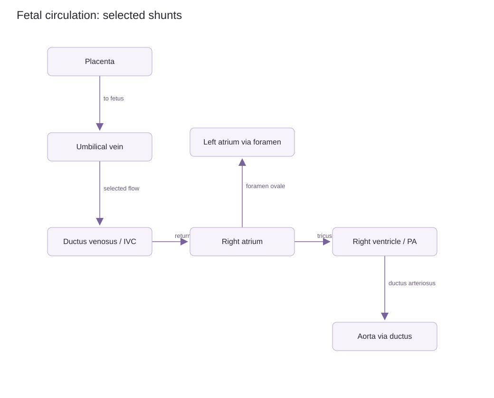

### 확인 문제

제대동맥이란 명칭은 무엇을 기준으로 하는가?

A. 산소가 항상 많은 혈액
B. 태아 심장에서 나가는 방향

**정답: B**

동맥과 정맥은 흐름 방향에 따른 이름이다.

**오답 해설**

A: 산소 함량은 태아순환에서 일반 성인 도식과 다를 수 있다.

## 신생아 빌리루빈 대사와 황달

### 학습목표

- 빌리루빈 생성·포합·배설을 설명한다
- 신생아의 비포합 빌리루빈 증가 요인을 구별한다
- 총수치와 신경독성 위험 및 담즙정체를 구분한다

### 헤모글로빈에서 담즙색소로

빌리루빈(bilirubin)은 헴의 분해 과정에서 만들어지는 색소이다. 노화하거나 손상된 적혈구의 처리 등으로 생긴 헴은 빌리베르딘을 거쳐 빌리루빈으로 전환된다. 비포합 빌리루빈(unconjugated bilirubin)은 물에 잘 녹지 않아 혈중에서 주로 알부민과 결합하여 운반된다. 간세포는 이를 받아들여 글루쿠론산 포합을 통해 수용성을 높인 뒤 담즙으로 배출한다. 생성이 늘거나 간의 처리와 배설이 감소하면 혈중 수치가 높아질 수 있다.

신생아는 적혈구 양과 수명, 출생 후 대사 전환, 간의 포합 기능이 성인과 다르다. 이 때문에 생리적인 출생 후 변화만으로도 빌리루빈이 상승할 수 있다. 그러나 신생아에게 흔하다는 사실은 모든 황달이 생리적이라는 뜻이 아니다. 용혈, 출혈의 흡수, 감염, 간담도 질환, 대사질환과 섭취 부족 등은 서로 다른 기전으로 수치를 높인다. 언제 시작했고 얼마나 빠르게 증가하며 어떤 분획이 증가하는지를 알아야 원인을 구별할 수 있다.

### 생성 증가와 장간순환

면역성 용혈이나 적혈구 효소·막의 이상은 적혈구 파괴와 빌리루빈 생성을 증가시킬 수 있다. 큰 멍이나 두혈종에서 혈액이 흡수되는 과정도 헴 분해 부담을 높인다. 빈혈이 뚜렷하지 않다고 모든 용혈을 배제할 수는 없으며, 혈액형과 면역검사, 망상적혈구, 말초혈액 소견 등을 상황에 따라 함께 해석한다. 한 검사에서 이상이 없다는 이유로 빠른 수치 상승의 원인을 생리적 변화로 단정하지 않는다.

장으로 배출된 포합 빌리루빈은 탈포합된 뒤 다시 흡수될 수 있어 장간순환이 형성된다. 초기 수유가 충분하지 않아 장 통과와 배변이 감소하면 이 재흡수와 탈수 등이 황달에 기여할 수 있다. 충분한 섭취 여부는 수유 횟수 하나보다 실제 젖 전달, 체중 변화, 소변과 대변 양상 등으로 평가한다. 섭취 부족과 관련된 초기 황달과 충분히 성장하는 모유수유아에서 지속될 수 있는 양상을 구별하되, 모유수유라는 사실만으로 다른 원인을 배제하지 않는다.

### 포합 기능과 담즙정체

포합효소의 성숙, 간세포의 유입과 배출 기능은 빌리루빈 처리에 관여한다. 비포합 빌리루빈 상승과 포합 빌리루빈 상승은 원인과 위험의 방향이 다를 수 있다. 담즙정체에서는 담즙 배출이 방해되어 직접반응 또는 포합 분획이 증가할 수 있고, 이는 단순한 생리적 황달로 다루어서는 안 되는 단서이다. 무담즙성 옅은 변과 진한 소변, 간비대와 성장 문제는 간담도 평가의 중요성을 높인다.

검사에서 말하는 직접반응 빌리루빈(direct-reacting bilirubin)은 측정법상의 범주이므로 순수한 포합 빌리루빈과 완전히 같은 물질 집합을 의미하지 않을 수 있다. 총 빌리루빈만으로 분획과 원인을 알 수 없고, 피부 색만으로도 정확한 혈중 농도를 알 수 없다. 경피 측정은 상황에 따라 선별과 추적에 유용하지만 높은 값이나 치료 판단이 필요한 상황에서는 혈청 측정과 임상 평가가 중요하다. 검사법과 시점이 다른 값을 단순한 연속 숫자로만 비교하지 않는다.

### 빌리루빈과 신경계

비포합 빌리루빈의 신경독성은 총수치 하나로만 결정되지 않는다. 알부민에 결합하지 않은 분획, 결합 능력과 약물의 영향, 미숙성과 전신 상태, 감염과 임상적 불안정 등이 위험에 관여한다. 총수치가 같아도 환자별 위험이 다른 배경이다. 높은 비포합 빌리루빈이 중추신경계에 독성을 미치면 급성 빌리루빈뇌병증이 발생할 수 있고, 심한 손상 뒤에는 운동과 청각 기능 등에 지속적인 장애가 남을 수 있다.

초기 신경학적 변화는 수유 저하나 처짐처럼 비특이적으로 보일 수 있고, 진행하면 근긴장과 자세, 울음 등에서 이상이 나타날 수 있다. 이런 소견을 기다렸다 치료를 결정하는 것이 예방의 목적은 아니다. 재태연령과 생후 시간, 수치의 경과, 동반 위험을 이용하여 신경 손상이 발생하기 전에 개입할 필요성을 판단한다. 치료 기준이 생후 일수 하나나 모든 신생아에게 동일한 고정 수치로 정해지지 않는 이유이다.

### 광선치료의 원리와 경과

광선치료(phototherapy)는 피부에 도달한 빛으로 빌리루빈의 구조와 광화학적 성질을 바꾸어 간의 포합에 덜 의존하는 제거 경로를 만든다. 몸을 따뜻하게 하거나 황색을 눈에 덜 보이게 하는 치료가 아니다. 효과는 빛의 파장과 조사 강도, 노출된 피부 면적, 실제 치료 시간 등에 영향을 받는다. 생성 속도가 매우 빠르면 적절한 광선치료 중에도 수치가 올라갈 수 있어 반응만 보지 않고 용혈과 다른 원인을 함께 평가해야 한다.

치료 뒤 수치가 떨어졌다는 사실과 다시 상승할 위험이 사라졌다는 사실은 다르다. 치료를 시작한 시점과 용혈 여부, 재태연령, 치료 중단 시 수치와 경과는 추적 계획에 영향을 준다. 퇴원 후에도 수유와 체중, 황달 진행, 추적 측정 가능성을 함께 고려한다. 신생아 황달은 간의 대사 성숙이라는 정상 생리, 적혈구와 면역학, 수유와 장 기능, 신경독성이라는 여러 영역을 연결하여 이해해야 하는 임상 문제이다.

### 확인 문제

신생아 황달의 위험을 총 빌리루빈 하나로 결정하기 어려운 이유는?

A. 모든 황달은 생리적이므로 검사가 필요하지 않기 때문이다.
B. 광선치료는 빌리루빈을 늘려 작용하기 때문이다.
C. 생후 시간, 재태연령, 결합 능력과 전신 상태 등이 위험에 관여하기 때문이다.

**정답: C**

수치의 경과와 분획 및 환자별 위험을 함께 평가하며 광선치료는 빌리루빈의 제거 경로를 변화시킨다.

**오답 해설**

A: 용혈·감염·담즙정체 등 병적 원인을 구별해야 한다.

B: 광선치료는 빌리루빈의 광화학적 변화를 통해 제거를 돕는다.

# 신경과학 및 임상신경학

## 뇌졸중에서의 병변 국소화

### 학습목표

- 피질·뇌간·소뇌 징후를 구분한다.
- 혈관영역과 신경기능을 연결한다.
- 국소화와 재관류 적합성 판단의 차이를 설명한다.

### 먼저 증후군을 정의하기

뇌졸중(stroke)은 급성 뇌혈관 장애로 발생하는 신경학적 손상을 포함한다. 허혈과 출혈은 원인과 치료가 다르므로 증상만으로 구분하지 않는다. 진찰의 첫 목표는 의식, 언어, 시야, 안구운동, 얼굴과 팔다리 운동·감각, 협응과 보행을 통해 손상 위치를 가설화하는 것이다. 갑작스러운 발병과 최대 증상 시점, 변동과 진행 여부는 중요하지만 대사장애, 발작 후 상태, 편두통 등 유사 증상도 고려해야 한다.

피질척수로의 많은 섬유는 아래쪽 연수에서 교차하므로 대뇌반구의 운동경로 손상은 흔히 반대쪽 팔다리 약화를 만든다. 그러나 얼굴과 몸의 징후 조합, 감각, 피질 기능과 뇌신경 소견을 함께 보아야 병변 높이를 추정할 수 있다. 약화의 좌우만으로 혈관 이름을 확정하지 않는다. 깊은 관통동맥 영역의 작은 병변도 밀집된 신경로를 손상시켜 큰 기능장애를 일으킬 수 있다.

### 전방순환과 피질 기능

중대뇌동맥(middle cerebral artery, MCA) 영역 손상에서는 얼굴·팔의 운동 및 감각 이상이 다리보다 두드러질 수 있고, 우성반구에서는 실어증이 나타날 수 있다. 비우성반구 손상에서는 편측무시나 공간 처리 장애가 중요한 단서가 된다. 실어증은 언어 체계의 장애이고 구음장애는 발음 운동의 장애이므로 질문 이해, 이름대기, 반복, 유창성을 따로 평가한다. 의식 저하나 청력·언어 장벽도 검사 결과에 영향을 줄 수 있다.

앞대뇌동맥(anterior cerebral artery, ACA) 영역은 안쪽 전두·두정면의 기능과 연결되어 다리 우세 약화나 행동 변화가 나타날 수 있다. 뒤대뇌동맥(posterior cerebral artery, PCA) 영역에서는 시각피질과 시상 등 침범 부위에 따라 시야 장애와 여러 신경학적 소견이 가능하다. 혈관 공급은 변이와 측부순환을 가지므로 표준 영역 지도는 확률적 안내다.

### 후방순환과 교차 징후

뇌간에는 뇌신경핵과 장경로가 가까이 모여 있어 같은 쪽 뇌신경 소견과 반대쪽 몸의 운동·감각 이상이 함께 나타날 수 있다. 이러한 교차 징후는 뇌간 국소화에 도움이 되지만 모든 병변이 교과서적 조합을 완전히 보이는 것은 아니다. 복시, 구음장애, 삼킴장애, 심한 실조와 안진을 동반한 어지럼은 후방순환 평가에서 중요하다. 어지럼을 한 가지 증상만으로 말초성이라고 단정하면 위험한 병변을 놓칠 수 있다.

소뇌 손상은 근력 저하보다 측정장애, 운동분해, 자세와 보행 불안정 등이 두드러질 수 있다. 감각성 실조와 전정성 장애도 비슷한 불안정을 만들 수 있어 눈을 뜨고 감은 상태, 고유감각, 안구운동을 함께 평가한다. 소뇌 부종은 좁은 뒤머리오목에서 뇌간과 뇌척수액 흐름에 영향을 줄 수 있으므로 초기 기능장애 정도만으로 경과를 가볍게 보지 않는다. 국소화는 해부를 임상 경과의 위험과 연결하는 도구다.

### 영상과 치료 판단의 별도 축

급성 평가에서는 출혈과 큰혈관 폐색, 조기 허혈 변화 및 상황에 따른 구제 가능한 조직 평가가 중요하다. 마지막 정상 확인 시점, 영상, 신경학적 중증도, 출혈 위험과 동반질환은 재관류 치료 적합성 판단에 관여한다. 증상이 특정 혈관과 맞는다는 사실만으로 혈전용해나 혈전제거술 적응을 확정할 수 없다.

### 확인 문제

실어증과 구음장애는 같은가?

A. 다르다.
B. 같다.

**정답: A**

언어 체계와 발음 운동의 장애를 구분한다.

**오답 해설**

B: 구음만으로 이해·명명·반복 기능을 대변하지 못한다.

# 정신건강의학

## 정신상태검사의 기술과 해석

### 학습목표

- 기분과 정동, 사고과정과 사고내용을 구분한다.
- 인지·지각·병식의 관찰을 체계적으로 기술한다.
- 의학적 원인과 정신과적 증상의 관계를 평가한다.

### 관찰과 면담을 통합하기

정신상태검사(mental status examination)는 면담 당시의 행동과 경험, 인지 기능을 체계적으로 기술하는 진찰이다. 정신과적 병력은 시간에 따른 경과를 제공하고 정신상태검사는 그 시점의 단면을 제공한다. 증상이 변동하면 반복 관찰이 필요하다. 외모와 위생, 자세, 눈맞춤, 협조와 운동 활동은 유용한 정보지만 문화와 환경, 신체장애 및 불편의 영향을 받는다. 관찰한 행동과 그 행동에 대한 해석을 구분하여 기록한다.

말은 양, 속도, 음량, 자발성과 응답 지연, 발음과 이해 등을 나누어 평가한다. 발화가 적다고 사고가 반드시 적은 것은 아니며, 언어 장벽과 청력 문제, 진정성 약물과 신경학적 질환이 영향을 줄 수 있다. 면담을 방해하는 요인을 먼저 확인하고 통역이나 의사소통 지원을 적용하면 평가의 정확도가 달라진다. 환자의 독특한 말은 가능하면 구체적인 예로 기록하여 막연한 형용사만으로 분류하지 않는다.

### 기분과 정동

기분(mood)은 환자가 보고하는 비교적 지속적인 감정 상태이고, 정동(affect)은 면담 중 관찰되는 감정 표현이다. 정동의 범위와 강도, 반응성과 안정성, 말하는 내용과의 적합성을 기술한다. 환자가 슬픔을 보고하지만 표정이 밝게 보인다는 한 소견으로 진술이 거짓이라고 판단하지 않는다. 감정 표현은 개인과 문화에 따라 다르며 일부는 불편을 감추거나 긴장으로 웃을 수 있다.

불안과 우울, 과민성과 고양된 기분을 평가할 때에는 수면, 에너지, 흥미, 집중과 기능 변화 및 시간 경과를 연결한다. 수면 시간이 줄었다는 사실과 잠이 거의 필요하지 않다고 느끼는 상태는 다르다. 식욕·체중과 활동 변화도 신체질환과 약물의 영향을 받을 수 있다. 증상 묶음과 기간, 기능 손상, 다른 원인에 대한 평가가 진단의 근거가 된다.

### 사고의 흐름과 내용

사고과정(thought process)은 생각이 연결되고 표현되는 방식이다. 목표 지향성, 연상의 연결, 우회성과 이탈, 사고차단 등을 관찰한다. 말이 장황하지만 결국 질문에 답하는 경우와 질문의 중심으로 돌아오지 않는 경우는 구분한다. 빠른 말이나 산만함은 여러 상태에서 나타날 수 있으므로 단일 표현만으로 조증이나 정신병적 장애를 확정하지 않는다.

사고내용(thought content)에는 걱정, 집착, 강박사고와 망상, 자해·타해 관련 생각 등이 포함된다. 망상은 문화적·사회적 맥락에서 공유되는 신념과 구분하고, 믿음의 확신도와 수정 가능성, 행동에 미치는 영향을 평가한다. 강박사고는 원치 않는 생각이나 충동이 반복되는 경험으로, 이에 대한 저항과 통찰의 정도는 다양하다. 자해 위험은 생각의 유무 외에 의도, 구체성, 수단 접근성, 과거 행동과 보호요인 등을 직접적이고 비판하지 않는 질문으로 평가한다.

### 지각과 인지

환각(hallucination)은 대응하는 외부 자극 없이 나타나는 지각 경험이고, 착각(illusion)은 실제 자극을 잘못 해석한 경험이다. 수면 전후 경험과 감각장애, 물질 및 의학적 질환도 감별에 포함된다. 어떤 감각 양식인지, 발생 상황과 빈도, 명령 내용이나 위협감 및 반응을 구체화한다. 환각이 있다는 사실만으로 특정 정신질환에 독점적으로 대응시키지 않는다.

의식 수준과 주의는 인지검사 해석의 바탕이다. 지남력, 등록과 회상, 언어, 집행기능과 시공간 능력은 서로 다른 기능을 평가한다. 급성으로 변동하는 주의장애와 의식 변화는 섬망 등 의학적 원인을 우선 검토하게 하는 단서다. 교육 수준과 언어, 감각장애는 검사 수행에 영향을 주므로 점수만으로 인지장애를 확정하지 않는다. 이전 기능과 현재의 일상생활 변화를 함께 확인한다.

### 병식과 판단

병식(insight)은 자신의 경험과 문제, 치료 필요성을 이해하는 여러 측면을 포함한다. 환자가 진단명에 동의하지 않는다는 이유만으로 병식이 전혀 없다고 단정하지 않는다. 판단력(judgment)은 실제 상황에서 선택과 결과를 고려하는 능력으로, 가상 질문에 대한 답과 실제 행동을 함께 살핀다. 의사결정능력은 특정 결정에 대해 별도로 평가해야 하며 정신질환 진단만으로 일괄 상실을 가정하지 않는다.

결과는 관찰 사실과 환자 보고, 검사 수행 및 추론을 구분해 정리한다. 정신상태검사가 정상으로 보였다는 것은 모든 과거 증상이나 위험이 없다는 뜻이 아니다. 환자 동의와 상황에 맞게 가족 및 기존 기록 등 추가 정보를 확인하고, 신체진찰과 필요한 검사로 의학적 원인을 함께 평가한다.

### 확인 문제

기분과 정동의 기본 구분은?

A. 환자 보고와 관찰된 감정 표현
B. 동일한 뜻의 표현

**정답: A**

기분은 보고되는 상태를, 정동은 관찰되는 표현을 기술한다.

**오답 해설**

B: 두 정보는 관련되지만 불일치도 가능하다.

# 피부과학

## 피부병변의 형태와 분포

### 학습목표

- 일차병변과 이차변화를 구분한다.
- 형태·배열·분포를 통합해 기술한다.
- 관찰 소견에서 감별진단을 구성한다.

### 병명보다 먼저 형태를 기술한다

피부병변은 형태, 색, 크기와 경계, 표면과 촉감, 배열과 분포를 조합하여 기록한다. 같은 질환도 시기와 부위, 치료 및 긁음에 따라 모양이 달라지고, 다른 질환이 비슷한 형태를 만들 수 있다. 병변이 처음 생긴 모습과 이후 변화를 구분하면 감염, 염증과 종양의 감별에 도움이 된다. 병력을 들을 때에는 발생 부위와 시간, 확산 양상, 가려움과 통증, 접촉물질·약물·전신증상을 확인한다.

피부색에 따라 홍반과 자반, 창백의 시각적 표현이 달라질 수 있다. 조명과 주변 정상 피부를 확인하고 열감과 부종, 압통 및 촉진 소견을 함께 평가한다. 사진은 크기 기준과 촬영 조건, 위치 정보가 없으면 비교에 제한이 있다. 색 하나만으로 염증이나 산소화 상태를 판정하지 않는다.

### 일차병변

반점(macule)은 만져지는 융기 없이 색이 달라진 병변이다. 구진(papule)은 고형의 융기이며, 판(plaque)은 넓게 솟은 병변을 설명한다. 결절(nodule)은 보다 깊은 진피나 피하 조직까지 포함할 수 있는 고형 병변이다. 용어별 크기 경계는 문헌과 분류 관례에 차이가 있으므로 실제 크기를 단위와 함께 적는 것이 유용하다. 표면의 넓이와 조직 안의 깊이는 별도로 평가한다.

소수포(vesicle)와 대수포(bulla)는 액체를 포함한 병변이며 농포(pustule)는 고름성 내용물을 가진다. 농포가 있다는 사실만으로 세균감염을 확정할 수는 없다. 팽진(wheal)은 진피 부종에 의한 일시적인 융기로 위치와 형태가 변할 수 있다. 한 부위의 병변이 얼마나 지속되는지 묻는 것은 두드러기와 비슷하게 보이는 다른 염증을 구분하는 데 도움이 된다.

### 이차변화와 피부 깊이

인설(scale)은 각질의 탈락이 두드러진 표면 변화이고, 가피(crust)는 삼출액이나 혈액 등이 마르면서 형성된다. 미란(erosion)은 표피의 소실을, 궤양(ulcer)은 더 깊은 조직 손실을 포함한다. 손상이 진피를 침범하면 회복 후 흉터가 남을 가능성과 연관된다. 긁음 자국, 균열, 태선화와 위축도 원래 병변과 행동 및 만성 경과를 해석하는 단서다.

수포가 터진 뒤에는 액체가 담긴 구조가 사라지고 미란과 가피만 남을 수 있다. 장기간 긁은 병변에서는 일차 형태보다 두꺼워진 피부와 긁힌 흔적이 두드러질 수 있다. 따라서 현재 모양만으로 발생 순서를 뒤집어 추론하지 않도록 초기 사진과 병력을 참고한다. 표면 병변 외에 점막과 손발톱, 털의 변화도 질환 범위를 규정한다.

### 배열과 분포

선형 배열은 외부 접촉, 긁음과 발생학적 분포 등 여러 기전에서 나타날 수 있다. 환상 병변은 가장자리의 활동성과 인설, 중심부 변화에 따라 감별이 달라진다. 군집성, 망상, 표적 모양 등은 형태학적 기술이며 그 자체가 확진명은 아니다. 병변을 눌렀을 때 색이 사라지는지 관찰하면 혈관 확장과 혈관 밖 출혈을 구분하는 데 도움을 받을 수 있다.

노출부와 가려지는 부위, 굴측과 신측, 피부주름과 말단, 좌우 대칭성을 살핀다. 신경분절을 따르는 수포는 신경 분포와 연결되지만 면역 상태와 전신 확산 여부도 평가한다. 약물발진이 의심되면 시작과 증량, 중단 이후 변화 및 다른 원인을 시간축으로 정리한다. 전신 질환의 피부 소견에서는 발열과 점막 침범, 피부 통증과 수포·박리, 순환 상태 등 동반 소견이 중증도 판단에 중요하다.

### 검체 선택

곰팡이 검사를 위한 인설 채취, 세균·바이러스 검체와 피부생검은 서로 다른 질문에 답한다. 생검은 병변의 나이와 부위, 깊이, 기존 치료에 따라 진단 수율이 달라질 수 있다. 면역형광 검사가 필요한 경우에는 검체 위치와 보관 방식도 따로 고려한다. 임상 사진과 분포, 감별진단을 병리 의뢰에 전달하면 조직 소견을 적절한 맥락에서 해석하는 데 도움이 된다.

### 확인 문제

농포가 보이면 세균감염이 확진되는가?

A. 그렇다.
B. 아니다.

**정답: B**

고름성 내용물은 여러 염증 과정에서 나타날 수 있다.

**오답 해설**

A: 형태 소견과 병인 확정은 다른 판단이다.

# 안과학

## 안구 광학·망막과 시각경로

### 학습목표

- 각막·수정체·망막의 역할을 연결한다.
- 시야와 망막 투사의 방향을 설명한다.
- 구심성 동공경로와 시각 인식을 구분한다.

### 빛을 망막에 모으기

각막과 수정체는 들어오는 빛을 굴절시켜 망막에 상을 형성한다. 각막은 공기와의 굴절률 차이 때문에 큰 굴절력을 제공하고, 수정체는 모양을 바꾸어 가까운 물체에 초점을 맞추는 조절(accommodation)에 기여한다. 섬모체근과 소대, 수정체의 탄성은 이 과정에서 연결된다. 노화로 조절 능력이 감소하는 노안과 수정체 혼탁으로 빛이 산란하는 백내장은 기전이 다르다.

근시는 눈의 굴절계에 비해 망막 위치가 뒤에 있거나 굴절력이 커 먼 물체의 초점이 망막 앞에 맺히는 상태로 설명한다. 원시와 난시는 다른 광학적 불일치를 가진다. 시력 저하가 굴절 이상으로 설명되는지 확인하려면 교정 상태와 검사 조건을 고려한다. 핀홀을 통한 개선은 굴절 관련 원인을 시사할 수 있지만 모든 안질환을 배제하는 검사는 아니다.

### 망막의 신호 변환

빛은 망막의 여러 층을 지나 광수용체에 도달하고, 광수용체에서 시작된 신호는 양극세포와 신경절세포 등으로 전달된다. 가로세포와 무축삭세포는 주변 정보와 시간·공간 대비 처리에 관여한다. 중심오목은 정밀 시각과 연결되고 주변 망막은 다른 시각 기능에 기여한다. 막대세포와 원뿔세포는 광민감도와 색각, 분포가 달라 어두운 환경과 중심 시력의 특성이 구분된다.

광수용체는 빛을 받으면 일반적인 신경세포의 단순 흥분 그림과 달리 과분극하는 방향으로 반응한다. 광색소와 transducin, phosphodiesterase를 거쳐 cGMP 농도가 감소하면 양이온 통로의 개방이 줄어든다. 이에 따른 전달물질 방출 변화는 ON·OFF 양극세포 경로에서 서로 다르게 해석된다. 망막은 빛의 위치를 그대로 전달하기만 하는 수동 스크린이 아니라 초기 시각 처리를 수행하는 신경조직이다.

### 시야의 투사와 교차

왼쪽 시야는 두 눈의 오른쪽 망막에, 위쪽 시야는 아래쪽 망막에 투사된다. 각 눈의 코쪽 망막 신경절세포 축삭은 시각교차에서 교차하고 관자쪽 망막 축삭은 같은 쪽으로 진행한다. 그 결과 한쪽 시각로는 주로 반대쪽 시야 정보를 전달한다. 한 눈의 문제와 두 눈에서 같은 쪽 시야가 손상되는 문제를 구분하면 시각교차 앞뒤의 병변 위치를 추정할 수 있다.

시각교차의 중심부 손상은 양쪽 코쪽 망막의 교차 섬유에 영향을 주어 양관자쪽 시야 장애를 만들 수 있다. 시각교차 뒤 병변은 동측성 반맹 등으로 나타날 수 있으며, 시각부챗살의 주행과 피질의 배열에 따라 사분맹 등 다른 패턴이 가능하다. 실제 검사에서는 주시와 협조, 굴절과 망막 상태를 확인하고 시야 결손을 해부학과 연결한다. 시력과 시야는 서로 다른 기능이므로 한쪽이 보존되었다고 다른 쪽이 정상이라는 뜻은 아니다.

### 동공과 진찰의 통합

빛반사의 구심경로는 망막과 시신경을 통해 중간뇌의 관련 회로에 도달하고, 양측 부교감 출력이 동안신경과 섬모체신경절을 거쳐 동공 수축에 관여한다. 이 경로는 시각피질에서 의식적으로 보는 과정과 완전히 같지 않다. 상대구심동공운동장애는 양쪽 구심 입력의 비대칭을 나타내며 동공 크기 차이 자체와 구분한다. 산동과 축동을 해석할 때는 약물과 자율신경, 홍채 상태도 고려한다.

시력, 동공, 안구운동과 안압, 앞부분과 안저 검사는 서로 보완적이다. 급성 시력 소실에서 통증 유무와 시간 경과, 단안 또는 양안, 신경학적 증상이 감별에 중요하다. 빨간 눈이라는 표면 소견만으로 결막의 경한 질환으로 결론내리지 않고 각막과 전방, 안압 및 시력을 함께 평가한다. 매체가 혼탁하여 안저를 볼 수 없다는 결과는 망막을 정상으로 확인한 것과 다르다.

### 확인 문제

빛을 받은 광수용체의 전형적 전위 변화는?

A. 과분극
B. 항상 활동전위 폭발

**정답: A**

cGMP 감소와 양이온 통로 개방 감소가 과분극을 만든다.

**오답 해설**

B: 광수용체 신호를 일반적인 활동전위 그림과 동일시하면 안 된다.

# 이비인후과학

## 청각 전달과 난청의 분류

### 학습목표

- 외이·중이·내이의 역할을 구분한다.
- 유모세포의 기계전기 변환을 설명한다.
- 전음성·감각신경성 난청과 청력검사를 연결한다.

### 공기의 진동을 내이로 전달하기

외이도는 소리를 고막에 전달하고, 중이의 이소골은 고막의 진동을 등자뼈 발판을 통해 안뜰창으로 전달한다. 중이 구조는 공기와 내이 액체 사이의 임피던스 차이로 생기는 전달 손실을 줄이는 데 기여한다. 고막과 이소골의 움직임이 제한되면 내이가 보존되어도 청력 저하가 생길 수 있다. 이관은 중이와 코인두를 연결하여 환기와 압력 조절에 관여하며, 기능 이상은 중이 질환과 연결된다.

소리는 시간에 따른 압력 변화이며 주파수와 강도, 복합 파형을 가진다. 주파수는 음높이와 관련되고 소리 강도의 표시는 로그 척도를 사용한다. 청력검사에서 사용하는 dB HL은 주파수별 기준 역치를 반영하는 척도로 물리적 음압의 dB SPL과 같은 숫자로 직접 대응하지 않는다. 검사 결과를 읽을 때 축과 단위, 측정 조건을 확인해야 한다.

### 달팽이관의 주파수 분석

기저막은 위치별 기계적 성질이 달라 높은 주파수에 대한 반응은 바닥쪽에서, 낮은 주파수 반응은 꼭대기쪽에서 두드러진다. 이러한 위치 배열은 청각경로의 주파수 지도를 형성하는 토대다. Corti 기관의 유모세포 다발이 휘어지면 기계적으로 조절되는 통로가 열리고 전기적 반응으로 전환된다. 내림프의 이온 환경과 전위는 이 반응을 가능하게 하는 중요한 조건이다.

속유모세포는 청각 구심 신호 전달에, 바깥유모세포는 기계적 증폭과 주파수 선택성에 중요한 역할을 한다. 유모세포 손상은 같은 소리 역치 변화 외에도 말소리 구분과 소음 속 청취에 영향을 줄 수 있다. 이음향방사(otoacoustic emission)는 바깥유모세포 기능과 관련된 정보를 제공하지만 이를 단독으로 청각 전체의 정상 판정으로 사용할 수는 없다. 중이 전달 상태와 검사 환경도 측정에 영향을 준다.

### 전음성과 감각신경성 난청

전음성 난청(conductive hearing loss)은 외이·중이를 통한 전달 장애와 관련되고, 감각신경성 난청(sensorineural hearing loss)은 달팽이관과 청각신경 경로의 장애를 포함한다. 두 성분이 함께 있으면 혼합성 난청이다. 귀지와 고막·중이 질환, 이소골 문제는 전음성 원인의 예이고, 소음과 노화 및 일부 약물, 내이·신경 질환은 감각신경성 원인이 될 수 있다. 난청의 좌우와 발병 속도는 원인과 평가의 시급성을 바꾼다.

순음청력검사는 공기전도와 뼈전도 역치를 비교한다. 적절한 조건에서 공기-뼈 차이는 전음 성분을 시사하며, 뼈전도도 떨어지면 내이 이후의 성분을 고려한다. 반대쪽 귀로 소리가 전달될 수 있어 차폐(masking)가 필요한 상황이 있다. 어음청력검사는 소리의 검출 외에 말소리 인지 능력에 관한 정보를 제공한다. 역치와 어음인지가 불일치하면 검사 신뢰성과 원인 병변을 함께 검토한다.

### 진찰과 추가 검사

이경검사는 외이도와 고막의 상태를 확인하고, 고실도검사는 중이의 압력·순응 특성을 평가한다. Rinne와 Weber 음차검사는 전음과 감각신경 성분의 비대칭을 추정하는 침상검사지만 정밀 청력검사를 대신하지는 못한다. 검사 음차의 주파수와 기술, 난청의 정도와 양측성에 따라 해석의 한계가 생길 수 있다. 고막이 정상으로 보여도 내이와 신경 질환은 남아 있을 수 있다.

갑작스러운 청력 변화에서는 귀 먹먹함만 보고 단순 이관 문제로 판단하지 않고 실제 청력과 내이·신경 증상을 평가한다. 이명은 난청과 함께 나타날 수 있지만 하나의 원인만을 뜻하지 않으며, 박동성과 신경학적 동반 증상 등 특성에 따라 감별이 달라진다. 소아에서는 청각 문제가 언어발달에 영향을 줄 수 있어 보호자 관찰과 발달, 선별 및 확진검사를 연결하는 평가가 필요하다.

### 확인 문제

공기전도와 뼈전도 역치의 비교가 주로 돕는 구분은?

A. 모든 청력장애 원인의 확진
B. 전음 성분의 평가

**정답: B**

적절한 검사 조건의 공기-뼈 차이는 전달 장애를 시사한다.

**오답 해설**

A: 정확한 원인과 전체 경로는 다른 검사 및 임상상과 통합한다.

# 응급의학

## 산소화·환기·산소운반의 구별

### 학습목표

- 산소분압과 산소함량 및 산소운반량을 구별한다
- 분당환기와 폐포환기의 차이를 설명한다
- 정상 산소포화도에서 조직 저산소증이 발생하는 기전을 설명한다

### 서로 다른 생리변수

산소화(oxygenation)는 폐에서 산소가 혈액으로 이동하여 동맥혈이 산소를 얻는 과정이다. 환기(ventilation)는 공기가 폐로 드나들어 산소를 공급하고 이산화탄소를 제거하는 과정이다. 산소운반(oxygen delivery)은 혈액이 조직에 산소를 가져가는 과정이다. 이 세 과정은 연결되어 있지만 같은 변수로 측정되지 않는다. 산소를 투여하여 동맥혈 산소포화도를 높여도 폐포환기가 부족하면 이산화탄소가 축적될 수 있다. 산소화가 충분해도 빈혈이나 저심박출량이 심하면 조직에 전달되는 산소가 부족할 수 있다.

동맥혈 산소분압(PaO2)은 혈액에 녹아 있는 산소의 분압이다. 헤모글로빈에 결합한 산소의 총량을 직접 나타내지 않는다. 산소포화도(SaO2)는 산소와 결합한 헤모글로빈의 비율과 관련된 값이고, 동맥혈 산소함량(CaO2)은 혈액 단위 부피에 들어 있는 산소량이다. 일반적인 조건에서 산소의 대부분은 헤모글로빈에 결합한 상태로 운반되므로 혈액의 산소함량은 헤모글로빈 농도의 영향을 크게 받는다. 산소분압이 정상이라는 사실만으로 산소함량이 정상이라고 결론지을 수 없다.

### 산소함량과 단위

동맥혈 산소함량은 흔히 CaO2 = 1.34 × Hb × SaO2 + 0.003 × PaO2로 근사한다. Hb의 단위는 g/dL, SaO2는 0에서 1 사이의 분율, PaO2는 mmHg이며 결과는 mL O2/dL이다. 1.34는 임상 계산에 사용하는 헤모글로빈 1g당 산소결합량의 근삿값이고, 0.003은 혈액에서 산소의 용해와 관련된 계수이다. 포화도 98%를 계산식에 넣을 때 98을 그대로 넣으면 100배의 오류가 생긴다. 계수의 값만 외우지 않고 단위를 함께 다루어야 한다.

헤모글로빈이 15g/dL이고 포화도가 0.98이라면 결합 산소만 약 19.7mL/dL이다. 산소분압이 100mmHg일 때 용해 산소의 기여는 약 0.3mL/dL이다. 헤모글로빈이 절반으로 감소하고 포화도와 산소분압이 같다면 결합 산소도 거의 절반으로 감소한다. 맥박산소측정기가 정상에 가까운 수치를 보여도 심한 빈혈이 조직 산소 공급을 위협할 수 있는 이유이다. 이 계산은 이상헤모글로빈이나 측정법의 문제가 있는 상황에서는 추가 해석이 필요하다.

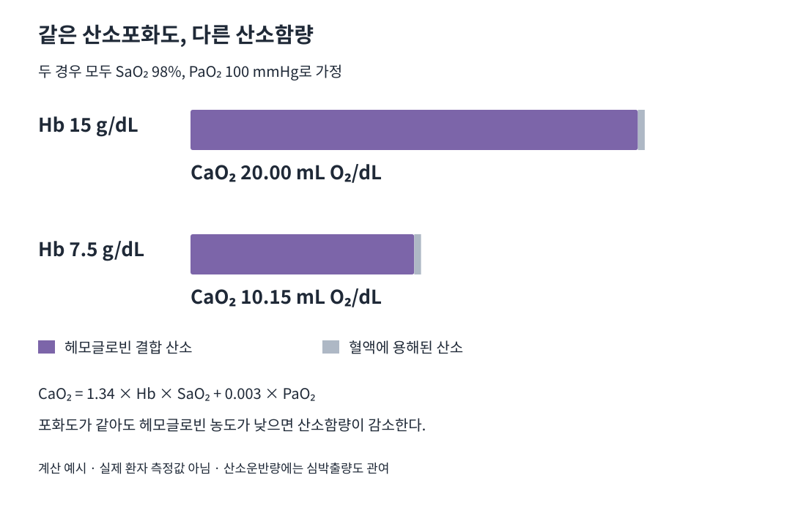

산소운반량(DO2)은 심박출량과 동맥혈 산소함량의 곱이다. 심박출량을 L/min, 산소함량을 mL/dL로 사용하면 DO2 = CO × CaO2 × 10으로 단위를 맞춘다. 예를 들어 심박출량 5L/min과 산소함량 20mL/dL은 약 1,000mL/min의 산소운반량을 만든다. 이는 전신에 운반하는 양이지 전신이 모두 소비한 양은 아니다. 실제 산소소비량(VO2)은 심박출량과 동정맥 산소함량 차이를 이용한 Fick 원리로 연결되며, 이때에도 부피 단위 변환이 필요하다.

### 조직의 추출과 미세순환

조직은 운반된 산소의 일부를 추출한다. 공급이 줄면 추출률을 높여 산소소비를 일정 범위에서 유지할 수 있지만 그 능력에는 한계가 있다. 산소운반량이 더 감소하여 수요를 충족하지 못하면 산화적 인산화가 제한되고 세포 기능이 손상된다. 전신 평균값이 충분해 보여도 특정 장기의 혈류가 줄거나 미세혈관에서 분포가 불균일하면 국소 저산소증이 발생할 수 있다. 혈압과 전신 심박출량을 확인하는 것만으로 모든 조직의 미세순환을 직접 측정한 것은 아니다.

정맥혈 산소포화도는 산소 공급과 소비의 균형에 대한 간접 정보를 준다. 낮은 값은 추출이 증가한 상황에서 나타날 수 있지만 높은 값이 언제나 조직 상태가 양호함을 뜻하지 않는다. 미세순환의 우회, 추출 장애, 세포의 산소 이용 장애가 있으면 산소가 충분히 사용되지 않은 채 정맥으로 돌아올 수 있다. 중심정맥혈과 혼합정맥혈은 채혈 위치와 대표하는 장기 구성이 달라 동일한 검체처럼 취급하지 않는다. 단일 수치보다는 임상 소견과 시간에 따른 변화를 함께 해석한다.

### 환기와 이산화탄소

분당환기량은 일회호흡량과 호흡수의 곱이다. 그러나 일회호흡량 전체가 가스교환에 참여하는 것은 아니다. 전도기도 등의 사강(dead space)을 제외한 부분이 폐포환기에 기여한다. 단순화하면 폐포환기량은 일회호흡량에서 사강량을 뺀 뒤 호흡수를 곱한다. 같은 분당환기량이라도 얕고 빠른 호흡은 각 호흡에서 사강이 차지하는 비율을 높여 유효 폐포환기를 줄일 수 있다. 호흡수만 정상이라고 환기가 충분하다고 판단하지 않는 이유이다.

이산화탄소 생성량이 일정하고 정상상태에 가깝다면 동맥혈 이산화탄소분압(PaCO2)은 폐포환기량에 반비례한다. 저환기에서 PaCO2가 올라가며, 대사산증에 대한 보상성 과환기는 PaCO2를 낮춘다. 이산화탄소가 낮다는 결과가 항상 폐 기능이 좋다는 뜻은 아니다. 통증, 불안, 중추신경계 자극, 저산소증, 산증 등이 호흡 구동을 증가시킬 수 있다. 호기말 이산화탄소도 환기뿐 아니라 폐혈류와 사강의 영향을 받으므로 PaCO2와 항상 같지 않다.

### 응급 평가의 통합

응급환자의 호흡 평가에서는 기도 개방, 호흡 노력, 흉곽 운동, 호흡음, 의식 수준, 산소화, 환기를 함께 본다. 호흡 노력이 감소한 것은 회복일 수도 있지만 탈진이나 중추 억제의 결과일 수도 있다. 산소 투여 뒤 산소포화도가 좋아져도 의식이 나빠지고 호흡이 얕아지면 환기 장애를 재평가해야 한다. 말초 관류가 나쁘거나 움직임이 심할 때 맥박산소측정 신호의 신뢰성이 떨어질 수 있어 파형과 임상 상태를 함께 확인한다.

조직 저산소증의 치료는 손상된 단계에 맞추어야 한다. 낮은 흡입 산소나 가스교환 장애에서는 산소화 개선이 중요하고, 기도 폐쇄와 저환기에서는 환기의 확보가 필요하다. 심한 출혈이나 저심박출량에서는 순환과 산소운반 능력의 회복이 핵심이다. 젖산 상승은 산소 공급 부족의 단서가 될 수 있으나 생성 증가와 제거 감소의 다른 원인도 있어 하나의 값으로 원인을 확정할 수 없다. 산소화, 운반, 소비를 나누어 본 뒤 다시 연결하는 것이 생리학에 근거한 소생 평가이다.

### 확인 문제

정상 산소포화도에서 심한 빈혈이 위험할 수 있는 이유는?

A. 산소운반량은 심박출량과 무관하기 때문이다.
B. 헤모글로빈 농도 감소로 산소함량과 운반량이 감소할 수 있기 때문이다.
C. 포화도 98%는 헤모글로빈 농도가 항상 정상이라는 뜻이기 때문이다.

**정답: B**

산소함량은 헤모글로빈 농도와 포화도 및 용해 산소에 의존하고 운반량에는 혈류도 관여한다.

**오답 해설**

A: DO2는 심박출량과 동맥혈 산소함량의 곱에 의존한다.

C: 포화도는 결합 비율에 관한 값으로 헤모글로빈 농도를 보증하지 않는다.

# 마취통증의학

## 국소마취의 신경생리와 약물 특성

### 학습목표

- 국소마취제의 나트륨통로 차단을 설명한다
- 산도와 신경 구조가 차단에 미치는 영향을 설명한다
- 국소 효과와 전신 독성을 구별한다

### 활동전위의 전파를 멈추는 원리

국소마취제(local anesthetic)는 전압개폐성 나트륨통로의 기능을 억제하여 신경의 활동전위 생성과 전파를 제한한다. 신경섬유를 절단하거나 신경전달물질을 모두 고갈시키는 작용과 다르다. 적절한 부위에 충분한 농도가 도달하면 통증 자극이 중추로 전달되는 과정이 가역적으로 차단된다. 약물이 사라지고 통로 기능이 회복되면 전도가 돌아올 수 있다. 의식 소실은 국소마취가 성립하는 필수 조건이 아니며, 진정제나 전신마취제를 함께 쓰는 경우 그 효과를 구별하여 평가한다.

통로 차단은 약물 농도뿐 아니라 통로가 어떤 기능 상태에 있는지의 영향을 받는다. 많은 국소마취제는 열려 있거나 불활성화된 통로에 대한 결합이 유리하여 반복해서 활성화되는 신경에서 차단이 누적되는 사용의존성(use dependence)을 보인다. 신경섬유 종류와 발화 양상이 다른 조직에서 효과가 다르게 나타날 수 있는 배경이다. 같은 원리는 신경 외 조직의 전압개폐성 통로에도 영향을 줄 수 있어 전신 독성과 연결된다.

### 약물이 신경막에 도달하기까지

일반적인 국소마취제는 지용성 방향족 부분과 친수성 아민 부분이 중간 연결로 이어진 구조를 가진다. 에스터형과 아미드형의 구분은 연결부 구조에 따른 것이며 대사 경향과 이상반응을 이해하는 데 유용하다. 많은 약물은 약염기로 존재하여 비이온화형과 양이온형 사이에 평형을 이룬다. 비이온화형은 지질막을 통과하는 데 유리하고, 세포 내에서 이온화된 형태가 통로 차단에 중요하게 관여하는 모형으로 설명할 수 있다. 실제 막 투과와 결합에는 약물별 특성도 관여한다.

조직이 산성화되면 세포외에서 비이온화형의 분율이 감소하여 신경막을 통과하는 양이 줄 수 있다. 염증 부위에서 마취가 불충분할 수 있는 한 가지 이유이다. 그러나 감염 부위의 국소마취 실패를 산도 하나로만 설명할 수는 없다. 혈류 변화와 약물 제거, 통각 과민, 부종과 해부학적 접근의 어려움도 관여한다. 효과가 부족할 때 같은 부위에 약물을 반복 주입하는 것만으로 문제를 해결하려 하면 누적 전신 노출이 커질 수 있다.

말초신경은 여러 신경섬유가 결합조직 층으로 둘러싸인 구조이다. 주입한 약물은 이 장벽을 지나 목표 섬유에 도달해야 한다. 신경 주위의 분포, 해부학적 변이, 주입 위치, 농도와 용량, 국소 혈류가 효과의 시작과 범위를 바꾼다. 신경 안으로 약물을 넣는 것이 더 좋은 차단이라는 뜻은 아니며, 기계적 손상과 허혈, 약물에 의한 신경독성 위험을 함께 고려해야 한다. 해부학을 확인하는 목적은 표적에 접근하면서 손상을 줄이는 데 있다.

### 차등 차단과 임상적 평가

자율신경, 통증과 온도, 촉각과 운동 기능의 차단은 동시에 같은 정도로 나타나지 않을 수 있다. 섬유 직경, 수초, 발화 특성, 신경 내 위치, 약물 농도와 노출 길이가 감수성에 관여한다. 흔히 제시하는 차단 순서는 이해를 돕지만 모든 시술과 약물에서 절대적인 법칙은 아니다. 환자가 다리를 움직일 수 있다는 사실만으로 통증 차단이 전혀 없다고 할 수 없고, 피부의 감각 저하만으로 수술 자극에 대한 차단이 충분하다고 보장할 수도 없다.

척수강내마취와 경막외마취는 약물이 놓이는 해부학적 공간과 확산 조건이 다르다. 교감신경 차단에 따른 혈관 확장은 정맥 환류와 혈압을 낮출 수 있고, 차단 범위가 높아지면 호흡과 순환에 대한 영향이 커질 수 있다. 감각 차단 수준, 운동 기능, 의식과 호흡, 혈압과 심박수는 서로 다른 정보를 준다. 국소 또는 부위마취가 전신마취보다 항상 생리학적 영향이 작다고 일반화하지 않고 실제 차단 범위와 환자 상태를 평가한다.

### 효과 지속과 전신 노출

약물의 지용성, 단백결합, 혈류와 주입 부위는 효과 지속에 영향을 준다. 혈관수축제를 함께 사용하면 일부 상황에서 흡수가 늦어질 수 있지만, 모든 부위와 환자에서 같은 이득을 주는 것은 아니다. 총 투여량뿐 아니라 혈관 내 오주입과 빠른 흡수는 급격한 전신 농도 상승을 일으킬 수 있다. 서로 다른 국소마취제를 섞거나 여러 부위에 사용한 경우에도 각각의 이름을 별개로 보지 말고 전체 노출을 고려해야 한다.

국소마취제 전신독성(local anesthetic systemic toxicity, LAST)은 중추신경계와 심혈관계에 영향을 줄 수 있다. 입 주위 이상감각, 이명, 이상한 맛, 초조나 경련 같은 신경학적 소견이 나타날 수 있고, 전도 장애와 부정맥, 수축력 저하, 순환 붕괴가 발생할 수 있다. 전형적인 전구증상이 항상 순서대로 나타나지는 않으며 진정 또는 전신마취 상태에서는 초기 신경학적 증상을 확인하기 어려울 수 있다. 따라서 증상 설명만으로 감시를 대신할 수 없다.

효과와 위해를 함께 평가하려면 투여 시점, 약물 종류와 총량, 주입 위치, 병용 약물, 간 기능과 심장 상태를 기록해야 한다. 시술 뒤 새로 발생한 신경학적 이상이 약물 효과인지, 신경 손상이나 혈종 등 다른 합병증인지도 구별해야 한다. 약물의 정상적인 소실에 맞추어 기능이 돌아오는지 시간경과를 관찰하는 것이 중요하다. 국소마취의 원리는 단순한 통증 감각 차단이지만 안전한 적용은 신경해부, 전기생리, 약동학과 전신 생리를 함께 요구한다.

### 확인 문제

염증 부위의 국소마취가 불충분할 수 있는 한 이유는?

A. 국소마취제는 신경을 영구 절단해야 작용하기 때문이다.
B. 국소마취는 의식 소실이 있어야만 성립하기 때문이다.
C. 산성화로 세포외 비이온화형 분율이 줄어 막 투과가 불리해질 수 있다.

**정답: C**

약염기의 이온화와 막 투과가 영향을 받지만 혈류와 통각 과민 등 다른 요인도 함께 작용한다.

**오답 해설**

A: 국소마취는 전압개폐성 통로의 가역적 억제이며 신경 절단이 아니다.

B: 의식이 유지된 상태에서도 국소 전도 차단이 가능하다.

# 중환자의학

## 쇼크와 산소전달의 생리학적 접근

### 학습목표

- 혈압과 조직관류를 구분한다.
- 쇼크의 네 기전을 비교한다.
- 동적 재평가와 수액 반응성의 의미를 설명한다.

### 압력이 있어도 관류가 충분하지 않을 수 있다

쇼크(shock)는 조직의 산소 공급과 이용이 생리적 요구를 충족하지 못하는 순환부전 상태로 이해할 수 있다. 저혈압은 중요한 단서지만 쇼크와 완전히 같은 말은 아니다. 보상성 혈관수축이 혈압을 유지하는 동안 이미 장기 관류가 불충분할 수 있고, 평소 혈압이 높은 환자는 같은 숫자에서도 다른 상태일 수 있다. 의식, 피부관류, 소변량, 호흡, 젖산의 경과와 혈역학 정보를 함께 평가한다. 한 번 측정한 혈압이나 젖산만으로 모든 조직의 상태를 대표하지 않는다.

산소전달량(DO2)은 심박출량과 동맥 산소함량의 곱이다. 심박출량은 심박수와 일회박출량, 산소함량은 혈색소와 포화도 및 용해 산소에 좌우된다. 이 식은 혈압이 회복되어도 심박출량이나 산소운반이 부족할 수 있음을 보여준다. 조직은 산소추출률을 바꾸어 일부 보상하지만 한계가 있고, 미세순환과 세포 이용 장애도 영향을 준다. 젖산 상승은 저관류 외에 생성 증가와 제거 감소 등 여러 기전을 가질 수 있으므로 산소 부족의 완전한 동의어로 해석하지 않는다.

### 기전별 분류

저혈량성 쇼크는 순환량 감소로 전부하와 심박출이 제한되는 기전을 중심으로 한다. 심인성 쇼크는 펌프 기능 장애가 핵심이고, 폐쇄성 쇼크는 심장 충만이나 유출을 방해하는 기계적 문제와 관련된다. 분포성 쇼크는 혈관 긴장과 혈류 분배의 변화가 중요하다. 실제 환자에서는 출혈과 심근 손상, 감염과 심기능 저하처럼 여러 기전이 섞일 수 있다. 분류를 했다는 이유로 다른 원인을 더 평가하지 않는 것은 위험하다.

진찰과 초음파는 심실 기능, 심낭, 우심실 부하, 큰정맥과 폐 소견 등을 통합하는 데 도움이 된다. 그러나 작은 정맥이나 낮은 충만압 하나만으로 수액이 필요하다고 단정하지 않는다. 정적 충만 지표와 수액에 대한 박출 반응은 다른 질문이다. 양압환기, 자발호흡, 부정맥과 우심실 기능은 여러 지표의 해석 조건을 바꾼다. 어떤 지표가 어떤 상황에서 검증되었는지 확인해야 한다.

### 반응성과 필요성의 차이

수액 반응성(fluid responsiveness)은 적절한 전부하 증가에 박출량이 증가하는지를 뜻한다. 반응성이 있다는 사실만으로 반드시 수액을 투여해야 하는 것은 아니다. 실제 저관류의 존재, 기대 이익, 폐울혈과 조직부종 등 위해를 함께 평가해야 한다. 수동 다리올리기와 같은 가역적 조작은 적용 조건과 적절한 실시간 박출 측정이 충족되어야 의미가 있다. 단순 혈압 변화만으로 같은 검사를 대체할 수 없는 경우가 있다.

치료 후에는 목표 지표의 변화와 부작용을 다시 확인하고 가설을 갱신한다. 수액, 혈관작용제, 심근수축제, 기계적 처치와 감염원 조절은 원인과 생리에 따라 역할이 다르다. 원인 치료를 놓친 채 숫자만 맞추는 접근은 불충분하다.

### 확인 문제

수액 반응성이 있으면 반드시 수액을 주어야 하는가?

A. 아니다.
B. 그렇다.

**정답: A**

실제 저관류와 기대 이익·울혈 위험을 함께 판단한다.

**오답 해설**

B: 박출 반응과 치료 필요성은 다른 질문이다.

# 재활의학

## 근력·근긴장과 운동기능 평가

### 학습목표

- 근력과 기능 수행의 차이를 설명한다
- 상위·하위운동신경원 손상의 소견을 구별한다
- 경직과 구축 및 운동학습의 관계를 설명한다

### 운동 수행의 여러 구성 요소

환자가 팔을 들어 올리지 못할 때 원인은 근육이 힘을 내지 못하는 것만이 아니다. 통증과 관절 운동 제한, 감각 저하, 운동계획의 장애, 균형과 주의의 문제, 심폐 지구력 저하가 수행을 제한할 수 있다. 근력(strength)은 힘을 발생시키는 능력이고, 기능(function)은 실제 환경에서 과제를 수행하는 능력이다. 근력이 개선되어도 과제 수행이 바로 회복되지 않을 수 있으며, 보상 전략과 보조기구로 근력 변화 없이 기능이 좋아질 수도 있다.

평가에서는 자발적 움직임과 수동 관절운동을 구별한다. 능동운동 범위가 작지만 수동운동 범위가 충분하면 근력, 통증, 운동조절의 문제를 생각할 수 있다. 수동 범위까지 제한되면 관절과 연부조직의 구조적 제한이나 긴장 증가가 기여할 수 있다. 자세와 측정 방법, 통증과 이해 정도는 결과에 영향을 준다. 단순히 정상 또는 비정상으로 나누는 것보다 어떤 조건에서 무엇이 제한되는지 기록해야 치료 목표가 구체화된다.

### 상위운동신경원과 하위운동신경원

상위운동신경원(upper motor neuron)은 피질과 뇌간 등에서 척수와 말초 운동 출력을 조절하는 하행 회로에 관련된다. 손상 뒤 약화와 선택적 운동조절 저하, 반사 변화와 병적 반사가 나타날 수 있다. 하위운동신경원(lower motor neuron)은 앞뿔세포와 그 축삭을 포함하여 근육으로 직접 출력을 전달한다. 손상에서는 근육의 탈신경과 관련된 약화, 반사 저하, 위축 및 근섬유다발수축 등이 나타날 수 있다. 이런 구분은 병변 위치를 추정하는 틀이지만 모든 소견이 초기부터 완성된 모습으로 나타나지는 않는다.

급성 중추신경계 손상에서는 처음에 저긴장과 반사 저하를 보인 뒤 시간이 지나 긴장과 반사가 증가할 수 있다. 반대로 말초신경 질환도 분포와 손상 정도에 따라 감각과 운동 소견이 다르게 나타난다. 진찰 한 번의 긴장도만으로 중추와 말초를 확정하지 않고 시간경과, 반사, 감각, 뇌신경 소견과 분포를 통합한다. 근육 질환과 신경근접합부 질환도 서로 다른 피로성과 분포를 만들 수 있어 감별이 필요하다.

### 근긴장과 경직

근긴장(tone)은 수동 움직임에서 느끼는 저항과 관련된 임상 개념이다. 신경 반사뿐 아니라 근육과 힘줄, 관절의 수동 기계적 특성이 함께 기여한다. 경직(spasticity)은 전형적으로 신장 속도에 의존하여 저항이 증가하는 상위운동신경원 증후군의 한 요소이다. 빠르게 움직일 때와 천천히 움직일 때 반응이 다른지 관찰하면 신경성 요소와 비신경성 요소를 구별하는 데 도움이 된다. 모든 뻣뻣함을 경직이라고 부르면 치료 표적이 흐려진다.

구축(contracture)은 근육·힘줄·관절 등의 구조적 변화로 수동 운동범위가 지속적으로 제한되는 상태이다. 신경성 긴장을 낮추어도 이미 생긴 구조적 제한은 그대로 남을 수 있다. 경직과 구축은 함께 존재할 수 있으며, 장기간의 부동과 특정 자세의 유지가 조직 변화를 촉진할 수 있다. 운동범위, 피부 상태, 통증과 기능 과제를 반복 평가하여 어느 요소가 현재 활동을 제한하는지 판단해야 한다.

경직을 줄이는 것 자체가 언제나 기능 향상을 뜻하지는 않는다. 일부 환자는 증가한 신전 긴장을 서기나 이동의 보조로 이용할 수 있고, 긴장 감소 뒤 숨겨져 있던 약화가 더 드러날 수 있다. 반면 과도한 긴장이 통증과 위생 관리, 수면과 관절 움직임을 방해할 수 있다. 치료 목표는 점수의 감소만이 아니라 환자에게 중요한 과제와 돌봄 부담의 개선이어야 한다. 남아 있는 자발적 힘과 감각을 함께 평가하는 이유이다.

### 운동학습과 회복

신경계 회복에는 손상 자체의 생물학적 변화와 경험에 따른 회로 재조직, 보상 전략 학습이 함께 관여한다. 반복은 중요하지만 과제와 무관한 움직임을 기계적으로 많이 수행하는 것만으로 모든 기능이 회복되는 것은 아니다. 목표 과제의 특성, 적절한 난이도, 피드백과 연습 분포, 피로와 통증이 학습에 영향을 준다. 실제로 물건을 잡고 옮기는 능력은 손가락 근력뿐 아니라 감각과 시각, 팔과 몸통의 조절을 요구한다.

보상은 회복의 반대말로만 취급할 수 없다. 남아 있는 능력과 보조기구를 이용하여 안전한 활동을 확보하는 것은 중요한 재활 목표이다. 다만 특정 보상이 통증과 과사용을 만들거나 다른 회복 기회를 제한하는지도 평가한다. 기능적 이득과 장기적인 신체 부담을 함께 보고 전략을 조정한다. 과제 수준의 변화가 실제 가정과 지역사회 환경으로 이어지는지는 환경 장벽과 보호자 지원에도 영향을 받는다.

### 활동과 참여로 연결하기

재활 평가는 신체 기능의 손상에서 끝나지 않고 옷 입기와 식사, 이동 같은 활동, 학업과 직업 및 사회적 참여로 이어진다. 같은 근력과 관절범위를 가진 사람도 주거 환경과 직업 요구, 보조기구 접근성에 따라 필요한 치료가 다르다. 치료사는 기능 수행을 분석하고 환자와 함께 우선순위를 정해야 한다. 신경학적 진찰이 어디가 손상되었는지를 묻는다면 재활적 평가는 그 손상 속에서 무엇을 할 수 있고 무엇이 가능해져야 하는지를 함께 묻는다.

### 확인 문제

경직을 줄였는데 기능이 좋아지지 않을 수 있는 이유는?

A. 구축과 약화 등 다른 제한이 남거나 기존 긴장을 보조적으로 사용했을 수 있다.
B. 모든 수동 저항은 동일한 신경성 경직이기 때문이다.
C. 경직 점수와 모든 일상 기능은 완전한 일대일 관계이기 때문이다.

**정답: A**

신경성 긴장과 구조적 제한 및 실제 기능 과제는 별도로 평가해야 한다.

**오답 해설**

B: 수동 저항에는 신경성 긴장과 근육·관절의 구조적 특성이 함께 관여한다.

C: 경직 감소와 일상 기능 향상은 일대일 대응이 아니므로 실제 과제를 평가한다.

# 가정의학

## 건강검진의 이득·위해와 추적

### 학습목표

- 선별과 진단 평가를 구별한다
- 조기진단시간·기간 편향과 과잉진단을 설명한다
- 검진의 절대이득과 후속 과정의 위해를 함께 해석한다

### 증상이 없는 사람을 검사한다는 의미

선별검사(screening)는 증상이 없는 대상자 중 질환 또는 위험의 가능성이 높아 추가 평가가 필요한 사람을 찾는 과정이다. 증상이 있는 환자에서 원인을 찾는 진단 평가와 목적과 출발 확률이 다르다. 검진에서 음성이었더라도 이후 새 증상이 생기면 별도의 진단 평가가 필요하다. 반대로 검진 양성은 곧 질환의 확진을 뜻하지 않으며 확인 검사와 상담이 이어져야 한다. 검사 자체와 결과 이후의 과정까지 포함해야 하나의 검진 프로그램이 된다.

질환이 중요하고 조기에 발견 가능하다는 사실만으로 선별검사가 유익해지는 것은 아니다. 발견 뒤의 개입이 환자에게 중요한 결과를 개선해야 하며, 위양성과 과잉진단 및 치료의 위해가 이득을 상쇄하지 않아야 한다. 검사의 민감도와 특이도뿐 아니라 대상 집단과 간격, 확인 경로와 치료 접근성이 결과를 결정한다. 정확한 기계가 있다는 사실과 효과적인 건강검진 체계가 있다는 사실은 구별한다.

### 생존기간이 길어져도 사망이 늦춰지지 않을 수 있다

조기진단시간 편향(lead-time bias)은 진단 시점이 앞당겨져 진단부터 사망까지의 기간이 길어 보이는 현상이다. 증상으로 70세에 진단하고 75세에 사망한 질환을 검진으로 67세에 발견했는데 사망은 75세로 같다고 하자. 진단 후 생존기간은 5년에서 8년으로 늘지만 생명이 연장된 것은 아니다. 따라서 검진 발견 환자의 진단 후 생존율만으로 검진의 생명 연장 효과를 확정할 수 없다.

기간 편향(length bias)은 느리게 진행하여 검출 가능한 무증상 기간이 긴 질환이 선별에서 더 잘 발견되는 현상이다. 빠른 질환은 검사 사이에 증상으로 나타날 수 있다. 검진으로 발견한 종양의 평균 예후가 좋아 보이는 것이 검진 자체의 효과 외에 원래의 생물학적 차이를 반영할 수 있는 이유이다. 검진 참여자와 비참여자의 건강행태와 의료 이용 차이 역시 관찰연구의 비교를 왜곡할 수 있다.

### 과잉진단과 위양성

과잉진단(overdiagnosis)은 검사 오류로 존재하지 않는 병을 만들어내는 것과 다르다. 병리학적 정의에는 맞지만 그 사람의 생애 동안 증상이나 사망을 일으키지 않았을 병변을 발견하는 경우이다. 이런 병변의 진단과 치료는 불안과 비용, 시술 합병증을 만들 수 있다. 개별 환자에서 치료하지 않은 미래를 직접 관찰할 수 없으므로 과잉진단 여부를 즉시 확정하기 어렵다는 점도 중요하다.

위양성(false positive)은 질환이 없는데 선별 결과가 양성인 경우이다. 반복 검사와 영상, 생검이 이어지면서 신체적 위해와 불안이 발생할 수 있다. 유병률이 낮은 집단에서는 좋은 성능의 검사도 양성 가운데 질환자의 비율이 낮을 수 있다. 많은 검사를 동시에 시행하면 적어도 하나의 비정상 결과를 받을 가능성이 높아진다. 정상 참고범위 밖의 수치가 모두 임상적으로 중요한 질환은 아니므로 개별 결과를 사전확률과 검사 목적에 연결한다.

### 결과변수와 절대이득

검진의 평가는 발견한 병변 수나 초기 병기 비율만으로 끝내지 않는다. 질환별 사망, 전체 사망, 중대한 이환과 삶의 질, 검사와 치료의 위해를 함께 본다. 관찰 기간이 짧으면 이득이 나타나기 전에 위해만 측정되거나, 반대로 추적 누락으로 위해가 과소평가될 수 있다. 검진의 효과가 드러나는 데 필요한 시간과 대상자의 기대수명 및 동반 질환이 적용 가능성에 영향을 준다.

상대위험 감소가 같아도 기저 위험이 낮으면 절대이득은 작다. 가상의 검진이 일정 기간 질환 사망 위험을 1%에서 0.8%로 줄인다면 상대 감소는 20%이지만 절대 감소는 0.2%포인트이다. 이 수치를 설명할 때에는 같은 기간의 위양성, 추가 시술과 치료 위해를 함께 제시해야 한다. 서로 다른 기간과 집단의 숫자를 나란히 놓고 어느 검진이 더 좋다고 단순 비교하면 해석이 어긋난다.

### 대상과 간격

검진 대상은 연령과 성별, 장기 보유 상태, 가족력과 유전적 위험, 과거 검사 및 질환력에 따라 달라질 수 있다. 평균 위험군에 대한 프로그램을 고위험 유전 증후군의 추적에 그대로 적용해서는 안 된다. 과거의 이상 소견 뒤 시행하는 추적검사도 일반 인구의 선별과 다른 목적을 가진다. 검진 시작과 종료, 간격은 국가와 지침에 따라 다를 수 있어 실제 적용에서는 해당 시점의 국내 기준과 환자 위험을 확인한다.

검사 간격을 짧게 하면 모든 문제가 해결되는 것은 아니다. 빠르게 진행하는 질환의 일부를 더 일찍 발견할 가능성이 있는 반면 위양성과 누적 노출, 과잉진단이 증가할 수 있다. 병변의 자연경과와 검출 성능, 위해와 자원 사이의 균형이 필요하다. 연속 음성 결과가 위험을 낮출 수는 있어도 이후 질환이 영원히 발생하지 않는다는 보장은 아니다. 검진의 한계를 이해시키면서 새 증상에 대한 평가 경로를 알려야 한다.

### 상담과 결과의 연결

공유의사결정(shared decision making)에서는 검진의 목표와 가능한 이득, 위해, 불확실성을 이해 가능한 숫자와 표현으로 설명한다. 같은 확률이라도 암 진단에 대한 불안, 시술에 대한 부담, 생명 연장과 삶의 질에 대한 가치가 다를 수 있다. 환자의 선호는 설명을 생략한 채 동의 여부만 묻는 절차로 확인되지 않는다. 검사하지 않는 선택을 포함한 합리적인 선택지를 설명하고 질문할 기회를 제공한다.

검진 양성 뒤 결과 전달이 지연되거나 확인 검사가 누락되면 검사의 잠재적 이득이 실현되지 않는다. 의뢰와 회신, 확인 검사, 치료 연결의 책임과 시점을 정하고 완료 여부를 추적해야 한다. 음성 결과에서도 중요한 다른 이상이나 증상과의 불일치를 검토한다. 가정의학의 건강검진은 검사 항목의 수를 늘리는 일이 아니라 개인의 위험과 선호에 맞는 예방을 선택하고 결과 이후의 진료를 끝까지 연결하는 과정이다.

### 확인 문제

진단이 3년 빨라지고 사망 시점이 같다면 생존 연장을 입증하는가?

A. 아니다. 진단 후 생존기간만 늘어나는 조기진단시간 편향일 수 있다.
B. 그렇다. 진단 후 생존기간이 늘면 언제나 사망이 늦춰진다.

**정답: A**

진단 시점과 사망 시점을 구별해야 검진 효과를 평가할 수 있다.

**오답 해설**

B: 진단 시점이 앞당겨진 것만으로 실제 생명 연장을 입증하지 못한다.

## 건강행동 상담과 지속적 변화

### 학습목표

- 의존과 생활환경을 행동 변화에 연결한다
- 동기와 자신감 및 실행계획을 구별한다
- 재시도를 장기 치료의 일부로 설명한다

### 정보 제공에서 실행 지원으로

건강행동 상담은 위험을 알려주는 일과 실제 생활에서 변화를 실행하도록 돕는 일을 함께 포함한다. 흡연과 음주, 식사와 신체활동, 수면은 지식만이 아니라 의존과 습관, 정서, 경제적 조건과 일의 환경에 영향을 받는다. 이미 위험을 잘 아는 환자도 실행하기 어려울 수 있다. 행동이 바뀌지 않았다는 사실을 곧바로 의지나 이해의 부족으로 해석하면 필요한 지원을 찾기 어렵다.

상담의 출발점은 현재 행동의 구체적인 양상과 환자가 생각하는 이득과 불편, 이전 시도와 그 결과이다. 같은 흡연량이라도 기상 직후의 사용, 금단과 스트레스 대처, 가족과 직장 환경이 다를 수 있다. 무엇을 얼마나 하는지와 왜 계속하게 되는지를 함께 확인한다. 위험과 보호 요인은 개인에게만 있지 않으므로 가족의 지지와 안전한 운동 공간, 식품 접근성과 근무 형태도 임상적으로 의미 있는 정보이다.

### 중요도와 자신감

변화가 중요하다고 느끼는 정도와 실제로 해낼 수 있다고 생각하는 자신감은 다르다. 중요도는 높지만 실패 경험 때문에 자신감이 낮은 환자에게 위험을 더 강조하는 설명만 반복하면 도움이 제한될 수 있다. 작은 성공 경험과 장애물 해결, 필요한 약물과 지원 서비스가 더 적절할 수 있다. 반대로 자신감은 높아도 현재 변화의 필요성을 느끼지 못한다면 환자의 목표와 위험을 연결하는 대화가 필요하다.

동기강화적 접근은 환자의 양가감정을 탐색하고 스스로 표현하는 변화의 이유를 구체화한다. 개방형 질문과 반영, 요약은 단순한 친절 표현이 아니라 환자의 관점과 실행 장벽을 정확히 파악하는 방법이다. 선택권을 존중하는 것은 의학적 권고를 생략한다는 뜻이 아니다. 임상적으로 중요한 위험과 도움이 되는 방법을 분명하게 설명하면서 환자의 준비와 선호를 확인한다.

### 의존과 치료

니코틴 의존에서는 반복 노출에 따른 신경 적응과 보상, 금단이 사용을 유지하는 데 관여한다. 중단 뒤 불편을 의지로만 견뎌야 한다는 설명은 의존의 생물학을 놓친다. 행동 지원과 적절한 약물치료는 서로 다른 부분을 다룰 수 있으며, 약제 선택에는 금기와 임신 여부, 동반 질환 및 상호작용을 포함해야 한다. 구체적인 처방은 환자별 평가에 근거한다.

음주 상담에서도 고위험 사용과 의존, 금단 위험을 구별해야 한다. 장기간 많은 양을 사용한 환자가 갑자기 중단할 때의 위험은 가벼운 절주 목표와 같은 방식으로 다룰 수 없다. 현재 사용량과 마지막 사용, 과거 금단과 경련, 동반 질환 및 안전한 지지 환경을 평가한다. 생활 습관이라는 표현 때문에 의학적 위험과 치료 필요성이 작아지는 것은 아니다.

### 실행 가능한 계획

구체적인 계획은 무엇을 언제 어디에서 얼마나 바꿀지와 어려움이 생겼을 때의 대응을 포함한다. 신체활동을 늘리겠다는 목표는 근무 후 어느 요일에 어느 장소에서 어떤 강도로 시작할지로 구체화할 수 있다. 초기 목표는 현재 기능과 안전, 자신감에 맞추어 정한다. 통증이나 심폐 증상이 있는 환자에게 무조건 운동량만 늘리도록 권고하기보다 적절한 평가와 가능한 활동을 연결한다.

행동의 단서를 바꾸고 필요한 물품과 시간을 준비하는 것은 실행을 돕는다. 흡연을 유발하는 상황에서 대체 행동을 정하거나, 식품 구매 단계에서 선택을 조정하고, 약 복용을 기존 일과와 연결할 수 있다. 단기 목표와 장기 목표를 구분하면 처음부터 완벽한 수행을 요구하여 중단하는 문제를 줄일 수 있다. 기록은 비난의 자료가 아니라 실제 장벽과 성공 조건을 찾는 정보로 사용한다.

### 추적과 재시도

추적에서는 목표 달성 여부뿐 아니라 어떤 상황에서 유지되었고 어디서 어려웠는지 확인한다. 효과가 적으면 목표와 지원, 치료 강도를 조정한다. 재사용이나 이전 행동으로의 복귀는 위험을 다시 평가해야 하는 사건이면서 계획을 수정할 자료이다. 한 번의 실패로 치료 관계를 끝내거나 이전의 성공을 모두 무효로 보지 않는다.

예방 상담의 결과는 장기적으로 나타날 수 있으며 반복적인 짧은 접촉이 누적될 수 있다. 환자에게 중요한 기능과 증상, 검사 변화와 치료 부담을 함께 검토하면 장기 목표를 일상적 이득과 연결할 수 있다. 의사의 역할은 목표를 대신 정해 통보하는 것만이 아니라 근거 있는 선택지를 설명하고 안전성과 실행 조건을 함께 조정하는 것이다. 행동 변화는 진료실의 한 번의 결심이 아니라 생활 속에서 연습하고 수정하는 지속적 과정이다.

### 확인 문제

위험을 잘 아는데 실행이 어려운 환자에게 필요한 접근은?

A. 의존과 환경, 자신감 및 실행 장벽을 평가한다.
B. 위험 설명만 더 반복하면 모든 장애물이 해결된다.

**정답: A**

지식과 실행 능력은 같지 않으며 생물학적·환경적 지원이 필요할 수 있다.

**오답 해설**

B: 지식과 실행 능력은 같지 않으며 생물학적·환경적 지원이 필요할 수 있다.

# 노인의학

## 섬망의 인지생리와 유발요인

### 학습목표

- 급성 인지 변화와 기존 인지기능을 구별한다
- 소인과 유발요인의 상호작용을 설명한다
- 저활동성 섬망과 다요인 관리의 중요성을 설명한다

### 섬망은 시간에 따른 변화이다

섬망(delirium)은 주의와 인식의 급성 장애를 중심으로 하며, 인지 기능과 각성 수준의 변화가 시간에 따라 변동하는 임상 증후군이다. 같은 날에도 대화가 비교적 잘 되는 때와 혼란이 심해지는 때가 번갈아 나타날 수 있다. 한 번의 면담에서 질문에 몇 개 답했다는 사실만으로 최근의 변화를 배제할 수 없다. 진단의 핵심 정보에는 현재 소견뿐 아니라 언제부터 평소와 달라졌는지, 어느 정도 변동하는지가 포함된다.

치매(dementia)는 대체로 더 긴 시간축에서 진행하는 인지 기능 저하를 다루는 개념이다. 두 상태는 상호 배타적이지 않으며 기존 인지장애가 있는 환자에게 섬망이 겹칠 수 있다. 갑자기 악화한 증상을 원래 치매가 있기 때문이라고만 설명하면 가역적인 유발요인을 놓칠 수 있다. 반대로 급성기 검사 점수만으로 이전부터 있던 인지 기능의 수준을 정확히 확정할 수도 없다. 가족과 돌봄 제공자가 전하는 평소의 기능과 변화 시점은 중요한 임상 자료이다.

### 소인과 유발요인의 균형

섬망의 위험은 뇌의 취약성과 급성 생리적 부담의 상호작용으로 이해할 수 있다. 고령, 기존 인지장애, 감각 저하, 기능 저하와 여러 동반 질환은 예비능을 낮출 수 있다. 취약성이 큰 환자에서는 비교적 작은 감염이나 수면 손상, 약물 변화도 큰 인지 변화를 일으킬 수 있다. 반대로 기저 기능이 좋던 환자에게 섬망이 생겼다면 심한 급성 질환이나 큰 독성 부담을 더 적극적으로 평가해야 할 수 있다. 어느 경우든 나이만으로 원인을 설명하지 않는다.

감염, 저산소증, 혈역학적 이상, 전해질과 대사 장애, 통증, 요폐, 변비, 탈수, 약물 독성과 금단은 서로 다른 경로로 섬망에 기여할 수 있다. 하나의 원인을 찾았다고 나머지가 사라지는 것은 아니다. 수술 후 환자에게 통증과 수면 부족, 약물 영향과 감염이 동시에 존재할 수 있다. 따라서 평가를 단일 검사 양성에 고정하지 않고 증상의 발생과 약물·환경·생리 변화의 시간 관계를 확인한다.

### 주의와 각성의 관찰

주의(attention)는 정보를 선택하고 유지하며 전환하는 능력이다. 대화를 따라오지 못하거나 간단한 과제를 지속하지 못하는 모습은 주의 장애의 단서가 된다. 그러나 청력 저하, 언어 차이, 피로, 교육 수준과 기존 인지기능도 수행에 영향을 준다. 검사 지시를 듣지 못한 상태를 곧바로 인지 장애로 해석하지 않도록 안경과 보청기, 통역 등 필요한 조건을 갖춘다. 환자의 불충분한 반응이 의지 부족이라는 가정도 피한다.

과활동성 섬망은 초조와 안절부절못함, 환각이나 행동 변화로 쉽게 눈에 띌 수 있다. 저활동성 섬망은 처짐, 느린 반응, 활동과 식사 감소처럼 조용한 모습으로 나타나 놓치기 쉽다. 조용히 누워 있다는 이유로 정신 상태가 정상이라고 판단해서는 안 된다. 혼합형에서는 두 양상이 바뀌어 나타날 수 있다. 반복 관찰이 중요한 이유는 섬망이 한 시점의 성격이나 태도가 아니라 변동하는 뇌 기능 상태이기 때문이다.

### 약물과 환경

항콜린성 효과가 있는 약물은 주의와 기억을 포함한 중추 기능에 영향을 줄 수 있고, 진정제와 오피오이드는 용량과 환자 상태에 따라 의식과 호흡에 영향을 준다. 신장이나 간 기능 변화로 이전에 잘 견디던 용량에서도 노출이 증가할 수 있다. 최근 새로 시작한 약뿐 아니라 중단한 약, 필요 시 투여 약, 일반의약품과 복합제까지 검토해야 한다. 금단에 의한 섬망은 단순한 진정제 과다와 다른 원인과 치료 방향을 가진다.

낯선 환경, 낮밤 구별의 약화, 반복되는 야간 처치와 소음, 움직임 제한은 지남력과 수면을 방해할 수 있다. 탈수나 감각 정보의 부족은 이런 부담을 더한다. 환경은 급성 질환의 원인을 대체하는 설명이 아니지만 회복을 방해하거나 증상을 악화시키는 요소이다. 친숙한 사람의 도움, 날짜와 장소의 단서, 적절한 낮 활동과 밤 휴식, 감각 보조, 안전한 움직임은 환자별 필요에 맞추어 통합한다.

### 원인 치료와 안전

섬망 관리는 원인 평가와 생리적 안정, 비약물적 지지를 함께 진행한다. 감염과 저산소증, 통증과 배설 문제 등을 교정하면서 새로운 약물 부작용과 불필요한 제한이 추가되지 않도록 한다. 초조를 억제한 결과가 섬망의 원인 해결과 같지는 않다. 진정되어 조용해진 환자에서도 호흡과 연하, 낙상 위험, 주의 상태를 다시 평가해야 한다. 신체적 제한 역시 불편과 공포를 늘리거나 손상을 유발할 수 있어 단순한 편의 수단으로 사용할 수 없다.

의사소통에서는 짧고 분명한 설명과 반복적인 안심, 한 번에 한 가지 요청이 도움이 될 수 있다. 환각이나 혼란을 논쟁으로 바로잡으려 하기보다 고통과 안전을 평가하고 원인을 다룬다. 급성 질환이 호전되어도 인지 회복이 즉시 끝나지 않을 수 있으며, 지속되는 변화는 다시 평가해야 한다. 퇴원 시에는 이전 기능, 급성기 변화와 남은 문제를 전달하여 추적 관찰이 이어지게 한다. 섬망은 노인의 피할 수 없는 행동 변화가 아니라 원인을 찾아야 하는 급성 뇌 기능 장애이다.

### 확인 문제

기존 치매 환자가 갑자기 처지고 대화를 따라오지 못할 때 적절한 접근은?

A. 저활동성 섬망과 급성 유발요인이 겹쳤을 가능성을 평가한다.
B. 조용하므로 섬망은 배제한다.
C. 기존 치매가 있으면 급성 원인 평가는 불필요하다.

**정답: A**

섬망은 치매에 겹칠 수 있고 저활동성 양상은 눈에 덜 띄어 반복 관찰과 평소 상태 확인이 중요하다.

**오답 해설**

B: 저활동성 섬망에서는 조용하고 처진 모습이 나타날 수 있다.

C: 치매 환자에게도 가역적 유발요인에 의한 급성 섬망이 겹칠 수 있다.

# 완화의료

## 완화의료의 증상 평가와 목표 설정

### 학습목표

- 질환 치료와 완화의료의 병행을 설명한다
- 증상의 강도와 원인 및 기능 영향을 구별한다
- 환자의 가치와 치료 결정을 연결한다

### 고통을 줄이는 임상 목표

완화의료(palliative care)는 중대한 질환과 관련된 환자와 가족의 고통을 평가하고 완화하여 삶의 질을 지지하는 진료이다. 질환을 겨냥한 치료를 모두 중단한 뒤에만 시작하는 서비스로 제한되지 않는다. 항암치료와 심부전 치료 등 질환 중심 진료와 함께 증상과 기능, 심리·사회적 부담을 다룰 수 있다. 완치를 기대하기 어렵다는 사실과 할 수 있는 진료가 없다는 판단은 같은 말이 아니다.

고통은 통증 같은 신체 증상뿐 아니라 불안과 우울, 관계와 돌봄, 경제적 부담 및 실존적 문제와 연결된다. 이 요소들이 신체 증상을 가짜로 만든다는 뜻이 아니라 실제 경험과 대처, 치료 부담을 바꾼다는 뜻이다. 한 증상이 심할 때에도 환자가 가장 중요하게 여기는 문제가 다를 수 있다. 환자와 가족이 말할 시간을 확보하고 기능과 우선순위를 확인하는 것이 평가의 일부이다.

### 증상을 구조적으로 평가하기

통증에서는 위치와 시간 양상, 유발과 완화 인자, 강도와 성격, 수면과 활동에 미치는 영향을 묻는다. 통각수용성 통증과 신경병성 기전이 함께 있을 수 있고 기존 치료의 효과와 이상반응도 원인 추정에 중요하다. 강도 점수는 반복 평가에 유용하지만 환자의 경험 전체를 대신하지 않는다. 같은 점수라도 움직임과 수면, 돌봄 활동의 제한이 다를 수 있다.

호흡곤란은 산소포화도와 완전히 같은 변수는 아니다. 저산소증과 기도 및 폐질환, 순환 문제, 호흡근의 부담과 불안 등이 관여할 수 있다. 원인 치료가 가능한지 평가하면서 자세와 환경, 호흡 지원과 적절한 증상 조절을 함께 고려한다. 증상을 완화하려는 치료와 원인을 평가하는 과정은 반드시 서로를 배제하지 않는다. 특정 수치가 정상이라는 이유로 환자가 느끼는 고통을 부정하지 않는다.

오심과 변비, 식욕 저하와 피로 역시 약물과 질환, 대사 및 환경 등 여러 원인이 겹칠 수 있다. 모든 증상에 같은 약을 추가하기보다 복용 약과 배설, 섭취와 기능을 검토한다. 한 증상을 조절하는 약물이 다른 증상을 악화시킬 수 있어 치료 뒤 재평가가 필요하다. 환자의 치료 목표가 달라지면 검사의 부담과 결과가 실제 결정을 바꿀 가능성도 다시 판단해야 한다.

### 기능과 인지, 돌봄 환경

기능 저하는 질환 진행뿐 아니라 가역적인 통증과 약물 영향, 탈수와 감염, 우울 및 환경 장벽으로도 생길 수 있다. 돌봄 제공자의 피로와 자원은 집에서 치료를 유지할 수 있는지를 바꾼다. 약물 처방이 의학적으로 적절해도 실제 투여와 관찰을 수행할 사람이 없으면 계획이 작동하지 않을 수 있다. 진료 장소와 연락 경로, 응급 상황의 대응을 현실적인 환경에 맞추어 정한다.

의사결정능력(decision-making capacity)은 특정 결정과 시점에서 정보를 이해하고 자신의 상황에 적용하며 선택을 표현할 수 있는지에 관한 임상 평가이다. 고령이나 진단명만으로 능력의 유무를 단정하지 않는다. 섬망과 약물, 통증 및 감각 문제는 일시적으로 의사소통을 방해할 수 있다. 가능한 지원으로 환자의 참여를 높이고 필요한 경우 적절한 대리 결정 과정을 연결한다. 구체적인 법적 요건은 적용되는 제도와 별도로 확인해야 한다.

### 목표에 근거한 선택

치료목표 대화는 소생술 여부 하나를 묻는 절차로 축소할 수 없다. 환자가 질환과 예후를 어떻게 이해하는지, 무엇이 가장 중요하고 어떤 부담을 감수할 수 있는지 확인한다. 예후는 불확실성을 포함하므로 정확한 날짜를 보장하기보다 가능한 경과와 우려, 준비해야 할 문제를 설명한다. 정보를 얼마나 듣고 싶은지와 가족의 참여 방식도 환자에게 확인하는 것이 중요하다.

어떤 치료가 수명을 늘릴 가능성이 있더라도 그 크기와 소요 기간, 부작용과 입원 부담이 환자의 목표와 맞는지 검토한다. 반대로 증상 완화 치료가 환자에게 의미 있는 활동과 관계를 유지하는 데 큰 이득을 줄 수 있다. 선택은 포기와 적극 치료라는 단순한 두 칸이 아니라 목표에 맞는 개별 처치를 조합하는 과정이다. 결정의 이유와 재평가 조건을 기록해야 진료팀이 바뀌어도 일관성을 유지할 수 있다.

### 지속적인 관찰

증상 조절 뒤에는 강도 감소뿐 아니라 각성과 호흡, 낙상과 변비 등 이상반응, 실제 기능을 확인한다. 의사표현이 어려운 환자에서는 행동과 표정, 생리적 변화 및 가족의 관찰을 활용하되 해석의 한계를 함께 인식한다. 조용해졌다는 사실만으로 고통이 해결되었다고 보장할 수 없다. 치료의 이득과 위해를 반복 평가하는 원칙은 완화의료에서도 동일하다.

질환이 진행하면 목표와 우선순위도 변할 수 있다. 이전에 선택한 치료를 다시 논의하는 것은 일관성이 없는 행동이 아니라 상태 변화에 맞춘 진료이다. 가족의 상실과 애도에 대한 지원도 돌봄의 연속성에 포함된다. 완화의료는 불확실한 경과 속에서도 무엇을 평가하고 어떤 고통을 줄이며 누구에게 어떻게 도움을 연결할지 구체화하는 의학적 실천이다.

### 확인 문제

완화의료는 질환 치료가 모두 끝난 뒤에만 시작하는가?

A. 그렇다. 치료 중에는 증상과 삶의 질을 다룰 수 없다.
B. 아니다. 질환 중심 치료와 병행하여 고통을 줄일 수 있다.

**정답: B**

조기 통합이 가능하며 완치 목표와 증상 완화는 상호 배타적이지 않다.

**오답 해설**

A: 조기 통합이 가능하며 완치 목표와 증상 완화는 상호 배타적이지 않다.

# 직업환경의학

## 직업력과 노출의 시간·강도 평가

### 학습목표

- 직업명과 실제 작업 노출을 구별한다
- 노출 경로와 시간 관계를 질환 기전에 연결한다
- 개인 보호구와 상위 수준의 예방을 구분한다

### 직업명만으로는 노출을 알 수 없다

직업력은 현재의 회사와 직종을 묻는 데서 끝나지 않는다. 같은 공장에서 일해도 공정과 작업 위치, 사용 물질과 환기, 작업시간에 따라 노출은 크게 다를 수 있다. 정규직과 도급·하청, 임시 작업과 정비·청소는 서로 다른 위험을 갖는다. 어떤 일을 실제로 했고 무엇을 어떻게 사용했는지를 구체적으로 확인해야 직업명 뒤의 생물학적 노출을 추정할 수 있다.

현재 작업뿐 아니라 과거 직장과 담당 공정, 기간과 이직의 이유를 시간 순서로 정리한다. 질환에 따라 노출과 발병 사이의 잠복기가 길 수 있어 현재 환경이 안전하다는 사실만으로 과거의 관련성을 배제하지 않는다. 취미와 부업, 가정에서의 물질 사용 및 가족 작업복을 통한 간접 노출도 다른 원인과 혼합 요인을 평가하는 데 필요하다. 직업성 여부를 판단하기 전에 전체 노출 경로를 보아야 한다.

### 물질·경로·시간

흡입과 피부, 섭취 및 손상에 의한 노출은 체내 흡수와 표적 장기에 다른 영향을 준다. 공기 농도가 낮아도 피부 흡수가 중요할 수 있고, 장갑을 끼었다고 모든 화학물질에 대한 장벽이 확보되는 것은 아니다. 물질과 제형, 온도와 작업 방식, 접촉 시간과 피부 상태가 실제 흡수량을 바꾼다. 냄새가 나지 않는다는 사실도 무노출을 보장하지 않는다.

평균 노출과 짧은 고농도 노출은 같은 총량처럼 보여도 독성 결과가 다를 수 있다. 급성 자극과 감작, 장기간 축적과 발암 등은 시간과 강도를 다르게 반영한다. 작업장 측정값이 어느 시점과 작업을 대표하며 측정 방법의 한계가 무엇인지 알아야 한다. 평소 공정의 평균값으로 비정상적인 누출과 정비 작업의 노출까지 모두 설명할 수는 없다.

### 증상과 작업의 관계

증상이 작업 중 시작하는지와 퇴근·휴일·휴가 때 어떻게 변하는지는 중요한 단서이다. 그러나 직업성 질환이 모두 휴일마다 완전히 좋아지는 것은 아니다. 손상이 지속되거나 감작 이후 반응이 남을 수 있고 지연성 증상도 가능하다. 반대로 작업 중 악화된다는 사실만으로 특정 물질이 원인이라고 확정할 수도 없다. 자세와 신체부담, 수면과 스트레스 및 비직업성 질환이 함께 관여할 수 있다.

동료에게 비슷한 증상이 있는지와 공정 변경, 새 원료 및 사고 이력은 집단 노출의 가능성을 보여준다. 동료가 괜찮다는 이유로 개인의 감수성과 실제 작업 차이를 무시하지 않는다. 노출과 증상의 선후 관계, 가능한 기전과 대체 원인을 함께 평가한다. 질환이 생긴 뒤 직장을 떠난 사람이 조사에서 빠지는 경우에는 현재 노동자만의 건강 상태로 위험을 과소평가할 수 있다.

### 환경 측정과 생물학적 감시

작업환경 측정은 외부 노출의 정보를 주고, 생물학적 지표는 흡수된 물질과 대사산물 또는 반응의 일부를 반영할 수 있다. 둘은 같은 검사가 아니다. 지표의 반감기와 채취 시점, 신장 기능과 대사, 다른 노출과 생활 요인이 결과에 영향을 준다. 정상 생물학적 지표가 과거의 모든 고노출을 배제하는 것도 아니고, 높은 값이 현재 질환의 단독 원인임을 바로 입증하는 것도 아니다.

노출기준은 건강 보호와 관리에 사용되는 기준이지만 모든 개인에게 위험이 0이 되는 경계로 해석해서는 안 된다. 평균 기준과 단시간 기준, 혼합 노출과 감작물질 등의 문제를 구별하고 적용 연도와 제도를 확인해야 한다. 의학적 관련성과 행정·법적 인정 요건은 관련되지만 같은 질문은 아니다. 평가 기록에는 사실과 추정, 근거 및 남은 불확실성을 구분한다.

### 예방의 우선순위

유해요인 제거와 대체, 밀폐·국소배기 등 공학적 관리, 작업 절차와 시간 조정, 개인 보호구는 서로 다른 수준의 예방이다. 보호구는 중요한 수단이지만 오염원이 그대로인 상태에서 착용만 강조하면 설비와 공정의 문제를 놓칠 수 있다. 보호구의 선택과 적합성, 유지와 교체, 실제 착용 가능성도 확인해야 한다. 서류상 지급과 실제 보호 효과는 같지 않다.

원인 질환의 치료와 함께 노출 감소 및 복귀 조건을 계획한다. 증상이 줄었다고 같은 노출에 재진입해도 안전하다고 자동 판단하지 않으며, 직무 조정과 대체 작업 및 추적이 필요할 수 있다. 노동자의 생계와 고용상 불이익 우려는 정보 공개와 치료 선택에 영향을 준다. 비밀보장과 필요한 정보 공유의 범위를 설명하고 당사자의 참여를 지지해야 한다.

직업환경의학의 병력은 개인의 질병을 작업이라는 실제 환경에 놓는 과정이다. 진찰과 검사, 노출 자료와 현장 정보가 서로 보완되어야 한다. 질환을 개인의 취약성 탓으로만 돌리거나 모든 증상을 직업 하나의 원인으로 환원하는 접근은 모두 제한적이다. 예방 가능한 위험을 찾고 건강을 유지할 수 있는 조건을 구체화하는 것이 평가의 실질적인 목적이다.

### 확인 문제

개인 보호구 지급만으로 노출 관리가 충분한가?

A. 아니다. 제거·대체와 공학적 관리 등 상위 수단도 평가한다.
B. 그렇다. 보호구가 있으면 공정의 노출은 평가하지 않아도 된다.

**정답: A**

지급과 실제 보호 효과는 다르며 오염원과 공정 관리가 중요하다.

**오답 해설**

B: 지급과 실제 보호 효과는 다르며 오염원과 공정 관리가 중요하다.

# 영상의학

## MRI 신호와 확산영상의 원리

### 학습목표

- T1·T2·T2별 이완을 구별한다
- 영상의 강조와 조직 특성을 구별한다
- 확산강조영상과 ADC를 함께 해석하는 이유를 설명한다

### 신호는 조직과 촬영 방식이 함께 만든다

자기공명영상(magnetic resonance imaging, MRI)은 자기장 속 핵스핀의 집단적 자화와 고주파 자극 뒤의 변화를 이용하여 신호를 얻는다. 임상 MRI에서는 인체에 풍부한 수소의 신호가 주로 이용된다. 정자기장 안의 순자화에 고주파 펄스를 가하면 자화의 방향과 위상 관계가 변하고, 수신 코일은 시간에 따라 변하는 신호를 감지한다. MRI의 밝기는 조직에 고정된 색이 아니라 조직 특성과 촬영 변수, 신호 처리의 결과이다.

경사자기장은 위치에 따라 자기장과 공명 조건이 달라지게 하여 공간 정보를 신호에 부여한다. 단면 선택, 위상 부호화, 주파수 부호화는 공간을 구별하는 핵심 요소이다. 측정 신호에서 영상을 재구성하므로 움직임, 금속, 자장 불균일은 단순히 해상도를 낮추는 것뿐 아니라 위치 왜곡과 신호 소실을 만들 수 있다. MRI에 이온화방사선이 없다는 사실과 강한 자기장 및 고주파 에너지에 대한 안전성 평가는 별개의 문제이다.

### T1과 T2

T1은 종자화(longitudinal magnetization)가 평형 상태로 회복되는 시간 특성을 설명한다. T2는 횡자화(transverse magnetization)의 위상 일치가 소실되는 시간 특성을 설명한다. 두 과정은 하나가 끝난 뒤 다른 하나가 시작되는 순차적 사건이 아니라 동시에 일어날 수 있다. T2별(T2*)에는 조직 자체의 상호작용에 따른 탈위상화뿐 아니라 자장 불균일 등 추가적인 탈위상화가 포함된다. 따라서 T2와 T2*를 같은 물리량으로 취급하지 않는다.

T1강조영상과 T2강조영상의 강조(weighting)는 조직 간 신호 차이가 어떤 특성에 더 민감하게 나타나도록 촬영했는지를 뜻한다. 반복시간(TR), 에코시간(TE), 뒤집기각과 펄스열의 종류에 따라 대비가 달라진다. 단순한 스핀에코 모형에서는 비교적 짧은 TR과 TE가 T1 차이를 강조하고, 긴 TR과 TE는 T2 차이를 강조하는 데 쓰인다. 실제 임상에는 더 복잡한 펄스열이 많아 두 변수만으로 모든 영상을 분류할 수 없다.

자유로운 물은 일반적인 T2강조영상에서 밝고 T1강조영상에서 어두운 경향이 있다. 그러나 단백질 농도, 혈액 분해산물, 지방, 흐름, 조영제와 촬영 방식은 신호를 바꾼다. 특정 병변이 T2에서 밝다는 것은 흔히 수분 상태 변화와 관련된 단서이지 염증이나 종양 중 하나를 확정하는 표지는 아니다. 같은 단면의 여러 시퀀스를 비교하면 하나의 밝기 정보에만 의존할 때 생기는 오류를 줄일 수 있다.

### 지방과 액체 신호를 억제하는 이유

지방억제는 지방의 밝은 신호를 줄여 부종과 조영증강 등을 더 잘 구별하게 한다. 신호를 줄이는 원리는 주파수 차이를 이용하는 방법, 반전회복을 이용하는 방법, 물과 지방의 성분을 분리하는 방법 등으로 다르다. 자기장 불균일이나 금속 주변에서는 방법에 따라 억제가 불완전해질 수 있다. 억제가 실패한 부위의 밝은 신호를 곧바로 병변으로 해석하지 않고 시퀀스 특성과 분포를 확인한다.

액체감쇠반전회복(fluid-attenuated inversion recovery, FLAIR)은 반전시간을 조절하여 뇌척수액과 같은 특정 액체 신호를 억제하는 기법이다. 주변의 밝은 뇌척수액에 가려질 수 있는 병변을 더 잘 보이게 하는 목적이 있다. 그러나 모든 종류의 물 신호가 완전히 사라지는 것은 아니다. 단백질, 혈액, 흐름과 기술적 요인은 억제 상태에 영향을 준다. FLAIR 고신호 역시 임상과 다른 영상 소견을 함께 해석해야 한다.

### 확산강조영상과 ADC

확산강조영상(diffusion-weighted imaging, DWI)은 물 분자의 미세한 이동에 민감한 경사를 사용한다. 확산에 대한 민감도를 나타내는 b값이 커지면 물 이동에 따른 신호 감쇠가 커지는 경향이 있다. 제한된 이동을 보이는 부위는 높은 b값 영상에서 상대적으로 높은 신호를 유지할 수 있다. 다만 DWI에는 T2 성분도 관여하므로 밝다는 이유만으로 확산제한을 확정하지 않는다.

겉보기확산계수(apparent diffusion coefficient, ADC)는 서로 다른 확산 가중에서의 신호 변화를 이용하여 계산하는 값이다. 단순한 모형에서는 S(b) = S(0) × exp(−b × ADC)로 표현하며, 신호 감쇠의 기울기로 ADC를 추정한다. DWI 고신호와 ADC 저하가 함께 있으면 확산제한을 지지한다. DWI는 밝지만 ADC가 감소하지 않은 경우 T2 투과효과(T2 shine-through)를 고려한다. 실제 조직의 복잡한 확산과 관류 효과 때문에 ADC는 순수한 물리적 자유확산계수와 동일하지 않다.

급성 허혈에서는 에너지 고갈과 이온 항상성 장애가 세포성 부종과 물 이동 환경의 변화를 일으켜 확산영상에 빠른 변화가 나타날 수 있다. 그러나 확산제한은 허혈만의 소견이 아니며 일부 감염, 고세포성 종양과 다른 병변에서도 나타난다. 병변 위치와 혈관 분포, 다른 시퀀스, 시간경과를 통합해야 한다. ADC는 병변의 연령과 치료에 따라 변할 수 있어 단일 수치를 모든 시점에서 같은 의미로 해석하지 않는다.

### 조영증강과 판독의 통합

가돌리늄 기반 조영제는 주변 수소핵의 이완 특성을 변화시켜 영상 대비를 만든다. 조영증강은 혈관 분포와 투과성, 세포외 공간과 촬영 시점에 영향을 받는다. 증강이 있다는 사실만으로 악성을 확정할 수 없고, 증강이 적다고 모든 병변이 양성인 것도 아니다. 조영 전후 같은 조건의 영상을 비교하고 필요하면 감산영상 등을 이용하여 원래 높은 신호와 실제 증강을 구별한다.

MRI 판독은 해부학적 위치를 정한 뒤 신호, 확산, 출혈과 석회화의 가능성, 조영 양상, 주변 효과와 시간 변화를 통합하는 과정이다. 시퀀스 이름을 암기하는 것보다 그 영상이 어떤 물리적 질문에 답하는지 이해하는 것이 중요하다. 정상 해부학 모델은 병변의 위치와 주변 관계를 설명하는 데 도움이 되지만 실제 MRI의 조직 신호와 확산 특성을 정적 표면 메시가 제공하지는 않는다. 영상의 신호 정보와 입체 해부의 위치 정보를 연결하면서 두 자료의 성격을 구별해야 한다.

### 확인 문제

DWI 고신호를 해석할 때 ADC를 함께 보는 이유는?

A. T2 성분에 의한 고신호와 확산제한을 구별하는 데 도움이 되기 때문이다.
B. DWI 고신호는 언제나 급성 허혈이기 때문이다.
C. ADC는 뼈의 방사선 밀도만 측정하기 때문이다.

**정답: A**

DWI 고신호와 ADC 저하가 확산제한을 지지하지만 원인은 여러 가지이므로 다른 영상과 임상을 통합한다.

**오답 해설**

B: 감염과 일부 종양 등에서도 확산제한이 가능하고 T2 투과효과도 고려한다.

C: ADC는 MRI 신호 감쇠로 추정하는 물 이동 관련 값이다.

# 핵의학

## 방사성추적자의 분포와 기능영상

### 학습목표

- 물리적 붕괴와 생물학적 제거를 구별한다
- 섭취와 대사 및 배설의 정보를 해석한다
- 생리적 섭취와 질환의 비특이적 섭취를 구별한다

### 표지가 붙은 물질의 움직임을 본다

핵의학 영상은 방사성핵종으로 표지한 물질이 몸 안에서 어디로 이동하고 얼마나 남는지를 검출하여 기능과 분포의 정보를 얻는다. CT가 주로 X선 감쇠를, MRI가 자화와 이완 등의 특성을 이용하는 것과 측정 대상이 다르다. 영상의 높은 신호는 해당 부위에 추적자가 많다는 의미에서 출발하며, 그것이 어떤 생리 또는 질환을 뜻하는지는 추적자의 성질과 검사 조건에 따라 해석해야 한다.

추적자는 혈류와 세포막 수송, 수용체 결합, 대사적 포획 및 배설 등 서로 다른 과정을 반영할 수 있다. 같은 장기에서도 어떤 추적자를 사용했는지에 따라 신호의 의미가 다르다. 섭취가 높다는 사실만으로 대사가 언제나 증가했다고 말하거나 모든 추적자 영상에서 같은 정상 분포를 기대하면 안 된다. 투여량과 주입의 적절성, 촬영 시점, 전처치와 약물도 결과에 영향을 준다.

### 두 가지 시간 과정

물리적 반감기(physical half-life)는 방사성 붕괴에 의해 방사능이 절반이 되는 시간이다. 생물학적 반감기(biological half-life)는 물질이 생체의 특정 구획에서 제거되는 시간 특성을 설명한다. 둘이 함께 작용하여 실제 관찰되는 방사능 감소가 달라진다. 단순한 일차 제거와 단일 구획을 가정할 때에는 유효 반감기를 계산할 수 있지만, 복잡한 장기 분포와 여러 구획의 교환을 언제나 그 모형 하나로 표현할 수는 없다.

활성의 시간 변화는 방사성 붕괴 외에 흡수와 재분포, 배설을 포함한다. 주입 직후의 혈류 정보와 나중의 조직 잔류 정보는 같은 의미가 아니다. 동적 영상은 시간에 따른 곡선으로 유입과 배출을 평가할 수 있고, 정적 영상은 특정 시간창의 분포를 보여준다. 촬영을 늦게 했을 때 신호가 낮다는 사실만으로 처음의 유입도 낮았다고 확정할 수 없다.

### SPECT와 PET

감마카메라는 방출된 광자를 검출하며 SPECT는 여러 방향의 정보를 이용하여 단층 분포를 재구성한다. PET에서는 양전자와 전자의 소멸에 따른 광자 쌍의 동시 검출을 이용한다. 두 방식은 사용하는 핵종과 검출 원리, 재구성과 해상도에서 차이가 있다. 장비 이름 자체가 특정 질환에 대한 민감도와 특이도를 고정해 주는 것은 아니며 추적자와 임상 질문을 함께 알아야 한다.

PET/CT나 SPECT/CT는 기능적 분포를 해부학적 위치와 연결하는 데 도움을 준다. 두 자료가 완전히 같은 순간에 같은 호흡 상태로 얻어진 것은 아닐 수 있어 위치 불일치와 움직임의 영향을 검토한다. 감쇠 보정과 재구성 과정도 인공물을 만들 수 있다. 숫자와 색지도가 정밀해 보여도 환자의 움직임과 기술 조건을 확인하는 과정은 생략할 수 없다.

### 높은 섭취가 뜻하는 것

포도당 유사 추적자를 사용하는 영상에서 염증세포도 높은 이용과 섭취를 보일 수 있다. 높은 신호를 모든 상황에서 암으로 확정하지 않으며, 일부 종양은 성질과 크기 및 치료 상태에 따라 신호가 높지 않을 수도 있다. 수술과 방사선치료 뒤의 염증, 감염과 정상 생리적 활동은 감별에 영향을 준다. 신호의 강도와 형태, 해부학적 위치 및 촬영 시점을 함께 해석한다.

정량화 지표는 투여량과 체격 보정, 혈당과 대기시간, 장비 및 재구성 조건 등에 영향을 받을 수 있다. 서로 다른 조건의 검사에서 수치만 비교하면 실제 질환 변화와 측정 차이를 혼동할 수 있다. 작은 병변에서는 부분용적 효과로 실제 농도가 낮게 보일 수 있다. 하나의 절단값을 모든 장기와 병변, 모든 장비에 보편적 확진 기준으로 적용하지 않는다.

### 환자 준비와 안전

검사 전 준비는 추적자의 경로와 질문에 맞추어 정한다. 금식과 혈당, 약물 중단 여부 및 수분 섭취와 배뇨는 검사 종류에 따라 의미가 다르다. 임신과 수유, 신장 기능과 이동 능력 등도 안전과 결과의 질에 영향을 준다. 모든 핵의학 검사에 같은 준비와 중단 시간을 적용할 수 없으므로 검사별 기준을 확인해야 한다.

기능영상은 병변의 위치만이 아니라 장기가 실제로 작동하는 방식을 평가하는 강점이 있다. 하지만 신호의 생리학적 비특이성과 기술적 한계가 있어 임상과 다른 영상, 필요에 따른 조직 결과를 통합한다. 정상 표면 3D 모델은 장기 위치를 설명할 수 있지만 추적자의 실제 농도 분포와 시간 변화를 포함하지 않는다. 해부학적 맥락과 기능적 측정 자료를 연결하면서 두 정보의 범위를 구별해야 한다.

### 확인 문제

PET에서 높은 섭취는 항상 암을 의미하는가?

A. 그렇다. 신호가 높으면 조직 확인은 항상 불필요하다.
B. 아니다. 추적자와 생리적·염증성 원인을 함께 해석한다.

**정답: B**

염증과 정상 활동도 높은 섭취를 보일 수 있어 신호만으로 확진하지 않는다.

**오답 해설**

A: 염증과 정상 활동도 높은 섭취를 보일 수 있어 신호만으로 확진하지 않는다.

# 방사선종양학

## 방사선의 세포 효과와 분할치료

### 학습목표

- 흡수선량과 생물학적 효과를 구별한다
- DNA 손상과 산소 효과를 설명한다
- 종양 제어와 정상 조직의 손상을 함께 고려한다

### 에너지의 침착에서 세포 반응으로

방사선치료는 이온화방사선이 조직에 에너지를 전달하여 종양을 제어하는 치료이다. 흡수선량(absorbed dose)의 단위인 그레이(gray, Gy)는 질량당 흡수 에너지로 정의된다. 같은 흡수선량이 모든 조직과 모든 방사선 종류에서 같은 생물학적 결과를 만드는 것은 아니다. 에너지의 미세한 공간 분포와 세포 상태, 산소와 시간 구조가 반응에 영향을 준다. 선량이라는 물리량과 세포가 살아남아 증식하는 능력이라는 생물학적 결과를 구별해야 한다.

방사선은 DNA에 직접 손상을 주거나 물의 방사선분해로 생긴 반응성 물질을 통해 간접적으로 영향을 줄 수 있다. 단일가닥 손상과 염기 변화, 이중가닥 절단 등 여러 손상이 발생하며, 세포의 복구와 세포주기 조절, 사멸 경로가 결과를 바꾼다. 세포가 조사 직후 모양을 유지한다고 증식 능력까지 보존된 것은 아니다. 여러 차례 분열하려 할 때 드러나는 생식적 사멸과 즉각적인 세포 소실은 다른 관찰 결과이다.

### 생존곡선과 시간

세포 생존은 조사 뒤 장기간 증식하여 집락을 만들 수 있는 능력으로 평가할 수 있다. 선형-이차 모형은 특정 조건에서 생존분율의 로그와 선량 사이 관계를 선형 항과 제곱 항으로 표현한다. 이 모형은 분할선량과 조직 반응을 이해하는 데 유용하지만 모든 선량 범위와 방사선 종류, 생물학적 조건을 완벽히 설명하는 법칙은 아니다. 계산값을 사용할 때 적용 범위와 시간에 관한 가정을 확인한다.

총선량을 여러 번으로 나누는 분할치료(fractionation)는 정상 조직의 회복과 종양 제어의 균형을 조정한다. 분할 사이의 손상 복구와 세포주기 재분포, 종양의 재산소화와 재증식은 치료 효과에 영향을 준다. 총선량만 같으면 분할 크기와 전체 기간이 달라도 결과가 언제나 같다는 설명은 성립하지 않는다. 치료 기간의 연장과 누락도 종양과 정상 조직에 서로 다른 영향을 줄 수 있다.

### 산소와 종양 미세환경

일부 방사선에서는 산소가 라디칼에 의한 손상을 더 고정된 형태로 만드는 데 기여하여 산소 상태가 세포 반응을 바꾼다. 저산소성 종양 영역은 관류와 확산, 산소 소비의 조건에 따라 생길 수 있으며 그 분포는 시간에 따라 변할 수 있다. 종양이 작다고 항상 모든 세포에 산소가 충분한 것도 아니고 큰 종양이 모두 균일하게 저산소인 것도 아니다. 미세환경과 조사 방식의 차이를 함께 고려한다.

방사선치료 후 종양 크기가 즉시 줄지 않는다고 모든 세포가 저항성을 보인다고 판단하지 않는다. 괴사와 염증, 섬유화가 영상에 남을 수 있고 병변의 반응 속도도 다르다. 반대로 초기 축소만으로 장기 제어를 확정할 수 없다. 영상과 증상, 적절한 시점의 경과를 통합해야 한다. 조사 뒤 조직 변화는 재발의 감별에도 영향을 주므로 치료 부위와 기간, 선량 분포를 알아야 한다.

### 치료계획과 정상 조직

치료계획에서는 종양의 범위뿐 아니라 미세 침범 가능성과 움직임, 위치 재현의 불확실성을 고려하여 표적을 정의한다. 정상 조직과 위험장기(organs at risk)는 허용 가능한 손상과 기능을 기준으로 함께 평가한다. 같은 평균 선량이라도 선량의 분포와 장기 내부 구조에 따라 위해가 달라질 수 있다. 특정 구조의 작은 부위 손상이 큰 기능 손실을 만드는 경우와 손상 범위의 비율이 더 중요한 경우를 구별한다.

영상 유도와 고정, 호흡과 장기 움직임의 관리는 계획한 선량을 실제 환자에게 재현하기 위한 과정이다. 정밀한 기계가 있어도 환자의 위치와 움직임, 해부학적 변화가 맞지 않으면 계획과 실제 노출이 달라질 수 있다. 체중 감소나 종양 축소 등 치료 중 변화가 큰 경우에도 재평가가 필요할 수 있다. 계획의 수치와 반복 치료 과정의 품질을 함께 관리해야 한다.

### 급성과 후기 반응

점막과 피부, 골수처럼 세포 교체가 활발한 조직은 치료 중 또는 비교적 이른 시기에 증상을 보일 수 있다. 후기 손상에는 섬유화와 혈관 및 기능 변화 등 다른 과정이 관여하며 오랜 기간 뒤 드러날 수 있다. 급성 증상이 적었다고 모든 후기 위험이 없다고 할 수 없다. 분할선량과 총선량, 조사 부피와 동반 치료, 환자의 기저 기능을 함께 고려한다.

방사선종양학의 목표는 종양세포를 가능한 많이 조사하는 단순한 최대화가 아니라 종양 제어와 정상 조직 기능 사이에서 적절한 치료비를 확보하는 것이다. 완치 목적과 증상 완화 목적은 기대하는 시간과 결과가 다를 수 있다. 통증과 출혈, 압박 증상의 완화도 중요한 치료 결과이며 환자의 전신 상태와 부담을 함께 평가한다. 치료 뒤의 장기 관찰은 재발뿐 아니라 기능과 후기 합병증을 포함해야 한다.

### 확인 문제

총선량이 같으면 분할 크기가 달라도 항상 효과가 같은가?

A. 아니다. 복구와 재증식 및 조직 특성에 따라 달라질 수 있다.
B. 그렇다. 시간과 분할은 생물학적 효과와 무관하다.

**정답: A**

물리적 총선량과 시간 구조를 포함한 생물학적 효과는 구별한다.

**오답 해설**

B: 물리적 총선량과 시간 구조를 포함한 생물학적 효과는 구별한다.

# 진단검사의학

## 검사 전 과정과 결과 해석의 품질

### 학습목표

- 검사 전·분석·검사 후 오류를 구분한다.
- 용혈과 검체 조건의 영향을 설명한다.
- 참고구간과 의사결정 기준을 구별한다.

### 검사실에 도착하기 전에 생기는 변화

검사 결과는 환자의 생물학적 상태뿐 아니라 환자 준비, 채취와 운송, 분석 및 보고 과정의 영향을 받는다. 공복 여부, 채혈 시간, 자세, 운동과 약물은 검사별로 다른 영향을 줄 수 있다. 채혈관 종류와 첨가제, 혼합, 보관 온도와 지연도 중요하다. 검체에 적힌 환자 정보가 틀리면 분석 장비가 아무리 정확해도 잘못된 환자에 대한 정밀한 숫자를 만들 뿐이다. 품질관리는 기계의 오차만 관리하는 작업이 아니다.

용혈(hemolysis)은 세포 성분의 유출과 분석 간섭을 통해 칼륨, LDH 등 여러 결과에 영향을 줄 수 있다. 체내 용혈과 채혈 과정의 시험관내 용혈은 임상적 의미가 다르다. 검체가 용혈되었다고 모든 항목이 같은 방향과 크기로 변하는 것은 아니며, 장비와 검사법에 따른 간섭 한계를 확인해야 한다. 의심스러운 결과가 나오면 환자 상태와 검체 주석을 함께 검토하고 필요한 재채취를 고려한다. 비정상 수치를 무조건 검체 오류로 처리하는 것도 실제 위험을 놓칠 수 있다.

### 분석 성능의 언어

정확도(accuracy)와 정밀도(precision)는 구분한다. 반복 측정값이 가깝다고 참값에 가까운 것은 아니며, 일정한 체계오차가 있으면 정밀하지만 편향된 결과를 얻을 수 있다. 검출한계와 정량한계는 같은 개념이 아니고, 보고 가능한 측정범위 바깥의 값에는 희석과 추가 처리 등이 필요할 수 있다. 서로 다른 검사실의 숫자를 비교할 때 단위, 측정법과 보정체계가 같은지 확인해야 한다.

면역검사에는 이종항체나 특정 보충제, 교차반응 등 다양한 간섭이 있을 수 있다. 결과가 임상상과 크게 어긋나면 흔하지 않은 생리 상태를 확정하기 전에 분석 간섭을 검토할 가치가 있다. 같은 검체를 다른 방법으로 측정하거나 검사실과 논의하는 접근이 도움이 될 수 있다. 모든 결과 불일치를 한 가지 간섭 원인으로 설명해서는 안 되며, 복용량과 시점, 검사법별 특성을 확인해야 한다.

### 참고구간과 변화량

참고구간(reference interval)은 정의된 기준집단의 측정값 분포를 바탕으로 만든다. 흔히 중앙의 일정 비율을 포함하지만 질환 진단의 절대 경계와 동일하지 않다. 질환이 없어도 일부 건강인은 구간 밖에 있고, 질환이 있어도 구간 안에 있을 수 있다. 나이, 성별, 임신과 검사방법에 따라 적절한 구간이 달라질 수 있다. 많은 검사를 동시에 하면 우연히 구간을 벗어나는 값이 나올 가능성이 커지므로 사전 임상 질문이 중요하다.

개인의 연속 검사에서는 집단 참고구간뿐 아니라 이전 값과의 변화도 살핀다. 생물학적 변동과 분석 변동이 있기 때문에 작은 차이가 언제나 질환 진행을 의미하지 않는다. 반대로 구간 안에서의 큰 변화가 임상적으로 중요할 수 있다. 급성 변화의 시간 경과와 검체 조건을 확인해야 하며, 변화량 비교를 위해 같은 방법과 단위를 유지하는 것이 유리하다. 참고변화값을 사용할 때에는 해당 분석과 집단의 가정이 적절한지 검토한다.

### 보고 이후의 책임

위급 결과의 통보는 숫자를 전산에 올리는 것으로 끝나지 않는다. 누가 결과를 받았고 어떤 조치를 할지 확인하는 체계가 필요하다. 퇴원 뒤 나온 배양이나 병리 결과도 확인 책임을 명시해야 한다. 진단검사의학은 검사실 내부의 품질과 임상적 사용의 품질을 연결하는 분야다.

### 확인 문제

정밀도가 좋으면 체계오차가 없다는 뜻인가?

A. 그렇다.
B. 아니다.

**정답: B**

반복값이 가까워도 일정한 편향을 가질 수 있다.

**오답 해설**

A: 정확도와 정밀도는 구분해야 한다.

# 수혈의학

## 성분수혈과 면역학적 적합성

### 학습목표

- 적혈구와 혈장 수혈의 ABO 적합성 방향을 설명한다
- 용혈성 반응과 다른 수혈반응을 구별한다
- 백혈구제거·세척·방사선조사의 목적을 구분한다

### 부족한 기능을 성분으로 보충한다

수혈은 혈액의 여러 기능 중 필요한 기능을 보충하는 치료이다. 적혈구제제는 주로 산소운반 능력을, 혈소판제제는 일차 지혈을, 혈장제제는 여러 응고인자를 제공한다. 이들은 같은 붉은 액체의 서로 다른 용량이 아니다. 수혈 적응을 결정할 때에는 검사 수치뿐 아니라 활동성 출혈과 혈역학, 증상, 원인 치료 가능성, 대체 수단을 함께 고려한다. 혈색소가 낮다는 사실과 당장 적혈구를 투여해야 한다는 결정 사이에는 환자의 산소 공급과 위험에 관한 평가가 필요하다.

적혈구 수혈은 빈혈의 원인을 교정하지 않으므로 철 결핍, 출혈, 용혈과 조혈 장애의 평가가 이어져야 한다. 혈장 역시 단순한 영양 보충이나 모든 저혈압의 용적 보충제로 이해해서는 안 된다. 필요한 성분과 예상 효과, 투여 뒤 평가할 결과를 정해야 위해에 비해 이득이 있는지 판단할 수 있다. 여러 성분을 함께 투여하는 대량출혈 상황에서는 산소운반과 지혈의 회복을 동시에 다룬다.

### ABO 적합성의 방향

적혈구 표면의 A와 B 항원 및 혈장 속 항체의 관계가 ABO 적합성의 기본이다. 적혈구제제에서는 공여 적혈구의 항원이 수혜자의 혈장 항체와 반응하는지가 중요하다. O형 적혈구는 A와 B 항원이 없어 일부 응급 상황에서 활용되지만 다른 혈액형 항원과 잔여 성분, 환자별 항체까지 모두 사라지는 것은 아니다. ABO라는 한 체계에서의 장점이 모든 면역학적 조건을 충족한다는 의미는 아니다.

혈장제제에서는 공여 혈장 속 항체가 수혜자의 적혈구 항원을 공격할 가능성을 생각해야 하므로 적합성의 방향이 적혈구제제와 다르다. AB형 혈장에는 통상 항-A와 항-B가 없지만 O형 혈장에는 이 항체들이 존재할 수 있다. 적혈구 수혈에서 외운 공여 관계를 혈장에 그대로 적용하면 오류가 생긴다. 혈소판제제도 적혈구 항원과 잔여 혈장 및 제제별 특성을 고려하므로 적합성을 단순한 한 문장으로 환원하지 않는다.

ABO 외에도 Rh를 비롯한 여러 적혈구 항원이 있다. 과거 수혈과 임신으로 동종항체(alloantibody)가 형성될 수 있으며, 시간이 지나 검사에서 잘 검출되지 않다가 재노출 뒤 증가할 수도 있다. 항체선별검사와 교차시험은 이런 반응 위험을 줄이는 과정이다. 과거 항체 기록과 정확한 환자 식별이 중요한 이유이다. 검사가 정교해도 다른 사람의 검체를 사용하거나 잘못된 환자에게 제제를 연결하면 적합성 평가의 전제가 무너진다.

### 급성과 지연성 용혈

면역성 급성 용혈성 수혈반응에서는 항체와 공여 적혈구 항원의 반응 및 보체 활성 등이 적혈구 파괴를 일으킬 수 있다. 발열과 오한, 통증, 저혈압, 혈색소뇨, 신장 손상과 응고 이상이 나타날 수 있으나 모든 소견이 처음부터 함께 나타나는 것은 아니다. 마취 중인 환자는 통증이나 불안감을 표현하지 못하므로 출혈 양상과 혈역학 변화 등이 중요한 단서가 될 수 있다. 수혈 중 새 이상을 단순한 수술 반응으로만 설명하지 않는다.

지연성 용혈성 수혈반응은 재노출 뒤 항체 반응이 증가하여 수혈 후 한동안 지나 헤모글로빈이 기대보다 감소하고 황달이나 용혈 소견이 나타나는 양상이다. 즉시 발생하지 않았다고 수혈과 무관하다고 판단할 수 없다. 직접항글로불린검사(direct antiglobulin test, DAT)는 적혈구에 결합한 면역글로불린이나 보체를 평가하지만 양성 그 자체가 임상적 용혈의 정도를 정하지는 않는다. 혈액형과 항체 검사, 혈색소 변화와 용혈 지표를 함께 해석한다.

### 발열과 호흡곤란의 감별

발열성 비용혈성 수혈반응은 수혈 중 또는 뒤 발열을 보일 수 있지만 발열이 생겼다는 이유만으로 이 비교적 양성인 범주를 먼저 확정해서는 안 된다. 급성 용혈, 세균 오염과 감염, 다른 급성 질환도 감별해야 한다. 두드러기 중심의 알레르기 반응과 기도·순환을 위협하는 아나필락시스도 중증도가 다르다. 새로운 반응이 의심되면 수혈을 중단하고 환자 상태와 환자·제제 식별을 확인하며 필요한 진료와 수혈 관련 평가가 신속하게 이어져야 한다.

수혈관련순환과부하(transfusion-associated circulatory overload, TACO)는 혈관 내 용적 부담과 심혈관·신장 기능의 관계에서 이해하는 폐부종이다. 수혈관련급성폐손상(transfusion-related acute lung injury, TRALI)은 주로 폐혈관의 염증성 투과성 증가와 관련된 별개의 병태생리이다. 두 상태 모두 저산소증과 양측 폐 음영을 보일 수 있어 영상 한 장으로 확정하기 어렵다. 체액 균형과 혈역학, 심장 기능, 발생 시점, 동반 염증과 다른 원인을 통합한다. 모든 수혈 뒤 호흡곤란을 단순 용적 과다로 취급하면 서로 다른 기전을 놓칠 수 있다.

### 제제 처리는 서로 다른 위해를 줄인다

백혈구제거(leukoreduction)는 제제 내 백혈구를 줄여 일부 발열성 반응과 백혈구 관련 위험을 낮추는 목적이 있다. 방사선조사(irradiation)는 잔존 림프구의 증식 능력을 억제하여 수혈관련이식편대숙주병을 예방하려는 처리이다. 세척(washing)은 혈장 성분 등을 줄이는 데 이용된다. 어느 한 처리를 했다고 나머지 처리의 목적이 모두 충족되지는 않는다. 방사선조사는 제제의 모든 병원체를 제거하는 멸균과 같지 않다.

환자에게 필요한 특수 처리는 면역 상태와 병력, 제제 종류 및 기관 기준에 따라 달라진다. 투여 전 요구 사항이 정확히 전달되고 실제 제제에 적용되었는지 확인해야 한다. 수혈 후에는 기대한 혈액학적·임상적 반응과 지연성 합병증을 관찰한다. 수혈의 안전은 공여자 검사만으로 성립하는 것이 아니라 적응 결정, 검체 채취, 적합성 평가, 보관과 운반, 투여와 감시가 연결된 과정에서 만들어진다.

### 확인 문제

적혈구 수혈과 혈장 수혈의 ABO 적합성 방향이 다른 이유는?

A. 백혈구제거는 모든 ABO 항체를 제거하기 때문이다.
B. 적혈구제제에서는 공여 항원, 혈장에서는 공여 항체와 수혜 적혈구의 관계가 중요하기 때문이다.
C. O형 혈장에는 항-A와 항-B가 절대로 없기 때문이다.

**정답: B**

제제별로 항원과 항체가 어느 쪽에 있는지를 구별해야 하며 특수 처리는 목적이 서로 다르다.

**오답 해설**

A: 백혈구제거는 혈장 항체 전체 제거를 목적으로 하는 처리가 아니다.

C: O형 혈장에는 항-A와 항-B가 존재할 수 있어 적혈구의 공여 관계와 다르다.

# 진단병리학

## 병리검체와 진단의 범위

### 학습목표

- 검체 채취와 고정이 진단에 미치는 영향을 설명한다
- 형태·면역염색·분자검사의 역할을 구별한다
- 절제연과 병기 및 표본의 한계를 해석한다

### 검체가 진단의 출발점이다

진단병리학은 세포와 조직의 구조, 분자적 특성을 이용하여 질환을 분류하고 진료에 필요한 정보를 제공한다. 현미경 판독의 정확성은 검체의 채취 부위와 양, 보존과 처리에서 시작된다. 괴사 부위만 채취하거나 중요한 병변이 표본 밖에 있으면 정교한 염색을 해도 진단 정보가 제한될 수 있다. 임상 질문과 영상상 위치, 선행 치료와 병력을 병리과에 전달하는 이유이다.

검체의 환자 식별과 부위, 방향 표시는 조직이 환자와 연결되는 기본 조건이다. 좌우 또는 절제연의 방향이 잘못 전달되면 세포의 진단이 맞아도 수술 후 의사결정이 틀어질 수 있다. 검체가 채취된 시점과 고정까지의 시간, 고정 방법은 형태와 단백질 및 핵산 분석에 영향을 준다. 모든 검사를 동일한 처리로 수행할 수 있는 것은 아니므로 필요한 검사를 예상하여 적절한 경로로 보낸다.

### 육안검사와 절편

육안검사는 검체의 크기와 형태, 병변 위치와 절제연, 주변 구조를 관찰하고 어느 부위를 조직 절편으로 만들지 선택하는 과정이다. 큰 장기의 모든 세포를 현미경으로 보는 것이 아니므로 표본 추출 전략이 중요하다. 종양의 가장 깊은 침범과 의심되는 절제연, 이질적인 부위를 적절히 포함해야 한다. 사진과 방향 표시, 블록의 위치 기록은 현미경 소견을 실제 해부학과 다시 연결하게 한다.

통상 조직 처리는 고정과 포매, 얇은 절편과 염색을 거친다. 절단 방향과 조직의 접힘, 압착 및 열 손상은 관찰을 어렵게 할 수 있다. 세침흡인 검체의 세포학과 바늘 또는 절제 조직의 조직학은 제공하는 구조 정보가 다르다. 세포가 악성처럼 보이는지와 조직의 침윤 관계를 확인하는 질문이 같은 방식으로 해결되는 것은 아니다.

### 형태와 추가 검사

형태학은 세포의 배열과 핵, 기질과 염증, 괴사 및 침윤을 통합하여 감별진단을 세우는 중심이다. 면역조직화학은 특정 단백질의 발현을 확인하여 세포 계통과 진단, 치료 관련 표지자 평가를 돕는다. 양성 염색 하나가 항상 특정 종양에만 존재하는 것은 아니므로 패널과 내부 대조, 염색 위치와 강도 및 형태의 일치성을 해석한다. 염색을 많이 했다는 사실만으로 진단의 확실성이 자동으로 커지지 않는다.

분자검사는 변이와 융합, 증폭 등 특정 이상을 평가할 수 있다. 검출된 이상이 진단을 지지하는지, 치료 반응을 예측하는지, 의미가 불확실한지를 구별한다. 종양 함량과 검체의 질, 검사 범위와 검출한계가 결과를 바꾼다. 검사에 포함되지 않은 변이를 음성으로 배제한 것처럼 표현해서는 안 된다. 형태와 임상 정보에 맞지 않는 결과는 검체와 기술적 조건을 포함하여 재검토한다.

### 절제연과 병기

절제연(margin)은 절제된 조직의 경계와 병변의 관계이다. 절제연에 종양이 보이는지와 얼마나 떨어져 있는지의 임상 의미는 장기와 수술, 종양 종류에 따라 다르다. 검체 수축과 소작, 방향 표시 및 표본 추출도 측정과 해석에 영향을 준다. 병리 절제연이 음성이어도 환자 몸 전체에 종양이 전혀 없다는 뜻은 아니며 미세전이와 다른 부위의 질환은 별도의 문제이다.

병기 평가에는 원발종양의 침범 범위와 림프절, 원격 병변 등의 정보가 필요하다. 병리검체는 관찰한 범위에서 중요한 자료를 제공하지만 제출하지 않은 장기와 림프절의 상태를 직접 알 수 없다. 선행 치료 뒤에는 살아 있는 종양과 치료 반응의 분포가 변할 수 있어 치료 전과 같은 방식으로 수치만 비교하지 않는다. 병기 체계의 장기별 규칙과 적용 판본 및 치료 시점을 확인해야 한다.

### 동결절편과 최종 진단

수술 중 동결절편은 제한된 시간에 필요한 특정 질문에 답하도록 시행한다. 신속성의 장점이 있지만 동결과 표본 추출의 한계가 있고 모든 종양의 세부 분류와 분자 정보까지 즉시 확정하는 검사는 아니다. 수술 중 답해야 하는 질문을 분명하게 전달하고, 최종 고정 조직에서 추가로 확인될 수 있는 불확실성을 이해해야 한다. 동결과 최종 결과의 차이는 표본과 처리 및 추가 정보의 영향을 검토한다.

병리 보고서는 진단명만이 아니라 검체와 위치, 조직형과 등급, 침범과 절제연, 림프절 및 필요한 표지자 정보를 구조적으로 전달한다. 임상적 판단에 필요한 항목이 없는 경우 그것이 정상인지 평가 불가인지 기록 누락인지 확인해야 한다. 병리 진단과 임상·영상이 불일치하면 검체의 대표성과 감별, 추가 검사의 필요성을 함께 검토한다. 조직은 강력한 근거이지만 환자의 전체 질환을 표본 하나가 무조건 완전히 대표하는 것은 아니다.

### 확인 문제

음성 절제연이 뜻하는 범위는?

A. 평가한 조직 경계에서 종양이 확인되지 않았다는 의미이다.
B. 몸 전체에 어떤 종양세포도 없음을 보장한다.

**정답: A**

절제연 검사는 제출된 조직의 경계 정보이며 원격 미세전이 전체를 평가하지 않는다.

**오답 해설**

B: 절제연 검사는 제출된 조직의 경계 정보이며 원격 미세전이 전체를 평가하지 않는다.

# 임상영양학

## 기아 적응과 재급식의 대사

### 학습목표

- 공복과 장기 영양결핍의 연료 변화를 설명한다
- 재급식에서 인·칼륨·마그네슘 변화의 기전을 설명한다
- 체중과 알부민만으로 영양상태를 판단할 수 없는 이유를 설명한다

### 영양상태는 체중 하나로 정해지지 않는다

영양상태는 에너지와 단백질의 섭취, 흡수와 이용, 염증과 질환 부담, 신체 구성 및 기능의 결과이다. 체중은 지방과 근육, 체액이 합쳐진 값이므로 부종이 생기면 근육이 줄어도 체중 감소가 가려질 수 있다. 비만한 환자도 근육량과 단백질 섭취가 부족할 수 있다. 현재 체중과 함께 평소 체중에서의 변화, 섭취 감소 기간, 삼킴과 소화 기능, 활동과 근력을 평가해야 한다.

혈청 알부민은 간의 합성과 체액 분포, 염증, 신장과 장관 소실 등에 영향을 받는다. 영양 부족이 있는 환자에서 낮을 수 있지만 그 수치 하나를 단백질 저장량의 직접 측정치처럼 사용하면 안 된다. 급성 염증에서 낮은 알부민을 단순히 식사량 부족 탓으로 돌리면 질환의 생리를 놓친다. 영양 평가는 병력과 신체 구성, 기능과 질환의 맥락을 통합하는 과정이며 검사 수치는 그 일부이다.

### 공복의 연료 전환

식후에는 인슐린 작용이 저장과 합성을 촉진하고, 공복에는 간의 글리코젠 분해와 포도당신생이 혈당을 지지한다. 공복이 길어져 간의 글리코젠 공급이 감소하면 젖산, 글리세롤과 아미노산 등의 탄소가 포도당 공급에 더 중요해진다. 지방조직의 지방분해는 지방산과 글리세롤을 제공한다. 지방산은 여러 조직의 에너지원이고, 간에서는 케톤체 생성의 기질과 에너지를 제공한다. 지방산의 탄소가 사람에서 일반적으로 순 포도당 생성의 주 공급원이 되는 것은 아니다.

장기 기아에서는 뇌의 케톤체 이용이 증가하여 포도당 요구와 단백질 소모를 줄이는 적응이 나타난다. 그렇다고 단백질 손실이 완전히 멈추거나 포도당이 불필요해지는 것은 아니다. 적혈구처럼 미토콘드리아가 없는 세포는 계속 해당과정에 의존한다. 심한 감염과 외상에서는 염증과 스트레스호르몬에 따른 이화작용이 더해져 건강한 사람의 단순 기아 적응과 다른 양상을 보일 수 있다. 충분한 열량을 공급했다고 질환에 따른 근육 분해가 즉시 사라지지 않는 이유이다.

### 총저장량과 혈중 농도

영양결핍이 오래 지속되면 인, 칼륨, 마그네슘의 총체내 저장량이 줄 수 있다. 혈중 농도는 세포 안팎의 이동과 신장 처리에 의해 유지되기도 하므로 공급 전 검사값이 정상이라는 이유만으로 저장량이 충분하다고 확정할 수 없다. 혈중 농도와 총량은 서로 다른 변수이다. 이후 탄수화물 공급으로 인슐린 분비가 증가하면 세포 내 대사와 이온 이동이 바뀌어 숨겨져 있던 결핍이 드러날 수 있다.

재급식(refeeding)에서 인슐린은 포도당 이용과 합성을 촉진하고 칼륨 등의 세포 내 이동을 증가시킨다. 인산은 ATP 생성과 인산화 중간체 및 여러 생합성 반응에 필요하여 요구가 커진다. 심한 저인산혈증은 근육과 호흡 기능, 심장 및 신경계에 영향을 줄 수 있고, 칼륨과 마그네슘 이상은 부정맥 위험을 높일 수 있다. 이런 변화는 한 전해질만 보충하면 끝나는 단순 결핍 문제가 아니라 대사 전환 전체의 문제이다.

### 티아민과 체액

티아민(thiamine)은 피루브산 탈수소효소와 α-케토글루타르산 탈수소효소 등 탄수화물 산화에 중요한 효소 반응의 보조인자이다. 저장이 부족한 상태에서 탄수화물 부하가 늘면 결핍의 임상적 영향이 드러날 수 있다. 신경학적 이상과 젖산 대사의 변화 등을 이해할 때 에너지 섭취량뿐 아니라 미량영양소의 역할을 생각해야 한다. 재급식 평가가 열량 계산에만 머물러서는 안 되는 배경이다.

인슐린과 신장의 반응은 나트륨과 수분 저류에도 영향을 줄 수 있다. 체중이 빠르게 늘어나는 것이 항상 근육과 영양 저장의 회복을 뜻하지 않으며, 체액 과다가 심장과 호흡에 부담을 줄 수 있다. 기존 심장·신장 기능, 정맥 수액과 약물에 포함된 수분, 영양 공급 경로의 체액을 함께 계산해야 한다. 영양제가 들어가는 양과 환자가 실제로 이용하는 영양소의 양, 체내에 축적되는 체액은 각각 구별하여 평가한다.

### 공급 경로와 감시

경구 섭취가 가능한지, 삼킴이 안전한지, 위장관 기능이 유지되는지를 먼저 평가하여 공급 경로를 선택한다. 경장영양은 소화관을 이용하고 정맥영양은 혈관으로 영양소를 제공하므로 각각 다른 접근과 합병증을 가진다. 경관으로 공급한다고 흡인 위험이 모두 사라지는 것은 아니고, 정맥영양이 소화관 기능 회복을 대신하는 것도 아니다. 영양 요구량의 추정에는 체격과 질환, 대사 상태 및 실제 공급 가능성이 관여한다.

재급식 위험이 있는 환자에서는 공급 전 위험 평가와 전해질·체액 및 비타민 상태의 고려, 공급 시작 뒤 반복 감시가 연결되어야 한다. 구체적인 시작량과 증량 속도, 보충 처방은 환자의 위험과 장기 기능, 임상 상황에 맞추어 정한다. 공급 직전 검사만 정상인 것으로 확인하고 이후 관찰을 끝내면 대사 변화가 발생하는 시기를 놓칠 수 있다. 증상, 심전도와 필요한 혈액검사, 수분 균형과 체중 변화를 함께 추적한다.

영양 치료의 결과는 공급한 열량의 숫자뿐 아니라 기능과 회복으로 평가한다. 근력과 활동의 회복에는 적절한 단백질과 에너지 공급 외에도 질환 조절과 재활 자극이 필요하다. 과도한 공급도 고혈당과 대사 부담을 만들 수 있으므로 부족을 피하는 것과 무조건 많이 주는 것은 다르다. 영양 치료는 정상 대사와 질환의 대사, 환자의 실제 섭취와 기능을 연결하여 반복 조정하는 치료이다.

### 확인 문제

장기 영양결핍 환자의 공급 전 혈중 인산이 정상일 때 적절한 해석은?

A. 체내 인산 저장이 충분함을 확정한다.
B. 재급식에서는 인슐린과 전해질 이동이 전혀 변하지 않는다.
C. 총저장량 부족이 가려질 수 있어 재급식 뒤 변화도 관찰한다.

**정답: C**

혈중 농도는 총량과 같지 않고 재급식의 대사 전환에서 세포 내 이동과 요구가 달라질 수 있다.

**오답 해설**

A: 혈중 농도가 정상이더라도 총체내 저장량 결핍이 존재할 수 있다.

B: 재급식은 인슐린과 세포 내 전해질 이동 및 대사 요구를 변화시킨다.

# 예방의학

## 예방의 단계와 집단 전략

### 학습목표

- 질환의 자연경과와 예방의 시점을 연결한다
- 고위험군 접근과 집단 접근을 비교한다
- 개입의 이득과 위해 및 형평성을 평가한다

### 자연경과와 개입의 위치

질환은 위험과 노출, 생물학적 변화와 무증상 단계, 임상 증상과 합병증 및 장애라는 여러 시간 구간을 가질 수 있다. 모든 질환이 동일한 순서와 속도로 진행하지는 않지만 개입이 어느 지점을 겨냥하는지 구별하면 예방의 목적을 명확히 할 수 있다. 위험요인을 줄이는 것과 이미 발생한 질환을 일찍 발견하는 것, 합병증을 줄이는 것은 서로 다른 질문이다.

일차예방(primary prevention)은 질환의 발생을 줄이려는 개입을 다룬다. 예방접종과 특정 유해노출 감소, 위험 환경 개선 등이 이에 연결될 수 있다. 이차예방(secondary prevention)은 질환을 조기에 발견하고 적절히 개입하여 불리한 경과를 줄이려는 접근이다. 삼차예방(tertiary prevention)은 이미 발생한 질환에서 합병증과 장애를 줄이고 기능과 삶의 질을 유지하는 목적을 포함한다. 분류는 진료를 나누는 벽이 아니라 개입의 시점과 결과를 설명하는 틀이다.

### 경계와 실제 진료

하나의 개입이 어떤 결과를 기준으로 보느냐에 따라 여러 예방 목적을 가질 수 있다. 심혈관질환이 있는 환자의 위험인자 관리는 재발과 장애를 줄이는 목표와 다른 질환 발생의 예방을 함께 포함할 수 있다. 분류의 명칭만 외우기보다 어떤 사건을 누구에게 언제 줄이려는지 명시한다. 이미 질환이 있다는 이유로 예방이 끝났다고 보지 않는다.

위험요인 자체를 만드는 사회·환경 조건을 바꾸는 접근도 중요하다. 유해요인이 널리 퍼진 뒤 개인의 수치만 조정하는 방식과, 식품과 교통·노동 환경을 바꾸어 위험 분포를 이동시키는 방식은 작동하는 수준이 다르다. 개인의 선택을 존중하면서 실제 선택을 가능하게 하는 조건을 함께 마련해야 한다. 예방을 의지와 교육의 문제로만 한정하면 접근과 자원의 격차가 남는다.

### 고위험군과 집단 접근

고위험군 전략은 위험이 큰 사람을 찾아 더 강한 개입을 제공하여 개인의 절대이득을 높일 수 있다. 그러나 위험을 측정하고 구분하는 과정에 오차가 있고, 위험이 중간인 많은 사람에게서 전체 사건의 상당 부분이 발생할 수 있다. 경계값 아래라는 이유로 위험이 전혀 없다고 설명해서는 안 된다. 위험은 종종 연속적이며 시간에 따라 변한다.

집단 전략은 더 넓은 사람들의 노출과 위험 분포를 이동시키려 한다. 각 개인이 얻는 평균 이득은 작아도 많은 사람에게 적용되면 전체 사건 감소가 클 수 있다. 반대로 광범위하게 시행하므로 작은 위해와 부담도 전체적으로 중요해질 수 있다. 고위험군과 집단 접근을 서로 대체하는 정답으로만 보지 않고 문제의 분포와 개입의 성질에 맞추어 결합한다.

### 검출과 예방 효과

조기에 진단했다는 사실만으로 사망이나 장애가 줄었다고 확정할 수 없다. 자연경과와 과잉진단, 조기진단시간 편향과 효과적인 치료의 존재를 검토해야 한다. 검사 성능과 프로그램의 실제 결과는 다른 층의 정보이다. 검진 뒤 확인과 치료에 접근하지 못하면 잠재적인 이득이 실현되지 않을 수 있다.

예방약과 백신 및 환경 개입은 각각 다른 이득과 위해를 갖는다. 흔한 경미한 반응과 드문 중대한 위해를 구분하고, 대상자의 기저 위험과 관찰기간을 명시한다. 감염 예방의 경우 개인의 보호와 전파 변화가 서로 영향을 줄 수 있다. 개별 시험의 상대효과를 모든 집단과 시점의 절대효과로 그대로 옮기지 않는다.

### 실행과 평가

개입이 실제로 전달되는지, 필요한 사람이 이용하는지, 질환과 기능이 변하는지를 단계별로 관찰한다. 예방 서비스 제공 건수가 늘어도 건강 결과가 반드시 같은 비율로 좋아지는 것은 아니다. 접근이 쉬운 집단만 참여하면 평균 효과와 형평성이 서로 다른 방향으로 움직일 수 있다. 이용 장벽과 정보, 비용 및 지역 조건을 함께 평가한다.

예방의 성과는 장기간 뒤에 나타날 수 있어 비교 집단과 자료 품질, 다른 정책과 시간 변화의 영향을 검토해야 한다. 관찰된 사건 감소를 모두 한 개입의 공으로 돌리거나 유의한 차이가 없다고 모든 이득이 없다고 단정하지 않는다. 효과의 크기와 불확실성, 실행의 실제 범위를 함께 설명한다. 예방의학은 질병이 생기기 전만의 의학이 아니라 자연경과의 여러 단계에서 피할 수 있는 고통과 손실을 줄이는 학문이다.

### 확인 문제

고위험군과 집단 전략은 반드시 상호 배타적인가?

A. 그렇다. 어느 하나만 모든 질환의 정답이다.
B. 아니다. 위험의 분포와 개입의 특성에 맞추어 결합할 수 있다.

**정답: B**

개인의 절대이득과 집단 사건 수, 위해와 형평성을 함께 평가한다.

**오답 해설**

A: 개인의 절대이득과 집단 사건 수, 위해와 형평성을 함께 평가한다.

## 선별검사의 편익·위해와 평가 설계

### 학습목표

- 선별검사와 증상 환자의 진단검사를 구분한다
- 진단 후 생존율과 사망률의 차이를 설명한다
- 과진단·위양성 및 경쟁위험을 고려해 편익을 평가한다

### 증상이 없는 사람에게 검사를 권하는 이유

선별검사(screening)는 아직 해당 질환으로 진료를 요청하지 않은 사람에게 위험이나 잠재 질환을 찾아 후속 평가와 개입으로 건강 결과를 개선하려는 활동이다. 증상이 생긴 환자에서 원인을 찾는 진단검사와 목적 및 사전확률이 다르다. 같은 검사라도 무증상 저위험 집단에 적용하면 질환이 있는 사람의 비율이 낮아져 양성 결과 중 실제 질환의 비율이 달라진다. 검사가 정교하다는 사실만으로 모든 사람에게 시행할 이유가 성립하지 않는다.

선별의 이득은 질환을 일찍 발견했다는 사실 자체가 아니라 조기 개입이 이후의 사망, 중증 합병증 또는 생활 기능을 개선하는 데 있다. 자연경과에서 검출 가능한 무증상 기간이 존재하는지, 그 시점에 시작하는 치료가 임상 발현 후 치료보다 유리한지, 적절한 후속 진료가 가능한지를 살핀다. 검사를 제공하면서 확진과 치료에 접근하지 못하게 하면 기대한 편익이 실현되지 않을 수 있다.

### 진단 후 생존율이 늘어나는 세 가지 이유

선별로 진단 날짜가 앞당겨지면 실제 사망 시점이 같아도 진단일부터 측정한 생존 기간이 길어진다. 이것이 선행시간편향(lead-time bias)이다. 가령 증상이 생긴 뒤 진단받으면 사망까지 짧게 관찰되던 사람이 몇 년 일찍 진단되면, 수명이 연장되지 않아도 진단 후 생존은 늘어난다. 따라서 진단 후 생존율 향상을 곧바로 선별의 사망 감소 효과로 해석하지 않는다.

길이편향(length bias)은 무증상 검출 가능 기간이 긴, 상대적으로 천천히 진행하는 병변이 주기적 선별에 더 잘 잡히는 현상이다. 같은 간격으로 관찰하면 잠깐만 머무는 상태보다 오래 머무는 상태를 만날 가능성이 크다. 선별로 발견된 환자가 증상으로 발견된 환자보다 경과가 좋다는 비교에는 이러한 생물학적 차이가 섞일 수 있다. 두 집단의 예후가 다르다는 관찰만으로 조기 치료가 차이를 만들었다고 확정할 수 없다.

검진에 자발적으로 참여하는 사람은 의료 접근성, 생활습관 및 치료 이행 등에서도 다를 수 있다. 관찰연구에서 검진자와 비검진자의 결과를 비교할 때에는 이 선택의 영향을 고려해야 한다. 통계적 보정이 측정되지 않은 모든 차이를 제거해 주는 것은 아니다. 가능한 경우 적절한 무작위 비교와 장기 결과를 통해 전체 프로그램의 효과를 평가한다.

### 위양성과 과진단은 다른 문제이다

위양성(false positive)은 질환이 없는데 선별 결과가 양성인 경우이다. 재검, 영상, 생검과 불안 및 비용이 뒤따를 수 있다. 반면 과진단(overdiagnosis)은 검사로 확인한 병변이 실제로 존재하지만 그 사람의 남은 생애 동안 증상이나 사망을 일으키지 않았을 질환을 진단하는 것이다. 검사가 틀리게 양성인 상황과 구분한다. 진단이 조직학적으로 맞아도 그 진단이 환자에게 순이득을 준다고 보장할 수 없는 이유이다.

과진단은 과잉치료와 연결될 수 있다. 잠재적으로 해롭지 않았을 병변을 제거하거나 약물로 치료하면서 출혈, 감염 또는 장기 기능 손상이 생길 수 있다. 개별 환자에서 치료를 하지 않았더라면 어떤 경과였을지 직접 관찰할 수 없으므로 과진단을 한 사람 단위로 확실히 판정하기는 어렵다. 집단의 누적 발생, 진행성 질환과 사망 변화 및 충분한 추적을 함께 검토한다.

### 절대위험으로 편익 설명하기

상대위험 감소율은 효과의 비율을 보여 주지만 원래 위험을 함께 제시해야 개인의 기대 이득을 이해할 수 있다. 같은 상대적 효과라도 기저위험이 낮으면 예방되는 사건의 절대 수가 적다. 검진을 통해 예방되는 사망과 추가 검사·생검·치료를 받는 사람의 수를 같은 기간과 같은 집단 규모로 제시하면 비교가 쉬워진다. 서로 다른 추적 기간의 수치를 바로 나누거나 뺄셈하지 않는다.

검진 필요수(number needed to screen)는 특정 기간에 특정 결과 하나를 예방하기 위해 선별해야 할 사람 수를 표현할 수 있다. 이는 검사 자체뿐 아니라 참여율, 반복 검사, 확진 및 치료 과정의 영향을 받는다. 추적 기간과 대상자의 위험이 달라지면 값도 바뀐다. 한 번 제시된 숫자를 모든 연령과 모든 환경에 고정해 적용하지 않는다.

### 어떤 결과를 측정할 것인가

질환 특이 사망은 목표 질환의 영향을 평가하지만 사망 원인의 분류 오류와 다른 원인으로의 이동 가능성을 고려한다. 전체 사망은 이러한 분류에 덜 의존하지만 목표 질환이 전체 사망에서 차지하는 비중이 작으면 효과를 검출하기 위해 큰 연구가 필요할 수 있다. 진행성 질환의 감소, 치료 부담 및 삶의 질도 중요하다. 조기 병기 진단이 늘었다는 중간 결과만으로 최종 건강 편익을 대체하지 않는다.

고령이나 중증 동반 질환에서는 다른 원인으로 사망할 경쟁위험(competing risk)이 선별의 기대 편익에 영향을 준다. 선별의 위해는 검사 직후 나타날 수 있지만 편익은 오랜 시간이 지나야 실현되기도 한다. 기대여명, 치료를 받을 수 있는 상태 및 환자의 선호를 함께 검토한다. 연령이나 위험 기준은 프로그램별 근거와 적용 시점을 확인하여 사용한다.

### 프로그램으로 평가하기

선별의 질은 양성률이나 발견 건수만으로 정하지 않는다. 대상자 선정, 동의, 검사의 질 관리, 결과 전달, 확진의 적시성 및 치료 접근성을 이어서 평가한다. 위음성 이후 증상이 생겼는데도 이전 검진이 정상이었다는 이유로 진료가 지연되면 프로그램의 추가 위해가 된다. 정상 결과가 향후 일정 기간 모든 관련 질환을 배제한다는 인상을 주지 않도록 설명한다.

선별을 권할지 논의할 때에는 검사로 얻을 수 있는 이득, 발생 가능한 위해와 불확실성, 양성 이후의 선택지를 구체적으로 전달한다. 정확한 정보에 근거하여 검사를 받지 않기로 한 선택도 공동 의사결정의 결과일 수 있다. 예방의학은 검사 건수를 최대화하는 활동이 아니라 제한된 자원으로 건강의 순이득을 높이고 불필요한 손상을 줄이는 활동이다.

### 확인 문제

선별로 진단 후 생존이 늘었다면 수명 연장을 확정할 수 있는가?

A. 아니다. 진단 시점 이동과 과진단 등을 고려해야 한다.
B. 그렇다. 진단 후 생존 기간은 언제나 사망 지연만 반영한다.

**정답: A**

진단 날짜가 앞당겨지면 실제 사망 시점이 같아도 측정 생존은 늘어난다.

**오답 해설**

B: 이 선택지는 옳지 않다. 진단 날짜가 앞당겨지면 실제 사망 시점이 같아도 측정 생존은 늘어난다.

# 역학

## 편향·교란·효과수정

### 학습목표

- 선택편향과 정보편향을 구별한다
- 교란과 매개 및 충돌변수를 구분한다
- 효과수정의 척도 의존성을 설명한다

### 연관과 인과의 간격

노출된 집단에서 질환이 더 많이 관찰되었다고 노출이 그 차이를 일으켰다고 즉시 결론지을 수 없다. 두 집단의 원래 위험이 다르거나 연구 참여 방식과 측정 오류가 다를 수 있고, 우연한 변동도 존재한다. 인과 추론은 어떤 개입을 달리했을 때 결과가 어떻게 달라질 것인가라는 비교를 목표로 한다. 같은 사람이 동시에 노출되고 노출되지 않은 두 결과를 모두 관찰할 수 없으므로 적절한 비교 집단과 가정이 필요하다.

무작위배정은 알려진 요인과 알려지지 않은 요인을 평균적으로 균형 있게 분포시키는 장점이 있지만 모든 연구 오류를 제거하지 않는다. 실제 표본에서 우연한 불균형이 남을 수 있고, 배정 이후 탈락과 측정, 치료 순응도 차이는 결과를 바꿀 수 있다. 관찰연구에서는 노출과 결과에 함께 관련된 차이를 더 명시적으로 고려해야 한다. 연구 유형의 이름만으로 결과의 진실성을 확정하지 않고 설계와 수행을 평가한다.

### 선택편향

선택편향(selection bias)은 연구에 들어오거나 남아 있는 과정 때문에 노출과 결과의 관계가 왜곡되는 현상이다. 연구대상자가 전체 인구와 다르다는 사실만으로 모든 연관 추정에 선택편향이 생기는 것은 아니다. 중요한 것은 선택 과정이 연구 질문과 관련된 변수들을 어떤 방식으로 연결하는가이다. 환자-대조군 연구에서 대조군은 환자가 발생한 원천 집단의 노출 분포를 적절히 대표해야 하며, 단지 편리하게 구한 건강인 집단이라는 이유만으로 충분하지 않다.

추적 연구에서 건강이 나빠진 노출자가 더 많이 탈락하면 남은 사람들의 질환 위험이 실제보다 낮게 보일 수 있다. 반대로 특정 노출자가 더 자주 검사를 받으면 진단될 가능성이 커져 질환이 많아 보일 수 있다. 입원 환자만을 선택하는 과정도 입원에 영향을 주는 여러 원인을 서로 연관되게 만들 수 있다. 등록과 탈락의 이유, 노출별 추적 완결성, 진단 기회의 차이를 검토해야 한다.

### 정보편향과 오분류

정보편향(information bias)은 노출이나 결과, 관련 변수의 정보가 체계적으로 잘못 수집되어 발생한다. 환자가 과거 노출을 더 자세히 회상하면 회상편향이 생길 수 있고, 연구자가 노출을 알고 결과를 더 적극적으로 찾으면 관찰자 편향이 발생할 수 있다. 표준화된 측정과 적절한 눈가림은 이런 차이를 줄이는 데 기여한다. 하지만 기록이 자세하다는 이유만으로 정확성이 보장되지는 않으며, 측정하려는 개념을 검사나 기록이 실제로 반영하는지 평가해야 한다.

오분류(misclassification)는 사람을 잘못된 노출 또는 결과 범주에 넣는 경우이다. 비차별적 오분류가 항상 연관을 0 쪽으로 약화시킨다는 문장은 모든 자료 구조에서 성립하지 않는다. 단순한 이분형 노출과 특정 독립성 가정에서는 그런 경향을 설명할 수 있지만 여러 범주, 연관된 오류, 공변량 오분류에서는 다른 양상이 가능하다. 오류의 방향을 판단하려면 무엇을 어떻게 잘못 측정했으며 그 오류가 다른 변수와 어떤 관계인지 알아야 한다.

### 교란과 조정

교란(confounding)은 노출 효과를 추정할 때 노출과 결과에 관련된 다른 원인의 영향이 섞이는 문제이다. 예를 들어 치료를 더 중증인 환자에게 집중해서 사용하면 치료군의 나쁜 결과가 질환 중증도 때문에 나타날 수 있다. 적응증에 의한 교란(confounding by indication)이다. 단순히 결과와 유의한 관련이 있다는 이유만으로 모든 변수를 교란변수로 선정하면 안 된다. 변수의 발생 시점과 인과적 위치를 함께 판단해야 한다.

매개변수(mediator)는 노출이 결과를 만드는 경로 중간에 놓인다. 총효과를 추정하려는 분석에서 매개변수를 조정하면 효과의 일부를 차단할 수 있다. 충돌변수(collider)는 서로 다른 원인들이 함께 영향을 주는 변수이며, 그 변수를 조건화하면 원래 없던 연관이 열릴 수 있다. 따라서 가능한 공변량을 모두 회귀식에 넣는 것이 언제나 더 정확한 인과 추정은 아니다. 연구 질문과 인과 구조를 먼저 정하고 조정 집합을 선택해야 한다.

층화, 회귀, 표준화, 성향점수 등의 방법은 관찰한 변수에 관한 차이를 다루는 수단이다. 측정하지 않았거나 부정확하게 측정한 교란은 남을 수 있고, 비교 가능한 노출·비노출 대상자가 없는 영역에서는 모형이 자료 밖으로 과도하게 추정할 수 있다. 조정 뒤 수치가 정밀해졌다고 가정의 타당성이 증명된 것은 아니다. 조정 변수의 선택 근거와 측정, 결측 처리, 민감도 분석을 함께 검토한다.

### 효과수정은 제거해야 할 오류와 다르다

효과수정(effect modification)은 노출의 효과가 다른 변수의 수준에 따라 달라지는 현상이다. 어떤 치료가 특정 위험군에서 더 큰 절대 이득을 주는 경우는 임상적으로 중요한 정보일 수 있다. 이를 교란처럼 제거해야 할 문제로만 다루면 환자별 차이를 놓친다. 효과수정은 사용하는 척도에 의존한다. 상대위험이 같아도 기저 위험이 다르면 절대위험 감소는 달라질 수 있고, 위험차가 같아도 상대위험은 달라질 수 있다.

하위집단에서 하나는 유의하고 다른 하나는 유의하지 않다는 사실만으로 두 효과가 서로 다르다고 증명할 수 없다. 집단 사이 효과 차이를 직접 평가하고, 사전 가설과 표본 수, 여러 비교에 따른 우연 가능성을 고려해야 한다. 인과 추론에서 필요한 것은 관측된 연관을 믿거나 버리는 이분법이 아니라 어떤 오류가 얼마나 가능하며 어떤 가정 아래에서 어느 효과를 추정하는지를 분명하게 기술하는 일이다.

### 확인 문제

총효과 추정에서 모든 변수를 무조건 조정하면 안 되는 이유는?

A. 변수를 많이 넣을수록 인과 가정은 자동으로 참이 된다.
B. 회귀분석은 측정하지 않은 교란을 항상 완전히 제거한다.
C. 매개 경로를 차단하거나 충돌변수 조정으로 편향을 만들 수 있기 때문이다.

**정답: C**

조정 대상은 변수 수가 아니라 질문과 인과 구조 및 측정 가능성을 기준으로 정해야 한다.

**오답 해설**

A: 공변량 개수는 인과 가정의 타당성을 증명하지 않는다.

B: 관찰하지 못한 교란은 회귀만으로 자동 제거할 수 없다.

# 의학통계학

## 진단검사와 베이즈 추론

### 학습목표

- 민감도·특이도와 예측도를 구분한다.
- 우도비로 사후확률을 계산한다.
- 검사 설계의 편향을 설명한다.

### 질환 상태와 검사 결과

진단검사의 결과는 질환의 존재와 동일하지 않다. 기준에 따라 질환 있음·없음을 구분하고, 검사 양성·음성을 교차하면 진양성, 위양성, 위음성, 진음성의 네 칸을 만든다. 민감도(sensitivity)는 질환이 있는 사람 중 양성인 비율이고, 특이도(specificity)는 질환이 없는 사람 중 음성인 비율이다. 반면 양성예측도는 양성인 사람 중 질환이 있는 비율이다. 조건부확률에서 무엇을 이미 알고 있는지를 바꾸면 다른 질문이 되므로 P(양성|질환)과 P(질환|양성)을 바꿔 쓰면 안 된다.

교육용 집단 1,000명 중 질환자가 10명이고 검사의 민감도와 특이도가 각각 90%라 하자. 평균적으로 진양성은 9명, 위음성은 1명이다. 질환이 없는 990명 중 위양성은 99명, 진음성은 891명이다. 양성예측도는 9/(9+99)로 약 8.3%다. 민감도와 특이도가 모두 높아 보여도 낮은 사전확률에서는 양성 결과 중 위양성이 많을 수 있다는 뜻이다. 이 예시는 실제 특정 검사의 성능이나 유병률 자료가 아니다.

### 확률을 갱신하는 과정

사전확률 p를 오즈로 바꾸면 p/(1−p)이다. 양성우도비(LR+)는 민감도/(1−특이도), 음성우도비(LR−)는 (1−민감도)/특이도다. 사후오즈는 사전오즈에 해당 우도비를 곱해 얻고, 다시 오즈/(1+오즈)로 확률에 환산한다. 이 과정은 결과를 임상 판단에 반영하는 원리를 보여준다. 우도비가 1이면 해당 결과가 질환 여부에 관한 정보를 거의 추가하지 않는다. LR+가 크거나 LR−가 작을수록 더 강한 갱신이 가능하지만 검사 정확도 추정의 불확실성도 함께 고려해야 한다.

같은 환자에게 여러 검사를 시행해 우도비를 순서대로 곱할 때는 조건부 독립 가정이 중요하다. 같은 생리적 현상을 측정하는 유사 검사는 결과가 서로 연관될 수 있어 단순 곱셈이 증거를 과장할 수 있다. 검사가 양성 또는 음성 두 가지가 아니라 연속값을 줄 때에는 구간별 우도비나 다른 확률모형이 더 많은 정보를 유지할 수 있다. 임계값을 높이면 대개 민감도와 특이도의 균형이 바뀌므로, 하나의 검사 이름에 하나의 고정 성능만 존재한다고 생각하지 않는다.

### 연구와 임상 사이의 간격

ROC 곡선은 다양한 임계값에서 민감도와 위양성률의 관계를 보여준다. 곡선 아래 면적이 좋다고 특정 환자군에서의 양성예측도, 치료 이익, 비용효과가 자동으로 좋아지는 것은 아니다. 검사로 바뀐 의사결정이 환자 결과를 개선하는지 확인해야 한다. 정상범위는 건강인 분포의 통계적 범위일 수 있고, 진단 또는 치료 의사결정 문턱은 별개의 기준일 수 있다.

검사 연구에서 중증 환자와 매우 건강한 대조군만 비교하면 실제 외래의 경계 사례보다 성능이 좋아 보일 수 있는 스펙트럼 문제가 생긴다. 일부 환자에게만 기준검사를 시행하는 검증편향, 기준검사 판독자가 지표검사 결과를 아는 해석편향, 지표검사 결과 자체가 최종 진단에 포함되는 통합편향도 살펴야 한다. 사전확률은 단순한 직감이 아니라 환자의 증상과 위험인자, 진료 환경, 질환 빈도 및 근거를 바탕으로 세워야 한다.

#### 증례: 양성검사 해석

1000 10 0.9 0.9

진양성 9명과 위양성 99명이므로 양성예측도는 약 8.3%다. 사전확률과 조건부확률의 방향을 구분한다.

### 확인 문제

민감도는 어떤 조건부 비율인가?

A. 질환자 중 검사 양성
B. 검사 양성자 중 질환자

**정답: A**

분모가 질환자다.

**오답 해설**

B: 두 번째 설명은 양성예측도다.

## 추정·신뢰구간·가설검정

### 학습목표

- 표준편차와 표준오차를 구별한다
- 신뢰구간과 P값의 해석 오류를 설명한다
- 통계적 유의성과 임상적 중요성을 구별한다

### 표본에서 모집단으로

의학 연구는 관찰한 사람들의 자료를 이용하여 더 넓은 환자 집단에 관한 질문에 답하려 한다. 모집단의 평균이나 위험 차이 같은 값은 모수(parameter)이고, 표본에서 계산한 평균이나 위험 차이는 추정량(estimator)의 관측값이다. 다른 사람을 같은 방식으로 다시 표집하면 관측값이 달라질 수 있다. 통계적 추론은 이 표본 변동성을 모델링하는 과정이다. 자료가 많다는 사실만으로 대상자 선정과 측정의 오류까지 자동으로 해결되는 것은 아니다.

표준편차(standard deviation, SD)는 개별 관측값이 평균 주변에서 얼마나 퍼져 있는지를 나타낸다. 표준오차(standard error, SE)는 추정량이 반복 표집에서 얼마나 변동하는지를 나타낸다. 독립이고 같은 분포를 따르는 관측값의 표본평균에서 표준오차는 흔히 표준편차를 표본 수의 제곱근으로 나누어 추정한다. 이 관계에서 표본 수가 늘면 평균 추정은 더 정밀해지지만 개인들의 생물학적 차이인 표준편차 자체가 그 비율로 줄어드는 것은 아니다.

반복 측정이나 병원별 군집 자료에서는 관측값 사이에 상관이 있다. 같은 환자의 혈압을 열 번 재었다고 독립적인 환자 열 명과 같은 정보량을 얻은 것은 아니다. 독립성을 잘못 가정하면 표준오차가 과소평가되고 신뢰구간이 지나치게 좁아질 수 있다. 통계 모형은 데이터가 모인 구조를 반영해야 한다. 평균값을 계산하는 산술은 같아 보여도 그 평균의 불확실성을 계산하는 방법은 연구 설계에 따라 달라진다.

### 신뢰구간의 의미

신뢰구간(confidence interval, CI)은 추정값의 불확실성을 구간으로 표현한다. 빈도주의적 95% 신뢰구간은 같은 표집과 계산 절차를 반복할 때 만들어지는 구간의 약 95%가 고정된 참값을 포함하도록 설계된 절차를 뜻한다. 이미 계산한 한 구간 안에 참값이 있을 확률이 95%라고 엄밀하게 해석하는 것과는 다르다. 또 관측한 환자의 95%가 그 구간 안에 있다는 의미도 아니다. 후자는 개인값의 분포에 관한 질문이다.

정규근사가 적절한 단순한 상황에서는 추정값에 표준오차의 약 1.96배를 더하고 빼는 방식으로 95% 구간을 만들 수 있다. 작은 표본의 평균 추정에서는 t분포를 이용하거나, 비율과 희귀 사건에서는 다른 방법이 필요할 수 있다. 위험비나 오즈비는 로그 척도에서 구간을 계산한 뒤 원래 척도로 변환하는 경우가 많아 구간이 추정값을 중심으로 산술적으로 대칭일 필요가 없다. 어떤 자료에서든 1.96을 곱하면 된다는 공식 적용은 적절하지 않다.

신뢰구간의 폭은 정밀도를 표현하지만 연구의 모든 타당성을 보증하지 않는다. 체계적으로 잘못 측정한 자료는 매우 좁고 틀린 구간을 만들 수 있다. 구간은 사용한 모형과 가정 아래에서의 표본 불확실성을 다루며, 선택편향과 잔여 교란, 부적절한 결과변수 정의까지 모두 포함하는 자동 안전장치가 아니다. 좁은 구간을 얻었다면 무엇을 정밀하게 추정했는지부터 확인해야 한다.

### 가설검정과 P값

귀무가설(null hypothesis)은 예를 들어 두 집단의 평균 차이가 0이라는 명제이다. P값은 귀무가설과 통계 모형의 가정이 성립할 때 현재 관측한 것 이상으로 극단적인 검정통계량이 나타날 확률이다. 귀무가설이 참일 확률, 연구 결과가 우연일 확률, 치료가 효과 없을 확률과 동일하지 않다. 작은 P값은 해당 가정 조합과 관측 자료의 부합이 낮다는 정보이며 효과의 크기나 임상적 이득을 직접 측정하지 않는다.

제1종 오류는 참인 귀무가설을 기각하는 오류이고, 제2종 오류는 특정 대립가설이 참인데도 기각하지 못하는 오류이다. 검정력(power)은 그 특정 효과가 있을 때 기각할 확률로 1에서 제2종 오류 확률을 뺀 값이다. 검정력은 효과 크기, 변동성, 표본 수와 유의수준에 의존한다. 유의하지 않은 결과가 동등성을 증명하지 못하는 이유는 연구가 임상적으로 중요한 차이를 구별할 만큼 정밀하지 않을 수 있기 때문이다.

여러 결과변수와 하위집단을 반복해서 검정하면 적어도 하나에서 작은 P값을 얻을 가능성이 커진다. 연구 후 눈에 띄는 비교만 선택하면 실제보다 강한 증거로 보일 수 있다. 주요 가설과 분석 계획의 사전 명시, 다중성에 대한 적절한 고려, 탐색적 분석의 구분이 필요하다. 자료를 보면서 표본 수나 분석법을 임의로 바꾸는 행동도 검정의 오류 특성을 변화시킬 수 있다. 통계 분석의 투명성은 계산식의 정확성만큼 중요하다.

### 크기와 임상적 판단

매우 큰 연구에서는 임상적으로 사소한 차이도 통계적으로 유의할 수 있다. 작은 연구에서는 상당한 이득과 상당한 위해가 모두 가능한 넓은 구간이 나오면서 유의하지 않을 수 있다. 효과 추정값과 구간을 환자에게 중요한 최소 차이, 부작용, 비용과 치료 부담에 연결해야 한다. 단순히 P값이 0.05보다 작거나 크다는 두 범주로 나누면 자료가 제공하는 연속적인 정보를 잃는다.

효과가 없다는 질문과 허용 가능한 차이 이내라는 질문도 다르다. 비열등성 연구는 사전에 정한 한계와 비교하여 효과 손실이 허용 범위 안인지 평가하므로 그 한계의 임상적 근거와 분석 집단을 검토해야 한다. 통계적 기준을 만족해도 비교 치료가 부적절하거나 환자군이 달라 실제 진료에 적용하기 어려울 수 있다. 통계학은 임상 판단을 숫자로 없애는 수단이 아니라 불확실성을 명시하여 판단의 근거를 분명하게 만드는 도구이다.

### 확인 문제

95% 신뢰구간의 설명으로 적절한 것은?

A. 연구의 모든 선택편향이 95% 제거되었다는 뜻이다.
B. 같은 표집·계산 절차를 반복할 때 구간의 약 95%가 참값을 포함하도록 설계된다.
C. 표본 개인값의 95%가 반드시 그 안에 존재한다.

**정답: B**

신뢰구간은 모형 아래 추정의 표본 불확실성을 다루며 개인값 분포나 모든 체계적 오류의 보증은 아니다.

**오답 해설**

A: 신뢰구간의 명목 수준이 체계적 편향의 제거율을 나타내지는 않는다.

C: 개인값의 분포와 모수 추정의 불확실성 구간은 다른 질문이다.

# 환경보건

## 환경노출과 건강위험의 평가

### 학습목표

- 위해요인과 위험의 차이를 설명한다
- 외부 농도와 체내 용량을 구별한다
- 집단 위험과 개인 질환의 인과 판단을 구분한다

### 물질의 성질과 실제 위험

위해성 또는 유해성(hazard)은 어떤 요인이 손상을 일으킬 수 있는 성질을 가리키고, 위험(risk)은 특정 조건에서 그 손상이 발생할 가능성과 결과를 다룬다. 유해물질이라는 이름만으로 모든 접촉이 같은 위험을 갖는 것은 아니다. 노출의 강도와 시간, 경로와 흡수 및 개인의 감수성이 결과를 바꾼다. 반대로 자연에서 유래하거나 평소 사용하는 물질이라는 사실도 무조건적인 안전을 보장하지 않는다.

환경보건의 평가는 대기와 물, 토양과 식품 및 주거 환경에서 유해요인이 사람에게 이르는 경로를 추적한다. 오염원이 존재하는지, 실제로 이동하여 노출이 이루어지는지, 체내에 얼마나 흡수되고 어떤 반응을 만드는지는 별개의 질문이다. 오염원과 질환이 같은 지역에 있다는 사실만으로 개인의 인과를 확정할 수 없지만, 불확실성이 있다는 이유로 예방 가능한 노출을 무시할 수도 없다. 근거와 조치의 목적을 구별하여 판단한다.

### 노출 경로와 시간 창

외부 환경 농도와 개인의 노출은 다를 수 있다. 실내외 활동과 환기, 식수와 식품 선택, 작업과 이동이 실제 접촉을 바꾼다. 같은 공기 농도에서도 호흡량과 활동, 체격이 흡입량에 영향을 준다. 피부와 소화관의 흡수, 대사 및 배설은 체내 용량을 바꾼다. 따라서 관측소의 수치를 개인의 장기 농도처럼 그대로 해석하지 않는다.

발달기의 민감한 시간 창(window of susceptibility)은 평균적인 평생 노출만으로 충분히 표현되지 않을 수 있다. 태아와 영유아의 장기 발달, 성장과 행동은 노출과 감수성을 다르게 만든다. 노인과 만성질환자도 생리적 예비능과 배설 능력이 다를 수 있다. 같은 기준과 평균값이 모든 집단의 위험을 동일하게 대표한다고 가정하지 않고 어떤 집단을 보호하려는 평가인지 명확히 한다.

### 용량과 반응

용량-반응 관계(dose-response relationship)는 노출 또는 용량의 변화와 결과 사이의 관계를 설명한다. 어떤 효과는 일정 범위의 보상과 역치를 고려할 수 있고, 다른 평가에서는 낮은 용량의 위험을 특정 모형으로 추정한다. 사용한 모형은 관찰 자료와 생물학적 지식 및 정책적 가정에 의존한다. 관찰하지 않은 낮은 농도로 외삽한 값을 직접 측정한 사실처럼 표현해서는 안 된다.

평균 노출뿐 아니라 최고 농도와 빈도, 지속기간 및 회복 간격이 중요할 수 있다. 여러 물질의 혼합 노출은 표적 장기와 기전, 대사 및 공동 원인의 영향을 받는다. 각 물질이 개별 기준 이하라는 사실만으로 모든 혼합 조건의 위험이 0이라고 확정할 수는 없다. 그러나 혼합이라는 이유만으로 무조건 큰 상승작용을 주장하는 것도 근거가 필요하다. 무엇을 측정했고 무엇을 가정했는지를 나누어 기록한다.

### 근거의 결합

역학 연구는 실제 사람의 건강 결과와 노출의 관계를 보여주지만 교란과 오분류, 선택과 시간 관계를 평가해야 한다. 독성학과 실험 연구는 기전과 표적을 이해하는 데 도움을 주지만 종과 용량, 노출 방식이 사람과 다를 수 있다. 생체지표는 노출 또는 초기 반응의 정보를 제공하나 임상질환과 일대일로 대응하지 않을 수 있다. 서로 다른 근거를 결합하되 각 자료가 답하는 질문을 구별한다.

지역의 질환 발생이 많아 보이는 경우에는 인구 구조와 진단 기회, 모집단과 관찰기간 및 비교 기준을 확인한다. 작은 집단의 수치는 우연 변동이 크고, 여러 지역과 질환을 반복 비교하면 우연한 군집이 눈에 띌 수 있다. 반대로 실제 위험이 있어도 자료가 적고 잠복기가 길면 통계적으로 뚜렷하지 않을 수 있다. 유의성 여부 하나로 주민의 문제 제기를 인정하거나 기각하지 않고 체계적으로 조사해야 한다.

### 관리와 소통

노출 감소에는 오염원 제거와 배출 관리, 환경과 공정 개선 및 생활 지원 등 여러 수준의 조치가 있다. 개인에게 회피 행동만 요구하면 사회적 조건과 취약집단의 자원 차이를 놓칠 수 있다. 조치의 이득과 부담, 다른 위험으로의 이동과 접근 가능성을 함께 평가한다. 위험을 줄이려는 개입도 실제 실행과 결과를 관찰해야 한다.

위험 소통에서는 현재 확인한 사실과 추정, 남은 불확실성과 조사 계획을 구분한다. 절대위험과 비교의 기간 및 집단을 설명하고, 위험이 작다는 표현만으로 개인의 고통과 불공정을 무시하지 않는다. 검사를 많이 하면 모든 과거 노출과 질환의 원인이 밝혀진다는 보장도 피해야 한다. 환경보건은 개인의 진료와 집단의 예방, 과학적 불확실성과 공공의 의사결정을 함께 연결하는 분야이다.

### 확인 문제

환경 관측소 농도는 곧 개인의 체내 용량인가?

A. 아니다. 활동·경로·흡수·대사 등 매개 과정을 고려한다.
B. 그렇다. 외부 농도와 장기 농도는 언제나 같다.

**정답: A**

환경 농도와 개인 노출 및 흡수된 용량은 구별해야 한다.

**오답 해설**

B: 환경 농도와 개인 노출 및 흡수된 용량은 구별해야 한다.

# 산업보건

## 소음 노출과 청력 보존

### 학습목표

- 소리의 물리량과 누적 노출을 구별한다
- 감각신경성 손상과 청력검사의 정보를 설명한다
- 환경 관리와 개인 보호 및 감시의 역할을 구분한다

### 소리의 강도와 시간

소리는 매질의 압력 변동으로 전달되며 주파수와 크기, 시간 양상을 가진다. 데시벨(decibel, dB)은 기준에 대한 비를 로그로 표현하므로 숫자의 차이를 일반적인 선형 배수처럼 해석해서는 안 된다. A가중 음압 수준은 사람의 청각 민감도를 반영하려는 가중을 적용하지만 모든 주파수와 충격성 노출의 위험을 하나의 값이 완전히 대표하지는 않는다. 측정 방법과 시간 평균, 주파수 특성을 함께 알아야 한다.

같은 평균 수준이라도 노출 지속시간과 고농도 사건, 회복 간격 및 충격성 소음의 특성이 실제 부담을 바꿀 수 있다. 작업장 한 지점의 측정값과 움직이며 일하는 개인의 노출은 다를 수 있다. 측정한 날의 작업이 평소와 같은지, 정비와 비정상 작업을 포함했는지도 확인한다. 청력 보호구를 착용했다는 사실은 바깥에서 측정한 농도가 그대로 귀에 도달했다는 뜻도, 귀의 노출이 항상 충분히 낮아졌다는 뜻도 아니다.

### 달팽이관과 손상

소리의 진동은 중이의 전달을 거쳐 달팽이관의 기계적 움직임으로 이어지고 유모세포와 신경의 전기적 신호로 변환된다. 달팽이관의 위치에 따라 민감한 주파수가 다르다. 큰 소음은 기계적 스트레스와 대사적 부담, 산화 손상 등으로 청각 구조에 영향을 줄 수 있다. 소음성 난청은 외이도에 소리가 막혀 들어가지 않는 전음성 문제와 구별되는 감각신경성 손상을 중심으로 이해한다.

일시적으로 역치가 올라갔다가 회복되는 변화와 영구적인 변화는 구별해야 한다. 일시적인 호전이 반복 노출을 계속 받아도 안전하다는 증거는 아니다. 이명과 말소리 이해의 어려움, 특히 소음 속에서의 불편이 동반될 수 있다. 환자가 조용한 진료실에서 대화할 수 있다는 사실만으로 일터에서의 청각 기능과 안전이 정상이라고 판단하지 않는다.

### 다른 노출과 감별

나이와 과거 귀질환, 약물과 비직업적 소음, 화학물질 노출은 청력 변화에 함께 관여할 수 있다. 특정 주파수의 역치 저하 패턴은 단서이지만 직업성 원인을 단독으로 확정하는 도장은 아니다. 좌우 차이와 갑작스러운 변화, 귀 통증과 어지럼 등은 별도의 원인 평가를 필요로 할 수 있다. 모든 난청을 작업장의 소음이나 연령 하나로 설명하지 않는다.

작업력에서는 공정과 기계, 작업시간 및 과거 직장과 보호구 사용을 확인하고 공연과 총기, 개인 음향기기 등 다른 노출도 묻는다. 소음 외의 이독성 물질과 약물은 다른 경로로 손상에 기여할 수 있다. 혼합 노출이 있을 때 각각의 노출과 시간 관계를 기록한다. 냄새와 소음 중 하나를 줄였다고 다른 위해가 함께 사라지는 것은 아니다.

### 청력검사와 감시

순음청력검사는 주파수별 역치를 측정하여 변화의 분포를 보여준다. 검사실과 기기, 주변 소음 및 환자의 이해와 협조가 신뢰성에 영향을 준다. 최근의 강한 소음 노출은 일시적 변화를 만들 수 있어 검사 조건과 시점을 확인해야 한다. 이전 검사와의 비교에서는 같은 방식과 기준, 귀의 상태 및 측정 오차를 고려한다.

청력 감시는 위험을 조기에 찾고 예방을 수정하는 목적을 가진다. 변화가 확인되면 재검과 의학적 평가뿐 아니라 작업환경과 보호 체계의 적절성을 검토해야 한다. 검사에서 손상을 찾은 뒤 보호구만 다시 지급하고 원인 노출을 유지하면 예방의 목적이 제한된다. 청력검사를 정기적으로 했다는 사실과 청력 손상을 실제로 예방했다는 결과는 다르다.

### 예방과 기능

소음원 제거와 더 조용한 장비로의 대체, 차폐와 방진·흡음 및 공정의 분리는 노출 자체를 줄이는 접근이다. 작업시간과 동선 조정은 노출의 기회를 바꾼다. 개인 보호구는 종류와 적합성, 착용과 유지가 중요하며 사람마다 실제 감쇠가 다를 수 있다. 표시된 성능을 모든 착용자의 실제 보호 효과와 동일시하지 않는다.

위험 관리에는 경고음과 의사소통, 다른 안전 업무의 요구도 포함한다. 소음을 줄이면서 필요한 신호를 인지할 수 있는 조건을 마련해야 한다. 청력 저하가 있는 노동자의 업무 조정과 보조는 배제보다 안전하고 지속 가능한 참여를 목표로 한다. 산업보건에서 청력 보존은 귀의 검사 수치만 지키는 일이 아니라 노출 환경과 실제 기능 및 안전을 함께 관리하는 과정이다.

### 확인 문제

청력검사를 정기 시행하면 노출 관리가 대체되는가?

A. 아니다. 측정과 감시는 예방 개입의 적절성을 재평가하는 자료이다.
B. 그렇다. 난청을 발견하기만 하면 노출을 줄일 필요는 없다.

**정답: A**

검사와 손상 예방은 다른 기능이며 환경과 보호체계를 함께 관리한다.

**오답 해설**

B: 검사와 손상 예방은 다른 기능이며 환경과 보호체계를 함께 관리한다.

# 지역사회의학

## 지역사회 건강요구와 자원 평가

### 학습목표

- 의료 이용과 건강요구를 구별한다
- 분모와 인구구조를 고려하여 지역 지표를 해석한다
- 주민 참여와 개입 평가를 연결한다

### 개인 진료에서 집단의 요구로

지역사회의학은 개인의 질환을 진료하면서 그 질환과 의료 접근을 만드는 생활환경과 집단의 조건을 함께 다룬다. 같은 진단을 가진 환자라도 주거와 소득, 이동과 돌봄 자원이 다르면 치료를 실행할 가능성이 달라진다. 지역사회라는 말은 행정구역만을 의미하지 않으며 일과 학교, 생활과 관계를 공유하는 집단으로 정의할 수도 있다. 평가를 시작할 때에는 누구를 포함하며 어떤 문제에 답하려는지 명확히 해야 한다.

건강요구(health need)는 실제로 이용한 서비스의 양과 같지 않다. 병원을 자주 방문하는 집단은 질병 부담이 클 수도 있지만 접근성이 좋거나 진단 기회가 많을 수도 있다. 반대로 방문이 적은 지역에서 필요한 진료를 받지 못하는 문제가 숨어 있을 수 있다. 청구와 이용 자료만으로 요구를 정의하면 의료체계에 들어오지 못한 사람들의 문제가 보이지 않게 된다. 증상과 기능, 미충족 필요와 접근 장벽을 함께 조사해야 한다.

### 지표의 분모와 시간

질환자 수와 발생률, 유병률은 서로 다른 정보를 준다. 주민 수가 많은 지역에서 환자가 많다는 사실만으로 개인 위험이 높다고 단정할 수 없다. 연령과 성별, 관찰기간과 인구 이동, 진단 기준을 확인해야 한다. 고령 인구가 많은 지역의 사망률을 다른 지역과 단순 비교하면 인구구조의 차이가 결과에 섞일 수 있다. 표준화한 지표와 실제 서비스 수요를 나타내는 절대수는 목적에 맞게 함께 이용한다.

작은 지역의 비율은 사건 몇 건에 따라 크게 변할 수 있다. 여러 해를 합치면 변동을 줄일 수 있지만 최근의 변화를 가릴 수 있어 기간 선택의 의미를 설명해야 한다. 자료가 보고된 위치와 실제 거주지, 노출 장소가 다른 경우도 있다. 지도에 표시된 경계와 색은 계산과 분류의 결과이지 질환의 원인이 그 선에서 갑자기 바뀐다는 뜻이 아니다. 측정과 표시의 조건을 보존해야 한다.

### 평균과 격차

지역 평균이 좋아져도 일부 집단은 개선을 경험하지 못할 수 있다. 소득과 장애, 언어와 이주 상태, 연령과 지리적 접근에 따라 지표를 나누어 보면 평균에 가려진 격차를 찾을 수 있다. 다만 작은 집단에서는 수치의 불안정성과 개인정보 보호를 함께 고려해야 한다. 격차를 발견하는 것과 그 원인을 입증하는 것은 다른 단계이며, 집단 수준의 연관을 모든 개인의 원인으로 적용해서는 안 된다.

건강 문제의 원인은 개인 행동뿐 아니라 주거와 노동, 교통과 식품 환경 및 제도의 영향을 받는다. 운동을 권고해도 안전한 공간과 시간이 부족하면 실행이 어려울 수 있다. 건강교육만으로 변화가 적었다고 주민의 의지를 탓하기보다 실제 환경의 장벽을 확인한다. 개인 지원과 환경 개선, 서비스 연결은 경쟁하는 대안만이 아니라 함께 작동할 수 있는 개입이다.

### 주민의 경험과 지역 자원

통계와 면담, 현장 관찰 및 주민의 경험은 서로 다른 정보를 제공한다. 조사에 쉽게 참여하는 사람들의 의견만 모으면 취약한 주민과 이동이 어려운 사람들의 요구가 빠질 수 있다. 참여 경로와 시간, 언어 및 신뢰를 고려하여 누가 의견을 내지 못했는지 확인한다. 주민 참여는 이미 정한 계획에 동의를 받는 행사보다 문제 정의와 우선순위 및 평가에 영향을 주는 과정이어야 한다.

지역 자원은 의료기관의 숫자뿐 아니라 학교와 복지, 돌봄과 주민 조직, 교통과 정보망을 포함한다. 기관이 존재해도 이용 조건과 비용, 대기 및 연결 방식 때문에 실제 도움을 받지 못할 수 있다. 의뢰서를 보냈다는 사실과 환자가 서비스를 이용했다는 사실을 구별한다. 필요한 사람이 연결에서 빠지는 지점을 찾아 책임과 회신 경로를 정해야 한다.

### 우선순위와 평가

우선순위에는 문제의 크기와 심각성, 예방 가능성과 근거, 실행 자원과 형평성 및 주민의 가치가 관여한다. 큰 숫자 하나로 모든 결정을 대신하지 않고 선택의 기준을 공개한다. 쉽게 측정되는 문제만 선택하면 중요하지만 자료가 부족한 요구가 계속 밀릴 수 있다. 반대로 관심이 높다는 이유만으로 효과가 확인되지 않은 개입에 자원을 무제한 배분해서도 안 된다.

개입의 투입과 수행, 이용과 결과를 나누어 평가하면 어느 단계에서 변화가 막혔는지 알 수 있다. 교육을 많이 실시한 것과 행동이 바뀐 것, 질환과 기능이 개선된 것은 다른 결과이다. 시행 전후의 변화에는 다른 정책과 유행, 인구 변화가 섞일 수 있으므로 적절한 비교와 기간을 고려한다. 지역사회의학의 평가는 보고서를 완성하는 데서 끝나지 않고 결과를 주민과 공유하고 계획을 수정하는 순환으로 이어진다.

### 확인 문제

지역의 의료 이용이 적으면 건강요구도 적다고 단정할 수 있는가?

A. 아니다. 접근 장벽과 미충족 필요를 함께 평가한다.
B. 그렇다. 이용량은 건강요구와 항상 같다.

**정답: A**

의료체계에 들어오지 못한 주민의 요구는 이용자료에 드러나지 않을 수 있다.

**오답 해설**

B: 접근성과 비용 등 장벽이 이용을 제한할 수 있다.

# 보건의료관리

## 보건의료 재원·위험분산·구매

### 학습목표

- 재원 조달과 위험분산 및 구매를 구별한다
- 보장 범위와 실제 접근성을 구별한다
- 지불제도의 유인과 질 관리를 설명한다

### 보건의료 재정의 세 질문

보건의료 재정은 누가 어떤 방식으로 돈을 모으는지, 누구의 위험을 함께 나누는지, 어떤 서비스에 어떻게 지불하는지를 다룬다. 재원 조달(revenue raising), 위험분산(pooling), 구매(purchasing)는 연결되어 있지만 같은 기능은 아니다. 보험료나 세금으로 재원이 있다는 사실만으로 모든 사람이 필요한 서비스를 제때 이용할 수 있는 것은 아니다. 급여와 본인부담, 공급과 지역 및 정보의 장벽을 함께 보아야 한다.

질병의 발생과 의료비는 개인에게 불확실하고 큰 부담이 될 수 있다. 위험분산은 건강한 사람과 아픈 사람, 비용이 적게 드는 시기와 많이 드는 시기의 부담을 집단에서 나누는 기능이다. 집단이 지나치게 잘게 나뉘거나 고위험자가 특정 기금에 몰리면 형평성과 재정 지속성의 문제가 커질 수 있다. 가입자 수뿐 아니라 위험과 소득의 분포 및 기금 사이 조정이 중요하다.

### 보장과 경제적 보호

보장 범위는 어떤 사람이 어떤 서비스를 어떤 비용 분담으로 이용하는지를 포함한다. 명목상 급여에 포함되어도 대기와 거리, 인력 부족으로 실제 이용이 제한될 수 있다. 진료 시점의 큰 본인부담은 필요한 이용을 미루거나 생활비와 교육 등 다른 필수 지출을 줄이게 할 수 있다. 의료 이용량만으로 필요한 의료가 충족되었는지 판단하지 않는다.

재정적 보호는 의료비 때문에 가계가 큰 경제적 손실과 빈곤을 겪지 않도록 하는 목적이다. 지출의 절대액뿐 아니라 소득과 지불 능력, 장기적인 반복 비용 및 간접 비용이 영향을 준다. 소득이 낮은 가구가 의료비를 적게 썼다고 부담이 작았다고 해석하면 필요한 진료를 이용하지 못한 상황을 놓칠 수 있다. 이용과 미충족 필요, 경제적 결과를 함께 평가해야 한다.

### 구매와 지불제도의 유인

구매는 재원을 어떤 제공자와 서비스에 배분할지 결정하는 과정이다. 수동적으로 청구를 지불하는 방식과 필요와 질, 가격 및 수행 결과를 고려하는 전략적 구매는 질문의 범위가 다르다. 어떤 지표를 성과로 보상하는지는 제공자의 행동을 바꿀 수 있어 측정과 감독이 필요하다. 단순히 계약에 질이라는 단어가 있다는 사실만으로 좋은 결과를 보장하지 않는다.

행위별 지불은 제공한 개별 서비스에 수입을 연결하여 서비스량에 대한 유인을 만들 수 있다. 포괄적 지불과 인두제, 예산 방식은 비용과 이용을 관리하려는 다른 유인을 가지지만 과소 제공과 환자 선택, 전가 등의 위험도 검토해야 한다. 어느 제도가 모든 상황에서 항상 우월한 것은 아니며 환자 구성과 서비스 특성, 가격과 질 감시 및 위험 조정이 결과를 바꾼다.

### 정보와 책임

성과 지표는 건강 결과와 과정, 환자 경험과 접근 및 안전을 서로 다른 수준에서 평가한다. 결과만 비교하면 중증 환자를 많이 보는 기관이 불리해질 수 있고, 과정 지표만 맞추어도 실제 건강이 개선되지 않을 수 있다. 위험 조정의 적절성과 자료의 질, 지표에 포함되지 않은 활동의 위축을 함께 고려한다. 측정하는 수치가 진료의 모든 가치를 대표하지는 않는다.

분절된 진료에서는 한 기관의 비용 감소가 다른 기관과 환자의 부담 증가로 이어질 수 있다. 입원과 외래, 재활과 돌봄 및 예방의 연결을 보고 전체 결과를 평가해야 한다. 정보 공유와 의뢰·회송, 책임과 보상 체계가 조화되지 않으면 환자가 반복 검사와 설명의 부담을 떠안을 수 있다. 자원의 효율과 진료의 연속성을 함께 설계하는 것이 중요하다.

### 정책 평가

지불제도와 보장 정책의 변화는 대상 집단과 제공자, 시기 및 지역에 따라 다른 효과를 낼 수 있다. 시행 전후의 숫자 변화만으로 정책 효과를 확정하면 다른 정책과 유행, 인구와 진단 변화가 섞일 수 있다. 적절한 비교와 시간, 의도하지 않은 결과 및 형평성을 함께 평가한다. 평균 성과가 좋아져도 취약집단의 접근이 나빠졌는지 검토해야 한다.

보건의료 관리는 비용 절감 자체를 최종 목표로 삼기보다 제한된 자원으로 필요한 의료와 경제적 보호를 어떻게 더 공정하고 효과적으로 제공할지 묻는다. 재정의 지속가능성과 현장의 업무, 환자의 경험은 서로 연결되어 있다. 제도의 이름과 재원 규모뿐 아니라 실제 자원이 어떤 진료와 결과로 이어지는지 추적해야 한다.

### 확인 문제

가입과 명목상 급여만으로 실제 접근이 보장되는가?

A. 그렇다. 급여 항목이면 미충족 의료가 존재할 수 없다.
B. 아니다. 본인부담과 거리·대기·인력 등의 장벽을 평가한다.

**정답: B**

제도상의 보장과 실제 이용 및 경제적 보호는 별도로 평가한다.

**오답 해설**

A: 제도상의 보장과 실제 이용 및 경제적 보호는 별도로 평가한다.

# 의료경제학

## 비용효과분석과 불확실성

### 학습목표

- 분석 관점과 시간범위의 영향을 설명한다
- 증분 비용과 효과를 구별한다
- 경제적 효율과 형평성 및 임상적 권고를 분리한다

### 비교하는 선택을 명확히 한다

보건의료 경제성 평가는 제한된 자원을 여러 선택 가운데 어디에 사용할지 판단하는 정보를 제공한다. 새 치료의 비용만 계산하는 것이 아니라 적절한 대안과 비교하여 추가 비용과 결과를 평가한다. 비교 대안이 실제 진료와 맞지 않으면 계산이 정밀해도 의사결정에 도움이 제한될 수 있다. 대상 환자와 치료 경로, 관점과 시간범위를 먼저 정해야 한다.

분석 관점(perspective)은 어떤 비용과 결과를 포함할지에 영향을 준다. 의료체계 관점과 사회적 관점은 환자 이동과 돌봄, 생산성 손실 등을 다르게 포함할 수 있다. 비용이 한 기관에서 다른 기관이나 환자에게 옮겨간 것을 전체 비용 절감으로 표현하지 않도록 한다. 어떤 자원을 실제로 사용했는지와 그 자원의 가치 평가를 구별하고 자료의 적용 시점을 확인한다.

### 비용과 효과의 시간

예방은 현재 비용이 발생하고 이득이 먼 미래에 나타날 수 있으며, 만성질환 치료는 오랫동안 비용과 이득이 함께 누적될 수 있다. 시간범위가 너무 짧으면 중요한 결과를 놓칠 수 있다. 관찰 기간 밖의 결과를 모형으로 추정할 때에는 자연경과와 치료 효과 지속에 관한 가정이 필요하다. 추정의 불확실성과 실제 관찰된 자료를 구분해야 한다.

미래의 비용과 건강 결과를 현재 가치로 평가하는 할인(discounting)은 분석 결과에 영향을 줄 수 있다. 적용률과 방식은 평가 지침과 맥락에 따라 확인해야 하며 어떤 하나의 숫자를 모든 나라와 시점에 고정하지 않는다. 가격과 자원 사용, 치료 경로가 달라지면 이전 분석의 결과를 그대로 적용하기 어렵다. 경제성 결과도 출처와 적용 환경을 명확히 해야 한다.

### 건강 결과와 QALY

비용효과분석은 생존년수나 사건 예방 등 건강 결과와 비용을 연결한다. 질보정수명(quality-adjusted life year, QALY)은 생존 기간과 건강 관련 삶의 질에 대한 가중을 결합한 척도이다. 삶의 모든 가치와 개인의 존엄을 하나의 숫자로 완전히 평가한다는 의미는 아니다. 측정 도구와 선호값, 대상 집단과 상태의 변화가 추정에 영향을 준다.

환자가 보고한 증상과 기능을 선호 가중으로 변환하는 과정에는 측정과 모형의 가정이 있다. 인지와 감각, 돌봄 부담 등 일부 결과를 도구가 충분히 반영하지 못할 수 있다. 같은 평균 QALY 증가라도 어느 집단이 어떤 이득을 얻는지와 결과의 분포는 다를 수 있다. 수치의 비교 가능성과 누락된 가치를 함께 검토해야 한다.

### 증분 분석

새 대안의 비용에서 비교 대안의 비용을 뺀 증분 비용과, 효과에서 비교 효과를 뺀 증분 효과가 중심이다. 증분비용효과비(incremental cost-effectiveness ratio, ICER)는 증분 비용을 증분 효과로 나눈 값이다. 효과가 더 좋고 비용이 더 낮은 대안과, 효과가 더 나쁘고 비용이 더 높은 대안은 비율 하나보다 우열 관계를 먼저 확인한다. 여러 대안에서는 적절한 비교 순서와 제외 조건이 중요하다.

ICER가 어떤 기준보다 낮다는 사실과 지금의 예산에서 도입이 가능한지는 다른 질문이다. 대상자가 많으면 환자당 비용효과성이 좋아도 총예산 영향은 클 수 있다. 비용효과성과 예산영향, 접근과 실행 가능성을 나누어 평가해야 한다. 반대로 예산이 작다는 사실만으로 효과가 없는 처치가 좋은 선택이 되는 것은 아니다.

### 불확실성과 형평성

효과와 비용, 상태 전환과 삶의 질 값에는 불확실성이 있다. 민감도 분석은 가정과 입력이 바뀔 때 결론이 얼마나 달라지는지 평가한다. 확률적 분석은 여러 입력의 불확실성을 분포로 표현할 수 있지만 잘못된 구조와 빠진 대안까지 자동으로 해결하지 않는다. 어떤 입력이 결론을 좌우하는지와 추가 연구의 가치도 함께 생각할 수 있다.

효율적인 평균 배분이 항상 공정한 결과와 일치하지는 않는다. 중증도와 희귀질환, 취약집단과 지역 격차 및 사회적 가치가 의사결정에 포함될 수 있다. 경제성 평가는 임상적 효과와 윤리적 판단을 대체하는 판정기가 아니라 선택의 기회비용과 가정을 드러내는 도구이다. 자료와 모형의 한계를 명시하여 다른 고려사항과 함께 투명하게 해석해야 한다.

### 확인 문제

비용효과성이 좋다는 것과 예산 도입 가능성은 같은가?

A. 아니다. 총 대상자와 예산영향도 별도로 평가한다.
B. 그렇다. 낮은 ICER는 전체 재정 부담이 없다는 뜻이다.

**정답: A**

환자당 증분 효율과 전체 규모의 지출은 다른 질문이다.

**오답 해설**

B: 환자당 증분 효율과 전체 규모의 지출은 다른 질문이다.

# 근거중심의학

## 상대효과·절대효과와 임상적 적용

### 학습목표

- 위험비와 오즈비 및 위험차를 구별한다
- 기저 위험과 추적기간을 포함하여 NNT를 해석한다
- 근거의 확실성과 권고의 결정을 구별한다

### 치료 효과를 어떤 척도로 말할 것인가

치료 효과는 치료군과 비교군에서 발생한 환자에게 중요한 결과를 비교하여 표현한다. 이분형 결과에서 위험(risk)은 정해진 기간 동안 사건이 발생한 사람의 비율이다. 치료군 위험을 비교군 위험으로 나눈 위험비(risk ratio, RR)는 상대척도이고, 두 위험을 뺀 위험차(risk difference, RD)는 절대척도이다. 사망처럼 줄이려는 사건에서는 비교군 위험에서 치료군 위험을 뺀 값을 절대위험 감소(absolute risk reduction, ARR)라고 부른다. 어떤 방향으로 뺐는지와 어느 결과를 다루는지 명시해야 한다.

비교군의 사건 위험이 20%, 치료군이 15%라면 RR은 0.75이고 상대위험 감소는 25%이다. ARR은 5%포인트이다. 상대위험 감소 25%를 사건이 25%포인트 줄었다는 뜻으로 읽으면 효과를 다섯 배로 과장한다. 같은 RR 0.75라도 비교군 위험이 2%라면 치료군 위험은 1.5%, ARR은 0.5%포인트이다. 치료의 상대적인 생물학적 효과가 비슷해도 환자군의 기저 위험이 다르면 실제 피할 수 있는 사건의 수가 달라진다.

### NNT와 시간축

추가로 한 명의 사건을 예방하기 위해 치료해야 하는 수(number needed to treat, NNT)는 특정 조건에서 ARR의 역수로 계산한다. 위험이 20%에서 15%로 감소하는 예에서는 NNT가 20이고, 2%에서 1.5%로 감소하는 예에서는 200이다. 이 값은 개인 20명을 치료하면 반드시 정확히 한 명이 이득을 본다는 보장이 아니라 집단 평균 효과의 표현이다. 어느 사람이 이득을 얻을지는 결과만으로 직접 확인할 수 없다.

NNT에는 결과의 정의와 추적기간, 비교 치료, 환자군이 함께 있어야 한다. 1년간 사망 예방과 10년간 가벼운 증상 예방의 NNT를 같은 의미로 비교할 수 없다. 시간이 길어지면 사건 위험과 치료 순응도, 경쟁 사건이 바뀔 수 있어 짧은 기간의 위험을 단순히 곱하여 장기간 NNT를 만들면 안 된다. 위해 역시 같은 방식으로 절대 증가와 추가 위해 발생에 필요한 수를 표현할 수 있지만 이득과 위해의 임상적 중요성은 숫자 하나로 같아지지 않는다.

### 오즈비와 위험비

오즈(odds)는 사건 위험을 사건이 발생하지 않을 위험으로 나눈 값이다. 오즈비(odds ratio, OR)는 두 집단의 오즈를 비교한다. 사건이 드물 때에는 OR과 RR이 가까울 수 있지만 사건이 흔해지면 차이가 커진다. 예를 들어 비교군 위험이 50%, 치료군이 25%이면 RR은 0.5이지만 OR은 약 0.33이다. OR을 그대로 위험이 67% 감소했다는 식으로 설명하면 실제 위험비와 다른 주장을 하게 된다.

환자-대조군 연구에서는 연구자가 정한 환자와 대조군의 수가 원천 집단의 위험을 직접 나타내지 않으므로 표의 사건 비율로 위험을 단순 계산해서는 안 된다. 적절히 설계된 연구의 OR이 추정하는 의미도 대상자 표집 방식에 따라 해석해야 한다. 통계 프로그램이 출력하는 척도와 환자에게 설명하는 위험 척도를 구별하고, 변환에 필요한 기저 위험과 가정이 있는지 확인한다.

### 생존분석과 경쟁위험

시간-사건 자료는 사건 여부뿐 아니라 언제 발생했는지를 이용한다. 위험도비(hazard ratio, HR)는 아직 사건이 발생하지 않은 사람들에서 순간적인 사건률을 비교하는 모형의 척도이다. 일반적으로 RR이나 특정 시점의 생존 확률 차이와 동일하지 않다. 비례위험 가정이 맞지 않으면 하나의 HR이 추적기간 전체의 효과를 충분히 요약하지 못할 수 있다. 생존곡선과 특정 시점의 절대위험, 제한평균생존시간 등 질문에 맞는 정보를 함께 검토할 필요가 있다.

다른 원인의 사망은 이후 특정 질환의 발생을 관찰할 가능성을 바꾸는 경쟁 사건이다. 경쟁위험이 큰 집단에서 특정 사건의 감소를 해석할 때에는 전체 사망과 다른 결과를 함께 봐야 한다. 치료가 어떤 질환 사건을 줄여도 다른 위해를 늘릴 수 있다. 복합결과변수(composite outcome)는 사건 수를 늘릴 수 있지만 구성 사건의 중요성과 빈도가 다르므로 전체 효과가 무엇에 의해 주도되는지 확인한다.

### 근거를 환자에게 옮기기

근거의 확실성은 관찰한 효과가 얼마나 믿을 만한지를 평가하는 개념이다. 연구의 편향 위험, 결과의 일관성, 직접성, 정밀도와 선택적 보고 가능성 등이 관련된다. 권고는 여기에 이득과 위해의 균형, 환자의 가치와 선호, 자원과 실행 가능성을 함께 반영한다. 확실성이 높은 작은 이득이 언제나 강한 권고로 이어지는 것은 아니고, 불확실한 상황에서도 큰 위해를 피하기 위한 결정이 필요할 수 있다.

개별 환자에게 적용할 때에는 연구 대상과 현재 환자의 차이, 기저 위험, 동반 질환, 치료 부담과 기대수명을 검토한다. 평균 효과는 모든 환자에서 동일한 효과를 보장하지 않는다. 관찰한 하위집단 차이의 신뢰성이 낮다면 그 점을 불확실성으로 남겨야 한다. 상대효과와 절대효과, 기간과 위해를 함께 제시하면 환자가 선택의 실제 크기를 이해하는 데 도움이 된다. 근거중심의학은 논문의 결론을 그대로 처방으로 옮기는 과정이 아니라 근거의 질과 적용 조건을 명시하여 의사결정하는 과정이다.

### 확인 문제

1년 위험이 20%에서 15%로 줄어든 연구의 ARR과 NNT는?

A. ARR 5%포인트, NNT 20이다.
B. ARR 25%포인트, NNT 4이다.
C. 추적기간과 무관하게 모든 환자의 NNT는 영구히 20이다.

**정답: A**

ARR=0.20−0.15=0.05, NNT=1/0.05=20이며 기간과 집단을 함께 제시한다.

**오답 해설**

B: 상대위험 감소 25%와 절대위험 감소 5%포인트를 혼동했다.

C: NNT는 사건 정의와 기간, 기저 위험 및 비교 치료를 포함하여 해석한다.

# 의학연구방법론

## 연구질문과 설계·추정대상

### 학습목표

- 연구질문을 대상·개입·비교·결과·시간으로 구체화한다
- 무작위배정과 분석 집단의 의미를 구별한다
- 인과효과와 예측 성능의 질문을 분리한다

### 질문을 먼저 정한다

의학연구는 자료가 많다는 이유만으로 시작하기보다 어떤 불확실성을 줄이려는지 분명히 해야 한다. 특정 환자군에서 어떤 개입을 어떤 대안과 비교하여 어떤 결과를 어느 기간에 평가할 것인가를 정하면 연구의 설계와 측정이 구체화된다. 같은 약물을 연구해도 사망 감소, 증상 완화, 부작용과 비용은 다른 질문이다. 편리하게 측정할 수 있는 검사 수치가 환자에게 중요한 결과를 충분히 대신하는지도 검토해야 한다.

추정대상(estimand)은 연구가 궁극적으로 어떤 효과를 수치화하려는지 명확히 하는 개념이다. 개입을 시작하도록 배정하는 전략의 효과와 모든 사람이 계획대로 지속 복용했을 경우의 효과는 다르다. 치료 중단과 교차, 추가 치료 및 사망 같은 사건을 어떻게 다룰지가 질문의 일부이다. 분석 방법을 나중에 선택하면서 이 차이를 숨기면 같은 연구에서 서로 다른 의미의 효과가 혼동될 수 있다.

### 무작위배정이 만드는 비교

무작위배정은 치료 선택이 환자의 예후 요인과 체계적으로 연결되는 문제를 줄이려는 설계이다. 배정순서 은폐(allocation concealment)는 등록 전에 다음 배정을 예측하여 대상자 선택에 영향을 주는 것을 막는 과정이다. 눈가림(blinding)은 배정 후의 기대와 평가 및 치료 차이를 줄이는 과정으로 서로 다른 시점의 편향을 다룬다. 하나를 수행했다고 다른 하나의 역할이 자동으로 충족되는 것은 아니다.

무작위배정 뒤에도 복약 누락과 교차, 추적 탈락 및 결과 측정의 차이가 생길 수 있다. 배정군에 따른 분석은 배정의 비교 가능성을 유지하는 장점이 있지만 실제 복용 효과와 동일한 질문은 아니다. 계획을 지킨 사람만 단순 선택하면 그 선택이 건강 상태와 예후에 관련되어 새로운 편향이 생길 수 있다. 연구 질문과 분석의 가정을 함께 명시해야 한다.

### 관찰 설계와 시간

코호트 연구는 정의된 집단에서 노출과 결과의 시간 관계를 추적하는 데 이용된다. 환자-대조군 연구는 결과가 있는 사람과 적절한 비교군에서 과거 노출을 평가하며, 대조군의 표집 방식이 추정의 의미를 결정한다. 단면 연구는 한 시점 또는 기간의 상태와 연관을 파악하는 데 유용하지만 노출과 결과의 선후가 불분명할 수 있다. 설계의 이름만으로 인과 추론의 모든 가정이 해결되지는 않는다.

치료 시작까지 살아남아야 노출군에 속하도록 정의하면 그 이전의 생존 시간이 잘못 귀속되는 불멸시간 편향(immortal time bias)이 생길 수 있다. 연구의 기준 시점과 노출 시작, 적격성 및 추적 시작을 정렬해야 한다. 같은 데이터에서 날짜를 어떻게 정의하는지만으로 효과가 크게 달라질 수 있다. 시간축을 명확히 그리는 일은 분석 이전의 설계 단계에서 필요하다.

### 측정과 결과변수

주요 결과변수는 임상적 의미와 측정 신뢰성, 사건 빈도와 관찰 가능성을 함께 고려하여 정한다. 대리결과변수(surrogate outcome)는 빠르게 변화를 볼 수 있지만 그 변화가 환자에게 중요한 장기 결과 개선을 반드시 보장하지 않는다. 복합결과는 사건을 묶어 정보량을 늘릴 수 있으나 구성 요소의 중요성과 빈도, 치료 효과가 다를 수 있다. 전체 수치가 어떤 구성 사건에 의해 결정되었는지 검토한다.

측정 일정과 방법은 두 비교군에서 일관되게 적용되어야 한다. 검사 빈도가 다르면 질환 발견 기회가 달라지고, 평가자가 치료를 알면 주관적인 결과에 영향을 줄 수 있다. 결측 자료가 생기는 이유도 예후와 관련될 수 있어 단순히 관찰된 사례만 분석하면 편향이 생길 수 있다. 결측 처리의 방법과 그 가정, 민감도 분석을 사전에 고려한다.

### 표본 수와 실행 가능성

표본 수 계획에는 임상적으로 중요한 차이와 예상 변동 또는 사건 위험, 오류 기준과 검정력 및 탈락 가능성이 관여한다. 예산에 맞춘 표본 수를 계산한 뒤 그 연구가 구별할 수 있는 효과의 범위를 평가하는 접근도 가능하다. 그러나 작은 표본에서 유의하지 않았다는 결과를 동등성의 증거로 표현해서는 안 된다. 정밀도와 신뢰구간이 질문에 답할 만큼 충분한지 판단해야 한다.

실행 가능성에는 등록할 환자의 수뿐 아니라 개입의 재현성, 추적과 자료 품질, 윤리적 수용성과 자원이 포함된다. 계획이 복잡해 실제 진료에서 유지되지 않으면 이상적인 효능과 실제 효과의 차이가 커질 수 있다. 예비연구는 절차와 모집, 측정의 문제를 확인하는 데 도움을 주지만 작은 예비자료의 효과 크기를 확정값처럼 사용하지 않는다.

### 분석과 보고의 일관성

주요 가설과 결과, 분석 집단 및 하위집단을 사전에 명시하면 자료를 본 뒤 유리한 결과만 선택하는 위험을 줄일 수 있다. 탐색적 분석은 새로운 가설을 만들 수 있는 가치가 있지만 확증적 결과와 구분하여 보고한다. 연구 등록과 계획 및 결과 보고의 일치, 미보고 결과와 계획 변경의 이유를 확인해야 한다. 재현 가능한 코드만으로 설계와 보고의 모든 편향이 사라지는 것은 아니다.

예측 연구는 미래 위험을 얼마나 잘 맞히는지를, 인과 연구는 개입을 달리했을 때 결과가 어떻게 바뀌는지를 묻는다. 잘 예측하는 변수가 치료 표적이라는 보장은 없고, 효과적인 개입의 원인을 설명하는 변수가 예측에 큰 추가 정보를 주지 않을 수도 있다. 질문의 종류에 따라 필요한 설계와 검증을 선택해야 한다. 연구방법론은 통계 검정을 고르는 절차를 넘어 질문과 실제 자료, 결론의 의미를 일치시키는 과정이다.

### 확인 문제

배정순서 은폐와 눈가림은 같은 절차인가?

A. 아니다. 등록 전 선택과 배정 후 평가 등 다른 편향을 다룬다.
B. 그렇다. 하나를 하면 다른 기능이 자동으로 충족된다.

**정답: A**

시점과 표적 편향이 달라 각각의 적절성을 평가해야 한다.

**오답 해설**

B: 시점과 표적 편향이 달라 각각의 적절성을 평가해야 한다.

## 무작위 임상시험의 배정·추정대상·결측

### 학습목표

- 무작위 배정·배정 은폐·눈가림의 역할을 구분한다
- 치료 중단 등 중간사건과 결측을 구분한다
- 분석 전략이 답하는 임상 질문을 설명한다

### 임상 질문을 비교 가능한 형태로 만든다

무작위배정 임상시험(randomized controlled trial, RCT)은 비교할 중재를 우연에 의해 배정하여 치료군 간의 체계적 차이를 줄이는 연구 설계이다. 무작위 배정은 큰 표본에서 알려진 요인과 알려지지 않은 요인의 분포를 평균적으로 균형에 가깝게 만드는 장점이 있다. 그러나 특정 시험에서 모든 기저 특성이 완전히 같아짐을 보장하지는 않는다. 또한 부적절한 결과 측정이나 추적 탈락으로 생기는 편향을 자동으로 해결하지 않는다.

연구를 시작하기 전에 대상 환자, 비교할 치료, 평가할 결과 및 기간을 정해야 한다. 약물이 생물학적으로 효능이 있는가와 실제 진료에서 그 약물을 처방하는 전략이 도움이 되는가는 관련되지만 같은 질문은 아니다. 치료 중단, 다른 치료로의 전환 및 사망이 발생했을 때 무엇을 결과로 볼지에 따라 추정하려는 효과가 달라질 수 있다.

### 배정 생성과 배정 은폐

무작위 순서 생성은 다음 환자가 어느 군에 속할지 정하는 확률적 절차이다. 배정 은폐(allocation concealment)는 등록 전에 그 결과를 예측하거나 확인하여 대상자 선정에 영향을 줄 수 없도록 하는 절차이다. 순서가 처음에는 무작위였더라도 담당자가 다음 배정을 알아보고 특정 환자의 등록을 늦추면 선택편향이 생길 수 있다. 두 절차는 서로 다른 단계의 문제를 막는다.

블록 무작위화는 연구 진행 중 군 크기의 불균형을 줄일 수 있지만 고정된 작은 블록의 구조가 알려지면 예측 가능성이 생길 수 있다. 층화는 중요한 요인별로 배정을 관리하여 작은 시험에서의 균형에 도움을 준다. 그러나 층을 너무 세분하면 운영과 분석이 복잡해진다. 설계는 통계적 목적과 실제 등록 환경을 함께 고려해야 한다.

### 눈가림과 결과 측정

눈가림(blinding)은 배정 후 치료를 아는 것이 행동, 돌봄 또는 평가에 미치는 영향을 줄인다. 환자와 치료자 및 결과 평가자 중 누가 눈가림되었는지 구체적으로 확인한다. 이중눈가림이라는 명칭만으로 모든 관계자가 같은 방식으로 가려졌다고 가정하지 않는다. 부작용이나 투여 방식 차이가 배정을 추측하게 만들 수 있어 눈가림의 실질적 유지도 중요하다.

수술이나 생활습관 중재처럼 치료자를 가리기 어려운 연구도 있다. 이 경우 독립적인 평가, 표준화된 결과 정의 및 가능한 객관적인 측정을 이용하여 영향을 줄일 수 있다. 객관적 결과도 관찰 시점이나 추적의 강도가 다르면 영향을 받을 수 있다. 어느 치료군에서 검사를 더 자주 시행했는지에 따라 발견되는 사건 수가 달라질 수 있기 때문이다.

### 추정대상과 중간사건

추정대상(estimand)은 연구가 최종적으로 알고자 하는 치료 효과를 명확히 정의한 것이다. 대상 집단, 비교 치료, 결과 변수, 치료 중 발생하는 사건의 처리 및 집단 수준의 요약을 함께 기술한다. 추정량(estimator)은 그 대상을 계산하는 방법이고, 추정값(estimate)은 실제 데이터에서 얻은 숫자이다. 이 셋을 구분하면 같은 데이터에 여러 분석을 적용했을 때 서로 다른 질문에 답하고 있는지 확인할 수 있다.

치료 중단, 구조 치료의 사용 또는 다른 약물로의 전환은 결과의 해석에 영향을 주는 중간사건(intercurrent event)일 수 있다. 예를 들어 배정된 약물을 중단한 이후에도 결과를 추적하는 전략과 중단이 없었을 상황의 효과를 추정하는 전략은 임상적 의미가 다르다. 편리한 분석을 먼저 정한 뒤 그 방법이 만든 숫자를 원래 질문의 답으로 부르면 안 된다.

### 배정 기준 분석과 순응도

배정된 군에 따라 분석하는 원칙은 무작위 배정으로 형성된 비교를 유지하는 데 중요하다. 그러나 치료 후 모든 결과가 실제로 수집되었는지, 중단한 환자를 어떻게 추적했는지 확인해야 한다. 단지 논문에 intention-to-treat라고 적혀 있다는 이유로 결측과 제외 문제가 모두 해결되었다고 볼 수 없다. 무작위 배정된 전체 집단과 실제 분석 집단의 흐름을 살핀다.

치료를 잘 따른 사람만 비교하면 생물학적 효능에 가까운 질문을 하고 싶을 수 있지만 순응도 자체가 예후와 관련될 수 있다. 건강 상태가 나빠 중단한 환자와 건강관리가 잘 되어 복용을 지속한 환자는 처음의 배정 이후 다른 집단이 된다. 단순한 순응자 분석이 무작위 비교와 같은 인과적 해석을 자동으로 유지하는 것은 아니다. 질문에 맞는 설계와 필요한 가정을 명시한다.

### 결측은 원인을 가진 데이터 상태이다

치료를 중단했다는 사실과 결과가 관찰되지 않았다는 사실은 동일하지 않다. 중단 후에도 결과를 추적할 수 있으며, 치료를 지속해도 방문 누락으로 결측이 생길 수 있다. 결측이 결과나 부작용 및 환자의 상태와 관련되면 관찰된 사람만 분석하는 결과가 왜곡될 수 있다. 두 군의 탈락률이 비슷하다는 사실만으로 그 이유와 편향의 방향이 같다고 보장하지 않는다.

이전 관찰값을 마지막까지 유지하는 단순 대체는 질환의 변화가 멈춘다는 강한 가정을 숨길 수 있다. 다중대체나 모형 기반 방법도 정보가 없던 사실을 무조건 복원하는 도구가 아니라 특정 가정하에서 추정하는 방법이다. 주분석과 같은 추정대상을 유지하면서 가정이 달라졌을 때 결론이 얼마나 바뀌는지 민감도 분석을 수행한다. 다른 질문을 묻는 추가 분석과 같은 질문의 강건성을 검사하는 분석을 구별한다.

### 우월성과 비열등성

우월성 시험은 비교 치료보다 효과가 더 나은지를 평가한다. 비열등성 시험은 임상적으로 허용 가능한 차이를 사전에 정하고 새 치료가 그보다 나쁘지 않다는 근거를 평가한다. 유의한 차이가 없다는 결과는 비열등성의 증명이 아니다. 표본이 작아 큰 손해도 배제하지 못하는 경우가 있기 때문이다. 비열등성 한계의 근거와 신뢰구간의 위치를 함께 확인한다.

비열등성 시험에서는 치료 간 차이를 흐리게 하는 불순응이나 교차 치료가 해석에 특히 중요할 수 있다. 그렇다고 어느 한 분석 집단의 결과만 선택적으로 채택하면 안 된다. 사전에 정의한 분석과 일관성, 효과 크기 및 임상적 교환관계를 검토한다. 치료 부담이 적다는 장점을 평가하더라도 어느 정도의 효능 손실이 허용되는지 환자에게 의미 있는 기준이 필요하다.

### 결과를 진료로 옮기는 과정

시험의 내부 타당성이 높아도 연구 대상과 진료 환자의 기저위험, 동반 질환 및 의료 접근성이 다르면 효과의 절대 크기와 위해가 달라질 수 있다. 복합결과변수에서는 각 구성 사건의 중요도와 발생 빈도를 살핀다. 가벼운 사건이 대부분을 차지하면 복합 결과의 개선을 사망 감소처럼 설명해서는 안 된다. 연구의 질문, 설계, 실제 추적 및 효과의 불확실성을 연결할 때 임상시험을 올바르게 해석할 수 있다.

### 확인 문제

치료 중단과 결과 결측의 관계로 옳은 것은?

A. 치료를 중단한 사람은 정의상 결과가 모두 결측이다.
B. 중단 후에도 결과를 추적할 수 있으므로 서로 다른 사건이다.

**정답: B**

중재의 사용과 결과의 관찰은 별도 축이며 추정대상에 맞춰 추적해야 한다.

**오답 해설**

A: 이 선택지는 옳지 않다. 중재의 사용과 결과의 관찰은 별도 축이며 추정대상에 맞춰 추적해야 한다.

# 연구윤리

## 인간대상연구의 동의와 위험·이익 평가

### 학습목표

- 연구와 진료의 목적 차이를 설명한다
- 자발성과 이해 및 동의를 지속 과정으로 해석한다
- 연구 설계의 타당성과 윤리적 정당성을 연결한다

### 연구 참여와 진료 선택

인간대상연구는 일반화 가능한 지식의 생산을 추구하며, 진료는 개별 환자의 건강 문제를 해결하려는 목적이 중심이다. 실제 임상연구에서는 두 목적이 겹칠 수 있지만 연구 참여가 개인에게 최선의 치료를 보장하는 것은 아니다. 무작위배정과 위약, 추가 채혈 또는 영상은 연구 질문에 필요할 수 있으나 개인의 직접 이득과는 별도로 평가해야 한다. 연구를 받으면 특별히 좋은 치료를 반드시 얻는다고 이해하는 치료적 오해(therapeutic misconception)를 줄여야 한다.

연구의 과학적 타당성은 윤리와 분리된 기술적 장식이 아니다. 질문에 답할 수 없는 설계와 부적절한 표본, 신뢰하기 어려운 측정은 참여자의 부담을 정당화하기 어렵게 만든다. 필요한 비교와 결과변수, 분석 계획 및 실행 가능성을 검토하여 노출하는 위험이 의미 있는 지식으로 이어질 가능성을 확보해야 한다. 연구 승인이라는 절차가 실제 수행의 타당성을 자동으로 보장하지는 않는다.

### 위험과 이익의 여러 수준

위험은 신체 손상뿐 아니라 사생활 침해와 낙인, 정서적 부담과 경제·시간 비용을 포함한다. 직접적인 임상 이익이 기대되는 처치와 오직 자료 수집을 위한 절차를 구별하여 설명해야 한다. 사회적 지식의 이익을 개별 참여자에게 반드시 돌아오는 이익처럼 제시하면 안 된다. 위험의 발생 확률뿐 아니라 크기와 회복 가능성, 대체 방법과 불확실성을 함께 평가한다.

취약성은 특정 집단의 고정된 속성만이 아니라 관계와 상황에서 생길 수 있다. 학생이나 직원이 상급자의 연구 제안을 거절하기 어려운 경우, 진료 접근이 제한되어 참여 외에는 선택이 없다고 느끼는 경우에는 자발성에 압력이 생길 수 있다. 보호는 무조건적인 배제와 같지 않으며 참여의 공정성과 필요한 추가 지원을 함께 고려한다. 참여자 선정이 편의와 순응 가능성에만 의존하지 않도록 한다.

### 동의는 서명보다 넓다

충분한 설명에 근거한 동의(informed consent)는 정보를 제공하고 이해를 확인하며 자발적인 결정을 가능하게 하는 과정이다. 문서에 서명했다는 사실만으로 모든 정보가 이해되었다고 확정하지 않는다. 연구 목적과 절차, 예상 위험과 이익, 대안과 참여 중단, 개인정보 및 문의 경로를 대상자의 언어와 상황에 맞추어 설명한다. 전문용어를 단순히 쉬운 단어로 바꾸는 것 외에도 무엇이 진료와 다른지를 구체적으로 밝혀야 한다.

이해 확인은 시험을 보듯 정답을 요구하기보다 참여자가 자기 말로 핵심을 설명하도록 돕는 방식으로 할 수 있다. 언어와 문해력, 청각·시각 문제 및 인지 상태가 필요한 지원을 바꾼다. 질문할 시간과 가족 또는 신뢰하는 사람과 상의할 기회를 제공한다. 동의를 서두르도록 압박하거나 거절하면 통상 진료에 불이익이 있을 것처럼 암시하면 자발성이 손상될 수 있다.

### 지속적 동의와 중단

연구 중 새 위험과 중요한 정보가 확인되거나 절차가 바뀌면 기존 동의만으로 충분한지 재평가해야 한다. 참여자의 상태와 의사도 변할 수 있으므로 동의는 등록 시점의 한 사건으로 끝나지 않는다. 의사결정능력이 제한된 상황에서는 적용되는 요건에 맞는 대리 동의와 참여자 본인의 의사 존중, 필요한 추가 보호를 검토한다. 구체적인 법적 기준과 기관의 절차를 확인해야 한다.

참여를 중단할 권리와 이미 수집된 자료의 처리 범위는 구별하여 설명한다. 철회하면 모든 데이터와 검체가 어떤 상황에서도 반드시 삭제된다고 보장하거나, 반대로 중단 의사가 어떤 영향도 갖지 않는다고 말해서는 안 된다. 식별 가능성과 분석 및 공유 상태, 적용되는 동의와 제도에 따라 처리 조건이 달라질 수 있다. 재연락과 결과 통지, 우연한 발견에 대한 계획도 가능한 범위에서 명확히 한다.

### 독립 심의와 연구자의 책임

독립적인 윤리심의는 연구팀의 이해관계와 참여자 보호 사이에 검토 장치를 제공한다. 그러나 승인을 받았다는 이유로 실제 동의와 감시의 책임이 사라지지 않는다. 연구 중 위해와 계획 이탈을 기록하고 필요한 보고와 수정이 이어져야 한다. 이해상충은 존재 여부뿐 아니라 연구 설계와 자료 해석 및 참여자 설명에 어떤 영향을 줄 수 있는지 관리한다.

개인정보의 최소 수집과 접근 통제, 보관과 파기 및 공유 계획은 자료의 생애 전체를 다룬다. 가명처리는 직접 식별자를 줄일 수 있지만 다른 정보와 결합한 재식별 가능성이 항상 0이 되는 것은 아니다. 특히 유전체와 희귀 질환, 소규모 집단에서는 간접 식별 정보를 고려해야 한다. 연구 윤리는 서류의 완성 여부가 아니라 지식 생산의 모든 단계에서 참여자의 권리와 복지를 지키는 지속적인 책임이다.

### 확인 문제

동의서 서명만으로 연구 동의가 충분한가?

A. 아니다. 이해와 자발성, 지속적인 정보 공유를 확인해야 한다.
B. 그렇다. 서명 뒤에는 새 위험을 설명할 필요가 없다.

**정답: A**

동의는 서명 사건보다 넓은 과정이며 중요한 새 정보에 따른 재평가가 필요하다.

**오답 해설**

B: 동의는 서명 사건보다 넓은 과정이며 중요한 새 정보에 따른 재평가가 필요하다.

# 의료윤리

## 설명·동의와 공동 의사결정

### 학습목표

- 의사결정능력을 결정별로 평가한다.
- 정보 제공과 이해 확인을 구분한다.
- 환자의 가치와 대안 비교를 연결한다.

### 동의는 서명보다 넓다

설명에 근거한 동의(informed consent)는 환자가 필요한 정보를 이해하고 자발적으로 선택하도록 돕는 과정이다. 서명은 기록의 한 요소일 수 있지만 이해와 자발성을 자동으로 증명하지 않는다. 제안하는 검사나 치료의 목적, 기대 이익과 중요한 위험, 가능한 대안과 치료하지 않을 경우의 예상 경과를 환자의 상황에 맞게 설명해야 한다. 어떤 위험이 중요한지는 확률뿐 아니라 그 환자의 삶에 미치는 영향에도 좌우된다. 의료진이 익숙한 선택이라고 환자에게도 당연한 선택인 것은 아니다.

의사결정능력(decision-making capacity)은 관련 정보를 이해하고, 자신의 상황에 적용하며, 대안을 비교하고 선택을 표현하는 능력 등을 구체적인 결정에 대해 평가한다. 진단명이나 나이만으로 일괄 판정하지 않는다. 섬망, 통증, 저산소증, 언어와 청력 문제처럼 일시적·수정 가능한 요인이 영향을 줄 수 있다. 의료진과 다른 선택을 한다는 사실만으로 능력이 없다고 판단해서는 안 된다. 필요한 지원을 제공한 뒤 결정의 복잡성과 시급성에 맞게 평가한다.

### 이해를 돕는 설명

전문용어를 많이 나열한 설명은 정보량이 많아도 실질적인 이해를 줄 수 있다. 절대위험과 상대위험을 구분하고, 같은 분모와 시간 범위로 대안을 비교하는 것이 도움이 된다. 예를 들어 위험이 절반으로 감소했다는 상대 표현은 원래 위험이 얼마였는지 없이는 이익의 크기를 판단하기 어렵다. 불확실성도 숨기지 말고 알려진 범위와 모르는 부분을 구분한다. 환자가 자신의 말로 핵심 내용을 되짚게 하여 오해를 확인하고 수정할 수 있다.

공동 의사결정(shared decision-making)은 의료진의 근거와 환자의 가치가 만나는 과정이다. 모든 선택을 환자에게 떠넘기거나 의료진이 권고를 하지 않는다는 뜻은 아니다. 선택이 실제로 존재하는지 밝히고, 대안의 이익과 위해를 설명하며, 환자가 중요하게 여기는 결과를 확인하고 함께 결론을 조정한다. 일부 환자는 적극적 권고를 원하고 일부는 숙고할 시간을 원하므로 참여 방식도 논의할 수 있다. 환자가 원하지 않는 가족에게 정보를 자동으로 공개하는 것은 별도의 문제다.

### 대리결정과 기록의 경계

환자가 결정에 참여하기 어렵다면 알려진 이전 의사와 가치, 적절한 대리결정 과정과 최선의 이익을 고려한다. 실제 법적 대리권과 응급 예외, 연명의료 관련 절차는 관할 법과 적용 시점에 따라 달라지므로 윤리 원칙만으로 법적 요건을 대신하지 않는다.

기록에는 설명한 주요 내용과 대안, 환자의 질문과 선호, 이해 확인, 동의 또는 거부의 범위와 후속 계획을 남긴다. 동의는 이후 철회나 재논의가 가능하며 계획이 본질적으로 달라지면 추가 설명이 필요할 수 있다. 환자 자율성은 관계와 지원을 배제하는 고립된 개인의 선택이 아니라 충분한 정보와 자발성이 확보된 결정의 존중으로 이해하는 것이 유용하다. 갈등이 지속되면 기관의 윤리 지원과 관련 전문가의 도움을 활용한다.

### 확인 문제

의료진과 다른 선택은 의사결정능력 부족을 뜻하는가?

A. 언제나 뜻한다.
B. 그렇지 않다.

**정답: B**

능력은 이해·적용·비교·선택 표현 등을 결정별로 평가한다.

**오답 해설**

A: 결론의 불일치를 무능력과 동일시하면 자율성을 침해한다.

# 의료인문학

## 질병 경험과 환자의 서사

### 학습목표

- 생물학적 질병과 살아가는 경험을 구별한다
- 환자의 설명을 진단과 계획에 통합한다
- 낙인과 권력 및 맥락이 진료에 미치는 영향을 설명한다

### 진단명 밖의 질병

의학은 병변과 기능 이상을 찾아 설명하지만 환자는 그 변화와 함께 생활한다. 생물학적 질병(disease)과 환자가 느끼고 해석하는 질병 경험(illness)은 연결되지만 같은 정보는 아니다. 검사에서 같은 진단을 받은 두 사람도 통증과 기능, 직업과 관계에 미치는 영향이 다를 수 있다. 진단이 정확하다는 사실만으로 환자가 겪는 모든 문제가 설명되지는 않는다.

환자의 이야기는 과학적 자료와 경쟁하는 비합리적 덧붙임으로만 취급할 수 없다. 증상의 순서와 의미, 약물의 실제 사용과 생활의 제약은 병력과 치료의 중요한 정보이다. 반대로 환자의 설명을 존중한다는 이유로 의학적 위험을 확인하지 않는 것도 적절하지 않다. 객관적 평가와 경험의 이해는 서로를 보완하여 더 정확하고 실행 가능한 진료를 만든다.

### 시간과 의미

환자는 증상의 발생을 검사 날짜보다 삶의 사건과 연결하여 기억할 수 있다. 일을 잃은 뒤 시작된 불면, 아이를 돌볼 수 없게 된 통증처럼 표현되는 시간축을 확인하면 증상의 변화와 중요성을 이해하는 데 도움이 된다. 원인이 심리적이라고 성급히 단정하지 않으면서도 삶의 조건이 고통과 대처에 미치는 영향을 평가한다. 생물학적 원인과 사회적 의미는 서로 배타적인 칸이 아니다.

질병은 앞으로의 삶에 대한 예상과 정체성에도 영향을 줄 수 있다. 이전에 독립적으로 하던 일을 부탁해야 하거나 자신의 몸을 신뢰하기 어려워지는 경험은 검사 수치로 직접 드러나지 않을 수 있다. 진료에서는 무엇을 잃었다고 느끼며 무엇을 유지하고 싶은지 묻는다. 기능과 가치가 치료 목표로 연결될 때 환자에게 중요한 결과를 더 잘 정의할 수 있다.

### 설명모형과 대화

환자는 자신의 경험과 가족, 문화와 정보원에 근거하여 질병의 원인과 치료를 설명하는 모형을 가질 수 있다. 그 설명을 먼저 확인하지 않고 의학적 모형만 일방적으로 전달하면 서로 다른 문제에 답하는 대화가 될 수 있다. 어떤 점을 걱정하고 어떤 치료를 기대하는지 확인하여 일치와 차이를 드러낸다. 잘못된 믿음이 위험을 만들 때에는 근거와 이유를 설명하되 환자 전체를 무지한 사람으로 규정하지 않는다.

이야기를 듣는 것은 언제나 긴 면담만을 뜻하지 않는다. 짧은 진료에서도 환자가 중요한 말을 시작할 기회와 요약을 확인하는 순간을 마련할 수 있다. 시간과 업무 구조의 제약을 개인의 친절만으로 해결할 수는 없지만, 어떤 질문과 문서화가 필요한 정보를 보존하는지 검토할 수 있다. 다른 팀에 전달될 기록에도 환자의 목표와 실제 장애물이 남아야 한다.

### 낙인과 신뢰

질환과 생활행동에 대한 낙인은 환자가 증상과 약물, 성생활과 물질 사용 등의 정보를 숨기게 만들 수 있다. 도덕적 판단이 섞인 표현은 진료 자료의 정확성과 후속 참여를 해칠 수 있다. 개인의 책임과 선택을 다룰 때에도 중독과 경제, 환경과 관계의 제약을 함께 이해해야 한다. 존중은 위험을 축소하는 말이 아니라 정확한 평가를 가능하게 하는 조건이다.

의료진은 전문 지식과 처방 권한, 기록과 제도적 권력을 가진다. 환자가 동의하는 듯 보여도 거절의 불이익을 두려워하거나 설명을 이해하지 못했을 수 있다. 선택의 여지와 질문의 기회를 실제로 제공하고 이해를 확인해야 한다. 환자를 자율적인 존재로 대하는 것과 모든 부담을 개인에게 넘기는 것은 다르다. 필요한 지원과 전문적 권고를 함께 제공한다.

### 불확실성과 전문성

진단이 불분명하거나 치료 결과가 기대와 다를 때에도 환자에게 어떤 근거와 계획이 있는지 설명해야 한다. 모르는 부분을 인정하는 일과 아무 판단도 하지 않는 일은 구별한다. 현재 판단의 이유와 불확실성, 재평가의 조건을 제시하면 과도한 확신 없이도 전문적 책임을 유지할 수 있다. 질병 경험의 이해는 의학적 엄밀함을 약화시키는 것이 아니라 판단의 적용 범위를 분명히 한다.

의료인문학은 좋은 의사의 성격을 추상적으로 칭찬하는 데 그치지 않는다. 언어와 서사, 윤리와 역사 및 사회적 맥락을 통해 진료가 사람의 삶에서 어떤 의미와 영향을 갖는지 분석한다. 환자의 목소리를 실제 진단 정보와 치료 목표, 제도의 개선으로 연결할 때 임상적 가치가 생긴다. 정상과 질환의 지식을 배우는 과정에서도 누가 어떤 조건에서 그 지식을 경험하는지 함께 질문해야 한다.

### 확인 문제

정확한 진단명이 환자가 겪는 모든 문제를 완전히 설명하는가?

A. 그렇다. 같은 진단이면 삶의 영향도 모두 같다.
B. 아니다. 기능과 생활의 맥락, 환자의 경험을 함께 확인한다.

**정답: B**

생물학적 질병과 살아가는 경험은 연결되지만 동일한 정보가 아니다.

**오답 해설**

A: 생물학적 질병과 살아가는 경험은 연결되지만 동일한 정보가 아니다.

# 의료법규

## 의료행위 설명과 동의의 법적 구조

### 학습목표

- 설명과 서면 동의의 대상을 구별한다
- 의사결정능력과 법정대리의 관계를 이해한다
- 동의와 변경 고지 및 기록의 기능을 설명한다

### 설명과 자기결정

의료행위의 설명은 환자가 자신의 신체와 치료에 관한 결정을 내릴 수 있도록 필요한 정보를 전달하는 과정이다. 서면 동의는 그 과정과 선택을 기록하는 중요한 방식이지만 서명 한 번이 모든 의무와 판단을 대신하지는 않는다. 환자가 어떤 처치를 받고 어떤 위험과 대안을 고려했는지 이해할 수 있어야 한다. 임상적으로 적절한 처치인지와 유효한 동의가 있는지는 관련되지만 서로 다른 질문이다.

국내 의료법의 의료행위 설명 조항은 생명이나 신체에 중대한 위해를 일으킬 우려가 있는 수술·수혈·전신마취를 특정하여 설명과 서면 동의를 규정한다. 서면에는 전자문서가 포함된다. 이 조항에 열거된 처치의 범위와 모든 진료 상황에서 문제될 수 있는 설명의 범위를 무조건 동일시해서는 안 된다. 개별 사건의 다른 법령과 판단은 별도로 검토해야 한다.

### 누구에게 설명하는가

조항의 설명과 동의 대상은 환자이며, 환자에게 의사결정능력이 없는 경우에는 법정대리인을 기준으로 규정한다. 단순히 가족이 함께 왔다는 사실과 법정대리의 권한은 같지 않다. 나이와 진단명만으로 환자의 이해와 선택 능력을 자동 판단하지 않고 실제 상태와 필요한 지원을 확인해야 한다. 통역과 감각 보조 및 설명 방식의 조정으로 가능한 참여를 확보한다.

법정대리와 다른 형태의 대리 판단, 응급 상황 및 다른 특별한 제도의 요건을 하나의 일반 문장으로 합쳐 적용하면 오류가 생길 수 있다. 의사결정능력이 없다는 이유만으로 아무 가족의 서명이나 충분하다고 가정하지 않는다. 환자의 상태와 권한의 근거, 적용되는 절차를 확인하고 기록해야 한다. 임상적 능력 평가와 법률상 권한의 문제를 구별한다.

### 설명의 내용

설명에는 진단과 처치가 필요한 이유, 방법과 내용, 설명하는 의료인과 주된 참여 의료인의 신원, 전형적으로 예상되는 후유증과 부작용 및 전후 준수사항 등 조항이 정하는 요소가 포함된다. 항목이 문서에 인쇄되어 있다는 사실만으로 환자에게 실제로 이해 가능한 설명이 제공되었다고 확정할 수는 없다. 처치의 목적과 위험을 환자의 상황에 연결하여 말하고 질문과 확인의 기회를 제공한다.

위험을 설명할 때에는 발생 가능성과 중대성, 환자에게 중요한 기능과 선택을 고려한다. 모든 상황에서 모든 가능한 희귀 사건을 기계적으로 나열하는 방식과 중요한 위험을 생략하는 방식은 모두 충분한 의사결정을 방해할 수 있다. 개별 법적 책임의 판단은 구체적인 사실과 적용 법리에 의존하므로 설명 문구 하나를 보편적인 면책 수단으로 취급하지 않는다.

### 지연의 위험과 예외

설명과 동의 절차로 처치가 늦어지면 생명이 위험해지거나 심신에 중대한 장애가 생길 수 있는 경우에 관한 예외가 규정되어 있다. 응급이라는 명칭만으로 어떤 절차도 필요 없다고 일반화하지 않는다. 실제 지연의 위험과 환자의 상태, 가능한 설명 및 조치의 이유를 평가해야 한다. 치료의 긴급성과 문서 작성의 편의는 같은 사유가 아니다.

위험한 상황에서 필요한 치료를 제공하는 일과 이후 근거를 남기는 일은 서로를 대신하지 않는다. 당시 관찰과 판단, 시간 관계 및 가능한 의사소통을 기록하면 진료의 연속성과 사후 검토에 도움이 된다. 나중의 결과만으로 당시의 모든 선택을 단정하지 않으려면 실제 시점의 정보가 중요하다. 기록을 사후에 사실과 다르게 채우는 것은 설명과 동의를 보완하는 방법이 아니다.

### 사본과 변경

환자의 동의서 사본 요청과 정당한 이유 없는 거부의 제한이 규정되어 있다. 또한 동의를 받은 내용 중 처치의 방법·내용 또는 주된 참여 의료인이 바뀌는 경우에는 변경의 이유와 내용을 서면으로 알리는 구조를 가진다. 최초 동의가 있었다는 사실과 변경에 대한 고지가 적절했는지는 구별하여 확인한다. 실제 변경과 환자에게 전달된 정보를 연결하는 기록이 필요하다.

설명과 동의의 방법 및 보존 등 세부 절차에는 하위 규정이 연결될 수 있다. 특정 기관의 양식을 사용했다는 이유만으로 현행 요건이 모두 충족된다고 가정하지 않는다. 법령의 시행 시점과 개정, 적용되는 특별 규정을 확인하고 기관 절차를 갱신해야 한다. 의료법규 학습은 조문 제목을 외우는 데서 끝나지 않고 대상과 요건, 예외와 절차를 실제 진료 상황에서 구분하는 능력을 요구한다.

### 확인 문제

가족이 동행했다는 사실만으로 법정대리 권한이 확인되는가?

A. 아니다. 환자의 능력과 필요한 지원, 대리 권한의 근거를 구별한다.
B. 그렇다. 어떤 가족의 서명이나 같은 효력을 보장한다.

**정답: A**

동행 관계와 법률상 권한은 동일하지 않으며 적용 요건을 확인해야 한다.

**오답 해설**

B: 동행 관계와 법률상 권한은 동일하지 않으며 적용 요건을 확인해야 한다.

# 법의학

## 사후변화와 사망 경과의 해석

### 학습목표

- 시반·시강·체온 변화를 구별한다
- 환경과 개인 조건의 영향을 설명한다
- 관찰 소견과 사후경과시간의 추정을 구분한다

### 사망 뒤의 변화는 하나의 시계가 아니다

사후변화는 순환과 대사 조절이 중단된 뒤 물리·화학·생물학적 과정으로 발생한다. 시반과 시강, 체온 변화 및 부패는 서로 다른 기전과 시간 양상을 가진다. 같은 시간에 사망해도 환경과 체격, 사망 전 상태 및 이후 이동에 따라 모습이 다를 수 있다. 한 소견을 보고 모든 상황에 적용되는 정확한 사망 시각을 정하는 방식은 적절하지 않다.

법의학적 관찰에서는 실제로 본 색과 분포, 온도와 경직, 주변 환경 및 검사의 시점과 방법을 구체적으로 기록한다. 관찰 사실과 그로부터 추정한 시간 및 원인을 분리해야 다른 자료와 비교할 수 있다. 사진과 현장, 시신 이동과 보관 및 의료 처치의 정보가 해석을 바꿀 수 있다. 시신만 따로 떼어 주변 조건을 잊으면 중요한 경로가 사라진다.

### 시반

순환이 멈춘 뒤 혈액이 중력의 영향을 받아 의존 부위에 모이면 시반(livor mortis)이 형성될 수 있다. 압박받은 부위와 몸의 자세는 분포에 영향을 준다. 시간과 상태에 따라 압박 반응과 위치 변경에 대한 양상이 달라질 수 있으나 고정이라는 표현을 모든 조건에서 같은 시각에 완성되는 사건으로 취급하지 않는다. 혈액량과 온도, 사망 원인과 이후 처리도 관찰에 영향을 준다.

시반의 분포와 현재 자세가 맞지 않는 경우 이동의 가능성을 생각할 수 있지만 현장과 보관, 처치 기록을 함께 확인해야 한다. 색의 특성이 특정 원인을 시사할 수 있어도 색 하나만으로 중독과 사인을 확정할 수 없다. 조명과 사진, 피부와 혈액의 상태도 색 판단에 영향을 준다. 외상의 멍과 시반의 감별 역시 위치와 조직 소견 및 필요한 추가 검사에 근거한다.

### 시강

시강(rigor mortis)은 사후 근육에서 ATP의 고갈과 가교의 분리 제한 등으로 경직이 나타나는 현상이다. 신경이 계속 수축 명령을 내려 생기는 정상 수축과는 다르다. 이후 조직의 분해가 진행되면서 경직은 소실될 수 있다. 사망 전 운동과 경련, 체온과 근육량 및 환경은 발생과 진행에 영향을 준다. 관절의 뻣뻣함을 곧바로 같은 단계의 시강으로 분류하지 않는다.

시강은 부위와 강도, 실제 관절 움직임 및 주위 조건을 함께 기록한다. 이미 외력으로 경직이 변했거나 자세와 보관이 달라진 경우에도 단순한 시간표를 적용하면 오류가 생길 수 있다. 사망 당시의 자세와 사후 경직으로 유지되는 자세를 같은 의미로 확정해서는 안 된다. 다른 사후 소견과 현장 정보가 필요하다.

### 체온과 환경

사후 체온은 체내 열 생성과 조절이 사라진 뒤 주변 환경과 열 교환을 하며 변한다. 실내 온도와 바람, 물과 접촉 표면, 의복과 덮개 및 체격이 속도에 영향을 준다. 고열과 저체온, 사망 전 운동 및 치료는 초기 조건을 바꾼다. 일정한 시간마다 같은 온도가 내려간다는 직선 모형을 모든 사례에 적용할 수 없다.

측정 위치와 기구, 주변 온도의 변화와 사후 이동을 기록해야 한다. 특정 모형으로 시간을 추정할 때에도 가정과 오차 범위, 적용 제한을 제시한다. 외부에서 만져 본 피부 온도와 표준화한 심부 측정값은 같은 정보가 아니다. 추정은 하나의 정답 시간을 만들어내는 절차보다 관찰 자료와 조건에 맞는 범위를 평가하는 과정이다.

### 부패와 기타 변화

자가분해와 미생물 작용은 조직의 형태와 색, 기체 및 냄새 등을 바꾼다. 온도와 습도, 매장과 수중 환경 및 곤충 접근은 진행을 크게 달리할 수 있다. 일부 환경에서는 건조나 지방의 변화 등 다른 보존 양상이 나타날 수 있다. 부패의 외관만으로 사후경과시간을 좁은 범위에 확정하면 실제 환경 차이를 무시하게 된다.

사후 영상과 조직·독성학 검사도 사후변화와 보관의 영향을 받는다. 혈중 약물 농도는 사후 재분포와 검체 부위 등에 영향을 받을 수 있어 생전의 효과와 직접 동일시하지 않는다. 검체 채취와 보존, 인계와 분석 기록은 결과를 해석하는 근거의 일부이다. 추정의 정밀도와 자료의 신뢰성을 구별해야 한다.

### 다른 근거와의 통합

사후경과시간 평가는 마지막 생존 확인과 발견, 현장과 통신·의료 기록 등 독립 자료와 함께 이루어진다. 여러 소견이 같은 방향을 가리키는지와 불일치의 가능한 원인을 검토한다. 사망의 원인과 기전, 사망 시점 및 사건의 법적 평가는 서로 관련되지만 동일한 질문은 아니다. 한 분야의 추정을 다른 분야의 확정 사실처럼 표현해서는 안 된다.

법의학의 설명은 관찰의 한계를 숨기지 않으면서 필요한 판단에 도움을 주어야 한다. 과도한 정밀도를 가진 시각과 수치보다 근거와 조건, 가능한 범위와 대안을 명확히 하는 것이 중요하다. 표준적인 사후변화를 배우는 목적은 도식적인 시간표를 외우는 데 그치지 않고 실제 현장에서 무엇을 확인하고 무엇을 단정할 수 없는지 이해하는 데 있다.

### 확인 문제

시강 하나로 정확한 사망 시각을 정할 수 있는가?

A. 그렇다. 모든 시신에서 같은 분 단위 시간표가 적용된다.
B. 아니다. 환경과 개인 조건 및 다른 근거를 통합한다.

**정답: B**

사후변화는 여러 기전과 조건의 영향을 받아 추정의 범위와 한계를 명시해야 한다.

**오답 해설**

A: 사후변화는 여러 기전과 조건의 영향을 받아 추정의 범위와 한계를 명시해야 한다.

# 환자안전

## 환자확인·투약조정·인계의 안전 원리

### 학습목표

- 인계에서 정보 전달과 책임 이전을 구분한다.
- 투약조정의 단계를 설명한다.
- 시스템 방어와 인간요인을 연결한다.

### 오류를 개인 주의력 이상으로 보기

환자안전(patient safety)은 위해 사건을 줄이기 위해 임상 지식과 업무 환경, 기술, 조직 문화를 함께 다룬다. 사람은 주의력과 기억에 한계가 있고, 중단과 피로, 비슷한 이름과 화면 배치는 오류를 유발할 수 있다. 오류가 발생했다는 사실만으로 고의나 무능을 추정해서는 안 되지만, 안전 원칙을 반복적으로 무시하는 행동과 학습 가능한 실수를 구분할 책임은 있다. 보고를 처벌의 도구로만 쓰면 근접오류와 취약한 과정이 드러나지 않아 개선이 어려워진다.

환자확인은 이름을 물어보는 한 번의 행동보다 넓다. 검사, 투약, 수혈과 술기 등 위해가 발생할 수 있는 접점에서 기관의 검증된 식별 절차를 적용해야 한다. 병실이나 침상 위치는 환자가 옮겨질 수 있으므로 신뢰할 만한 신원 그 자체가 아니다. 비슷한 이름, 의사소통 어려움, 응급 상황에서도 식별의 책임이 사라지는 것은 아니며 대체 절차와 재확인이 필요하다. 전자시스템과 바코드는 도움이 되지만 잘못 연결된 기록이나 우회 사용까지 자동으로 해결하지 못한다.

### 투약조정과 목록의 차이

투약조정(medication reconciliation)은 환자가 실제 사용하는 약을 가능한 정확히 확인하고, 현재 처방과 비교하여 불일치를 해석하고 조정하며, 변경사항을 전달하는 과정이다. 과거 목록을 그대로 복사하는 작업이 아니다. 용량과 빈도, 경로, 실제 복용 여부, 일반의약품과 보조제, 알레르기와 이상반응을 함께 확인한다. 입원, 병동 이동, 퇴원처럼 진료 전환 때 약물이 빠지거나 중복되기 쉬워 특히 중요하다.

모든 불일치가 오류는 아니다. 의도적 변경인지 기록 누락인지 확인하고, 중단 이유와 재개 조건을 설명해야 한다. 퇴원 시 새 처방만 전달하면 기존 약과 함께 복용하는 중복이 생길 수 있다. 환자와 보호자가 이해한 내용을 확인하고 후속 진료자에게 변경 근거를 알린다. 약물 안전은 처방자뿐 아니라 조제, 투여, 환자 사용과 모니터링의 연속 과정이므로 한 단계의 정확성만으로 보장되지 않는다.

### 인계는 다음 행동을 합의하는 과정

안전한 인계(handover)는 환자의 현재 상태, 중요한 배경, 진행 중인 문제, 해야 할 일, 악화 시 대응과 담당 책임을 전달한다. 모든 과거 정보를 빠르게 읽는 것보다 다음 담당자가 행동할 수 있는 우선순위를 분명히 해야 한다. 전달받는 사람이 질문하고 핵심 내용을 되짚는 확인은 일방적 보고의 누락을 줄인다. 표준 구조는 유용하지만 기관과 환자군에 맞게 적용하고 실제 수행 품질을 확인해야 한다.

검사 결과가 아직 나오지 않았다면 누가 확인하고 환자에게 어떻게 전달할지 정해야 한다. 인계가 끝났다는 말과 책임이 실제로 이어졌다는 사실은 다를 수 있다. 전산 기록이 있어도 알림을 누가 읽는지, 이상 결과를 누가 처리하는지 불분명하면 안전한 추적이 되지 않는다. 사건 분석에서는 사람의 마지막 행동만 찾지 말고 업무 흐름과 중복 방어가 어디서 실패했는지 검토한다. 독립적인 확인이 실제 독립적으로 수행되는지도 평가해야 한다.

### 확인 문제

검사 결과가 미완료인 인계에서 반드시 정할 내용은?

A. 검사 이름만
B. 확인 책임과 후속 행동

**정답: B**

책임 이전과 결과 추적이 완료되어야 안전한 인계다.

**오답 해설**

A: 목록 전달만으로 추적 책임이 생기지 않는다.

## 투약 안전과 약물조정의 체계

### 학습목표

- 처방부터 투여·모니터링까지 오류 발생 지점을 구분한다
- 약물조정을 단순 목록 복사와 구분한다
- 오류 보고 자료의 해석과 개선 방법을 설명한다

### 투약은 여러 단계의 연결이다

환자에게 약물이 도달하기까지 약력 확인, 적응증 판단, 처방, 조제, 전달, 투여 및 효과·독성의 관찰이 이어진다. 어느 한 단계가 정확하더라도 다른 단계의 정보가 틀리면 위해가 생길 수 있다. 올바른 약과 용량이라는 판단도 환자의 체중, 콩팥 기능, 알레르기 및 동시에 복용하는 약물을 전제로 한다. 투약 안전은 개인의 주의력뿐 아니라 필요한 정보가 정확히 전달되는 작업 체계에 의존한다.

처방 오류와 약물이상반응(adverse drug reaction)을 구분한다. 적절하게 사용한 약물에도 부작용이 생길 수 있고, 오류가 발생해도 우연히 위해 없이 지나갈 수 있다. 위해가 없었다는 이유로 잘못된 과정이 안전한 과정으로 바뀌는 것은 아니다. 근접오류(near miss)는 실제 손상 전에 발견되었거나 손상이 일어나지 않은 사건으로, 방어 장치와 취약점을 이해하는 중요한 단서가 된다.

### 실제 복용약을 확인한다

약물조정(medication reconciliation)은 환자가 실제 사용하는 약물을 가능한 정확히 파악하고 진료 전환 시점의 처방과 비교하여 의도되지 않은 차이를 해결하는 과정이다. 전자의무기록의 이전 목록을 그대로 복사하는 것과 다르다. 처방약 외에도 일반의약품, 건강기능식품, 외용제, 주사제 및 필요시 복용약을 확인한다. 복용을 중단한 약이 목록에 남거나 실제 복용하는 약이 빠질 수 있다.

약 이름뿐 아니라 용량, 제형, 경로, 빈도와 마지막 복용 시각이 중요할 수 있다. 환자 설명, 약 봉투, 약국 정보 및 보호자의 도움 등 여러 출처를 대조하되 어느 정보가 확인되었는지 표시한다. 의식 저하나 언어 장벽이 있으면 처음에 완전한 목록을 얻기 어려울 수 있다. 불확실한 부분을 정상으로 가정해 지우지 않고 후속 확인 대상으로 남긴다.

### 진료 전환의 위험

입원할 때 만성 약물을 모두 그대로 유지하는 것도, 모두 중단하는 것도 적절하지 않다. 급성 질환과 금식, 시술, 장기 기능 변화에 따라 의도적인 조정이 필요하다. 중요한 것은 변경의 이유와 재개 조건을 전달하는 것이다. 일시 중단한 약이 퇴원 후에도 이유 없이 빠져 있거나, 입원 중 단기 사용한 약이 목적 없이 장기 처방으로 이어질 수 있다.

퇴원에서는 새 약, 중단 약, 변경 약을 구분하여 환자가 이해할 수 있는 목록을 제공한다. 서로 다른 상품명으로 같은 성분이 중복되는지, 기존 집의 약과 새 처방을 함께 복용할 가능성이 있는지 확인한다. 설명을 들었다는 사실만으로 이해가 보장되지는 않는다. 환자에게 자신의 말로 복용 방법과 변화 이유를 되말하게 하면 오해를 찾는 데 도움이 된다.

### 단위·제형·경로의 혼동

소수점과 단위, 농도 및 총량을 혼동하면 큰 오차가 발생할 수 있다. 용량을 질량으로 처방했는지 부피로 처방했는지, 제공되는 용액의 농도가 무엇인지 일관되게 확인한다. 같은 성분이라도 서방형과 속방형, 경구와 주사 제형은 투여 방식과 노출이 다르다. 제형을 분쇄하거나 경로를 바꾸기 전에 해당 제품의 특성을 검토해야 한다.

이름이나 포장이 비슷한 약, 고농도 제제 및 소량의 오차가 큰 위해로 이어지는 약은 별도의 방어가 필요하다. 보관 분리, 표준 농도와 명확한 라벨, 처방·투여 화면의 정보 구조가 오류 가능성에 영향을 준다. 모든 상황에 확인 단계를 무작정 추가하면 업무량과 경고 피로만 커질 수 있다. 위해의 크기와 발생 경로에 맞는 장치를 선택한다.

### 자동화의 장점과 새로운 오류

바코드 확인은 환자와 약물의 일치를 돕고 전자 처방은 필체와 일부 상호작용 문제를 줄일 수 있다. 그러나 잘못된 환자 화면 선택, 기본값의 무비판적 수용, 부정확한 체중이나 장기 기능 정보는 다른 오류를 만든다. 자동화가 제공한 결과를 근거 없이 신뢰하는 자동화편향(automation bias)을 경계한다. 시스템이 경고하지 않았다는 사실은 약물 사용이 반드시 적절하다는 뜻이 아니다.

너무 많은 낮은 가치 경고는 중요한 경고까지 무시하게 만들 수 있다. 경고의 빈도와 실제 임상적 중요성, 사용자가 취한 행동 및 우회 이유를 평가한다. 안전 장치를 우회한 사용자를 비난하는 데서 끝내면 장치가 실제 업무와 충돌한 원인을 놓친다. 동시에 고의적 위험 행동이나 반복되는 부적절한 관행을 평가할 책임도 사라지지 않는다. 학습과 책임을 함께 다루는 공정한 문화가 필요하다.

### 모니터링과 결과 확인

약물을 정확히 투여해도 효과와 독성을 관찰하지 않으면 안전한 치료가 완성되지 않는다. 항응고, 인슐린, 진정제 및 장기 기능에 따라 노출이 변하는 약물에서는 임상 상태와 검사 결과가 처방 조정으로 연결되어야 한다. 검사를 주문했다는 사실과 결과를 확인하여 필요한 행동을 했다는 사실은 다르다. 담당자의 교대나 퇴원 시 결과 추적 책임이 끊기지 않도록 한다.

약물 관련 위해가 의심되면 환자 상태를 안정화하고 원인 약물과 투여 경로 및 관련 정보를 확보한다. 오류 발견 후 기록을 숨기거나 추측으로 덮으면 후속 치료도 어려워진다. 환자와 가족에게 전달할 정보는 확인된 사실과 아직 조사 중인 부분을 구분하며 기관의 적절한 절차에 따라 설명한다. 안전 사건의 대응은 보고서 작성보다 실제 환자 돌봄이 우선이다.

### 보고에서 개선으로

자발적 보고 건수는 실제 오류 발생률과 같지 않다. 보고 문화가 좋아지면 사건이 줄어도 보고가 늘 수 있고, 두려움이 크면 위해가 많아도 보고가 적을 수 있다. 보고 자료는 취약한 경로를 발견하는 데 유용하지만 조직 간 단순 순위를 매기는 데는 한계가 있다. 다른 감시 자료와 처방·투여 과정의 직접 평가를 함께 사용한다.

개선에서는 사건의 가장 가까운 실수뿐 아니라 정보, 인력, 장비와 작업 환경을 살핀다. 교육만 반복하는 방법과 구조를 바꾸어 같은 혼동이 일어나기 어렵게 하는 방법은 효과가 다를 수 있다. 개선 후에는 실제 위해와 업무 부담 및 새로운 우회가 생기는지 평가한다. 안전은 오류가 한 번도 없다고 선언하는 상태가 아니라 위험을 지속적으로 찾고 줄이는 능력이다.

### 확인 문제

자발적 안전사건 보고가 증가한 경우의 해석은?

A. 보고 문화 변화와 실제 사건 발생을 구분해 평가한다.
B. 실제 위해 발생률이 같은 비율로 증가한 것이 확정이다.

**정답: A**

보고 수는 보고 성향과 접근성의 영향을 받으므로 발생률과 같지 않다.

**오답 해설**

B: 이 선택지는 옳지 않다. 보고 수는 보고 성향과 접근성의 영향을 받으므로 발생률과 같지 않다.

# 의료정보학

## 임상자료의 의미와 의사결정지원

### 학습목표

- 자료 형식과 임상 의미의 차이를 설명한다
- 경보의 성능과 실제 효과를 구별한다
- 결측과 기록 과정의 편향을 설명한다

### 기록은 임상 사건의 표현이다

의료정보는 환자에게 일어난 사건 자체가 아니라 관찰과 측정, 진료 및 기록 과정으로 만들어진 표현이다. 같은 검사명이라도 검체와 방법, 단위 및 측정 시점이 다르면 직접 비교하기 어려울 수 있다. 자료를 한 파일로 모았다는 사실만으로 의미가 통일되는 것은 아니다. 정보학에서는 값과 함께 그 값이 무엇을 어떤 조건에서 측정했는지의 맥락을 보존해야 한다.

시간 정보에는 증상 발생, 검체 채취, 결과 보고, 의사 확인과 처방 시점 등이 있다. 이들을 모두 하나의 날짜로 합치면 진단과 치료의 순서가 바뀌어 보일 수 있다. 수정된 결과와 취소된 처방도 최종 상태만 남기면 당시의 의사결정을 재구성하기 어렵다. 임상 연구와 의사결정지원 모두에서 시간의 정의와 버전 및 출처를 명확히 하는 것이 중요하다.

### 상호운용성과 용어

상호운용성(interoperability)은 자료를 전송할 수 있는 기술적 연결뿐 아니라 전달된 정보를 올바르게 이해하고 이용할 수 있는 조건을 포함한다. 표준 형식과 코드체계는 도움이 되지만 지역별 코드와 관행, 검사법 및 진료 맥락의 차이가 남을 수 있다. 문자열이 같은지 비교하는 것과 같은 임상 개념인지 판단하는 것은 다른 작업이다. 단위 변환과 코드 대응은 원래 자료와 근거를 추적할 수 있도록 관리해야 한다.

진단 코드는 실제 질환의 존재 외에도 청구와 문서화, 의심 및 추적의 영향을 받는다. 약물 처방 기록은 약이 조제되고 복용되었다는 사실과 같지 않으며, 투약 기록도 실제 환자 노출의 모든 세부를 완전히 대표하지 못할 수 있다. 기록을 해석할 때 어느 과정에서 생성된 자료인지 확인한다. 임상 개념을 단일 코드 하나로 정의할 때 생기는 오분류를 평가해야 한다.

### 결측과 측정의 선택

검사가 없다는 것은 수치가 정상이라는 의미가 아니다. 검사를 시행하지 않을 만큼 위험이 낮았을 수도 있고 접근성과 비용, 임상의의 판단 또는 기록 연계 문제 때문일 수도 있다. 검사를 더 자주 받은 환자는 더 중증이거나 특정 치료를 받고 있을 수 있다. 이런 측정 과정의 차이는 자료에 나타나는 연관을 바꾼다. 결측을 단순한 빈칸으로만 취급하지 않고 발생 과정을 검토해야 한다.

반복 측정값에서 가장 높거나 가장 낮은 값만 선택하면 시간과 검사 빈도의 차이가 결과에 섞일 수 있다. 미래에 얻은 정보를 과거 예측 시점의 변수로 사용하는 정보 누출(data leakage)은 실제보다 우수한 예측 성능을 만들 수 있다. 모델을 만들 때에는 실제 진료 시점에 이용 가능한 정보만 포함하고 평가 과정도 그 시간 구조를 재현해야 한다.

### 의사결정지원의 목표

임상의사결정지원(clinical decision support)은 지식과 환자 정보를 연결하여 적절한 판단과 행동을 돕는 기능이다. 약물 상호작용 경보와 용량 점검, 진료경로 및 위험 예측 등 형태가 다양하다. 모든 기능이 화면을 막는 경고일 필요는 없다. 적절한 사용자에게 실제로 행동할 수 있는 시점과 방식으로 정보를 제공해야 효과가 있다.

경보의 민감도가 높아도 위양성이 많고 반복되면 사용자가 중요한 경고까지 무시하는 경보 피로(alert fatigue)가 발생할 수 있다. 반대로 경보 수를 줄이는 것만이 좋은 목표는 아니며 놓친 중요한 위해를 함께 평가한다. 환자 맥락과 약물 노출, 검사 시점 등을 반영하여 실행 가능한 정보인지 검토한다. 경보를 표시한 횟수와 실제 환자 안전의 개선은 같은 성과가 아니다.

### 예측과 임상 효과

예측모델의 판별력은 높은 위험과 낮은 위험을 구별하는 능력이고, 보정(calibration)은 예측 확률과 실제 관찰 위험의 일치에 관련된다. 판별력이 좋아도 위험을 체계적으로 과대평가하면 실제 의사결정에서 위해가 생길 수 있다. 적용 집단과 유병률, 측정과 진료의 변화는 성능을 바꾸므로 외부 및 시간적 검증이 중요하다. 이전 병원의 성능을 새 환경의 보장으로 취급하지 않는다.

예측이 맞다는 사실과 개입하면 결과가 개선된다는 사실도 구별한다. 고위험 예측 뒤 어떤 처치를 할지, 그 처치의 이득과 위해가 무엇인지, 업무 흐름에서 실행 가능한지를 평가해야 한다. 이미 알려진 위험을 반복 표시하기만 하거나 대응 자원이 없는 상황에서는 예측 정확도가 높아도 효과가 제한될 수 있다. 실제 도입 뒤에는 사용자 행동과 환자 결과 및 의도하지 않은 부작용을 관찰한다.

### 추적 가능성과 책임

자료와 알고리즘의 버전, 규칙과 모델 변경, 입력과 출력 및 사용자의 대응을 추적할 수 있어야 오류와 위해를 분석할 수 있다. 접근 권한과 최소 필요한 정보, 보안 및 개인정보 보호도 설계의 일부이다. 편리한 자료 수집이 모든 정보의 무제한 사용을 정당화하지 않는다. 환자와 의료진이 결과의 의미와 한계를 이해하고 오류를 보고할 경로가 필요하다.

의료정보학은 기록을 디지털로 옮기는 기술을 넘어 임상적 의미와 사람의 행동, 시스템의 결과를 연결한다. 데이터 형식이 맞는지의 검증과 임상적 정확성, 실제 효과 및 공정성의 평가는 각각 다른 층이다. 어떤 단계가 검증되었는지를 명확히 해야 기술적 성공을 환자의 이득으로 과장하지 않고 지속적으로 개선할 수 있다.

### 확인 문제

검사 기록이 없으면 정상으로 처리해도 되는가?

A. 그렇다. 기록되지 않은 값은 모두 정상이다.
B. 아니다. 결측의 발생 과정과 측정 선택을 검토한다.

**정답: B**

검사 미시행은 임상 판단과 접근성 및 기록 문제 등 여러 원인을 갖는다.

**오답 해설**

A: 검사 미시행은 임상 판단과 접근성 및 기록 문제 등 여러 원인을 갖는다.

# 병력청취

## 병력청취의 구조와 정보의 신뢰성

### 학습목표

- 개방형 질문에서 초점 문진으로 전환한다.
- 약물력과 사회력을 임상문제에 연결한다.
- 환자 서술과 해석을 구분해 기록한다.

### 만남의 시작과 의제 설정

병력청취는 증상을 체크리스트에 채우는 작업인 동시에 치료 관계를 만드는 과정이다. 면담자의 역할을 소개하고 환자 확인과 필요한 동의를 얻은 뒤, 환자가 가장 중요하게 생각하는 문제를 열린 질문으로 듣는다. 처음부터 닫힌 질문만 반복하면 예상하지 못한 문제와 환자의 걱정을 놓칠 수 있다. 환자의 주된 의제를 확인한 뒤 시간과 긴급도에 맞춰 순서를 협의한다. 심한 호흡곤란이나 의식 변화처럼 불안정한 상황에서는 면담보다 즉각적 평가와 팀 지원을 우선해야 한다.

현병력은 발병 시점, 위치, 성격, 강도, 경과, 유발·완화 요인, 동반 증상과 기능 영향을 따라 구체화한다. 통증을 숫자로만 묻기보다 잠, 식사, 보행과 일상 활동에 미치는 영향을 함께 듣는다. 환자의 단어는 의미를 확인해야 한다. 어지럽다는 표현은 회전감, 실신 전 느낌, 불균형, 막연한 불편을 모두 뜻할 수 있기 때문이다. 특정 선택지를 먼저 제시하여 환자의 답을 유도하지 않도록 주의한다.

### 질병 이야기와 환자 경험

환자가 증상을 어떻게 해석하는지, 무엇을 가장 걱정하는지, 어떤 도움을 기대하는지는 임상적으로 중요한 정보다. 이는 생물학적 사실과 경쟁하는 장식적 질문이 아니다. 치료의 수용과 행동, 추적관찰 가능성을 이해하게 해 준다. 공감은 검증되지 않은 진단에 동의하는 말이 아니라 환자의 경험과 감정을 인정하고 이해를 확인하는 반응이다. 설명 후에는 환자가 자신의 말로 내용을 되짚게 하여 전달이 되었는지 확인할 수 있다.

과거력은 진단명뿐 아니라 당시 진단 근거와 치료, 합병증을 확인한다. 약물력에는 처방약, 일반의약품, 건강보조식품, 실제 복용 방식, 최근 변경과 중단을 포함한다. 약물 목록이 존재한다고 실제 복용이 확인된 것은 아니다. 알레르기라는 표현도 발진, 위장 불편, 호흡곤란 등 구체 반응과 시점을 확인해야 한다. 환자가 기억하지 못하는 부분은 모른다고 기록하고 가능하면 처방기록 등 다른 자료로 보완한다.

### 맥락과 민감한 정보

가족력은 질환명과 발병 나이, 관계를 구체적으로 묻고 유전성과 공유 환경을 함께 고려한다. 사회력은 직업과 노출, 주거, 돌봄, 흡연·음주와 물질 사용, 신체활동, 경제적 접근성 등을 포함한다. 민감한 질문은 필요한 이유를 설명하고 사생활을 확보하며 비판하지 않는 방식으로 한다. 보호자나 통역자가 함께 있어도 환자에게 직접 말하고, 동의와 의사결정 능력을 상황에 맞게 확인해야 한다. 전문 통역과 가족 통역의 역할 및 한계도 구분한다.

면담 마지막에는 핵심 내용을 요약해 환자가 정정할 기회를 주고, 진찰과 검사 계획을 설명한다. 기록에는 환자의 진술, 관찰 사실, 임상의의 추론을 구분한다. 환자가 부인했다고 쓰려면 실제로 질문했는지 확인해야 하며, 묻지 않은 사항을 자동으로 음성 처리하면 안 된다. 인지장애, 청력, 언어 장벽, 통증과 불안은 정보 신뢰성에 영향을 줄 수 있으나 환자를 일괄적으로 믿을 수 없다고 낙인찍는 표현은 피한다.

### 확인 문제

묻지 않은 증상을 음성으로 자동 기록해도 되는가?

A. 된다.
B. 안 된다.

**정답: B**

미질문과 실제 부인은 서로 다른 정보다.

**오답 해설**

A: 자동 음성 기록은 확인되지 않은 임상 정보를 만든다.

# 신체진찰

## 경정맥압과 정맥파의 진찰

### 학습목표

- 정맥파와 경동맥 박동을 구별한다
- 진찰 자세와 기준점이 측정에 미치는 영향을 설명한다
- 정맥압 소견을 순환 상태와 통합한다

### 오른심장의 압력을 몸 표면에서 읽기

경정맥 진찰은 오른심방과 연결된 정맥계의 압력과 파형이 목의 정맥에 전달되는 현상을 이용한다. 정맥혈의 충만은 우심방 압력뿐 아니라 정맥의 연결과 흉강 내 압력, 자세에 영향을 받는다. 목의 어떤 혈관이 보인다는 사실만으로 경정맥압 상승을 확정하지 않는다. 혈관을 식별하고 상단의 위치가 자세에 따라 어떻게 변하는지 확인하는 과정이 필요하다.

내경정맥은 우심방과의 연결을 반영하는 데 유용하지만 실제 관찰은 체형과 조명, 정맥 깊이에 영향을 받는다. 환자의 상체 각도를 조정하여 정맥 충만의 상단을 찾는다. 모든 사람을 같은 각도로 눕힌 뒤 보이지 않으면 정상이라고 단정할 수 없다. 압력이 높으면 더 세운 자세가, 낮으면 더 누운 자세가 관찰에 필요할 수 있다. 관찰 조건과 환자의 호흡 상태를 함께 기록한다.

### 정맥과 동맥의 구별

경동맥 박동은 상대적으로 단일한 강한 박동으로 촉지되며, 경정맥파는 여러 굴곡과 호흡 및 자세에 따른 변화가 보일 수 있다. 정맥파는 일반적으로 경동맥처럼 뚜렷하게 만져지는 박동과 다르다. 한 특징만으로 구분하기 어려울 수 있으므로 파형과 위치, 호흡 및 자세 변화를 통합한다. 목을 지나치게 긴장시키거나 돌리면 근육이 관찰을 방해할 수 있다.

정맥 충만 상단의 수직 높이를 정해진 해부학적 기준과 비교하여 기록한다. 측정 높이를 우심방 압력으로 환산하는 데 사용하는 해부학적 가정에는 개인과 자세에 따른 오차가 있다. 화면의 거리나 피부를 따라 잰 길이와 중력 방향의 수직 높이를 구별해야 한다. 진찰값은 침습적 압력 측정과 완전히 같은 정확도의 숫자가 아니며 단일값보다 다른 소견과 경과를 함께 해석한다.

### 파형의 생리

a파는 우심방 수축과 관련되고, v파는 심실 수축 동안 닫힌 삼첨판을 사이에 두고 우심방으로 혈액이 차는 과정과 관련된다. x와 y 하강은 심방 이완과 판륜 움직임, 삼첨판 개방 뒤 우심방의 배출 등에 연결된다. 실제 표면에서 모든 파를 선명하게 분리할 수 있는 것은 아니다. 심박수와 리듬, 호흡 및 측정 조건이 식별을 어렵게 할 수 있다.

리듬과 방실 관계가 바뀌면 a파가 변할 수 있고, 삼첨판 역류와 오른심방으로의 수축기 혈류는 v파 양상에 영향을 줄 수 있다. 우심실 충만과 심낭의 제한은 하강과 호흡 반응을 바꿀 수 있다. 파형의 이름과 질환 하나를 기계적으로 연결하기보다 어떤 압력과 혈류 사건이 그 모양을 만드는지 추적한다. 비전형적인 소견은 원인의 확정이 아니라 추가 평가의 단서이다.

### 호흡과 복부 압박 반응

자발 호흡에서 흉강 내 압력의 변화는 우심방과 정맥 환류에 영향을 주어 경정맥 높이를 바꾼다. 양압환기에서는 이 관계가 달라질 수 있어 같은 호흡 반응을 기대하지 않는다. 흡기 때 정맥압이 기대대로 내려가지 않거나 상승하는 소견은 우심실 충만의 제한 등을 시사할 수 있지만 임상 맥락을 확인해야 한다. 호흡 상태와 환기 방식을 모른 채 파형만 해석하면 오류가 생긴다.

복부에 일정한 압력을 가할 때의 정맥압 반응은 우심계가 증가한 환류를 어떻게 받아들이는지 평가하는 데 도움을 줄 수 있다. 순간적인 변화와 지속적인 상승을 구별하고 환자가 숨을 참거나 힘주지 않는지 확인한다. 이 검사는 복부 장기의 상태를 직접 확진하는 검사가 아니라 순환의 반응을 관찰하는 방법이다. 통증과 상태를 고려하여 적절하게 시행한다.

### 통합과 한계

경정맥압 상승은 전신 정맥 울혈의 단서이지만 좌심실 수축기능 저하와 같은 뜻은 아니다. 우심실 질환과 판막, 심낭 및 체액 상태 등 여러 원인이 가능하다. 반대로 경정맥을 잘 관찰하지 못했다고 우심방 압력이 낮다고 확정할 수 없다. 말초부종과 간 소견, 심음과 호흡음, 혈압과 증상 및 필요에 따른 영상과 검사 결과를 통합한다.

반복 진찰에서는 자세와 호흡, 관찰 조건을 가능한 일관되게 하여 변화의 의미를 높인다. 이뇨 뒤 부종이 줄어드는 양상과 정맥압 변화, 신장 기능 및 어지럼과 저혈압을 함께 평가한다. 진찰은 숫자 한 개로 체액량을 정확히 계산하는 방법이 아니라 혈역학적 가설을 세우고 치료 반응을 반복 확인하는 과정이다. 정상 구조와 압력 전달을 이해하면 몸 표면의 작은 움직임을 실제 순환의 정보로 연결할 수 있다.

### 확인 문제

경정맥의 a파는 어떤 사건에 관련되는가?

A. 좌심실의 모든 수축기 박출량을 직접 측정한 파이다.
B. 우심방 수축이다.

**정답: B**

정맥파는 우심방과 연결된 압력 사건이며 박출량 직접 측정이 아니다.

**오답 해설**

A: 정맥파는 우심방과 연결된 압력 사건이며 박출량 직접 측정이 아니다.

# 임상추론

## 문제표현과 감별진단의 갱신

### 학습목표

- 긴 병력을 진단적으로 유용한 문제표현으로 압축한다.
- 진단확률과 위험도를 구분한다.
- 인지편향을 재평가 과정에 반영한다.

### 정보 압축의 원리

문제표현(problem representation)은 환자의 긴 이야기를 핵심 임상 특성으로 압축한 문장이다. 나이와 배경, 시간 경과, 주요 증후군과 결정적 양성·음성 소견을 포함한다. 그러나 자료를 짧게 만드는 것만이 목적은 아니다. 급성과 만성, 단일계통과 다계통, 통증성과 무통성 같은 의미적 대조가 가능한 정보를 남겨 질병 모형과 비교하기 쉽게 한다. 교육용 사례에서 단순히 배가 아프다고 쓰는 것보다 갑자기 시작된 지속적 상복부통과 순환 불안정처럼 시간과 생리 상태를 표현하는 편이 추론을 돕는다.

초기 가설은 어떤 문진과 진찰을 더 할지 안내하지만, 가설에 맞는 정보만 수집하면 확증편향이 생긴다. 환자가 처음 선택한 단어나 이전 진단명에 고정되는 앵커링, 그럴듯한 진단 하나를 얻은 뒤 탐색을 멈추는 조기종결도 흔한 위험이다. 이를 피하기 위해 모든 환자에게 무한한 검사 목록을 적용하는 것은 해결책이 아니다. 현재 가설을 지지하는 근거와 설명하지 못하는 소견, 놓치면 큰 위해가 있는 대안을 함께 적고 목적이 분명한 추가 평가를 한다.

### 가능성과 위험을 나누기

가장 흔한 진단과 가장 빨리 배제해야 할 진단은 다를 수 있다. 낮은 확률이어도 지연 시 위해가 큰 질환은 초기 행동 문턱을 낮출 수 있다. 반대로 약간 가능성이 있다는 이유만으로 위험하고 비싼 검사를 모두 시행하면 위양성과 후속 검사로 인한 위해가 늘 수 있다. 검사 문턱과 치료 문턱은 질환 확률뿐 아니라 검사 정확도, 치료 이익과 위해, 시간 민감성, 환자의 가치에 의해 달라진다. 통계적 확률과 윤리적·실무적 의사결정을 연결하는 지점이다.

감별진단은 무작위 병명 나열이 아니라 기전과 위치, 시간 경과에 따라 조직화한다. 호흡곤란이라면 기도, 폐실질, 폐혈관, 심장, 혈액 산소운반, 신경근과 대사 원인 등을 고려할 수 있다. 동시에 심한 저산소혈증이나 쇼크 같은 생리적 위협은 병명이 확정되기 전에도 평가하고 대응한다. 안정화와 진단은 순서대로 완전히 분리된 두 작업이 아니라 병행될 수 있다. 환자 상태가 바뀌면 우선순위도 다시 정해야 한다.

### 불확실성을 기록하고 전달하기

검사 음성의 의미는 검사 전 확률과 검사 성능에 따라 달라진다. 초기 단계라 이상이 나타나지 않았을 수 있고, 검사한 부위와 실제 병변이 다를 수도 있다. 진단이 확정되지 않았으면 현재까지의 판단, 아직 남은 가능성, 어떤 변화가 재평가를 요구하는지 설명한다. 안전망(safety-netting)은 단순히 악화하면 오라는 말보다 악화의 구체 증상, 연락 방법, 재평가 시점과 책임을 명료하게 전달하는 과정이다. 문서에는 불확실성과 후속 계획을 함께 남긴다.

진단추론을 평가할 때 최종 진단이 맞았는지만 보면 우연과 위험한 과정이 가려진다. 당시 이용 가능했던 정보, 가설을 바꾼 근거, 중요한 대안의 처리, 후속 결과 확인까지 검토해야 한다. 오류를 개인의 지식 부족으로만 설명하면 인계 실패나 결과 추적 시스템의 문제를 놓친다. 반대로 시스템만 강조하여 개인의 지식·관찰 훈련을 생략해서도 안 된다. 두 수준의 개선이 함께 필요하다.

### 확인 문제

가장 흔한 질환과 먼저 배제할 질환은 항상 같은가?

A. 아니다.
B. 그렇다.

**정답: A**

빈도 외에 지연 시 위해와 시간 민감성이 중요하다.

**오답 해설**

B: 진단 가능성과 긴급성을 한 축으로 보면 안 된다.

# 증상별 감별진단

## 호흡곤란의 기전별 감별

### 학습목표

- 호흡곤란과 저산소혈증을 구별한다
- 기도·폐실질·순환·호흡펌프의 문제를 나누어 설명한다
- 시간경과와 위험 소견으로 평가 우선순위를 정한다

### 주관적 호흡 불편과 객관적 생리

호흡곤란(dyspnea)은 숨이 차거나 공기가 부족하고 호흡에 힘이 든다는 불편한 경험이다. 산소포화도가 낮다는 검사 결과와 완전히 같은 개념은 아니다. 호흡 구동과 실제 환기, 근육의 노력과 감각 입력 사이의 관계가 증상에 관여한다. 정상 포화도에서도 심한 호흡곤란이 가능하고, 반대로 일부 환자는 저산소혈증에 비해 증상을 적게 표현할 수 있다. 주관적 고통을 존중하면서 환기와 산소화, 순환을 별도로 평가한다.

갑작스러운 악화에서는 의식과 기도, 말할 수 있는 정도, 호흡 노력과 피로, 혈압과 맥박 및 피부 상태를 먼저 본다. 소리와 호흡수가 줄었다는 사실이 호전인지 호흡근 탈진인지는 전체 상태에 따라 다르다. 흉통과 실신, 새 신경학적 변화 또는 심한 전신 불안정이 있으면 긴급한 원인을 고려해야 한다. 가능한 질환 목록을 완성하기 전에도 필요한 안정화와 평가가 진행되어야 한다.

### 시간과 상황

분 또는 시간 단위의 발생과 수일의 진행, 수개월의 만성 증상은 원인 확률을 다르게 만든다. 운동과 자세, 야간 및 환경 노출, 감염 증상과 약물 변화의 관계를 확인한다. 누우면 악화하고 앉으면 좋아지는 기좌호흡(orthopnea)은 순환과 폐의 체액 변화 등을 시사할 수 있지만 질환 하나의 확진 소견은 아니다. 과거의 호흡곤란과 이번 양상이 같은지도 중요하다.

흡연과 천식, 심장질환과 혈전 위험, 최근 수술과 부동, 신경근 질환 및 빈혈 등의 병력은 질문을 구체화한다. 환자가 불안을 보인다는 사실만으로 심인성 원인으로 확정하지 않는다. 호흡곤란 자체가 불안을 만들 수 있고 급성 폐·심장질환과 불안이 함께 존재할 수 있다. 위험한 원인을 충분히 고려한 뒤 증상을 설명하는 것이 필요하다.

### 기도와 폐의 문제

상기도 폐쇄와 기관지수축은 공기의 흐름을 제한한다. 천명은 기도 협착의 단서가 될 수 있지만 없다고 모든 폐쇄가 배제되지는 않는다. 심한 유량 감소에서는 소리가 약할 수 있고, 폐부종 등 다른 상황에서도 천명이 들릴 수 있다. 흡기와 호기 소리의 위치와 양상, 호흡 노력 및 실제 환기를 함께 평가한다.

폐실질과 폐혈관, 흉막의 문제는 환기-관류 관계와 확산, 기계적 부담을 바꾼다. 폐렴과 폐부종, 기흉과 폐색전증은 각각 다른 경로로 증상을 만들 수 있다. 산소화와 흉부 진찰, 영상 및 혈전 위험 평가 등의 역할이 다르다. 한 장의 흉부 영상이 정상이라는 사실만으로 모든 중요한 폐혈관 질환이나 초기 질환을 배제할 수는 없다.

### 순환과 산소운반

심박출량 저하와 폐정맥 압력 상승, 판막과 심장 리듬의 이상은 호흡곤란과 연결될 수 있다. 빈혈에서는 포화도가 유지되어도 산소함량이 낮아 운동 중 공급의 한계가 드러날 수 있다. 전신 감염과 대사 요구 증가도 호흡 구동을 높일 수 있다. 같은 증상에서 심장과 폐를 완전히 배타적인 원인으로 나누지 않고 서로의 영향을 고려한다.

대사산증은 보상성 환기 증가를 일으켜 숨이 가쁘거나 깊게 호흡하는 모습으로 나타날 수 있다. 이런 환자에게 호흡수만 낮추려는 접근은 보상 기전을 손상시킬 수 있다. 신장 기능과 혈당, 독성 노출 및 산염기 평가가 임상 맥락에 따라 필요하다. 호흡곤란의 원인이 항상 산소 부족에서 시작되는 것은 아니라는 점을 보여준다.

### 호흡펌프와 기능

신경근 약화와 흉곽의 제한, 비만과 심한 탈조건화는 환기와 운동의 부담에 영향을 준다. 일회호흡량과 기침의 힘, 자세에 따른 변화, 다른 근육과 연하 기능은 단서를 제공한다. 신경근 질환에서는 산소포화도만으로 초기 환기 문제를 충분히 평가하지 못할 수 있다. 이산화탄소와 환기의 평가가 다른 정보를 준다.

만성 증상에서는 운동 능력의 변화와 일상에서 피하는 활동을 묻는다. 활동을 줄여 증상이 적게 나타나는 환자를 기능이 정상이라고 판단하면 안 된다. 심폐 질환과 근력, 영양 및 심리적 요인이 함께 있을 수 있다. 적절한 기능 검사와 재활 평가를 통해 어느 제한이 중심인지 확인한다. 원인 질환의 치료와 활동 회복의 목표를 함께 정해야 한다.

### 검사와 반복 평가

검사는 병력과 진찰에서 세운 가설 및 위험도에 맞추어 선택한다. 심전도와 혈액검사, 영상 및 폐기능 검사는 서로 다른 질문에 답하며 모든 환자에게 같은 묶음을 무조건 적용하는 것은 아니다. 검사 전 가능성이 낮은 상황에서 비특이적인 양성을 얻으면 불필요한 연쇄검사와 위해가 생길 수 있다. 반대로 위험도가 높은 상황에서 한 음성 결과만 믿고 평가를 종료해서도 안 된다.

치료 뒤에는 호흡곤란의 정도뿐 아니라 산소화와 환기, 혈역학과 기능을 재평가한다. 증상이 남거나 새 변화가 생기면 처음 진단과 동반 원인을 다시 검토한다. 만성 질환이 있다는 사실이 급성 새 원인을 배제하지 않는다. 기전별 접근은 긴 질환 목록을 외우는 부담을 줄이면서도 실제로 어느 생리 기능이 위협받는지에 집중하게 한다.

### 확인 문제

정상 산소포화도만으로 호흡곤란의 중요한 원인을 배제하는가?

A. 아니다. 환기·순환·빈혈 및 다른 기전을 함께 평가한다.
B. 그렇다. 포화도가 정상이면 모든 심폐 기능이 정상이다.

**정답: A**

포화도는 환기와 산소함량 및 순환 전체를 대표하지 않는다.

**오답 해설**

B: 포화도는 환기와 산소함량 및 순환 전체를 대표하지 않는다.

# 기본 의료술기

## 주사와 혈관 접근의 무균 원칙

### 학습목표

- 청결과 소독·무균을 구별한다
- 주사제 준비에서 투여까지의 오염 경로를 설명한다
- 술기 성공과 환자 안전을 함께 평가한다

### 무균은 연속 과정이다

주사와 혈관 접근은 피부와 점막의 장벽을 통과하여 물질 또는 기구를 몸 안에 연결한다. 안전은 바늘이 혈관에 들어갔는지뿐 아니라 준비한 약과 기구, 접촉 표면 및 유지 과정의 오염을 줄였는지에 달려 있다. 청결(cleaning)은 이물과 오염을 제거하는 과정이고, 소독(disinfection)은 정해진 조건에서 미생물을 줄이는 과정이다. 멸균(sterilization)은 다른 수준의 목표를 가지므로 서로 같은 단어로 사용하지 않는다.

무균술(aseptic technique)은 오염이 없어야 하는 중요 부위와 기구를 오염원에서 보호하는 일련의 행동이다. 멸균 포장을 열었다는 한 사건으로 모든 과정이 무균이 되지는 않는다. 손과 장갑, 주변 표면 및 환자의 피부 사이 접촉이 이후 상태를 바꾼다. 중요 부위에 무엇이 닿았는지와 다시 준비해야 하는 시점을 인식하는 것이 필요하다. 장갑은 손 위생을 대신하는 도구가 아니다.

### 준비와 확인

술기 전에는 환자와 처방, 알레르기와 필요한 검사를 확인하고 절차와 불편, 협조가 필요한 부분을 설명한다. 약물의 일반명과 농도, 용량과 경로 및 유효기간을 구별하여 확인한다. 같은 이름의 약이 다른 농도로 존재할 수 있어 부피만 맞추어서는 안 된다. 준비한 주사기에 내용물과 농도를 명확히 표시하고, 준비 중 중단이나 담당자 변경이 있을 때 식별이 유지되도록 한다.

약물을 준비하는 공간은 사용한 기구와 오염물의 동선에서 분리하고 필요한 기구를 미리 갖춘다. 멸균 중요 부위를 건드리지 않도록 취급하며, 접촉과 오염이 의심되면 단순히 겉을 닦는 것으로 모든 상황을 해결하려 하지 않는다. 준비 상태를 계속 추적할 수 없는 물품의 사용은 안전을 위협할 수 있다. 바쁜 업무 흐름에서도 핵심 확인이 빠지지 않도록 설계해야 한다.

### 주사제와 기구

주사바늘과 주사기는 일회 사용 원칙을 따른다. 바늘만 교체하면 사용한 주사기가 새것이 되는 것은 아니다. 약물 용기에 접근하는 과정에서도 사용한 기구를 다시 넣으면 용기와 이후 투여가 오염될 수 있다. 단회용과 다회용 용기는 관리 목적과 조건이 다르며, 단회용 제제의 남은 양을 임의로 여러 환자에게 나누는 것은 안전한 준비와 동일하지 않다.

용기의 고무마개와 연결부는 접촉과 접근 과정의 오염원이 될 수 있다. 필요한 소독과 건조, 기구 교체 및 보관 조건은 해당 제제와 기구의 기준에 맞추어 수행한다. 소독제를 적용했다는 사실만으로 즉시 충분한 효과가 생긴다고 가정하지 않는다. 사용한 약과 물품의 관리, 준비 시각 및 실제 투여까지의 조건을 함께 확인한다.

### 혈관 접근과 유지

피부 준비 후에는 준비한 부위의 무균 상태를 유지해야 한다. 다시 촉진하거나 기구를 접촉시키는 행동이 중요 부위의 상태를 바꿀 수 있으므로 필요한 경우 정해진 방식으로 다시 준비한다. 접근 부위 선택에는 혈관과 신경, 동맥 및 피부 상태와 감염, 사용 목적과 기간이 관여한다. 초음파가 혈관을 보여주어도 탐촉자와 덮개, 젤 및 기구의 무균 관리가 별도로 필요하다.

삽입 뒤에는 고정과 드레싱, 연결부 및 접근 횟수, 주입 기능과 국소 상태를 관리한다. 카테터의 존재가 계속 필요한지 반복 검토하는 것도 감염 위험 관리의 일부이다. 통증과 발적, 부종, 누출과 주입 저항은 감염 외에도 혈관외유출과 정맥염, 위치 문제 등의 단서가 될 수 있다. 문제가 생겼을 때 단순히 더 큰 힘으로 주입하는 대응은 원인 평가를 대신하지 못한다.

### 위해 예방과 대응

날카로운 기구의 처리 동선은 술기 전에 계획한다. 사용한 바늘을 손으로 다시 다루는 과정에서 찔림이 발생할 수 있으므로 안전장치와 전용 폐기 용기를 적절히 이용한다. 노출 사고가 발생하면 즉시 필요한 초기 조치와 기관의 보고·평가 경로를 따른다. 사고를 개인의 부주의로만 처리하면 기구와 환경 및 업무 흐름의 반복 위험이 남는다.

술기 뒤에는 환자의 반응과 실제 투여, 접근 상태 및 필요한 관찰 항목을 기록한다. 어려운 접근과 시도 횟수, 합병증 가능성도 다음 진료에 도움이 되는 정보이다. 술기의 질은 빠르게 끝내는 속도만이 아니라 정확한 대상과 약물, 무균 유지 및 합병증의 조기 인지로 평가해야 한다. 손 위생부터 폐기와 추적까지의 연결이 환자 안전을 만든다.

### 확인 문제

사용한 주사기는 바늘만 교체하면 다른 환자에게 쓸 수 있는가?

A. 그렇다. 보이는 혈액이 없으면 안전하다.
B. 아니다. 바늘과 주사기 모두 일회 사용 원칙을 따른다.

**정답: B**

눈에 보이지 않는 오염 가능성이 있어 바늘 교체만으로 안전해지지 않는다.

**오답 해설**

A: 눈에 보이지 않는 오염 가능성이 있어 바늘 교체만으로 안전해지지 않는다.

# CPX

## 임상수행의 병력·추론·설명 통합

### 학습목표

- 병력의 질문을 진단 가설과 연결한다
- 환자의 관점과 위험 평가를 통합한다
- 진료 계획과 안전한 추적을 구체적으로 설명한다

### 진료의 흐름을 구성하기

임상수행에서 필요한 능력은 질문 항목을 빠짐없이 말하는 것만이 아니다. 환자의 문제를 파악하고 위험을 평가하며, 얻은 정보를 해석하여 적절한 계획을 설명해야 한다. 병력과 진찰, 임상추론과 의사소통은 동시에 서로 영향을 준다. 처음 정한 질문 순서가 있더라도 새로운 위험 소견과 환자의 표현에 따라 우선순위를 조정할 수 있어야 한다.

시작에서는 환자와 자신의 역할을 확인하고 진료 목적과 현재 불편을 묻는다. 열린 질문은 환자가 문제를 자신의 말로 설명할 기회를 주고, 이후의 구체적 질문은 진단과 위험에 필요한 정보를 보완한다. 두 방식을 서로 경쟁하는 선택으로 취급하지 않는다. 말을 충분히 들었다는 사실과 중요한 위험 정보를 확인했다는 사실은 각각 평가해야 한다.

### 증상의 시간과 가설

증상이 언제 어떻게 시작되어 어떤 순서로 변했는지를 파악하면 원인의 가능성이 달라진다. 갑작스러운 최고 강도의 증상과 수일간의 진행, 반복되는 사건은 같은 이름의 통증이나 호흡곤란에서도 다른 가설을 만든다. 위치와 강도, 유발과 완화, 동반 증상은 시간축 안에 배치한다. 양성 소견뿐 아니라 위험 가설을 낮추는 정보도 목적에 맞게 확인한다.

질환별로 외운 질문을 무작정 이어가면 이미 얻은 정보와 충돌하거나 환자의 중요한 말을 놓칠 수 있다. 현재 무엇을 의심하고 무엇을 놓치면 위험한지를 생각하며 질문을 선택한다. 다만 하나의 인상에 너무 빨리 고정하면 새로운 원인을 보지 못할 수 있다. 중간 요약을 통해 사실의 연결과 아직 설명되지 않은 부분을 확인하는 것이 도움이 된다.

### 맥락과 환자의 관점

과거 질환과 수술, 약물과 알레르기, 가족과 생활 및 직업의 정보는 현재 증상의 해석과 계획을 바꾼다. 복용 중인 약의 이름뿐 아니라 실제 사용과 최근 변경, 일반의약품과 보조제도 필요에 따라 확인한다. 생활에 관한 질문은 진단에 어떤 도움이 되는지 설명하면 민감한 정보를 더 정확히 얻는 데 도움이 될 수 있다. 비난과 가정이 섞인 표현은 피한다.

환자가 생각하는 원인과 두려움, 기대하는 도움을 확인하면 설명의 목표를 맞출 수 있다. 검사와 약을 원하는 이유가 심각한 병에 대한 걱정인지, 일과 돌봄을 유지할 필요인지에 따라 대화가 달라진다. 환자의 요구를 안다는 사실이 무조건 그 요구대로 처방한다는 뜻은 아니다. 의학적 근거와 대안을 설명하면서 실제 문제를 해결할 계획을 찾는다.

### 진찰과 판단의 연결

진찰은 예상 진단과 위험을 평가하는 데 필요한 범위로 선택하고 절차와 노출, 불편을 설명하며 동의를 구한다. 관찰한 소견과 정상으로 기대한 소견을 구별하여 기록한다. 시행하지 않은 검사를 정상이라고 말하거나 확인하지 못한 소견을 확정하는 것은 추론의 전제를 왜곡한다. 신체진찰의 한계와 추가 검사의 필요성도 함께 고려한다.

평가를 설명할 때에는 가장 가능성 높은 원인과 중요한 대안, 현재 근거로 확정할 수 없는 부분을 구별한다. 진단명을 나열하는 것보다 어떤 정보가 그 판단을 지지하고 어떤 검사가 다음 결정을 바꾸는지 연결하면 이해가 쉽다. 불안한 환자에게 근거 없는 안심을 주거나 드문 위험을 맥락 없이 늘어놓는 방식은 모두 적절한 의사결정을 방해할 수 있다.

### 계획과 안전

검사와 치료의 목적, 기대 효과와 주요 위해, 대안 및 환자의 선호를 확인한다. 즉시 필요한 처치와 외래 추적이 가능한 계획은 환자의 안정성과 위험도에 맞추어 구별한다. 치료하지 않고 관찰하는 경우에도 무엇을 보고 언제 재평가할지를 정해야 한다. 관찰은 책임 없는 기다림과 다르다.

마무리에서는 핵심 계획을 짧게 요약하고 환자가 이해한 내용을 확인한다. 약의 사용과 결과 확인, 다시 진료받아야 하는 변화 및 연락 경로를 구체적으로 설명한다. 실제로 검사와 진료에 접근할 수 있는지도 확인해야 한다. 임상수행의 완결성은 정해진 시간 안에 말을 많이 하는 능력보다 정보를 정확히 얻고 해석하여 환자가 실행할 수 있는 안전한 계획으로 연결하는 능력에 있다.

### 확인 문제

질문 항목을 모두 말하면 임상수행이 충분한가?

A. 아니다. 위험 판단과 해석, 실행 가능한 계획의 설명이 필요하다.
B. 그렇다. 얻은 정보의 해석과 추적은 필요 없다.

**정답: A**

자료 수집과 추론 및 의사소통이 실제 진료에서 통합되어야 한다.

**오답 해설**

B: 자료 수집과 추론 및 의사소통이 실제 진료에서 통합되어야 한다.

# OSCE

## 구조화된 진찰과 술기의 안전

### 학습목표

- 동작의 순서와 목적을 연결한다
- 모형 수행과 실제 환자의 반응을 구별한다
- 중요 오류와 미실시를 정확히 인지한다

### 수행의 기준

객관구조화임상시험(objective structured clinical examination, OSCE)은 임상 과제를 관찰하여 수행을 평가하는 방식이다. 과제는 진찰과 술기, 결과 해석과 의사소통 등을 포함할 수 있다. 표준화는 평가 조건의 차이를 줄이는 데 도움을 주지만 체크 항목을 빨리 통과하는 행동만으로 실제 임상 능력이 충분하다고 보장하지 않는다. 각 동작이 어떤 정보를 얻고 어떤 위해를 줄이려는지 이해해야 한다.

수행 전에 환자와 과제, 필요한 기구와 환경을 확인한다. 설명과 동의, 통증과 노출, 감염 관리 및 낙상 등은 술기 바깥의 예의가 아니라 안전의 조건이다. 환자가 불편을 말하거나 상태가 변하면 예정한 순서를 그대로 진행하는 것보다 중단과 재평가가 먼저일 수 있다. 절차를 외우는 능력과 변화에 대응하는 판단을 함께 길러야 한다.

### 진찰의 선택과 해석

진찰은 관찰·촉진·타진·청진 등의 방법으로 구조와 기능의 단서를 얻는다. 실제 필요한 방법과 순서는 장기와 질문에 따라 다르다. 예를 들어 통증이 심한 부위를 평가할 때에는 환자의 반응과 불필요한 자극을 고려해야 한다. 같은 동작을 했다는 사실보다 적절한 위치와 힘, 자세에서 시행하여 해석 가능한 정보를 얻었는지가 중요하다.

소견은 실제로 확인한 것과 추정한 것을 구별하여 말한다. 관찰하지 못한 반사를 정상이라고 하거나 검사하지 않은 감각을 보존되었다고 표현하면 판단의 자료가 왜곡된다. 정상 모형이나 표준환자가 특정 병적 소견을 재현하지 못할 수도 있다. 그 한계와 주어진 정보의 범위를 인식하고, 수행과 결과 해석을 혼동하지 않는다.

### 술기의 공통 안전 구조

술기에는 적응과 금기 평가, 준비와 시행, 결과 확인 및 후속 관찰이 있다. 약물을 투여했다는 동작만으로 정확한 대상과 약물·농도·경로가 보장되지 않는다. 관을 삽입했다는 사실과 적절한 위치와 기능이 확인되었다는 사실도 다르다. 각 과제에서 반드시 확인해야 하는 종료 조건을 알아야 한다.

기구와 모형에서 연습할 때에도 실제 환자에게 위해가 될 행동을 습관으로 만들지 않는다. 해부학적 표지와 깊이, 힘과 방향을 확인하고 저항과 예상 밖 소견이 있을 때의 대응을 배운다. 모형에서 통과하기 쉬운 경로가 실제 사람의 안전한 경로와 같지 않을 수 있다. 반복 연습에는 동작을 많이 하는 것뿐 아니라 피드백과 오류 교정이 필요하다.

### 오류의 의미

모든 오류가 같은 위해를 갖는 것은 아니다. 핵심 식별을 놓치거나 무균 중요 부위를 오염시키는 문제, 잘못된 위치와 경로 및 이상반응을 인지하지 못하는 문제는 환자 안전에 직접 연결될 수 있다. 사소한 순서 차이와 중대한 안전 위반을 구별해야 한다. 다만 시험의 배점과 통과 규칙은 실제 시행기관의 기준을 확인해야 하며 임의로 정한 목록을 공식 평가표라고 제시해서는 안 된다.

수행 뒤에는 무엇이 부족했는지를 구체적인 행동과 판단으로 나누어 검토한다. 지식이 없었는지, 기구 사용이 미숙했는지, 시간과 긴장 때문에 놓쳤는지에 따라 연습 방법이 달라진다. 점수만 확인하면 같은 오류의 원인이 남을 수 있다. 관찰 가능한 수행과 그 동작의 이유를 함께 설명하는 연습은 지식을 실제 행동으로 연결하는 데 도움이 된다.

### 실제 진료로의 전이

제한된 과제에서는 한 가지 문제만 제시되지만 실제 환자에게는 통증과 불안, 동반 질환과 의사소통 장벽이 함께 있다. 술기의 성공을 검사실이나 모형의 조건에서만 정의하면 실제 환경의 위험을 놓칠 수 있다. 환자 안전과 감독, 자신의 능력 범위를 인식하고 도움이 필요한 시점에 요청해야 한다. 모른다는 사실을 숨기기보다 필요한 지원을 연결하는 것이 전문적 수행의 일부이다.

진찰과 술기의 결과는 다음 의사결정과 기록 및 인계로 이어진다. 이상을 발견했는데 전달하지 않거나 처치 뒤 관찰이 누락되면 동작이 정확해도 진료 과정은 불완전하다. 구조화된 수행은 외운 순서의 재현을 넘어 환자 확인에서 결과와 후속 계획까지 연결하는 능력으로 이해해야 한다.

### 확인 문제

모형에서 가능한 동작이면 실제 환자에게도 항상 안전한가?

A. 그렇다. 모형 수행 성공이 모든 임상 안전을 보장한다.
B. 아니다. 해부학과 힘·깊이 및 환자 반응을 고려해야 한다.

**정답: B**

모형과 실제 환자의 조건 차이를 인식하고 감독과 안전을 확보한다.

**오답 해설**

A: 모형과 실제 환자의 조건 차이를 인식하고 감독과 안전을 확보한다.

# 임상 의사소통

## 설명·이해 확인과 공유의사결정

### 학습목표

- 정보 제공과 환자 이해를 구별한다
- 위험을 절대빈도와 시간으로 설명한다
- 불확실성과 추적 계획을 구체적으로 전달한다

### 환자가 이해한 문제를 먼저 확인하기

임상 의사소통은 진단과 처방 뒤에 붙이는 장식이 아니라 정보를 얻고 의사결정을 실행하는 진료 과정이다. 환자가 무엇을 걱정하고 질환을 어떻게 이해하는지 확인하면 같은 설명도 필요한 부분과 순서가 달라진다. 의사가 다루려는 검사 수치와 환자가 가장 두려워하는 기능 상실이 다를 수 있다. 질문할 기회를 주고 환자의 표현을 요약하여 서로 같은 문제를 이야기하고 있는지 확인한다.

의학적 설명은 한 번에 모든 사실을 전달하는 것보다 중요한 정보를 묶어 제시하고 이해를 확인하며 이어가는 방식이 유용할 수 있다. 일상 언어와 전문용어를 연결하고 필요한 그림과 숫자를 사용한다. 설명의 양이 많다는 사실과 이해가 충분하다는 사실은 다르다. 환자가 질문하지 않는 이유도 이해가 끝났기 때문만은 아니며 불안과 위계, 시간 압박과 언어 장벽이 관여할 수 있다.

### 선택이 있는 지점을 밝히기

공유의사결정(shared decision making)은 임상 근거와 전문적 판단, 환자의 가치와 선호를 함께 이용하여 선택하는 과정이다. 의사가 책임을 환자에게 넘기거나 환자가 원하는 것을 무조건 따르는 방식이 아니다. 가능한 선택과 권고 이유, 이득과 위해 및 불확실성을 설명하고 환자에게 중요한 결과와 부담을 확인한다. 긴급도와 의사결정능력, 실제 대안의 존재에 따라 대화 방식과 시간이 달라질 수 있다.

관찰과 추적이 합리적인 선택지인 경우에는 이를 치료를 하지 않고 방치하는 것과 구별하여 설명한다. 반대로 신속한 개입이 필요한 상황에서는 지연의 위험과 권고를 명확히 제시해야 한다. 모든 선택지가 임상적으로 같은 정도로 적절한 것은 아니다. 환자의 거절과 망설임이 있을 때에는 이유를 탐색하고 대안과 안전 계획을 조정하되 위험을 숨기지 않는다.

### 숫자와 위험

상대위험 감소만 말하면 실제 이득의 크기를 과장해서 받아들일 수 있다. 일정 기간 같은 수의 사람 가운데 사건이 몇 명에서 몇 명으로 줄어드는지 절대빈도로 설명하면 비교가 쉬워진다. 이득과 위해의 분모와 기간을 맞추고, 가벼운 이상반응과 중대한 위해의 성격도 구별한다. 숫자가 정확해 보여도 개인의 결과를 보장하지 않는다는 점을 설명해야 한다.

검사 결과에서는 양성이 확진을 의미하는지와 추가 확인이 필요한지를 분리하여 말한다. 음성 결과가 어떤 가능성을 얼마나 낮추며 무엇을 배제하지 못하는지도 중요하다. 검사 전 위험과 검사의 한계를 모르고 정상이라는 단어만 전달하면 이후 새 증상에 대한 평가가 늦어질 수 있다. 환자에게 필요한 것은 통계 용어의 암기보다 그 결과가 다음 행동을 어떻게 바꾸는지의 이해이다.

### 이해 확인과 언어 지원

환자가 자기 말로 계획과 복용 방법, 다시 진료를 받아야 하는 조건을 설명하도록 요청하면 오해를 찾는 데 도움이 된다. 이는 환자를 시험하는 절차가 아니라 설명이 충분했는지 확인하는 방법이다. 잘못 이해한 내용이 드러나면 비난하지 않고 다른 방식으로 다시 설명한다. 특히 새 진단과 복잡한 약물 변경, 퇴원과 시술 전후처럼 정보 부담이 큰 상황에서 중요하다.

언어와 청력·시력, 인지 상태는 필요한 지원을 바꾼다. 전문 통역과 적절한 보조기기를 이용하고 환자 본인에게 말하는 기본 원칙을 유지한다. 가족의 도움은 유용할 수 있지만 민감한 정보와 정확성, 환자의 자율성 문제가 있어 모든 상황에서 전문 통역을 대신하지는 못한다. 서면 자료와 그림도 실제로 읽고 사용할 수 있는 형식인지 확인해야 한다.

### 불확실성과 안전 계획

진단이 확정되지 않았을 때에는 현재 가장 가능성 높은 설명과 놓치지 않으려는 문제, 선택한 관찰과 검사의 이유를 설명한다. 아무 문제 없다는 보장과 현재 근거에서 긴급한 이상이 확인되지 않았다는 판단은 다르다. 불확실성을 말하는 것은 무능의 표현이 아니라 추적과 재평가가 필요한 이유를 정확히 알리는 과정이다. 알 수 없는 부분을 가짜 확신으로 채워서는 안 된다.

안전 계획에는 어떤 변화가 생기면 언제 어디로 연락하거나 진료를 받아야 하는지, 결과 확인은 누가 어떻게 할지와 추적 시점을 포함한다. 증상이 계속되면 오라는 모호한 표현보다 구체적인 변화와 경로가 필요하다. 환자가 실제로 연락하고 방문할 수 있는지, 약을 구하고 복용할 수 있는지도 확인한다. 실행할 수 없는 계획은 문서상 완결되어도 실제 진료에서는 작동하지 않는다.

### 기록과 진료의 연속성

기록에는 전달한 정보뿐 아니라 환자가 중요하게 여기는 가치와 선택, 남은 질문과 재평가 조건을 남긴다. 여러 진료팀이 관여하면 서로 다른 설명이 환자의 혼란과 불신을 키울 수 있어 핵심 정보와 계획을 일치시켜야 한다. 새로운 근거와 상태 변화로 권고가 달라지면 그 이유를 설명한다. 의사소통의 질은 친절한 말투만이 아니라 환자가 문제와 선택을 이해하고 계획을 실제로 수행할 수 있는지로 평가한다.

### 확인 문제

이해 확인을 위해 환자가 계획을 자기 말로 설명하도록 하는 목적은?

A. 설명의 오해와 실행의 어려움을 확인하기 위해서이다.
B. 환자를 시험하여 진료 자격을 판단하기 위해서이다.

**정답: A**

이해 확인은 설명과 지원을 개선하는 과정이며 환자를 비난하는 시험이 아니다.

**오답 해설**

B: 이해 확인은 설명과 지원을 개선하는 과정이며 환자를 비난하는 시험이 아니다.

# 진료과별 임상실습

## 임상실습의 문제목록과 인계

### 학습목표

- 관찰 사실과 평가·계획을 구별한다
- 문제목록을 우선순위와 시간으로 조직한다
- 인계의 책임과 확인을 설명한다

### 환자의 정보를 진료 문제로 바꾸기

임상실습에서는 많은 정보를 수집하는 것과 그 정보에서 중요한 문제를 찾아 행동으로 연결하는 능력을 함께 배운다. 병력과 진찰, 검사와 이전 기록에는 중복과 불일치, 시간 차이가 있다. 먼저 누가 언제 얻은 정보인지와 현재 상태를 구별한다. 과거 진단이 있다는 사실만으로 이번 증상의 원인을 확정하지 않고, 새로 생긴 위험을 확인해야 한다.

문제목록(problem list)은 진단명만의 목록이 아니라 평가와 관리가 필요한 증상과 기능 이상, 위험 및 돌봄 문제를 구조화한다. 확진된 질환과 원인이 미정인 소견을 구별하고 현재 활동성 여부와 시간경과를 기록한다. 하나의 검사 이상을 여러 진단으로 중복해 표현하거나 서로 관련 없는 모든 문제를 억지로 하나의 원인에 묶지 않는다. 현재 설명 가능한 것과 남은 불확실성을 드러내는 것이 중요하다.

### 우선순위와 근거

우선순위는 생명과 기능의 위협, 변화 속도 및 개입 가능성을 고려하여 정한다. 만성 문제가 많아도 새 저산소증이나 의식 변화가 먼저일 수 있다. 환자가 중요하게 여기는 통증과 돌봄의 어려움도 계획에 포함한다. 긴급도와 환자의 목표를 함께 보되 위험한 상태를 선호의 문제로만 환원하지 않는다.

각 문제에는 핵심 근거와 가능한 원인, 필요한 검사와 처치 및 재평가 조건을 연결한다. 계획은 검사를 하겠다는 문장만이 아니라 어떤 질문에 답하고 결과에 따라 무엇을 바꿀지 포함해야 한다. 관찰도 무엇을 얼마나 자주 보고 언제 상급자에게 알릴지를 정해야 한다. 예측 가능한 악화에 대한 대응 계획이 있으면 팀이 바뀌어도 위험 관리가 이어질 수 있다.

### 경과 기록

경과 기록은 지난 기록을 그대로 복사하는 문서 작업이 아니다. 오늘의 증상과 진찰, 새 검사와 치료 반응 및 판단의 변화를 남겨야 한다. 다른 시점의 자료를 현재 소견처럼 합치면 환자의 상태를 오해할 수 있다. 시행하지 않은 진찰과 확인되지 않은 복약을 사실처럼 기록하지 않는다. 정보의 불확실성과 출처를 구분한다.

검사 결과의 숫자를 모두 옮기는 것보다 의사결정에 중요한 변화와 해석을 전달하는 것이 필요하다. 크레아티닌 상승의 의미는 기준값과 기간, 체액과 약물 및 다른 소견에 따라 달라진다. 수치와 판단을 분리하여 기록하면 이후 다른 해석과 재평가가 가능하다. 결론을 먼저 정해 거기에 맞는 자료만 선택하는 오류를 경계한다.

### 인계의 목적

인계(handover)는 환자의 책임과 정보를 다음 담당자에게 연결하는 과정이다. 진단과 주요 경과, 현재 위험 및 해야 할 일을 전달하고, 예상되는 변화와 대응 조건을 설명한다. 자료를 많이 전달하는 것과 필요한 정보를 사용할 수 있게 전달하는 것은 다르다. 급한 과제와 확인되지 않은 결과, 미완료 처치를 명확히 해야 한다.

의뢰를 보냈거나 인계 내용을 말한 사실만으로 다음 사람이 책임을 이해하고 받아들였다고 보장할 수는 없다. 중요한 내용은 되확인하고 필요한 질문을 받을 수 있어야 한다. 특히 검사 결과가 나중에 보고되는 경우 누가 확인하고 환자에게 전달할지 정한다. 담당자가 바뀌는 시점은 정보와 책임이 빠질 수 있는 위험 구간이다.

### 감독과 환자 참여

학생은 학습과 진료 참여의 범위를 알고 적절한 감독 아래에서 수행해야 한다. 관찰한 이상과 자신이 판단하기 어려운 부분을 적시에 전달하고, 처치의 지시와 확인 경로를 이해한다. 수행 경험을 늘리는 목적이 환자의 동의와 안전을 앞설 수는 없다. 학생의 역할을 환자에게 설명하고 거절과 불편을 존중한다.

환자와 가족은 약물과 증상 변화, 평소 기능과 실제 계획의 실행에 중요한 정보를 가진다. 팀 내부의 전문 용어만으로 계획을 끝내지 말고 환자가 이해한 내용을 확인해야 한다. 퇴원은 병원의 치료가 끝나는 행정 사건을 넘어 약물과 추적, 검사 결과 및 돌봄을 다음 환경으로 옮기는 전환이다. 접근 가능한 연락과 재진료 경로가 필요하다.

### 학습과 전문적 성찰

실습에서 본 사례는 정상 기전과 질환 지식을 실제 불확실성에 적용할 기회이다. 진단 결과만 외우지 않고 당시 어떤 정보로 어떤 가설을 세웠는지, 무엇이 판단을 바꾸었는지 검토한다. 나중에 답을 알았다는 사실 때문에 처음부터 명백했던 문제로 재구성하면 학습이 왜곡될 수 있다. 놓친 정보와 시스템의 조건, 다음에 바꿀 행동을 구체화한다.

임상실습의 성장은 많은 환자를 보았다는 숫자뿐 아니라 정보를 정확히 얻고, 안전하게 해석하고, 적절히 도움을 요청하며, 팀과 환자에게 계획을 전달하는 능력으로 나타난다. 전문과의 지식은 이런 공통 과정을 통해 실제 진료로 연결된다. 개별 질환의 깊은 이해와 진료의 연속성에 관한 책임을 함께 학습해야 한다.

### 확인 문제

인계 내용을 말한 것으로 책임의 전달이 모두 확인되는가?

A. 아니다. 중요한 내용과 미완료 과제, 다음 담당자의 이해를 확인한다.
B. 그렇다. 이후 결과 확인 주체를 정할 필요는 없다.

**정답: A**

전달과 수신 확인 및 책임의 연결은 별도로 관리해야 한다.

**오답 해설**

B: 전달과 수신 확인 및 책임의 연결은 별도로 관리해야 한다.

