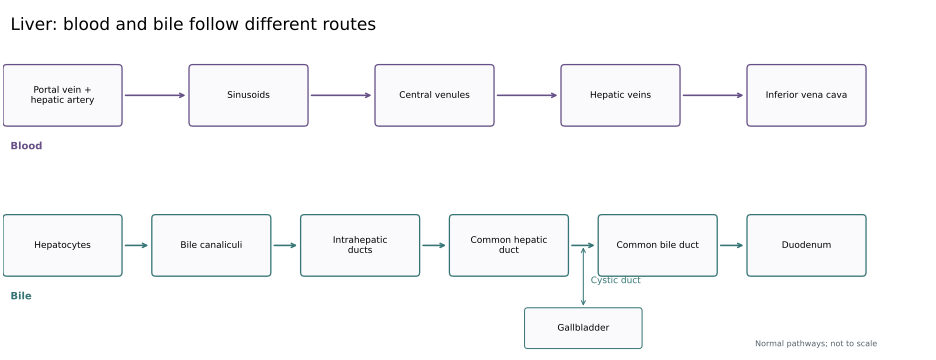
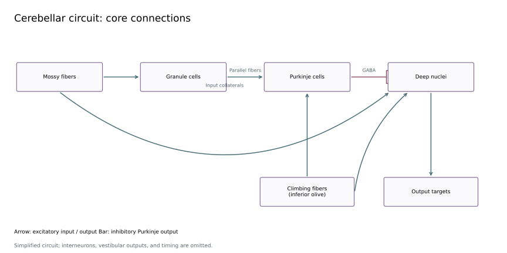
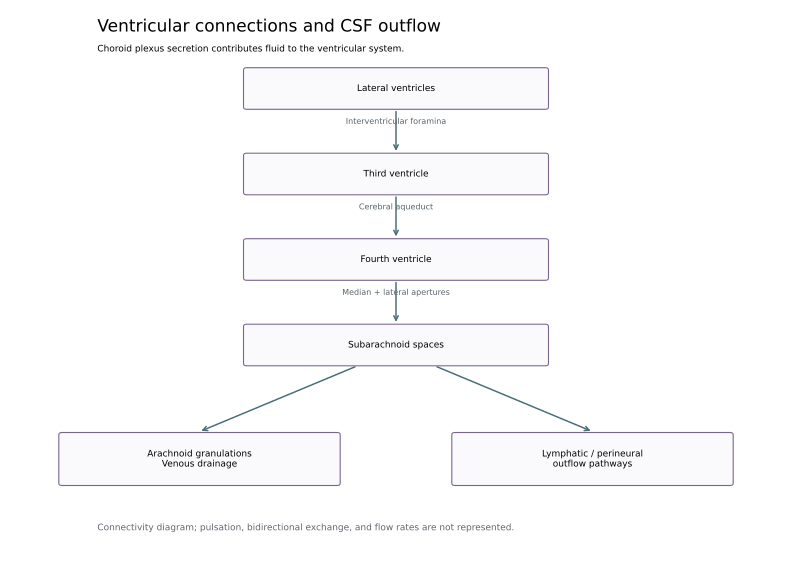

# 해부학·조직학·발생학

# 육안해부학

## 심장과 심낭의 입체 해부

### 학습목표

- 심장의 표면과 심장방의 관계를 설명한다.
- 판막과 섬유성 골격의 기능을 연결한다.
- 관상순환과 심장 전도계의 수술적 관계를 설명한다.

### 심장을 공간에 배치하기

심장(heart)은 두 폐 사이 종격동(mediastinum)에 놓인 근육성 기관이며, 심낭(pericardium)에 싸여 있다. 심장의 장축은 단순한 수직선이 아니라 뒤위쪽에서 앞아래쪽으로 기울어져 있다. 따라서 심방이 위에 있고 심실이 아래에 있다는 도식만 외우면 실제 단면영상을 해석하기 어렵다. 우심실(right ventricle)은 앞쪽 흉골에 가장 가까운 심장방의 대부분을 이루고, 좌심방(left atrium)은 뒤쪽에 놓여 식도와 가깝다. 좌심실(left ventricle)은 두꺼운 벽으로 심장끝(apex)을 이루며, 그 끝은 대개 왼쪽 앞아래쪽을 향한다. 영상에서 좌우는 화면의 좌우가 아니라 환자의 해부학적 좌우로 판단해야 한다.

흉골갈비면은 주로 우심실로 이루어지고, 가로막면은 주로 좌심실과 일부 우심실로 이루어진다. 심장바닥(base)은 주로 좌심방이 차지하는 뒤쪽 면이다. 심장바닥을 심장의 아래쪽이라고 해석하는 것은 일상어와 해부학 용어를 혼동한 결과다. 심장 외면의 방실고랑(coronary sulcus)은 심방과 심실의 경계를 표시하며, 앞뒤심실사이고랑은 심실 사이의 위치를 가늠하게 한다. 외부 고랑은 내부 중격의 위치와 관련되지만 모든 내부 구조의 경계를 그대로 투영하는 것은 아니다.

### 심낭과 인접 구조

섬유심낭(fibrous pericardium)은 심장을 둘러싸는 질긴 결합조직 주머니로, 아래쪽에서 가로막의 중심널힘줄과 이어진다. 장막심낭(serous pericardium)은 벽쪽층과 내장쪽층으로 나뉘며, 내장쪽층은 심장바깥막(epicardium)을 이룬다. 두 장막층 사이의 심낭강(pericardial cavity)에는 마찰을 줄이는 소량의 액체가 존재한다. 큰혈관 뿌리에서 장막층이 반사되면서 가로심낭굴과 빗심낭굴이 형성된다. 가로심낭굴은 동맥쪽 유출로와 정맥쪽 유입부 사이의 공간으로, 심장수술에서 큰혈관의 상대적 위치를 이해하는 데 중요하다.

가로막신경(phrenic nerve)은 섬유심낭 바깥면을 따라 내려가며 폐뿌리의 앞을 지난다. 반대로 미주신경(vagus nerve)은 폐뿌리 뒤를 지나는 관계가 중요하다. 벽쪽 심낭의 통증은 가로막신경이 담당하는 척수분절과 연관되어 어깨 부위로 연관통을 일으킬 수 있다. 심낭삼출이 있어도 압박의 심각도는 액체량만으로 결정되지 않는다. 천천히 증가한 액체에는 심낭이 적응할 수 있지만 급격한 축적은 적은 양으로도 심장방 충만을 제한한다. 이는 해부학적 주머니의 압력과 순응도가 생리적 정맥환류에 영향을 주는 사례다.

### 심장방 내부와 판막

우심방에는 위대정맥과 아래대정맥, 심장정맥굴이 열린다. 매끈한 정맥 유입부와 빗살근(pectinate muscles)이 발달한 부위는 분계능선(crista terminalis)을 기준으로 구분할 수 있다. 심방사이중격에는 태아기의 타원구멍이 닫힌 흔적인 타원오목(fossa ovalis)이 보인다. 우심실에는 불규칙한 근육기둥인 육주(trabeculae carneae), 유두근(papillary muscles), 힘줄끈(chordae tendineae)이 존재한다. 힘줄끈은 방실판막의 자유가장자리와 유두근을 연결하며, 심실 수축 중 판막이 심방으로 뒤집히는 것을 제한한다.

유두근은 판막을 당겨 여는 근육이 아니다. 판막의 개폐는 주로 양쪽 압력차에 의해 결정되고, 유두근과 힘줄끈은 닫힌 판막을 안정시킨다. 좌심실의 승모판(mitral valve)은 보통 앞뒤 두 판엽으로 이루어지며, 우심실의 삼첨판(tricuspid valve)은 전형적으로 세 판엽으로 설명한다. 반달판막인 대동맥판과 폐동맥판에는 방실판막과 같은 유두근-힘줄끈 장치가 없다. 이 차이는 급성 유두근 기능장애가 승모판역류를 유발할 수 있지만 같은 방식으로 대동맥판역류를 설명할 수 없다는 점과 연결된다.

좌심방은 폐정맥을 통해 산소화된 혈액을 받으며 내부 대부분은 비교적 매끈하다. 좌심실 벽은 높은 체순환 압력을 발생시키기 때문에 우심실보다 두껍다. 그러나 벽 두께만으로 수축 기능을 판단할 수는 없다. 확장, 섬유화, 허혈, 판막 부하와 같은 조건이 실제 기능을 바꾼다. 심실사이중격은 큰 근육부분과 작은 막부분으로 나뉜다. 작은 막부분은 방실 전도조직과 가까워 중격 결손이나 수술을 이해할 때 특히 중요하다.

### 혈액 공급과 전기적 연결

관상동맥(coronary arteries)은 대동맥뿌리에서 시작한다. 오른관상동맥과 왼관상동맥의 주행을 따라가면 심장 표면의 고랑이 혈관의 길잡이가 된다는 것을 알 수 있다. 왼관상동맥은 대개 앞심실사이가지와 휘돌이가지로 나뉜다. 관상동맥 우세성(dominance)은 뒤심실사이동맥을 어느 관상동맥계가 내는지에 따라 정하며, 단순히 어느 동맥이 더 굵은가를 뜻하지 않는다. 분지와 공급 영역에는 개인차가 있으므로 특정 혈관 폐색을 모든 사람에게 동일한 크기의 경색으로 연결해서는 안 된다.

심장정맥혈의 상당 부분은 심장정맥굴(coronary sinus)을 통해 우심방으로 돌아온다. 심장 림프는 심외막 아래 림프관을 통해 주로 기관기관지 림프절 방향으로 배액된다. 교감신경은 심박수와 수축력을 높이는 방향으로 작용하고, 미주신경성 부교감신경은 특히 동방결절과 방실결절의 활동에 영향을 준다. 동방결절(sinoatrial node)은 우심방의 위대정맥 유입부 가까이, 방실결절(atrioventricular node)은 우심방 중격쪽 아래 부위에 위치한다. 섬유성 심장골격은 판막을 지지하면서 심방과 심실 사이의 직접적인 전기 확산을 제한하고, 정상 전도는 방실다발을 통해 이어진다.

### 영상과 임상 해석

경흉부 심초음파의 각 창은 심장의 서로 다른 면과 장축을 절단한다. 심첨 네심장방 단면에서는 양쪽 심방과 심실, 방실판막과 중격의 관계를 관찰한다. 단면에서 구조가 보이지 않는다는 사실이 구조의 부재를 의미하지는 않는다. 탐촉자의 위치와 각도를 바꾸면 절단면에 포함되는 범위가 달라지기 때문이다. 심낭액은 심장 바깥의 공간에서, 판막 운동은 주기별 영상에서 평가하며, 형태 관찰과 혈류 평가를 구분한다. 도플러 신호의 방향과 속도는 초음파 빔과 흐름의 상대적 각도에 영향을 받으므로 영상의 색 하나를 산소 함량으로 해석해서는 안 된다.

### 확인 문제

유두근의 주된 판막 관련 기능은?

A. 수축기 판막 뒤집힘을 제한한다.
B. 판막을 당겨 직접 연다.

**정답: A**

압력차가 개폐를 만들고 유두근-건삭은 지지한다.

**오답 해설**

B: 유두근을 개방 장치로 이해하면 역할을 뒤바꾼다.

## 가슴벽·갈비사이공간·가로막

### 학습목표

- 가슴우리의 뼈 표지와 호흡 운동을 연결한다
- 갈비사이 신경혈관의 층을 설명한다
- 가로막의 구멍·신경지배·연관통을 구분한다

### 보호 구조이면서 움직이는 벽

가슴우리(thoracic cage)는 등뼈, 갈비뼈와 갈비연골 및 복장뼈를 포함하여 심장과 폐를 보호하고 호흡에 필요한 용적 변화를 만든다. 갈비뼈는 전형적으로 열두 쌍이며 위쪽 일곱 쌍은 자신의 갈비연골로 복장뼈와 연결된다. 아래쪽 일부는 연골을 통해 간접 연결되고 마지막 두 쌍은 앞쪽에서 같은 방식으로 붙지 않는다. 연결 형태 차이는 운동과 손상의 기계적 특성에 영향을 준다.

복장뼈는 자루, 몸통과 칼돌기로 구분한다. 복장각(sternal angle)은 둘째갈비연골을 찾고 갈비뼈를 세는 표지이며 가슴세로칸의 구분을 이해하는 기준과도 연결된다. 피부에서 만지는 위치와 내부 장기의 정확한 높이는 자세와 호흡 및 체형에 따라 달라질 수 있다. 하나의 표면선이 언제나 장기의 경계와 일치한다고 가정하지 않는다.

### 갈비뼈의 관절과 호흡

전형적 갈비뼈의 머리는 척추뼈몸통 부근, 결절은 가로돌기 부근과 관계되어 뒤쪽 관절을 만든다. 회전축과 갈비뼈 방향 때문에 위쪽과 아래쪽 가슴우리에서 용적 증가의 형태가 다르게 나타난다. 앞뒤 직경과 가로 직경의 변화가 함께 일어난다. 실제 호흡에서는 가로막과 갈비사이근 및 필요에 따른 보조근이 협동한다.

갈비뼈의 수나 관절면 형태에는 부위별 차이와 변이가 있다. 첫째갈비뼈는 목과 가슴의 연결에서 혈관·신경 관계가 중요하고 아래쪽 갈비뼈 손상은 가로막 아래 장기와도 연결될 수 있다. 가슴벽 통증과 골절을 평가할 때 손상 높이만으로 내부 손상의 범위를 좁게 정하지 않는다. 호흡 상태와 주변 장기의 징후를 함께 본다.

### 갈비사이근의 층

바깥갈비사이근과 속갈비사이근 및 가장속갈비사이근 등은 층과 섬유 방향이 다르다. 각 층이 가슴우리의 움직임과 안정화에 기여하는 방식은 위치와 호흡 단계에 따라 달라진다. 속갈비사이근의 모든 부위를 무조건 같은 호기 작용으로 묶는 것은 단순화이다. 근육성 부분과 막으로 바뀌는 구간도 구분하여 본다.

주된 갈비사이 신경혈관 다발은 속갈비사이근과 가장속갈비사이근 사이의 층에 있고 갈비뼈 아래모서리의 고랑과 관련된다. 정맥·동맥·신경의 위아래 배열을 함께 기억하되 곁가지가 있어 한 줄만 피하면 모든 혈관 손상 위험이 사라지는 것은 아니다. 흉강 접근은 해부 표지와 함께 실제 장기 위치 및 영상 확인과 안전 절차를 반영해야 한다.

### 신경·혈관과 가슴벽 통증

갈비사이신경은 주로 등척수신경의 앞가지이며 가슴벽의 감각과 근육 운동에 기여한다. 뒤가지는 등 깊은 근육과 피부의 다른 영역에 연결된다. 대상포진 같은 신경 관련 통증의 분포를 피부분절과 연결할 수 있지만 통증 하나로 원인을 확정하지 않는다. 갈비사이동맥은 앞뒤 공급원이 연결되고 정맥은 홀정맥 계통이나 속가슴정맥 등으로 회수된다.

속가슴동맥(internal thoracic artery)은 앞가슴벽의 중요한 혈관으로 복장뼈 가쪽을 따라 내려가 분지를 낸다. 수술과 외상에서 표면의 복장뼈 위치뿐 아니라 이 혈관의 상대 위치를 생각해야 한다. 가슴벽의 림프 배액은 겨드랑 및 복장뼈 주위 등 여러 경로에 연결되어 동맥 목록과 완전히 같은 구획으로 나누어지지 않는다.

### 가로막의 돔과 부착

가로막(diaphragm)은 가슴안과 배안을 나누는 돔 모양의 근육·힘줄 구조이다. 복장뼈, 갈비뼈와 허리뼈 부위에서 시작하는 근섬유가 중심힘줄로 이어진다. 수축하면 돔이 내려가 가슴안 용적을 늘리고 배안 압력과 장기 위치에도 영향을 준다. 오른쪽 돔이 간과 관련하여 더 높게 보이는 전형적 양상이 있지만 정상 높이는 호흡과 자세 및 개인차의 영향을 받는다.

가로막에는 아래대정맥, 식도와 대동맥이 지나는 서로 다른 통로가 있다. 대정맥 통로는 중심힘줄, 식도 통로는 근육성 부분, 대동맥 통로는 뒤쪽 다리와 관련된 관계를 구분한다. 대표 척추 높이는 위치를 외우는 보조 기준이며 고정된 피부 지점이나 모든 호흡 단계에서의 절대 높이가 아니다. 식도와 대동맥이 같은 구멍을 지나간다고 혼동하지 않는다.

### 신경지배와 연관통

가로막신경(phrenic nerve)은 주로 C3~C5 분절의 기여를 받아 운동 지배를 한다. 중심부 가로막과 관련 막의 감각도 이 경로에 연결되고 주변부 감각은 갈비사이신경 등의 기여를 받는다. 가로막 자극이 어깨 부위의 연관통으로 느껴질 수 있는 것은 공통 척수 분절 수준의 감각 처리와 관련된다. 어깨 통증의 원인을 항상 어깨관절 자체로 한정하지 않는 이유이다.

한쪽 가로막 기능 저하는 영상에서의 높이와 호흡 운동 변화로 단서를 얻을 수 있으나 높은 돔 하나만으로 신경 마비를 확정하지 않는다. 무기폐, 배안의 압력과 다른 원인도 고려한다. 정상 3D 모형의 가로막 위치는 들숨과 날숨의 실제 변형을 내장하지 않는다. 호흡 역학을 설명하려면 정적 구조와 별도의 운동 도식을 연결해야 한다.

### 확인 문제

주된 갈비사이 신경혈관 다발은 어디와 관련되는가?

A. 속갈비사이근과 가장속갈비사이근 사이의 층이다.
B. 항상 피부 바로 아래에만 있어 깊은 접근과 무관하다.

**정답: A**

다발은 깊은 근육층 사이 및 갈비뼈 고랑과 관계되며 곁가지와 실제 환자의 구조를 함께 고려한다.

**오답 해설**

B: 이 해석은 옳지 않다. 다발은 깊은 근육층 사이 및 갈비뼈 고랑과 관계되며 곁가지와 실제 환자의 구조를 함께 고려한다.

## 폐·허파문·가슴막과 폐구역

### 학습목표

- 좌우 폐의 엽·틈새·주변 구조 차이를 설명한다
- 폐순환·기관지순환과 림프 배액을 구분한다
- 가슴막의 층과 통증·기흉·흉수의 관계를 설명한다

### 좌우가 완전히 대칭인 장기가 아니다

폐(lung)는 가슴안 양쪽에서 기도와 혈관 및 림프관을 통해 몸의 다른 부분과 연결된다. 오른폐는 위·중간·아래엽, 왼폐는 위·아래엽으로 나뉘는 전형적 배열을 가진다. 오른쪽의 수평틈새와 양쪽의 빗틈새는 엽의 경계를 이룬다. 왼쪽의 심장패임과 혀구역은 심장과의 공간 관계를 반영한다. 좌우를 단순 거울상으로 취급하면 영상과 수술 해부를 잘못 이해할 수 있다.

폐의 꼭대기와 바닥, 갈비면과 가슴세로칸면은 주변 구조의 방향을 설명한다. 폐꼭대기는 가슴우리 위쪽 입구와 목의 깊은 구조에 가깝고, 바닥은 가로막에 놓인다. 앞가슴벽에서 보이는 폐의 영역과 뒤쪽에서 보이는 영역은 엽의 입체적 배열 때문에 다르다. 뒤쪽의 넓은 영역에서 아래엽이 차지하는 위치를 생각하면 청진과 영상 소견을 연결하기 쉽다.

### 허파문과 폐뿌리

허파문(hilum)은 가슴세로칸면에서 기관지와 폐혈관 등 구조가 드나드는 부위이며, 이 구조를 감싸는 연결을 폐뿌리(root of lung)로 이해한다. 기관지, 폐동맥과 폐정맥의 관계는 좌우가 다르다. 폐정맥은 전반적으로 앞아래 쪽 관계가 중요하고, 폐동맥과 기관지의 상대 위치는 각각 확인해야 한다. 한쪽의 단면을 외운 뒤 그대로 다른 쪽에 적용하지 않는다.

폐뿌리 주위에서 가로막신경은 앞쪽, 미주신경은 뒤쪽을 지나는 관계가 중요하다. 주변의 대동맥활, 홀정맥활과 식도 등은 좌우와 높이에 따라 다른 영상 표지를 제공한다. 종괴나 림프절 비대가 기관지·혈관·신경에 어떤 영향을 줄 수 있는지 생각할 때 이러한 관계가 필요하다. 허파문이 커 보인다는 소견은 혈관과 림프절 및 다른 원인을 구분하여 해석한다.

### 엽과 폐구역의 차이

기관지는 주기관지에서 엽기관지와 구역기관지로 분지한다. 기관지폐구역(bronchopulmonary segment)은 구역기관지와 해당 폐동맥 분지에 연결되는 해부학적 단위이다. 정맥은 구역 사이 경계를 따라 지나는 관계가 중요하여 동맥과 완전히 같은 방식으로 묶이지 않는다. 폐엽과 폐구역은 크기만 다른 동의어가 아니다.

구역의 이름과 수는 특히 왼쪽의 통합 여부와 분류 관례에 따라 기술이 달라질 수 있다. 실제 수술 계획에서는 환자의 기관지와 혈관 분지 및 변이를 확인한다. 정상 구역의 개념은 국소 절제와 병변 위치 설명에 유용하지만 모든 병변이 구역 경계에서 정확히 멈추는 것은 아니다. 감염, 기도 폐쇄와 종양은 서로 다른 확산 경로를 보일 수 있다.

### 두 순환과 회수

폐순환은 오른심실에서 온 혈액을 폐포 모세혈관으로 보내 가스교환 후 왼심방으로 돌려보낸다. 기관지순환(bronchial circulation)은 기도벽과 지지 조직 등에 산소화 혈액을 공급하는 체순환 계통이다. 기관지정맥의 배액 일부와 폐정맥으로 이어지는 연결은 두 순환이 완전히 독립된 닫힌 두 관이 아님을 보여 준다. 폐동맥의 산소 함량이 낮다고 폐 조직 전체가 산소 공급을 받지 못하는 것은 아니다.

림프관은 표면과 깊은 조직의 계통을 통해 허파문과 기관기관지 림프절 등으로 이어진다. 림프절의 위치와 연결은 감염과 종양의 평가에 중요하지만 동맥 분지 구역과 일대일로 일치하지 않는다. 일부 배액은 정중선을 넘어 연결될 수 있어 같은 쪽 림프절만을 확인하는 단순한 지도에는 한계가 있다. 병변의 위치와 실제 영상·검사 결과를 함께 본다.

### 장측과 벽측 가슴막

장측가슴막(visceral pleura)은 폐 표면과 틈새를 덮고, 벽측가슴막(parietal pleura)은 가슴벽과 가로막 및 가슴세로칸 쪽 경계를 덮는다. 두 층 사이의 가슴막안은 정상적으로 적은 액체가 있는 잠재 공간이며 폐 실질의 내부 공기 공간과 다르다. 폐가 가슴벽에 접착제로 붙어 움직이는 것이 아니라 압력과 액체층 및 조직의 탄성에 의해 운동이 연결된다.

벽측가슴막의 감각은 부위에 따라 갈비사이신경과 가로막신경 등에 연결된다. 장측층과 벽측층의 통증 민감도 및 경로를 구분하면 국소 흉통과 어깨 연관통의 차이를 이해할 수 있다. 숨 쉴 때 아프다는 증상은 가슴막 자극의 단서일 수 있지만 근골격 질환과 다른 흉부 원인도 고려한다. 통증의 성질 하나로 병인을 확정하지 않는다.

### 가슴막오목과 병적 공간 변화

갈비가로막오목(costodiaphragmatic recess)은 폐 가장자리와 벽측가슴막의 반전 사이에서 호흡에 따라 관계가 달라지는 공간이다. 액체는 중력과 자세의 영향을 받아 고이므로 서 있는 영상과 누운 영상의 흉수 모양이 다를 수 있다. 폐의 아래 경계와 가슴막의 아래 경계는 같은 선이 아니며 호흡 단계에 따라 위치가 변한다. 고정된 한 줄만으로 시술 위치를 정하지 않는다.

기흉에서는 가슴막안으로 공기가 들어가 폐와 가슴벽 사이의 압력 관계가 달라지고 폐가 줄어들 수 있다. 긴장 상태에서는 순환에도 영향을 줄 수 있어 단순히 폐의 크기만의 문제가 아니다. 흉수는 액체의 생성과 배액 불균형 또는 염증·손상 등 여러 원인에서 생긴다. 정상 3D 폐 모델은 병적 공기나 액체를 포함하지 않으며, 질환 표현에는 검증된 영상과 별도의 병태생리 도식이 필요하다.

### 확인 문제

폐구역의 동맥과 정맥은 항상 완전히 같은 경로인가?

A. 아니다. 구역 기관지·동맥과 구역 사이 정맥의 관계를 구분한다.
B. 그렇다. 모든 정맥은 구역기관지와 같은 중심 경로만 지난다.

**정답: A**

구역의 기능적 공급 단위와 구역 사이 회수 경로를 구분해야 국소 병변과 절제 해부를 이해할 수 있다.

**오답 해설**

B: 이 해석은 옳지 않다. 구역의 기능적 공급 단위와 구역 사이 회수 경로를 구분해야 국소 병변과 절제 해부를 이해할 수 있다.

## 해부학적 방향·단면·근막과 구획

### 학습목표

- 자세가 바뀌어도 해부학적 방향 용어를 일관되게 적용한다
- 근막과 근육 구획을 혈관·신경 주행과 연결한다
- 영상의 좌우 및 단면 정보를 실제 구조에 대응시킨다

### 표준 자세는 공간 설명의 좌표계이다

해부학적 자세(anatomical position)는 몸을 세우고 얼굴과 발을 앞쪽으로 향하며 팔을 몸 옆에 두고 손바닥이 앞을 향한 기준 자세이다. 실제 환자가 누워 있거나 팔을 회전해도 안쪽과 가쪽, 앞과 뒤의 해부학적 명칭은 이 기준을 바탕으로 사용한다. 손바닥이 뒤로 향하도록 팔을 돌렸다는 이유로 노뼈와 자뼈의 명칭이나 기본 안가쪽 관계를 새로 정하지 않는다. 관찰한 자세와 기준 방향을 구분해야 수술 기록과 영상 설명이 서로 통한다.

정중면(median plane)은 몸을 좌우로 나누는 중심의 시상면이다. 시상면(sagittal plane)은 이에 평행한 면, 관상면(coronal plane)은 앞뒤를 나누는 면, 가로면(transverse plane)은 위아래를 나누는 면이다. 실제 영상은 비스듬한 단면을 포함할 수 있으며 하나의 구조가 여러 연속 단면에 걸쳐 나타난다. 한 장에서 둥글게 보이는 구조가 구형 장기인지 길게 뻗은 관의 단면인지 구분하려면 앞뒤 영상을 이어서 추적한다.

### 방향 용어와 운동 용어

위·아래와 앞·뒤는 몸통에서 직관적이지만 굽은 중추신경계와 돌출된 팔다리에서는 부위별 관례를 확인해야 한다. 몸통에 가까운 쪽은 몸쪽(proximal), 먼 쪽은 먼쪽(distal)이라고 하며 손가락의 첫마디를 설명할 때도 기준이 된다. 얕은층(superficial)과 깊은층(deep)은 피부로부터의 상대적 거리이다. 두 구조가 깊이가 다르더라도 같은 단면에서 겹쳐 보여 앞뒤 관계를 잘못 추론할 수 있다.

굽힘과 폄, 벌림과 모음, 안쪽돌림과 가쪽돌림은 관절의 운동을 기술한다. 엄지는 다른 손가락과 다른 방향으로 놓여 움직임을 손바닥 평면과 관련하여 해석한다. 엎침(pronation)과 뒤침(supination)은 주로 아래팔에서 노뼈가 자뼈와 갖는 관계의 변화이며 어깨의 안쪽돌림과 같지 않다. 겉으로 손바닥의 방향이 비슷해져도 어느 관절에서 움직임이 생겼는지 구분한다.

### 피부·피하조직·깊은근막

피부 아래 피하조직에는 지방, 얕은정맥, 피부신경과 림프관이 분포한다. 깊은근막(deep fascia)은 근육과 다른 깊은 구조를 둘러싸고 사이막을 통해 뼈와 연결되어 구획을 만든다. 이 층은 단순한 포장지가 아니라 조직 사이 힘의 전달과 구조의 위치 유지 및 감염 확산 경로에 영향을 준다. 다만 근막면의 이름과 연속성은 부위에 따라 다르므로 전신에 동일한 한 장의 막이 있다는 식으로 단순화하지 않는다.

신경과 혈관은 근육 사이의 틈이나 근막의 통로를 따라 이동한다. 얕은 피부신경과 깊은 운동신경은 같은 이름의 넓은 구역을 지나더라도 깊이와 손상 위험이 다르다. 주사나 절개에서 표면의 한 지점을 아는 것만으로 안전한 깊이와 방향이 정해지는 것은 아니다. 인접 장기, 해부학적 변이 및 환자의 체격도 실제 경로를 바꾼다.

### 근육 구획이 갖는 기능적 의미

팔다리의 근육은 구획(compartment)별로 묶이며 같은 구획에서 작용이나 주요 신경지배가 비슷한 경우가 많다. 위팔 앞구획은 굽힘 관련 근육과 근육피부신경, 뒤구획은 폄 관련 근육과 노신경을 연결해 이해할 수 있다. 그러나 구획 규칙에는 예외와 경계가 있다. 신경은 한 구획을 지나 다른 구획으로 이동하기도 하므로 지나간다는 사실과 그곳의 모든 근육을 지배한다는 사실을 구분한다.

구획 안에 출혈이나 부종이 생기면 단단한 경계 때문에 압력이 상승하여 미세순환과 신경 기능을 해칠 수 있다. 이것이 구획증후군의 해부학적 배경이다. 큰 동맥의 맥박이 남아 있어도 작은 혈관의 관류가 충분하다는 뜻은 아니다. 손상 부위의 통증, 감각과 운동 및 시간 경과를 연결해야 한다. 해부학은 한 구조의 존재를 확인하는 데서 끝나지 않고 닫힌 공간에서의 압력과 조직 생존을 설명한다.

### 혈관·신경·림프의 서로 다른 지도

동맥은 유입, 정맥은 회수, 림프관은 조직액과 면역 관련 물질의 배출을 담당한다. 동맥과 깊은정맥이 함께 주행하는 경우가 많지만 얕은정맥은 다른 표면 경로를 이용할 수 있다. 림프 배액도 동맥의 분지 영역과 완전히 같은 지도로 대응하지 않는다. 감염이나 종양의 확산을 설명할 때 동맥 공급만 보고 림프절 위치를 추정해서는 안 된다.

피부분절(dermatome)은 척수신경 뿌리와 연관된 피부 감각 분포이고 말초신경의 피부 영역은 신경얼기를 거친 뒤의 분포이다. 한 신경뿌리의 섬유가 여러 말초신경에 나뉘므로 두 지도가 다르다. 감각 저하를 기록할 때 손가락 끝 하나의 소견과 팔 전체의 근력·반사 소견을 함께 보면 병변의 위치를 더 정확히 추론할 수 있다.

### 영상과 3D 모델을 연결하는 순서

영상의 왼쪽과 환자의 왼쪽은 표시 관례에 따라 다를 수 있다. 먼저 방향 표지와 촬영면을 확인하고 뼈, 큰 혈관 및 장기를 기준점으로 삼는다. 비슷하게 생긴 구조를 한 장의 모양으로만 맞추지 않고 인접 구조와 연속성을 확인한다. 정적 3D 모델은 공간 관계를 이해하는 데 유용하지만 자세 변화에 따른 근육 긴장이나 장기의 변형까지 자동으로 보여 주지는 않는다.

구조를 선택할 때에는 명칭, 좌우, 주변 구조 및 실제 메시를 함께 확인한다. 모델에서 보이지 않는 근막이나 작은 신경을 비슷한 모양의 다른 구조로 대신하면 학습자가 잘못된 관계를 기억할 수 있다. 보이지 않는 구조는 해당 층의 단면도나 별도의 도식으로 설명하고, 거시 구조를 통한 위치 학습과 미세구조 및 기능 학습을 연결한다.

### 확인 문제

피부분절 지도와 말초신경 감각 지도가 다른 이유는?

A. 피부의 모든 감각은 한 개 신경뿌리만 지배하기 때문이다.
B. 신경얼기에서 여러 분절의 섬유가 재배열되기 때문이다.

**정답: B**

하나의 말초신경에 여러 분절의 섬유가 섞여 두 지도의 단위가 다르다.

**오답 해설**

A: 이 선택지는 옳지 않다. 하나의 말초신경에 여러 분절의 섬유가 섞여 두 지도의 단위가 다르다.

## 빗장뼈·어깨뼈와 어깨이음부

### 학습목표

- 어깨이음부의 뼈 표지를 촉진 및 영상과 연결한다
- 어깨뼈 위치 조절 근육의 작용과 신경지배를 설명한다
- 빗장뼈·어깨뼈 손상의 인접 구조 위험을 추론한다

### 팔을 몸통에 연결하는 가동성 있는 바닥

어깨이음부(pectoral girdle)는 빗장뼈(clavicle)와 어깨뼈(scapula)를 중심으로 팔을 몸통과 연결한다. 가슴우리 뒤의 어깨뼈는 근육에 의해 지지되며 갈비뼈와 직접적인 뼈성 관절을 이루지 않는다. 복장빗장관절은 팔뼈대와 몸통뼈대 사이의 중요한 뼈성 연결이다. 따라서 위팔의 넓은 운동 범위는 위팔어깨관절만의 운동이 아니라 빗장뼈와 어깨뼈의 동반 움직임에 의존한다.

빗장뼈는 피부 가까이에 놓인 S자 형태의 뼈이다. 안쪽 끝은 복장뼈, 가쪽 끝은 어깨뼈의 봉우리와 관절한다. 빗장뼈는 팔을 가슴우리에서 떨어져 있게 하여 운동 공간을 확보하고 상지에서 전달되는 힘을 몸통으로 보낸다. 뼈의 표면만 외우기보다 아래에 지나가는 혈관과 신경, 근육의 부착 및 인대의 위치를 함께 봐야 한다.

### 빗장뼈의 인대와 손상

복장빗장관절은 관절원반과 주위 인대에 의해 안정화된다. 가쪽의 봉우리빗장관절은 어깨뼈와 빗장뼈의 작은 상대 운동을 허용하고, 부리빗장인대(coracoclavicular ligament)는 두 뼈 사이의 수직 안정성에 중요하다. 부리빗장인대는 원뿔인대와 마름인대로 구분된다. 봉우리빗장관절 손상에서 관절면의 어긋남뿐 아니라 이 인대 복합체의 손상 정도가 중요하다.

빗장뼈 골절에서는 부착 근육과 팔의 무게가 골편 위치에 영향을 준다. 아래쪽의 빗장밑혈관과 팔신경얼기 및 안쪽 주변의 가슴 구조는 인접 손상 평가에 중요하다. 특히 안쪽 끝의 뒤쪽 전위는 표면 변형보다 깊은 구조에 대한 위험이 더 클 수 있다. 변형의 크기만 보고 중요도를 정하지 않고 호흡, 혈관 및 신경 증상을 함께 평가한다.

### 어깨뼈의 면과 돌기

어깨뼈는 앞쪽 갈비면과 뒤쪽 면을 가진 넓은 뼈이다. 뒤쪽의 어깨뼈가시(spine)는 가시위오목과 가시아래오목을 나누고 가쪽으로 봉우리(acromion)에 이어진다. 앞면의 어깨밑오목에는 어깨밑근이 놓인다. 가쪽의 관절오목(glenoid cavity)은 위팔뼈머리와 관절하고, 앞위쪽의 부리돌기(coracoid process)는 인대와 근육의 부착점이다. 이 표지들은 단면 영상에서 근육의 위치를 확인하는 기준이 된다.

관절오목 위쪽에는 위팔두갈래근 긴갈래의 부착과 관련된 결절이 있고 아래쪽에는 위팔세갈래근 긴갈래의 부착 부위가 있다. 어깨뼈위패임 부근에서 어깨위신경과 혈관의 경로가 달라질 수 있어 구조 관계가 중요하다. 뼈의 작은 패임이나 돌기는 표면 장식이 아니라 신경 통로, 근육 부착 및 힘 전달의 흔적이다.

### 앞톱니근과 등세모근의 협동

앞톱니근(serratus anterior)은 위쪽 여러 갈비뼈에서 시작해 어깨뼈 안쪽모서리의 앞면에 닿는다. 어깨뼈를 가슴우리에 붙이고 앞으로 내밀며 위쪽돌림에 참여한다. 긴가슴신경(long thoracic nerve)이 지배한다. 이 신경이 손상되면 팔로 벽을 밀 때 어깨뼈 안쪽모서리가 뒤로 두드러질 수 있다. 어깨뼈가 가슴우리 위에서 안정되지 않으면 위팔의 거상도 제한될 수 있다.

등세모근(trapezius)은 뒤통수와 목·등의 정중 부위에서 어깨이음부로 이어지며 위·중간·아래 섬유의 방향에 따라 올림, 뒤당김과 아래당김에 기여한다. 위아래 섬유와 앞톱니근의 협동은 어깨뼈 위쪽돌림을 돕는다. 운동 지배에는 더부신경(accessory nerve)이 중요하고 목신경의 감각·고유감각 기여도 구분한다. 한 근육이 한 방향으로만 당긴다고 외우면 섬유별 기능 차이를 놓친다.

### 다른 위치 조절 근육

큰마름근과 작은마름근(rhomboid major and minor)은 척주에서 어깨뼈 안쪽모서리로 이어져 뒤당김과 아래쪽돌림 등에 기여하며 등쪽어깨신경이 지배한다. 어깨올림근(levator scapulae)은 위쪽 목뼈 부위에서 어깨뼈 위안쪽으로 이어져 올림과 관련된다. 작은가슴근(pectoralis minor)은 갈비뼈에서 부리돌기로 이어져 어깨뼈를 앞아래 방향으로 조절하며 안쪽가슴신경이 주요 지배를 한다. 각 근육은 움직이는 뼈가 무엇인지에 따라 기능 설명이 달라진다.

근육이 어깨뼈를 고정하는지 위팔뼈를 직접 움직이는지 구분한다. 작은가슴근과 큰가슴근은 이름이 비슷하지만 정지 부위와 주요 역할이 다르다. 팔이 고정되었을 때에는 흉곽 운동 등 다른 작용이 나타날 수 있다. 기시와 정지는 절대적으로 움직이지 않는 쪽과 움직이는 쪽을 뜻하기보다 표준적인 해부학적 부착 명칭임을 이해한다.

### 혈액 공급과 영상에서의 확인

어깨뼈 주위에는 어깨위동맥, 어깨휘돌이동맥 및 등쪽어깨동맥 계통이 연결되어 곁순환에 기여한다. 혈관 분지와 근육의 혈액 공급에는 변이가 있어 하나의 도식이 모든 사람의 실제 혈관을 대신하지는 못한다. 깊은정맥과 표면정맥의 회수 경로, 액와 림프절로 이어지는 림프 배액은 동맥의 연결과 별도로 살핀다.

일반 영상에서는 봉우리빗장관절과 관절오목 및 어깨뼈 몸통의 겹침을 고려한다. 어깨뼈 골절은 주변 흉부 손상과 함께 나타날 수 있어 뼈 자체만 보지 않는다. 신체진찰에서는 어깨뼈의 휴식 위치, 팔을 들 때의 회전과 가슴우리에서의 들림을 관찰한다. 통증으로 덜 움직이는 경우와 근육 또는 신경 기능이 실제로 저하된 경우를 나누어 평가한다.

### 확인 문제

앞톱니근 약화에서 어깨뼈가 들릴 수 있는 이유는?

A. 가슴우리에 어깨뼈를 붙이고 돌리는 작용이 저하되기 때문이다.
B. 어깨뼈와 갈비뼈의 뼈성 관절이 분리되기 때문이다.

**정답: A**

어깨가슴 움직임은 근육성 지지에 의존하며 직접 뼈성 관절의 탈구와 다르다.

**오답 해설**

B: 이 선택지는 옳지 않다. 어깨가슴 움직임은 근육성 지지에 의존하며 직접 뼈성 관절의 탈구와 다르다.

## 위팔어깨관절과 돌림근띠

### 학습목표

- 관절의 가동성과 안정성을 구조적으로 설명한다
- 돌림근띠 네 근육의 부착·작용·신경지배를 연결한다
- 탈구와 신경혈관 손상의 관계를 설명한다

### 큰 머리와 작은 오목의 조합

위팔어깨관절(glenohumeral joint)은 위팔뼈머리와 어깨뼈 관절오목 사이의 윤활관절이다. 넓은 위팔뼈머리에 비해 오목이 얕아 운동 범위가 크지만 뼈의 맞물림만으로 충분한 안정성을 얻지는 못한다. 관절테두리(labrum)는 오목의 가장자리를 보강하고 관절주머니와 인대 및 주변 근육이 안정성에 기여한다. 정상적인 움직임에는 구조를 조이는 힘뿐 아니라 적절한 느슨함과 관절면의 중심화가 필요하다.

위팔뼈머리는 운동 중 단순히 한 지점에서 회전하는 것이 아니라 관절면의 구름과 미끄러짐 및 어깨뼈의 이동을 동반한다. 팔 거상에서 위팔어깨관절과 어깨뼈의 기여 비율은 운동의 구간, 방향과 부하에 따라 달라질 수 있다. 일정한 비율 하나를 모든 자세에 고정하여 적용하면 정상 변이와 병적 운동을 잘못 구분할 수 있다.

### 네 근육의 공통 역할

돌림근띠(rotator cuff)는 가시위근(supraspinatus), 가시아래근(infraspinatus), 작은원근(teres minor)과 어깨밑근(subscapularis)의 힘줄이 관절주머니와 어우러진 복합체이다. 이 근육들은 회전이나 벌림을 만드는 동시에 위팔뼈머리를 관절오목 쪽으로 압박하고 위치를 유지한다. 큰 근육의 힘이 관절면에서 불필요한 이동을 만들지 않도록 조절하는 동적 안정화가 중요하다.

세모근이 팔을 들어 올릴 때 위팔뼈머리를 위로 옮기는 성분도 발생할 수 있다. 돌림근띠의 협동은 이러한 이동을 제어하며 관절면의 적절한 관계를 돕는다. 따라서 돌림근띠 손상을 단순한 한 방향 근력 저하로만 설명할 수 없다. 통증, 힘줄 연속성, 근육 위축 및 관절 운동의 변화를 함께 살펴야 한다.

### 근육별 부착과 신경지배

가시위근은 가시위오목에서 시작해 위팔뼈 큰결절의 위쪽 부위에 닿으며 어깨위신경(suprascapular nerve)이 지배한다. 팔 벌림과 머리 안정화에 참여하고 힘줄은 봉우리 아래를 지난다. 가시아래근은 가시아래오목에서 시작해 큰결절의 중간 부위에 닿으며 같은 어깨위신경이 지배한다. 주요 작용은 가쪽돌림과 안정화이다. 두 근육은 같은 신경을 공유하므로 신경 손상 위치에 따라 함께 약해질 수 있다.

작은원근은 어깨뼈 가쪽모서리 부근에서 큰결절 아래쪽 부위로 이어지며 겨드랑신경(axillary nerve)이 지배한다. 가쪽돌림과 관절 안정화에 기여한다. 어깨밑근은 어깨밑오목에서 작은결절로 이어지고 위·아래어깨밑신경이 지배한다. 안쪽돌림과 앞쪽 관절 안정화에 중요하다. 큰원근은 이름과 위치가 비슷해도 돌림근띠의 네 근육에는 포함되지 않는다.

### 세모근과 위팔두갈래근 긴갈래

세모근(deltoid)은 빗장뼈 가쪽 부분과 봉우리 및 어깨뼈가시에서 시작해 위팔뼈 세모근거친면에 닿는다. 앞·중간·뒤 섬유는 굽힘과 안쪽돌림, 벌림, 폄과 가쪽돌림에 서로 다르게 기여한다. 겨드랑신경이 지배하며 뒤위팔휘돌이동맥 등의 공급을 받는다. 실제 기능은 팔의 위치와 다른 근육의 협동에 따라 달라져 한 동작을 한 근육의 단독 검사로 완전히 분리하기 어렵다.

위팔두갈래근 긴갈래 힘줄은 관절오목 위쪽 부위에서 시작해 관절 안을 지나 결절사이고랑으로 이어진다. 관절 안에 있지만 윤활막과의 관계는 단순히 자유롭게 떠 있는 구조와 다르다. 관절테두리와 힘줄의 연결은 일부 어깨 병변을 설명하는 데 중요하다. 앞쪽 어깨 통증이 있다고 모두 긴갈래 힘줄 문제로 진단하지 않고 돌림근띠 및 관절과 목의 다른 원인을 평가한다.

### 네모공간과 인접 통로

네모공간(quadrangular space)은 뒤쪽에서 작은원근, 큰원근, 위팔세갈래근 긴갈래 및 위팔뼈 수술목과 관련된 경계로 이해한다. 겨드랑신경과 뒤위팔휘돌이동맥이 지나 위팔뼈 목 주위로 이어진다. 인접한 다른 삼각 공간과 삼각 틈은 지나는 구조가 다르므로 모양만 비슷하다고 같은 통로로 취급하지 않는다. 경계와 내용물을 묶어 기억하면 신경혈관 손상 위치를 추론하기 쉽다.

겨드랑신경 손상에서는 세모근 기능과 어깨 가쪽 일부의 감각을 평가한다. 그러나 통증이 심한 급성 손상에서는 적극적인 근력 검사가 어려울 수 있고 감각 하나만으로 기능 전체를 확정하지 않는다. 위팔뼈 수술목 골절과 어깨 탈구에서는 신경과 혈관 상태를 손상 전후 또는 처치 전후에 비교하는 것이 중요하다.

### 탈구·힘줄 손상·강직의 구별

관절의 앞쪽 탈구는 팔의 위치와 관절주머니의 취약 부위 및 외력 방향과 관련된다. 탈구는 관절면의 관계가 어긋난 상태이고 힘줄 파열이나 관절테두리 손상이 동반될 수 있다. 돌림근띠 질환에서는 능동 운동과 수동 운동의 차이가 평가에 도움을 줄 수 있지만 한 가지 징후가 확정 진단을 대신하지 않는다. 관절주머니의 강직은 수동 범위에도 영향을 주는 다른 설명이 될 수 있다.

초음파와 MRI는 힘줄과 연부조직 평가를 돕고 단순 영상은 뼈 정렬과 일부 퇴행 변화를 확인한다. 영상에서 보이는 힘줄 변화가 현재 통증의 유일한 원인인지 임상 소견과 대조한다. 정상 해부학적 3D 모델은 뼈와 근육의 위치를 보여 주지만 파열 크기, 염증 또는 실제 힘 전달을 재현하지 않는다. 이러한 기능은 별도의 움직임 도식과 검사 해석으로 보완한다.

### 확인 문제

돌림근띠의 공통 작용으로 옳은 것은?

A. 팔의 위치와 무관하게 모든 근육이 같은 방향으로만 당긴다.
B. 회전 등과 함께 위팔뼈머리의 중심화와 안정화에 참여한다.

**정답: B**

네 근육은 부착과 주작용이 다르지만 관절면을 안정화하는 데 협동한다.

**오답 해설**

A: 이 선택지는 옳지 않다. 네 근육은 부착과 주작용이 다르지만 관절면을 안정화하는 데 협동한다.

## 팔신경얼기의 구성과 병변 위치

### 학습목표

- 뿌리·줄기·갈래·다발·종말가지를 구분한다
- 척수신경 뿌리와 말초신경 분포의 차이를 설명한다
- 근력·감각·반사 조합으로 병변 위치를 추론한다

### 신경섬유가 다시 묶이는 이유

팔신경얼기(brachial plexus)는 주로 C5에서 T1 척수신경의 앞가지가 서로 섞여 상지의 여러 말초신경을 만드는 체계이다. 여기서 신경얼기의 뿌리(root)는 척수 앞뿌리나 뒤뿌리와 같은 구조를 뜻하지 않는다. 이미 감각과 운동 섬유가 합쳐진 척수신경의 앞가지가 신경얼기에 참여한다. 용어가 같다는 이유로 신경얼기 뿌리를 순수 운동 섬유로 이해하면 병변 해석이 틀어진다.

한 근육은 여러 척수 분절의 기여를 받으며 한 말초신경에도 여러 분절의 섬유가 섞인다. 이 재배열 때문에 신경뿌리 손상과 하나의 말초신경 손상이 다른 근력·감각 분포를 만든다. 교과서의 대표 분절은 주된 기여를 요약한 것이며 모든 사람에서 완전히 배타적인 한 분절 지배를 뜻하지 않는다. 경계가 겹치는 피부 감각 지도도 같은 관점에서 해석한다.

### 목에서 겨드랑으로 이어지는 구성

C5와 C6은 위줄기, C7은 중간줄기, C8과 T1은 아래줄기를 이루는 전형적 배열을 보인다. 각 줄기는 앞갈래와 뒤갈래로 나뉜다. 위·중간줄기의 앞갈래는 가쪽다발, 아래줄기의 앞갈래는 안쪽다발을 이루고 세 뒤갈래는 뒤다발로 합쳐진다. 다발 이름은 겨드랑동맥, 특히 그 둘째 부분에 대한 위치 관계를 기준으로 붙인다.

뿌리와 줄기는 목의 앞목갈비근과 중간목갈비근 사이 및 첫째갈비뼈 부근을 지나고, 갈래는 빗장뼈 뒤쪽 부근에서 다발로 이어진다. 빗장밑정맥은 동맥과 신경얼기와 같은 목갈비근 사이 통로에 놓인다고 단순화하지 않는다. 같은 좁은 부위의 압박이라도 정맥, 동맥 및 신경에 미치는 영향이 다를 수 있다. 자세와 해부학적 변이도 관계를 바꾼다.

### 다섯 종말가지

가쪽다발은 근육피부신경(musculocutaneous nerve)을 내고 정중신경의 가쪽 기여를 제공한다. 안쪽다발은 자신경(ulnar nerve)과 정중신경의 안쪽 기여 및 피부신경 등을 낸다. 뒤다발에서는 겨드랑신경과 노신경(radial nerve)이 나온다. 대표적인 다섯 종말가지만 외우면 신경얼기 중간에서 갈라지는 다른 신경을 놓치므로 뿌리·줄기·다발에서 일찍 나오는 가지도 함께 보아야 한다.

근육피부신경은 주로 위팔 앞쪽 근육의 운동과 아래팔 가쪽 피부 감각에 연결된다. 정중신경은 아래팔 굽힘·엎침의 많은 근육과 손의 일부 근육 및 피부에, 자신경은 일부 아래팔 근육과 손의 많은 속근육에 연결된다. 노신경은 뒤쪽 폄 근육과 관련 감각 영역에, 겨드랑신경은 세모근과 작은원근 및 어깨 가쪽 피부 일부에 기여한다. 실제 세부 분포는 각 신경의 분지 위치를 따라 확인한다.

### 중간에서 나오는 가지

등쪽어깨신경은 뿌리 수준에서 나와 마름근 등의 기능과 연결되고, 긴가슴신경은 여러 뿌리의 기여를 받아 앞톱니근으로 이어진다. 어깨위신경은 위줄기에서 나와 가시위근과 가시아래근을 지배한다. 이러한 신경은 겨드랑의 다섯 종말가지가 형성되기 전에 나뉘므로 손상 양상이 병변의 높이를 구분하는 단서가 된다.

뒤다발의 어깨밑신경들과 가슴등신경은 어깨밑근, 큰원근 또는 넓은등근 같은 근육에 연결된다. 가슴신경은 큰가슴근과 작은가슴근에 기여한다. 같은 어깨 주변 약화라도 어깨위신경 단독 병변인지, 뒤다발 병변인지, 더 근위부 신경얼기 병변인지에 따라 다른 근육과 감각 소견이 동반될 수 있다. 근육 하나의 이름보다 여러 가지의 분기 관계를 이용한다.

### 위쪽과 아래쪽 손상의 기능

위쪽 신경얼기 손상은 어깨 벌림·가쪽돌림과 팔꿈치 굽힘 등의 약화와 연결될 수 있다. 아래쪽 손상은 손의 속근육과 손가락 기능 및 안쪽 감각 변화가 중요할 수 있다. 그러나 실제 외상은 교과서의 순수한 위줄기 또는 아래줄기 병변보다 복잡할 수 있다. 견인 방향, 손상 세기 및 혈관·뼈 손상을 함께 확인한다.

손의 근육 위축과 안쪽 감각 변화가 있을 때는 아래줄기, 안쪽다발, 자신경 또는 경추 신경뿌리 병변 등을 감별한다. 정중신경 지배 근육의 동반 약화는 자신경 단독 손상으로 설명할 수 있는지를 시험하는 단서이다. 교감신경 경로와 가까운 근위부 손상에서는 관련 징후가 동반될 수 있으나 특정 징후만으로 신경얼기의 손상 범위를 완전히 결정하지 않는다.

### 전기생리와 영상의 의미

신경전도검사와 근전도는 감각 반응, 운동 축삭과 근육의 변화를 통해 병변 위치 및 생리적 손상 정도를 평가한다. 신경절의 몸쪽과 먼쪽 병변은 감각신경세포 몸체와 말초 축삭의 관계 때문에 검사 양상이 다를 수 있다. 다만 검사 시점과 동반 병변 및 기술적 조건을 고려해야 한다. 손상 직후 정상에 가까운 검사가 모든 축삭 손상을 배제하지는 않는다.

영상은 신경얼기와 주변 뼈·연부조직의 구조적 원인을 찾는 데 도움이 된다. 진찰은 특정 자세에서의 통증뿐 아니라 실제 근력, 감각과 반사를 분리하여 기록한다. 반복 평가에서 회복과 악화의 방향을 확인하고 서로 맞지 않는 소견은 다른 병변이나 검사 한계를 검토한다. 신경얼기 학습의 목적은 복잡한 도식을 외우는 데 그치지 않고 여러 신경의 이상을 하나의 병변 위치로 설명하는 것이다.

### 확인 문제

팔신경얼기의 뿌리라는 용어는 무엇을 가리키는가?

A. 통상 해당 척수신경의 앞가지이다.
B. 순수 운동성 척수 앞뿌리와 항상 같은 구조이다.

**정답: A**

신경얼기에 참여하는 앞가지는 감각·운동이 섞인 척수신경 이후의 구조이다.

**오답 해설**

B: 이 선택지는 옳지 않다. 신경얼기에 참여하는 앞가지는 감각·운동이 섞인 척수신경 이후의 구조이다.

## 겨드랑과 상지의 동맥·정맥·림프

### 학습목표

- 겨드랑의 벽과 신경혈관 내용물을 연결한다
- 동맥의 이름 변화와 주요 분지를 해부학적 경계로 설명한다
- 얕은정맥과 깊은정맥 및 림프 배액을 구분한다

### 통로이면서 연결 공간인 겨드랑

겨드랑(axilla)은 목과 상지 사이의 신경혈관이 지나는 공간이다. 앞벽은 큰가슴근과 작은가슴근 및 관련 근막, 뒤벽은 어깨밑근과 큰원근·넓은등근 부위, 안쪽벽은 가슴우리와 앞톱니근, 가쪽벽은 위팔뼈 쪽의 좁은 영역으로 이해한다. 바닥은 피부와 피하조직 및 겨드랑근막이며 꼭대기는 목과 이어진다. 경계 근육의 이름과 그 안을 통과하는 구조를 따로 외우기보다 공간을 실제로 둘러본다는 관점이 유용하다.

겨드랑에는 동맥·정맥과 팔신경얼기 다발 및 가지, 림프절과 지방조직이 있다. 팔 위치가 바뀌면 상대적인 긴장과 접근 방향도 바뀐다. 림프절 수술이나 혈관 접근에서 하나의 구조만 찾아 조작한다고 생각하면 인접한 긴가슴신경이나 가슴등신경 등의 위험을 놓칠 수 있다. 감각신경 손상과 운동신경 손상은 이후 불편과 기능 저하의 양상이 다르다.

### 겨드랑동맥의 세 부분

빗장밑동맥(subclavian artery)은 첫째갈비뼈 가쪽모서리를 지난 뒤 겨드랑동맥(axillary artery)으로 이어진다. 작은가슴근에 대한 위치를 기준으로 그 몸쪽, 뒤쪽 및 먼쪽의 세 부분으로 구분한다. 전형적인 분지 배열에서 첫 부분은 위가슴동맥, 둘째 부분은 가슴봉우리동맥과 가쪽가슴동맥, 셋째 부분은 어깨밑동맥 및 앞·뒤위팔휘돌이동맥과 연결된다. 분지 수의 규칙은 학습의 틀이며 개인별 변이가 있을 수 있다.

어깨밑동맥은 어깨휘돌이동맥과 가슴등동맥 계통으로 이어져 어깨뼈 주위와 넓은등근 등에 공급한다. 뒤위팔휘돌이동맥은 겨드랑신경과 가까이 주행하여 위팔뼈 수술목 및 어깨 주변 구조와 연결된다. 앞위팔휘돌이동맥과 다른 연결도 위팔뼈머리 혈액 공급에 참여한다. 어느 한 분지가 모든 부위의 공급을 독점한다고 단정하지 않고 실제 연결과 손상의 위치를 살핀다.

### 위팔과 아래팔의 동맥

큰원근 아래모서리 이후 겨드랑동맥은 위팔동맥(brachial artery)으로 이름이 바뀐다. 위팔동맥은 위팔 앞안쪽을 내려가 팔오금에서 노뼈동맥과 자동맥으로 나뉘는 전형적 경로를 보인다. 깊은위팔동맥은 노신경과 함께 뒤쪽 구획에 관계되고, 팔꿈치 주위의 곁가지와 되돌이동맥은 관절 주변 연결망을 만든다. 큰 혈관의 한 이름이 다음 구간으로 바뀌는 것은 혈액이 별도 혈관으로 갑자기 옮겨 간다는 뜻이 아니다.

노뼈동맥(radial artery)은 아래팔 가쪽을 따라 손목에서 맥박을 확인할 수 있는 표면 위치로 이어지고, 손등의 엄지 쪽을 돌아 깊은손바닥동맥활 형성에 중요하게 기여한다. 자동맥(ulnar artery)은 아래팔 앞안쪽을 지나 손으로 들어가 얕은손바닥동맥활에 주요하게 기여한다. 두 활의 연결 정도와 분지에는 변이가 있어 손의 혈류가 모든 사람에서 완전히 동일한 이중 공급을 갖는다고 가정하지 않는다.

### 깊은정맥과 얕은정맥

깊은정맥은 동맥과 나란히 동반정맥 형태로 주행하는 부분이 많고 위팔에서 겨드랑정맥으로 이어진다. 얕은정맥인 노쪽피부정맥(cephalic vein)은 상지 가쪽, 자쪽피부정맥(basilic vein)은 안쪽의 경로가 중요하다. 노쪽피부정맥은 세모가슴고랑 부근을 지나 깊은계로 들어가고, 자쪽피부정맥도 근막을 뚫고 깊은정맥과 연결된다. 표면 정맥을 보고 같은 이름의 동맥이 바로 아래 있을 것이라고 추정하지 않는다.

팔꿈치 부근의 팔오금중간정맥(median cubital vein)은 두 얕은정맥 사이를 연결하는 흔한 형태이지만 그 모양은 다양하다. 정맥 천자에서는 표면 혈관과 깊은 동맥·신경 및 이두근널힘줄의 관계를 이해해야 한다. 정상 해부 도식과 다르다는 이유만으로 비정상이라 판단하지 않되, 표면 표지만으로 깊은 구조가 안전하다고 단정하지 않는다. 혈관 접근은 실제 환자의 구조를 확인하는 과정과 함께 이루어진다.

### 겨드랑 림프절과 배액

겨드랑 림프절은 앞쪽 가슴근 부위, 뒤쪽 어깨밑 부위, 가쪽 위팔 부위 및 중심·꼭대기 군 등으로 나누어 이해할 수 있다. 상지뿐 아니라 가슴벽과 유방의 상당 부분에서 오는 림프를 받는다. 림프절의 위치는 동맥 분지 목록과 완전히 일치하는 구역이 아니다. 유방의 배액에는 다른 경로도 있어 겨드랑만으로 모든 전파를 설명하지 않는다.

상지의 얕은 림프관은 얕은정맥 경로와 관련되며 일부는 팔꿈치 안쪽 부위 림프절을 거쳐 올라간다. 림프절 절제나 방사선 치료 뒤에는 배액 능력이 제한되어 림프부종이 생길 수 있다. 부종은 정맥 폐쇄, 염증 또는 다른 체액 문제에서도 나타나므로 병력과 분포 및 피부 변화를 함께 살핀다. 림프부종을 단순히 동맥 혈류가 부족한 상태와 동일시하지 않는다.

### 곁순환과 임상 평가

어깨뼈와 팔꿈치의 혈관 연결은 주된 경로가 제한될 때 혈류를 보완할 수 있다. 그러나 곁순환이 있다는 사실이 급성 손상이 언제나 안전하다는 뜻은 아니다. 막힌 위치, 발생 속도와 기존 혈관 상태에 따라 보상 능력이 다르다. 손의 따뜻함이나 맥박 하나만으로 신경과 근육의 충분한 관류를 모두 확인할 수 없다.

손상에서는 피부색과 온도, 모세혈관 재충만, 맥박 및 신경 기능을 함께 평가하고 전후 변화를 기록한다. 동맥 손상과 신경 손상은 같은 외상에서 함께 발생할 수 있다. 영상과 3D 모델에서는 한쪽 혈관을 반대쪽으로 오인하지 않도록 좌우와 주변 근육을 확인한다. 원본 모델의 정적 혈관은 실제 혈류량이나 폐쇄 상태를 표시하는 자료가 아니므로 기능 평가는 별도로 해석한다.

### 확인 문제

곁순환이 있다는 사실만으로 급성 동맥 손상이 안전한가?

A. 그렇다. 모든 급성 폐색의 혈류를 언제나 완전히 보충한다.
B. 아니다. 손상 위치·속도와 기존 혈관 상태가 중요하다.

**정답: B**

연결망의 존재와 충분한 유량 확보는 다르며 신경·근육 관류를 평가해야 한다.

**오답 해설**

A: 이 선택지는 옳지 않다. 연결망의 존재와 충분한 유량 확보는 다르며 신경·근육 관류를 평가해야 한다.

## 위팔·팔오금·팔꿈치의 기능해부

### 학습목표

- 위팔 앞뒤 구획의 근육과 신경을 연결한다
- 팔오금의 경계와 깊이에 따른 내용물을 설명한다
- 골절과 신경 손상의 위치별 차이를 추론한다

### 위팔뼈와 두 근육 구획

위팔뼈(humerus)의 몸쪽 머리는 어깨 관절을, 먼쪽 작은머리와 도르래는 각각 노뼈 및 자뼈와 관절을 이룬다. 앞쪽의 노뼈오목·갈고리오목과 뒤쪽의 팔꿈치오목은 굽힘과 폄 때 인접 돌기가 들어갈 공간을 제공한다. 안쪽과 가쪽위관절융기는 근육과 인대의 부착점이며 관절면 자체와 구분한다. 뼈의 돌출과 오목은 운동 범위와 주변 연부조직의 관계로 이해한다.

깊은근막과 근육사이막은 위팔을 앞구획과 뒤구획으로 나눈다. 앞구획의 근육은 팔꿈치 굽힘에, 뒤구획은 폄에 중요하지만 각 근육이 모두 같은 관절만 움직이는 것은 아니다. 어깨를 가로지르는 근육은 위팔의 위치도 바꾸며 팔꿈치만 가로지르는 근육과 기능이 다르다. 신경이 구획을 이동하는 위치는 외상에서 손상 양상을 설명하는 기준이다.

### 앞구획의 세 근육

위팔두갈래근(biceps brachii)은 긴갈래가 관절오목 위쪽 부위, 짧은갈래가 부리돌기에서 시작하여 노뼈거친면과 널힘줄로 이어진다. 팔꿈치 굽힘과 아래팔 뒤침에 중요하며 근육피부신경이 지배한다. 정지가 노뼈에 있으므로 아래팔 회전에 기계적으로 기여한다. 같은 굽힘 동작이라도 아래팔 자세에 따라 기여가 달라질 수 있다.

위팔근(brachialis)은 위팔뼈 앞면에서 자뼈 쪽으로 이어져 팔꿈치 굽힘에 작용한다. 주로 근육피부신경이 지배하지만 일부 가쪽 부위의 노신경 기여를 구분할 수 있다. 부리위팔근(coracobrachialis)은 부리돌기에서 위팔뼈 안쪽으로 이어져 어깨 굽힘과 모음에 참여한다. 근육피부신경이 이 근육을 뚫고 내려가는 전형적 관계는 신경 주행을 확인하는 표지이다.

### 뒤구획과 노신경

위팔세갈래근(triceps brachii)의 긴갈래는 관절오목 아래쪽 부위, 다른 갈래들은 위팔뼈 뒤면에서 시작해 팔꿈치머리에 닿는다. 노신경이 지배하며 팔꿈치 폄이 주요 기능이다. 긴갈래는 어깨를 지나므로 위팔의 모음과 폄 및 안정화에도 기여할 수 있다. 팔꿈치근(anconeus)은 팔꿈치 폄과 안정화를 보완한다.

노신경은 깊은위팔동맥과 함께 위팔뼈 뒤쪽 노신경고랑 부근을 지나 가쪽 근육사이막을 통과하여 앞쪽으로 이동한다. 위팔뼈 몸통 골절에서는 이 관계 때문에 손상 위험이 있다. 손목과 손가락 폄 약화가 나타날 수 있지만 팔꿈치 폄의 보존 정도는 분지 위치와 손상 범위에 따라 다르다. 노신경 손상이라는 이름만으로 모든 폄 근육의 마비를 동일하게 예상하지 않는다.

### 팔오금의 경계와 층

팔오금(cubital fossa)은 앞쪽 팔꿈치의 삼각형 영역으로 가쪽의 위팔노근, 안쪽의 원엎침근 및 위관절융기를 잇는 위쪽 선과 관련된다. 바닥은 위팔근과 뒤침근, 덮개는 피부·근막 및 위팔두갈래근널힘줄 등으로 이해한다. 얕은정맥과 피부신경은 덮개의 층에 있고 깊은 동맥과 정중신경은 그 아래의 관계가 중요하다.

깊은 내용물에서 위팔두갈래근 힘줄, 위팔동맥 및 정중신경은 가쪽에서 안쪽으로 차례로 놓이는 전형적 배열을 보인다. 노신경은 더 가쪽에서 얕은가지와 깊은가지로 나뉘는 부위와 연결된다. 자신경은 안쪽위관절융기 뒤를 지나므로 팔오금 가운데 내용물로 넣어 외우지 않는다. 동맥의 분지 높이와 정맥 모양에는 변이가 있다.

### 관절 안정성과 회전

위팔자관절은 팔꿈치 굽힘과 폄의 뼈성 맞물림에 중요하고, 위팔노관절 및 몸쪽노자관절은 아래팔 회전과 연결된다. 노뼈머리는 자뼈의 패임과 머리띠인대(annular ligament) 관계 속에서 회전한다. 엎침·뒤침에서는 먼쪽 노자관절과 아래팔뼈사이막도 함께 작용한다. 팔꿈치를 경첩관절 하나로만 부르면 회전과 힘 전달을 충분히 설명하지 못한다.

안쪽 곁인대와 가쪽 인대 복합체 및 근육은 관절의 비정상적인 벌어짐과 회전에 저항한다. 반복 투구에서는 인대와 근육의 부하가 특정 방향으로 커질 수 있다. 소아의 노뼈머리와 머리띠인대 관계는 견인성 손상을 이해하는 데 중요하지만 성인 골절과 같은 방식으로 설명하지 않는다. 발달 상태에 따라 구조와 손상 형태가 달라진다.

### 신경혈관 손상의 위치

위팔뼈 먼쪽 손상에서는 위팔동맥과 정중신경, 특히 앞뼈사이신경 기능을 포함한 평가가 중요할 수 있다. 안쪽위관절융기 부위는 자신경의 주행과 가깝다. 각각 손가락의 굽힘, 벌림·모음 또는 감각 변화 등 다른 단서가 나타난다. 통증으로 힘을 쓰지 못하는 상황과 실제 운동신경 약화를 구분하려면 여러 동작과 감각을 종합한다.

손상의 이름만으로 병변을 확정하지 않고 맥박, 피부 상태 및 운동·감각을 반복 기록한다. 뼈의 정렬이 교정되어도 신경혈관 상태가 달라질 수 있으므로 처치 전후 비교가 중요하다. 정상 모델로는 뼈와 근육 및 혈관의 관계를 배울 수 있지만 골편 전위나 구획 압력은 별도 임상 자료로 판단해야 한다.

### 확인 문제

위팔뼈 몸통 골절 후 노신경 기능 평가에서 옳은 접근은?

A. 분지 수준을 고려해 손목·손가락·팔꿈치 기능과 감각을 평가한다.
B. 노신경이라는 이름이면 모든 폄 근육이 같은 정도로 마비된다.

**정답: A**

분지 전후 위치와 실제 손상 범위에 따라 보존되는 기능이 달라진다.

**오답 해설**

B: 이 선택지는 옳지 않다. 분지 전후 위치와 실제 손상 범위에 따라 보존되는 기능이 달라진다.

## 아래팔의 굽힘·폄 구획과 손목굴

### 학습목표

- 아래팔 근육군의 작용과 대표 신경지배를 구분한다
- 정중·자·노신경의 분지 수준을 기능과 연결한다
- 손목굴과 그 밖의 통로를 구별한다

### 두 뼈와 회전의 틀

해부학적 자세에서 노뼈(radius)는 엄지 쪽인 가쪽, 자뼈(ulna)는 안쪽에 놓인다. 뒤침에서 두 뼈가 비교적 나란하고 엎침에서는 노뼈가 자뼈를 가로지르는 관계가 된다. 이 운동은 몸쪽과 먼쪽 노자관절 및 뼈사이막의 협동에 의존한다. 손목이 돌아가는 것처럼 보여도 손목관절 하나에서 축회전이 일어나는 것으로 설명하지 않는다.

손에서 전달되는 하중은 노뼈와 뼈사이막 및 자뼈를 통해 위쪽으로 분산된다. 한 뼈의 손상에서도 다른 끝 관절의 불안정이나 뼈사이막 손상이 동반될 수 있다. 영상과 진찰에서 통증 부위만 좁게 확인하면 연결된 구조의 손상을 놓친다. 아래팔은 두 긴뼈를 따로 보는 영역이 아니라 하나의 회전·하중 전달 단위이다.

### 앞구획의 표층과 중간층

원엎침근(pronator teres), 노쪽손목굽힘근(flexor carpi radialis), 긴손바닥근(palmaris longus)과 자쪽손목굽힘근(flexor carpi ulnaris)은 앞구획 표층의 대표 근육이다. 공통적으로 위팔뼈 안쪽위관절융기 부근과 관련되지만 각 근육의 추가 기시와 정지는 다르다. 노쪽손목굽힘근은 손목 굽힘과 노쪽 치우침, 자쪽손목굽힘근은 굽힘과 자쪽 치우침에 기여한다. 비슷한 굽힘근도 함께 수축하는 조합에 따라 최종 방향이 달라진다.

얕은손가락굽힘근(flexor digitorum superficialis)은 여러 갈래의 힘줄로 가운데마디뼈에 이어져 몸쪽손가락뼈사이관절 굽힘에 중요하다. 앞구획의 많은 근육은 정중신경이 지배하지만 자쪽손목굽힘근은 자신경 지배라는 중요한 예외이다. 긴손바닥근은 없을 수 있어 손바닥 쪽 표면 힘줄이 모든 사람에서 같은 수와 배열을 보이지 않는다. 표면 표지만으로 깊은 신경의 위치를 확정하지 않는다.

### 깊은 굽힘근과 앞뼈사이신경

깊은손가락굽힘근(flexor digitorum profundus)은 끝마디뼈까지 이어져 먼쪽손가락뼈사이관절을 굽힌다. 가쪽 부분은 정중신경의 앞뼈사이신경(anterior interosseous nerve, AIN), 안쪽 부분은 자신경 지배가 중요하다. 긴엄지굽힘근(flexor pollicis longus)은 엄지 끝마디의 굽힘, 네모엎침근(pronator quadratus)은 아래팔 엎침과 먼쪽 안정화에 참여하며 AIN이 지배한다. 깊이와 분지 수준을 함께 기억한다.

AIN 병변에서는 엄지와 집게손가락 끝마디 굽힘을 이용한 집기 모양에 변화가 생길 수 있다. 이 신경의 운동 기능과 정중신경 본줄기의 피부 감각 분포는 구분한다. 손끝 감각이 유지된다고 모든 정중신경 계열 운동 기능이 정상인 것은 아니다. 또한 힘줄 파열도 유사한 동작 이상을 만들 수 있어 관절의 수동 범위와 다른 근육 기능을 함께 확인한다.

### 뒤구획과 노신경 가지

아래팔 뒤구획은 손목과 손가락의 폄 및 일부 엄지 운동과 관련된다. 긴·짧은노쪽손목폄근, 자쪽손목폄근과 손가락폄근 등은 최종 정지 부위에 따라 손목 또는 손가락에 힘을 전달한다. 위팔노근은 위치가 가쪽·뒤구획 계열과 연결되어도 팔꿈치 굽힘에 작용하는 예외이다. 구획의 위치와 동작을 완전히 같은 분류로 취급하지 않는다.

노신경의 깊은가지는 뒤침근 부위를 지나 뒤뼈사이신경(posterior interosseous nerve) 계통으로 이어지고 많은 폄근의 운동에 기여한다. 얕은가지는 주로 감각과 연결된다. 손가락 폄이 약하면서 손목 폄이 일부 남고 피부 감각이 뚜렷하게 변하지 않는 양상은 분지 수준을 생각하게 한다. 손목 처짐 하나만으로 모든 노신경 병변을 같은 위치에 놓지 않는다.

### 손목굴의 경계와 내용물

손목굴(carpal tunnel)은 손목뼈가 이루는 오목과 앞쪽 굽힘근지지띠(flexor retinaculum) 사이의 공간이다. 정중신경과 얕은·깊은손가락굽힘근 힘줄 여덟 개 및 긴엄지굽힘근 힘줄 하나가 지나는 전형적인 내용물이다. 노쪽손목굽힘근 힘줄은 별도의 통로 관계를 가지므로 이 아홉 힘줄에 단순히 더하지 않는다. 자신경과 자동맥도 정중신경과 같은 손목굴 안을 지나지 않는다.

정중신경의 손바닥피부가지는 손목 몸쪽에서 갈라져 굽힘근지지띠의 얕은쪽을 지나는 경로가 중요하다. 따라서 손목굴 내 압박에서 엄지두덩 피부 감각이 상대적으로 보존될 수 있다. 손목굴증후군의 감각과 근력 양상을 전체 정중신경의 몸쪽 병변과 비교하는 해부학적 근거이다. 실제 환자에서는 감각 경계가 겹치고 다른 병변이 동반될 수 있어 단일 증상만으로 확정하지 않는다.

### 손목뼈 표지와 손상

손목뼈는 몸쪽과 먼쪽의 두 줄로 배열되며 노뼈와의 관절 관계 및 손허리뼈 연결이 중요하다. 손배뼈(scaphoid)는 엄지 쪽의 손목 운동과 하중 전달에 참여한다. 일부 부위의 혈액 공급 방향은 골절 위치에 따른 치유 위험을 설명한다. 초기 단순 영상에 명확한 골절선이 없더라도 손상 기전과 압통이 의심스럽다면 그 임상적 의미를 따로 평가한다.

손목의 통증과 저림은 굴 안 신경 압박뿐 아니라 힘줄집, 관절, 뼈 및 목이나 더 몸쪽 신경의 문제에서도 생길 수 있다. 반복 동작과 자세에 따른 변화는 단서이지만 원인의 확정은 아니다. 해부학적 접근은 어느 통로의 어떤 구조가 영향을 받는지 가설을 세우고, 감각·운동과 적절한 검사로 서로 맞는 설명을 찾는 과정이다.

### 확인 문제

손목굴의 전형적 내용물은?

A. 자신경과 자동맥이 정중신경 대신 같은 굴의 중심을 지난다.
B. 정중신경과 손가락굽힘 힘줄 여덟 개 및 긴엄지굽힘 힘줄이다.

**정답: B**

자신경·자동맥의 손목 통로는 손목굴과 구분하며 노쪽손목굽힘힘줄도 별도 관계이다.

**오답 해설**

A: 이 선택지는 옳지 않다. 자신경·자동맥의 손목 통로는 손목굴과 구분하며 노쪽손목굽힘힘줄도 별도 관계이다.

## 손의 속근육·힘줄·감각 분포

### 학습목표

- 손의 속근육과 아래팔에서 오는 힘줄의 역할을 비교한다
- 벌레근·뼈사이근의 복합 작용을 설명한다
- 정중·자신경 병변의 수준별 차이를 추론한다

### 힘과 정밀 조절의 분업

손의 큰 굽힘·폄 힘은 아래팔에서 시작해 긴 힘줄로 전달되고 손 안의 속근육(intrinsic muscles)은 손가락의 자세와 정밀한 힘 조절에 기여한다. 손바닥널힘줄, 섬유성 힘줄집과 지지 구조는 힘줄이 뼈에서 지나치게 들리지 않게 하고 힘 전달을 유지한다. 힘줄이 이어져 있다는 사실과 신경에 의해 근육이 정상적으로 작동한다는 사실을 구분해야 손가락 운동 이상을 해석할 수 있다.

얕은손가락굽힘근 힘줄은 두 갈래로 갈라져 가운데마디뼈에 닿고, 깊은손가락굽힘근 힘줄은 그 사이를 지나 끝마디뼈로 이어진다. 따라서 두 관절의 굽힘을 나누어 보면 힘줄과 근육 기능의 서로 다른 부분을 평가할 수 있다. 그러나 통증이나 관절 강직 및 인접 손가락의 협동이 검사에 영향을 주므로 동작이 안 된다는 사실만으로 신경 손상을 확정하지 않는다.

### 엄지두덩과 맞섬

짧은엄지벌림근(abductor pollicis brevis), 엄지맞섬근(opponens pollicis)과 짧은엄지굽힘근(flexor pollicis brevis)은 엄지두덩의 주요 구성이다. 엄지를 손바닥에서 들어 올리고 손허리뼈를 돌려 다른 손가락과 마주 보게 하는 맞섬(opposition)은 단순한 한 관절 굽힘보다 복합적인 운동이다. 정중신경의 되돌이운동가지가 이 근육군의 중요한 지배를 한다.

짧은엄지굽힘근의 깊은 부분과 엄지모음근(adductor pollicis)은 자신경 지배를 포함하므로 모든 엄지 운동을 정중신경 하나로 묶지 않는다. 엄지모음근은 엄지를 집게손가락 쪽으로 당겨 종이 등을 집는 힘에 기여한다. 약해졌을 때 긴엄지굽힘근의 보상적 굽힘이 나타날 수 있어 검사에서는 손끝의 위치와 힘을 따로 관찰한다. 같은 집기라도 사용하는 근육의 조합이 달라질 수 있다.

### 새끼두덩과 뼈사이근

새끼두덩에는 새끼벌림근, 짧은새끼굽힘근과 새끼맞섬근 등이 있어 다섯째손가락의 위치와 손바닥의 형태를 조절한다. 주로 자신경의 깊은 운동가지와 연결된다. 손등뼈사이근(dorsal interossei)은 손가락을 중지의 축에서 벌리고 손바닥뼈사이근(palmar interossei)은 그 축 쪽으로 모은다. 벌림과 모음의 기준 축이 몸의 정중선이 아니라 손의 중지라는 점을 확인한다.

뼈사이근은 손허리손가락관절을 굽히고 폄근널힘줄에 작용하여 손가락뼈사이관절의 폄을 돕는다. 따라서 손가락을 옆으로 움직이는 기능만 가진 것이 아니다. 한 근육이 여러 관절에 서로 다른 방향의 힘을 만들 수 있는 이유는 힘줄이 관절의 회전축에 대해 지나가는 위치가 다르기 때문이다. 단순한 벌림·모음 표만으로 손의 변형을 설명하기 어렵다.

### 벌레근과 폄근널힘줄

벌레근(lumbricals)은 깊은손가락굽힘근 힘줄에서 시작해 폄근널힘줄(extensor expansion) 쪽으로 이어진다. 보통 가쪽 두 개는 정중신경, 안쪽 두 개는 자신경의 지배를 받는다. 손허리손가락관절 굽힘과 손가락뼈사이관절 폄을 돕는 작용이 뼈사이근과 협동한다. 뼈에서 시작하지 않는 특성과 긴 굽힘힘줄 및 폄 구조 사이의 연결이 중요하다.

폄근널힘줄은 긴 폄힘줄과 속근육의 힘을 여러 마디로 분배한다. 중앙과 가쪽 힘줄띠의 위치가 달라지거나 손상되면 특정한 굽힘·폄 변형이 생길 수 있다. 관절 하나의 변형을 보아도 더 몸쪽 힘줄과 속근육의 균형을 함께 생각해야 한다. 신경 마비에서 나타나는 갈퀴 모양은 속근육의 기능 상실과 긴 근육의 상대적 작용으로 설명할 수 있다.

### 자신경 손상의 높이

자신경이 손목 부근에서 손상되면 손의 속근육 약화와 함께 긴 굽힘근의 일부 기능이 남아 변형이 두드러질 수 있다. 더 몸쪽 손상에서는 깊은손가락굽힘근 안쪽 부분도 영향을 받아 같은 모양이 덜 두드러질 수 있다. 눈에 보이는 갈퀴 변형이 더 심하다고 반드시 더 많은 신경 기능이 손상되었다고 판단하지 않는다. 손상 높이와 남은 근육의 작용이 모양을 바꾼다.

자신경의 손등피부가지는 손목보다 몸쪽에서 나뉘는 경로가 중요하다. 따라서 손목 부근의 특정 통로 압박과 더 몸쪽 병변은 손등 감각의 보존 여부가 다를 수 있다. 정중신경에서도 손바닥피부가지와 되돌이운동가지의 분기를 함께 보아야 한다. 감각과 운동의 조합은 단순히 신경 이름 하나를 맞히는 것보다 병변의 위치를 좁히는 데 유용하다.

### 감각 지도와 혈류

정중신경은 손바닥의 가쪽 손가락들과 관련된 감각 및 일부 손끝 손등 영역에, 자신경은 안쪽 손가락 영역에 주요하게 기여한다. 노신경 얕은가지는 손등의 가쪽 영역과 연결되지만 손끝 전체를 지배하는 것은 아니다. 지도 사이에는 겹침과 개인차가 있어 좁은 구역 하나의 감각만으로 모든 병변을 분류하지 않는다. 여러 손가락의 손바닥과 손등을 비교하여 기록한다.

얕은·깊은손바닥동맥활과 손가락동맥은 손의 혈액 공급에 관여하고, 손등 및 손바닥의 정맥과 림프관은 서로 다른 깊이에서 회수와 배액을 한다. 작은 공간의 부종과 감염은 힘줄집 및 깊은 공간을 따라 확산될 수 있다. 표면 상처가 작아도 힘줄·신경·혈관의 손상 가능성을 배제하지 않고 깊이와 위치 및 실제 기능을 평가한다.

### 해부학적 기능을 진찰로 확인한다

손 검사에서는 손목과 손가락의 휴식 자세, 각 관절의 능동·수동 범위, 선택적 굽힘·폄, 맞섬과 벌림·모음 및 감각을 차례로 본다. 하나의 동작을 못 하는 이유가 통증인지 힘줄의 단절인지 신경 기능 저하인지 분리하려는 과정이다. 좌우를 비교하되 우세손과 기존 질환의 차이도 고려한다. 정상 정적 모델의 구조를 실제 운동으로 연결할 때 손의 복잡한 해부가 임상적 의미를 갖는다.

### 확인 문제

자신경의 더 먼쪽 손상에서 갈퀴 변형이 더 두드러질 수 있는 이유는?

A. 남은 긴 굽힘근과 상실된 속근육 작용의 조합이 다르기 때문이다.
B. 변형 크기만으로 더 많은 신경섬유의 손상을 확정할 수 있기 때문이다.

**정답: A**

눈에 보이는 모양은 손상량뿐 아니라 병변 높이와 남은 근육의 힘을 반영한다.

**오답 해설**

B: 이 선택지는 옳지 않다. 눈에 보이는 모양은 손상량뿐 아니라 병변 높이와 남은 근육의 힘을 반영한다.

## 척주·척추관·신경뿌리의 공간 관계

### 학습목표

- 부위별 척추뼈의 표지를 구분한다
- 추간판·인대·관절과 운동 제한을 연결한다
- 척수 분절과 척추뼈 높이의 차이를 설명한다

### 지지와 보호를 동시에 수행하는 기둥

척주(vertebral column)는 몸의 하중을 골반으로 전달하고 머리와 몸통의 운동을 허용하며 척수와 신경뿌리를 보호한다. 전형적으로 목뼈 일곱 개, 등뼈 열두 개와 허리뼈 다섯 개가 구분되고 엉치뼈와 꼬리뼈에서는 융합된 배열을 보인다. 분절 수와 이행부에는 변이가 있을 수 있어 영상에서 번호를 정할 때 단순히 가장 아래의 모양만 보고 확정하지 않는다. 수술과 시술에서는 정확한 높이의 확인이 중요하다.

정상적인 목과 허리의 앞굽음 및 등과 엉치의 뒤굽음은 하중과 자세에 관계된다. 굽음의 정도는 나이와 자세 및 개인차에 따라 다르다. 옆으로 휘어 보이는 모습은 회전과 자세 및 구조적 변화 등을 구별하여 평가한다. 정상 굽음의 존재와 병적인 과도한 변형은 같은 뜻이 아니며 통증의 원인을 한 번의 정적 모양으로 모두 설명할 수 없다.

### 전형적인 척추뼈의 부위

척추뼈몸통(vertebral body)은 앞쪽의 하중 지지 부위이고, 뒤쪽 척추뼈고리(vertebral arch)는 뿌리와 고리판 등으로 이루어져 척추구멍을 둘러싼다. 여러 척추구멍이 이어져 척추관을 만들고 인접 척추뼈 사이에는 신경과 혈관이 지나는 척추사이구멍이 형성된다. 가시돌기와 가로돌기는 근육·인대의 부착 및 관절 관계에 기여한다. 같은 돌기라도 부위에 따라 크기와 방향이 달라진다.

목뼈의 가로구멍, 등뼈의 갈비관절면 및 허리뼈의 큰 몸통은 부위 판별의 단서이다. 고리뼈(atlas, C1)는 두개골을 받치고, 중쇠뼈(axis, C2)의 치아돌기(dens)는 위쪽 목 회전의 중요한 구조이다. 고리뼈의 몸통이 일반 목뼈처럼 앞쪽에 있다는 전제로 영상을 해석하면 안 된다. 위쪽 목의 인대 손상은 뼈의 골절선이 뚜렷하지 않아도 안정성에 영향을 줄 수 있다.

### 추간판과 후관절의 분업

척추사이원반(intervertebral disc)은 바깥 섬유테(annulus fibrosus)와 중심의 속질핵(nucleus pulposus) 등을 통해 하중을 분산하고 운동을 허용한다. 섬유의 배열과 수분 보유가 기계적 성질을 만든다. 성숙 원반의 혈액 공급은 제한적이고 주변 조직을 통한 물질 이동이 중요하다. 나이와 퇴행에 따른 변화가 영상에서 흔히 보인다는 사실과 그 변화가 현재 통증의 원인이라는 판단은 구분한다.

뒤쪽 관절돌기 사이의 윤활관절은 움직임을 유도하고 제한한다. 관절면의 방향이 부위별로 달라 굽힘·폄·회전의 허용 범위도 다르다. 몸통과 원반의 앞쪽 기둥, 뒤쪽 관절 및 인대와 근육은 함께 안정성을 만든다. 척주가 움직일 때 하나의 원반만 변형되고 다른 구조는 고정되어 있다고 생각하지 않는다.

### 인대와 척추관의 경계

앞세로인대는 척추뼈몸통의 앞쪽을, 뒤세로인대는 척추관 안에서 몸통과 원반의 뒤쪽을 따라 이어진다. 황색인대(ligamentum flavum)는 인접 고리판 사이를 연결하고 가시사이·가시끝인대 등은 뒤쪽 구조를 보강한다. 인대의 두꺼워짐이나 원반 및 관절의 변화는 척추관과 신경 통로의 공간에 영향을 줄 수 있다. 압박은 한 구조의 변화만이 아니라 여러 요소의 합으로 발생하기도 한다.

척추관 안의 경막 바깥 공간에는 지방과 정맥얼기 등이 있다. 경막·거미막과 연질막의 관계를 이해해야 경막외 공간과 뇌척수액이 있는 거미막밑공간을 구분할 수 있다. 이 둘은 이름이 비슷한 빈 공간이 아니라 경계와 내용물 및 임상적 접근이 다르다. 바늘이 지나가는 층을 정확히 구분하는 것은 신경축 시술의 해부학적 기초이다.

### 뼈의 높이와 신경 분절

성인의 척수는 척추관의 끝까지 같은 길이로 내려가지 않으며 아래쪽 신경뿌리는 척수 끝 이후에도 내려가 말총(cauda equina)을 형성한다. 따라서 척추뼈의 번호와 같은 높이의 척수 분절을 언제나 일치시키면 안 된다. 척수끝의 높이에는 변이가 있고 성장 과정의 상대적 길이 변화가 이 관계를 만든다. 척추 영상과 신경학적 소견을 연결할 때 중요한 차이이다.

목 부위에서 신경의 출구 번호와 척추뼈 번호의 관계는 아래쪽 부위와 다른 관례를 포함한다. 허리의 원반 병변도 위치가 중앙·곁중앙인지 구멍 부위 또는 그 바깥인지에 따라 영향을 받는 신경뿌리가 다를 수 있다. 특정 원반 높이를 보았다는 이유로 하나의 신경만 무조건 손상되었다고 단정하지 않는다. 통증 분포와 근력·감각·반사를 함께 대조한다.

### 원반탈출과 협착의 해석

추간판탈출은 원반 물질의 변위와 관련되고 신경뿌리 자극 또는 압박을 일으킬 수 있다. 그러나 영상상 돌출이 있어도 증상이 없을 수 있다. 척추관협착은 중앙 통로, 가쪽 오목 및 구멍 부위의 좁아짐을 나누어 이해하며 자세와 운동에 따른 기능적 변화도 중요하다. 같은 영상 소견을 가진 환자의 증상과 기능이 다를 수 있다.

배뇨·배변 변화, 회음부 감각 이상이나 진행하는 근력 저하와 같은 소견은 단순한 국소 허리 통증과 구분하여 평가한다. 척수, 척수끝과 말총 병변은 상위·하위운동신경 소견 및 분포가 다를 수 있으나 복합 손상도 가능하다. 정상 3D 모델은 뼈와 통로의 관계를 익히는 자료이며 실제 신경 압박과 불안정성 및 염증을 확정하는 검사는 아니다.

### 확인 문제

척추뼈 높이와 같은 번호의 척수 분절은 언제나 일치하는가?

A. 아니다. 발달에 따른 상대 길이와 말총의 관계를 고려한다.
B. 그렇다. 모든 척수 분절은 같은 번호 뼈의 한가운데에 있다.

**정답: A**

척수와 척주의 상대 길이는 달라 아래쪽 신경뿌리가 내려가며 척수 분절과 뼈 높이를 분리해 해석한다.

**오답 해설**

B: 이 해석은 옳지 않다. 척수와 척주의 상대 길이는 달라 아래쪽 신경뿌리가 내려가며 척수 분절과 뼈 높이를 분리해 해석한다.

## 복벽의 층·근육·혈관과 신경

### 학습목표

- 배곧은근집의 높이별 구성을 설명한다
- 복벽 신경혈관의 주행을 근육층과 연결한다
- 배꼽주름과 탈장의 위치 관계를 구분한다

### 복벽은 압력을 조절하는 근육성 경계이다

앞가쪽복벽(anterolateral abdominal wall)은 배안 장기를 보호하면서 호흡, 배변과 배뇨 및 몸통 운동에 필요한 압력을 조절한다. 가슴우리와 달리 넓은 부분이 뼈로 둘러싸이지 않아 근육과 널힘줄의 배열이 특히 중요하다. 같은 부위라도 피부에서 안쪽으로 들어가는 경로와 배안에서 바깥을 보는 경로는 서로 반대이다. 표면의 흉터나 돌출을 해석하려면 어느 층의 연속성이 끊어졌는지 생각해야 한다.

배의 네 구역은 배꼽을 지나는 세로·가로 기준을 이용해 위치를 전달하는 방법이고, 아홉 구역은 두 세로면과 두 가로면으로 더 세분한 것이다. 구역은 장기의 고정된 상자와 같지 않다. 위와 장은 팽창 정도에 따라 위치가 바뀌고 간과 콩팥은 호흡에 따라 이동한다. 통증의 표면 위치는 장기의 실제 위치 및 감각 경로와 함께 해석해야 한다.

### 피부 아래에서 복막까지

피부 밑에는 지방을 포함한 피하조직이 있으며 특히 아래쪽 앞복벽에서 얕은 지방층과 깊은 막성층의 구분이 중요하다. 막성층인 Scarpa 근막은 아래쪽 샅 부위의 근막과 이어져 액체가 퍼지는 경로에 영향을 준다. 고환주머니와 음경 부위에서는 피하조직의 지방과 근막 구성이 복벽과 달라 단순히 같은 두께의 지방층이 연속된다고 설명하지 않는다.

가쪽에서는 배바깥빗근, 배속빗근과 배가로근이 겹친다. 더 안쪽에는 배가로근막(transversalis fascia), 복막앞 지방과 결합조직 및 벽측복막이 있다. 배가로근이라는 근육과 배가로근막이라는 결합조직층은 다른 구조이다. 복막앞 공간과 복막안도 같은 공간이 아니다. 층을 구분하면 복벽혈종, 복막앞 액체 및 배안 병변을 영상에서 다르게 추적할 수 있다.

### 세 넓은 근육과 널힘줄

배바깥빗근(external oblique)은 아래쪽 갈비뼈에서 시작해 골반과 정중부 널힘줄로 이어지며 섬유가 주로 아래안쪽을 향한다. 배속빗근(internal oblique)은 골반과 허리등근막 부위 등에서 시작하여 위안쪽 방향의 섬유와 아래쪽의 다른 배열을 보인다. 배가로근(transversus abdominis)은 섬유가 비교적 가로로 주행하여 복벽의 긴장과 압력 조절에 기여한다. 이들은 널힘줄을 통해 정중부와 반대쪽 근육의 힘을 연결한다.

한쪽 빗근의 수축은 몸통 돌림과 가쪽굽힘에 관여하고 양쪽 수축은 굽힘과 복압 증가에 참여한다. 배바깥빗근과 배속빗근은 돌림 방향의 기여가 같지 않아 서로 다른 쪽 근육이 협동할 수 있다. 배가로근은 큰 굽힘 운동을 만드는 것보다 복벽을 조이고 안정화하는 작용이 중요하다. 힘의 방향은 기시·정지와 고정된 부위 및 자세에 따라 달라진다.

### 배곧은근과 배곧은근집

배곧은근(rectus abdominis)은 두덩뼈 부위에서 위쪽의 칼돌기와 갈비연골 부위로 이어져 몸통 굽힘과 골반 위치 조절 및 복압 증가에 기여한다. 힘줄교차(tendinous intersections)는 근육을 여러 구획처럼 보이게 하지만 독립된 여러 근육이 줄지어 있는 것은 아니다. 정중부의 백색선(linea alba)은 양쪽 널힘줄이 얽히는 결합 부위이고, 가쪽의 반달선은 넓은 근육의 널힘줄과 배곧은근집 관계를 나타낸다.

갈비모서리 아래에서 활꼴선 위의 전형적인 높이에서는 배바깥빗근 널힘줄과 배속빗근 널힘줄의 앞층이 배곧은근 앞을, 배속빗근의 뒤층과 배가로근 널힘줄이 뒤를 이룬다. 활꼴선(arcuate line) 아래에서는 세 널힘줄이 모두 앞쪽으로 가므로 근육 뒤에 같은 형태의 널힘줄성 뒤집이 없다. 그 깊은쪽의 배가로근막과 복막앞 조직은 여전히 존재한다. 뒤집이 없다는 표현을 복벽의 모든 뒤쪽 층이 사라진 것으로 이해하지 않는다.

### 높이 차이가 만드는 임상적 관계

갈비모서리 위쪽에서도 배곧은근의 뒤쪽은 아래쪽과 같은 배곧은근집 배열이 아니며 갈비연골과 근육 사이의 관계를 확인한다. 활꼴선의 위치와 널힘줄 배열에는 개인차가 있다. 이러한 변화는 배곧은근집 안의 혈종이 퍼지는 범위와 복벽 절개의 층을 이해하는 데 중요하다. 겉에서 보이는 배꼽 높이를 모든 사람의 동일한 근막 경계로 사용할 수는 없다.

백색선에서 양쪽 근육이 벌어진 배곧은근벌어짐(rectus diastasis)과 실제 근막 결손을 통한 탈장은 구분한다. 두 상태는 돌출을 만들 수 있지만 같은 해부학적 변화는 아니다. 기침이나 복압 변화 때의 형태, 근막의 연속성 및 적절한 영상으로 관계를 확인한다. 근육이 양옆으로 떨어져 보인다는 한 가지 특징만으로 탈장 주머니의 존재를 확정하지 않는다.

### 신경의 층과 혈액 공급

복벽에는 아래쪽 가슴신경의 연속인 가슴배신경과 갈비밑신경, 엉덩아랫배신경 및 엉덩샅굴신경 등의 기여가 있다. 많은 주행 구간에서 신경과 혈관은 배속빗근과 배가로근 사이의 면에 놓인다. 근육 운동과 피부 감각을 모두 지닌 가지가 있으므로 절개 후 감각 저하와 국소 복벽 약화가 함께 생길 수 있다. 분절별 감각 구역에는 겹침이 있으며 배꼽의 대표 분절은 위치 이해의 기준이지 절대적인 경계선은 아니다.

위배벽동맥(superior epigastric artery)은 속가슴동맥 계통에서 내려오고 아래배벽동맥(inferior epigastric artery)은 바깥엉덩동맥 계통에서 올라와 배곧은근 깊은면 부근에서 연결된다. 가쪽에서는 깊은엉덩휘돌이동맥과 갈비사이·갈비밑 계통 등이 기여한다. 피부 가까운 얕은배벽동맥은 다른 층의 경로이다. 이름이 비슷한 얕은혈관과 깊은혈관을 같은 한 줄로 표시하면 출혈 위치와 시술 위험을 잘못 이해할 수 있다.

### 배꼽주름과 배액

복벽 안쪽의 정중배꼽주름은 태아의 요막관 잔여 구조, 안쪽배꼽주름은 주로 폐쇄된 배꼽동맥의 잔여 구조와 관련된다. 가쪽배꼽주름에는 아래배벽혈관이 관계된다. 정중·안쪽·가쪽이라는 세 명칭을 구분하면 샅굴 깊은고리 및 탈장 위치와의 관계를 설명할 수 있다. 모두 같은 태아 혈관의 잔재는 아니다.

얕은 림프 배액은 배꼽 위아래에서 겨드랑 또는 얕은샅림프절 방향의 대표적 차이를 보이고 깊은 경로는 깊은 혈관 및 림프절과 연결된다. 표면 정맥에는 위아래 체정맥계와 연결되는 경로가 있으며 배꼽 주위의 문맥 연결도 별도로 존재한다. 배꼽 주변 정맥 확장이나 부종을 해석할 때 동맥 공급과 정맥 회수 및 림프 배액을 하나의 동일 지도처럼 다루지 않는다.

### 확인 문제

활꼴선 아래의 배곧은근 뒤쪽 층에 관한 설명으로 옳은 것은?

A. 널힘줄성 뒤집은 없지만 배가로근막과 복막앞 조직은 남는다.
B. 복막을 포함한 뒤쪽 모든 층이 사라진다.
C. 세 널힘줄이 모두 근육 뒤로만 지난다.

**정답: A**

널힘줄의 재배열과 더 깊은 근막·복막의 존재를 구분해야 한다.

**오답 해설**

B: 이 선택지는 해당 구조의 관계를 잘못 설명한다. 널힘줄의 재배열과 더 깊은 근막·복막의 존재를 구분해야 한다.

C: 이 선택지는 해당 구조의 관계를 잘못 설명한다. 널힘줄의 재배열과 더 깊은 근막·복막의 존재를 구분해야 한다.

## 샅굴·정삭과 샅부위 탈장의 해부

### 학습목표

- 샅굴 네 벽과 두 고리의 층을 설명한다
- 직접·간접샅탈장을 아래배벽혈관과 연결한다
- 넙다리탈장과 샅굴 병변을 구분한다

### 근육성 벽을 비스듬히 지나는 통로

샅굴(inguinal canal)은 아래쪽 앞복벽을 가쪽 깊은 곳에서 안쪽 얕은 곳으로 비스듬히 지나는 통로이다. 남성에서는 정삭(spermatic cord), 여성에서는 자궁원인대(round ligament of uterus)가 주요 내용물이며 엉덩샅굴신경도 일부 구간을 지난다. 신경은 깊은고리를 통해 정삭과 똑같은 경로로 들어오는 구조가 아니므로 통로의 내용물이라는 말과 두 입구를 모두 통과한다는 말을 구별한다.

깊은샅굴고리(deep inguinal ring)는 배가로근막의 입구로 아래배벽혈관의 가쪽에 놓인다. 얕은샅굴고리(superficial inguinal ring)는 배바깥빗근 널힘줄이 갈라진 부위로 두덩뼈결절 근처에 있다. 두 고리가 서로 다른 근막·널힘줄층에 있다는 사실이 통로의 기울기와 벽을 이해하는 핵심이다. 복벽 전체를 곧게 뚫는 구멍 하나로 단순화하지 않는다.

### 네 벽과 강화 부위

앞벽은 주로 배바깥빗근 널힘줄이며 가쪽에서 배속빗근의 기여로 보강된다. 뒤벽은 주로 배가로근막이고 안쪽에서는 배속빗근과 배가로근 널힘줄의 결합 부위가 보강에 참여한다. 합동힘줄(conjoint tendon)의 형태와 발달 정도에는 변이가 있다. 뒤벽을 배가로근 자체와 동일시하면 직접샅탈장의 통과 층을 잘못 설명하게 된다.

지붕은 배속빗근과 배가로근의 활꼴로 지나는 아래쪽 섬유와 관련되고 바닥은 샅고랑인대(inguinal ligament)가 이루는 홈 및 안쪽의 열공인대와 관계된다. 샅고랑인대는 위앞엉덩뼈가시에서 두덩뼈결절로 이어지는 배바깥빗근 널힘줄의 아래쪽 경계이다. 근육 수축에 따른 통로의 형태 변화는 복압이 올라갈 때 내장의 돌출을 제한하는 데 기여한다.

### 기준점의 이름을 구분한다

샅고랑인대의 중점은 위앞엉덩뼈가시와 두덩뼈결절 사이의 중점이고, 샅중간점(mid-inguinal point)은 위앞엉덩뼈가시와 두덩결합 사이의 중점이다. 두덩뼈결절과 두덩결합은 다른 표지이므로 두 중점을 같은 위치로 쓰지 않는다. 깊은고리의 표면 위치를 설명하는 기준과 넙다리동맥의 경로를 설명하는 기준에서 이 차이가 중요하다.

표면 표지는 환자의 체형과 변이 및 과거 수술에 따라 실제 깊은 구조와의 대응이 달라질 수 있다. 복벽의 한 점이 같은 깊이에 항상 특정 혈관이나 신경을 가리키는 것은 아니다. 영상에서 아래배벽혈관과 샅고랑인대 및 돌출된 주머니의 관계를 함께 보면 단순한 표면 돌출보다 병변의 경로를 더 잘 파악할 수 있다.

### 정삭의 구성과 덮개

정삭에는 정관(ductus deferens), 고환동맥과 정관·고환올림근 관련 혈관, 덩굴정맥얼기(pampiniform plexus), 림프관과 자율신경 및 음부넙다리신경의 생식가지 등이 포함된다. 덮개는 복벽의 층에서 유래하여 안쪽정삭근막, 고환올림근과 그 근막 및 바깥정삭근막의 관계로 이해한다. 각각의 이름은 통과하면서 얻는 층과 연결된다.

고환은 발생 중 높은 위치에서 내려오므로 혈관과 림프 배액이 고환주머니 피부와 같지 않다. 고환의 림프는 배의 깊은 림프절 방향으로 이어지는 반면 고환주머니 피부는 주로 얕은샅림프절로 배액된다. 같은 고환주머니 안에서 발견한 병변이라도 발생 기원과 실제 조직에 따라 전파를 평가하는 경로가 달라진다. 정삭과 피부의 구조를 하나로 묶지 않는다.

### 질돌기와 간접샅탈장

발생 중 복막의 질돌기(processus vaginalis)가 샅굴을 따라 내려가며 이후 대부분 폐쇄되고 고환 주위의 고환집막과 관련된 부분이 남는다. 통로의 일부 또는 전부가 남으면 장기나 액체가 이동할 수 있는 해부학적 바탕이 된다. 열린 질돌기가 있다고 모든 사람에게 같은 임상 크기의 탈장이 생기는 것은 아니며 통로 크기와 복압 및 주변 지지가 영향을 준다.

간접샅탈장(indirect inguinal hernia)은 아래배벽혈관의 가쪽에서 깊은고리로 들어가 샅굴을 따르는 경로가 특징이다. 얕은고리를 지나 고환주머니 방향으로 내려갈 수 있다. 선천적인 통로의 지속과 관련될 수 있지만 성인에서도 발생할 수 있어 간접이라는 말이 곧 소아나 선천성만을 뜻하지 않는다. 주머니와 내용물을 구분하면 장 외의 지방조직이 돌출된 상황도 더 정확히 기술할 수 있다.

### 직접샅탈장과 넙다리탈장

직접샅탈장(direct inguinal hernia)은 아래배벽혈관의 안쪽에서 샅굴 뒤벽의 취약 부위를 통과하는 전형적 관계를 보인다. 샅굴삼각, 곧 Hesselbach 삼각의 안쪽 경계는 배곧은근 가쪽모서리, 가쪽 위 경계는 아래배벽혈관, 아래 경계는 샅고랑인대이다. 직접·간접의 구분은 크기나 통증의 정도보다 이 혈관과의 관계 및 통과 경로에 근거한다.

넙다리탈장(femoral hernia)은 샅고랑인대 아래의 넙다리고리와 넙다리관을 통해 나온다. 넙다리정맥의 안쪽에 있는 통로와 관계되며 샅굴을 통한 탈장과 다르다. 두덩뼈결절과 샅고랑인대에 대한 돌출의 위치가 단서가 될 수 있으나 실제 큰 병변은 표면에서 구분하기 어려울 수 있다. 좁은 경계와 내용물 압박은 감돈과 교액 위험을 이해하는 해부학적 배경이다.

### 정맥얼기·감각과 수술 후 증상

덩굴정맥얼기는 열 교환 및 정맥 회수에 관계되고 좌우 고환정맥의 유입 경로 차이는 정계정맥류의 해석에 중요하다. 왼고환정맥은 왼콩팥정맥, 오른고환정맥은 아래대정맥으로 유입되는 전형적 배열을 보인다. 표면 돌출이 모두 장 탈장은 아니므로 정맥 확장, 액체 저류와 다른 종괴를 구분한다.

샅굴 부근의 엉덩샅굴신경, 엉덩아랫배신경과 음부넙다리신경 가지는 수술 뒤 감각 변화와 통증 평가에 중요하다. 감각 분포가 겹치고 흉터 및 근막 장력이 함께 작용할 수 있어 증상 위치만으로 손상 신경을 단정하기 어렵다. 해부학적 층과 수술 경로를 확인하면 통로의 복원과 신경·혈관 보존이 서로 연결된 과제임을 이해할 수 있다.

### 확인 문제

아래배벽혈관의 가쪽에서 깊은샅굴고리로 들어가는 탈장은?

A. 직접샅탈장만의 필수 경로이다.
B. 넙다리정맥 안쪽의 넙다리탈장 경로이다.
C. 간접샅탈장의 전형적인 경로이다.

**정답: C**

간접은 깊은고리·혈관 가쪽, 직접은 뒤벽·혈관 안쪽, 넙다리탈장은 샅고랑인대 아래의 다른 통로이다.

**오답 해설**

A: 이 선택지는 해당 구조의 관계를 잘못 설명한다. 간접은 깊은고리·혈관 가쪽, 직접은 뒤벽·혈관 안쪽, 넙다리탈장은 샅고랑인대 아래의 다른 통로이다.

B: 이 선택지는 해당 구조의 관계를 잘못 설명한다. 간접은 깊은고리·혈관 가쪽, 직접은 뒤벽·혈관 안쪽, 넙다리탈장은 샅고랑인대 아래의 다른 통로이다.

## 복막·장간막·그물막과 배안의 구획

### 학습목표

- 복막안과 복막내장기의 관계를 정확히 설명한다
- 작은주머니와 그물막구멍의 경계를 연결한다
- 장간막과 배안 액체의 확산 경로를 설명한다

### 장기는 복막안의 액체 속에 떠 있지 않다

복막(peritoneum)은 중피와 그 아래 결합조직으로 이루어진 장막이며 배벽과 장기 표면을 연속적으로 덮는다. 벽측복막(parietal peritoneum)은 벽을, 장측복막(visceral peritoneum)은 장기 표면을 덮고 사이의 잠재 공간이 복막안(peritoneal cavity)이다. 복막내장기라는 표현은 장기가 복막으로 덮이고 장간막 등으로 연결되는 관계를 가리키며, 장기 자체가 두 층 사이의 잠재 공간 안에 담겨 있다는 뜻은 아니다.

복막은 미끄러짐을 돕는 표면인 동시에 혈관·신경·림프가 장기로 접근하는 결합조직의 통로를 형성한다. 장간막(mesentery)은 두 겹의 복막과 사이의 조직이 뒤배벽 등에서 장기로 이어지는 구조이다. 장기가 움직일 수 있는 범위는 장간막의 길이와 부착 및 인접 조직에 따라 달라진다. 움직임이 자유롭다는 것과 혈관·신경 연결이 없다는 것은 다른 말이다.

### 일차성과 이차성 뒤복막

콩팥과 부신 및 요관 등은 발생 과정에서 복막 뒤쪽에 놓인 일차성 뒤복막 구조의 대표 예이다. 샘창자와 이자 및 오름·내림잘록창자의 많은 부위는 발생 중 장간막과 뒤벽의 관계가 변하면서 이차성 뒤복막 위치를 얻는다. 이 구분은 성인 위치만 외우는 것보다 수술 박리면과 발생 이상을 이해하는 데 도움이 된다.

모든 샘창자 부위와 이자 전체를 예외 없이 같은 정도로 고정된 한 덩어리로 설명하지 않는다. 샘창자 몸쪽의 가동성 있는 부분과 이자꼬리의 지라콩팥인대 관계 등은 별도로 본다. 직장처럼 높이와 면에 따라 복막 덮임이 다른 구조도 있다. 복막내·뒤복막이라는 범주를 기관 이름 하나만으로 완전히 고정하면 절단면에서의 실제 관계를 놓칠 수 있다.

### 큰그물막과 작은그물막

큰그물막(greater omentum)은 위 큰굽이 부위에서 내려와 장 앞쪽을 덮고 다시 가로잘록창자 부근과 연결되는 복막 주름의 복합체이다. 발생 중 여러 층이 서로 붙어 성인에서 구분이 어려울 수 있다. 지방과 혈관 및 면역 관련 조직을 포함하고 염증 부위에 붙어 확산을 제한하는 데 기여할 수 있다. 모든 상황에서 감염을 완전히 막는 고정된 장벽은 아니다.

작은그물막(lesser omentum)은 간과 위 작은굽이 및 샘창자 몸쪽 사이를 연결한다. 간위인대와 간샘창자인대 부위를 구분하며, 간샘창자인대의 자유모서리에는 담관과 간동맥 및 문맥이 관계된다. 전형적으로 담관은 앞오른쪽, 동맥은 앞왼쪽, 문맥은 그 뒤쪽이라는 배열이 중요한 기준이다. 혈관과 담관의 변이가 있어 실제 환자에서는 개별 확인이 필요하다.

### 작은주머니와 그물막구멍

작은주머니(lesser sac, omental bursa)는 위와 작은그물막 뒤쪽에 있는 복막안의 구획으로 이자 앞쪽 등과 관계된다. 위 앞쪽의 큰주머니와는 그물막구멍(omental foramen)을 통해 연결된다. 작은주머니는 위의 속공간도, 이자 내부도 아니다. 위 뒤쪽의 염증이나 액체 저류를 영상에서 해석할 때 이 구획을 구분한다.

그물막구멍의 앞쪽은 간샘창자인대, 뒤쪽은 아래대정맥을 덮는 부위, 위쪽은 간 꼬리엽 부위, 아래쪽은 샘창자 첫 부분과 관계된다. 이 경계는 손가락이나 기구로 접근할 때 주변 구조를 이해하는 기초이다. 문맥 유입을 일시적으로 제한하는 조작의 해부학적 바탕과, 간정맥처럼 다른 경로의 출혈이 같은 방식으로 통제되지 않는 이유도 이 배열로 설명된다.

### 위·아래 구획과 액체의 이동

가로잘록창자와 그 장간막은 배안의 위쪽과 아래쪽 구획을 나누는 중요한 구조이다. 아래 구획에서는 작은창자 장간막 뿌리가 오른쪽과 왼쪽 공간의 관계에 영향을 준다. 잘록창자 가쪽의 잘록창자옆고랑(paracolic gutter)은 골반과 위쪽 공간 사이 액체 이동의 경로가 될 수 있다. 중력뿐 아니라 자세, 호흡, 유착과 염증이 실제 확산에 영향을 준다.

간 아래와 오른콩팥 앞쪽 사이의 간콩팥오목(hepatorenal recess)은 누운 환자에서 액체가 모일 수 있는 대표적 공간이다. 가로막 아래 공간과 골반의 깊은 오목도 중요하다. 초음파에서 어느 공간에 액체가 있는지 아는 것은 출혈·복수·염증의 평가를 돕지만 액체의 종류를 위치만으로 확정하지는 못한다. 구획은 독립된 여러 주머니처럼 완전히 밀폐되어 있지 않다.

### 장간막 뿌리와 꼬임

작은창자 장간막의 뿌리는 뒤배벽에 비스듬히 부착되어 혈관과 신경 및 림프관이 출입한다. 상대적으로 짧은 부착선에 비해 장 쪽의 긴 가장자리가 펼쳐져 작은창자가 움직일 수 있게 한다. 이 연결이 비틀리면 장관뿐 아니라 정맥 회수와 동맥 유입이 함께 영향을 받을 수 있다. 장꼬임을 단순히 속공간이 막히는 현상으로만 설명하면 혈류 손상을 놓친다.

장회전과 고정의 발생 과정이 달라지면 장간막 뿌리의 폭과 위치 및 장의 배열이 달라질 수 있다. 성인에서도 가동성이 큰 잘록창자 구간은 꼬임과 관련될 수 있다.  정상 장의 굴곡과 병적 회전은 혈관 배열 및 임상·영상 근거를 포함해 구분한다.

### 감각·유착·임상 연결

벽측복막의 자극은 체성 감각 경로를 통해 비교적 뚜렷한 위치의 통증과 근육 방어를 만들 수 있다. 장측복막과 장기의 내장감각은 팽창이나 허혈 등에 반응하며 초기 통증이 넓거나 정중 부근으로 느껴질 수 있다. 한 염증 과정에서 통증 위치가 바뀌는 현상은 병변 자체의 이동이 아니라 자극되는 구조와 감각 경로가 달라진 결과일 수 있다.

수술과 염증 뒤의 유착은 원래 미끄러지던 표면을 연결해 장운동과 통로 및 후속 수술 접근을 바꿀 수 있다. 복막의 표면 구조, 장간막 속 혈관 및 공간의 연결을 함께 이해하면 장폐색, 복수와 복막 전파를 서로 다른 기전으로 설명할 수 있다.

### 확인 문제

복막내장기라는 표현의 뜻으로 적절한 것은?

A. 혈관과 신경 연결이 없다는 뜻이다.
B. 장측복막으로 덮이고 장간막 등으로 연결되는 관계이다.
C. 장기가 두 복막층 사이의 액체 공간 안에 떠 있다는 뜻이다.

**정답: B**

복막안은 잠재 공간이며 장기와 장간막 속 연결은 그 공간 자체와 구별한다.

**오답 해설**

A: 이 선택지는 해당 구조의 관계를 잘못 설명한다. 복막안은 잠재 공간이며 장기와 장간막 속 연결은 그 공간 자체와 구별한다.

C: 이 선택지는 해당 구조의 관계를 잘못 설명한다. 복막안은 잠재 공간이며 장기와 장간막 속 연결은 그 공간 자체와 구별한다.

## 위·샘창자와 복강동맥 계통

### 학습목표

- 위의 구역·인접 구조·혈관을 연결한다
- 샘창자 네 부분과 이자·큰혈관 관계를 설명한다
- 앞창자와 중간창자의 경계를 혈액 공급과 연결한다

### 위의 위치와 구역

위(stomach)는 식도와 샘창자 사이에서 음식 저장, 혼합과 배출을 조절한다. 분문(cardia)은 식도 연결부, 위바닥(fundus)은 그 위가쪽으로 불룩한 부분, 몸통(body)은 주된 중앙부이며 날문부분은 날문방과 날문관 및 날문으로 이어진다. 작은굽이와 큰굽이는 근육 벽의 두 경계이면서 그물막과 혈관의 부착 경로이다. 위 모양은 내용물, 자세와 체격에 따라 변한다.

앞쪽에는 간의 왼쪽 부분과 가로막 및 앞복벽 등이 관계되고 뒤쪽에는 작은주머니를 사이에 둔 이자, 지라와 왼콩팥·부신 부위 및 혈관 등으로 이루어진 뒤쪽 접촉면(stomach bed) 관계가 중요하다. 뒤쪽 접촉 구조의 집합을 뜻하는 stomach bed와 위의 한 구역인 fundus를 혼동하지 않는다. 뒤벽 병변이 주변 장기에 영향을 줄 때는 이러한 뒤쪽 관계가 의미를 갖는다.

### 벽의 근육과 점막 표지

위벽은 점막과 점막밑층, 근육층 및 장막으로 구성된다. 근육층에는 긴축·돌림·빗방향의 섬유 배열이 있어 혼합과 배출 운동에 기여한다. 점막주름(rugae)은 위가 비었을 때 두드러지고 팽창하면 펴질 수 있으므로 영구적인 일정 높이의 능선이 아니다. 날문의 근육성 두꺼워짐은 위에서 샘창자로의 배출을 조절하는 구조와 연결된다.

위식도연결부의 역류 방지는 단순히 육안으로 보이는 하나의 고리만의 기능이 아니다. 식도 아래쪽의 생리적 괄약 기능, 가로막 다리와 위치 관계 등이 함께 관여한다. 위벽의 육안 구역과 분비세포의 조직학적 구역은 대응하지만 완전히 같은 경계선을 가진 것은 아니다. 구조, 분비와 운동을 각기 다른 수준에서 이해한 뒤 연결한다.

### 복강동맥의 분지와 위 혈액 공급

복강동맥줄기(celiac trunk)는 전형적으로 왼위동맥, 지라동맥과 온간동맥으로 나뉘어 앞창자 유래 장기의 많은 부위에 공급한다. 왼위동맥과 오른위동맥은 작은굽이에서, 왼·오른위그물막동맥은 큰굽이에서 연결된다. 짧은위동맥들은 지라동맥 계통에서 위바닥 쪽으로 이어진다. 위의 풍부한 연결은 한 동맥 분지만으로 장기 전체의 공급을 설명하지 않게 한다.

온간동맥은 위샘창자동맥과 고유간동맥 계통으로 이어지는 전형적 배열을 가지며 오른위동맥의 기원 등에는 변이가 있다. 위샘창자동맥은 샘창자 첫 부분 뒤쪽 관계가 중요하다. 샘창자 궤양의 위치에 따라 앞쪽 천공과 뒤쪽 혈관 침범이 서로 다른 합병증으로 나타날 수 있는 해부학적 배경이다. 실제 출혈 원인은 내시경과 영상 등으로 확인한다.

### 정맥·림프·자율신경

위의 정맥은 동맥 경로와 대체로 관련되지만 최종적으로 문맥계에 회수된다. 왼·오른위정맥 및 지라·위창자간막정맥 계통과의 연결을 구분한다. 식도 아래쪽의 문맥·체정맥 연결은 문맥압 상승 때 중요해질 수 있다. 동맥 공급이 여러 갈래라는 사실과 정맥압이 높아지는 현상은 별개의 문제이다.

림프는 굽이를 따라 놓인 림프절과 복강동맥 부근으로 이어지는 경로가 중요하다. 종양의 위치와 침범 깊이 및 실제 림프절 연결을 고려해야 하며 혈관 이름 하나로 전이를 단정하지 않는다. 부교감신경은 미주신경줄기를 통해, 교감 및 내장감각은 복강신경얼기 등을 통해 관계된다. 분비·운동 조절과 통증의 전달을 같은 한 가지 신경 기능으로 뭉뚱그리지 않는다.

### 샘창자의 네 부분

샘창자(duodenum)는 위 날문에서 시작해 이자머리를 C자 모양으로 둘러싸며 샘빈창자굽이로 이어진다. 첫 부분은 위쪽으로 향하는 구간을 포함하고, 둘째 부분은 아래로 내려가며 큰샘창자유두가 있다. 셋째 부분은 가로로 지나 큰혈관과 관계하고, 넷째 부분은 위로 올라가 빈창자와 연결된다. 각 구간은 인접 구조와 가동성이 달라 같은 관의 반복 구간으로 취급하지 않는다.

둘째 부분 안쪽 벽의 큰유두에는 일반적으로 담관과 주이자관이 합류하는 간이자팽대 부위가 열린다. 작은유두와 부이자관의 존재 및 배액 방식에는 변이가 있다. 이자머리 병변은 장관, 담관 및 이자관에 동시에 영향을 줄 수 있어 황달과 소화 증상 등을 함께 설명할 수 있다. 관의 개구 위치를 안다고 모든 관이 언제나 하나의 동일한 합류 형태를 보이는 것은 아니다.

### 큰혈관과의 입체 관계

샘창자 셋째 부분은 대동맥과 아래대정맥 앞쪽, 위창자간막혈관 뒤쪽을 지나는 관계가 중요하다. 넷째 부분과 샘빈창자굽이는 지지 구조를 통해 뒤벽에 연결된다. 영상에서는 앞뒤 관계와 혈관의 기시 높이 및 장의 연속성을 함께 확인한다. 이 구간의 압박 가능성을 설명할 수 있지만, 특정 혈관 사이에 장이 있다는 정상 관계 자체가 곧 증후군의 진단은 아니다.

이자와 샘창자 주위의 박리면은 발생 중 뒤벽에 붙은 과정과 관계된다. 이 부위 뒤에는 큰혈관과 콩팥 및 요관 계통 등 중요한 구조가 있어 장을 이동시키는 조작은 주변의 층을 이해하는 문제이다.

### 두 혈액 공급 영역의 연결

샘창자와 이자머리에는 위샘창자동맥 계통의 위이자샘창자동맥과 위창자간막동맥 계통의 아래이자샘창자동맥이 연결된다. 이 연결망은 앞창자와 중간창자의 혈관 영역이 만나는 부위를 보여 준다. 발생학적 경계는 큰샘창자유두 부근과 연관되어 설명되지만 성인 혈관 연결이 칼로 자른 듯 끊어진 두 반쪽이라는 뜻은 아니다.

위와 샘창자를 학습할 때에는 장관의 위치와 벽 구조, 공급과 배액 및 인접 이자·간담도 관계를 함께 연결한다. 식후 통증이나 구토, 출혈 및 황달은 서로 다른 경로에서 발생할 수 있다. 같은 위배 통증이라는 표현만으로 한 장기에서 모든 증상이 시작했다고 가정하지 않고 실제 구조와 기능의 연결을 따라 감별한다.

### 확인 문제

위샘창자동맥과 가까운 샘창자의 관계로 적절한 것은?

A. 샘창자 첫 부분 뒤쪽의 혈관 관계가 중요하다.
B. 모든 샘창자는 혈관과 떨어져 앞복벽 바로 아래에 고정되어 있다.
C. 샘창자는 이자와 연결된 인접 관계가 없다.

**정답: A**

첫 부분 뒤의 혈관과 둘째 부분·이자머리 및 셋째 부분·큰혈관의 서로 다른 관계를 구분한다.

**오답 해설**

B: 이 선택지는 해당 구조의 관계를 잘못 설명한다. 첫 부분 뒤의 혈관과 둘째 부분·이자머리 및 셋째 부분·큰혈관의 서로 다른 관계를 구분한다.

C: 이 선택지는 해당 구조의 관계를 잘못 설명한다. 첫 부분 뒤의 혈관과 둘째 부분·이자머리 및 셋째 부분·큰혈관의 서로 다른 관계를 구분한다.

## 간의 표면·기능 구역·문맥과 간정맥

### 학습목표

- 간의 겉모양에 따른 엽과 기능적 구역을 구분한다
- 문맥 유입과 간정맥 유출을 비교한다
- 간문과 복막 부착 및 인접 장기를 연결한다

### 큰 실질장기의 표면과 고정

간(liver)은 주로 오른위배에 놓이며 왼쪽으로 뻗어 가로막과 위 및 주변 장기와 관계한다. 가로막면은 매끈하고 돔 모양의 가로막과 맞닿으며 내장면에는 담낭과 콩팥·샘창자 및 위 등 주변 구조와의 접촉 흔적이 있다. 간의 아래모서리와 장기 크기를 평가할 때에는 호흡과 자세 및 체형을 고려한다. 촉진되는 모서리의 위치만으로 기능적 이상을 확정할 수는 없다.

간은 대부분 장측복막으로 덮이지만 맨구역(bare area), 간문 및 일부 부착 부위에서는 관계가 다르다. 낫인대(falciform ligament), 관상인대와 세모인대 등은 복막이 반전되는 구조이며 아래대정맥과 간정맥의 연결도 위치 유지에 중요하다. 간을 매다는 인대 이름만으로 모든 고정이 설명되는 것은 아니다. 가로막 아래의 액체 공간과 맨구역 뒤쪽의 복막외 경로도 구분한다.

### 겉모양의 엽과 기능적 좌우

낫인대와 간원인대 등의 표면 표지를 기준으로 오른엽과 왼엽을 나누는 육안적 구분은 내부 혈관 분포에 따른 기능적 구분과 일치하지 않는다. 담낭오목과 아래대정맥 부위를 잇는 기능적 경계는 문맥과 동맥 및 담관의 좌우 분포와 관련된다. 수술 해부에서 어느 구분을 사용하는지 명확히 해야 같은 엽이라는 말로 다른 범위를 가리키는 혼동을 피할 수 있다.

간의 기능 구역은 문맥·간동맥·담관의 분지와 간정맥의 경계를 이용해 설명한다. 문맥 가지 등은 주로 구역 내부의 공급과 배액관을 이루고 주요 간정맥은 구역 사이 평면과 관련된다. 간정맥의 위치가 문맥 가지의 경로와 똑같지 않은 이유이다. 표면에서 보이는 홈 하나가 모든 내부 경계를 그대로 표시하지는 않는다.

### 구역 분류의 입체적 이해

Couinaud 분류는 꼬리엽 관련 제1구역과 나머지 구역을 기능적 혈관 분포로 나누는 틀이다. 대표적으로 왼쪽 가쪽 구역의 위아래에 II·III, 왼쪽 안쪽에 IV, 오른쪽 앞쪽의 아래·위에 V·VIII, 오른쪽 뒤쪽의 아래·위에 VI·VII가 관계된다. IV는 위아래로 다시 구분하기도 한다. 숫자를 평면 원형 그림으로만 외우면 실제 뒤쪽·위쪽 구역의 위치를 잘못 상상할 수 있다.

제1구역은 다른 구역과 구별되는 유입 및 아래대정맥으로의 직접 유출 관계가 중요하다. 다만 구역별 혈관에는 변이가 있어 표준 번호가 실제 환자의 모든 분지 경로를 대신하지 않는다. 영상에서는 문맥의 분지면과 간정맥 및 아래대정맥을 함께 따라 구역을 확인한다.

### 간문으로 들어오는 구조

간문(porta hepatis)은 문맥과 간동맥 가지, 간관 및 림프·신경 구조가 드나드는 내장면의 영역이다. 간샘창자인대 속의 문맥삼합(portal triad)은 큰 구조 수준의 표현이며 현미경에서 보는 문맥공간의 작은 동맥·정맥·담관과 수준을 구별한다. 같은 삼합이라는 이름이 있어도 눈으로 확인하는 크기와 주변 조직이 다르다.

간문맥(hepatic portal vein)은 소화관과 지라 등에서 회수된 혈액을 간으로 들이고 간동맥은 산소화 혈액을 공급한다. 두 유입은 굴모양혈관으로 이어진 뒤 중심정맥과 더 큰 간정맥 계통으로 배출된다. 문맥은 정맥이라는 이름을 가졌지만 간에 대해서는 유입 혈관이다. 간정맥은 간에서 아래대정맥으로 나가는 유출 혈관이므로 두 정맥을 서로 바꾸어 설명하면 안 된다.

### 문맥의 형성과 간정맥

문맥은 전형적으로 이자목 뒤쪽에서 위창자간막정맥과 지라정맥이 합쳐져 형성된다. 아래창자간막정맥의 합류에는 변이가 있다. 문맥은 샘창자 첫 부분 뒤쪽과 간샘창자인대의 관계를 거쳐 간문에 도달한다. 이자와 간담도 부위 수술 또는 종괴에서 여러 소화 장기의 정맥 회수가 함께 영향을 받을 수 있는 해부학적 연결이다.

오른·중간·왼간정맥은 간 실질에서 아래대정맥으로 이어지고 작은 직접 유출 가지도 존재한다. 간문으로 들어오는 동맥과 문맥의 흐름을 제한해도 간정맥 또는 아래대정맥 쪽 출혈이 같은 방법으로 통제되지 않을 수 있다. 문맥압 상승과 간정맥 유출 폐쇄는 모두 간에 영향을 주지만 압력이 시작되는 위치와 관련 병태생리가 다르다.

### 담즙·림프·신경의 경로

간세포가 만든 담즙은 세포 사이의 작은 담세관에서 더 큰 관으로 모여 오른·왼간관 및 바깥 담도계로 이어진다. 작은엽 안에서 혈액이 중심정맥 쪽으로 흐르는 방향과 담즙이 문맥공간의 관 쪽으로 흐르는 방향은 다르다. 같은 간 속 흐름이라는 이유로 혈액과 담즙이 동일한 한 관 안에서 같은 방향으로 이동한다고 설명하지 않는다.

림프는 간문과 가로막 쪽 등 여러 경로로 배출되고 자율신경은 간신경얼기 등을 통해 관계된다. 간실질 자체, 피막과 인접 가로막의 자극은 통증 해석이 같지 않다. 피막의 늘어남이나 가로막 자극은 깊은 부위의 불편 또는 연관통에 기여할 수 있다. 오른위배 통증과 황달 및 혈액검사 변화는 각각 구조적·기능적 원인을 나누어 연결한다.

### 발생과 영상에서의 연결

간은 앞창자에서 나온 내배엽성 싹과 주변 중간엽의 상호작용으로 발달하며, 태아기의 배꼽정맥과 정맥관은 출생 후 간원인대와 정맥관인대 등과 관련된 잔여 구조를 남긴다. 이들 표면 표지는 성인 간의 엽과 고랑을 이해하는 데 도움이 된다. 태아 혈류 경로를 성인의 정상 개방 혈관으로 표시하지 않는다.

간의 CT나 MRI에서는 조영 시점에 따른 동맥·문맥·간정맥의 변화를 구분하고 종괴와 혈관 및 담관의 관계를 함께 본다. 기능 구역은 혈관 지도를 바탕으로 확인하며 겉모양의 엽과 혼용하지 않는다.

### 확인 문제

문맥과 간정맥의 관계로 옳은 것은?

A. 둘은 간문으로 들어오는 같은 유입 혈관의 두 이름이다.
B. 주요 간정맥은 문맥 가지와 항상 동일한 구역 중심을 지난다.
C. 문맥은 간 유입, 간정맥은 아래대정맥으로의 유출에 관여한다.

**정답: C**

간 구역 중심의 유입 구조와 구역 사이 유출 경로를 구별한다.

**오답 해설**

A: 이 선택지는 해당 구조의 관계를 잘못 설명한다. 간 구역 중심의 유입 구조와 구역 사이 유출 경로를 구별한다.

B: 이 선택지는 해당 구조의 관계를 잘못 설명한다. 간 구역 중심의 유입 구조와 구역 사이 유출 경로를 구별한다.

## 담낭·담관·이자의 관과 혈관 관계

### 학습목표

- 담즙 이동과 담관·이자관 합류를 설명한다
- 간담도삼각과 혈관 변이를 구분한다
- 이자 부위별 인접 혈관과 폐쇄 증상을 연결한다

### 간에서 장으로 이어지는 관

오른간관과 왼간관은 간 속 담즙을 모아 온간관(common hepatic duct)으로 이어지고, 담낭관(cystic duct)이 합류한 뒤 온담관(common bile duct)이 된다. 담낭관을 통한 이동은 담낭을 채울 때와 비울 때 방향이 달라질 수 있다. 담즙은 간에서 생성되며 담낭은 이를 저장·농축하고 필요할 때 배출한다. 담낭이 담즙을 처음 만들어 내는 기관은 아니다.

담낭(gallbladder)은 바닥·몸통·목으로 구분하며 간의 내장면 오목에 놓인다. 목과 담낭관의 형태, 담낭관의 합류 높이와 방향에는 변이가 있다. 담낭관의 주름과 국소 팽창을 고정된 단일 괄약근 구조처럼 해석하지 않는다. 담석의 위치가 담낭 안인지 담낭관인지 온담관인지에 따라 통증, 염증 및 폐쇄 양상이 달라질 수 있다.

### 간담도삼각의 경계

간담도삼각(hepatocystic triangle)은 담낭관, 온간관과 간의 아래면을 경계로 설명하는 수술 해부학적 영역이다. 원래 Calot 삼각의 정의에서 담낭동맥을 경계로 사용한 방식과 혼용되므로 어떤 경계를 뜻하는지 분명히 한다. 단순히 삼각이라는 이름을 외우는 것보다 실제 관과 동맥을 구분하는 것이 중요하다.

담낭동맥(cystic artery)은 흔히 오른간동맥 계통에서 나와 이 부위에 관계되지만 기원과 분지 및 경로에 변이가 있다. 염증과 유착은 평소의 관 위치를 바꾸거나 구조를 붙여 보이게 할 수 있다. 예상 위치에 관처럼 보이는 구조 하나가 있다는 이유만으로 담낭관을 확정해서는 안 된다. 담낭과 간의 접촉면 및 담도·혈관의 전체 연결을 확인하는 원리가 수술 중 구조 오인의 예방과 연결된다.

### 온담관과 샘창자

온담관은 간샘창자인대 속을 내려가 샘창자 첫 부분 뒤쪽을 지나 이자머리 부근과 관계한다. 흔히 주이자관과 합류해 간이자팽대(hepatopancreatic ampulla)를 이루고 샘창자 둘째 부분의 큰유두로 열린다. 합류 형태와 관이 함께 지나는 길이에는 차이가 있고 각각 열리는 형태도 가능하다. 정상 해부를 설명할 때 가장 흔한 형태와 필수적인 동일 형태를 구별한다.

팽대부와 관련 괄약 근육은 담즙과 이자액 배출을 조절한다. 이 부위의 돌이나 종괴는 담도와 이자관 양쪽의 흐름에 영향을 줄 수 있다. 담낭에만 문제가 있을 때와 온담관 또는 유두 부위가 막힐 때의 차이는 관의 합류 위치로 설명된다. 황달과 담관 확장이 있다고 폐쇄 원인과 위치가 자동으로 같은 질환으로 확정되는 것은 아니다.

### 이자의 네 부위

이자(pancreas)는 머리·목·몸통·꼬리로 구분되고 머리는 샘창자의 C자 굽이에 둘러싸인다. 갈고리돌기(uncinate process)는 위창자간막혈관 뒤쪽과 관계하고 목 뒤에는 문맥 형성 부위가 놓이는 전형적인 배열을 보인다. 몸통은 위 뒤쪽에서 왼쪽으로 뻗으며 꼬리는 지라문 방향으로 이어진다. 앞쪽 장기의 이름만 보지 않고 큰혈관에 대한 앞뒤 관계를 확인한다.

이자는 대부분 이차성 뒤복막 장기지만 꼬리의 지라콩팥인대 관계는 구별한다. 위와 이자 사이에는 작은주머니가 있어 위 뒤쪽 병변과 이자 앞쪽 액체가 같은 단면에서 가까이 보일 수 있다. 이자머리 주변의 아래대정맥과 오른콩팥혈관 부위, 몸통 뒤의 대동맥과 왼콩팥혈관 및 지라정맥은 종괴 범위와 염증 확산을 평가하는 데 중요하다.

### 관과 발생학적 연결

주이자관(main pancreatic duct)은 꼬리 쪽에서 머리로 배액을 모아 샘창자로 이어진다. 부이자관은 작은유두를 통해 배출될 수 있으나 개방 여부와 역할에는 변이가 있다. 내분비 이자는 혈액으로 호르몬을 분비하고 외분비 이자는 선방세포에서 만든 분비물을 관으로 내보낸다. 주이자관이 모든 이자 호르몬을 장으로 운반하는 것은 아니다.

등쪽과 배쪽 이자싹의 회전·합류는 성인 관과 조직의 배열을 만든다. 합류 과정의 차이는 관 분리나 샘창자를 둘러싼 조직 고리와 같은 발생 이상을 설명하는 바탕이다. 이러한 변이를 일반적인 종괴와 혼동하지 않고 관의 실제 연결을 확인한다. 발생 기전은 형태를 설명하지만 증상 유무와 치료 필요성을 단독으로 결정하지 않는다.

### 혈액 공급과 정맥 회수

이자머리와 샘창자에는 위·아래이자샘창자동맥의 연결망이 중요하다. 위쪽은 위샘창자동맥과 복강동맥 계통, 아래쪽은 위창자간막동맥 계통에 연결된다. 몸통과 꼬리는 지라동맥의 여러 이자 가지로 공급받는다. 따라서 이자 전체를 단일 끝동맥 영역으로 표시하는 도식은 실제 연결을 충분히 반영하지 못한다.

이자 정맥은 지라정맥과 위창자간막정맥 등 문맥계로 이어진다. 특히 지라정맥은 이자 뒤쪽과 가까워 염증이나 종괴에 영향을 받을 수 있다. 동맥 공급이 보존되어도 정맥 회수 장애가 생길 수 있으며, 문맥계의 어떤 구간이 막히는지에 따라 주변 정맥압의 범위가 달라진다. 혈관 이름뿐 아니라 합류 순서와 장기 접촉을 함께 이해한다.

### 림프·신경과 임상 연결

림프는 이자·지라 및 샘창자 주위 림프절과 복강·위창자간막 계통으로 이어진다. 자율신경은 관련 신경얼기를 통해 분비와 혈관 반응 등을 조절하고 내장감각은 위배와 등 쪽 불편에 연결될 수 있다. 통증이 등에 느껴진다는 이유만으로 척주 질환 또는 이자 질환 하나를 바로 확정하지 않는다. 감각 경로는 다른 장기와 겹치며 구조적 검사가 필요할 수 있다.

담낭·담관·이자는 각각 독립된 기관이지만 관의 합류와 공통 혈관 및 좁은 공간 때문에 한 부위의 병변이 여러 기능을 바꿀 수 있다. 학습에서는 혈액의 흐름, 담즙과 이자액의 흐름 및 림프 배액을 서로 다른 선으로 그려 본다.

### 확인 문제

담즙의 생성·저장에 관한 설명으로 옳은 것은?

A. 이자 내분비 호르몬은 온담관을 거쳐 장으로만 분비된다.
B. 간이 생성하고 담낭이 저장·농축 및 배출에 참여한다.
C. 담낭이 모든 담즙을 처음 합성한다.

**정답: B**

담즙 흐름과 이자액 흐름 및 혈중 호르몬 분비는 서로 다른 경로이다.

**오답 해설**

A: 이 선택지는 해당 구조의 관계를 잘못 설명한다. 담즙 흐름과 이자액 흐름 및 혈중 호르몬 분비는 서로 다른 경로이다.

C: 이 선택지는 해당 구조의 관계를 잘못 설명한다. 담즙 흐름과 이자액 흐름 및 혈중 호르몬 분비는 서로 다른 경로이다.

## 지라의 인대·혈관·주변 장기와 손상

### 학습목표

- 지라와 왼쪽 갈비뼈·이자꼬리의 관계를 설명한다
- 지라의 혈류와 문맥계 배액을 연결한다
- 림프기관의 기능과 외상·절제의 임상 의미를 연결한다

### 왼위배의 혈액성 림프기관

지라(spleen)는 왼위배에서 가로막 아래, 위와 왼콩팥 및 이자꼬리와 가까이 놓인 림프기관이다. 림프절이 림프를 받아 여과하는 구조라면 지라는 혈액 속 세포와 항원을 다루는 기능이 중요하다. 정상적으로 왼쪽 아래 갈비뼈 뒤에 보호되며 호흡에 따라 위치가 달라진다. 정상 크기와 촉진 여부는 체격과 검사 조건의 영향을 받는다.

가로막면은 볼록하고 내장면에는 위·콩팥·잘록창자 등과의 접촉 관계가 나타난다. 지라문(hilum)에는 혈관과 신경 및 림프관이 드나들고 이자꼬리가 가까이 온다. 지라를 주변 장기에서 분리할 때 짧은 연결만 보지 않고 지라문 뒤쪽과 인대 속 구조를 확인해야 하는 이유이다. 지라의 위치는 왼쪽 폐와 가슴막 및 가로막을 사이에 둔 흉부 손상과도 연결된다.

### 복막과 인대

지라는 복막내장기로 분류되며 지라문을 제외한 많은 표면이 장측복막으로 덮인다. 위지라인대(gastrosplenic ligament)는 위 큰굽이와 지라 사이를 연결하고 짧은위혈관 및 왼위그물막혈관과 관계된다. 지라콩팥인대(splenorenal ligament)는 뒤벽의 왼콩팥 부위와 연결되며 지라혈관과 이자꼬리의 관계가 중요하다. 이들 인대는 혈관이 없는 장식성 끈이 아니다.

발생 중 등쪽위간막 안에서 지라 조직이 형성되고 위의 회전과 주변 복막의 변형이 성인 위치에 기여한다. 지라는 간이나 이자의 분비상피처럼 앞창자의 내배엽성 싹에서 직접 만들어지는 기관으로 설명하지 않는다. 지라 주변의 복막과 위·이자 관계가 비슷하다고 세 기관의 발생 기원이 동일한 것은 아니다.

### 동맥의 굴곡과 구역

지라동맥(splenic artery)은 복강동맥 계통에서 나와 이자 위쪽 모서리 부근을 따라 굴곡진 경로로 왼쪽으로 간다. 이자 가지와 위 쪽의 가지를 내며 지라문 부근에서 여러 가지로 나뉜다. 실질 안의 분지 영역은 국소 절제와 경색을 이해하는 기준이 될 수 있으나 실제 분지에는 변이가 있다. 큰 한 동맥이 지라 전체를 공급한다는 것과 조직 내 모든 부위가 풍부하게 서로 대체 공급된다는 것은 다른 말이다.

동맥혈은 백색속질과 적색속질의 미세순환에 연결되어 혈액의 면역 감시와 노화·비정상 적혈구 처리에 관여한다.  거시 혈관 지도와 조직학적 여과 과정을 나누어 학습한 뒤 연결한다.

### 지라정맥과 문맥계

지라정맥(splenic vein)은 지라문에서 나와 이자 뒤쪽을 따라 오른쪽으로 가고 위창자간막정맥과 합쳐 문맥을 이루는 전형적 경로를 보인다. 위와 이자 및 아래창자간막 계통의 유입 관계에는 변이가 있다. 이자 병변이 지라정맥에 영향을 줄 수 있는 이유는 같은 뒤쪽 공간에서의 긴 접촉 관계에 있다.

문맥압 상승 또는 국소적인 정맥 회수 장애는 지라의 크기와 주변 정맥에 영향을 줄 수 있다. 지라가 크다고 모든 환자가 같은 혈구 감소를 보이는 것은 아니며, 혈액질환·감염과 침윤 등 다른 원인도 있다. 장기 크기, 혈구 변화 및 정맥압 문제를 연결하되 단일 소견을 곧바로 하나의 질환으로 바꾸지 않는다.

### 피막과 혈액세포 처리

지라는 결합조직 피막과 그 안으로 이어지는 섬유기둥 및 혈관을 가진다. 적색속질은 혈액세포 처리와 회수, 백색속질은 림프구 반응과 관련된다. 면역 기능과 여과 기능이 한 장기 안에 있어 비정상 적혈구의 제거, 특정 감염 방어와 장기 비대가 서로 연결될 수 있다. 혈구를 제거하는 기관이라는 설명만으로 정상 지라의 모든 기능을 포괄하지 않는다.

지라 기능이 소실되면 특정 세균 감염에 대한 방어가 약해질 수 있어 예방과 환자 교육이 중요해진다. 예방접종의 실제 종류와 시점 및 항균 예방 전략은 환자의 나이와 질환 및 적용 지침을 따로 확인해야 한다. 정상 위치를 배우는 해부학 절에서 미확인된 일정이나 용량을 고정해 제시하지 않는다.

### 외상과 주변 손상

왼쪽 아래 갈비뼈의 손상은 가로막 아래 지라 손상과 함께 나타날 수 있다. 피막과 실질의 손상 및 혈관 손상은 배안 출혈로 이어질 수 있고, 손상 후 순환 상태와 시간 경과가 중요하다. 표면 상처가 없다는 사실이나 초기 통증이 약하다는 사실만으로 내부 출혈을 배제하지 않는다. 실제 평가는 활력, 진찰과 적절한 영상 및 반복 관찰을 통합한다.

가로막 부근 자극이 왼쪽 어깨의 연관통으로 나타날 수 있지만 어깨 통증이 곧 지라 손상을 확정하는 징후는 아니다. 지라 절제나 주변 수술에서는 위지라인대 속 위혈관과 지라문 가까운 이자꼬리를 보존·처리하는 관계가 중요하다. 지라를 떼어내는 수술을 장기 한 덩어리만 분리하는 일로 생각하면 인접 장기의 위험을 놓친다.

### 변이와 영상

부지라(accessory spleen)는 정상 지라 조직이 별도 결절로 존재하는 발생 변이로 지라문 주변이나 관련 인대 부근 등에서 볼 수 있다. 림프절 또는 다른 종괴와 감별이 필요하고 특정 혈액질환 수술 후 잔여 기능을 평가할 때 의미가 있을 수 있다.  실제 조직과 영상 특성의 확인이 필요하다.

지라를 영상에서 찾을 때에는 가로막과 왼콩팥, 위 및 이자꼬리를 기준으로 삼고 조영 시점과 혈관 분포를 고려한다. 좌우 위치가 전형적이지 않은 환자에서는 다른 장기의 배열도 함께 확인한다. 정상 해부학은 대표 위치를 제공하지만 개인의 변이를 배제하는 규칙은 아니다.

### 확인 문제

지라 수술에서 이자꼬리의 관계가 중요한 이유는?

A. 지라문과 지라콩팥인대 속 혈관 부근에 가까이 놓이기 때문이다.
B. 이자꼬리가 정상적으로 지라 안의 소변길이기 때문이다.
C. 두 장기는 항상 넓은 뼈벽으로 완전히 분리되기 때문이다.

**정답: A**

지라의 혈관·인대와 이자꼬리의 가까운 관계가 인접 손상 위험을 설명한다.

**오답 해설**

B: 이 선택지는 해당 구조의 관계를 잘못 설명한다. 지라의 혈관·인대와 이자꼬리의 가까운 관계가 인접 손상 위험을 설명한다.

C: 이 선택지는 해당 구조의 관계를 잘못 설명한다. 지라의 혈관·인대와 이자꼬리의 가까운 관계가 인접 손상 위험을 설명한다.

## 빈창자·돌창자·잘록창자와 장간막혈관

### 학습목표

- 작은창자와 큰창자의 육안 특징을 비교한다
- 위·아래창자간막혈관의 영역과 연결을 설명한다
- 장관의 위치·벽·장간막과 폐쇄·허혈을 연결한다

### 작은창자의 연속성과 구역 차이

빈창자(jejunum)와 돌창자(ileum)는 샘빈창자굽이에서 돌막창자연결부로 이어지는 작은창자의 긴 구간이다. 두 구간 사이에 육안으로 하나의 명확한 경계선이 있는 것은 아니다. 전형적으로 빈창자에서는 벽과 돌림주름이 더 발달하고 장간막 지방과 혈관궁의 배열이 돌창자와 다르다. 위치와 혈관 모양을 한 가지 특징만으로 확정하지 않고 여러 단서를 종합한다.

장간막혈관에서 나오는 곧은혈관(vasa recta)은 장벽으로 들어가며 혈관궁(arterial arcade)은 장간막 안에서 연결된다. 빈창자는 비교적 적은 겹의 궁과 긴 곧은혈관, 돌창자는 더 많은 궁과 짧은 곧은혈관이라는 대표적 차이를 보인다. 이는 평균적인 경향이며 모든 고리에서 일정하지는 않다. 장벽으로 가는 최종 작은 혈관이 손상되면 몸쪽 궁이 남아 있어도 국소 관류가 제한될 수 있다.

### 장간막과 이동성

작은창자 장간막은 뒤배벽의 부착선에서 장의 긴 가장자리로 펼쳐져 동맥·정맥·신경과 림프관을 전달한다. 장 고리는 자유롭게 움직이지만 뿌리의 혈관과 연결되어 있다. 폐쇄에서 장이 늘어나면 벽과 장간막의 정맥 회수가 먼저 영향을 받을 수 있고, 심하면 동맥 유입과 장벽 생존도 손상된다. 단순한 속공간 막힘과 혈관이 함께 눌린 상황을 구분해야 한다.

돌창자에는 집합 림프소절과 면역 기능의 특징이 있고 말단부의 담즙산·비타민 B12 흡수는 기능적 위치와 연결된다. 장의 길이와 점막 표면적뿐 아니라 어떤 구간을 잃었는지도 흡수 장애를 결정한다. 같은 길이의 절제라도 기능적 영향이 같지 않은 이유이다. 장간막의 손상 범위와 남은 혈류도 함께 고려한다.

### 막창자·충수와 큰창자의 표지

막창자(cecum)는 돌창자 연결부 아래의 주머니 부위이고 충수(vermiform appendix)는 여기서 뻗는다. 잘록창자띠(taeniae coli), 주머니 모양의 팽대와 지방수(omental appendices)는 큰창자를 식별하는 대표 표지이다. 충수바닥은 잘록창자띠가 모이는 관계가 유용하지만 충수끝의 방향은 다양하다. 뒤쪽·골반 쪽 등 위치 차이가 염증의 통증과 진찰 소견에 영향을 줄 수 있다.

충수는 장간막의 작은 주름을 통해 혈관을 받고 충수동맥은 대체로 돌잘록창자동맥 계통과 연결된다. 장기 위치가 달라져도 초기 내장감각과 후기 벽측복막 자극의 경로는 구분한다. 오른아랫배에 통증이 없다는 이유만으로 모든 위치의 충수염을 배제할 수는 없으며 다른 원인도 함께 감별한다.

### 잘록창자의 고정과 굽이

오름·내림잘록창자는 전형적으로 뒤벽에 붙은 이차성 뒤복막 관계가 중요하고, 가로잘록창자와 구불잘록창자는 장간막을 가져 더 가동성이 있다. 오른·왼잘록창자굽이는 간 및 지라와의 위치 관계를 반영한다. 좌우 굽이의 높이와 고정 및 인대 관계는 같지 않다. 장의 팽창이나 수술 뒤에는 위치가 달라질 수 있다.

구불잘록창자는 가동성 있는 고리와 장간막 부착의 관계 때문에 꼬임이 생길 수 있는 부위이다. 직장으로 이어지면서 잘록창자띠와 지방수 등 대표 표지가 바뀐다. 직장을 잘록창자의 특징을 그대로 가진 곧은 마지막 구간으로만 이해하면 복막 덮임과 혈관·신경 및 골반 관계를 놓칠 수 있다.

### 위창자간막동맥 영역

위창자간막동맥(superior mesenteric artery, SMA)은 중간창자 영역의 대표 동맥으로 샘창자의 먼쪽 및 이자머리 일부와 작은창자, 막창자·충수 및 오른쪽 큰창자 영역 등에 공급한다. 아래이자샘창자, 빈창자·돌창자 가지와 돌잘록창자·오른잘록창자·중간잘록창자 계통을 구분한다. 오른잘록창자동맥 등의 기원과 존재 형태는 변이가 있어 전형적인 분지 수가 모든 사람에게 그대로 적용되지 않는다.

SMA는 이자목 뒤쪽 부근에서 앞으로 나와 샘창자 셋째 부분 및 장간막 뿌리와 관계된다. 위창자간막정맥은 동맥과 나란한 영역을 지나 문맥 형성에 참여한다. 동맥과 정맥의 앞뒤·좌우 관계를 영상에서 확인하는 것은 장회전 및 종괴 평가에 도움을 준다. 정상적인 가까운 위치와 병적인 침범·압박을 구분한다.

### 아래창자간막동맥과 곁순환

아래창자간막동맥(inferior mesenteric artery, IMA)은 왼잘록창자, 구불잘록창자 및 위직장동맥 계통으로 이어져 뒤창자 영역의 많은 부분을 공급한다. 변연동맥(marginal artery)은 잘록창자 가장자리를 따라 여러 가지를 연결한다. SMA와 IMA 영역의 연결 정도와 작은 혈관 분포는 개인에 따라 달라 한 몸쪽 혈관이 막혀도 항상 충분히 대체되는 것은 아니다.

왼잘록창자굽이와 직장구불 부근은 혈액 공급 경계와 관련하여 허혈 취약성을 논의하는 대표 부위이다. 그러나 실제 허혈의 범위는 저관류, 색전·혈전, 정맥 폐쇄와 곁순환 및 기저 혈관 상태에 좌우된다. 혈관 지도의 경계선 하나만으로 모든 허혈성 장질환의 위치를 예측하지 않는다.

### 정맥·림프·자율신경

작은창자와 잘록창자의 많은 정맥은 위·아래창자간막 계통을 거쳐 문맥계로 이어진다. 직장 아래쪽에서는 체정맥계와의 연결이 추가되어 위쪽과 동일한 회수만을 갖지 않는다. 림프는 장벽 주변과 장간막 림프절을 지나 큰혈관 기시 주변으로 이어지는 단계가 중요하다. 종양 수술에서 혈관과 림프의 해부를 함께 확인하는 이유이다.

미주신경과 골반내장신경의 부교감 기여 및 교감신경얼기는 발생학적 영역과 관련하여 분포가 달라진다. 내장감각과 체성 복막감각은 통증의 위치와 성격을 다르게 만들 수 있다. 장의 기능을 혈관 공급 영역만으로 설명하지 않고 신경·림프 및 장벽의 층을 함께 연결한다. 해부학적 위치와 실제 관류·운동 상태는 서로 보완하는 정보이다.

### 확인 문제

변연동맥의 존재가 뜻하는 것은?

A. 모든 장 부위의 허혈이 원천적으로 불가능하다.
B. 정맥 폐쇄는 장벽에 영향을 주지 않는다.
C. 잘록창자 혈관의 연결이 있지만 모든 급성 폐색을 보상하지는 못한다.

**정답: C**

연결의 정도와 유량 및 최종 분지·정맥 상태를 함께 보아야 실제 관류를 평가할 수 있다.

**오답 해설**

A: 이 선택지는 해당 구조의 관계를 잘못 설명한다. 연결의 정도와 유량 및 최종 분지·정맥 상태를 함께 보아야 실제 관류를 평가할 수 있다.

B: 이 선택지는 해당 구조의 관계를 잘못 설명한다. 연결의 정도와 유량 및 최종 분지·정맥 상태를 함께 보아야 실제 관류를 평가할 수 있다.

## 콩팥·부신·요관과 뒤배벽

### 학습목표

- 콩팥문·콩팥굴·요로의 연속을 설명한다
- 좌우 콩팥혈관과 요관의 인접 관계를 비교한다
- 요관의 혈액 공급과 수술 손상 위험을 연결한다

### 뒤복막에서의 좌우 위치

콩팥(kidney)은 척주 양쪽의 뒤복막에 놓이고 간의 관계 때문에 오른쪽이 왼쪽보다 낮은 전형적 배열을 보인다. 뒤쪽에는 가로막과 큰허리근·허리네모근 등의 구조가 관계하고 앞쪽 접촉 장기는 좌우가 다르다. 오른콩팥은 간과 샘창자 및 오른쪽 잘록창자, 왼콩팥은 위·지라·이자 및 왼쪽 장관 부위와의 관계가 중요하다. 장기 표면이 모두 같은 두께의 복막으로 둘러싸여 배안에 떠 있는 것은 아니다.

섬유성 피막과 콩팥 주위 지방 및 콩팥근막은 서로 다른 층이다. 지방은 완충과 위치 유지에 기여하고 근막과 주변 공간은 출혈이나 염증의 확산 범위에 영향을 준다. 정상 크기와 높이는 호흡, 체격과 변이에 따라 달라진다. 표면의 갈비척추각 압통은 콩팥·요로 문제의 단서가 될 수 있지만 그 부위의 다른 구조도 통증을 만들 수 있다.

### 콩팥문에서 소변길까지

안쪽 오목한 부위의 콩팥문(renal hilum)은 혈관과 신경·림프 및 콩팥깔때기(renal pelvis)가 출입하는 영역이다. 전형적으로 큰 정맥이 앞쪽, 동맥이 그 뒤, 깔때기 쪽이 더 뒤에 놓이는 관계가 학습 기준이 된다. 분지와 변이가 있어 모든 단면에서 세 구조가 하나씩 같은 순서로 보이는 것은 아니다. 콩팥굴(renal sinus)은 안쪽의 공간으로 지방과 혈관 및 작은·큰콩팥잔 등을 포함한다.

겉질(cortex)과 속질(medulla)은 육안과 조직학에서 구분된다. 콩팥피라미드 끝의 유두로 모인 소변은 작은콩팥잔, 큰콩팥잔과 콩팥깔때기를 거쳐 요관으로 이어진다. 피라미드 사이의 콩팥기둥은 단순한 섬유성 격벽이 아니라 겉질 조직이 안쪽으로 이어진 부분이다. 여과를 만드는 실질과 이미 형성된 소변이 모이는 공간을 구분한다.

### 동맥 분지와 끝혈관 영역

콩팥동맥은 배대동맥에서 나와 구역동맥과 그 아래 분지로 이어진다. 콩팥의 구역별 동맥은 기능적으로 끝동맥 성격이 중요해 한 분지가 막힐 때 국소 경색이 생길 수 있다. 부콩팥동맥이나 다수 동맥은 드문 예외로 무시할 수 없는 변이이며 수술·이식에서 확인이 필요하다. 작은 추가 동맥이라는 이유로 공급 영역이 중요하지 않다고 판단해서는 안 된다.

오른콩팥동맥은 아래대정맥 뒤쪽을 지나는 전형적 관계가 있고, 왼콩팥정맥은 대동맥 앞쪽을 가로질러 아래대정맥으로 간다. 왼콩팥정맥은 위창자간막동맥과 대동맥 사이 및 왼생식샘·부신정맥과의 유입 관계가 중요하다. 뒤쪽 대동맥 경로 또는 둘레 경로 같은 변이도 가능하다. 혈관이 압박될 수 있는 정상 위치를 안다는 사실과 실제 증후군을 진단하는 것은 구분한다.

### 부신은 콩팥의 한 부분이 아니다

부신(adrenal gland)은 콩팥 위쪽과 관계되지만 다른 발생·기능을 가진 별도 내분비기관이다. 여러 동맥 공급과 상대적으로 집중된 정맥 유출이 특징이며 오른부신정맥은 짧게 아래대정맥에, 왼쪽은 왼콩팥정맥 계통에 연결되는 대표적 차이를 보인다. 오른쪽과 왼쪽 수술에서 혈관 관계를 같은 거울상으로 단순화하지 않는다.

부신겉질과 속질은 각각 스테로이드 생성 및 카테콜아민 분비의 기능이 다르다. 겉질의 중배엽 기원과 속질의 신경능선 계통을 구분하면 다른 세포 성분과 종양의 기원을 이해할 수 있다. 콩팥 위에 있다는 위치 때문에 여과액이나 소변이 부신을 통과한다고 설명하지 않는다. 콩팥과 부신은 혈관·신경 및 호르몬 작용으로 연결된다.

### 요관의 주행과 인접 구조

요관(ureter)은 콩팥깔때기에서 시작해 큰허리근 앞쪽의 뒤복막을 내려가 골반 가장자리를 건너고 골반 가쪽벽을 따라 방광으로 들어간다. 생식샘혈관은 복부 구간에서 요관 앞을 가로지르는 관계가 중요하다. 골반 가장자리에서의 엉덩혈관과 요관의 교차 형태에는 변이가 있다. 한 점의 외형만으로 요관을 확정하기보다 위아래 연속성을 따라 확인한다.

여성 골반에서는 자궁동맥이 요관 위를 가로지르는 자궁목 부근 관계가 중요하고, 남성에서는 정관이 요관 위를 지나 방광 뒤쪽으로 이어지는 관계가 중요하다. 같은 골반 수술에서도 인접한 관과 혈관이 다르므로 두 성의 장기 위치를 무조건 같은 것으로 표시하지 않는다. 방광벽 속을 비스듬히 통과하는 요관 구간은 역류 억제에 기여한다.

### 생리적 좁은 부위와 혈액 공급

콩팥깔때기요관이음부, 골반 가장자리의 교차 구간 및 방광벽 진입부는 요관의 좁아짐을 설명할 때 사용하는 대표적 부위이다. 실제 결석의 걸림 위치와 협착은 개인의 구조 및 병적 변화에 따라 다르다. 세 지점만 외웠다고 모든 폐쇄를 예측할 수는 없다. 요관벽의 민무늬근 연동은 소변 이동에 기여하며 중력만으로 흐르는 단순 배수관과 다르다.

요관은 콩팥·대동맥·생식샘·엉덩·방광 및 자궁 쪽 혈관 등에서 구간별 가지를 받고 벽 주변에서 세로로 연결된다. 주변 조직을 과도하게 벗기면 이 공급을 해칠 수 있다. 혈액 공급을 보존하는 문제는 요관을 절단하지 않는 것만으로 끝나지 않는다. 정맥과 림프 배액도 구간에 따라 깊은 배·골반 림프절 계통과 관계된다.

### 발생과 증상 해석

콩팥의 위치 변화와 회전 및 혈관 재배열의 발생 과정은 말굽콩팥, 골반콩팥과 여러 혈관 변이를 이해하는 바탕이다. 요관싹과 뒤콩팥 중간엽의 상호작용은 집합계와 네프론의 다른 발생 기여를 만든다. 집합관과 여과·세뇨관 구조가 모두 같은 싹에서 동일하게 생긴다고 정리하지 않는다.

요관의 내장감각은 옆구리에서 아랫배·샅부위로 느껴지는 연관통과 연결될 수 있다. 통증 위치와 혈뇨는 단서이지만 결석만의 확정 증거는 아니다. 한쪽 폐쇄에서는 반대쪽 콩팥 때문에 혈액의 전체 기능 수치가 비교적 유지될 수도 있어 정상 크레아티닌이 국소 폐쇄를 배제하지 않는다. 거시 위치와 혈액·소변 검사 및 적절한 영상을 함께 연결한다.

### 확인 문제

요관의 혈액 공급에 관한 설명으로 옳은 것은?

A. 주변 결합조직을 모두 벗겨도 공급에는 영향이 없다.
B. 구간별 작은 가지와 벽 주변의 세로 연결을 보존하는 것이 중요하다.
C. 배 전체에서 하나의 독립 끝동맥만 받는다.

**정답: B**

요관을 끊지 않았더라도 주변 혈관망을 손상하면 허혈 위험이 생길 수 있다.

**오답 해설**

A: 이 선택지는 해당 구조의 관계를 잘못 설명한다. 요관을 끊지 않았더라도 주변 혈관망을 손상하면 허혈 위험이 생길 수 있다.

C: 이 선택지는 해당 구조의 관계를 잘못 설명한다. 요관을 끊지 않았더라도 주변 혈관망을 손상하면 허혈 위험이 생길 수 있다.

## 골반바닥·샅과 골반 장기의 지지

### 학습목표

- 골반가로막과 샅막·샅중심체를 구분한다
- 배설 조절의 체성·자율신경 경로를 비교한다
- 골반 장기의 위치와 지지 손상을 연결한다

### 바닥은 단단히 막힌 한 장의 막이 아니다

골반바닥(pelvic floor)은 근육과 근막 및 결합조직이 장기를 받치면서 요도·직장과 생식기관의 통로를 허용하는 복합체이다. 항문올림근(levator ani)과 꼬리근(coccygeus)을 중심으로 한 골반가로막(pelvic diaphragm)이 중요하며 그 아래의 샅막과 샅중심체는 다른 구조이다. 여러 층이 모두 같은 위치의 하나의 판이라는 인상을 주지 않도록 위아래 관계와 통과 기관을 구분한다.

복압이 증가할 때 지지 구조는 압력을 견디면서 배설 통로의 닫힘을 유지해야 한다. 배뇨와 배변에서는 반대로 적절한 이완과 장기의 수축이 협동해야 한다. 근육이 강하게 수축하는 것만이 모든 골반바닥 기능의 목표는 아니다. 과도한 긴장이나 이완의 협동 장애도 증상을 만들 수 있다.

### 항문올림근의 구성

항문올림근은 두덩곧창자근(puborectalis), 두덩꼬리근(pubococcygeus)과 엉덩꼬리근(iliococcygeus) 등의 부위로 구분한다. 이 구분은 유용하지만 섬유다발이 서로 겹치고 이름의 범위가 교재와 연구에서 일부 다를 수 있다. 두덩뼈 및 골반 가쪽벽의 힘줄활 부근에서 시작해 정중부와 꼬리뼈 및 통과 장기 주변의 연결로 이어진다. 뼈에서 뼈로 직선 하나가 달리는 근육과 다른 형태이다.

두덩곧창자근은 항문직장연결부 뒤를 감싸는 고리 모양의 작용으로 항문직장각과 변 유지에 기여한다. 이완과 골반바닥의 내려감은 배변 때 통로를 여는 과정에 참여한다. 꼬리근은 뒤쪽 지지에 기여하고 궁둥뼈가시 및 엉치·꼬리뼈와 관계된다. 관찰된 각도 하나만으로 변실금이나 배변장애를 모두 설명하지 않고 근육·신경과 다른 조직을 함께 본다.

### 샅의 두 삼각과 샅중심체

샅(perineum)은 골반 출구 아래의 영역으로 양쪽 궁둥뼈결절을 잇는 기준에 의해 앞의 비뇨생식삼각과 뒤의 항문삼각으로 나누어 설명한다. 샅막(perineal membrane)은 앞쪽 영역의 결합조직 지지에 중요하며 요도와 여성의 질 등 통로의 관계가 다르다. 오래된 비뇨생식가로막이라는 단일 판 모형만으로 성별·층별 실제 배열을 완전히 설명하기는 어렵다.

샅중심체(perineal body)는 정중부에서 여러 근육과 결합조직이 연결되는 지지 부위이다. 출산이나 외상 및 수술의 손상은 질·항문 부근 지지와 기능에 영향을 줄 수 있다. 하지만 모든 골반장기탈출이 샅중심체 하나의 파열로 발생하는 것은 아니다. 근육 부착, 신경과 장기 사이 결합조직의 복합적 상태가 중요하다.

### 음부신경과 직접 근육가지

음부신경(pudendal nerve)은 주로 S2~S4 기여를 받아 샅 감각과 바깥요도·바깥항문조임근 등 체성 기능에 관계된다. 큰궁둥구멍을 나와 궁둥뼈가시·엉치가시인대 부근을 돌아 작은궁둥구멍을 통해 샅으로 들어가는 경로 및 속폐쇄근막의 음부신경관이 중요한 표지이다. 골반에서 나오는 모든 신경이 같은 통로로 지나가는 것은 아니다.

항문올림근의 운동 지배에는 주로 엉치신경의 직접 가지와 항문올림근신경이 중요하며 음부신경 계통의 추가 기여와 변이도 구분한다. 골반바닥의 모든 가로무늬근을 음부신경 하나가 똑같이 지배한다고 단정하지 않는다. 장기 주변의 자율신경얼기가 가까이 있다는 사실과 가로무늬근의 체성 운동 지배는 다른 질문이다.

### 골반내장신경과 아래아랫배신경얼기

골반내장신경(pelvic splanchnic nerves)은 S2~S4에서 나오는 부교감 경로로 방광과 직장 및 생식 기능 등에 관여한다. 아랫배신경과 교감 계통 및 골반내장신경은 아래아랫배신경얼기(inferior hypogastric plexus) 부근에서 여러 장기로 연결된다. 이 얼기는 순수 교감신경만의 덩어리가 아니며 체성 음부신경과도 구별한다.

방광 저장·배출, 직장 운동과 성기능은 자율신경 및 체성 조임근의 협동을 필요로 한다. 골반 수술에서 장기 자체가 보존되어도 주변 신경이 손상되면 배뇨나 성기능이 달라질 수 있다. 신경을 도식의 한 줄로만 보고 수술면에서의 위치를 생각하지 않으면 장기 제거 범위와 기능 변화의 관계를 이해하기 어렵다.

### 장기 위치와 복막 오목

방광은 앞쪽 두덩결합 뒤에 놓이고 직장은 뒤쪽 엉치뼈 앞과 관계한다. 남성에서는 방광 아래 전립샘과 뒤쪽 정낭 등이, 여성에서는 방광과 직장 사이의 질·자궁 관계가 중요하다. 방광의 충만과 자궁의 자세 및 직장 내용물에 따라 인접 장기의 상대 위치가 변할 수 있다.

복막은 장기 사이에서 반전되어 남성의 직장방광오목, 여성의 방광자궁오목과 직장자궁오목 등을 만든다. 골반에서 액체가 고이는 위치는 성별과 자세 및 해부 변이에 영향을 받는다. 오목의 위치를 안다고 액체의 원인이 자동으로 결정되지는 않는다. 방광이나 직장의 일부 면이 복막 아래에 있다는 사실도 절개와 종양 확산의 층을 이해하는 데 중요하다.

### 혈관·림프와 지지 장애

속엉덩동맥 계통의 여러 가지가 골반 장기와 벽 및 샅을 공급하고, 속음부혈관은 음부신경과 가까운 통로로 샅에 이어진다. 분지의 순서와 공통줄기에는 변이가 많아 단일 고정 순서만으로 수술 해부를 판단하지 않는다. 정맥얼기와 림프 경로도 장기별로 달라 자궁몸통·자궁목 또는 직장과 항문관을 하나의 같은 배액 단위로 묶지 않는다.

골반장기탈출과 배설 장애를 평가할 때에는 장기의 위치뿐 아니라 지지 근육, 결합조직, 신경 및 통로의 기능을 나누어 본다. 증상이 있다고 모든 환자에게 동일한 지지 결손이 있는 것은 아니며 관찰된 하강과 실제 불편이 비례하지 않을 수 있다. 구조와 기능 및 환자의 경험을 함께 연결하는 것이 골반 해부의 임상적 적용이다.

### 확인 문제

항문올림근 운동 지배의 설명으로 적절한 것은?

A. 직접 엉치신경·항문올림근신경과 추가 기여를 구별한다.
B. 모든 골반바닥 근육은 순수 부교감신경만 지배한다.
C. 음부신경의 모든 가지는 내장감각만 전달한다.

**정답: A**

가로무늬근의 체성 운동과 장기 주변의 자율신경 및 샅의 음부신경 기능을 분리한다.

**오답 해설**

B: 이 선택지는 해당 구조의 관계를 잘못 설명한다. 가로무늬근의 체성 운동과 장기 주변의 자율신경 및 샅의 음부신경 기능을 분리한다.

C: 이 선택지는 해당 구조의 관계를 잘못 설명한다. 가로무늬근의 체성 운동과 장기 주변의 자율신경 및 샅의 음부신경 기능을 분리한다.

## 직장·항문관과 빗살선의 해부

### 학습목표

- 직장의 복막 덮임과 골반 관계를 설명한다
- 빗살선 위아래의 감각·혈관·림프 차이를 비교한다
- 조임근과 두덩곧창자근의 협동을 설명한다

### 직장은 단순히 곧은 잘록창자가 아니다

직장(rectum)은 구불잘록창자에서 항문관으로 이어지는 골반의 장관으로 엉치뼈의 굽이를 따르며 여러 굴곡을 보인다. 잘록창자의 세 띠는 직장에서 더 연속적인 바깥 근육층으로 이어지고 전형적 지방수와 주머니 배열도 달라진다. 속공간이 넓어지는 직장팽대는 변의 저장과 감각에 관계된다. 직장 길이의 정의와 시작점은 임상·영상의 기준에 차이가 있을 수 있어 사용하는 기준을 확인한다.

앞쪽 관계는 성별에 따라 다르다. 남성에서는 방광 뒤쪽과 정낭·전립샘 부위, 여성에서는 질과 자궁의 뒤쪽 관계가 중요하다. 뒤에는 엉치뼈와 앞엉치 공간 등이 있다. 주변 근막과 자율신경얼기는 수술에서 기능 보존 및 종양 범위 평가와 연결된다. 직장 벽의 종괴만 보고 주변의 결합조직·혈관·신경 경로를 생략하지 않는다.

### 복막 덮임과 직장간막

직장 위쪽은 앞·가쪽 면에 복막이 관계하고 더 아래로 갈수록 덮임이 줄어드는 전형적 배열을 보인다. 아래쪽 직장은 주로 복막 아래 공간에 놓인다. 따라서 병변의 높이에 따라 복막안으로의 확산과 골반 내 국소 관계가 달라질 수 있다. 직장 전체를 복막으로 완전히 싸인 동일한 원통이라고 생각하면 천공과 수술 접근을 잘못 이해한다.

직장간막(mesorectum)은 직장 주위의 지방·혈관·림프 및 결합조직을 포함하는 임상 해부학적 단위이다. 작은창자의 자유로운 장간막과 완전히 같은 모양의 막이라고 보지 않는다. 주변 근막의 평면과 신경 관계는 종양 수술에서 절제 범위와 기능 보존을 함께 이해하는 기준이 된다. 해부학적 경계와 실제 종양의 침범 경계는 영상과 병리로 대조한다.

### 항문관과 조임근

항문관(anal canal)은 직장과 피부의 연결 구간이며 해부학적·수술적 정의의 위쪽 경계가 다르게 기술될 수 있다. 속항문조임근(internal anal sphincter)은 민무늬근의 두꺼워진 부분이고, 바깥항문조임근(external anal sphincter)은 가로무늬근으로 체성 조절에 참여한다. 두 근육은 서로 다른 조직과 신경 조절을 가지며 한 개의 고리로 합쳐 생각하지 않는다.

두덩곧창자근은 항문직장연결부의 뒤를 감싸고 휴식 시 각도와 닫힘 유지에 기여한다. 변의 성질과 직장 감각, 조임근 및 골반바닥의 협동이 실금 방지에 중요하다. 근육 하나의 수축력만으로 모든 배변 기능을 설명할 수 없고 이완 시점의 조정도 필요하다. 배변 시 복압 증가와 직장 수축에 맞추어 출구가 적절히 이완해야 한다.

### 빗살선과 발생 기원의 전환

항문기둥 아래쪽의 판막들이 만드는 빗살선(pectinate line)은 위쪽 장관의 내배엽 계통과 아래쪽 항문오목의 외배엽 계통을 구분하는 중요한 표지이다. 주변 상피는 원주상피에서 이행부와 중층편평상피 및 피부로 바뀐다. 실제 현미경 경계와 점막의 기능은 한 눈금선처럼 완벽히 같은 위치에서 모든 성질이 동시에 전환되는 것은 아니다.

상피의 차이는 통증 감각과 혈관·림프 배액 차이를 학습하는 틀을 제공한다. 그러나 발생 기원 하나가 모든 환자의 혈관 가지나 신경 경계의 세부 변이를 결정하는 것은 아니다. 표지의 위아래라는 범주와 실제 중첩을 함께 생각해야 한다.

### 혈액 공급과 두 정맥계

위직장동맥은 아래창자간막동맥의 연속으로 직장과 위쪽 항문관에 중요한 공급을 한다. 중간직장동맥의 존재와 기원에는 변이가 있고, 아래직장동맥은 속음부동맥 계통에서 나와 아래쪽과 주변 구조에 공급한다. 이들 사이 연결은 있으나 각 부위의 주된 유입 경로를 구분한다. 표준 그림에서 모든 동맥이 같은 굵기와 대칭으로 존재하는 것은 아니다.

위직장정맥은 아래창자간막정맥을 통해 문맥계에, 중간·아래직장정맥 계통은 속엉덩정맥 쪽의 체정맥계에 연결된다. 이 부위의 문맥·체정맥 연결은 문맥압 상승과 관련된 정맥류를 설명한다. 치핵은 정상 항문쿠션의 혈관과 지지조직 변화에 관련된 질환으로 항문직장 정맥류와 동일한 병변이 아니다. 두 용어를 단순히 문맥압 상승의 결과 하나로 합치지 않는다.

### 감각과 림프의 차이

빗살선 아래는 아래직장신경과 음부신경 계통의 체성 감각이 중요하여 통증·접촉·온도 자극에 민감하다. 위쪽의 내장감각은 팽창 등 자극에 반응하고 국소 통증의 양상이 다를 수 있다. 위쪽 병변은 어떤 상황에서도 통증을 만들지 않는다는 뜻은 아니다. 염증의 확산이나 탈출·혈전 및 인접 구조 자극에 따라 증상이 달라진다.

위쪽 림프 배액은 위직장혈관과 관련된 깊은 경로 및 속엉덩 계통 등과 연결되고, 빗살선 아래 피부 쪽은 주로 얕은샅림프절로 향한다. 종양이나 감염의 전파를 평가할 때 병변의 실제 위치와 침범 범위를 확인한다. 직장과 항문이라는 장기 이름만으로 하나의 림프절 군을 고정해 적용하지 않는다.

### 궁둥항문오목과 감염 경로

궁둥항문오목(ischioanal fossa)은 항문관 가쪽의 지방이 풍부한 공간으로 배변 때의 확장과 이동을 허용한다. 가쪽의 속폐쇄근막과 음부신경관, 안위쪽의 항문올림근 및 항문조임근 관계가 중요하다. 아래직장신경과 혈관은 이 공간을 가로질러 관련 구조로 간다. 공간 안의 농양은 표면에 보이는 병변보다 깊고 넓게 퍼질 수 있다.

항문샘의 감염과 조임근 사이 공간 및 주변 오목의 연결은 일부 농양과 치루의 경로를 설명한다. 모든 치루를 단순한 피부 구멍으로 보고 치료 범위를 정하면 조임근과 기능 보존 문제를 놓친다.

### 확인 문제

치핵과 항문직장 정맥류는 같은 병변인가?

A. 그렇다. 모든 치핵은 문맥압 상승만으로 발생한다.
B. 둘은 해부 위치와 무관하게 같은 발생 경로로 정의한다.
C. 아니다. 항문쿠션·지지조직 변화와 문맥압 관련 정맥류를 구분한다.

**정답: C**

정맥계 연결을 안다는 사실만으로 다른 기전의 혈관·지지조직 질환을 동일시하지 않는다.

**오답 해설**

A: 이 선택지는 해당 구조의 관계를 잘못 설명한다. 정맥계 연결을 안다는 사실만으로 다른 기전의 혈관·지지조직 질환을 동일시하지 않는다.

B: 이 선택지는 해당 구조의 관계를 잘못 설명한다. 정맥계 연결을 안다는 사실만으로 다른 기전의 혈관·지지조직 질환을 동일시하지 않는다.

## 골반뼈·엉치엉덩관절과 하중 전달

### 학습목표

- 볼기뼈 세 부분의 표지를 구분한다
- 골반 고리와 인대의 안정화 기능을 설명한다
- 절구와 골반 출구의 공간 관계를 연결한다

### 몸통에서 다리로 이어지는 고리

뼈골반(bony pelvis)은 양쪽 볼기뼈와 엉치뼈 및 꼬리뼈로 이루어진 고리 구조이다. 위쪽 몸통의 하중은 척주에서 엉치뼈와 엉치엉덩관절을 지나 양쪽 볼기뼈 및 엉덩관절로 전달된다. 한쪽 다리로 설 때에는 지지 쪽 엉덩관절과 벌림근이 반대쪽 골반의 내려감을 제어한다. 골반은 단순히 배안 장기를 담는 그릇이 아니라 하중과 운동을 연결하는 구조이다.

볼기뼈(hip bone)는 엉덩뼈(ilium), 궁둥뼈(ischium)와 두덩뼈(pubis)의 발생학적 부분이 합쳐진 뼈이다. 이들은 절구(acetabulum) 형성에 함께 기여한다. 성장기의 연골 연결과 성인의 융합 상태를 구분해야 정상 성장선을 골절로 오인하지 않는다. 뼈고리의 한 지점이 손상되었을 때 다른 지점의 동반 손상을 생각하는 것은 연결된 구조에서 힘이 전달되기 때문이다.

### 엉덩뼈와 표면 표지

엉덩뼈능선(iliac crest)은 복벽과 등 및 다리 근육의 부착점이고 위앞·아래앞엉덩뼈가시는 근육과 인대의 방향을 확인하는 표지이다. 위앞엉덩뼈가시에는 넙다리빗근과 샅고랑인대의 관계가, 아래앞엉덩뼈가시에는 넙다리곧은근의 기시가 중요하다. 이 두 돌기를 같은 위치로 부르면 골반 앞쪽의 견열손상과 근육 작용을 잘못 연결하게 된다.

안쪽 엉덩뼈오목은 엉덩근이 놓이는 넓은 면이고, 뒤안쪽의 귀모양면은 엉치뼈와 관절한다. 바깥쪽의 볼기면과 볼기선은 볼기근의 부착 관계에 기여한다. 앞뒤 돌기와 오목은 절단면에서 방향을 확인하는 기준이다. 피부에서 표지가 잘 만져지지 않는 환자에게도 뼈 내부의 실제 관계가 사라지는 것은 아니며 필요하면 영상으로 확인한다.

### 궁둥뼈·두덩뼈와 구멍

궁둥뼈결절(ischial tuberosity)은 앉을 때의 하중과 뒤넙다리근 기시 등과 연결된다. 궁둥뼈가시(ischial spine)는 엉치가시인대와 음부신경 경로 및 골반 공간을 설명하는 중요한 표지이다. 큰·작은궁둥패임은 인대와 함께 구멍의 경계를 만들며 신경·혈관이 골반과 볼기·샅 사이를 이동한다.

두덩뼈의 위·아래가지는 폐쇄구멍(obturator foramen)의 앞쪽·아래쪽 경계와 관계되고 두덩결합은 양쪽을 잇는다. 폐쇄막은 구멍의 많은 부분을 막지만 위쪽에는 폐쇄신경과 혈관이 지나는 통로가 있다. 구멍이 크게 보인다는 이유로 그 전체가 내용물 없이 열린 공간이라고 이해하지 않는다. 골반면과 다리 안쪽 근육 사이의 연결 경로를 함께 확인한다.

### 절구와 넙다리뼈머리

절구는 넙다리뼈머리를 받는 깊은 관절오목으로 말굽 모양의 관절면과 비관절성 오목 및 아래쪽 패임을 구분한다. 절구테두리(labrum)와 가로절구인대 등은 가장자리와 패임의 관계를 보완한다. 엉덩관절은 어깨보다 깊은 뼈성 맞물림과 강한 인대가 하중 지지에 유리한 구조를 만든다. 가동성이 크다는 점은 공통이어도 안정성을 얻는 방식의 비중은 다르다.

넙다리뼈머리와 목 및 몸통 사이의 각과 회전 정렬은 보행과 근육의 지렛팔에 영향을 준다. 성장과 질환 및 골절로 이 관계가 바뀌면 다리 길이와 움직임이 달라질 수 있다. 영상에서 한 각도를 측정할 때 촬영 자세와 회전이 결과에 영향을 주는 점도 고려한다.

### 엉치엉덩관절과 인대

엉치엉덩관절(sacroiliac joint)은 관절면과 강한 인대 복합체가 함께 안정성을 만든다. 움직임은 제한적이지만 완전히 무운동인 융합뼈는 아니다. 엉치뼈와 볼기뼈 사이의 작은 운동 및 골반 고리의 형태는 하중 전달과 관련된다. 앞·뒤·뼈사이 엉치엉덩인대와 주변 근육·근막은 서로 보완한다.

엉치결절인대(sacrotuberous ligament)와 엉치가시인대(sacrospinous ligament)는 골반 뒤쪽의 안정화 및 궁둥구멍의 경계 형성에 중요하다. 신경과 혈관은 인대와 뼈 사이의 공간으로 이동하므로 손상의 위치가 여러 조직에 동시에 영향을 줄 수 있다. 골반 고리의 불안정성과 혈관 손상은 겉의 통증 크기만으로 평가할 수 없다.

### 골반 입구·출구와 변이

골반분계선 부근은 큰골반과 작은골반의 구분 및 골반입구의 경계와 관련된다. 골반출구는 두덩활과 궁둥뼈결절 및 엉치결절인대·꼬리뼈 부위의 관계로 이해한다. 뼈의 크기와 형태에는 성별 평균 차이가 있으나 개인 사이 겹침이 크며, 출산 기능이나 특정 환자의 통과 가능성을 외형 하나로 확정하지 않는다.

골반 CT에서는 앞뒤 고리의 연속성, 관절면 및 구멍을 확인한다. 골절이나 관절의 어긋남이 보이면 앞뒤 고리의 다른 손상과 인접 장기 및 혈관·신경 손상을 함께 평가한다. 뼈의 형태와 연부조직의 상태는 서로 보완하는 정보이다.

### 확인 문제

한쪽 다리로 설 때 골반의 하중과 근육 역할을 어떻게 이해하는가?

A. 지지 쪽 엉덩관절과 벌림근이 반대쪽 골반의 하강을 제어한다.
B. 반대쪽 골반 하강은 언제나 같은 쪽 근육의 단독 수축으로 만들어진다.
C. 뼈골반은 척주와 연결되지 않아 하중을 전달하지 않는다.

**정답: A**

엉치엉덩관절과 볼기뼈·엉덩관절은 하중을 연결하고 지지 쪽 근육은 균형을 유지한다.

**오답 해설**

B: 구조의 경계 또는 기능을 혼동한 설명이다. 엉치엉덩관절과 볼기뼈·엉덩관절은 하중을 연결하고 지지 쪽 근육은 균형을 유지한다.

C: 구조의 경계 또는 기능을 혼동한 설명이다. 엉치엉덩관절과 볼기뼈·엉덩관절은 하중을 연결하고 지지 쪽 근육은 균형을 유지한다.

## 엉덩관절·볼기근·궁둥신경의 관계

### 학습목표

- 엉덩관절 인대와 머리 혈액 공급을 연결한다
- 볼기근의 부착·작용·신경지배를 비교한다
- 보행과 볼기부 신경 손상을 해부학적으로 설명한다

### 하중을 받는 공모양 관절

엉덩관절(hip joint)은 넙다리뼈머리와 절구 사이의 윤활관절로 관절테두리와 주머니 및 강한 인대가 안정화에 참여한다. 엉덩넙다리인대, 두덩넙다리인대와 궁둥넙다리인대는 서로 다른 방향에서 과도한 운동을 제한한다. 관절이 펴진 상태에서 인대의 긴장이 안정성을 높이고, 굽힘과 회전에서는 긴장의 조합이 달라진다. 인대 하나를 특정 한 방향의 끈으로만 생각하지 않는다.

관절주머니의 부착은 앞뒤가 같지 않으며 넙다리뼈목과 혈관의 관계가 중요하다. 목을 따라 올라가는 지지띠혈관(retinacular vessels)은 성인 머리 공급에 중요한 역할을 한다. 넙다리뼈머리인대 속 혈관의 기여는 연령과 상태에 따라 달라 주된 공급 전체를 언제나 대신하지 못한다. 목 골절과 관절 탈구에서 무혈성 손상을 고려하는 해부학적 이유이다.

### 깊은 혈관과 주변 근육

안쪽넙다리휘돌이동맥의 가지들이 머리·목 공급에 중요하고 가쪽넙다리휘돌이동맥 및 주변 연결도 참여한다. 깊은넙다리동맥 계통과 위·아래볼기동맥 등의 연결은 엉덩 주위 곁순환을 이해하는 부분이다. 그러나 곁순환이 있다고 머리로 가는 가는 혈관의 손상이 언제나 완전히 보상되는 것은 아니다.

엉덩허리근(iliopsoas)은 엉덩근과 큰허리근이 합쳐 작은돌기 부위로 이어져 강한 엉덩 굽힘에 기여한다. 앞쪽에서는 넙다리신경과 혈관 등 인접 관계를, 뒤쪽에서는 깊은 가쪽돌림근과 궁둥신경의 관계를 함께 본다. 관절 주위 통증을 모두 관절연골의 문제로 한정하면 힘줄·주머니·신경의 다른 원인을 놓칠 수 있다.

### 큰볼기근의 기능

큰볼기근(gluteus maximus)은 뒤쪽 엉덩뼈와 엉치·꼬리뼈 부위 등에서 시작하여 엉덩정강근막띠와 넙다리뼈 볼기근거친면으로 이어진다. 아래볼기신경(inferior gluteal nerve)이 운동 지배를 하며 엉덩 폄과 가쪽돌림에 기여한다. 계단 오르기나 낮은 의자에서 일어서기처럼 큰 폄 힘이 필요한 상황에서 역할이 두드러질 수 있다.

넓은 정지와 섬유 방향 때문에 모든 섬유가 완전히 같은 기능만 하는 것은 아니다. 엉덩정강근막띠를 통한 힘 전달은 무릎 쪽의 안정화와도 연결된다. 큰 근육이 겉에 보인다는 이유로 그 아래의 혈관·신경이 같은 깊이에 놓인다고 가정하지 않는다. 깊은 구조를 이해하려면 큰볼기근을 경계 층으로 구분해야 한다.

### 중간·작은볼기근과 한발 서기

중간볼기근(gluteus medius)과 작은볼기근(gluteus minimus)은 엉덩뼈 바깥쪽에서 넙다리뼈 큰돌기로 이어지고 위볼기신경(superior gluteal nerve)이 지배한다. 주로 벌림과 골반 안정화에 중요하며 앞뒤 섬유와 자세에 따라 돌림 작용이 다르다. 넙다리근막긴장근(tensor fasciae latae)도 같은 신경 계통과 엉덩정강근막띠를 통해 안정화에 기여한다.

한발로 설 때 지지 쪽 벌림근은 반대쪽 골반이 내려가려는 힘에 저항한다. 그 기능이 저하되면 반대쪽 골반 하강이나 몸통의 보상 기울임이 나타날 수 있다. 약한 쪽과 내려가는 쪽을 같은 쪽으로 외우면 병변의 좌우를 바꾸어 해석하기 쉽다. 통증이나 관절의 기계적 문제도 유사한 보행을 만들 수 있어 신경 손상만으로 확정하지 않는다.

### 궁둥구멍과 이상근

이상근(piriformis)은 엉치뼈 앞쪽 부위에서 큰궁둥구멍을 통해 큰돌기 쪽으로 이어져 깊은 볼기부의 기준 구조가 된다. 위볼기신경·혈관은 보통 이상근 위쪽으로, 궁둥신경과 아래볼기 및 여러 샅부위로 가는 구조는 아래쪽 관계가 중요하다. 음부신경과 속음부혈관은 궁둥뼈가시 부근을 돌아 작은궁둥구멍을 통해 다시 샅으로 간다.

궁둥신경(sciatic nerve)은 정강신경과 온종아리신경 성분이 함께 묶인 큰 신경으로 뒤넙다리와 더 먼쪽 기능에 연결된다. 분리 높이와 이상근과의 관계에는 변이가 있다. 볼기 통증을 이상근 부근에서 느낀다는 이유만으로 특정 포착 증후군을 확정하지 않는다. 허리 신경뿌리·엉덩관절·힘줄과 다른 신경 경로를 함께 평가한다.

### 깊은 돌림근과 임상 연결

속폐쇄근과 쌍둥이근, 넙다리네모근 등 깊은 근육들은 부착과 신경지배가 서로 다르며 관절의 회전과 안정화에 참여한다. 속폐쇄근 힘줄은 작은궁둥구멍 부근을 돌아 주행하는 특성이 있다. 근육 이름과 신경 이름이 같거나 가까워도 궁둥신경 하나가 모두 직접 지배한다고 묶지 않는다. 각 가지의 분기와 통로를 확인한다.

볼기부 주사와 수술에서는 혈관·신경 및 환자의 실제 체형을 고려한 검증된 접근이 필요하다. 피부를 일정한 사분면으로 나누는 도식만으로 모든 사람의 신경 위치와 안전 깊이가 확정되는 것은 아니다.

### 확인 문제

넙다리뼈목 손상에서 머리 혈류가 중요한 이유는?

A. 성인 머리 전체는 언제나 머리인대 속 한 혈관만으로 충분히 공급된다.
B. 관절 탈구는 혈관에 영향을 줄 수 없다.
C. 목을 따라 가는 지지띠혈관이 손상될 수 있기 때문이다.

**정답: C**

혈액 공급은 연령과 분지에 좌우되며 목·관절주머니의 손상이 머리 공급을 제한할 수 있다.

**오답 해설**

A: 구조의 경계 또는 기능을 혼동한 설명이다. 혈액 공급은 연령과 분지에 좌우되며 목·관절주머니의 손상이 머리 공급을 제한할 수 있다.

B: 구조의 경계 또는 기능을 혼동한 설명이다. 혈액 공급은 연령과 분지에 좌우되며 목·관절주머니의 손상이 머리 공급을 제한할 수 있다.

## 넙다리 구획·넙다리삼각·모음근굴

### 학습목표

- 넙다리 앞·안쪽·뒤 구획과 주요 신경을 연결한다
- 넙다리삼각과 넙다리집의 차이를 설명한다
- 혈관과 두렁신경의 먼쪽 주행을 구분한다

### 세 구획과 대표적인 기능

넙다리는 넓은근막(fascia lata)과 근육사이막을 통해 앞·안쪽·뒤 구획으로 나누어 이해한다. 앞쪽은 넙다리네갈래근 등을 통한 무릎 폄과 넙다리신경, 안쪽은 모음근군과 폐쇄신경, 뒤쪽은 뒤넙다리근과 궁둥신경 계통이 대표적이다. 그러나 두덩근의 신경지배, 큰모음근의 서로 다른 부분 및 넙다리두갈래근 짧은갈래 등 중요한 예외를 함께 구분한다.

넙다리곧은근은 엉덩과 무릎을 모두 지나 굽힘과 폄에 관여하고, 넓은근들의 다른 갈래는 주로 무릎 폄에 작용한다. 넙다리네갈래근 힘줄은 무릎뼈를 거쳐 무릎인대와 정강뼈거친면의 연결로 힘을 전달한다. 무릎뼈는 단순히 힘줄 앞에 놓인 보호판만이 아니라 폄 기전의 지렛팔에도 기여한다. 근육과 힘줄·뼈의 연속성을 따라야 폄 장애의 원인을 나눌 수 있다.

### 넙다리삼각의 경계

넙다리삼각(femoral triangle)은 위쪽 샅고랑인대, 가쪽 넙다리빗근(sartorius)과 안쪽 긴모음근(adductor longus)이 만드는 앞위쪽의 공간이다. 바닥에는 엉덩허리근과 두덩근 등의 관계가 있고 위에는 피부·피하조직 및 넓은근막이 덮는다. 삼각형은 겉에서 보이는 빈 구멍이 아니라 여러 층과 중요한 내용물을 가진 영역이다.

대표적인 가쪽에서 안쪽의 배열은 넙다리신경, 넙다리동맥, 넙다리정맥과 림프 통로이다. 다만 혈관은 아래로 내려가며 상대 위치가 달라지고 신경도 분지한다. 한 높이의 가로 단면 순서를 넙다리 전체에 고정해 적용하면 먼쪽 정맥과 동맥 관계를 잘못 이해할 수 있다. 실제 접근에서는 영상으로 해당 높이와 개인의 배열을 확인한다.

### 넙다리집과 넙다리관

넙다리집(femoral sheath)은 샅고랑인대 아래에서 동맥·정맥과 안쪽 림프 구획을 둘러싸는 근막성 구조이다. 넙다리신경은 가쪽에서 지나지만 집 안의 내용물은 아니다. 따라서 넙다리삼각 안의 구조 목록과 넙다리집 안의 구조 목록은 다르다. 근처에 함께 있다는 사실이 같은 막으로 싸여 있다는 뜻은 아니다.

가장 안쪽의 넙다리관(femoral canal)과 위쪽 넙다리고리는 정맥 팽창 여유 및 림프 구조와 관계되고 넙다리탈장의 통로가 될 수 있다. 고리의 앞쪽 샅고랑인대와 뒤쪽 두덩 부위 및 안쪽 열공인대, 가쪽 넙다리정맥의 관계가 중요하다. 이 경계는 샅굴의 깊은고리와 다른 위치이다. 두 탈장을 모두 샅부위 돌출이라는 한 표면 소견으로만 분류하지 않는다.

### 동맥의 분지와 혈류

바깥엉덩동맥은 샅고랑인대 아래로 나와 넙다리동맥으로 이어진다. 깊은넙다리동맥(profunda femoris artery)은 근육과 넙다리뼈에 중요한 공급을 하고 여러 관통가지 및 안쪽·가쪽넙다리휘돌이동맥 계통과 연결된다. 휘돌이동맥이 나오는 위치에는 변이가 있다. 넙다리동맥의 표면적 맥박 부위와 실제 깊은 분지의 범위를 구분한다.

표층에는 얕은배벽·얕은엉덩휘돌이·바깥음부 계통 등 피부와 아래복벽에 관계되는 가지가 있다. 깊은 근육 공급과 피부 혈관을 같은 층으로 표시하지 않는다. 혈관의 한 구간이 손상되면 먼쪽 관류뿐 아니라 출혈과 인접 신경의 압박도 문제가 될 수 있다. 맥박이 만져진다는 사실만으로 모든 구획의 미세관류가 충분하다고 판단하지 않는다.

### 큰두렁정맥과 림프

큰두렁정맥(great saphenous vein)은 다리 안쪽의 얕은 경로를 따라 올라와 넓은근막의 두렁구멍 부근에서 넙다리정맥으로 합류한다. 동맥과 함께 깊게 주행하는 정맥계와 구분하며 관통정맥과 판막 및 근육 펌프가 회수에 참여한다. 표면의 정맥 확장과 깊은 정맥의 폐쇄는 다른 상황이지만 서로 영향을 줄 수 있다.

얕은샅림프절은 넓은근막의 얕은쪽, 깊은샅림프절은 더 깊은 혈관 부근에 놓인다. 아래다리의 얕은·깊은 조직과 샅·아래복벽 등에서 오는 배액이 다르게 연결된다. 고환 자체의 깊은 배액과 고환주머니 피부의 얕은 배액 차이를 이 부위에서도 적용한다. 림프절이 커졌을 때 그 영역의 모든 장기가 같은 경로로 배액된다고 가정하지 않는다.

### 모음근굴과 모음근구멍

모음근굴(adductor canal)은 넙다리삼각의 끝에서 무릎 안쪽 위 부근으로 이어지는 통로이다. 가쪽의 안쪽넓은근, 뒤쪽의 모음근과 표층의 넙다리빗근·근막 관계가 중요하다. 넙다리동맥과 정맥, 두렁신경(saphenous nerve) 및 관련 가지가 지나지만 모두 똑같은 출구로 나가는 것은 아니다.

혈관은 큰모음근의 모음근구멍(adductor hiatus)을 통해 뒤쪽으로 가 오금혈관으로 이어진다. 두렁신경은 이 구멍을 따라 오금 깊은 곳으로 들어가는 것이 아니라 표면 쪽으로 나와 다리 안쪽 감각과 연결된다. 따라서 두렁신경 손상에서 감각 변화가 있어도 다리의 모든 운동이 같은 신경으로 마비되는 것은 아니다. 통로의 내용물과 분기·출구를 묶어 학습하면 혈관과 신경의 다른 증상을 설명할 수 있다.

### 확인 문제

넙다리신경과 넙다리집의 관계로 옳은 것은?

A. 두렁신경은 혈관과 함께 반드시 모음근구멍으로 오금 깊이 들어간다.
B. 넙다리신경은 삼각 안을 지나지만 집 안의 내용물은 아니다.
C. 신경·동맥·정맥은 모두 집의 같은 한 구획에 들어 있다.

**정답: B**

가까이 지나는 구조라도 근막 경계와 먼쪽 출구가 다르다. 두렁신경은 혈관과 다른 표면 쪽 경로로 이어진다.

**오답 해설**

A: 구조의 경계 또는 기능을 혼동한 설명이다. 가까이 지나는 구조라도 근막 경계와 먼쪽 출구가 다르다. 두렁신경은 혈관과 다른 표면 쪽 경로로 이어진다.

C: 구조의 경계 또는 기능을 혼동한 설명이다. 가까이 지나는 구조라도 근막 경계와 먼쪽 출구가 다르다. 두렁신경은 혈관과 다른 표면 쪽 경로로 이어진다.

## 무릎관절·반달연골·십자인대와 오금

### 학습목표

- 관절면·반달연골·인대의 안정화 역할을 비교한다
- 움직이는 뼈를 기준으로 십자인대 기능을 설명한다
- 오금의 층과 신경혈관 관계를 손상 양상에 연결한다

### 하중 지지와 이동을 함께 하는 관절

무릎관절(knee joint)은 넙다리뼈와 정강뼈 사이의 관절 및 넙다리뼈와 무릎뼈 사이의 관절을 포함한다. 주된 운동은 굽힘과 폄이지만 관절면의 모양 때문에 구름·미끄러짐과 축회전이 함께 일어난다. 정강뼈 관절면은 넙다리뼈 관절융기의 곡면에 비해 평평하므로 뼈의 맞물림만으로 충분한 안정성을 얻지 못한다. 반달연골, 관절주머니와 인대 및 근육이 서로 다른 부하를 나누어 받는다.

무릎뼈(patella)는 넙다리네갈래근 힘줄 안에 있는 종자뼈이며 뒤쪽 관절면이 넙다리뼈와 만난다. 폄 기전은 근육에서 힘줄, 무릎뼈와 무릎인대를 거쳐 정강뼈거친면으로 이어진다. 무릎뼈는 관절 앞을 보호하는 데 더해 힘줄의 작용선과 지렛팔에 영향을 준다. 폄을 하지 못하는 환자에서 근육 약화와 신경 손상뿐 아니라 힘줄·무릎뼈·인대의 연속성도 살피는 이유이다.

### 관절주머니와 윤활막의 경계

관절주머니는 뼈와 연부조직을 연결하고 윤활막은 관절 안쪽에서 비관절면을 덮는다. 관절연골 표면 자체가 일반적인 윤활막으로 덮이는 것은 아니다. 십자인대는 섬유성 관절주머니 안에 있지만 윤활막의 배치상 관절액 공간과 구별되는 관계를 가진다. 따라서 관절주머니 안이라는 표현과 윤활막안이라는 표현은 같은 뜻이 아니다.

무릎 위쪽의 윤활막 오목과 주변 윤활주머니는 액체가 고이는 위치를 설명한다. 무릎뼈앞주머니나 거위발주머니의 염증은 관절강 삼출과 다른 층의 문제일 수 있다. 부은 부위가 앞쪽인지, 관절선인지, 무릎 뒤쪽인지 구분하면 가능한 구조를 좁힐 수 있다. 부종의 위치만으로 감염·출혈·염증의 원인을 확정할 수는 없지만 검사할 층을 정하는 데 도움이 된다.

### 반달연골이 힘을 나누는 방식

안쪽·가쪽반달연골(medial and lateral menisci)은 정강뼈 위의 섬유연골 구조로 접촉면의 적합성과 하중 분산 및 안정화에 기여한다. 단면은 쐐기 모양이며 바깥쪽이 두껍다. 둘레 방향 콜라겐의 연결은 압박을 원주 방향 장력으로 바꾸는 데 중요하다. 반달연골의 뿌리나 방사 방향 섬유 연결이 손상되면 일부 조직이 남아 있어도 하중 분산 기능이 크게 저하될 수 있다.

안쪽반달연골은 주머니와 안쪽곁인대의 깊은 부분에 관계되어 상대적으로 덜 움직이는 반면 가쪽반달연골은 오금근 힘줄의 관계 등으로 다른 가동성을 가진다. 가쪽곁인대가 가쪽반달연골과 안쪽에서처럼 직접 붙는다고 외우면 안 된다. 반달연골의 이동은 무릎 굽힘·폄과 회전에 맞추어 관절면 사이 끼임을 줄이는 데 기여한다.

주변부는 혈관 공급을 더 받지만 중심부는 상대적으로 무혈관성이고 윤활액을 통한 물질 교환의 비중이 크다. 파열의 위치·형태와 조직 상태가 치유 가능성에 영향을 주는 배경이다. 나이가 들며 생긴 퇴행성 파열과 급성 외상성 파열은 같은 영상상 선이 보여도 임상적 의미가 다를 수 있다. 반달연골 변화가 보인다는 사실만으로 현재 통증의 유일한 원인이라고 결론내리지 않는다.

### 앞십자인대와 뒤십자인대

앞십자인대(anterior cruciate ligament, ACL)는 정강뼈의 앞쪽 관절융기사이 영역에서 넙다리뼈 가쪽관절융기의 안쪽면으로 이어진다. 넙다리뼈에 대한 정강뼈의 과도한 앞쪽 이동을 제한하고 회전 안정성에 참여한다. 뒤십자인대(posterior cruciate ligament, PCL)는 정강뼈 뒤쪽 관절융기사이 영역에서 넙다리뼈 안쪽관절융기의 가쪽면으로 이어져 정강뼈의 뒤쪽 이동을 제한하는 역할이 중요하다.

기능을 설명할 때 어느 뼈가 움직이는지 명시해야 한다. 발을 바닥에 고정한 닫힌사슬 운동에서는 정강뼈가 고정되고 넙다리뼈가 움직이므로 상대 이동의 표현이 바뀐다. ACL이 정강뼈 앞 이동을 막는다는 설명과 넙다리뼈 뒤 이동에 저항한다는 설명은 같은 상대 관계를 서로 다른 기준으로 기술한 것일 수 있다. 관절 각도에 따라 각 인대 섬유다발의 긴장과 기여도 달라진다.

무릎을 끝까지 펼 때에는 관절면의 비대칭과 인대 긴장에 따른 작은 축회전이 안정화에 기여한다. 이를 나사잠김(screw-home) 기전으로 설명하며, 굽힘을 시작할 때 오금근(popliteus)이 잠김을 푸는 데 참여한다. 열린사슬에서의 정강뼈 움직임과 체중을 받는 상태의 넙다리뼈 움직임을 구분한다. 무릎은 단순한 문 경첩과 달리 운동 구간에 따라 안정화 방식이 변한다.

### 곁인대와 뒤가쪽 안정화

정강곁인대 또는 안쪽곁인대(tibial collateral ligament, MCL)는 무릎 안쪽의 벌어짐에 저항한다. 종아리곁인대 또는 가쪽곁인대(fibular collateral ligament, LCL)는 넙다리뼈에서 종아리뼈머리로 이어져 가쪽의 비정상적인 벌어짐에 저항한다. 가쪽에는 오금근 힘줄과 여러 인대·주머니 구조가 함께 뒤가쪽 안정화에 참여한다. LCL 한 줄만 정상이라고 뒤가쪽 전체의 기능이 보장되는 것은 아니다.

안쪽과 가쪽의 벌어짐 검사는 특정 인대에 부하를 주지만 관절 각도와 십자인대 및 주머니 손상이 결과에 영향을 준다. 통증에 의한 근육 방어는 불안정성을 가리거나 검사를 어렵게 만들 수 있다. 한 번의 검사에서 양성 또는 음성이라는 말만 전달하기보다 검사 자세, 통증과 느슨함 및 끝느낌을 구분하여 기록한다.

### 오금의 경계와 깊이

오금(popliteal fossa)은 무릎 뒤의 마름모꼴 영역으로 위가쪽에는 넙다리두갈래근, 위안쪽에는 반막근과 반힘줄근, 아래쪽에는 장딴지근 두 갈래 등이 경계를 이룬다. 바닥은 넙다리뼈 뒤면과 관절주머니 및 오금근 부위에 관계되고 덮개는 피부·피하조직과 오금근막이다. 뒤쪽으로 접근할 때 얕은층과 깊은층의 내용물을 나누어 이해한다.

중앙 부근에서 정강신경, 오금정맥, 오금동맥은 대체로 얕은쪽에서 깊은쪽의 중요한 관계를 이룬다. 동맥은 가장 깊어 관절주머니와 가까우며 신경과 혈관의 안가쪽 관계는 높이에 따라 달라진다. 한 단면의 순서를 오금 전체에 고정하지 않는다. 온종아리신경은 가쪽 경계를 따라 내려가 종아리뼈목을 감는 경로가 중요하다.

### 혈관·신경과 손상의 연결

넙다리동맥은 모음근구멍을 지난 뒤 오금동맥으로 이어지고 무릎 주위 가지를 낸 다음 종아리의 동맥 계통으로 나뉜다. 무릎 주위 연결망이 있어도 탈구나 심한 전위에서 동맥이 손상될 위험이 없어지는 것은 아니다. 혈관의 늘어남과 내막 손상은 뼈의 정렬이 돌아온 뒤에도 문제가 될 수 있어 먼쪽 관류와 신경 상태를 전후로 평가한다.

종아리뼈목의 온종아리신경 손상은 발등굽힘·가쪽번짐의 약화와 발등 감각 변화 등에 연결될 수 있다. 정강신경은 뒤구획과 발바닥 기능에 관계한다. 오금 부종은 관절과 연결된 낭성 팽창, 혈관 병변, 정맥질환 또는 다른 종괴 등 여러 원인에서 생긴다. 뒤무릎 통증을 모두 반달연골이나 단순한 근육 문제로 좁히지 않고 층과 내용물을 따라 평가한다.

### 확인 문제

무릎에서 관절주머니 안과 윤활강 안의 관계로 옳은 것은?

A. 십자인대는 관절주머니 안에 있으나 윤활막 밖에 놓인다.
B. 관절주머니 안의 모든 구조는 반드시 윤활강에 직접 노출된다.
C. 반달연골의 모든 부분에는 같은 밀도의 혈관이 분포한다.

**정답: A**

주머니의 경계와 윤활막의 반사는 다른 기준이다.

**오답 해설**

B: 윤활막이 접혀 십자인대를 윤활강에서 구분하므로 주머니 안과 윤활강 안은 동의어가 아니다.

C: 반달연골은 주변부와 안쪽의 혈관 분포가 달라 치유 가능성도 같지 않다.

## 종아리 구획·발목관절·발목굴

### 학습목표

- 세 근육 구획의 작용·신경·혈관을 비교한다
- 발목의 인대와 정강종아리인대결합의 역할을 구분한다
- 발목 주위 통로와 신경 손상을 연결한다

### 두 뼈와 근막 구획

종아리(leg)는 해부학적으로 무릎과 발목 사이를 가리킨다. 정강뼈(tibia)는 안쪽의 주된 하중 지지 뼈이고 종아리뼈(fibula)는 가쪽에 놓여 근육 부착과 발목의 가쪽 안정화에 기여한다. 두 뼈 사이의 뼈사이막과 깊은근막 및 사이막은 앞·가쪽·뒤 구획을 나누며 뒤구획은 다시 얕은층과 깊은층으로 구분된다. 같은 발의 움직임을 만드는 근육도 지나가는 구획과 신경이 다르다.

구획 경계가 단단하므로 출혈이나 부종으로 압력이 상승하면 미세관류와 신경 기능이 손상될 수 있다. 큰 동맥의 맥박과 근육 구획의 충분한 관류는 같은 질문이 아니다. 통증이 손상 정도에 비해 심하거나 수동 신장에서 악화되는 양상, 감각과 운동 변화 및 시간 경과가 중요하다. 근막 구획의 해부는 외형의 부종뿐 아니라 닫힌 공간의 압력을 이해하는 기초이다.

### 앞구획의 근육과 깊은종아리신경

앞정강근(tibialis anterior)은 주로 정강뼈 가쪽과 뼈사이막 부근에서 시작하여 안쪽쐐기뼈와 첫째발허리뼈 바닥으로 이어진다. 발등굽힘과 안쪽번짐에 기여한다. 긴엄지폄근(extensor hallucis longus)과 긴발가락폄근(extensor digitorum longus)은 각각 엄지와 다른 발가락의 폄 및 발등굽힘에 참여한다. 셋째종아리근(fibularis tertius)의 존재와 크기에는 변이가 있다.

앞구획은 깊은종아리신경(deep fibular nerve)이 지배하고 앞정강동맥 계통이 공급한다. 발등굽힘이 약하면 발을 내딛는 동안 발끝이 바닥에 걸리기 쉬워 보상적인 높은 발 들기가 나타날 수 있다. 첫째·둘째 발가락 사이의 발등 감각은 깊은종아리신경 평가의 대표 부위이지만 그 한 점이 정상이라는 사실만으로 모든 운동가지가 정상임을 보장하지 않는다.

### 가쪽구획과 얕은종아리신경

긴종아리근(fibularis longus)은 종아리뼈머리와 몸쪽 가쪽면에서, 짧은종아리근(fibularis brevis)은 더 먼쪽 가쪽면에서 시작한다. 두 힘줄은 가쪽복사 뒤쪽을 지나며 짧은종아리근은 다섯째발허리뼈 바닥에 닿는다. 긴종아리근 힘줄은 발바닥을 가로질러 첫째발허리뼈와 안쪽쐐기뼈 부위로 이어진다. 따라서 발의 가쪽번짐뿐 아니라 발바닥굽힘과 발허리 부위 안정화에 기여한다.

가쪽구획의 운동 지배는 얕은종아리신경(superficial fibular nerve)이 중요하다. 이 신경의 피부가지는 종아리 먼쪽과 발등의 넓은 부분에 분포하지만 첫 발가락사이공간과 발의 가쪽모서리 등에는 다른 신경의 기여가 있다. 발등 전체 감각이 하나의 신경 지도와 완전히 일치하지 않는 이유이다. 지배 영역의 겹침과 손상 높이를 함께 고려한다.

### 얕은 뒤구획과 장딴지근힘줄

장딴지근(gastrocnemius)은 넙다리뼈에서 시작해 무릎과 발목을 모두 지나며 가자미근(soleus)은 정강뼈·종아리뼈 쪽에서 시작해 발목을 지나는 대표적 차이가 있다. 두 근육은 장딴지근힘줄(calcaneal tendon, Achilles tendon)을 통해 발꿈치뼈에 힘을 전달한다. 무릎 자세에 따라 근육 길이와 발바닥굽힘 기여가 달라질 수 있어 두 근육을 완전히 같은 기능의 한 덩어리로만 보지 않는다.

정강신경(tibial nerve)이 뒤구획 운동을 지배한다. 장딴지근의 무릎 굽힘과 가자미근의 자세 유지 기능 및 정맥 회수에 대한 근육 펌프 작용은 힘줄의 부착과 혈관 관계를 통해 이해한다. 장딴지근힘줄이 파열되어도 다른 근육의 힘으로 약한 발바닥굽힘이 남을 수 있으므로 움직임이 조금 가능하다는 사실만으로 연속성을 배제하지 않는다.

### 깊은 뒤구획과 뒤정강근

뒤정강근(tibialis posterior)은 정강뼈·종아리뼈와 뼈사이막 뒤쪽에서 시작하여 힘줄이 안쪽복사 뒤를 지나 주로 발배뼈와 주변 발목·발허리 부위로 퍼진다. 발의 안쪽번짐과 발바닥굽힘 및 세로활 지지에 중요하다. 긴발가락굽힘근(flexor digitorum longus)은 가쪽 네 발가락의 끝마디, 긴엄지굽힘근(flexor hallucis longus)은 엄지 끝마디로 힘을 전달한다.

긴 굽힘힘줄은 발바닥의 짧은 근육 및 힘줄 연결과 협동한다. 뒤정강근 약화, 힘줄 손상과 발의 지지조직 변화는 발바닥의 하중 분포를 바꿀 수 있다. 평발처럼 보이는 외형이 있다고 모든 환자에게 같은 힘줄 파열이나 동일한 신경 손상이 있는 것은 아니다. 변형의 유연성, 통증과 기능 및 남은 근육 작용을 나누어 본다.

### 발목관절과 정강종아리 연결

발목관절(talocrural joint)은 정강뼈 아래면과 안쪽복사 및 종아리뼈 가쪽복사가 만드는 격자에 목말뼈가 들어가는 관계이다. 주된 운동은 발등굽힘과 발바닥굽힘이다. 목말뼈 위 관절면의 앞뒤 너비 차이 때문에 발등굽힘 시 뼈성 맞물림과 먼쪽 정강종아리 관계가 달라진다. 발목의 안정성은 단순한 가쪽 인대 세 개의 상태만으로 결정되지 않는다.

먼쪽 정강종아리인대결합(distal tibiofibular syndesmosis)은 두 뼈의 관계를 유지하여 목말뼈가 안정적으로 지지되도록 한다. 이 부위 손상은 전형적인 가쪽 인대 염좌와 위치 및 회전 기전이 다를 수 있다. 발이 고정된 상태에서의 외회전이나 비정상적인 벌어짐을 평가할 때 인대결합과 뼈 정렬을 함께 본다. 같은 발목 염좌라는 명칭이 동일한 조직 손상을 뜻하지 않는다.

### 안쪽·가쪽 인대

가쪽 인대 복합체는 앞목말종아리인대(ATFL), 발꿈치종아리인대(CFL)와 뒤목말종아리인대(PTFL) 등으로 구분한다. 발바닥굽힘·안쪽번짐 등의 기전에서 각 인대에 걸리는 힘이 달라질 수 있다. 안쪽의 세모인대(deltoid ligament)는 여러 섬유군으로 넓게 퍼져 가쪽번짐과 회전 및 목말뼈 위치에 저항한다. 강한 인대라는 사실이 모든 외상에서 절대로 파열되지 않는다는 뜻은 아니다.

발목의 안쪽번짐과 가쪽번짐은 목말밑관절과 가로발목관절 등 여러 관절의 협동을 포함한다. 발목관절의 굽힘·폄과 같은 한 회전축의 운동으로 묶지 않는다. 인대 검사와 영상에서는 통증 위치, 부하 자세 및 뼈의 손상을 함께 평가한다. 안쪽 통증이 있다고 인대만, 가쪽 통증이 있다고 ATFL만 확인하는 방식은 다른 병변을 놓칠 수 있다.

### 발목굴과 발등의 통로

안쪽복사 뒤쪽의 발목굴(tarsal tunnel)은 굽힘근지지띠와 안쪽 발목뼈들의 관계로 형성된다. 앞쪽에서 뒤쪽으로 뒤정강근힘줄, 긴발가락굽힘근힘줄, 뒤정강혈관, 정강신경 및 긴엄지굽힘근힘줄의 전형적인 배열을 확인한다. 정강신경과 가지의 분기 높이에는 변이가 있으며 발꿈치 감각이 모든 포착에서 같은 양상으로 나타나는 것은 아니다.

발등에서는 폄근지지띠가 힘줄이 과도하게 들리는 것을 막고 깊은종아리신경 및 발등동맥의 위치가 중요하다. 가쪽복사 뒤의 종아리근힘줄 통로와 안쪽 발목굴은 다른 공간이다. 앞·뒤정강혈관과 종아리동맥의 연결, 피부 감각 및 근육 기능을 함께 살피면 골절·포착·힘줄 질환을 구조별로 구분할 수 있다.

### 확인 문제

종아리 구획과 근육 기능의 연결로 옳은 것은?

A. 가쪽구획 근육은 주로 발의 안쪽번짐을 만든다.
B. 깊은 뒤구획의 모든 힘줄은 발목 앞쪽을 지난다.
C. 앞구획 근육의 주요 기능에는 발등굽힘이 포함된다.

**정답: C**

앞구획의 깊은종아리신경 지배와 발등굽힘을 함께 연결한다.

**오답 해설**

A: 긴·짧은종아리근은 주로 가쪽번짐에 기여한다.

B: 뒤정강근·긴발가락굽힘근·긴엄지굽힘근 힘줄은 안쪽복사 뒤의 굽힘근지지띠와 관련된다.

## 발의 뼈·발바닥 층·활과 보행

### 학습목표

- 발의 관절과 하중 전달을 연결한다
- 발바닥 속근육과 신경 분포를 비교한다
- 발바닥널힘줄의 권양기 기전과 활 지지를 설명한다

### 이동하는 지지면으로서의 발

발은 서 있을 때 체중을 받는 구조이면서 걸을 때 지면에 적응하고 마지막에는 추진력을 전달하는 구조이다. 뒤발의 목말뼈와 발꿈치뼈, 중간발의 발배뼈·입방뼈·쐐기뼈와 앞발의 발허리뼈·발가락뼈는 관절로 연결된다. 이 구분은 위치를 전달하는 틀이며 각 구역이 기계적으로 완전히 독립되어 있다는 뜻은 아니다. 한 부위의 정렬과 가동성은 다른 부위의 하중을 바꾼다.

목말뼈(talus)는 종아리에서 전달되는 힘을 발꿈치뼈와 앞쪽 발 쪽으로 나누며 넓은 부분이 관절연골로 덮여 있다. 근육 힘줄의 직접 부착이 없다는 특성과 주변 인대·혈관의 관계가 중요하다. 발꿈치뼈(calcaneus)는 뒤쪽 하중과 장딴지근힘줄의 힘을 받고 안쪽의 목말받침돌기(sustentaculum tali)는 주변 힘줄과 관절의 표지가 된다. 모든 발목뼈를 같은 작은 블록의 반복으로 보지 않는다.

### 관절의 협동과 발의 회전

목말밑관절(subtalar joint)과 목말발배관절 및 발꿈치입방관절 등은 발의 안쪽·가쪽번짐과 복합 회전에 참여한다. 발의 엎침·뒤침은 여러 평면 성분이 결합한 운동으로 아래팔의 엎침·뒤침과 같은 뼈 배열 변화가 아니다. 하중을 받는 상태와 공중에서 움직이는 상태는 고정된 분절이 달라 관찰되는 움직임도 다르게 설명해야 한다.

발목관절의 발등굽힘이 제한되면 보행 중 발의 다른 관절이나 무릎·엉덩에서 보상이 나타날 수 있다. 반대로 발의 강직이나 활 변화가 종아리와 무릎의 회전 요구를 바꿀 수 있다. 발바닥 한 부위의 굳은살이나 통증은 반복 하중의 단서이지만 특정 정렬 이상 하나를 확정하는 검사는 아니다. 관절별 가동성과 실제 걸음의 방향을 함께 본다.

### 발바닥널힘줄과 지방 패드

발바닥널힘줄(plantar aponeurosis)은 발꿈치뼈 부근에서 앞쪽으로 이어지는 두꺼운 결합조직으로 발바닥 피부 및 힘줄집·앞발 구조와 연결된다. 세로 방향의 장력을 통해 활 지지에 기여하고 표면 조직이 과도하게 미끄러지지 않도록 한다. 발꿈치 아래 지방 패드는 섬유성 격막 사이의 구조를 통해 압박을 분산한다. 단순히 지방의 두께만이 충격 흡수 성질을 정하는 것은 아니다.

발가락을 발등 쪽으로 펴면 널힘줄이 발허리뼈머리 둘레에서 감기며 장력이 증가하는 권양기(windlass) 기전이 나타난다. 이는 발꿈치와 앞발 사이의 관계와 활 높이 및 추진 단계의 단단함에 영향을 준다. 그러나 실제 보행은 널힘줄 하나가 자동으로 모든 힘을 처리하는 과정이 아니라 근육·인대·관절 및 지면 반력의 협동이다. 활이 높아지는 모습만으로 통증이나 추진 기능의 정상성을 확정하지 않는다.

### 세로활과 가로활

안쪽세로활(medial longitudinal arch)은 발꿈치뼈에서 목말뼈·발배뼈·쐐기뼈와 안쪽 발허리뼈 쪽으로 이어지는 구조이다. 목말뼈머리 아래의 발꿈치발배인대, 곧 spring ligament 복합체와 뒤정강근힘줄 및 널힘줄 등이 지지에 참여한다. 가쪽세로활은 발꿈치뼈·입방뼈와 가쪽 발허리뼈 쪽의 비교적 낮은 배열을 보이며 긴·짧은발바닥인대 등이 관계된다.

가로 방향의 아치형 배열은 발목·발허리뼈의 형태와 인대 및 긴종아리근·뒤정강근 등의 힘 전달과 연결된다. 뼈의 형태는 수동 지지의 틀을, 근육은 부하와 움직임에 따른 동적 지지를 제공한다. 평평한 발의 모양은 유연한 변이, 고정된 변형, 힘줄 기능 저하나 신경 문제 등 여러 배경에서 나타날 수 있다. 모양 자체와 증상을 구분해야 불필요한 단일 원인 설명을 피할 수 있다.

### 발바닥 첫째·둘째 층

발바닥의 얕은 근육층에는 엄지벌림근(abductor hallucis), 짧은발가락굽힘근(flexor digitorum brevis)과 새끼벌림근(abductor digiti minimi)이 있다. 각각 발의 안쪽·가운데·가쪽 영역에서 발가락 위치와 발바닥 기능에 기여한다. 긴 굽힘힘줄이 아래팔에서 손으로 오듯 발에서도 긴발가락굽힘근과 긴엄지굽힘근의 힘줄이 종아리에서 들어온다.

둘째 층의 발바닥네모근(quadratus plantae)은 긴발가락굽힘힘줄의 당김 방향을 조절하는 데 기여하고, 벌레근(lumbricals)은 긴 굽힘힘줄에서 시작해 폄근널힘줄 쪽으로 이어진다. 손과 마찬가지로 발허리발가락관절의 굽힘 및 발가락뼈사이관절의 폄을 보완한다. 힘줄이 지나는 위치와 정지가 다른 관절에서 다른 작용을 만드는 이유를 연결한다.

### 셋째·넷째 층과 발가락 축

짧은엄지굽힘근과 엄지모음근, 짧은새끼굽힘근 등은 깊은 발바닥에서 발가락 위치와 하중 전달을 조절한다. 엄지모음근은 빗갈래와 가로갈래를 포함하여 앞발의 배열과 엄지 모음에 기여한다. 엄지의 종자뼈는 힘줄과 발허리뼈머리의 관계 속에서 하중과 힘줄 작용선을 바꾼다. 통증이 있는 종자뼈 부위에서 뼈·힘줄·관절과 주변 조직을 나누어 평가한다.

발등뼈사이근(dorsal interossei)은 둘째발가락의 축에서 벌림을, 발바닥뼈사이근(plantar interossei)은 그 축 쪽 모음을 돕는다. 손의 중지 기준과 발의 둘째발가락 기준을 혼동하지 않는다. 이들 근육도 발허리발가락관절과 폄근널힘줄에 힘을 전달하므로 옆으로 움직이는 기능만 가진 것은 아니다. 긴 근육과 속근육의 균형 변화는 발가락 변형에 영향을 준다.

### 발바닥 신경과 감각 지도

안쪽발바닥신경(medial plantar nerve)은 엄지벌림근, 짧은발가락굽힘근과 짧은엄지굽힘근 및 첫째벌레근 등의 운동에 중요하며 안쪽 발바닥과 발가락 감각에 기여한다. 가쪽발바닥신경(lateral plantar nerve)은 나머지 많은 속근육과 가쪽 영역에 기여한다. 정강신경의 발꿈치가지가 나뉘는 위치와 영역에는 변이가 있으므로 발목굴 압박에서 발꿈치 감각이 언제나 같은 방식으로 변하는 것은 아니다.

발등에서는 얕은·깊은종아리신경, 발의 가쪽에서는 장딴지신경(sural nerve), 안쪽모서리에서는 두렁신경 등의 기여를 구분한다. 발바닥 저림과 발등 저림이 같은 신경 포착을 의미하지 않으며 신경뿌리 병변도 감별에 포함된다. 피부 감각 지도, 특정 근육의 힘과 반사 및 더 몸쪽 소견이 서로 맞는지 살핀다.

### 혈류·림프와 조직 손상

뒤정강동맥은 안쪽·가쪽발바닥동맥 계통으로 이어지고 발등동맥은 깊은 가지 등을 통해 발바닥 혈관과 연결된다. 혈관활과 발가락으로 가는 분지는 발의 여러 면을 공급하지만 변이와 말단 질환에 따라 실제 관류가 다르다. 발등동맥의 맥박 하나가 발바닥과 모든 발가락의 충분한 미세관류를 직접 보증하지는 않는다.

발의 림프는 얕은정맥 경로와 관련되어 안쪽 계통이 샅 쪽으로, 가쪽 뒤쪽의 일부가 오금 쪽으로 이어지는 대표 차이를 보인다. 감각 저하가 있으면 반복 압박과 작은 상처를 알아채지 못할 수 있고 혈류와 감염 문제가 더해져 회복이 어려워진다. 피부 손상의 위치를 뼈 돌출·관절 가동성·신발 압박 및 신경혈관 상태와 연결하면 발의 해부가 실제 위험 평가로 이어진다.

### 확인 문제

발가락 폄과 세로활의 관계를 가장 잘 설명한 것은?

A. 정상 활의 높이는 체중·인대·근육과 관계없이 고정된다.
B. 발가락 폄은 발허리뼈머리 주위의 발바닥널힘줄을 당겨 활의 강성을 높일 수 있다.
C. 발바닥널힘줄은 뼈를 통과하는 운동신경이다.

**정답: B**

감아올림 기전은 발바닥널힘줄의 부착과 발허리발가락관절의 관계에 근거한다.

**오답 해설**

A: 활은 하중과 수동·능동 지지의 상호작용으로 변형된다.

C: 널힘줄은 결합조직성 구조이며 운동신경이 아니다.

## 두개바닥·뇌신경 통로·얼굴뼈의 공간 관계

### 학습목표

- 앞·중간·뒤머리뼈우묵을 구분한다
- 주요 구멍과 뇌신경·혈관을 연결한다
- 두개바닥 병변의 복합 신경 증상을 설명한다

### 뇌를 받치는 바닥과 얼굴의 뼈대

머리뼈(skull)는 뇌를 둘러싼 부분과 얼굴뼈대를 이루는 부분으로 구분한다. 두개바닥(skull base)은 단순한 평평한 판이 아니라 여러 높이의 우묵과 통로가 있는 입체 구조이다. 눈확, 코안과 입안 및 귀의 구조가 가까이 놓이고 신경·동맥·정맥이 뼈의 구멍을 통해 머리 안팎을 연결한다. 구멍 이름을 외우는 목적은 그 통로가 어떤 두 공간을 잇고 무엇을 전달하는지 설명하는 데 있다.

봉합(suture)은 인접 뼈의 연결이고, 혈관고랑과 신경구멍 및 공기세포의 경계는 다른 선이다. 영상에서는 정상 봉합과 골절선이 비슷해 보일 수 있어 위치와 모양 및 연속성을 확인한다. 성인의 대표적인 뼈 배열과 성장기의 숫구멍·봉합 상태를 구분한다. 두개골이 닫힌 공간을 만든다는 성질은 외상과 종괴에서 압력 및 주변 구조 손상을 이해하는 기초이다.

### 앞머리뼈우묵과 벌집뼈

앞머리뼈우묵(anterior cranial fossa)은 주로 전두엽을 받치며 이마뼈의 눈확판, 벌집뼈와 나비뼈 일부가 관계된다. 벌집뼈의 체판(cribriform plate)을 통해 후각신경 섬유가 코안 점막에서 올라간다. 체판 부위의 손상은 후각 변화와 뇌척수액 누출 가능성을 함께 생각하게 한다. 코에서 맑은 액체가 나온다는 사실만으로 뇌척수액을 확정하지 않으며 실제 검사가 필요하다.

벌집뼈의 수직판과 보습뼈 및 연골은 코중격 형성에 기여하고, 벌집뼈의 얇은 눈확판은 눈확과 벌집굴 사이의 경계가 된다. 이 얇은 벽과 주변 정맥·림프 경로는 부비동 감염과 눈확 합병증의 해부학적 연결이다. 눈확의 여러 벽은 같은 두께와 같은 뼈로 만들어져 있지 않다. 손상이나 감염이 어느 방향으로 퍼지는지 판단할 때 벽별 인접 구조를 구분한다.

### 중간머리뼈우묵의 구멍

중간머리뼈우묵(middle cranial fossa)은 나비뼈와 관자뼈 등이 이루며 관자엽과 뇌하수체 부근을 받친다. 나비뼈의 터키안장(sella turcica)은 뇌하수체 위치의 기준이고, 시각신경관(optic canal)은 시각신경(CN II)과 눈동맥 등과 관계된다. 위눈확틈새(superior orbital fissure)는 눈돌림·도르래·갓돌림신경(CN III·IV·VI)과 눈신경(V1) 및 정맥 등의 통로이다.

원형구멍(foramen rotundum)은 위턱신경(V2), 타원구멍(foramen ovale)은 아래턱신경(V3)의 주요 통로이다. 가시구멍(foramen spinosum)은 중간뇌막동맥 등과 관계된다. 각각은 삼차신경의 다른 가지와 혈관을 전달하므로 한 구멍의 병변이 얼굴 전체 감각과 모든 씹기 근육을 같은 정도로 손상시킨다고 가정하지 않는다. 주된 내용물 외에 작은 가지와 변이도 있을 수 있다.

### 목동맥관과 파열구멍

속목동맥은 목동맥관(carotid canal)을 통해 두개바닥으로 들어오며 주위 교감신경얼기와 함께 복잡한 굽이를 이룬다. 성인의 파열구멍(foramen lacerum)은 연골성 조직과 관계되며 속목동맥이 그 구멍을 아래에서 위로 곧게 관통하는 것으로 그리면 부정확하다. 동맥은 그 위쪽 부근과의 관계를 따라 주행한다. 마른뼈에서 크게 빈 것처럼 보이는 구멍과 살아 있는 조직의 통로가 항상 같은 열린 공간은 아니다.

중간머리뼈우묵 가쪽의 얇은 뼈와 중간뇌막혈관의 관계는 경막외 출혈의 해부학적 바탕이다. 동맥 출혈, 정맥성 출혈 및 뇌 자체의 손상은 서로 다른 층과 경과를 가질 수 있다. 표면 충격 위치나 특정 골절 하나만으로 모든 두개강내 출혈의 종류를 정하지 않는다.

### 뒤머리뼈우묵과 큰구멍

뒤머리뼈우묵(posterior cranial fossa)은 주로 소뇌와 뇌줄기를 받친다. 속귀길(internal acoustic meatus)은 얼굴신경(CN VII)과 속귀신경(CN VIII) 등의 통로이다. 얼굴신경은 관자뼈 안을 더 주행한 뒤 붓꼭지구멍(stylomastoid foramen)을 통해 바깥으로 나오는 경로를 가진다. 속귀길 입구와 얼굴 근육으로 나가는 최종 출구를 같은 구멍으로 외우지 않는다.

목정맥구멍(jugular foramen)은 혀인두·미주·더부신경(CN IX·X·XI)과 주요 정맥 유출의 관계가 중요하다. 혀밑신경(CN XII)은 별도의 혀밑신경관을 지난다. 큰구멍(foramen magnum)에는 뇌줄기와 척수의 연결, 척추동맥 및 척수 쪽 더부신경 뿌리 등 여러 구조가 관계된다. 두개바닥의 작은 영역에 여러 기능이 모여 있어 한 병변이 삼킴·발성·어깨 또는 혀 움직임에 복합 이상을 만들 수 있다.

### 정맥굴과 뇌신경의 인접성

해면정맥굴(cavernous sinus)은 나비뼈 부근에서 속목동맥과 여러 뇌신경이 가까이 놓이는 정맥 공간이다. 일부 신경은 가쪽 벽, 갓돌림신경은 동맥에 가까운 내부 관계를 가지므로 모든 신경을 같은 단면의 한 줄로 표시하지 않는다. 얼굴·눈확의 정맥 연결과 이 부위 관계는 감염과 정맥혈전의 복합 증상을 설명한다. 단일 눈근육 마비와 여러 신경·정맥 증상이 함께 있는 경우를 구분한다.

머리뼈의 구멍은 병변 위치를 좁히는 지도이다. V1·V2 감각 변화와 눈운동 장애가 함께 있는지, 청각 변화와 얼굴마비가 함께 있는지, 혀 움직임과 삼킴이 동시에 영향을 받는지를 확인하면 가까운 통로의 병변을 생각할 수 있다. 실제 진단은 신경학적 진찰과 영상 및 원인 평가를 통합한다. 해부학적 인접성은 가능한 설명을 제공하지만 특정 종양이나 감염을 단독으로 확정하지 않는다.

### 확인 문제

뇌신경과 두개바닥 통로의 연결로 옳은 것은?

A. 시각신경은 시각신경관을 지난다.
B. 위턱신경 V2는 가시구멍을 지난다.
C. 얼굴신경은 머리뼈 안에서 곧바로 목정맥구멍으로 나온다.

**정답: A**

시각신경관은 II와 눈동맥의 통로이다.

**오답 해설**

B: V2는 원형구멍을 지나며 가시구멍은 중간뇌막동맥 등과 관련된다.

C: VII는 속귀길·얼굴신경관을 거쳐 붓꼭지구멍으로 나오는 경로를 가진다.

## 목의 삼각·깊은근막·목동맥집

### 학습목표

- 목의 앞·뒤삼각과 주요 통로를 구분한다
- 근막 구획과 감염·종괴 확산을 연결한다
- 목동맥집 내부와 인접 신경을 구별한다

### 근육 표지로 깊은 구조를 정리한다

목빗근(sternocleidomastoid, SCM)은 복장뼈·빗장뼈에서 꼭지돌기 부근으로 이어지며 목의 앞삼각과 뒤삼각을 나누는 표지이다. 앞삼각은 정중선과 아래턱 및 목빗근 앞모서리, 뒤삼각은 목빗근 뒤모서리와 등세모근 앞모서리 및 빗장뼈 부위로 설명한다. 표면의 경계는 깊은 신경혈관 위치를 이해하는 틀이지만 한 삼각 안의 모든 구조가 같은 깊이에 있는 것은 아니다.

목빗근은 한쪽에서 머리의 반대쪽 돌림과 같은 쪽 가쪽굽힘 등에, 양쪽에서 목 자세와 굽힘 등에 참여한다. 더부신경(CN XI)의 운동 지배와 목신경의 감각·고유감각 기여를 구분한다. 뒤삼각을 가로지르는 더부신경은 비교적 얕은 경로가 있어 수술이나 손상 뒤 어깨 올림·어깨뼈 운동 변화와 연결될 수 있다.

### 앞삼각의 세부 구역

두힘살근(digastric)과 어깨목뿔근(omohyoid) 등의 경계에 따라 턱밑삼각·턱끝밑삼각·목동맥삼각과 근육삼각 등을 구분한다. 턱밑샘과 관련 도관, 림프절, 얼굴혈관 및 혀밑신경의 서로 다른 층을 함께 본다. 목동맥삼각에서는 온목동맥 갈림과 목정맥 및 미주신경 관계가 중요하다. 같은 표면의 덩이가 샘·림프절·혈관 또는 다른 조직에서 기원할 수 있다.

목뿔위근과 목뿔아래근은 목뿔뼈·후두·아래턱을 연결하여 삼킴과 발성 및 턱 움직임에 기여한다. 목뿔아래근의 많은 부분은 목신경고리(ansa cervicalis), 방패목뿔근과 턱끝목뿔근은 혀밑신경을 따라가는 C1 섬유와 관련된다. 혀밑신경과 함께 주행한다고 모두 CN XII 자체의 운동섬유라고 부르지 않는다.

### 피부근막과 깊은근막

넓은목근(platysma)은 얕은 조직에 놓이고 얼굴신경 가지와 연결된다. 더 깊은 목근막은 표층의 둘러싸는 층, 내장·목뿔아래근 부위의 층 및 척주앞근육을 덮는 층 등으로 설명한다. 용어와 세부 경계는 자료마다 일부 차이가 있어 이름보다 어떤 구조를 싸고 어떤 공간과 이어지는지 명확히 한다. 근막을 보이지 않는 하나의 완전 밀봉 봉투로 생각하지 않는다.

표층의 둘러싸는 근막은 목빗근과 등세모근을 감싸고, 앞쪽 깊은 층은 기관·갑상샘과 인두·식도 부위의 결합 관계에 참여한다. 척주앞근막은 목뼈 주변 근육과 목갈비근 및 팔신경얼기 쪽 통로와 관계된다. 혈관·신경을 따라 이어지는 근막과 공간은 감염이 목에서 가슴으로 퍼질 수 있는 경로를 만든다.

### 인두뒤 공간과 확산

인두와 식도 뒤쪽, 척주 앞쪽 사이에는 여러 근막층과 잠재 공간이 있다. 인두뒤공간(retropharyngeal space)과 더 깊은 공간의 경계를 구분하며 아래쪽으로의 연결 범위가 다를 수 있다. 깊은목감염은 외부 피부의 발적이 크지 않아도 삼킴·호흡과 주변 혈관에 영향을 줄 수 있다. 표면에 만져지는 크기만으로 깊은 범위를 추정하지 않는다.

공간의 이름을 외우는 데서 끝내지 않고 감염의 출발점, 근막의 연속성과 영상에서 액체가 실제로 놓인 층을 추적한다. 종괴는 발생한 구획에 따라 목동맥과 목정맥 또는 기도의 위치를 서로 다르게 밀 수 있다. 혈관과 기도의 변위는 종괴의 기원에 대한 단서지만 영상 하나의 변위 방향만으로 원인을 확정하지 않는다.

### 목동맥집의 중심 구조

목동맥집(carotid sheath)에는 온목동맥 또는 속목동맥, 속목정맥과 미주신경이 주요하게 관계된다. 동맥은 상대적으로 안쪽, 정맥은 가쪽, 미주신경은 그 사이 뒤쪽의 관계가 전형적이지만 개인과 높이에 따라 달라진다. 바깥목동맥은 갈림 이후 목의 여러 가지로 나가므로 속목동맥과 같은 긴 집 경로를 그대로 유지하는 것으로 단순화하지 않는다.

목신경고리의 가지가 집의 앞벽에 붙어 지나거나 혀밑신경 등 다른 신경이 가까이 가로지르는 관계는 집의 주된 중심 내용물과 구분한다. 목교감줄기(cervical sympathetic trunk)는 보통 집의 뒤쪽·안쪽 부근 척주앞 영역에 관계하며 미주신경과 같은 구조가 아니다. 주위 동맥을 따르는 교감신경얼기와 교감줄기를 한 줄로 합치지 않는다.

### 동맥 갈림과 반사 구조

온목동맥은 속목동맥과 바깥목동맥으로 갈라진다. 속목동맥은 전형적으로 목에서 큰 가지를 내지 않고 머리 안으로 올라가며 바깥목동맥은 목과 얼굴·두피의 여러 부위로 분지한다. 갈림 높이와 분지에는 변이가 있어 피부의 한 지점을 모든 환자의 갈림 위치로 정하지 않는다. 목의 맥박을 확인하는 부위와 실제 혈관 기시·분지 지도를 구분한다.

목동맥팽대(carotid sinus)는 압력 변화 감지, 목동맥토리(carotid body)는 화학적 변화 감지와 관계된다. 두 구조는 위치가 가깝지만 같은 감각을 측정하는 장치가 아니다. 구심 경로와 뇌줄기 반사 회로를 통해 순환과 호흡 조절에 연결된다. 목의 압박이나 처치에 대한 반응은 이 구조와 기저 질환 및 약물 등에 영향을 받을 수 있어 임의 자극을 해부학 학습의 검사법으로 일반화하지 않는다.

### 정맥·림프와 뒤삼각

속목정맥은 두개강과 얼굴·목 깊은 영역의 회수를 받아 빗장밑정맥과 합쳐 팔머리정맥으로 이어진다. 바깥목정맥은 목빗근 위의 얕은 경로와 연결되고 피부에서 보이는 정맥의 상태는 깊은정맥의 정확한 위치 자체를 표시하는 것은 아니다. 목정맥 접근에서는 머리 회전과 호흡 및 실제 초음파 영상에 따라 동맥과 정맥의 관계가 바뀔 수 있다.

깊은목림프절은 속목정맥 주위 등 여러 경로에 분포하고 왼쪽 가슴림프관과 오른쪽의 배액 관계는 대칭적이지 않다. 뒤삼각에서는 목신경얼기의 피부가지, 더부신경과 팔신경얼기 및 빗장밑혈관 부위가 서로 다른 층을 지난다. 목의 한 부위 손상에서 감각·어깨 운동·상지 기능과 순환 변화가 다르게 나타나는 것은 이러한 층과 분기 관계 때문이다.

### 확인 문제

목동맥집의 핵심 내용물과 주변 관계로 옳은 것은?

A. 목교감신경줄기는 속목정맥 내강 안으로 주행한다.
B. 목신경고리의 위치와 집 안 핵심 내용물은 항상 같은 뜻이다.
C. 미주신경은 집 안에, 목교감신경줄기는 일반적으로 집 뒤쪽 바깥에 놓인다.

**정답: C**

신경이 가까이 지나더라도 근막 경계에 따른 안팎 관계를 구별한다.

**오답 해설**

A: 교감신경줄기는 정맥 내강 구조가 아니다.

B: 목신경고리는 집의 앞벽과 관계되며 동맥·정맥·미주신경과 같은 방식으로 묶지 않는다.

## 후두연골·성대·후두근과 신경지배

### 학습목표

- 후두연골과 성문 구조를 구분한다
- 성대 벌림·모음·긴장 조절의 근육을 비교한다
- 위·되돌이후두신경 손상의 기능 차이를 설명한다

### 호흡·발성·삼킴의 교차점

후두(larynx)는 인두와 기관 사이에서 공기 통로를 유지하고 발성 및 삼킴 중 기도 보호에 참여한다. 목뿔뼈와 여러 막·인대 및 바깥근육에 의해 목의 다른 구조와 연결된다. 삼킬 때 후두 전체가 움직이는 현상과 성대 자체의 벌림·모음은 다른 수준의 운동이다. 어느 구조가 어느 방향으로 움직이지 않는지 구분해야 신경·근육과 관절의 문제를 나눌 수 있다.

후두덮개가 내려오는 한 동작만으로 기도 보호가 완성되는 것은 아니다. 후두의 상승과 앞쪽 이동, 후두입구와 안뜰주름 및 성대의 닫힘과 인두의 조정이 함께 작용한다. 흡인은 감각 저하, 운동 약화와 협동 장애 등 여러 기전에서 생길 수 있다. 쉰목소리의 유무만으로 삼킴 안전을 모두 평가할 수 없다.

### 연골의 배열과 관절

방패연골(thyroid cartilage)은 앞쪽 큰 틀을, 반지연골(cricoid cartilage)은 그 아래에서 완전한 고리 모양의 지지를 이룬다. 반지연골은 앞쪽이 낮고 뒤쪽 판이 넓으며 그 위에 양쪽 모뿔연골(arytenoid cartilage)이 놓인다. 후두덮개연골(epiglottic cartilage)과 작은 짝연골들은 입구 및 주름의 구조에 기여한다. 방패연골과 갑상샘은 이름이 비슷해도 다른 조직과 기관이다.

반지방패관절(cricothyroid joint)과 반지모뿔관절(cricoarytenoid joint)은 성대 길이·장력 및 성문 너비 변화에 관여한다. 모뿔연골의 성대돌기는 성대인대의 뒤쪽 부착, 근육돌기는 여러 근육의 힘 전달과 관계된다. 단순히 모뿔연골이 제자리에서 회전만 하는 것이 아니라 미끄러짐과 상대 위치 변화가 함께 일어난다. 관절 고정도 신경 마비와 비슷한 움직임 제한을 만들 수 있다.

### 안뜰주름과 성대

안뜰주름(vestibular fold)은 위쪽, 진성 성대(vocal fold)는 아래쪽에 놓이며 사이에는 후두실이 있다. 성대는 상피와 고유판 및 성대인대·근육 등 복합 구조를 가진다. 성문(glottis)은 성대와 그 사이 틈새의 관계로 정의하며, 성문위·성문아래의 구역은 병변 위치와 전파를 설명하는 데 중요하다. 육안적 주름의 이름과 조직학적 진동층을 구분한다.

공기의 흐름에 따라 성대가 진동하는 현상은 매 주기마다 운동신경이 성대를 하나씩 여닫아 만드는 것이 아니다. 공기역학과 조직의 탄성 및 근육이 설정한 자세·긴장이 결합한다. 점막의 유연성과 층간 미끄러짐이 손상되면 육안적으로 큰 결절이 없어도 음성이 달라질 수 있다. 음높이와 음량도 같은 한 변수로 설명되지 않는다.

### 유일한 주된 벌림근과 모음근

뒤반지모뿔근(posterior cricoarytenoid muscle)은 모뿔연골의 근육돌기에 작용하여 성대를 벌리는 주된 속근육이다. 호흡 때 성문을 여는 데 중요하며 양측의 벌림 기능이 제한되면 목소리 변화가 심하지 않아도 기도 문제를 만들 수 있다. 성대 벌림이 안 되는 이유는 신경 손상 외에도 관절의 고정이나 기계적 병변일 수 있다.

가쪽반지모뿔근(lateral cricoarytenoid)과 모뿔사이근(interarytenoid)은 성대 모음과 뒤쪽 닫힘 등에 기여한다. 방패모뿔근(thyroarytenoid)과 그 일부인 성대근(vocalis)은 성대의 길이·두께 및 미세 장력 조절에 참여한다. 여러 근육이 동시에 작용하므로 한 근육의 수축 방향을 전체 음성의 단일 효과와 그대로 일치시키지 않는다.

### 반지방패근의 예외

반지방패근(cricothyroid muscle)은 방패·반지연골의 관계를 바꾸어 성대를 길게 하고 장력을 높이는 데 기여한다. 다른 많은 후두 속근육과 달리 위후두신경(superior laryngeal nerve)의 바깥가지가 운동 지배한다. 바깥가지 손상은 고음이나 음성 투사의 어려움과 연결될 수 있어 일상 대화의 목소리가 비교적 유지된다고 모든 후두 운동 기능이 정상은 아니다.

위후두신경의 속가지는 주로 성문 위쪽의 감각과 관련되고 방패목뿔막 부근에서 위후두혈관과 함께 관계한다. 바깥가지와 속가지는 감각·운동의 역할과 통로가 다르다. 위후두신경이라는 이름 하나로 모든 가지가 성대를 직접 움직인다고 설명하지 않는다. 감각이 저하되면 기도 보호 반응에도 영향을 줄 수 있다.

### 되돌이후두신경의 좌우 주행

되돌이후두신경(recurrent laryngeal nerve, RLN)은 미주신경 가지로 오른쪽은 빗장밑동맥 부근을, 왼쪽은 대동맥활 부근을 돌아 올라오는 전형적 차이를 가진다. 이후 기관과 식도 사이 고랑 부근 및 갑상샘 뒤쪽과 관계하며 후두로 들어간다. 왼쪽의 가슴안 주행이 더 길어 목 밖의 종격동 병변도 성대 기능에 영향을 줄 수 있다.

RLN은 반지방패근을 제외한 많은 후두 속근육의 운동과 성문 아래 감각에 중요하다. 후두 밖에서의 분지와 동맥과의 관계에는 변이가 있으며 비되돌이 신경 형태도 가능하다. 신경 한 줄이 모든 사람에서 같은 위치로 들어온다는 가정은 수술 해부에 충분하지 않다. 큰 혈관의 발생·배열 변이가 신경의 경로와 연결될 수 있다.

### 혈액 공급·림프와 임상 해석

위·아래후두동맥은 각각 위갑상샘·아래갑상샘 계통 등과 연결되어 공급하고 정맥은 주변 갑상샘·목정맥 계통으로 회수된다. 성문위와 성문아래 구역의 림프 배액은 진성 성대 자유모서리 부위와 차이가 있다. 후두 종양의 위치를 말할 때 성문위·성문·성문아래를 구분하는 것은 음성뿐 아니라 림프절 평가와도 관계된다.

한쪽 성대 움직임 저하에서는 소리의 기식성, 닫힘의 틈과 삼킴 기능 등이 달라질 수 있고, 양측 병변에서는 성대가 남은 위치에 따라 기도 위험이 달라진다. 쉰목소리만으로 RLN 손상을 확정하거나 양측 병변은 언제나 무성이라고 정리하지 않는다. 실제 후두 관찰과 신경·관절·점막 및 기계적 원인의 평가를 함께 수행한다.

### 확인 문제

성대의 벌림과 관련된 후두 속근육은?

A. 가쪽반지모뿔근은 뒤반지모뿔근과 같은 방향의 주된 벌림을 만든다.
B. 뒤반지모뿔근이 주된 성대 벌림근이다.
C. 반지방패근은 모든 다른 후두 속근육처럼 되돌이후두신경만으로 지배된다.

**정답: B**

뒤반지모뿔근의 기능과 반지방패근의 신경지배 예외를 구별한다.

**오답 해설**

A: 가쪽반지모뿔근은 모뿔연골의 회전을 통해 모음에 기여한다.

C: 반지방패근은 위후두신경 바깥가지의 지배를 받는다.

## 갑상샘·부갑상샘과 후두신경·혈관

### 학습목표

- 갑상샘의 층·부착·발생 경로를 설명한다
- 위·아래갑상샘혈관과 후두신경의 관계를 구분한다
- 부갑상샘의 위치·공급과 수술 후 기능 변화를 연결한다

### 기관 앞가쪽의 내분비기관

갑상샘(thyroid gland)은 후두와 기관의 앞가쪽에서 좌우 엽과 이를 잇는 잘록(isthmus)을 이루는 전형적 형태를 보인다. 기관 앞의 위치와 깊은 목근막 및 후두·기관에 대한 부착 때문에 삼킬 때 함께 움직일 수 있다. 위쪽에는 후두연골, 가쪽에는 목동맥집과 목빗근, 앞에는 목뿔아래근 등이 관계한다. 목의 표면 돌출만으로 샘 전체의 크기와 뒤쪽 범위를 정확히 판단하기는 어렵다.

샘의 피막과 주변 근막의 연결 및 뒤안쪽의 Berry 인대 부근은 후두신경의 인접성 때문에 중요하다. 엽의 뒤쪽과 식도·기관의 관계는 커진 샘이나 종괴가 삼킴과 호흡에 영향을 줄 수 있는 해부학적 바탕이다. 샘이 커졌다는 사실만으로 기능항진을 뜻하지 않으며 구조와 호르몬 기능은 별도로 평가한다.

### 발생 경로와 정상 변이

갑상샘은 혀의 막구멍(foramen cecum) 부근과 연결된 발생 경로를 따라 내려오며 갑상혀관(thyroglossal duct)은 보통 소실된다. 남은 관이나 조직은 정중목의 낭종과 이소성 갑상샘 등의 원인을 설명한다. 피라미드엽(pyramidal lobe)은 위쪽으로 뻗는 변이이며 모든 사람에서 같은 길이나 같은 쪽에 존재하지 않는다.

혀뿌리 등에서 발견한 갑상샘 조직이 그 사람의 유일한 기능 조직인지 여부는 따로 확인해야 한다. 정중 낭종의 위치와 삼킬 때 또는 혀를 움직일 때의 변화는 발생 경로를 생각하게 하는 단서이지만 하나의 징후가 확정 진단은 아니다. 목뿔뼈와 관의 관계가 영상과 수술 범위 이해에 중요하다.

### 동맥 공급과 정맥 배액

위갑상샘동맥(superior thyroid artery)은 대체로 바깥목동맥 계통에서 내려와 위극에 공급하고, 아래갑상샘동맥(inferior thyroid artery)은 갑상목동맥줄기(thyrocervical trunk) 계통에서 올라와 뒤쪽으로 관계한다. 갑상샘최하동맥(thyroid ima artery)이 별도로 존재할 수 있으며 기원과 주행이 다양하다. 앞기관 공간을 지나는 혈관 변이는 목의 접근에서 중요할 수 있다.

위·중간갑상샘정맥은 속목정맥 계통, 아래갑상샘정맥은 앞기관 정맥얼기와 팔머리정맥 계통의 관계가 중요하다. 동맥과 정맥이 모든 부위에서 한 쌍씩 같은 경로로만 다니는 것은 아니다. 샘이 커지거나 염증이 있으면 혈관과 조직의 관계도 달라질 수 있다. 출혈의 원인이 어느 혈관군인지에 따라 접근하는 층과 주변 위험이 다르다.

### 위극과 위후두신경 바깥가지

위극의 혈관과 위후두신경 바깥가지는 가까이 주행할 수 있어 위극 처리에서 반지방패근 기능과 관련된 위험을 생각해야 한다. 신경과 혈관의 교차 높이 및 샘의 크기에 따라 관계가 다르므로 고정된 한 위치만으로 설명하지 않는다. 바깥가지 손상에서는 고음과 장력 조절 또는 음성의 지구력이 영향을 받을 수 있다.

일상 대화가 가능하다는 사실만으로 이 신경의 기능이 보존되었다고 확정할 수 없다. 반대로 고음이 어렵다는 한 증상만으로 수술 중 특정 신경 절단을 단정하지 않는다. 후두 점막과 관절, 주변 근육 및 신경의 다른 원인도 평가한다. 해부학은 예상 가능한 기능 변화를 알려 주지만 개별 환자의 손상 기전은 검사와 경과로 확인한다.

### 아래갑상샘동맥과 되돌이후두신경

RLN은 갑상샘 뒤쪽과 기관식도고랑 부근에서 올라와 후두로 들어간다. 아래갑상샘동맥 및 그 가지의 앞·뒤 또는 사이를 지나는 관계에는 변이가 있다. 한쪽에서 본 관계가 반대쪽에도 그대로 재현된다고 가정하지 않는다. Berry 인대와 신경의 가까운 관계 및 후두로 들어가기 전 분지도 실제 수술 해부에 중요하다.

드물게 되돌아 도는 부분이 없는 신경은 큰혈관의 비전형적 배열과 연결될 수 있다. 신경을 예상 위치에서 찾지 못했다고 곧바로 없다고 판단하지 않고 변이를 고려해야 한다. 목의 출혈과 부종은 신경 손상과 별도로 기도에 영향을 줄 수 있다. 수술 후 목소리 변화와 호흡 곤란은 같은 원인 하나로 자동 설명되지 않는다.

### 부갑상샘의 위치와 혈류

부갑상샘(parathyroid glands)은 보통 갑상샘 뒤쪽에 여러 작은 샘으로 존재하지만 수와 위치의 변이가 있다. 위부갑상샘은 상대적으로 일정한 뒤쪽 관계를 보이는 경향이 있고, 아래부갑상샘은 가슴샘과 연결된 발생 이동 때문에 위치 변이가 더 클 수 있다. 셋째·넷째 인두주머니 유래와 이동을 구분하면 이소성 위치를 이해할 수 있다.

부갑상샘 혈액 공급에는 아래갑상샘동맥 계통의 가지가 중요하지만 개별 샘의 공급에는 차이가 있다. 샘 조직을 눈으로 남겼더라도 공급이 손상되면 기능이 저하될 수 있다. 따라서 장기 보존은 단순히 절제하지 않았다는 사실과 같은 말이 아니다. 혈관 연결과 주변 조직 및 실제 기능 평가를 함께 생각한다.

### 림프·조직과 임상 연결

갑상샘의 림프는 앞후두·앞기관·기관곁과 깊은목림프절 계통 등으로 연결되며 정중선을 넘는 연결도 있다. 엽의 위치와 종양 종류 및 침범 범위에 따라 실제 림프절 위험이 달라질 수 있다. 혈관 공급 영역과 림프 전파를 완전히 같은 지도로 쓰지 않는다. 작은 결절이라는 이유만으로 주변 구조와 배액 평가를 생략하지 않는다.

갑상샘의 여포세포와 콜로이드, 부여포 C세포 및 부갑상샘의 주세포는 서로 다른 분비 기능을 가진다. 수술 후 저칼슘혈증은 부갑상샘과 혈류 및 다른 원인을 평가하는 문제이고, 갑상샘호르몬 저하는 여포 기능과 관련된 별개의 축이다. 같은 목의 수술 뒤 생겼다는 이유로 모든 전해질·호르몬 변화를 한 샘의 동일 기능으로 묶지 않는다.

### 확인 문제

갑상샘 수술 해부에서 옳은 것은?

A. 아래갑상샘동맥 가지와 되돌이후두신경의 관계에는 변이가 있다.
B. 갑상샘과 부갑상샘은 같은 세포가 만드는 동일한 호르몬샘이다.
C. 정상 갑상연골이 보이면 그 자체가 갑상샘 실질이다.

**정답: A**

혈관과 신경의 관계를 한 가지 고정된 배열로 가정하지 않는다.

**오답 해설**

B: 소포세포의 T3·T4 계통과 부갑상샘 주세포의 PTH 계통은 다르다.

C: 갑상연골은 후두를 이루는 연골이며 갑상샘과 다른 구조이다.

## 구강·혀·침샘과 신경의 경로

### 학습목표

- 혀 근육의 부착과 기능을 신경지배에 연결한다
- 혀의 일반감각·미각·운동·분비 신경을 구별한다
- 주요 침샘의 관과 부교감신경 경로 및 주변 구조를 설명한다

### 구강의 경계와 바닥

구강(oral cavity)은 입술·볼과 치아 사이의 구강안뜰(oral vestibule), 치열 안쪽의 고유구강(oral cavity proper)으로 구별한다. 볼의 안쪽 표면을 덮는 점막과 볼근(buccinator)은 씹는 동안 음식이 치아 사이에 놓이도록 돕는다. 볼근은 표정근 계통으로 얼굴신경의 운동지배를 받으며, 저작근을 지배하는 아래턱신경의 운동분지와 구분한다. 볼의 일반감각을 전달하는 볼신경(buccal nerve)이 같은 이름의 근육 운동신경이라는 뜻은 아니다.

구강바닥의 주요 근육성 지지는 턱목뿔근(mylohyoid)이다. 아래턱뼈의 턱목뿔근선에서 시작하여 정중의 솔기와 목뿔뼈로 이어지며, 양쪽 근육은 혀와 침샘을 받치는 바닥을 형성한다. 턱목뿔근신경은 아래이틀신경이 아래턱뼈구멍에 들어가기 전에 갈라져 턱목뿔근과 두힘살근 앞힘살을 지배한다. 턱끝목뿔근(geniohyoid)은 아래턱뼈의 아래턱끝가시 부근에서 목뿔뼈로 이어지며, 혀밑신경을 따라 주행하는 C1 섬유의 지배를 받는다. 신경이 함께 주행한다는 사실과 그 운동섬유의 기원을 구별해야 한다.

### 혀의 형태와 근육

혀의 등면에서 분계고랑(terminal sulcus)은 앞쪽 구강부와 뒤쪽 인두부를 구분하는 표지이다. 그 꼭짓점 부근의 막구멍(foramen cecum)은 갑상샘의 발생 경로와 연결되는 흔적이다. 실유두(filiform papilla)는 기계적 기능이 중요하며 보통 미뢰가 없고, 버섯유두·성곽유두·잎새유두에는 미각과 관련된 구조가 분포한다. 혀의 앞부분이 모든 맛을 동일하게 한 구역씩 나누어 담당한다는 고정된 혀 지도는 적절하지 않다. 미각 수용세포의 분포와 신경 경로는 단순한 맛별 영역 구분과 다르다.

혀의 속근육(intrinsic muscle)은 혀 안에서 시작하고 끝나며 길이·폭·두께와 끝의 모양을 바꾼다. 가로근은 혀를 좁고 길게, 수직근은 납작하고 넓게 만드는 데 기여하고, 세로근은 혀를 짧게 하거나 끝의 굽힘을 조절한다. 실제 발음과 삼킴에서는 여러 근육이 함께 작용하므로 한 근육의 수축을 완성된 기능 전체와 동일시하지 않는다. 혀는 뼈관절의 회전만으로 움직이는 기관이 아니라 근육 덩이 자체의 형태 변화가 중요한 기관이다.

바깥근육(extrinsic muscle)은 주변 뼈나 입천장과 혀를 연결한다. 턱끝혀근(genioglossus)은 아래턱뼈의 위턱끝가시 부근에서 혀로 부채꼴로 퍼져 내밀기와 중앙부의 모양 조절에 관여한다. 목뿔혀근(hyoglossus)은 목뿔뼈에서 혀 가쪽으로 이어져 내리기·뒤당기기에, 붓혀근(styloglossus)은 붓돌기에서 혀 가쪽으로 이어져 뒤당기기와 가쪽 모서리의 올리기에 기여한다. 입천장혀근(palatoglossus)은 물렁입천장에서 혀의 가쪽으로 이어져 입천장혀활을 이루고 구강과 인두 사이 통로를 조절한다.

혀밑신경(hypoglossal nerve, CN XII)은 입천장혀근을 제외한 혀 속근육과 바깥근육의 주요 운동신경이다. 입천장혀근은 미주신경 계통의 인두신경얼기를 통해 지배된다. 한쪽 혀밑신경의 말초 운동섬유가 손상되면 해당 쪽의 위축·근력 저하가 나타날 수 있고, 혀를 내밀 때 약한 쪽으로 치우치는 소견이 생길 수 있다. 혀의 편위 방향만으로 중추·말초 병변을 모두 같은 방식으로 판단하지는 않는다. 위축·근다발수축과 다른 뇌신경·사지 소견을 함께 살펴야 한다.

### 감각과 미각의 서로 다른 경로

혀 앞쪽 약 3분의 2의 일반감각은 아래턱신경(V3)의 혀신경(lingual nerve)이 전달한다. 같은 영역의 미각은 얼굴신경(VII)의 고실끈신경(chorda tympani) 섬유가 혀신경에 합류하여 전달한다. 두 섬유가 말초에서 함께 달리더라도 뇌신경의 기원과 중추 연결은 다르다. 혀 뒤쪽 약 3분의 1의 일반감각과 미각은 주로 혀인두신경(IX)이 담당하며, 성곽유두는 분계고랑의 앞쪽에 있지만 주로 IX와 연결된다는 점이 단순한 앞뒤 구분의 예외이다. 후두덮개 부근은 미주신경의 속후두신경과 관련된다.

고실끈신경에는 미각 구심섬유와 함께 턱밑신경절로 가는 부교감신경 절전섬유가 포함된다. 따라서 혀신경 손상은 위치에 따라 일반감각만이 아니라 미각과 침샘 분비에도 영향을 줄 수 있다. 특히 고실끈신경과 합류한 뒤의 혀신경을 다룰 때 이러한 혼합 성분을 고려한다. 반대로 혀밑신경은 혀 근육의 운동과 관련되므로 이를 손상했다고 혀 앞부분의 미각이 반드시 소실된다고 설명할 수는 없다. 해부학적 신경 이름과 그 안에 포함된 기능 성분을 나누어 이해해야 한다.

### 혈관·림프와 혀밑 공간

혀동맥(lingual artery)은 바깥목동맥에서 나와 대체로 목뿔혀근의 깊은쪽으로 주행하며 혀와 구강바닥에 분지를 보낸다. 혀밑신경은 목뿔혀근의 얕은쪽에서 관찰되는 중요한 구조이다. 이 근육은 혀의 혈관과 신경의 깊이를 구별하는 표지이지만 분지와 위치 변이가 있어 모든 관계를 단일 평면의 그림으로 고정하지는 않는다. 혀의 정맥 배액은 목정맥 계통으로 이어지며, 혀밑 점막에서 보이는 정맥을 깊은 동맥의 위치와 동일시해서는 안 된다.

혀끝과 중앙부·가쪽부의 림프는 턱끝밑·턱밑 및 깊은목림프절 계통과 연결되고, 특히 중앙부와 뒤쪽에서는 양쪽으로 배액될 수 있다. 혀의 정중선이 모든 림프 흐름을 가르는 완전한 장벽은 아니다. 이 때문에 혀의 종양에서 반대쪽 목림프절의 상태도 중요해질 수 있다. 구강바닥의 감염은 턱목뿔근 위·아래 공간 및 그 뒤쪽의 연결을 따라 퍼질 수 있다. 국소 통증만이 아니라 혀의 거상, 삼킴곤란, 호흡에 미치는 영향을 해부학적으로 이해해야 한다.

### 큰침샘의 관과 자율신경

귀밑샘(parotid gland)은 귀 앞아래와 아래턱뼈가지 뒤쪽에 놓인다. 귀밑샘관은 깨물근 표면을 지나 앞모서리에서 안쪽으로 방향을 바꾸고 볼근을 관통하여 보통 위턱 둘째 큰어금니 맞은편 안뜰로 열린다. 얼굴신경은 샘을 통과하며 가지를 나누지만 귀밑샘의 분비를 조절하는 절전 부교감신경의 기원은 혀인두신경이다. 이 섬유는 고실신경얼기·작은바위신경을 거쳐 귀신경절에서 연접하고, 절후섬유는 귀관자신경을 따라 샘에 도달한다. 통과하는 운동신경과 분비신경을 구별하는 대표적인 예이다.

턱밑샘(submandibular gland)은 턱목뿔근의 뒤쪽 자유모서리를 감싸듯 얕은부분과 깊은부분이 이어진다. 턱밑샘관은 구강바닥을 앞쪽으로 달려 혀주름띠 양옆의 작은 융기 부근으로 열린다. 혀신경은 이 관과 가까우며 관의 아래쪽을 돌아가며 위치 관계가 달라지는 구간이 있어 관을 따라 일정한 가쪽 위치에만 있다고 외우면 안 된다. 혀밑샘(sublingual gland)은 구강바닥 점막 아래에 놓이고 여러 작은 관으로 열리며 큰 관의 연결에는 변이가 있다.

턱밑샘과 혀밑샘의 부교감신경 절전섬유는 얼굴신경에서 고실끈신경·혀신경을 거쳐 턱밑신경절로 전달된다. 절후섬유는 두 샘으로 분포하며, 교감신경은 주로 목의 교감신경절에서 혈관을 따라 도달한다. 침샘 분비는 단순한 한쪽 신경의 켜짐·꺼짐이 아니라 혈류와 선방·관세포의 반응이 결합된 과정이다. 귀밑샘, 턱밑샘, 혀밑샘의 관 출구와 신경 경로를 함께 정리하면 타석의 위치, 수술 중 손상, 기능 변화의 차이를 설명할 수 있다.

### 확인 문제

혀 앞부분의 신경 기능 구분으로 옳은 것은?

A. 일반감각은 혀신경 V3, 미각은 고실끈신경 VII 섬유와 관련된다.
B. 혀밑신경은 앞혀 미각의 주요 전달신경이다.
C. 귀밑샘 안을 지나가는 VII 운동분지가 귀밑샘의 절전 분비신경이다.

**정답: A**

동행하는 감각섬유도 기원 뇌신경과 기능 성분을 나누어 이해한다.

**오답 해설**

B: XII는 혀 근육의 운동과 관련된다.

C: 귀밑샘의 절전 부교감신경은 IX 계통이며 VII가 샘을 통과한다는 사실과 다르다.

## 인두·물렁입천장·삼킴의 공간 관계

### 학습목표

- 코인두·입인두·후두인두의 통로와 경계를 설명한다
- 입천장과 인두근의 운동지배 및 예외를 구별한다
- 삼킴의 기도 보호와 인두 주위 감염의 확산을 구조적으로 설명한다

### 서로 다른 통로가 만나는 인두

인두(pharynx)는 두개바닥에서 식도로 이어지는 근육성 통로이며 앞쪽으로 코안·구강·후두와 연결된다. 코인두(nasopharynx)는 물렁입천장 위에 놓이고 뒤콧구멍과 연결된다. 입인두(oropharynx)는 구강 뒤쪽에서 음식과 공기의 통로가 겹치는 부위이며, 후두인두(laryngopharynx)는 후두 입구의 뒤·가쪽에서 아래로 이어진다. 이 구획은 전면의 통로 및 주변 구조에 따른 구분으로, 근육 벽이 가로로 완전히 끊어져 각각 독립된 방을 이루는 것은 아니다.

코인두 가쪽벽의 귀관, 즉 인두고실관(pharyngotympanic tube) 입구는 중이와의 압력 조절 통로이다. 입구 주위의 융기와 인두편도·귀관편도 등 림프조직은 기도 방어와 관련된다. 소아에서 코인두의 림프조직과 귀관 기능의 관계를 이해하면 코막힘과 중이 문제의 동반을 해석할 수 있다. 귀관은 소리가 지나가는 귓바퀴·바깥귀길의 연속이 아니라 중이와 코인두를 연결하는 별도의 통로이다.

### 물렁입천장과 입천장근

단단입천장은 코안과 구강 사이의 뼈성 경계를 이루고, 그 뒤쪽 물렁입천장(soft palate)은 움직이는 섬유근육성 구조이다. 입천장긴장근(tensor veli palatini)의 힘줄은 날개갈고리 주위를 돌아 입천장널힘줄로 이어져 긴장을 만들고 귀관의 열림에 기여한다. 입천장올림근(levator veli palatini)은 물렁입천장을 올려 삼킴 중 코인두와 아래쪽 통로를 분리하는 데 중요하다. 따라서 긴장근과 올림근은 이름이 비슷하지만 힘줄의 경로와 주된 기계적 역할이 다르다.

입천장긴장근은 V3의 운동분지를 통해 지배되고, 입천장올림근·목젖근·입천장인두근·입천장혀근은 대체로 미주신경을 통한 인두신경얼기의 운동지배를 받는다. 입천장혀활은 앞쪽, 입천장인두활은 뒤쪽의 점막 융기를 이루며 입천장편도는 그 사이의 편도오목과 관련된다. 혀인두신경은 편도 부위의 감각과 가까운 깊은 관계 때문에 임상적으로 중요하지만 이 부위의 모든 근육을 지배하는 운동신경은 아니다.

### 수축근과 세로근

위·중간·아래인두수축근은 바깥쪽에서 인두 벽을 둘러싸며 뒤쪽의 인두솔기로 모인다. 위수축근은 날개아래턱솔기 등에서, 중간수축근은 목뿔뼈 부근에서, 아래수축근은 후두연골 부근에서 시작한다. 서로 일부 겹치는 배열로 음식덩이를 아래로 이동시키는 벽을 이룬다. 아래수축근의 반지인두부분(cricopharyngeal part)은 위식도조임근 영역의 중요한 구성 요소이다. 위식도조임근은 한 개의 독립된 고리만을 뜻하기보다 주변 인두·식도의 근육과 기능이 결합된 고압 영역으로 이해한다.

붓인두근(stylopharyngeus)은 붓돌기에서 시작하여 인두 벽 사이로 들어가 인두·후두의 올림과 길이 변화에 기여한다. 입천장인두근과 귀관인두근(salpingopharyngeus)도 세로 방향의 근육으로서 인두의 형태를 바꾼다. 붓인두근은 혀인두신경(IX)의 운동지배를 받는 중요한 예외이며 나머지 주요 인두근은 미주신경 계통의 지배를 받는다. 수축근의 벽을 통한 좁힘과 세로근의 올림을 각각 삼킴의 한 부분에 연결하되 실제 운동은 시간적으로 겹쳐 협동한다.

### 삼킴에서 통로가 바뀌는 과정

삼킴의 구강 단계에서는 혀가 음식덩이를 뒤쪽으로 이동시키고, 인두 단계에서는 물렁입천장의 상승과 인두·후두의 움직임이 기도와 음식 통로를 일시적으로 분리한다. 목뿔뼈와 후두가 위앞쪽으로 이동하고 성대와 후두 입구의 폐쇄가 조화를 이루며 위식도조임근 부위가 적절한 시점에 열려야 한다. 후두덮개가 뒤집히는 모습은 이 복합적인 운동의 일부이다. 후두덮개 한 장이 수동적으로 덮이는 것만으로 모든 흡인 방지가 완성된다고 설명하면 성대 폐쇄·감각·운동 협응의 역할을 놓치게 된다.

후두 입구 가쪽의 조롱박오목(piriform recess)은 음식덩이가 식도로 향하는 통로와 관련된다. 그 점막 깊이에 후두 감각신경이 가까이 주행하므로 이 부위의 날카로운 이물은 단순한 점막 자극 이상으로 중요할 수 있다. 인두의 감각은 구역에 따라 V2·IX·X 계통의 기여가 다르다. 구역반사를 흔히 IX의 구심로와 X의 원심로로 설명하지만 반사의 존재와 삼킴 안전성이 언제나 일치하지는 않는다. 하나의 반사만으로 복잡한 삼킴 기능을 완전히 평가할 수 없다.

### 인두벽 바깥 공간과 감염

인두 벽은 안쪽 점막·섬유성 지지와 근육층, 바깥쪽 근막의 관계로 이해한다. 인두뒤공간(retropharyngeal space)은 인두 뒤에서 이웃 근막 사이에 놓이며, 주변 근막층에 따라 구분되는 더 깊은 공간과 아래쪽 확산 경로가 다를 수 있다. 근막 공간의 명명은 자료와 영상 분류에 차이가 있으므로 단어만 외우기보다 각 공간의 앞뒤 경계와 연결을 확인해야 한다. 인두 뒤의 모든 고름집이 동일한 종격동 경로를 가진다고 일반화하지 않는다.

인두곁공간(parapharyngeal space)은 인두의 가쪽에서 큰 혈관·신경이 있는 영역과 가깝다. 입천장편도 주위의 감염, 깊은목 감염, 침샘 병변은 이 공간의 구조를 밀거나 침범할 수 있다. 목동맥집과 인두벽 사이의 관계를 알면 인두 안쪽에서 보이는 융기가 반드시 점막 자체에서 시작한 병변은 아니라는 점을 이해할 수 있다. 삼킴곤란, 목소리 변화, 입벌림 제한, 호흡 증상은 각각 다른 구조의 영향을 반영할 수 있어 위치를 연결하여 해석해야 한다.

### 혈관·림프와 신경 병변의 해석

인두와 편도 부위에는 바깥목동맥 계통의 여러 분지가 공급되며, 특히 오름인두동맥과 얼굴동맥 계통 등의 기여를 고려한다. 정맥은 인두정맥얼기에서 속목정맥 계통으로 연결된다. 코인두와 인두뒤 부위의 림프는 인두뒤림프절 및 깊은목림프절과 관련되며, 입천장편도는 위쪽 깊은목림프절 계통과 밀접하다. 머리·목의 림프 배액은 단순한 하나의 직선 관이 아니라 여러 연결을 가진 체계이므로 병변 위치와 양측 분포를 함께 검토한다.

한쪽 미주신경의 운동 기능이 저하되면 물렁입천장의 비대칭과 비음·삼킴 장애가 나타날 수 있다. 목젖은 강한 쪽으로 당겨져 보일 수 있지만 정상 변이와 관찰 조건도 있어 목젖 방향 하나로 병변을 확정하지 않는다. 혀인두신경의 감각 저하, 후두신경의 감각·운동 손상, 혀 운동의 장애는 삼킴에 서로 다른 방식으로 영향을 준다. 따라서 인두의 기능검사는 발성·입천장 거상·혀 운동·기침·음식 통과의 여러 정보를 결합해야 하며 해부학은 이 소견들을 하나의 병변 위치로 연결하는 근거가 된다.

### 확인 문제

입천장·인두의 운동지배 예외로 옳은 것은?

A. 인두의 모든 근육은 예외 없이 IX의 지배를 받는다.
B. 삼킴의 기도 보호는 후두덮개만 움직이면 항상 완성된다.
C. 붓인두근은 IX, 입천장긴장근은 V3 계통의 지배를 받는다.

**정답: C**

대부분의 관련 근육은 X 계통이지만 두 근육의 예외를 구별한다.

**오답 해설**

A: 붓인두근의 IX 지배를 다른 인두근 전체로 확대할 수 없다.

B: 성대·후두 입구 폐쇄와 목뿔후두 이동, 감각 및 시점 조절이 함께 필요하다.

## 안와·눈운동근·눈물길의 해부

### 학습목표

- 안와 벽과 주요 통로 및 주변 부비동의 관계를 설명한다
- 눈운동근의 부착·작용과 III·IV·VI 신경의 지배를 연결한다
- 눈꺼풀·눈물길·자율신경 기능의 서로 다른 경로를 구별한다

### 안와의 벽과 통로

안와(orbit)는 안구와 눈운동근·신경·혈관·지방조직을 담는 뼈 공간이다. 위벽은 주로 이마뼈, 가쪽벽은 광대뼈와 나비뼈, 아래벽은 주로 위턱뼈, 안쪽벽은 벌집뼈 등과 관련된다. 안쪽의 얇은 벌집뼈판과 아래쪽 위턱굴과의 관계는 감염의 확산과 골절의 양상을 이해하는 데 중요하다. 눈확바닥골절에서 겉으로 보이는 안와 가장자리가 보존될 수 있는 이유도 바닥과 테두리의 구조가 다르기 때문이다.

시각신경관(optic canal)은 시각신경(II)과 눈동맥이 지나는 중요한 통로이고, 위눈확틈새(superior orbital fissure)는 III·IV·VI 및 V1 계통의 신경과 정맥 통로를 포함한다. 안와 꼭대기의 공동힘줄고리(common tendinous ring)는 곧은근의 시작 부위이며 통과 구조의 안팎 관계를 구분하는 표지이다. 모든 신경이 같은 고리 안으로 들어오는 것은 아니다. 아래눈확틈새(inferior orbital fissure)는 눈확아래신경 등과 주변 공간의 연결에 관련된다. 안와 꼭대기의 병변과 해면정맥굴 병변은 일부 증상이 겹치지만 시각신경의 직접 침범 여부와 주변 신경 분포가 달라 구별할 수 있다.

### 곧은근과 빗근의 부착

안쪽·가쪽·위·아래곧은근(rectus muscles)은 안와 뒤쪽에서 시작하여 안구의 앞쪽 공막에 붙는다. 안쪽곧은근은 내전, 가쪽곧은근은 외전에 주로 작용한다. 위곧은근은 거상과 함께 내회선·내전 성분을, 아래곧은근은 하전과 함께 외회선·내전 성분을 가진다. 눈을 정면으로 둔 상태에서 위·아래곧은근의 힘 방향은 순수한 위아래 방향과 일치하지 않는다. 근육 이름의 위·아래라는 위치만으로 모든 작용을 판단할 수 없는 이유이다.

위빗근(superior oblique)의 힘줄은 안와 위안쪽의 도르래(trochlea)를 지나 방향을 바꾸고 안구의 위뒤쪽으로 이어진다. 아래빗근(inferior oblique)은 다른 눈운동근과 달리 안와 앞안쪽 바닥에서 시작하여 안구 아래를 가쪽뒤쪽으로 가로지른다. 위빗근은 내회선과 하전·외전 성분을, 아래빗근은 외회선과 거상·외전 성분을 가진다. 여기서 회선은 안구의 앞뒤축 주위 회전이며, 내전·외전과 같은 수평 방향 운동과 구별한다.

### 눈의 위치와 근육 검사

눈운동근의 효과는 안구가 놓인 위치에 따라 달라진다. 눈을 가쪽으로 향하게 하면 위·아래곧은근의 수직 운동 성분을 평가하기가 쉬워지고, 안쪽으로 향하게 하면 빗근의 수직 작용을 관찰하기가 쉬워진다. 따라서 안쪽으로 모은 눈의 하전 장애는 위빗근 기능과 관련하여 생각할 수 있다. 그러나 실제 진찰에서는 한 근육만 완전히 분리되는 것이 아니라 여러 근육의 작용·기계적 제한·중추 운동 명령이 함께 작용한다. 검사 방향을 아는 것과 병변의 원인을 확정하는 것은 다른 단계이다.

가쪽곧은근은 갓돌림신경(abducens nerve, VI), 위빗근은 도르래신경(trochlear nerve, IV), 나머지 세 곧은근·아래빗근은 눈돌림신경(oculomotor nerve, III)의 지배를 받는다. III는 위눈꺼풀올림근에도 운동섬유를 보낸다. 이 조합을 이용하면 외전만 약한 경우와 눈꺼풀처짐·여러 방향의 눈운동 장애가 함께 있는 경우의 해부학적 차이를 설명할 수 있다. 복시가 어느 방향에서 심해지는지, 머리 자세와 눈 정렬이 어떤지, 동공과 눈꺼풀 소견이 동반되는지를 함께 관찰해야 한다.

### 눈꺼풀과 동공은 다른 근육계이다

위눈꺼풀올림근(levator palpebrae superioris)은 위눈꺼풀을 들어 올리는 가로무늬근이며 III의 지배를 받는다. 위눈꺼풀판근(superior tarsal muscle)은 교감신경의 영향을 받는 평활근으로 눈꺼풀 높이 유지에 기여한다. 눈둘레근(orbicularis oculi)은 얼굴신경(VII)이 지배하는 표정근으로 눈꺼풀을 닫는다. 눈을 뜨는 근육과 감는 근육의 운동신경이 다르므로 얼굴신경 손상에서 눈을 감기 어려운 소견을 III 손상에 의한 눈꺼풀처짐과 구별한다.

동공조임근(sphincter pupillae)과 섬모체근은 III를 따라 섬모체신경절(ciliary ganglion)에 도달한 부교감신경 계통과 관련된다. 동공확대근(dilator pupillae)은 위목신경절에서 출발한 절후 교감섬유의 지배를 받는다. 이들은 안구를 움직이는 바깥 근육과 달리 안구 안의 평활근이다. 눈운동 장애와 동공 이상이 함께 있으면 신경섬유의 기능적 성분과 통과 경로를 고려해야 하며, 동공 소견 하나만으로 모든 압박성·허혈성 병변을 배제하거나 확정할 수는 없다.

### 눈물의 분비와 배출

눈물샘(lacrimal gland)은 안와 위가쪽에 놓여 눈 표면에 분비물을 공급한다. 눈물은 눈꺼풀의 움직임과 표면 흐름을 통해 안쪽으로 이동하고 눈물점·눈물소관·눈물주머니를 거쳐 코눈물관(nasolacrimal duct)으로 배출된다. 코눈물관은 아래콧길로 열린다. 분비가 증가한 상태와 배출길이 막힌 상태는 모두 눈물이 넘치는 증상을 만들 수 있으므로 눈물샘의 위치만으로 눈물흘림의 원인을 설명할 수는 없다.

눈물샘의 부교감신경 절전섬유는 얼굴신경의 큰바위신경 계통을 거쳐 날개입천장신경절에서 연접한 뒤 삼차신경 가지를 따라 샘으로 도달한다. 샘의 일반감각은 V1 계통의 눈물신경과 관련된다. 부교감섬유가 말초에서 삼차신경 가지를 타고 간다고 해서 그 절전 기원이 삼차신경이 되는 것은 아니다. 침샘과 마찬가지로 자율신경의 기원·연접 신경절·동행 경로를 분리하여 정리해야 한다.

### 혈관과 안와 질환의 공간적 이해

눈동맥(ophthalmic artery)은 속목동맥 계통에서 나와 안와와 안구에 분지를 보낸다. 망막중심동맥의 혈류와 눈운동근·눈꺼풀의 혈류는 동일한 한 분지만으로 설명되지 않는다. 눈정맥은 해면정맥굴 및 얼굴 정맥계와 연결되어 있어 안와 감염과 정맥 배액의 관계가 중요하다. 안와는 뼈로 둘러싸인 제한된 공간이므로 부종·출혈·종괴는 안구 위치와 시각신경 기능, 눈운동에 함께 영향을 줄 수 있다.

안와 안의 병변이 근육을 물리적으로 제한하는 경우와 뇌신경의 운동 명령을 차단하는 경우는 비슷한 운동 장애를 만들 수 있다. 눈확바닥과 아래곧은근 주변의 관계는 하전근 자체의 마비 여부와 별개로 상전 제한을 설명할 수 있다. 따라서 움직임의 방향과 지배신경 이름을 일대일로 곧바로 연결하기 전에 수동적 제한, 통증, 안구돌출·함몰, 감각 변화, 시력 소견을 함께 살펴야 한다. 해부학은 관찰을 정돈하는 근거이며 단일 증상에서 진단을 자동 결정하는 규칙은 아니다.

### 확인 문제

눈운동근의 지배와 기능에 관한 설명으로 옳은 것은?

A. 위빗근은 모든 안구 위치에서 수평 내전만 일으킨다.
B. 가쪽곧은근은 VI, 위빗근은 IV의 지배를 받는다.
C. 눈둘레근은 III가 지배하여 눈꺼풀을 닫는다.

**정답: B**

위치·작용·지배신경을 서로 구별하여 연결한다.

**오답 해설**

A: 위빗근은 내회선과 하전·외전 성분을 가지며 안구 위치에 따라 효과가 달라진다.

C: 눈둘레근은 VII 지배이며 눈꺼풀올림근의 III 지배와 다르다.

# 신경해부학

## 척수의 구조와 감각·운동 신경로

### 학습목표

- 척수분절과 척추뼈 높이를 구분한다.
- 뒤기둥·앞가쪽계통과 피질척수로의 교차 위치를 설명한다.
- 편측 척수 병변의 증후를 추론한다.

### 척수분절과 신경뿌리

척수(spinal cord)는 큰구멍 부근에서 연수와 이어지고, 성인에서는 보통 위쪽 허리척추 높이에서 척수원뿔(conus medullaris)로 끝난다. 척수보다 척주가 길게 성장하므로 아래쪽 척수분절은 같은 번호의 척추뼈보다 위에 놓인다. 허리·엉치신경뿌리는 척추관 안에서 아래로 주행한 뒤 해당 사이구멍으로 나가며 말총(cauda equina)을 이룬다. 척추 영상에서 손상된 뼈의 높이와 손상된 척수분절을 구분해야 하는 해부학적 근거다.

뒤뿌리(dorsal root)는 감각 구심섬유를, 앞뿌리(ventral root)는 운동 원심섬유를 주로 포함한다. 뒤뿌리신경절에는 일차감각신경세포의 세포체가 있다. 두 뿌리가 합쳐진 척수신경은 감각과 운동 성분을 함께 가지며 이후 앞가지와 뒤가지로 나뉜다. 신경의 뒤가지는 감각만, 앞가지는 운동만 전달하는 것이 아니다. 뿌리와 가지는 서로 다른 분지 수준의 명칭이다. 피부절(dermatome)은 주로 한 척수신경뿌리가 담당하는 피부 영역이며 인접 영역의 중첩이 있어 뿌리 하나가 손상되어도 완전한 감각 소실이 나타나지 않을 수 있다.

### 회색질과 백색질

척수 단면의 중심에는 회색질이, 주변에는 백색질이 배열된다. 뒤뿔은 감각 정보 처리에, 앞뿔은 골격근을 지배하는 아래운동신경세포와 연결된다. 중간부의 자율신경세포 분포는 분절에 따라 다르다. 교감신경 절전세포는 흉요부 척수에, 골반 장기를 향하는 부교감신경 절전세포는 엉치 척수에 위치한다. 상지와 하지에 많은 신경세포와 섬유를 보내는 부위에는 목팽대와 허리엉치팽대가 형성된다.

뒤기둥·가쪽기둥·앞기둥은 백색질의 위치 구획이며 각각 여러 신경로를 포함한다. 하나의 기둥을 한 종류의 감각이나 운동 기능과 일대일로 대응시킬 수는 없다. 위쪽 척수에서는 아래에서 올라온 감각섬유와 위에서 내려오는 운동섬유가 함께 지나므로 일반적으로 백색질의 양이 많다. 회색질의 크기와 형태도 분절별로 달라 단면을 비교할 때 분절의 기능적 요구를 고려한다.

### 뒤기둥-안쪽섬유띠계통

진동감각, 의식적 고유감각과 정밀촉각의 주요 경로는 뒤기둥-안쪽섬유띠계통(dorsal column-medial lemniscus pathway)이다. 일차감각섬유는 척수에서 같은 쪽 뒤기둥을 따라 올라가 연수의 얇은다발핵과 쐐기다발핵에서 시냅스한다. 두 번째 신경세포의 축삭은 연수에서 교차하여 안쪽섬유띠를 형성하고 시상으로 올라간다. 따라서 척수의 한쪽 뒤기둥이 손상되면 병변 아래 같은 쪽의 진동감각과 위치감각 장애가 나타날 수 있다.

아래몸통과 하지의 정보는 안쪽의 얇은다발(fasciculus gracilis)을, 위몸통과 상지의 정보는 보다 가쪽의 쐐기다발(fasciculus cuneatus)을 주로 이용한다. 시상을 거친 정보는 일차몸감각피질에 도달하며, 피질의 손상은 단순한 감각 검출 외에 식별과 통합 기능에도 영향을 줄 수 있다. 관절위치감각이 저하된 환자는 시각에 더 의존하므로 눈을 감으면 자세 불안정이 커질 수 있다. 이 현상은 소뇌성 협응장애와 감별하는 단서다.

### 앞가쪽계통과 통증

통증과 온도감각의 주요 상행로는 앞가쪽계통(anterolateral system)이다. 일차섬유는 뒤뿔에서 시냅스하고 일부는 Lissauer 다발을 따라 몇 분절 이동할 수 있다. 두 번째 신경세포 축삭은 앞백색질맞교차를 통해 반대쪽으로 넘어가 올라간다. 이 때문에 편측 척수 병변에서 반대쪽 통각·온도감각 저하의 시작 높이는 병변 분절보다 약간 아래에 나타날 수 있다. 손상의 높이를 피부절 하나로 과도하게 정밀하게 단정하지 않고 여러 감각검사를 종합한다.

중심 척수 병변이 교차하는 섬유를 양쪽에서 손상하면 해당 높이의 통각과 온도감각이 선택적으로 저하되는 양상이 가능하다. 뒤기둥 기능이 상대적으로 유지되는 해리성 감각장애는 신경로의 위치 차이로 설명된다. 실제 병변은 확대되면서 다른 회색질과 신경로도 침범할 수 있어 초기의 전형적 패턴이 경과 내내 유지되는 것은 아니다.

### 피질척수로와 운동 징후

피질척수로(corticospinal tract)는 대뇌피질에서 내려와 속섬유막과 뇌간을 지나며 많은 섬유가 연수 아래쪽의 피라미드교차에서 교차한다. 가쪽피질척수로의 척수 병변은 병변 아래 같은 쪽에서 위운동신경세포 징후를 일으킬 수 있다. 반면 병변 분절의 앞뿔이나 앞뿌리가 손상되면 해당 근육에 아래운동신경세포 징후가 나타날 수 있다. 따라서 한 환자에서 병변 높이의 근위축·저긴장과 그 아래의 경직·반사항진이 함께 존재할 수 있다.

급성 중증 척수손상 직후에는 척수쇼크로 반사가 저하되어 만성기 징후와 다를 수 있다. 척수 반쪽 손상의 전형적 조합은 병변 아래 같은 쪽 운동 및 뒤기둥 감각 장애, 반대쪽 통각·온도감각 장애다. 불완전 병변과 부종, 신경뿌리 손상은 이 조합을 변형한다. 방광·장기능과 회음부 감각을 함께 평가하면 척수원뿔 및 말총 침범과 자율신경 손상을 추론하는 데 도움이 된다.

#### 주요 척수 신경로

| 경로 | 주요 기능 | 주요 교차 | 편측 척수 손상 아래의 전형적 장애 |
|---|---|---|---|
| 뒤기둥-안쪽섬유띠 | 위치·진동·정밀촉각 | 연수 | 같은 쪽 |
| 앞가쪽계통 | 통각·온도감각 | 척수의 앞맞교차 부근 | 반대쪽; 시작 높이에 차이 가능 |
| 가쪽피질척수로 | 수의운동 조절 | 연수 피라미드교차 | 같은 쪽 위운동신경세포 징후 |

불완전 병변과 급성 척수쇼크는 전형적 소견을 바꿀 수 있다.

### 확인 문제

편측 척수의 뒤기둥 손상에서 병변 아래 위치감각 저하는 어느 쪽에 예상되는가?

A. 같은 쪽
B. 항상 반대쪽

**정답: A**

주요 뒤기둥 경로는 척수에서 같은 쪽으로 올라가 연수에서 교차한다.

**오답 해설**

B: 통각의 척수 교차 위치와 혼동한 설명이다.

## 뇌줄기의 단면·뇌신경핵·교차성 징후

### 학습목표

- 숨뇌·다리뇌·중간뇌의 표면과 단면 표지를 구별한다
- 뇌신경핵과 긴 신경로의 위치를 연결한다
- 교차성 운동·감각 소견을 병변의 높이와 좌우 판별에 적용한다

### 길을 통과시키는 구조와 고유한 핵

뇌줄기(brainstem)는 아래쪽부터 숨뇌(medulla oblongata), 다리뇌(pons), 중간뇌(midbrain)로 이어지며 척수와 대뇌·소뇌 사이의 통로를 이룬다. 그러나 단순한 케이블 묶음은 아니다. 뇌신경핵, 그물체, 자율신경 조절 회로와 눈운동 조절 구조가 내부에 포함되어 있다. 따라서 작은 병변도 몸통·사지의 긴 신경로 이상과 얼굴·눈·삼킴 기능의 이상을 함께 만들 수 있다. 병변의 높이를 정할 때에는 긴 신경로의 존재보다 해당 높이에 특징적인 뇌신경핵·출구를 먼저 찾는 것이 유용하다.

단면을 읽을 때에는 등쪽의 뇌실계, 앞쪽의 하행 운동섬유, 그 사이의 뒤판(tegmentum)을 기준으로 방향을 정한다. 중간뇌에서는 중간뇌수도관(cerebral aqueduct) 뒤쪽의 덮개(tectum), 수도관 주위 회색질과 뒤판, 앞쪽의 대뇌다리 구조를 구별한다. 다리뇌에서는 앞쪽 바닥부에 다리뇌핵과 가로섬유가 발달하고 뒤쪽에 넷째뇌실이 놓인다. 숨뇌에서는 아래쪽의 닫힌 중심관에서 위쪽의 열린 넷째뇌실 바닥으로 형태가 바뀐다. 같은 이름의 신경로라도 높이에 따라 모양과 상대 위치가 변한다.

### 숨뇌의 앞쪽과 안쪽 구조

숨뇌 앞면의 피라미드(pyramid)에는 대뇌겉질에서 내려온 운동섬유가 모인다. 많은 피라미드척수섬유는 아래숨뇌에서 반대쪽으로 교차하여 가쪽피라미드척수로로 이어진다. 뒤기둥을 통해 올라온 정교한 촉각·진동·의식적 고유감각 섬유는 얇은핵·쐐기핵에서 연접한 뒤 속활꼴섬유(internal arcuate fibers)로 교차하여 안쪽섬유띠(medial lemniscus)를 이룬다. 운동섬유의 교차와 감각섬유의 교차는 별개의 사건이며 서로 정확히 같은 한 평면에서 일어나는 것이 아니다.

혀밑신경핵과 그 섬유는 혀 운동에 관련되며 숨뇌 안쪽 구조의 손상을 해석하는 표지가 된다. 피라미드척수로와 안쪽섬유띠, 혀밑신경 섬유가 함께 영향을 받으면 한쪽 혀의 말초 운동 약화와 반대쪽 팔다리의 운동·깊은감각 이상이 조합될 수 있다. 여기서 몸의 반대쪽 이상은 병변보다 아래에서 이미 교차한 신경로인지 여부로 설명한다. 혀의 약화 방향과 팔·다리의 약화 방향이 다르다는 사실을 외우기보다 각각의 섬유가 어디서 교차하는지 추적해야 한다.

### 숨뇌 가쪽 구조와 감각의 분리

척수삼차신경로와 핵은 얼굴의 통증·온도감각 처리에 관여하며 다리뇌에서 아래쪽으로 길게 이어진다. 몸의 통증·온도감각을 전달하는 앞가쪽계통은 척수에서 이미 반대쪽으로 건너온 섬유이다. 따라서 숨뇌 가쪽 병변은 같은 쪽 얼굴과 반대쪽 몸의 통증·온도감각 이상을 함께 만들 수 있다. 얼굴 감각과 몸 감각이 서로 다른 경로를 거쳐 합류한다는 점이 교차성 감각 소견의 근거이다.

의문핵(nucleus ambiguus)은 인두·후두의 아가미운동 기능과 관련되어 삼킴곤란과 발성 변화를 이해하는 데 중요하다. 안뜰핵과 소뇌 연결의 침범은 어지럼·안진·협응 이상과 연결되고, 하행 교감신경섬유의 영향은 같은 쪽 눈꺼풀·동공 변화로 나타날 수 있다. 이 조합은 가쪽숨뇌 병변의 대표적인 양상이지만 모든 환자에게 모든 소견이 동시에 나타나는 것은 아니다. 혈관의 분지와 병변 범위가 달라지며 운동섬유가 비교적 보존될 수도 있다.

### 다리뇌와 수평 눈운동

다리뇌에서 갓돌림신경핵은 같은 쪽 가쪽곧은근을 지배하는 운동뉴런뿐 아니라 반대쪽 눈돌림신경핵의 안쪽곧은근 계통과 연결되는 사이뉴런을 포함한다. 이 사이뉴런은 안쪽세로다발(medial longitudinal fasciculus, MLF)을 통해 눈의 공동 수평운동을 연결한다. 따라서 갓돌림신경 자체의 병변은 주로 한 눈의 외전 약화를 만들지만, 갓돌림신경핵이나 인접 수평주시 회로의 병변은 같은 쪽으로 향하는 두 눈의 공동주시를 방해할 수 있다. 핵과 말초신경의 역할을 동일하게 설명하면 이 차이를 놓친다.

얼굴신경 운동섬유는 다리뇌 안에서 갓돌림신경핵 주위를 돌아가는 경로를 가져 넷째뇌실 바닥의 얼굴신경융기(facial colliculus)와 관련된다. 이 융기를 얼굴신경핵 자체가 표면으로 솟아오른 구조라고 보면 안 된다. 다리뇌 병변에서 얼굴신경의 말초성 약화와 눈운동 이상이 함께 나타나는 것은 이처럼 가까운 내부 경로로 설명할 수 있다. 앞쪽 운동섬유가 함께 침범되면 반대쪽 팔다리 약화도 동반될 수 있다.

삼차신경의 주감각핵과 운동핵은 다리뇌의 중요한 표지이다. 얼굴의 정교한 촉각 경로와 통증·온도감각 경로는 핵의 범위가 다르며, 중간뇌삼차신경핵에는 턱의 고유감각과 관련된 일차감각뉴런의 세포체가 들어 있다는 특수성이 있다. 따라서 삼차신경을 하나의 핵과 하나의 감각만으로 표현하지 않는다. 씹기 운동의 약화와 얼굴 감각의 종류별 변화가 같은지 다른지를 살피면 뿌리·핵·신경로의 침범을 더 구체적으로 나눌 수 있다.

### 중간뇌의 눈운동핵과 앞쪽 운동섬유

눈돌림신경핵군은 중간뇌의 위둔덕 높이 부근에, 도르래신경핵은 더 아래쪽의 아래둔덕 높이 부근에 놓인다. 도르래신경 섬유는 등쪽으로 돌아 교차한 뒤 뇌줄기 뒤면으로 나오는 독특한 경로를 가진다. 그러므로 도르래신경핵 병변의 눈운동 이상 방향과 이미 교차하여 나온 말초신경의 손상 방향을 구별한다. III의 핵군 역시 여러 세포군과 양측 연결을 가져 핵 손상을 단순한 한쪽 말초 III 마비와 완전히 같은 모습으로 기대해서는 안 된다.

중간뇌 앞쪽 대뇌다리의 하행 운동섬유와 III의 섬유가 함께 영향을 받으면 같은 쪽의 눈운동 장애와 반대쪽 사지 약화가 조합될 수 있다. 더 뒤쪽의 적색핵·소뇌 연결과 관련된 병변에서는 떨림이나 협응 이상 등이 추가될 수 있다. 검은질(substantia nigra)은 이 부근의 중요한 핵이지만 중간뇌의 모든 운동 장애를 검은질 도파민 결핍으로 설명할 수는 없다. 위치가 가까운 구조들의 역할과 연결을 각각 구분해야 한다.

### 혈관영역과 임상추론의 한계

뇌줄기의 혈액 공급은 척추동맥·뇌바닥동맥 계통의 관통가지와 둘레가지, 소뇌동맥 분지 등으로 이루어진다. 안쪽 관통가지와 가쪽·둘레가지의 분포는 병변의 위치를 설명하는 데 도움이 되지만 이름이 붙은 증후군 하나가 언제나 한 혈관 하나의 폐쇄만을 의미하지는 않는다. 예를 들어 가쪽숨뇌 병변은 뒤아래소뇌동맥뿐 아니라 척추동맥 병변과도 관련될 수 있다. 혈관 변이와 공급 영역의 중첩을 고려해야 한다.

교차성 징후는 뇌줄기 병변의 강한 단서이지만 그 부재가 뇌줄기 병변을 배제하지는 않는다. 작은 병변은 뇌신경핵만 또는 긴 신경로만 침범할 수 있고, 넓은 병변은 의식·호흡·여러 뇌신경을 함께 손상할 수 있다. 진찰에서는 증상의 시작과 경과를 확인한 뒤 뇌신경, 얼굴과 몸의 감각, 팔다리 운동, 협응·보행, 눈운동을 일관된 좌표에 배치한다. 그 조합이 한 단면의 한 부위에서 설명되는지를 검토하는 것이 신경해부학적 국소화의 핵심이다.

### 확인 문제

갓돌림신경핵과 말초 VI 병변을 구별하는 근거는?

A. 핵에는 반대쪽 눈의 안쪽곧은근 계통과 연결되는 사이뉴런이 있다.
B. 핵에는 한쪽 가쪽곧은근의 힘줄만 존재한다.
C. 얼굴신경융기는 얼굴신경핵이 표면에 직접 솟은 것이다.

**정답: A**

핵의 공동주시 연결은 한 눈의 외전 운동섬유만 포함한 말초신경과 다르다.

**오답 해설**

B: 핵은 뉴런 세포체 집단이며 힘줄 구조가 아니다.

C: 얼굴신경 섬유가 VI 핵 주위를 도는 내부 경로가 융기와 관련된다.

## 소뇌겉질·깊은핵·소뇌다리와 협응

### 학습목표

- 소뇌의 해부학적 구획과 기능적 구획을 구별한다
- 푸르키녜세포와 깊은핵을 중심으로 입력·출력 경로를 설명한다
- 소뇌 징후의 좌우와 감각실조의 차이를 해석한다

### 구획을 나누는 서로 다른 기준

소뇌(cerebellum)는 뇌줄기 뒤쪽에 놓이며 겉면에 가늘고 반복적인 잎(folia)이 나타난다. 정중의 벌레(vermis)와 양쪽 반구를 구별할 수 있고, 큰 틈새를 기준으로 앞엽·뒤엽·타래결절엽(flocculonodular lobe)을 나눈다. 한편 안뜰소뇌·척수소뇌·대뇌소뇌라는 기능적 구분은 입력·출력 연결을 기준으로 한다. 해부학적 엽과 기능적 영역은 서로 관련되지만 경계가 완전히 일치하는 세 가지 독립 칸으로 취급하지 않는다.

벌레와 중간영역은 몸통·사지의 자세 및 진행 중인 운동의 조절과 관련되고, 가쪽 반구는 대뇌겉질과의 회로를 통해 계획·시간 조절 등에 관여한다. 타래결절엽과 안뜰 연결은 평형과 시선 안정화에서 중요하다. 이러한 기능 분담은 절대적인 단독 담당표라기보다 연결의 차이를 반영한다. 소뇌는 운동신경으로 근육을 직접 지배하기보다 대뇌·뇌줄기의 운동계와 감각 입력을 이용하여 오차를 줄이고 적절한 시간 관계를 형성한다.

### 세 층의 세포 배열

소뇌겉질은 바깥에서 안쪽으로 분자층(molecular layer), 푸르키녜세포층(Purkinje cell layer), 과립층(granular layer)으로 구별한다. 분자층에는 푸르키녜세포의 넓게 펼쳐진 가지돌기와 과립세포의 평행섬유가 교차하며 억제성 사이뉴런도 존재한다. 푸르키녜세포의 세포체는 한 줄로 배열되고, 과립층에는 작은 과립세포가 조밀하게 분포한다. 이 세 층의 배열을 보면 세포가 많아 짙게 보이는 층과 신호가 공간적으로 확장되는 층의 역할을 연결할 수 있다.

과립세포는 흥분성 전달을 하는 작은 뉴런이다. 그 축삭은 분자층으로 올라가 두 갈래 평행섬유가 되어 여러 푸르키녜세포의 가지돌기와 연결된다. 푸르키녜세포는 GABA를 사용하는 억제성 뉴런이며 소뇌겉질의 주된 출력이다. 소뇌겉질의 출력이 억제성이라는 사실을 소뇌의 전체 출력이 언제나 운동을 억제한다는 뜻으로 해석해서는 안 된다. 깊은핵의 기본 활동과 다른 입력을 어떻게 조절하는지가 최종 효과를 결정한다.

### 이끼섬유·오름섬유와 깊은핵

이끼섬유(mossy fiber)는 다리뇌핵·척수·안뜰계 등 여러 경로의 정보를 받아 과립세포 계통으로 전달하며 깊은핵에도 곁가지를 보낸다. 오름섬유(climbing fiber)는 반대쪽 아래올리브핵 계통에서 와서 푸르키녜세포의 가지돌기에 강력한 입력을 제공한다. 두 입력은 단순히 운동 명령과 감각이라는 한 쌍으로 고정되지 않으며 운동 맥락과 오차·학습 관련 신호를 다양한 방식으로 반영한다. 평행섬유와 오름섬유가 같은 세포에 만나는 배치는 가소성을 통한 회로 조절의 기반이다.

소뇌 깊은핵은 안쪽부터 꼭지핵(fastigial nucleus), 중간위치핵(interposed nuclei), 치아핵(dentate nucleus)으로 묶어 설명할 수 있다. 중간위치핵은 마개핵(emboliform)과 둥근핵(globose)을 포함하므로 개별 이름으로 세면 네 쌍이라는 표현도 사용된다. 세 기능군과 네 개별 핵이라는 서로 다른 묶음 기준을 모순으로 보지 않는다. 깊은핵은 흥분성 입력의 곁가지와 푸르키녜세포의 억제를 결합하여 소뇌 밖으로 신호를 보낸다. 안뜰핵으로 직접 가는 일부 푸르키녜세포의 출력은 이 전형적 깊은핵 경로와 구분한다.

### 세 쌍의 소뇌다리

중간소뇌다리(middle cerebellar peduncle)는 다리뇌핵에서 교차하여 들어오는 다리뇌소뇌섬유가 중심을 이룬다. 대뇌겉질에서 다리뇌핵으로 전달된 정보가 반대쪽 소뇌에 도달하는 중요한 입력 통로이다. 아래소뇌다리(inferior cerebellar peduncle)는 척수·아래올리브·안뜰계와의 여러 입력 및 일부 출력이 지나는 혼합 통로이다. 위소뇌다리(superior cerebellar peduncle)는 깊은핵에서 적색핵·시상으로 향하는 주요 출력이 지나지만 입력섬유도 포함하므로 순수한 원심성 통로라고 단정하지 않는다.

위소뇌다리를 통한 많은 출력은 중간뇌에서 교차한다. 소뇌가 대뇌 운동계와 연결되고 그 운동계가 다시 교차하여 몸에 작용하는 관계 때문에 소뇌 반구의 병변은 흔히 같은 쪽 사지의 협응 이상으로 나타난다. 이 결과를 소뇌의 모든 연결이 한 번도 교차하지 않기 때문이라고 설명하면 잘못이다. 척수소뇌 경로 역시 섬유별 교차 방식이 달라 같은 쪽 몸의 정보를 표현하는 결과와 개별 축삭의 주행을 나누어 이해해야 한다.

### 운동 오차와 진찰 소견

소뇌 기능이 저하되면 목표에 맞추어 운동의 크기와 시간을 조절하기 어려워 운동거리조절이상(dysmetria), 빠른 교대운동의 장애(dysdiadochokinesia), 운동 분해가 나타날 수 있다. 목표에 가까워질수록 떨림이 커지는 의도떨림(intention tremor)은 안정 시 떨림과 발생 상황이 다르다. 근력이 어느 정도 유지되더라도 운동의 정확성이 떨어질 수 있으므로 힘이 약해서 목표를 못 맞추는 경우와 협응 자체의 장애를 구별해야 한다.

정중부와 안뜰 연결의 병변은 몸통 불안정·넓은 보행기저·눈운동 이상과 관련될 수 있다. 반구 병변에서는 같은 쪽 팔다리의 협응 장애가 두드러질 수 있지만 실제 병변은 기능 구획을 넘어 퍼질 수 있다. 말소리가 불규칙하게 분절되거나 시간 조절이 달라지는 소견도 운동 조정의 일부로 이해한다. 소뇌의 역할은 발화나 손가락 운동 한 종류에 한정되지 않으므로 여러 과제를 이용해 일관된 이상을 확인해야 한다.

고유감각 입력의 손상도 실조를 일으킬 수 있다. 감각실조에서는 시각으로 자신의 위치를 보완하다 눈을 감으면 균형이 특히 악화될 수 있으며, 진동·관절위치감각의 저하가 중요한 단서이다. 소뇌실조는 시각 보상만으로 충분히 교정되지 않을 수 있다. 다만 롬베르크검사를 양성·음성 한 항목으로만 읽어 모든 실조를 분류하지는 않는다. 안뜰 장애, 근력·관절 상태, 의식과 약물 영향까지 평가해야 한다.

### 혈관 공급과 회로 해석

위소뇌동맥, 앞아래소뇌동맥, 뒤아래소뇌동맥은 소뇌와 인접 뇌줄기에 분포한다. 공급 영역에는 변이와 중첩이 있으며 한 동맥 영역의 병변이 소뇌겉질뿐 아니라 소뇌다리·뇌신경 경로를 함께 침범할 수 있다. 소뇌의 부종은 뒤머리뼈우묵의 제한된 공간에서 넷째뇌실과 뇌줄기에 영향을 줄 수 있으므로 협응 이상만의 문제로 볼 수 없다. 회로 수준의 기능 장애와 종괴 효과는 서로 다른 방식으로 증상을 만든다.

소뇌 회로를 설명하는 단순한 입력·억제·출력 모형은 연결의 기본 방향을 이해하기 위한 도구이다. 실제 운동 학습에는 반복 경험에 따른 시냅스 변화, 깊은핵의 가소성, 뇌줄기와 대뇌의 다른 회로가 함께 참여한다. 따라서 푸르키녜세포의 발화가 증가했다는 한 정보만으로 특정 근육이 반드시 수축하거나 이완한다고 예측할 수는 없다. 해부학적 연결과 신경전달물질의 방향을 먼저 확인한 뒤 행동 수준의 결과를 논의해야 한다.

### 확인 문제

소뇌겉질의 주요 출력에 관한 설명으로 옳은 것은?

A. 과립세포의 평행섬유는 소뇌겉질에서 사라지며 어떤 연결도 만들지 않는다.
B. 소뇌 손상이 같은 쪽 협응 이상을 만드는 것은 모든 경로가 교차하지 않기 때문이다.
C. 푸르키녜세포의 출력은 억제성이다.

**정답: C**

겉질의 억제성 출력과 깊은핵의 통합된 최종 출력을 구별한다.

**오답 해설**

A: 평행섬유는 분자층에서 푸르키녜세포 등과 연결된다.

B: 여러 소뇌 연결과 운동계의 교차를 종합한 결과이며 개별 경로는 교차할 수 있다.

## 뇌막·정맥굴·뇌실과 뇌척수액 순환

### 학습목표

- 경막·거미막·연막과 정상 공간을 구별한다
- 뇌실의 연결과 뇌척수액의 생성·배출 경로를 설명한다
- 출혈·수두증·탈출의 위치를 뇌막과 압력 구획에 연결한다

### 세 겹의 막과 공간의 구별

중추신경계는 바깥쪽부터 경막(dura mater), 거미막(arachnoid mater), 연막(pia mater)에 의해 둘러싸인다. 머리뼈 안의 경막은 뼈막층과 뇌막층을 구별할 수 있으며 대부분 밀착하지만 일부에서 분리되어 정맥굴을 형성한다. 연막은 뇌 표면의 고랑을 따라 밀착하고, 거미막은 표면의 요철을 가로질러 놓여 그 아래에 뇌척수액이 흐르는 거미막밑공간(subarachnoid space)을 이룬다. 혈액과 뇌척수액이 흐르는 장소를 같은 막 사이의 빈 공간으로 통합해서는 안 된다.

머리뼈 안의 경막바깥공간(epidural space)은 보통 넓게 열려 있는 정상 공간이 아니라 뼈와 경막이 병적으로 벌어질 수 있는 잠재적 부위이다. 반면 척추관에서는 경막과 뼈 사이에 지방과 정맥얼기를 포함하는 실제 경막바깥공간이 존재한다. 경막밑공간(subdural space) 역시 정상에서 큰 액체 주머니로 열려 있지 않으며 출혈 등에 의해 경계층이 벌어질 수 있다. 거미막밑공간은 이들과 달리 정상에서 뇌척수액과 혈관이 존재하는 공간이다. 같은 이름의 공간을 머리뼈와 척추관에 기계적으로 적용하면 정상 해부가 달라지는 점을 놓친다.

### 경막주름과 정맥 배액

대뇌낫(falx cerebri)은 양쪽 대뇌반구 사이로 내려오고 소뇌천막(tentorium cerebelli)은 소뇌 위와 대뇌 뒤쪽 아래면 사이의 구획을 만든다. 소뇌천막의 패임(tentorial notch)은 중간뇌가 지나는 통로와 관련된다. 대뇌낫의 아래 자유모서리와 소뇌천막 패임은 서로 다른 구조이다. 경막주름은 뇌를 지지하지만 한 구획의 압력이 높아질 때 조직이 밀려 이동하는 경계가 되기도 한다.

위시상정맥굴(superior sagittal sinus), 아래시상정맥굴, 곧은정맥굴(straight sinus), 가로정맥굴, 구불정맥굴은 뇌의 정맥 혈액이 빠져나가는 주요 경로이다. 곧은정맥굴은 깊은대뇌정맥 계통과도 관련된다. 좌우 정맥굴의 크기와 연결에는 정상적인 비대칭이 있어 한쪽이 작다고 곧바로 폐쇄라고 단정할 수 없다. 뇌 표면의 정맥과 경막정맥굴을 연결하는 다리정맥(bridging vein)은 경막 경계 부근의 전단력에 취약할 수 있다. 정맥굴은 동맥처럼 벽의 평활근 수축으로 압력을 조절하는 관과 구조가 다르다.

### 뇌실의 연속성

가쪽뇌실(lateral ventricle)은 대뇌반구 안에서 C자 형태로 뻗고, 앞뿔·몸통·뒤뿔·아래뿔 등의 구역을 구별한다. 각 가쪽뇌실은 뇌실사이구멍(interventricular foramen)을 통해 셋째뇌실로 연결된다. 셋째뇌실은 양쪽 사이뇌 구조 사이의 좁은 정중 공간이고, 중간뇌수도관을 통해 넷째뇌실로 이어진다. 넷째뇌실은 다리뇌·위숨뇌의 뒤와 소뇌 사이에 놓인다. 이 연속성은 외부 뇌 표면의 주름과 다른 내부 공간의 지도이다.

넷째뇌실의 정중구멍(median aperture)과 양쪽 가쪽구멍(lateral apertures)은 거미막밑공간으로 통하는 중요한 출구이다. 아래쪽 중심관과의 연결도 있지만 성인에서 중심관을 뇌척수액 전체가 주로 배출되는 경로로 생각하면 안 된다. 큰수조, 다리뇌앞수조, 다리사이수조 등은 거미막밑공간이 넓어진 부위이다. 이 공간은 서로 연결되어 뇌와 척수 주변의 액체 이동에 참여하며 동맥·뇌신경과의 위치 관계를 가진다.

### 맥락얼기와 장벽

맥락얼기(choroid plexus)는 혈관성 기질과 그 표면을 덮는 상피로 구성된다. 맥락얼기 상피세포 사이의 치밀이음은 혈액과 뇌척수액 사이의 선택적 장벽에서 중요하다. 이 장벽은 뇌 모세혈관 내피의 치밀이음이 중심인 혈액뇌장벽(blood–brain barrier)과 위치가 다르다. 창문모세혈관이 포함된 맥락얼기의 혈관만 보고 뇌척수액이 혈장 여과액과 완전히 같다고 결론 내릴 수 없다. 상피의 수송과 이온 조절이 액체 조성 및 생성에 기여한다.

일반적인 뇌실막세포(ependymal cell)와 특수화된 맥락얼기 상피를 같은 기능으로 단순화하지 않는다. 뇌실막의 섬모는 국소적인 액체 움직임에 관여할 수 있지만 뇌척수액 생성과 장거리 이동을 전부 섬모의 힘으로 설명할 수는 없다. 동맥 박동·호흡·압력 변화와 조직·혈관 주변의 교환이 함께 관련된다. 뇌척수액은 뇌를 띄우는 기계적 효과뿐 아니라 화학적 환경 유지와 물질 교환에 기여하므로 하나의 일방향 관 속 액체와 완전히 동일한 모형은 아니다.

### 배출과 순환 장애

고전적인 배출 경로는 거미막융모·거미막과립을 거쳐 경막정맥굴 쪽으로 이어지는 흐름이다. 여기에 신경 주위 경로와 경막 림프관 등 다른 배출 경로도 관련된다. 각 경로의 기여는 연령·상태·연구 방법에 따라 평가가 달라질 수 있어 모든 배출이 한 구조에서만 이루어진다고 단정하지 않는다. 정맥 배액의 압력이 변해도 뇌척수액 순환과 압력에 영향을 줄 수 있다는 점에서 혈액과 뇌척수액의 순환은 연결되어 있다.

뇌실 안의 연결부가 막히면 그보다 위쪽 공간이 확장될 수 있다. 예를 들어 중간뇌수도관이 막히는 경우 가쪽뇌실과 셋째뇌실의 확장을 예상할 수 있지만 넷째뇌실의 반응은 같은 방향으로 단순히 일반화하지 않는다. 반대로 거미막밑공간의 배출 장애에서는 여러 뇌실의 확장이 함께 나타날 수 있다. 교통성·비교통성 수두증이라는 구분은 유용하지만 실제 원인은 출혈·염증·종양·발생 이상 등 다양하고 여러 기전이 겹칠 수 있다.

### 출혈의 위치를 구별하는 이유

머리뼈와 경막 사이의 출혈은 흔히 경막동맥 손상과 관련되지만 정맥성 원인도 가능하다. 경막밑 출혈은 다리정맥 손상과 관련되는 경우가 많다. 거미막밑출혈은 뇌척수액이 있는 공간에 혈액이 들어오는 현상으로, 뇌 표면·수조의 혈관과의 관계가 중요하다. 영상의 렌즈형·초승달형 같은 전형적인 모양은 경계와 확산 양상을 이해하는 데 도움이 되지만 예외가 있어 모양 한 가지로 모든 원인과 시기를 확정하지 않는다.

경막은 감각신경과 혈관이 풍부한 조직이며 뇌 실질의 통증 감지 특성과 다르다. 천막 위·아래 부위의 감각 전달 경로 차이는 통증의 위치와 연관통을 해석하는 데 기여한다. 중간뇌막동맥은 주로 경막을 공급하는 동맥이고 중간대뇌동맥은 대뇌 실질을 공급하는 주요 동맥이라는 점도 구별해야 한다. 이름의 ‘중간’이 같아도 두 혈관의 기원·경로·손상 결과는 다르다.

### 구획 사이 압력 차와 탈출

머리뼈 안에서 뇌·혈액·뇌척수액의 부피 관계는 압력 조절에 중요하다. 한 성분이 증가할 때 다른 성분의 이동으로 어느 정도 보상할 수 있지만 그 여유가 줄면 작은 추가 부피가 큰 압력 상승과 연결될 수 있다. 국소 병변은 전체 평균 압력뿐 아니라 구획 사이의 압력 차를 만들 수 있다. 대뇌낫 아래, 천막 패임, 큰구멍을 통한 조직 이동은 각각 다른 혈관·뇌신경·뇌줄기 구조를 압박할 수 있으므로 탈출(herniation)을 한 종류의 아래방향 이동으로만 생각하지 않는다.

소뇌편도가 큰구멍 쪽으로 밀리거나 천막 주위에서 뇌줄기가 압박되면 의식·눈운동·호흡 등 생명 유지 기능에 영향을 줄 수 있다. 뇌척수액을 채취하거나 배액하는 행위도 이러한 압력 구획과 무관하지 않다. 해부학적 학습에서는 바늘이 들어가는 층뿐 아니라 머리뼈 안의 종괴와 액체 흐름이 공간적으로 연결된다는 점을 이해해야 한다. 구체적인 검사 적응증과 금기는 환자 평가와 별도의 임상 기준으로 판단한다.

### 확인 문제

중간뇌수도관이 막혔을 때 연결 구조로 예상할 수 있는 것은?

A. 정상 머리뼈 안의 경막바깥공간은 척추관처럼 큰 지방 공간이다.
B. 가쪽뇌실과 셋째뇌실이 막힌 부위의 위쪽에 놓인다.
C. 중간뇌수도관은 가쪽뇌실에서 코안으로 직접 열린다.

**정답: B**

뇌실사이구멍→셋째뇌실→수도관→넷째뇌실의 순서를 이용한다.

**오답 해설**

A: 두개강 경막바깥 부위는 잠재 공간이며 척추관의 실제 경막바깥공간과 다르다.

C: 수도관은 셋째뇌실과 넷째뇌실을 연결한다.

# 영상해부학

## 단면해부와 영상 방향의 해석

### 학습목표

- 축상·관상·시상 단면의 관계를 설명한다
- 환자 방향과 화면 방향을 구별한다
- 연속 절편과 3D 표면의 정보를 통합한다

### 절편은 입체 구조의 일부이다

단면해부학(cross-sectional anatomy)은 입체적인 장기와 혈관, 공간을 절편에서 인식하는 학문이다. 같은 구조도 자르는 방향과 높이, 비스듬한 정도에 따라 원형이나 타원, 긴 띠처럼 보일 수 있다. 원형 구조를 보았다고 구형 장기라고 단정할 수 없는 이유이다. 한 절편의 형태에서 입체 구조를 추론하고 인접 절편으로 가설을 확인하는 과정이 기본이다. 장기 이름을 외우는 것과 해당 단면에서 그 장기의 경계 및 인접 관계를 알아보는 것은 서로 다른 학습 과제이다.

축상면(axial plane)은 몸의 위아래 방향에 대체로 수직인 단면, 관상면(coronal plane)은 앞뒤를 나누는 단면, 시상면(sagittal plane)은 좌우를 나누는 단면이다. 정중시상면은 정중선을 통과한다. 실제 영상에서는 환자 자세와 장기 축에 맞추어 비스듬한 재구성면을 사용할 수 있다. 심장의 장축 영상처럼 특정 장기의 방향을 기준으로 만든 면을 신체의 표준 세 면과 무조건 동일시하지 않는다.

### 환자의 왼쪽과 화면의 왼쪽

일반적인 축상 영상의 표시 관례는 환자를 발쪽에서 머리쪽으로 바라보는 방향이다. 이 경우 화면 왼쪽이 환자의 오른쪽에 해당한다. 그러나 모든 프로그램과 모든 3D 장면이 같은 방향으로 고정된다고 가정하면 안 된다. 실제 영상의 R과 L, A와 P, 머리와 발 방향 표지를 먼저 확인하고 환자의 자세와 재구성 정보를 함께 본다. 화면을 회전하거나 반전한 경우에도 환자 좌표의 의미를 보존해야 한다.

관상과 시상 영상에서도 방향 표지를 기준으로 해석한다. 여러 시퀀스의 영상이 같은 위치를 보여주는 것처럼 보여도 절편 두께와 경사, 환자의 움직임 때문에 정확히 일치하지 않을 수 있다. 좌우를 구별할 때에는 큰 장기의 전형적 배치가 도움이 되지만 장기역위나 수술 후 변화 같은 예외가 있다. 해부학적 예상은 방향 표지를 검증하는 보조수단이지 표지를 대신하는 절대 규칙이 아니다.

### 연속성과 랜드마크

혈관을 한 절편에서만 관찰하면 작은 림프절이나 관 구조와 혼동할 수 있다. 연속 절편을 따라 기원과 분지, 연결을 추적하면 정체를 더 확실히 판단할 수 있다. 장관 역시 어느 고리에서 다른 고리로 이어지는지 확인해야 한다. 한 장의 영상에서 가까이 보이는 두 부분이 실제로 직접 연결되어 있다고 보장할 수 없다. 부분용적 효과와 굽은 경로가 평면에서의 인상을 바꾼다.

뼈와 큰 혈관, 장기의 문(hilum), 근막과 근육은 단면의 높이와 위치를 잡는 랜드마크가 된다. 복부에서는 척추체와 큰 혈관, 간과 비장, 신장 및 췌장 등의 관계를 먼저 잡고 세부 구조로 들어갈 수 있다. 다만 장기 높이는 호흡과 체형, 자세에 따라 변하고 소화관 내용물과 수술은 위치를 바꾼다. 특정 척추 높이를 모든 사람의 장기 경계에 정확히 고정하는 방식은 실제 해부의 변이를 충분히 반영하지 못한다.

### CT의 감쇠와 창 설정

컴퓨터단층촬영(computed tomography, CT)은 X선 감쇠의 차이를 이용한다. Hounsfield unit(HU)은 물과 공기를 기준으로 상대적 감쇠를 표현하는 척도이다. 표시할 HU 범위를 창폭(window width)과 창높이(window level)로 바꾸면 같은 자료에서도 서로 다른 구조가 잘 보인다. 폐창과 연부조직창, 뼈창이 다른 검사로 새로 촬영한 자료가 아니라 같은 촬영에서 서로 다른 표시와 재구성을 이용한 영상일 수 있다는 점이 중요하다.

뼈와 석회화, 공기와 지방은 전형적인 감쇠 차이를 제공하지만 조영 시점과 부분용적, 금속 및 움직임은 측정과 관찰에 영향을 준다. 작은 병변의 HU를 한 점에서 측정한 값이 순수한 조직 성분을 그대로 대표하지 않을 수 있다. 관심영역의 크기와 위치, 잡음과 조영 전후 조건을 함께 고려한다. 화면에서 밝다는 표현은 어느 창과 어느 시점인지가 빠지면 불완전한 정보이다.

### 조영과 시간

조영증강 CT에서 동맥과 정맥, 실질의 밝기는 주입 후 시간과 순환 상태에 따라 바뀐다. 같은 구조라도 동맥기와 문맥기, 지연기에서 다르게 보일 수 있으므로 구조가 보이지 않는 이유가 해부학적 부재인지 아직 조영되지 않은 것인지 구별한다. 혈관과 장기 실질의 대비는 해부학적 경계를 찾는 데 도움을 주지만 조영의 양상이 조직의 실제 색이나 고정된 성질은 아니다.

영상 비교에서는 촬영 조건과 시점을 맞추어야 한다. 이전과 현재의 차이가 질환의 변화인지, 호흡과 체액 상태, 조영 시점이나 절편의 차이인지 검토한다. 병변의 크기를 서로 다른 경사면에서 측정하면 실제 변화 없이 값이 달라질 수 있다. 한 방향의 직경 외에 형태와 주변 침범, 여러 평면에서의 위치를 함께 확인하면 이런 오류를 줄일 수 있다.

### 3D 표면과 단면의 연결

해부학적 표면 메시는 장기 바깥 모양과 구조 사이 위치 관계를 이해하는 데 유용하다. 그러나 표면의 내부를 자른다고 실제 CT 감쇠나 MRI 신호, 미세구조가 새로 생성되는 것은 아니다. 표면 메시의 절단면은 기하학적으로 만든 면이며 실제 장기 내부의 영상 정보를 나타내려면 별도 자료가 필요하다. 3D 모델의 정상 장기 위치를 단면 해부의 틀로 이용하되 이를 실제 환자의 병변이나 검증된 영상 신호로 해석하지 않는다.

모델과 영상을 연결할 때에는 환자 좌표계와 모델 좌표계를 일치시키고, 모든 구조에 동일한 변환을 적용해야 한다. 장기마다 중심을 따로 원점으로 옮기면 원래의 위치 관계가 파괴된다. 카메라를 돌리는 것과 해부 구조 자체를 이동시키는 것도 구별한다. 화면의 보이는 방향을 바꾸어도 환자의 좌우와 구조 사이 관계는 유지되어야 한다. 공간 정보를 일관되게 보존하는 것이 단면과 3D를 오가며 학습하는 기본 조건이다.

### 확인 문제

정상 장기의 3D 표면 메시를 잘랐을 때 알 수 있는 것은?

A. 실제 환자의 조직학적 소견이다.
B. 실제 MRI의 ADC 값이다.
C. 표면 형상에 따른 기하학적 단면이며 영상 신호에는 별도 자료가 필요하다.

**정답: C**

표면의 공간 정보와 체적 영상의 조직 정보를 구별해야 한다.

**오답 해설**

A: 표면 메시는 조직학 정보를 포함하지 않는다.

B: 물 확산에 따른 MRI 신호는 표면 기하만으로 생성되지 않는다.

# 조직학

## 상피의 극성과 세포접합

### 학습목표

- 상피의 분류를 기능과 연결한다.
- 세포접합을 세포골격 및 분자와 연결한다.
- 조직 절단 방향이 현미경 소견에 미치는 영향을 설명한다.

### 경계 조직의 설계

상피조직(epithelium)은 몸의 표면과 관강을 덮고 샘을 형성하는 세포 집단이다. 세포가 촘촘히 배열되며 세포외기질이 비교적 적고, 꼭대기(apical)와 바닥가쪽(basolateral) 영역이 기능적으로 구분되는 극성(polarity)이 발달한다. 혈관은 대개 상피 내부로 직접 들어오지 않으므로 아래 결합조직의 혈관에서 확산으로 영양을 공급받는다. 상피와 결합조직 사이의 바닥막(basement membrane)은 지지대뿐 아니라 선택적 장벽과 재생 시의 길잡이 역할을 한다.

상피는 층 수와 표면 세포 모양에 따라 분류한다. 단층편평상피는 확산과 여과에 적합한 얇은 장벽을 만들고, 단층원주상피는 흡수·분비에 필요한 세포질 공간을 제공한다. 중층상피의 이름은 가장 바깥층 세포의 모양을 기준으로 붙인다. 거짓중층상피(pseudostratified epithelium)는 핵이 서로 다른 높이에 있어 여러 층처럼 보이지만 모든 세포가 바닥층판에 닿는다. 이행상피(urothelium)는 요로에서 팽창과 장벽 유지에 적응한 특수 상피이며 표면의 우산세포가 중요하다.

### 접합 복합체의 역할 분담

치밀이음(tight junction)은 인접 세포 사이의 통과 경로를 조절하고 막 단백질의 영역 구분을 유지하는 데 기여한다. Claudin과 occludin 등의 막 단백질, ZO 계열의 연결 단백질이 관여하며, claudin 조합은 조직별 이온 선택성에 영향을 준다. 치밀이라는 이름 때문에 완전히 불투과성인 벽이라고 생각하면 안 된다. 소장의 흡수상피와 방광상피는 서로 다른 통과 특성을 가져야 하므로 조직에 맞게 장벽 성질이 조절된다. 염증이나 독소가 이 접합을 바꾸면 투과성이 증가할 수 있다.

부착이음(adherens junction)은 cadherin과 세포내 catenin 등을 통해 액틴 세포골격을 연결한다. 데스모솜(desmosome)은 desmoglein과 desmocollin 같은 cadherin 계열 분자 및 연결 단백질을 통해 중간세사를 연결하여 기계적 강도를 제공한다. 반데스모솜(hemidesmosome)은 세포와 세포의 연결이 아니라 바닥쪽 세포를 바닥층판에 고정하는 장치이며 integrin이 중요하다. 따라서 항체가 어떤 접착분자를 공격하는지에 따라 물집이 생기는 조직 수준이 달라질 수 있다.

틈새이음(gap junction)은 connexin으로 구성된 통로를 통해 작은 물질과 이온의 세포간 이동을 허용한다. 영양소나 모든 단백질이 자유롭게 교환되는 큰 구멍은 아니다. 전기적 연결과 대사적 조정에 유용하지만 통로 개방은 조절될 수 있다. 상피의 형태를 유지하는 접합과 세포간 신호를 전달하는 접합은 서로 다른 주기능을 가지므로 하나의 접착 장치로 묶어 외우지 않는다. 암세포의 침윤에서도 접착과 극성의 변화가 중요하지만 단일 분자 감소만으로 전이를 확정하지 않는다.

### 표면 특수화와 샘

미세융모(microvilli)는 액틴을 중심 구조로 하며 표면적을 늘린다. 운동섬모(motile cilia)는 미세소관 기반 구조와 dynein 운동을 이용하여 점액이나 액체를 이동시킨다. 일차섬모(primary cilium)는 흔히 감각과 신호전달 기능을 가지므로 모든 섬모를 운동성 구조로 보면 안 된다. 부동섬모(stereocilia)는 이름과 달리 긴 미세융모에 해당하는 액틴 기반 구조다. 구조를 이름만으로 분류하지 말고 세포골격과 기능을 함께 확인해야 한다.

외분비샘(exocrine gland)은 관을 통해 표면이나 관강으로 분비하고, 내분비샘(endocrine gland)은 관 없이 간질과 혈액 쪽으로 호르몬을 전달한다. 장액세포는 단백질성 분비물과 관련되어 거친면소포체와 분비과립이 발달하고, 점액세포는 점액성 당단백질 분비에 적합하다. H&E 염색에서 보이는 색은 분자의 화학적 성질과 고정·처리 과정의 결과다. 샘의 빈 공간이나 옅은 세포질을 실제 생체 내의 빈 구조와 동일시하면 안 된다.

### 현미경 판독의 한계

얇은 조직절편은 3차원 구조를 2차원으로 자른 결과다. 관을 비스듬히 자르면 타원이나 길쭉한 모양이 되고, 같은 샘의 여러 단면이 서로 다른 구조처럼 보일 수 있다. 세포 핵이 모든 절편에 보이지 않는다고 그 세포가 무핵세포라고 할 수 없다. 조직 판독에서는 표면 방향, 바닥막, 관강, 주변 기질을 함께 추적해야 한다. 이 절의 도식은 정상 조직 원리를 설명하는 독립 제작 그림이며 실제 환자 조직사진으로 표시하지 않는다.

### 확인 문제

반데스모솜의 주된 연결 대상은?

A. 세포와 바닥층판
B. 두 인접 세포의 꼭대기막

**정답: A**

Integrin 등을 통해 세포를 기저 기질에 고정한다.

**오답 해설**

B: 세포간 접합과 세포-기질 접합을 구분해야 한다.

## 간의 미세구조와 기능적 구역

### 학습목표

- 혈액과 담즙의 이동 방향을 구별한다
- 간소엽과 간세엽 모형이 강조하는 기능을 설명한다
- 간의 주요 비실질세포를 손상과 섬유화에 연결한다

### 이중 혈액 공급과 간세포판

간은 간동맥과 문맥이라는 두 경로로 혈액을 받는다. 문맥은 위장관과 비장 등에서 온 혈액을 운반하고, 간동맥은 전신 동맥혈을 공급한다. 두 혈류는 간 실질의 굴모세혈관(sinusoid)에서 섞여 간세포와 물질을 교환한 뒤 간정맥 계통으로 나간다. 문맥혈은 산소가 전혀 없는 혈액이 아니며, 문맥의 영양분과 장 유래 물질은 간이 대사와 해독, 면역 감시를 수행하는 데 중요한 입력이다. 혈액 공급을 단순히 영양용 혈관과 산소용 혈관의 완전히 분리된 두 회로로 이해하지 않는다.

간세포(hepatocyte)는 판 모양으로 배열되고 그 사이에 굴모세혈관이 위치한다. 두꺼운 조직 절편의 평면 영상에서는 세포판이 줄이나 끈처럼 보일 수 있지만 실제로는 입체적인 배열이다. 간세포의 혈액 쪽 면은 굴모세혈관과의 교환에 관여하고, 인접한 간세포 사이에는 담세관(bile canaliculus)이 만들어진다. 한 세포가 혈액에서 물질을 받아 대사하고 담즙으로 배출하는 방향성을 갖는다는 점에서 간세포의 극성(polarity)은 기능적으로 중요하다.

### 혈류와 담즙 흐름은 반대 방향이다

고전적 간소엽(classic hepatic lobule)은 중심정맥을 중심에 두고 주변의 문맥역(portal tract)을 연결한 모형이다. 문맥역에는 문맥 가지, 간동맥 가지, 담관을 포함한 구조들이 관찰된다. 혈액은 주변의 유입 혈관에서 굴모세혈관을 따라 중심정맥 쪽으로 흐른다. 중심정맥은 간동맥의 중심 가지가 아니라 간의 정맥 유출에 연결되는 혈관이다. 이름에 있는 중심이라는 표현은 이 조직 모형에서의 위치를 가리킨다.

담즙은 간세포 사이의 담세관에서 시작하여 문맥역 쪽의 담도 계통으로 배출된다. 따라서 고전적 소엽 안에서 혈액의 큰 흐름과 담즙의 큰 흐름은 반대 방향이다. 담세관 자체에는 별도의 담관 상피벽이 없고 인접 간세포의 막과 세포 사이 접합이 경계를 만든다. 더 큰 담관에서는 담관상피세포(cholangiocyte)가 관을 둘러싸고 담즙 성분 조절에도 관여한다. 담즙 정체가 발생하면 배출 경로의 어느 수준이 손상되었는지 구별하는 것이 중요하다.

### 간세엽과 대사 구역

간세엽(hepatic acinus)은 혈액 공급과 기능 차이에 초점을 맞춘 모형이다. 유입 혈관에 가까운 구역 1과 유출 쪽의 구역 3 사이에는 산소와 기질의 농도 기울기가 형성된다. 구역 1은 대체로 더 높은 산소 공급을 받고 구역 3은 상대적으로 낮은 산소 환경에 놓인다. 구역 2는 그 사이에 위치한다. 실제 간의 구역 경계는 종이 위의 동심원처럼 날카롭게 끊어진 구조가 아니라 혈류와 유전자 발현에 따른 연속적 기능 차이이다.

간세포의 대사 효소 발현은 구역별로 다르다. 산소 요구와 기질 이용, 약물 대사 능력의 분포가 같지 않아 같은 독성물질이나 저산소증이 간 전체를 균일하게 손상시키지 않을 수 있다. 유출 쪽에 가까운 구역은 관류 저하에 상대적으로 취약할 수 있으며, 특정 대사효소가 독성 대사산물을 만드는 위치에서는 약물 손상도 더 두드러질 수 있다. 구역 3 손상이라는 소견은 원인 하나의 이름이 아니라 혈류와 대사 분포를 바탕으로 감별해야 하는 손상 패턴이다.

### 굴모세혈관과 비실질세포

간 굴모세혈관 내피에는 창(fenestration)이 있고 일반적인 연속모세혈관과 다른 교환 특성이 있다. 내피와 간세포 사이의 디세공간(space of Disse)은 혈장 성분과 간세포 사이 교환이 이루어지는 중요한 미세환경이다. 만성 손상에서 내피의 특성이 변하고 세포외기질이 축적되면 이 교환이 제한될 수 있다. 큰 혈관의 직경이 유지되더라도 미세환경의 구조 변화만으로 간 기능과 혈류 저항이 바뀔 수 있는 이유이다.

쿠퍼세포(Kupffer cell)는 간의 상주 대식세포로서 혈액을 통해 들어온 입자와 미생물 성분의 처리, 염증 조절에 관여한다. 장에서 유래한 물질이 문맥을 통해 간으로 먼저 유입되는 구조와 면역 감시 기능이 연결된다. 간성상세포(hepatic stellate cell)는 정상 상태에서 비타민 A 저장 등에 관여하며, 손상과 염증 신호에 반응하여 활성화되면 기질을 생성하는 근섬유모세포 유사 상태로 바뀔 수 있다. 섬유화는 콜라겐이 단순히 가라앉는 현상이 아니라 세포 활성과 기질 생성 및 분해의 균형 변화이다.

### 조직 소견을 임상에 연결하기

간 조직은 문맥역의 염증, 소엽 내 손상, 담관 손상, 지방 축적, 섬유화의 위치와 정도를 나누어 관찰한다. 서로 다른 원인이 비슷한 패턴을 만들 수 있고 하나의 질환이 시기별로 다른 소견을 보일 수 있다. 간 생검은 작은 부위의 표본이므로 병변의 분포가 불균일하면 전체 상태를 완전히 대표하지 못한다. 채취 위치와 표본 크기, 문맥역의 수, 임상 및 혈액검사 소견을 함께 고려하여 해석한다.

간 효소 상승은 세포 손상이나 담즙 정체의 단서이지만 남아 있는 간의 합성 기능과 정확히 같은 지표는 아니다. 조직의 섬유화와 혈관 구조 변화는 문맥압과 연결되고, 광범위한 기능 상실은 응고인자 합성이나 대사 기능에 영향을 줄 수 있다. 정상 미세구조를 이해하면 손상 지표, 기능 지표, 혈역학적 합병증이 왜 서로 다르게 움직이는지 설명할 수 있다. 소엽과 세엽은 경쟁하는 정답 모형이 아니라 서로 다른 질문에 답하는 관찰 틀이다.

### 확인 문제

고전적 간소엽에서 혈액과 담즙의 큰 흐름을 비교하면?

A. 담세관은 간동맥의 작은 분지이다.
B. 혈액은 중심정맥 쪽으로, 담즙은 문맥역의 담도 쪽으로 흐른다.
C. 혈액과 담즙은 같은 굴모세혈관 안에서 함께 흐른다.

**정답: B**

혈액의 유입·유출과 담즙의 배출은 서로 다른 구조와 방향을 가진다.

**오답 해설**

A: 담세관은 간세포 사이의 담즙 경로이며 동맥 분지가 아니다.

C: 혈액은 굴모세혈관을, 담즙은 별도의 담세관과 담도 경로를 따른다.

## 결합조직의 세포·섬유·바탕질

### 학습목표

- 결합조직의 기능을 세포외기질의 조성과 배열로 설명한다
- 주요 세포와 콜라겐 유형을 구분한다
- 조직 처리에 따른 관찰 한계를 이해한다

### 세포 사이 물질이 기능을 결정한다

결합조직(connective tissue)은 세포와 세포외기질(extracellular matrix, ECM)의 조합으로 지지, 연결, 물질 교환과 방어에 참여한다. 상피처럼 세포가 촘촘히 붙은 조직과 달리 기질의 양과 성질이 기능에 큰 비중을 차지한다. 기질은 섬유와 바탕질 및 물로 이루어지며 단단한 뼈에서 부드러운 느슨결합조직까지 다양한 성질을 만든다. 세포 수가 적어 보인다고 비활성 조직이라고 판단하지 않는다.

많은 결합조직은 발생 중 중간엽에서 유래하지만 머리 부위 일부의 결합조직에는 신경능선 유래 세포가 기여한다. 모든 결합조직을 예외 없이 중배엽 유래라고 묶으면 두개안면의 발생을 설명하기 어렵다. 형태학적으로 비슷한 성인 조직도 발생 위치와 세포 계통 및 주변 신호에 따라 다른 특성을 가질 수 있다.

### 섬유모세포와 조직 유지

섬유모세포(fibroblast)는 콜라겐과 다른 기질 성분의 생성 및 재형성에 중요한 세포이다. 단백질 합성이 활발하면 거친면소포체가 발달하고 핵이 비교적 밝게 보일 수 있다. 활동이 낮은 상태와 연속적인 차이가 있으므로 한 장의 염색에서 세포 이름을 지나치게 이분법적으로 결정하지 않는다. 상처에서는 일부 세포가 수축성과 기질 생성이 두드러지는 근육섬유모세포 성질을 얻을 수 있다.

대식세포는 조직 잔해와 병원체의 처리 및 염증·회복 조절에, 비만세포는 과립 매개물질을 통한 염증 반응에 참여한다. 형질세포는 항체 분비와 연결되며 치우친 핵과 발달된 분비 장치가 관찰 단서이다. 혈액에서 유입되는 여러 백혈구도 결합조직에서 작용한다. 고유 세포와 이동 세포의 구분은 유용하지만 조직 내 세포의 기원과 교체 양상은 기관마다 다를 수 있다.

### 콜라겐의 유형과 배열

제1형 콜라겐은 힘줄, 피부와 뼈의 유기기질 등에서 인장 강도에 기여한다. 제2형은 유리연골의 중요한 섬유 성분이고 제3형은 그물섬유와 연결된다. 제4형은 기저판의 망상 구조에 중요하여 굵은 섬유다발을 만드는 콜라겐과 구별한다. 콜라겐이라는 한 이름만으로 모든 조직의 섬유 형태와 질병 양상을 설명하지 않는다.

콜라겐 합성은 세포 내 번역과 변형, 분비 후 가공 및 세포외 교차결합을 포함한다. 수산화 반응과 비타민 C, 일부 교차결합 반응과 구리의 관계는 영양과 조직 강도의 연결을 설명한다. 어느 단계가 손상되었는지에 따라 단백질 양과 구조가 다르게 변한다. 콜라겐 생성 장애와 과도한 축적은 모두 정상 기능을 해칠 수 있다.

### 탄력섬유와 바탕질

탄력섬유(elastic fibre)는 늘어난 뒤 되돌아오는 성질을 제공하며 엘라스틴과 미세섬유 성분이 관련된다. 큰 동맥의 벽, 폐 및 일부 인대에서 콜라겐과 서로 다른 기계적 역할을 한다. 조직을 늘릴 때 처음의 유연성과 더 큰 변형에서의 저항은 섬유의 조합과 배열에 의존한다. 탄력섬유가 많다는 사실이 모든 방향으로 같은 강도를 뜻하지는 않는다.

바탕질에는 글리코사미노글리칸, 프로테오글리칸과 접착 당단백질 등이 포함된다. 음전하를 가진 사슬은 물과 이온의 분포에 영향을 주어 수화된 환경과 압박 저항을 만든다. 세포의 인테그린은 기질과 세포골격 및 신호전달을 연결한다. 기질은 세포를 받치는 수동 재료만이 아니라 성장인자의 저장, 이동 경로와 세포 운명에도 영향을 주는 환경이다.

### 느슨조직과 치밀조직

느슨결합조직은 비교적 풍부한 바탕질과 여러 세포 및 느슨한 섬유 배열을 보여 상피 아래의 교환과 면역 반응에 적합하다. 치밀규칙결합조직에서는 콜라겐 다발이 주된 힘 방향에 맞추어 정렬되어 힘줄과 일부 인대의 기능을 뒷받침한다. 치밀불규칙결합조직은 다양한 방향의 힘에 저항하도록 섬유가 엇갈린다. 염색의 진하기만이 아니라 배열과 위치를 함께 판단한다.

지방조직은 에너지 저장과 보온 및 내분비 기능을 가진 특수 결합조직이다. 일반 조직 처리에서 지질이 빠지면 큰 빈 공간처럼 보일 수 있어 실제 세포가 비어 있었다고 해석하지 않는다. 절단 방향에 따라 길쭉한 힘줄 다발도 둥근 단면으로 보일 수 있다. 표본의 처리 방식과 방향을 이해해야 그림의 모양을 실제 구조와 연결할 수 있다.

### 손상과 재형성

조직 손상 후 기질 분해와 합성은 세포 이동과 상처 회복을 가능하게 한다. 재형성이 끝나도 원래의 배열과 기계적 성질이 완전히 회복되지 않을 수 있다. 만성 염증에서는 기질 생성과 분해의 균형이 변해 섬유화가 진행하고 기관 기능을 제한할 수 있다. 콜라겐이 많아지는 현상을 언제나 튼튼해지는 변화로 해석하지 않는다.

결합조직 질환을 이해할 때에는 섬유 자체의 유전적 이상, 영양 결핍, 면역 염증 및 대사 환경을 나누어 본다. 비슷한 피부나 관절 증상도 손상된 분자와 조직이 다를 수 있다. 조직학적 학습은 대표 사진의 모양을 외우는 데서 나아가 세포·기질·힘과 물질 이동을 연결할 때 임상 의미를 갖는다.

### 확인 문제

결합조직의 바탕질은 수동적인 빈 공간인가?

A. 그렇다. 섬유 외의 세포외 성분은 조직 기능과 무관하다.
B. 아니다. 물 분포·세포 신호·이동 등에 관여한다.

**정답: B**

프로테오글리칸과 접착 성분 등은 수화와 기계적 성질 및 세포 행동을 조절한다.

**오답 해설**

A: 이 선택지는 옳지 않다. 프로테오글리칸과 접착 성분 등은 수화와 기계적 성질 및 세포 행동을 조절한다.

## 연골·뼈의 세포와 기질 재형성

### 학습목표

- 연골 세 유형과 뼈조직의 구조를 비교한다
- 뼈모세포·뼈세포·파골세포의 역할을 연결한다
- 석회화와 뼈 형성 및 뼈 재형성을 구분한다

### 연골의 압박 저항과 확산

연골(cartilage)은 연골세포가 세포외기질 속의 연골방(lacuna)에 놓이는 지지 조직이다. 프로테오글리칸이 물을 보유하고 콜라겐 망이 팽창을 제한하여 압박에 저항한다. 일반적인 연골은 자체 혈관이 없어 영양소가 기질을 통해 확산한다. 연골세포가 적게 보이더라도 기질을 합성·유지하는 활동이 중요하며 손상 뒤의 회복 능력은 혈관과 세포 공급의 제약을 받는다.

유리연골(hyaline cartilage)은 제2형 콜라겐과 풍부한 바탕질을 가지고 많은 관절면과 기도 및 성장판 등에 나타난다. 탄력연골(elastic cartilage)은 탄력섬유가 풍부하여 형태 복원에 유리하다. 섬유연골(fibrocartilage)은 굵은 콜라겐 다발과 연골세포가 함께 보여 인장과 압박이 결합한 환경에 적응한다. 세 유형을 세포 모양만으로 구분하기보다 섬유와 위치를 함께 본다.

### 연골막과 성장 방식

연골막(perichondrium)은 많은 연골의 바깥을 둘러싸는 결합조직으로 혈관과 연골 생성 세포 공급에 기여한다. 그러나 관절연골과 섬유연골의 전형적인 부위에서는 같은 형태의 연골막이 없다. 따라서 모든 연골이 바깥막에서 같은 방식으로 회복된다고 설명하지 않는다. 관절연골은 윤활액을 통한 물질 교환과 하중에 따른 체액 이동이 중요하다.

사이질성장(interstitial growth)은 기질 안 세포의 분열과 기질 생성에, 덧붙이성장(appositional growth)은 바깥에서 새 기질을 더하는 과정에 관련된다. 조직이 성숙하면서 세포와 기질의 반응은 달라진다. 연골의 석회화는 무기질 침착이며 그것만으로 정상적인 뼈조직이 형성되었다는 뜻은 아니다. 연골 틀이 뼈로 대체되는 과정에는 혈관과 뼈 형성 세포의 참여가 필요하다.

### 뼈의 유기기질과 무기질

뼈(bone)는 주로 제1형 콜라겐을 포함한 유기기질과 칼슘·인산염 기반 무기질이 결합한 조직이다. 콜라겐은 인장과 변형 저항에, 무기질은 압박과 강성에 중요한 역할을 한다. 무기질 양만으로 전체 강도가 결정되는 것은 아니며 구조, 미세손상과 재형성 상태도 중요하다. 탈회 표본에서는 무기질이 제거되어 보이는 모습과 실제 단단한 뼈의 성질을 구분해야 한다.

치밀뼈(compact bone)는 바깥의 조밀한 구조를, 해면뼈(spongy bone)는 뼈잔기둥과 그 사이 공간의 구조를 나타낸다. 서로 다른 재료로 만들어진 것이 아니라 같은 조직이 다른 거시 배열을 가진 것이다. 뼈잔기둥은 하중 방향과 관련된 배열을 보이고 그 사이에는 골수와 혈관이 존재한다. 뼈를 빈 공간 없는 돌처럼 생각하면 혈액 공급과 세포 활동을 이해하기 어렵다.

### 뼈모세포·뼈세포·파골세포

뼈모세포(osteoblast)는 뼈바탕질(osteoid)을 분비하고 무기질화에 관여한다. 일부는 자신이 만든 기질에 둘러싸여 뼈세포(osteocyte)가 된다. 뼈세포는 작은관(canaliculi)을 지나는 돌기를 통해 다른 세포와 연결되며 하중 감지와 재형성 조절에 참여한다. 깊이 묻힌 세포도 독립적으로 고립된 채 수동적으로 남아 있는 것이 아니다.

파골세포(osteoclast)는 단핵구·대식세포 계통과 관련된 다핵세포로 뼈 표면을 산성화하고 유기기질을 분해한다. 뼈모세포 계열과 뼈세포의 RANKL 및 OPG 등의 조절은 파골세포의 형성과 작용에 영향을 준다. 뼈 형성 세포가 뼈 흡수를 조절하는 신호를 제공하므로 두 세포군은 반대 방향으로 따로 작동하는 관계만은 아니다. 호르몬과 기계적 자극은 이 연결을 통해 효과를 낼 수 있다.

### 층판과 뼈단위

성숙 층판뼈(lamellar bone)는 콜라겐과 기질이 질서 있는 층으로 배열된다. 치밀뼈의 뼈단위(osteon)는 중심관 주위를 층판이 둘러싸는 구조이며 관에는 혈관과 신경이 지난다. 가로 방향의 연결 통로는 주변 혈관과 이어진다. 단면이 중심관을 직각으로 가르는지 비스듬히 가르는지에 따라 원형 또는 타원형으로 보일 수 있다.

초기 형성이나 빠른 회복 과정에서 나타나는 얼기뼈(woven bone)는 섬유 배열이 덜 정돈되어 있다. 이후 재형성으로 층판 구조가 늘어날 수 있다. 성인의 정상 뼈에서도 손상 회복과 특정 병적 상태를 구분하여 해석해야 한다. 조직 사진에서 불규칙한 배열을 보았다고 단순히 미성숙 개인의 뼈라고 결론내리지 않는다.

### 뼈막·뼈속막과 재형성

뼈막(periosteum)은 바깥면을 덮는 결합조직과 세포층으로 혈액 공급, 부착 및 회복에 관여한다. 뼈속막(endosteum)은 골수강과 뼈잔기둥 등 안쪽 표면에 관련된다. 관절연골로 덮인 면을 일반적인 뼈막과 같은 구조로 보지 않는다. 표면의 세포가 활성화되는 위치와 혈관 공급은 골절 치유의 조건에 영향을 준다.

모델링(modeling)은 형성과 흡수의 공간적 배치가 뼈의 크기와 모양을 바꾸는 과정이고, 리모델링(remodeling)은 기존 조직을 제거하고 새 조직으로 교체하는 연계 과정이다. 성인에서도 미세손상 복구와 무기질 항상성에 필요하다. 흡수와 형성의 균형이 지속적으로 어긋나면 뼈량과 구조가 변한다. 뼈다공증의 뼈량 감소와 뼈연화증의 무기질화 장애를 같은 변화로 취급하지 않는다.

### 확인 문제

연골의 석회화는 곧바로 정상 뼈 형성과 같은가?

A. 아니다. 뼈바탕질 생성과 세포·혈관 참여를 구분한다.
B. 그렇다. 무기질만 침착하면 모든 연골이 성숙 층판뼈이다.

**정답: A**

석회화는 무기질 침착이며 조직의 세포와 기질이 뼈로 형성되는 과정과 다르다.

**오답 해설**

B: 이 선택지는 옳지 않다. 석회화는 무기질 침착이며 조직의 세포와 기질이 뼈로 형성되는 과정과 다르다.

## 소화관 벽의 층과 위·장 점막의 구별

### 학습목표

- 소화관 벽 네 층과 신경얼기를 구분한다
- 위샘·융모·장샘의 세포를 기능과 연결한다
- 조직 절단 방향과 염색의 한계를 설명한다

### 공통 설계와 부위별 변형

소화관 벽은 안쪽부터 점막, 점막밑층, 고유근육층과 바깥 장막 또는 바깥막의 배열로 이해한다. 점막은 상피·고유판·점막근육판을 포함하며 고유근육층과 구분한다. 점막밑층은 비교적 큰 혈관과 림프관 및 신경이 지나는 결합조직이고, 고유근육층은 주로 안쪽 돌림층과 바깥 세로층이 장관 운동에 기여한다. 위에는 추가적인 빗방향 근육 배열이 중요하다.

장막(serosa)은 중피로 덮인 바깥 표면이고 바깥막(adventitia)은 주변 조직과 이어지는 결합조직이다. 한 장기에서도 면과 높이에 따라 바깥 경계가 달라질 수 있다. 점막이 온전해 보이는 생검은 깊은 근육이나 장벽 밖의 질환을 직접 평가하지 못한다. 표본에 포함된 층을 먼저 확인해야 정상과 병변을 적절한 수준에서 해석할 수 있다.

### 장신경계의 위치

근육층사이신경얼기(myenteric plexus)는 고유근육층의 주요 두 층 사이에서 운동 조절에 중요하고, 점막밑신경얼기(submucosal plexus)는 점막 분비와 국소 혈류 등에 관여한다. 이 구분은 위치와 주된 기능의 틀이며 실제 장신경계는 감각·사이·운동신경세포가 연결된 회로이다. 자율신경 자극은 이 국소 회로와 상호작용한다.

조직에서 신경절세포를 찾을 때는 큰 세포 몸체와 핵 및 주변 신경섬유의 위치를 본다. 점막만 있는 표본에서 신경절세포가 보이지 않는다는 사실을 장 전체의 신경절 결손으로 해석해서는 안 된다. 특정 질환의 검사는 적절한 깊이와 위치 및 염색을 전제로 한다. 구조가 없다는 결론에는 먼저 그것을 볼 수 있는 표본인지 확인하는 과정이 필요하다.

### 위오목과 위샘

위 점막의 표면과 위오목(gastric pit)은 점액을 분비하는 원주상피로 덮인다. 위몸통·위바닥 부위의 위샘에는 벽세포(parietal cell), 으뜸세포(chief cell), 점액목세포와 내분비세포 등이 서로 다른 분포를 보인다. 벽세포는 산과 내인자 생성에, 으뜸세포는 펩시노겐 등의 분비에 연결된다. 같은 위샘 안에서도 위치에 따라 세포의 색과 형태가 다르다.

벽세포의 호산성 세포질에는 풍부한 미토콘드리아와 산 분비 장치의 특성이 반영되고, 으뜸세포의 바닥쪽 호염기성은 단백질 합성 장치와 관련된다. 세포 꼭대기의 분비과립과 세포 내 막구조를 모두 일반 광학 현미경으로 뚜렷이 볼 수 있는 것은 아니다. 전자현미경 수준의 장치를 H&E 표본의 점 하나로 임의 대응하지 않는다.

### 위의 구역과 내분비 신호

분문과 날문 부위의 샘은 위몸통의 전형적인 산·효소 분비샘과 모양 및 세포 분포가 다르다. 날문 쪽의 깊은 오목과 점액성 샘, 가스트린 분비 G세포와 소마토스타틴 분비 D세포의 관계를 기능과 연결한다. ECL 세포의 히스타민은 벽세포 조절에 참여하지만 내분비세포의 모든 유형이 같은 호르몬을 분비하지 않는다.

위 점막의 샘 구역은 육안적 경계와 대체로 관계되지만 실제 이행이 단순한 직선은 아니다. 위축과 화생은 정상 구역별 차이와 구분해야 한다. 장상피화생에서 관찰되는 술잔세포와 정상 위의 점액세포는 같은 세포로 부르지 않는다. 조직의 위치 정보가 빠지면 정상 샘의 분포를 병적 변화로 오인할 수 있다.

### 작은창자의 표면 확대

작은창자의 돌림주름(circular fold)은 점막과 점막밑층을 포함하는 큰 주름, 융모(villus)는 점막이 솟은 구조, 미세융모(microvillus)는 개별 흡수세포의 꼭대기막 돌기이다. 세 구조는 크기와 구성 층이 다르다. 융모가 많이 보인다는 사실과 미세융모의 분자 기능이 정상이라는 사실도 같지 않다. 광학 현미경의 솔가장자리는 개별 미세융모의 배열을 합쳐 보여 주는 수준이다.

융모 고유판에는 모세혈관과 중심 림프관 및 면역세포가 관계되고, 장샘(crypt)은 아래로 들어가는 상피 구조이다. 흡수세포와 술잔세포, 내분비세포 및 줄기세포 계통이 위치별로 분포한다. 샘 바닥의 파네트세포(Paneth cell)는 분비과립과 장벽 방어 기능이 중요하다. 모든 세포가 융모 꼭대기에서 같은 역할로 살아가는 것이 아니다.

### 샘창자·빈창자·돌창자의 차이

샘창자 점막밑층의 Brunner 샘은 산을 완화하는 분비와 연결된다. 빈창자는 표면 확대 구조가 발달한 전형적 양상을 보이고, 돌창자에서는 집합림프소절(Peyer patch)이 중요한 단서이다. 그러나 한 작은 절편에 대표 구조가 없을 수 있어 단일 사진의 부재만으로 장 구간을 확정하지 않는다. 절단 방향과 표본의 폭 및 나이가 관찰에 영향을 준다.

집합 림프조직을 덮는 특수 상피와 항원 전달은 점막 면역을 이해하는 부분이다. 장샘과 융모 사이 세포 이동 및 세포 교체는 손상 회복에 기여한다. 증식은 많아도 분화와 위치가 무너지면 정상적인 흡수 장벽이 유지되지 않을 수 있다. 재생과 기능적 회복은 관련되지만 같은 시점에 완성되는 현상은 아니다.

### 큰창자와 표본 해석

큰창자의 전형적 점막에는 작은창자와 같은 융모가 없고 비교적 곧은 장샘과 풍부한 술잔세포가 보인다. 물·전해질 흡수와 점액을 통한 내용물 이동이 구조와 연결된다. 정상적으로 존재하는 면역세포와 활동성 염증을 구분하려면 세포의 종류뿐 아니라 위치와 양, 상피 손상 및 구조 변형을 함께 본다.

비스듬히 잘린 장샘은 분지하거나 서로 이어진 것처럼 보일 수 있고 수축한 점막은 비정상적으로 촘촘해 보일 수 있다. 연속 절편과 적절한 배율로 구조를 확인한다. 소화관 조직학은 대표 모양을 맞히는 문제를 넘어, 표본에 어떤 층이 있고 그 위치에서 어떤 세포와 기질이 기능해야 하는지를 설명하는 학문이다.

### 확인 문제

작은창자의 융모와 미세융모는 무엇이 다른가?

A. 융모는 오직 고유근육층으로만 만들어진다.
B. 융모는 점막의 돌출, 미세융모는 개별 상피세포의 막 돌기이다.
C. 두 용어는 같은 크기의 같은 구조를 가리킨다.

**정답: B**

돌림주름·융모·미세융모는 크기와 포함하는 조직 수준이 서로 다르다.

**오답 해설**

A: 이 선택지는 해당 구조의 관계를 잘못 설명한다. 돌림주름·융모·미세융모는 크기와 포함하는 조직 수준이 서로 다르다.

C: 이 선택지는 해당 구조의 관계를 잘못 설명한다. 돌림주름·융모·미세융모는 크기와 포함하는 조직 수준이 서로 다르다.

## 콩팥소체·세뇨관·집합관의 조직학

### 학습목표

- 겉질·속질과 각 세뇨관의 형태를 구분한다
- 여과장벽과 사이질·혈관의 관계를 설명한다
- 세포의 형태를 수송 기능과 연결한다

### 소변길과 혈액길이 교차하는 조직

콩팥 겉질에는 콩팥소체(renal corpuscle)와 굽이세뇨관 등이, 속질에는 곧은세뇨관과 고리 및 집합관과 혈관이 배열된다. 겉질의 속질방사(medullary ray)는 이름과 달리 겉질 안에서 곧게 배열된 관들의 영역이다. 어떤 표본에 둥근 콩팥소체가 보이는지는 겉질과 속질을 구분하는 중요한 단서이지만 절편의 작은 범위와 이행부를 고려한다.

여과액은 콩팥소체의 요극에서 몸쪽세뇨관으로 이어지고, 혈액은 수입세동맥으로 들어와 토리 모세혈관을 지나 수출세동맥으로 나간다. 하나의 조직 안에서 관의 속공간과 혈관의 속공간은 다른 계통이다. 적혈구가 없는 빈 원형 구조를 모두 같은 세뇨관으로 부르지 않고 상피와 주변 조직 및 혈관벽을 확인한다.

### 콩팥소체와 여과장벽

콩팥소체는 토리(glomerulus)와 이를 둘러싼 Bowman 주머니의 관계로 이해한다. 바깥 벽측층은 얇은 편평상피, 안쪽 장측층은 모세혈관을 덮는 발세포(podocyte)로 구성된다. 발세포의 발돌기 사이에는 틈새막이 있으며 모세혈관 내피와 토리바닥막 등과 함께 선택적 여과에 참여한다. 여과장벽을 단순히 크기만 같은 구멍을 가진 한 장의 체로 설명하지 않는다.

내피의 창, 바닥막과 발세포의 미세구조는 전자현미경 수준의 관찰이 필요하다. 일반 광학 표본에서 보이는 두꺼운 선이나 빈틈 하나가 곧 특정 미세층의 정상 또는 결손을 직접 증명하지는 않는다. 임상 병리에서는 광학, 면역형광과 전자현미경 정보가 서로 다른 질문에 답한다. 구조의 수준을 구분해야 단백뇨의 원인을 한 사진으로 과도하게 확정하지 않는다.

### 토리사이질과 혈관극

토리사이세포(mesangial cell)와 그 기질은 모세혈관 고리를 지지하고 기질 유지와 신호 반응에 관여한다. 내피세포나 발세포와는 위치와 기능이 다르다. 세포 증가와 기질 증가는 서로 다른 변화이며 실제 병변에서는 둘이 함께 나타날 수 있다. 토리 전체의 크기와 세포 수를 판단할 때 절단면이 중심을 지났는지도 고려한다.

혈관극에서는 수입·수출세동맥과 먼쪽 네프론의 치밀반(macula densa) 및 주변 세포가 토리곁장치(juxtaglomerular apparatus)를 이룬다. 수입세동맥 벽의 과립세포는 레닌 분비와 연결되고 치밀반은 관 속의 염분 전달 신호를 감지하는 역할과 관련된다. 치밀반을 내분비 레닌 과립세포와 같은 세포로 혼동하지 않는다.

### 몸쪽세뇨관의 솔가장자리

몸쪽세뇨관(proximal tubule)은 풍부한 미토콘드리아와 미세융모를 가진 상피로 대량 재흡수를 수행한다. 일반 표본에서는 솔가장자리 때문에 내강 경계가 덜 선명하거나 좁아 보일 수 있다. 호산성 세포질과 기저외측 막의 발달은 에너지와 수송 요구를 반영한다. 이 형태는 기능을 추론하는 단서이지 각 수송체의 활성을 직접 측정한 결과는 아니다.

먼쪽굽이세뇨관은 몸쪽보다 솔가장자리가 덜 발달하고 내강과 세포 경계가 다른 양상을 보일 수 있다. 같은 직경의 관을 비교해도 절단 방향과 수축 및 염색 차이가 영향을 준다. 상피의 높이, 세포질과 내강 및 주변 콩팥소체 관계를 함께 본다. 표본에서 밝다는 한 가지 이유만으로 집합관이라고 확정하지 않는다.

### 고리와 집합계

Henle 고리의 얇은 부분은 편평상피로, 두꺼운 부분은 더 발달한 수송 상피로 구분된다. 물과 염분의 이동 성질은 고리의 부분별로 달라 역류 증폭의 해부학적 바탕을 만든다. 겉질네프론과 토리곁속질네프론은 고리 길이와 혈관 관계가 달라 속질 농도 기울기 유지에 같은 비중으로 기여하지 않는다.

집합관(collecting duct)에는 주세포(principal cell)와 사이세포(intercalated cell) 등이 있어 나트륨·칼륨, 물 및 산염기 조절에 관여한다. 세포 유형의 비율과 형태는 위치에 따라 달라진다. 집합계는 여러 네프론에서 온 액체를 받으며 발생학적 기원도 네프론 상피의 상당 부분과 구별된다. 같은 소변 흐름에 연결된 관이라는 이유로 모두 동일한 세포 기능을 가진 것은 아니다.

### 세뇨관 주위 혈관과 곧은혈관

수출세동맥 이후의 세뇨관주위 모세혈관은 재흡수된 물질의 회수와 세뇨관 공급에 중요하다. 속질의 곧은혈관(vasa recta)은 고리와 나란한 관계 및 역류 교환을 통해 농도 기울기의 소실을 줄이는 데 기여한다. 혈류가 많을수록 농축 능력이 언제나 좋아지는 것은 아니며 과도한 씻김과 산소 공급 사이의 관계를 생각해야 한다.

콩팥 사이질은 단순한 빈 틈이 아니라 혈관과 기질 및 세포가 있는 환경으로 산소와 신호 전달 및 손상 반응에 관여한다. 만성 세뇨관사이질 손상은 토리 변화와 함께 기능 저하를 만들 수 있다. 토리만 정상에 가까워 보인다고 전체 콩팥 기능이 보장되는 것은 아니다. 조직 평가에서는 토리·세뇨관·사이질·혈관을 함께 살핀다.

### 확인 문제

치밀반과 레닌 과립세포의 구분으로 옳은 것은?

A. 치밀반은 관 상피, 과립세포는 관련 세동맥 벽의 특수 세포이다.
B. 둘은 같은 한 세포의 다른 염색명이다.
C. 둘 다 콩팥깔때기의 피부 상피이다.

**정답: A**

토리곁장치는 관·혈관·주변 세포의 복합체이며 각 성분의 위치와 기능이 다르다.

**오답 해설**

B: 이 선택지는 해당 구조의 관계를 잘못 설명한다. 토리곁장치는 관·혈관·주변 세포의 복합체이며 각 성분의 위치와 기능이 다르다.

C: 이 선택지는 해당 구조의 관계를 잘못 설명한다. 토리곁장치는 관·혈관·주변 세포의 복합체이며 각 성분의 위치와 기능이 다르다.

## 갑상샘·부갑상샘의 여포와 내분비세포

### 학습목표

- 여포상피의 극성과 갑상샘호르몬의 저장·방출 경로를 연결한다
- 소포세포·소포곁세포·부갑상샘 주세포의 형태와 분비 산물을 구별한다
- 조직 형태와 기능검사 결과가 일대일로 대응하지 않는 이유를 설명한다

### 여포를 중심으로 조직을 읽는 방법

갑상샘(thyroid gland)의 조직을 저배율에서 보면 크기와 모양이 다른 둥근 공간이 반복된다. 이 공간은 혈관이나 외분비샘의 배출관이 아니라 소포, 즉 여포(follicle)의 속공간이다. 각 여포는 단층의 소포세포(follicular cell)로 둘러싸이며 속에는 콜로이드(colloid)가 들어 있다. 여포 사이 결합조직에는 모세혈관과 림프관이 분포한다. 여포의 크기는 같은 정상 표본 안에서도 일정하지 않으므로, 한 여포의 지름만으로 질환이나 기능 상태를 판정해서는 안 된다. 조직의 기본 단위를 먼저 확인한 뒤 상피 높이, 콜로이드의 양상, 세포 배열, 기질을 함께 관찰한다.

소포세포의 바닥쪽 면은 기저막과 혈관 쪽을 향하고 꼭대기쪽 면은 콜로이드를 향한다. 이 극성(polarity)은 호르몬 합성에 필요한 재료를 받아들이는 면과 합성·저장이 이루어지는 면을 분리한다. 혈액에서 유입된 요오드화물이 세포를 거쳐 여포 속공간으로 이동하고, 소포세포가 합성한 갑상샘글로불린(thyroglobulin, Tg)도 그 공간으로 분비된다. 따라서 콜로이드는 단순한 배설물이나 조직 처리 과정에서 생긴 빈틈이 아니다. 세포 밖에서 호르몬 전구물질을 저장하는 특수한 기능 공간이다.

### 갑상샘글로불린과 호르몬의 구별

갑상샘글로불린은 소포세포의 거친면소포체와 골지체를 거쳐 분비되는 큰 당단백질이다. 여포 안에서 그 단백질의 타이로신 잔기에 요오드가 결합하고 잔기 사이의 짝지음이 이루어지면서 T3와 T4의 구조가 만들어진다. 저장 상태의 호르몬은 갑상샘글로불린에 결합한 부분으로 존재한다. 콜로이드 전체를 자유로운 T3 또는 T4라고 부르면 단백질 저장체와 혈액으로 방출되는 작은 호르몬 분자를 혼동하게 된다. 일반적인 헤마톡실린·에오신(hematoxylin and eosin, H&E) 염색에서 콜로이드가 호산성으로 보이는 것은 그 단백질 성분과 관련된다.

기저가쪽 막의 나트륨·요오드화물 공동수송체(sodium–iodide symporter, NIS)는 나트륨 기울기를 이용하여 요오드화물을 세포 안에 농축한다. 나트륨 기울기 자체는 Na+/K+-ATPase가 유지하므로 NIS의 작용은 이차능동수송이다. 꼭대기쪽 막을 통한 요오드화물 이동 뒤에는 갑상샘과산화효소(thyroid peroxidase, TPO)와 과산화수소 공급계가 관여하는 유기화·짝지음 반응이 이어진다. H&E 표본은 이러한 분자의 실제 이동을 직접 보여 주지는 않는다. 세포의 방향과 분비 공간을 확인하고 분자 기전을 대응시켜 해석해야 한다.

갑상샘자극호르몬(thyroid-stimulating hormone, TSH)의 자극은 합성 과정뿐 아니라 저장물의 회수에도 영향을 준다. 소포세포가 콜로이드의 일부를 세포 안으로 받아들인 뒤 단백질분해 과정을 거치면 T3와 T4가 유리되어 혈액 쪽으로 방출된다. 요오드가 붙었지만 호르몬으로 결합하지 않은 잔기에서는 요오드의 회수·재이용도 이루어진다. 갑상샘호르몬 분비를 일반적인 펩타이드호르몬 과립의 세포외배출과 동일한 한 단계 과정으로 설명할 수 없는 이유가 여기에 있다.

### 기능 활동과 형태의 관계

소포세포는 흔히 입방형이지만 기능 활동에 따라 낮고 편평한 형태에서 높이가 증가한 형태까지 보일 수 있다. 자극된 상피에서 콜로이드 가장자리의 재흡수 소견이 뚜렷해질 수 있으나, 가장자리의 작은 빈 공간을 모두 생체 내 재흡수 소포로 단정하지는 않는다. 고정과 절단에 의한 인공물도 형태를 바꾼다. 여포의 직경과 상피 높이, 콜로이드 양을 한 방향의 기능 척도로만 외우기보다 자극의 종류·지속기간과 조직 채취 상황을 고려해야 한다.

같은 혈중 갑상샘호르몬 증가라도 합성·분비가 증가한 상태와 이미 만들어진 호르몬이 조직 손상으로 누출된 상태는 다르다. 전자에서는 기능성 세포의 자극과 합성 과정이 중요하고 후자에서는 염증·여포 파괴의 양상이 중요하다. 따라서 조직학적 모양을 기능검사의 대용으로 삼을 수 없다. TSH와 유리호르몬, 항체, 임상 경과, 필요한 영상·섭취 검사와 형태를 함께 해석해야 병태생리를 구별할 수 있다. 이러한 구별은 질환별 치료가 달라지는 이유를 이해하는 출발점이다.

### 소포곁세포와 칼시토닌

소포곁세포(parafollicular cell), 또는 C세포는 소포세포와 다른 내분비세포이다. 여포 상피의 바닥쪽이나 여포 사이에서 관찰되며 보통 여포 속공간에 직접 접하지 않는다. 세포질이 상대적으로 옅게 보일 수 있지만 일상 염색만으로 모든 C세포를 정확히 구별할 수 있는 것은 아니다. 칼시토닌(calcitonin)은 C세포의 대표적인 분비 산물이며 펩타이드호르몬으로서 분비 과립과 관련된다. 콜로이드에 저장된 갑상샘글로불린과 C세포의 분비 과립은 서로 다른 저장 체계이다.

성인 사람의 칼슘 항상성에서 칼시토닌과 부갑상샘호르몬을 완전히 대칭적인 두 조절자로 취급하면 실제 생리를 지나치게 단순화한다. 혈중 이온화칼슘의 조절에서는 부갑상샘호르몬과 비타민 D, 콩팥·뼈·장관의 상호작용이 중심적이다. 칼시토닌은 파골세포 기능에 영향을 주지만 그 결핍이나 증가의 결과가 부갑상샘호르몬 결핍·과잉과 대칭적이지는 않다. C세포와 소포세포의 종양을 구별할 때에도 호르몬 계통과 세포 기원이 다르다는 점을 출발점으로 삼는다.

### 부갑상샘의 세포와 기질

부갑상샘(parathyroid gland)은 갑상샘 가까이에 있지만 콜로이드 여포로 구성된 기관이 아니다. 얇은 결합조직 피막 안에 내분비세포 무리와 풍부한 혈관이 분포한다. 주세포(chief cell)는 부갑상샘호르몬(parathyroid hormone, PTH)을 만드는 주요 세포이며 비교적 작은 둥근 핵과 많지 않은 세포질을 가진다. 혈관 주위 배열은 분비 산물을 혈액으로 전달하기에 유리하다. 부갑상샘을 판별할 때에는 여포의 유무, 세포 무리의 형태, 지방세포와 혈관의 분포를 함께 관찰한다.

호산성세포(oxyphil cell)는 주세포보다 크고 호산성 세포질이 뚜렷하며 미토콘드리아가 풍부하다. 나이에 따라 그 비중이 달라질 수 있다. 세포질이 진한 붉은색이라는 이유로 이를 적혈구 또는 염증세포와 혼동해서는 안 된다. 호산성세포의 존재만으로 분비 항진이나 종양을 판정할 수도 없다. 성인의 부갑상샘에서는 지방세포가 섞일 수 있으나 지방 함량은 연령·체격과 표본에 따라 변하므로 단일 비율을 모든 정상 조직의 기준으로 적용하지 않는다.

### 칼슘 감지와 표적기관

주세포 표면의 칼슘감지수용체(calcium-sensing receptor, CaSR)는 세포 밖 칼슘 농도의 변화를 감지하는 G단백질연결수용체이다. 세포 밖 이온화칼슘이 증가하면 수용체 신호가 PTH 분비를 억제하는 방향으로 작용한다. 칼슘이 낮아지면 이러한 억제가 줄어 분비가 증가한다. 낮은 칼슘이 CaSR를 더 강하게 활성화하여 PTH를 분비시킨다고 설명하면 수용체 활성과 호르몬 분비의 방향을 뒤집은 것이다. 혈중 총칼슘은 알부민 농도에도 영향을 받으므로 조절의 직접 신호인 이온화칼슘과 구별한다.

PTH는 콩팥의 칼슘 재흡수와 인산 배설, 활성 비타민 D 생성에 영향을 준다. 뼈에서는 조골세포 계열 등의 신호를 통해 파골세포의 형성과 기능을 조절하며, PTH가 파골세포에 직접 결합해 모든 뼈흡수를 일으킨다는 설명은 부정확하다. 장관의 칼슘 흡수 증가는 주로 활성 비타민 D를 매개로 연결된다. 같은 PTH라도 노출 양상과 표적기관 상태에 따라 뼈 대사의 결과가 달라질 수 있다. 미세조직의 세포 이름을 외우는 데서 그치지 않고 수용체가 있는 세포와 실제 반응하는 조직 사이의 관계를 구별해야 한다.

### 표본 해석의 한계와 임상 연결

면역조직화학검사는 갑상샘글로불린·칼시토닌·PTH 등 분비 계통을 확인하는 데 도움을 주지만, 양성 염색 하나가 모든 진단을 결정하지는 않는다. 표본의 위치, 세포 형태, 다른 표지자의 조합, 내부 대조와 임상 정보를 함께 판단해야 한다. 갑상샘 여포성 병변에서는 세포가 여포 형태를 만든다는 사실과 종양의 악성 여부도 별개의 문제이다. 세포검사에서 관찰한 구조만으로 피막·혈관 침범 전체를 평가할 수 없다는 점이 조직 채취 방식의 한계와 연결된다.

갑상샘 절제 뒤의 저칼슘혈증을 이해할 때에는 갑상샘호르몬 생성 감소와 부갑상샘 기능 저하를 분리한다. 가까이 있는 부갑상샘이 제거되거나 혈액 공급을 잃으면 PTH가 감소할 수 있다. 이때 나타나는 신경근 흥분성 변화는 갑상샘 콜로이드가 줄어든 현상으로 설명되지 않는다. 같은 수술 영역의 기관이라도 조직 구성과 분비물·되먹임 회로가 다르다는 것이 임상적으로 중요한 결론이다.

### 확인 문제

이온화칼슘 증가에 대한 부갑상샘 주세포의 반응으로 옳은 것은?

A. CaSR는 낮은 칼슘에서 더 활성화되어 PTH를 분비시킨다.
B. 갑상샘 콜로이드는 자유로운 PTH로 가득 찬 공간이다.
C. CaSR 활성에 의해 PTH 분비가 억제되는 방향으로 작용한다.

**정답: C**

CaSR 신호와 PTH 분비의 방향을 구별한다.

**오답 해설**

A: 칼슘이 낮아지면 높은 칼슘에 의한 억제가 줄어드는 방향이다.

B: 콜로이드는 갑상샘 여포의 갑상샘글로불린 저장 공간이며 PTH 저장소가 아니다.

## 기관·기관지·세기관지와 폐포의 조직학

### 학습목표

- 기도 벽의 연골·샘·상피 변화로 기관지와 세기관지를 구별한다
- 종말세기관지와 호흡세기관지의 경계를 설명한다
- 폐포 세포와 혈액공기장벽의 구성 요소를 기능과 연결한다

### 전도부와 호흡부의 경계

기도의 전도부(conducting portion)는 공기를 전달하면서 가온·가습하고 입자를 제거한다. 기관에서 기관지, 세기관지, 종말세기관지(terminal bronchiole)로 이어지는 동안 벽의 두께와 구성은 달라지지만 정상적인 가스교환을 담당하는 폐포가 벽에 열려 있지는 않다. 호흡세기관지(respiratory bronchiole)에서는 기도 벽의 일부에 폐포가 나타나므로 전도와 가스교환 기능이 함께 존재한다. 종말세기관지가 가장 먼쪽의 전도기도라는 말은 그 뒤에 더 작은 통로가 없다는 뜻이 아니다. 기능적 경계와 크기의 비교를 구분해야 한다.

폐를 관찰할 때 한 절편에 보이는 둥근 속공간만으로 기관지·혈관·폐포를 분류할 수는 없다. 벽의 상피, 연골이나 샘의 존재, 평활근 배열, 적혈구가 든 내강과 주변 혈관의 관계를 함께 확인한다. 사선으로 잘린 작은 기도는 실제보다 넓고 타원형으로 보이며, 수축한 평활근은 점막을 주름지게 한다. 정상 기도 구조와 절단 방향에 따른 모양의 차이를 먼저 이해해야 염증이나 확장·폐쇄를 올바르게 해석할 수 있다.

### 기관 벽과 점액섬모 청소

기관(trachea)의 점막은 대체로 거짓중층섬모원주상피(pseudostratified ciliated columnar epithelium)를 이룬다. 핵이 여러 높이에 놓여 겹층처럼 보이지만 세포가 기저막에 접한다는 점에서 진정한 중층상피와 다르다. 섬모세포의 꼭대기에는 운동섬모가 있고, 술잔세포(goblet cell)는 점액 성분을 분비한다. 바닥세포(basal cell)는 상피 유지·재생에 관여한다. 일반 염색에서 보이는 모든 세포를 핵의 높이만으로 확정하지 않으며, 세포 분화 상태는 표지자와 초미세구조를 통해 더 세밀하게 구별할 수 있다.

점액은 흡입 입자를 붙잡지만 점액이 존재하는 것만으로 청소가 완료되지는 않는다. 섬모 운동과 기도 표면액의 성질이 함께 유지되어야 점액이 인두 쪽으로 이동한다. 섬모 자체의 이상, 표면액 조절의 변화, 과도한 분비는 서로 다른 방식으로 이 기능을 저해한다. 따라서 기도 방어를 술잔세포 수 하나로 설명할 수 없다. 점막 고유판의 면역세포, 점막밑샘, 기침 반사와도 연결되는 통합된 방어 체계이다.

기관의 유리연골(hyaline cartilage)은 뒤쪽이 열려 있는 고리 형태로 내강을 지지한다. 뒤벽의 기관근(trachealis muscle)과 섬유탄성조직은 연골이 없는 부분을 연결하며 식도는 그 뒤쪽에 놓인다. 점막밑층의 장액점액샘은 표면액과 분비물에 기여한다. 연골·샘·상피를 하나의 층으로 묶어 외우기보다 안에서 밖으로 점막, 점막밑조직, 연골과 근육, 바깥 결합조직의 관계를 구별한다. 이 층 구분은 소화관의 근육층 배열을 그대로 옮긴 것이 아니다.

### 기관지에서 세기관지로

폐 안의 기관지에서는 기관의 연골 고리와 달리 불규칙한 연골판이 벽에 분포한다. 상피 아래의 평활근과 탄성조직은 내강의 형태 및 기도 저항 변화에 관여한다. 가지가 작아질수록 상피 높이가 낮아지고 연골판과 점막밑샘이 줄어든다. 기관지가 혈관과 함께 주행하는 모습을 관찰하면 폐 실질 안에서 기관지혈관 다발의 위치를 이해할 수 있다. 다만 폐정맥은 흔히 기관지·폐동맥과 같은 중심 다발을 그대로 따르지 않고 소엽 사이 경계와 관련되어 분포한다.

세기관지(bronchiole)는 정상 벽에 연골과 점막밑샘이 없다는 점이 중요한 구별 기준이다. 큰 세기관지에서는 섬모원주상피가 보이고 더 먼쪽에서는 입방형 상피와 비섬모성 분비세포의 비중이 커진다. 클럽세포(club cell)는 분비와 유해물질 대사, 상피 유지에 관여하는 세포이다. 병적인 술잔세포 화생이 생길 수 있으므로 정상 먼쪽 기도와 만성 손상 기도에서 세포 구성의 의미를 구분해야 한다. 특정 지름 하나만으로 모든 기도를 기관지 또는 세기관지로 나누는 방식은 조직학적 변화의 연속성을 충분히 설명하지 못한다.

세기관지는 연골 지지가 없지만 벽의 평활근과 주변 폐실질의 견인력이 내강을 유지하는 데 기여한다. 평활근 수축, 점막 부종, 내강 분비물은 각각 기도 저항을 높일 수 있다. 폐실질의 탄성 지지가 파괴되어도 기도 개방성에 영향을 준다. 이러한 관계는 천식의 가역적인 평활근 수축과 폐기종에서의 탄성 지지 소실이 같은 기전이 아님을 설명한다. 한 환자에서 여러 기전이 겹칠 수 있으므로 조직의 층별 변화와 기능을 연결해야 한다.

### 폐포가 시작되는 지점

종말세기관지의 벽은 연속적인 전도상피로 이루어져 있다. 호흡세기관지에서는 그 벽의 일부가 폐포 입구로 끊기고, 더 먼쪽의 폐포관(alveolar duct)은 거의 전체 벽이 폐포 입구와 연관된다. 폐포주머니(alveolar sac)는 여러 폐포가 공통 공간으로 열리는 말단 구성을 가리킨다. 이 용어들은 크기가 다른 빈 공간을 임의로 부르는 이름이 아니라 기도 벽에서 폐포가 차지하는 방식의 차이를 나타낸다. 절편 하나에서는 연결 경로 전체가 보이지 않으므로 연속성은 여러 시야와 구조적 관계로 추론한다.

호흡단위인 세엽(acinus)은 하나의 종말세기관지보다 먼쪽에서 가스교환에 참여하는 통로와 폐포들을 포함한다. 영상에서 사용하는 이차폐소엽(secondary pulmonary lobule)과 동일한 단위는 아니다. 이차폐소엽은 여러 세엽을 포함하며 결합조직 격막에 의해 경계지어질 수 있다. 중심의 작은 기도·폐동맥과 주변의 정맥·림프관 관계는 조직학과 고해상도 CT의 소엽 중심성 또는 격막성 분포를 연결하는 기초가 된다.

### I형·II형 폐포상피세포

I형 폐포세포(type I pneumocyte)는 매우 얇고 넓게 퍼진 세포질로 폐포 표면의 대부분을 덮는다. 핵 주변을 제외한 세포질이 너무 얇아 광학현미경에서 경계 전체를 따라가기 어렵다. II형 폐포세포(type II pneumocyte)는 상대적으로 입방형이며 모서리 부근에서 보일 수 있고 층판소체(lamellar body)에 저장한 표면활성제(surfactant) 성분을 분비한다. 세포 수의 비중과 표면을 덮는 면적의 비중은 같은 값이 아니므로 I형 세포가 표면 대부분을 덮는다는 사실을 모든 세포 수의 대부분이라는 뜻으로 바꾸지 않는다.

표면활성제는 인지질과 단백질 등으로 구성되어 폐포 공기·액체 경계의 표면장력을 낮추는 데 기여한다. 이로써 팽창에 필요한 힘과 호기 말 불안정성이 감소한다. 실제 폐포는 서로 연결된 격막 구조이며 독립적인 비누방울과 같지 않다. 단순 구형 모형으로 반지름과 압력의 관계를 이해할 수는 있지만, 그 모형만으로 살아 있는 폐의 모든 안정성을 설명할 수는 없다. II형 세포는 손상 뒤 상피 재생에도 관여하므로 그 증가는 분비 기능뿐 아니라 복구 과정의 맥락에서 해석한다.

### 혈액공기장벽과 폐포사이막

폐포 공기에서 혈액으로 가스가 이동하는 가장 얇은 경로는 표면액과 표면활성제, I형 폐포세포, 얇은 바닥판 부위, 모세혈관 내피를 거친다. 상피와 내피의 바닥판은 얇은 부위에서 밀접하게 맞닿거나 융합되어 확산 거리를 줄인다. 폐포사이막 전체가 언제나 같은 두께인 것은 아니다. 더 두꺼운 부분에는 결합조직, 탄성섬유, 섬유모세포 등이 있어 지지와 변형 회복에 기여한다. 얇은 장벽과 기계적 지지는 한 구조 안에서 서로 다른 부분이 담당한다.

폐모세혈관 안의 적혈구와 폐포 공간의 대식세포는 위치와 기능이 다르다. 폐포대식세포(alveolar macrophage)는 흡입 입자와 세포 잔해를 처리하며 폐포 표면이나 사이질에서 관찰될 수 있다. 색소를 가진 대식세포의 의미도 흡입 분진, 흡연, 출혈 등 상황에 따라 달라진다. 대식세포가 보인다는 사실만으로 세균성 폐렴을 확정할 수 없다. 호중구·삼출물·미생물의 존재와 분포, 임상 경과를 함께 판단해야 한다.

### 손상과 표본의 해석

간질의 섬유화는 확산 경로를 두껍게 하고 폐의 기계적 성질을 바꿀 수 있다. 폐포 안의 부종액이나 염증성 삼출물은 공기가 들어갈 공간과 가스교환을 방해하지만 간질성 변화와 위치가 같다거나 동일한 영상 양상을 만든다고 단정할 수는 없다. 조직을 읽을 때에는 병변이 기도 벽, 기도 내강, 폐포 공간, 폐포사이막, 혈관 가운데 어디에 집중되는지 먼저 서술한다. 위치를 정한 뒤 세포와 물질의 성질을 판단하면 질환명을 성급하게 붙이는 오류를 줄일 수 있다.

폐는 팽창 상태에 따라 같은 조직도 다르게 보인다. 충분히 팽창하지 않은 표본에서는 격막이 조밀하고 폐포 공간이 좁아 보여 실질 세포가 증가한 것으로 오해할 수 있다. 작은 생검에서는 폐포와 기도의 연속성이나 병변 분포 전체가 포함되지 않을 수 있다. 따라서 조직학적 한 장면을 정상 호흡의 동영상처럼 해석하지 않는다. 구조의 단위와 절편의 제한을 인식하는 것이 생리·영상·병리 소견을 일관되게 연결하는 기본이다.

### 확인 문제

전도기도와 호흡부의 경계로 옳은 것은?

A. I형 폐포세포는 층판소체에서 표면활성제를 분비하는 주된 세포이다.
B. 호흡세기관지에서는 벽 일부에 폐포가 열린다.
C. 정상 종말세기관지 벽에는 연골판과 점막밑샘이 존재한다.

**정답: B**

종말세기관지는 마지막 전도기도이고 그 뒤 호흡세기관지에 폐포가 나타난다.

**오답 해설**

A: 표면활성제의 주된 분비세포는 II형 폐포세포이다.

C: 세기관지에는 정상 연골과 점막밑샘이 없다.

# 발생학

## 낭배형성과 배엽의 조직화

### 학습목표

- 낭배형성에서 세 배엽의 기원을 설명한다.
- 신경관과 신경능선을 구분한다.
- 발생 시기와 선천기형의 관계를 해석한다.

### 발생을 시간과 위치의 과정으로 보기

발생학(embryology)은 완성된 장기의 작은 모형이 단순히 커지는 과정을 다루지 않는다. 세포의 이동, 증식, 분화, 사멸과 조직 사이 유도가 시간에 따라 조합되어 형태를 만든다. 발생 중 같은 세포도 위치와 신호 환경에 따라 다른 운명을 가질 수 있다. 임신주수는 흔히 마지막 월경 시작일을 기준으로 하고 수정 후 나이는 수정 시점을 기준으로 하므로 대략적인 차이가 있다. 문헌의 주수 기준을 확인하지 않으면 같은 사건을 서로 다른 시점으로 오해할 수 있다.

착상 후 초기 배아는 상배엽(epiblast)과 하배엽(hypoblast)을 포함하는 두층 구조로 설명된다. 낭배형성(gastrulation)에서는 상배엽 세포가 원시선(primitive streak)을 통해 이동하여 배아의 세 배엽을 형성한다. 먼저 이동한 일부 세포가 하배엽을 대체하여 확정내배엽을 만들고, 다음 세포들은 외배엽과 내배엽 사이에 중배엽을 이룬다. 표면에 남는 상배엽은 외배엽이 된다. 따라서 배아 몸체의 세 배엽은 상배엽에서 유래한다는 점이 핵심이며, 세 층이 서로 무관하게 따로 생긴다고 설명하지 않는다.

### 배엽과 장기의 연결

외배엽(ectoderm)은 표피와 신경계 등으로 이어진다. 중배엽(mesoderm)은 근육, 뼈와 결합조직의 상당 부분, 심혈관계, 비뇨생식계의 많은 구조를 형성한다. 내배엽(endoderm)은 소화관과 호흡기 상피, 간과 이자 등 여러 샘의 상피 성분과 연결된다. 그러나 장기 하나가 한 배엽에서만 생긴다는 식으로 외우면 틀린다. 장의 상피는 내배엽이지만 벽의 평활근과 결합조직은 주로 중배엽이며, 장신경계에는 신경능선 유래 세포가 기여한다. 장기의 세포 구성별 기원을 나누어 봐야 한다.

척삭(notochord)은 축성 중배엽의 구조로 배아의 축을 정하고 주변 조직에 유도 신호를 제공한다. 성인에서 척삭은 척추뼈 전체로 변하는 것이 아니며 일부 잔재가 추간판 속질핵과 연결된다. 척추뼈 등은 체절의 경절 성분이 중요한 기원이 된다. 척삭과 신경관, 체절의 상대적 위치를 단계별 단면으로 보면 성인 해부에서 서로 떨어진 구조들이 발생 당시에는 가까운 신호 환경을 공유했다는 사실을 이해할 수 있다.

### 신경관과 신경능선

신경유도 이후 외배엽의 일부가 신경판으로 변하고 접히면서 신경관(neural tube)을 형성한다. 신경관은 중추신경계의 기본 틀로 이어진다. 접힘의 가장자리 부근에서 발생하는 신경능선(neural crest) 세포는 이동성이 높으며 말초신경계의 여러 성분, 멜라닌세포, 부신속질 등 다양한 조직에 기여한다. 신경능선이 외배엽 기원이라는 사실과 여러 결합조직 형성에 기여한다는 사실은 양립한다. 배엽 분류만으로 최종 세포의 기능을 모두 예측할 수 없기 때문이다.

신경관 폐쇄와 세포 이동의 오류는 서로 다른 선천기형을 만들 수 있다. 선천기형은 구조적 이상, 기능 이상, 여러 장기의 결합 이상 등으로 나타나며, 한 증상이 하나의 발생 사건만을 의미하지는 않는다. 형태이상(malformation), 파괴(disruption), 변형(deformation), 이형성(dysplasia)은 발생 과정의 서로 다른 문제를 구분하는 용어다. 외부 힘에 의해 이미 형성 중인 구조가 변형되는 상황과 내재적 형성 과정 자체의 이상을 구분하면 원인과 재발 위험을 생각하는 방식도 달라진다.

### 접힘과 체강

머리-꼬리 방향과 가쪽 방향의 접힘은 평평한 배아원반을 입체적 몸체로 바꾸고 내배엽 일부를 장관 안으로 포함시킨다. 가쪽판중배엽은 두 층으로 나뉘어 체벽과 내장 주변 구조 및 배아내체강 형성에 기여한다. 장간막과 장기의 복막 관계는 이 발생적 배치와 이후 회전·융합의 결과다. 성인의 복막뒤 기관이 단순히 처음부터 복막 바깥에서 완성되었다고 생각하기보다 일차적·이차적 복막뒤 관계를 구분하는 것이 유용하다.

기형유발인자(teratogen)의 영향은 노출량뿐 아니라 시기, 유전적 감수성, 태반 통과와 대사에 따라 달라진다. 장기형성기에는 구조 형성의 취약성이 크지만, 그 이후 노출이 모두 안전하다는 뜻은 아니다. 신경계 성장과 기능 성숙은 오랫동안 계속된다.

### 확인 문제

배아 몸체의 세 배엽의 공통 기원은?

A. 하배엽만
B. 상배엽

**정답: B**

낭배형성에서 상배엽의 이동과 잔류로 세 배엽이 형성된다.

**오답 해설**

A: 확정내배엽이 하배엽을 대체한다는 점을 구분한다.

## 심장의 고리형성과 중격 형성

### 학습목표

- 심장관의 굽힘과 최종 방실 배치를 연결한다
- 심방 및 심실 분리의 주요 구조를 설명한다
- 태아 단락의 출생 후 변화를 압력차로 설명한다

### 관에서 네 개의 방으로

심장은 발생 초기에 단순한 관에 가까운 구조에서 출발하여 서로 다른 방향의 혈류를 분리하는 네 개의 방으로 재구성된다. 이 과정에는 세포의 운명 결정과 증식, 심장관의 길이 증가와 굽힘, 내부 융기의 형성과 융합, 판막과 혈관 연결의 재형성이 함께 필요하다. 성인 심장을 네 부분으로 나눈 뒤 각 부분이 독립적으로 자랐다고 생각하면 연결과 위치 변화를 설명하기 어렵다. 발생학은 만들어진 구조의 목록보다 시간에 따른 공간 관계의 변화를 다룬다.

배아의 굽힘과 심장 전구세포의 배치 변화로 양쪽의 초기 구조가 중앙에서 연결되고 심장관이 형성된다. 심장관은 계속 길어지며 고리형성(looping)을 통해 굽혀지고, 심방이 될 영역과 심실이 될 영역의 상대적 위치가 바뀐다. 정상적인 방향의 굽힘과 방실·유출로의 정렬은 이후 중격 형성과 연결된다. 좌우 축의 이상은 심장 위치만 바꾸는 것이 아니라 장기 배열과 정맥 환류, 혈관 연결 이상을 동반할 수 있다.

### 심방중격과 난원공

심방의 분리는 일차중격(septum primum)과 이차중격(septum secundum)의 발달 및 흡수·융합이 결합된 과정이다. 일차중격이 심방 천장에서 내려오면서 아래쪽의 일차공은 줄어들고, 닫히기 전 상부에 새로운 통로가 형성되어 혈류가 계속 지나갈 수 있게 된다. 이차중격은 완전한 벽을 만드는 대신 난원공(foramen ovale)의 경계를 형성한다. 일차중격의 일부는 난원공의 판막처럼 작동한다. 태아에서는 폐를 우회하는 혈류를 허용해야 하므로 출생 전 통로의 존재 자체가 비정상은 아니다.

태아의 심방 간 혈류는 압력과 유입 혈류의 방향에 영향을 받는다. 출생 후 폐가 팽창하고 폐혈관 저항이 감소하면 폐정맥 환류와 좌심방 충만이 증가한다. 태반 순환이 중단되는 변화도 순환을 재배치한다. 좌심방 압력이 우심방 압력보다 높아지면서 일차중격의 판막이 눌려 기능적으로 닫힌다. 이후의 해부학적 융합은 즉시 일어나는 기능적 폐쇄와 시간적으로 다르다. 난원공개존(patent foramen ovale)은 조직 결손에 의한 심방중격결손과 같은 구조적 상태로 취급하지 않는다.

### 방실관과 심실중격

방실관의 심장내막융기(endocardial cushion)는 방실 통로의 분리와 판막 및 인접 중격 형성에 기여한다. 이 구조의 형성이나 융합이 손상되면 단순한 심방 구멍 하나를 넘어 방실 연결과 판막 구조가 함께 영향을 받을 수 있다. 심방·심실의 중격과 방실판막은 서로 완전히 독립적으로 만들어지는 부품이 아니라 접점에서 공간적 조정을 거친다. 방실중격결손의 여러 구성 요소를 함께 관찰해야 하는 발생학적 배경이다.

심실중격은 심실의 근육성 부분이 자라는 과정과 상부 연결부의 폐쇄가 결합하여 형성된다. 상부에서는 유출로와 방실관의 정렬 및 조직 기여가 중요하다. 심실중격결손(ventricular septal defect)은 위치와 주변 구조에 따라 혈역학과 치료 접근이 달라질 수 있다. 크기만 같다고 모든 결손이 같은 임상 경과를 보이지 않는다. 결손을 통한 혈류 방향과 양은 출생 후 폐혈관 저항의 변화, 좌우 심실 압력, 동반 폐쇄 병변에 따라 달라진다.

### 유출로와 신경능선

심장의 유출로가 대동맥과 폐동맥 계통으로 분리되고 각 심실과 적절히 연결되려면 유출로의 성장, 재배열과 중격 형성이 조화를 이루어야 한다. 심장 신경능선세포(cardiac neural crest cell)는 유출로와 대혈관 발달에 중요한 역할을 한다. 그러나 모든 유출로 조직을 신경능선이 단독으로 만든다고 설명해서는 안 된다. 여러 전구세포 집단과 신호 경로가 함께 관여하며, 공간적 정렬의 변화는 대혈관의 연결과 심실 유출에 영향을 준다.

선천성 심장질환의 이름을 한 발생 사건과 언제나 일대일로 연결하는 단순화에는 한계가 있다. 비슷한 형태 이상이 서로 다른 유전적·환경적 원인에서 발생할 수 있고, 같은 원인이 여러 형태를 만들 수 있다. 형태, 혈류와 압력의 변화는 서로의 발달에도 영향을 준다. 발생 단계의 모형은 임상 해부를 이해하게 하는 설명이지만, 개별 환자의 정확한 연결은 실제 심장영상과 해부학적 평가로 확인해야 한다.

### 태아 순환에서 신생아 순환으로

태아에서는 태반이 가스교환을 수행하고 폐혈관 저항이 높다. 정맥관(ductus venosus), 난원공, 동맥관(ductus arteriosus)은 혈류를 재분배하는 경로를 제공한다. 폐로 전혀 혈액이 가지 않는 것은 아니며, 태아 순환은 단순한 직렬 회로보다 병렬적 성격이 크다. 동맥관은 폐동맥 계통과 대동맥을 연결하며, 출생 후 산소 환경과 프로스타글란딘 신호의 변화에 따라 수축과 폐쇄가 진행된다. 기능적 폐쇄와 섬유성 구조로의 전환은 구분한다.

일부 심장기형에서는 동맥관이 열려 있을 때 유지되던 전신 또는 폐 혈류가 폐쇄 뒤 급격히 감소할 수 있다. 출생 직후 잠시 안정적으로 보였던 신생아가 이후 악화할 수 있는 이유이다. 청색증의 정도만으로 심장기형의 중증도를 평가할 수 없고, 전신 관류 저하와 호흡 양상, 맥박 및 산소화 차이도 중요하다. 정상 발생과 정상 전환 순환을 배워야 구조적 이상이 어느 시점에 어떤 생리적 문제를 일으키는지 예측할 수 있다.

### 확인 문제

출생 후 난원공의 기능적 폐쇄를 설명하는 변화는?

A. 출생 순간 모든 심방 조직이 즉시 완전히 융합한다.
B. 난원공은 정상 태아에게 존재해서는 안 된다.
C. 폐정맥 환류 증가 등에 따라 좌심방 압력이 높아져 판막이 눌린다.

**정답: C**

기능적 폐쇄는 압력 변화에 따른 현상이며 이후 해부학적 융합과 구별한다.

**오답 해설**

A: 기능적 판막 폐쇄와 이후 조직 융합은 서로 다른 시간과 과정이다.

B: 정상 태아에서는 난원공이 폐 우회 혈류에 기여한다.

## 신경관 형성·구획화와 신경능선

### 학습목표

- 신경관과 신경능선의 발생 및 분화를 구분한다
- 배측·복측 신호와 감각·운동 영역을 연결한다
- 발생 과정의 장애를 임상 표현형과 연결한다

### 신경판에서 신경관으로

신경계의 초기 발생은 외배엽의 일부가 신경외배엽으로 지정되는 과정에서 시작한다. 척삭과 주변 조직의 유도 신호는 세포의 운명과 배열을 바꾸며 신경판(neural plate)을 형성한다. 신경판이 길어지고 굽어 신경고랑과 신경주름을 만들고, 주름이 서로 만나 신경관(neural tube)을 형성한다. 이것은 완성된 신경세포가 관 안으로 모이는 과정이 아니라 증식하는 전구세포층의 형태 변화와 운명 결정이 결합한 과정이다.

일차 신경관형성(primary neurulation)은 판이 접혀 관을 만드는 방식이고, 이차 신경관형성(secondary neurulation)은 꼬리 쪽 세포 집단의 응축과 관강 형성에 관여한다. 머리부터 꼬리까지 모든 부위가 동일한 방식으로 한 번에 닫히는 것은 아니다. 신경관의 내강은 뇌실과 척수 중심관으로 이어지며 주변 벽은 신경계 조직으로 발달한다. 성인에서 보이는 뇌실의 모양은 초기 관강의 확대와 굽힘 및 주변 조직의 성장에 연결된다.

### 신경능선의 분리와 이동

신경능선(neural crest)은 신경판 경계 부근에서 형성되는 세포 집단이다. 이 세포들은 상피와 같은 결합 상태에서 벗어나 이동할 수 있는 성질을 얻고 여러 경로를 따라 분포한다. 신경관 벽에 남아 중추신경계를 만드는 세포와 이동해 말초 조직을 만드는 세포를 구분해야 한다. 신경능선의 운명은 출발 위치, 이동 시기와 도착한 미세환경에 영향을 받는다.

신경능선 유래 세포는 감각신경절, 자율신경절, 슈반세포, 멜라닌세포 및 부신수질 등에 기여한다. 머리 부위에서는 일부 두개안면 결합조직과 골격에도 기여하고 심장 유출로 발달에도 참여한다. 따라서 신경능선 장애는 이름과 달리 신경계에만 한정되지 않는 복합 표현형을 만들 수 있다. 반대로 몸의 모든 결합조직이나 모든 말초 감각구조를 신경능선 유래라고 묶는 것은 정확하지 않다. 머리 감각기관의 발생에는 외배엽성 판 등 다른 기원도 참여한다.

### 복측과 배측의 신호

척삭과 바닥판(floor plate)에서 유래하는 Sonic hedgehog(SHH) 신호는 신경관 복측의 세포 운명 결정에 중요하다. 배측에서는 BMP 등의 신호가 다른 영역의 운명을 조절한다. 세포가 받는 신호의 농도와 지속시간은 전사인자의 조합을 바꾸어 서로 다른 신경 전구세포 영역을 형성한다. 하나의 신호가 단독으로 완성된 장기 전체를 지정하는 것이 아니라 여러 신호와 세포 간 상호작용이 경계를 만든다.

척수에서 날개판(alar plate)은 주로 감각 처리 영역, 바닥판과 구별되는 기저판(basal plate)은 운동 영역의 발달과 연결된다. 두 영역을 나누는 고랑은 발생학적 구획을 이해하는 기준이다. 뒤뿌리신경절의 감각신경세포 몸체는 신경능선에서 기원하므로 신경관 배측 벽의 세포가 그대로 말초 감각신경절로 이동한 것이라고 설명하지 않는다. 중추의 감각 처리 영역과 말초 일차감각신경세포는 기능적으로 연결되지만 발생 기원이 다르다.

### 세포 증식·이동·축삭 유도

신경관 내강에 가까운 전구세포는 증식하고, 생성된 세포는 위치와 시기에 따라 분화하거나 이동한다. 신경세포는 축삭을 뻗어 표적과 연결되며 유인·반발 신호와 세포접착이 경로 선택을 돕는다. 연결이 만들어진 뒤에도 활동 의존적 조정과 선택적 세포사멸이 회로를 다듬는다. 정상 발생은 세포가 많이 생기는 과정만이 아니라 적절한 위치와 비율 및 연결을 얻는 과정이다.

중추신경계의 수초를 만드는 희소돌기아교세포와 말초신경계의 슈반세포는 역할이 비슷해도 기원이 다르다. 미세아교세포는 다른 신경교세포처럼 단순히 신경관의 신경외배엽 계열로 묶지 않고 초기 골수계 계통의 기여를 구분한다. 기능이 유사한 세포를 발생 기원이 같은 것으로 추론하면 염증 반응과 재생 능력의 차이도 이해하기 어렵다.

### 신경관 닫힘의 장애

신경관 결손(neural tube defect)은 형성과 닫힘의 장애와 관련된 다양한 형태를 포함한다. 병변 위치와 덮개 조직, 신경조직의 노출 여부에 따라 임상적 영향이 다르다. 척추뼈의 결손과 신경조직의 결손은 연결될 수 있지만 같은 구조의 이상은 아니다. 피부에 덮인 잠재성 병변에서부터 신경조직이 노출되는 중증 병변까지 구조를 구분하여 이해한다.

위험에는 유전적 배경, 모체 대사 상태, 영양과 약물 등 여러 요인이 관여한다. 엽산과 발생의 관계는 핵산 합성 및 세포 증식과 연결되지만 모든 신경관 결손을 단일 영양소 부족으로 설명하지 않는다. 결손은 임신을 인지하기 전의 초기 발달 과정에서 시작할 수 있어 임신 전 건강 관리가 중요하다. 산전 선별과 확진 영상은 무엇을 검출하는지와 검사 시점의 한계를 구분하여 해석한다.

### 이동 장애와 복합 표현형

장 신경계의 신경절 형성이 손상되면 장운동 기능에 영향을 준다. 멜라닌세포와 감각기관 관련 세포의 발달 장애가 함께 나타나는 질환에서는 피부·모발 색소와 청각의 연관성이 발생 경로로 설명될 수 있다. 심장 유출로와 두개안면 구조에 이상이 함께 있는 경우에도 신경능선의 이동과 분화라는 공통 배경을 생각할 수 있다. 다만 표현형이 비슷하다고 모두 같은 분자 원인인 것은 아니다.

발생학적 설명은 정상 성인 모형을 비정상 배아 모형으로 취급해서 얻을 수 없다. 성인 척수나 말초신경의 위치를 확인하는 해부학 학습과, 신경주름의 닫힘이나 신경능선 이동을 시간에 따라 보는 학습은 서로 다른 시각자료가 필요하다. 구조의 최종 위치를 안 뒤 그 위치까지의 이동과 분화 과정을 되짚으면, 멀리 떨어진 장기의 동반 이상을 하나의 발생 과정으로 이해할 수 있다.

### 확인 문제

뒤뿌리신경절과 척수의 발생 관계로 적절한 것은?

A. 두 구조의 모든 세포는 성인 혈액에서 이동해 만들어진다.
B. 신경능선은 이동하지 않고 신경관 내강으로만 남는다.
C. 감각신경세포 몸체는 신경능선에서, 척수 주요 조직은 신경관에서 발생한다.

**정답: C**

기능적으로 연결된 구조도 발생 기원이 다를 수 있다.

**오답 해설**

A: 신경계의 초기 발생을 성인 혈액 이동으로 설명할 수 없다.

B: 신경능선 세포의 이동과 분화는 주요 특징이다.

## 뼈 발생·성장판과 길이 성장

### 학습목표

- 막속뼈되기와 연골속뼈되기를 비교한다
- 성장판의 세포 변화와 길이 성장을 연결한다
- 성장판 손상이 이후 변형에 미치는 영향을 설명한다

### 발생 기원과 뼈 형성 경로

뼈대는 부위에 따라 중배엽과 일부 신경능선 계통의 세포가 기여하여 형성된다. 중간엽 세포가 모여 분화하고 주변 조직과 신호를 주고받으며 장차 뼈의 위치와 형태를 만든다. 최종 뼈가 모두 같은 기원에서 같은 방식으로 만들어지는 것은 아니다. 몸통의 체절과 팔다리 및 두개안면 영역의 차이를 구분해야 발생 이상과 동반 기형을 이해할 수 있다.

막속뼈되기(intramembranous ossification)는 중간엽에서 뼈모세포가 분화하여 뼈바탕질을 만들고 무기질화하는 경로이다. 연골속뼈되기(endochondral ossification)는 먼저 연골 모형이 형성되고 이후 혈관 유입과 기질 제거 및 뼈 형성이 일어나 대체되는 경로이다. 형성 방식이 다르다고 최종 성숙 뼈의 기본 재료가 완전히 다른 것은 아니다. 한 뼈의 여러 부위에서 두 경로가 함께 기여할 수도 있다.

### 막속뼈되기의 구조 변화

세포가 모인 영역에서 뼈모세포는 콜라겐 등의 바탕질을 분비하고 무기질화가 진행된다. 초기의 뼈잔기둥과 혈관 공간이 연결되며 일부 세포는 뼈세포로 포함된다. 바깥 표면과 안쪽 공간에서 성장과 재형성이 이어져 치밀·해면 배열이 조정된다. 뼈가 만들어지는 과정은 세포 하나가 단단해져 돌이 되는 현상과 다르다. 세포가 분비한 기질과 주변 혈관 및 세포 집단이 조직을 형성한다.

머리뼈의 봉합과 숫구멍은 발달 중 머리와 뇌의 성장에 필요한 공간적 관계를 가진다. 이들 구조가 열린 채로 있다는 사실은 뼈 형성이 전혀 이루어지지 않았다는 뜻이 아니다. 성장과 닫힘의 시점은 부위별로 다르며 임상에서는 머리둘레와 형태 및 발달을 함께 평가한다. 조기 융합과 다른 원인의 머리 모양 변화를 구별해야 한다.

### 연골 모형과 뼈되기 중심

긴뼈의 연골 모형에서는 중심부 연골세포의 증식과 비대 및 기질 변화가 진행된다. 연골 주위의 뼈 형성과 혈관 유입, 기질 제거가 이어지면서 몸통의 일차 뼈되기 중심과 골수 공간이 형성된다. 뼈끝의 이차 중심은 다른 시기에 발달하고 사이의 성장판 연골 및 관절연골은 역할이 다르게 남는다. 몸통과 뼈끝의 영상 소견이 연령에 따라 달라지는 이유이다.

연골 기질의 석회화와 뼈바탕질의 생성은 연속되어 나타나도 같은 단계는 아니다. 세포 증식, 비대, 기질 분해와 혈관 유입 및 뼈 형성의 속도가 균형을 이루어야 길이와 구조가 적절하게 변한다. 어느 단계의 이상인지에 따라 성장 지연과 형태 변화 및 무기질화 양상이 달라진다. 연골세포가 보이는 영역과 이미 뼈세포가 포함된 영역을 구분하여 관찰한다.

### 성장판의 구역

성장판(epiphyseal plate)은 뼈끝과 몸통 사이에서 길이 성장에 기여하는 연골 조직이다. 뼈끝 쪽의 비교적 작은 연골세포 영역에서 증식 영역으로 이어지고, 세포가 기둥처럼 배열되며 이후 비대한다. 몸통 쪽에서는 기질의 변화와 제거 및 새 뼈의 형성이 이어진다. 구역 이름은 교재의 구분 방식에 차이가 있을 수 있으나 세포의 증식에서 비대와 대체로 이어지는 흐름이 핵심이다.

연골이 뼈끝 쪽에서 늘어나고 몸통 쪽에서 대체되는 균형은 뼈의 길이를 늘린다. 성장판 두께가 비교적 일정해 보여도 정지 상태라는 뜻은 아니다. 생산과 제거가 계속되기 때문이다. 성장판이 닫힌 뒤에는 이 경로로 긴뼈의 길이가 같은 방식으로 증가하지 않는다. 성인의 뼈가 하중에 반응해 두께와 내부 구조를 바꾸는 현상은 길이 성장과 구별한다.

### 호르몬·영양·국소 신호

성장호르몬과 IGF-1, 갑상샘호르몬 및 성호르몬 등은 성장판과 뼈의 발달에 서로 다른 방식으로 관여한다. 사춘기의 성장 촉진과 이후 성장판 성숙은 연결되지만 동일한 단일 단계가 아니다. 충분한 단백질과 에너지 및 무기질·비타민 상태도 중요하다. 키가 작다는 결과만으로 특정 호르몬 결핍을 확정하지 않고 성장 속도와 가족력 및 전신 상태를 평가한다.

국소적으로는 연골세포의 증식과 비대 전환을 조절하는 여러 신호가 공간적 구역을 유지한다. 유전적 변화가 이 조절을 바꾸면 같은 성장호르몬 수치에서도 뼈 길이와 비율이 달라질 수 있다. 몸통과 팔다리의 비율 및 머리·가슴 형태는 전신 성장 문제와 뼈대 자체의 분화 문제를 나누는 단서이다. 발생학적 기전은 질환을 단순한 영양 부족으로 잘못 설명하지 않게 한다.

### 성장판 손상과 영상 해석

성장판은 성인에서 완전히 뼈가 된 부위와 재료 및 배열이 달라 외상에서 취약할 수 있다. 손상의 위치와 남은 성장 잠재력에 따라 이후 길이 차이 또는 각 변형이 생길 수 있다. 관절면과 성장판 침범을 따로 확인하고 처음의 통증이 좋아진 뒤에도 성장에 미치는 영향을 추적해야 하는 이유가 여기에 있다. 모든 소아 골절이 성인 골절과 같은 경과를 보이는 것은 아니다.

영상에서는 정상 뼈되기 중심과 성장판의 선을 골절로 오인하거나 반대로 실제 손상을 정상 성장선으로 놓치지 않도록 연령과 위치를 고려한다. 성인 BodyParts3D 모델에는 성장판의 세포 구역과 시간에 따른 뼈되기 중심이 표현되어 있지 않다. 성인 뼈의 최종 위치를 확인하는 모델과 연령별 영상 및 독립적인 발생 도식을 함께 사용해야 발달 과정을 정확히 이해할 수 있다.

### 확인 문제

성장판의 두께가 일정하면 길이 성장이 멈춘 것인가?

A. 그렇다. 같은 두께에서는 세포 증식이 일어나지 않는다.
B. 아니다. 생성과 대체가 동시에 지속될 수 있다.

**정답: B**

생산과 제거가 균형을 이루면 두께를 유지하면서 뼈의 길이가 늘 수 있다.

**오답 해설**

A: 이 선택지는 옳지 않다. 생산과 제거가 균형을 이루면 두께를 유지하면서 뼈의 길이가 늘 수 있다.

## 장관의 형성·회전·고정과 선천 이상

### 학습목표

- 장관 상피·근육·신경의 발생 기원을 구분한다
- 중간창자의 회전과 장간막 고정을 설명한다
- 장회전 이상과 배벽 결손을 구분한다

### 여러 배엽이 함께 만드는 관

배아의 머리꼬리 및 가쪽 접힘은 내배엽 일부를 몸 안으로 포함하여 원시 장관을 만든다. 장관 상피와 많은 소화샘의 상피는 내배엽 계통이고, 주변 근육과 결합조직 및 장막에는 내장중배엽이 기여한다. 장신경계의 많은 세포는 신경능선 계통의 이동과 분화에 의존한다. 장관 전체가 한 배엽에서 동일한 방식으로 생긴다고 정리하면 벽의 서로 다른 구성 요소를 설명할 수 없다.

앞창자·중간창자·뒤창자라는 구분은 발생 구역과 성인의 혈액 공급 및 신경 관계를 연결하는 틀이다. 성인 경계는 혈관과 기능이 완전히 끊기는 선이 아니며 서로 연결과 중첩이 존재한다. 기관의 이름을 외운 뒤 공급 영역을 기계적으로 나누기보다 발생 중 길어지고 회전하며 주변 조직에 고정되는 과정을 함께 이해한다.

### 위 회전과 뒤쪽 공간

위의 서로 다른 부분이 성장하고 회전하면서 큰굽이와 작은굽이 및 앞뒤 면의 관계가 변한다. 식도에서 내려온 미주신경의 왼·오른 기여가 성인의 앞·뒤 줄기와 관계되는 것도 이러한 재배열과 연결된다. 위 뒤쪽의 장간막과 공간 변화는 작은주머니와 큰그물막의 형성에 기여한다. 성인 그물막의 여러 층이 어떤 경로로 생겼는지를 시간 순서로 볼 수 있다.

샘창자와 이자 계통도 위 및 주변 장기의 이동과 함께 뒤벽과의 관계가 바뀐다. 장간막의 두 표면이 뒤벽 부근에 붙어 성인의 이차성 뒤복막 배열이 형성된다. 이는 장기가 발생 초기에 애초부터 뒤복막에 있던 것과 다르다. 성인 수술에서 박리면으로 활용되는 관계는 이러한 발생 과정으로 이해할 수 있지만 실제 유착과 혈관 변이는 별도 확인이 필요하다.

### 중간창자 고리와 생리적 탈출

중간창자는 위창자간막동맥을 축으로 길어지는 고리를 만들며 난황관과 연결된다. 빠른 성장에 비해 배안 공간이 제한되는 발달 시기에 장 일부가 배꼽고리를 통해 일시적으로 나오는 생리적 탈출이 일어난다. 이는 정상 발생 과정이며 출생 뒤의 배꼽탈장 또는 선천성 배벽 결손과 그대로 같은 상태가 아니다. 관찰한 발생 시기와 덮개 및 장기의 위치가 해석을 바꾼다.

앞에서 배아를 바라보는 기준으로 중간창자 고리는 배꼽 부위로 나가고 다시 돌아오는 전체 과정에서 대표적으로 270도의 반시계 방향 재배열을 보인다. 방향을 말할 때 관찰 기준을 함께 명시해야 한다. 실제 조직은 단단한 평면 원판처럼 한 번에 회전하는 것이 아니라 서로 다른 부분이 길어지고 이동하는 과정이다. 숫자는 최종 관계를 설명하는 모델이지 모든 장의 움직임을 한 순간의 각도로 압축한 관찰값은 아니다.

### 복귀와 막창자의 위치

작은창자 쪽의 부분이 먼저 돌아와 중앙 쪽 배열을 이루고 큰창자 계통이 그 둘레의 위치를 얻는다. 막창자싹은 일시적으로 간 아래 부위에 놓였다가 오른아래 쪽으로 이동하는 대표 경로를 보인다. 충수는 막창자와 함께 위치를 얻지만 끝의 방향은 다양하다. 성인 충수의 위치 변이는 이 성장과 고정 과정의 차이와 연결될 수 있다.

장간막의 부착은 정상적으로 비교적 넓은 뿌리와 장관의 안정된 배열을 만든다. 일부 구간은 뒤벽에 붙고 가로·구불잘록창자와 작은창자는 다른 가동성을 유지한다. 모든 장간막이 사라지는 과정이 아니며, 완전히 자유로운 긴 관이 성인 배안에 놓이는 것도 아니다. 혈관과 고정이 함께 배열을 규정한다.

### 장회전 이상과 꼬임

장회전 이상(malrotation)은 회전과 고정의 다양한 비전형적 배열을 포함한다. 장간막 뿌리가 좁아지면 그 축 주위 꼬임으로 장의 통로뿐 아니라 혈류가 손상될 위험이 생길 수 있다. 비정상 고정띠는 샘창자 통과에 영향을 줄 수 있다. 장이 오른쪽 또는 왼쪽에 보인다는 한 장의 영상만으로 전체 회전 형태를 확정하지 않고 샘창자·장간막혈관 및 막창자의 관계를 함께 본다.

담즙성 구토가 있는 영아에서는 폐쇄와 혈류 문제를 포함한 신속한 평가가 중요하다. 발생 기전의 이해는 위험을 인식하는 바탕이며, 질환을 집에서 관찰해도 된다는 판단을 대신하지 않는다. 장회전 이상은 일부 성인에서도 발견될 수 있으나 증상과 위험은 개인의 실제 구조와 임상 상태에 따라 다르다.

### 난황관과 배벽 이상

난황관의 잔여 연결은 장과 배꼽 사이의 여러 형태를 남길 수 있다. 일부가 남은 Meckel 게실은 돌창자의 주머니 구조로 나타나며 이소성 조직이 있으면 출혈 등의 원인에 관여할 수 있다. 모든 돌창자 게실을 동일한 발생 잔여물로 부르거나 항상 같은 이소성 조직을 가진다고 단정하지 않는다. 실제 위치와 벽의 구성 및 병리 소견을 확인한다.

배꼽탈출(omphalocele)은 배꼽 부위의 결손과 막으로 덮인 탈출 내용물의 관계가 중요하고, 배벽갈림증(gastroschisis)은 전형적으로 배꼽 옆의 결손을 통해 장이 노출되는 다른 상태이다. 덮개 유무와 배꼽 연결 및 동반 이상을 구분한다. 두 상태를 단지 장이 배 밖으로 나왔다는 외형만으로 같은 질환이라고 설명하지 않는다.

### 확인 문제

중간창자 회전을 기술할 때 필요한 기준은?

A. 어느 방향에서 보아도 시계·반시계는 항상 같은 말이다.
B. 성인의 장이 한 순간에 평면 원판처럼 회전했다는 뜻이다.
C. 배아를 앞에서 보는 방향과 위창자간막동맥 축을 명시한다.

**정답: C**

관찰 기준에 따라 방향 표현이 달라지며 발생은 성장·이동·복귀·고정의 연속 과정이다.

**오답 해설**

A: 이 선택지는 해당 구조의 관계를 잘못 설명한다. 관찰 기준에 따라 방향 표현이 달라지며 발생은 성장·이동·복귀·고정의 연속 과정이다.

B: 이 선택지는 해당 구조의 관계를 잘못 설명한다. 관찰 기준에 따라 방향 표현이 달라지며 발생은 성장·이동·복귀·고정의 연속 과정이다.

