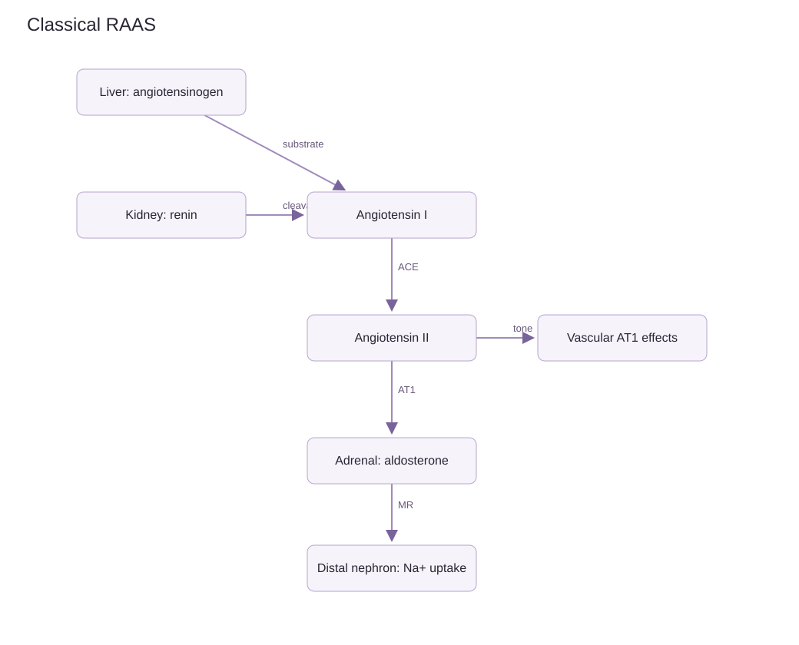
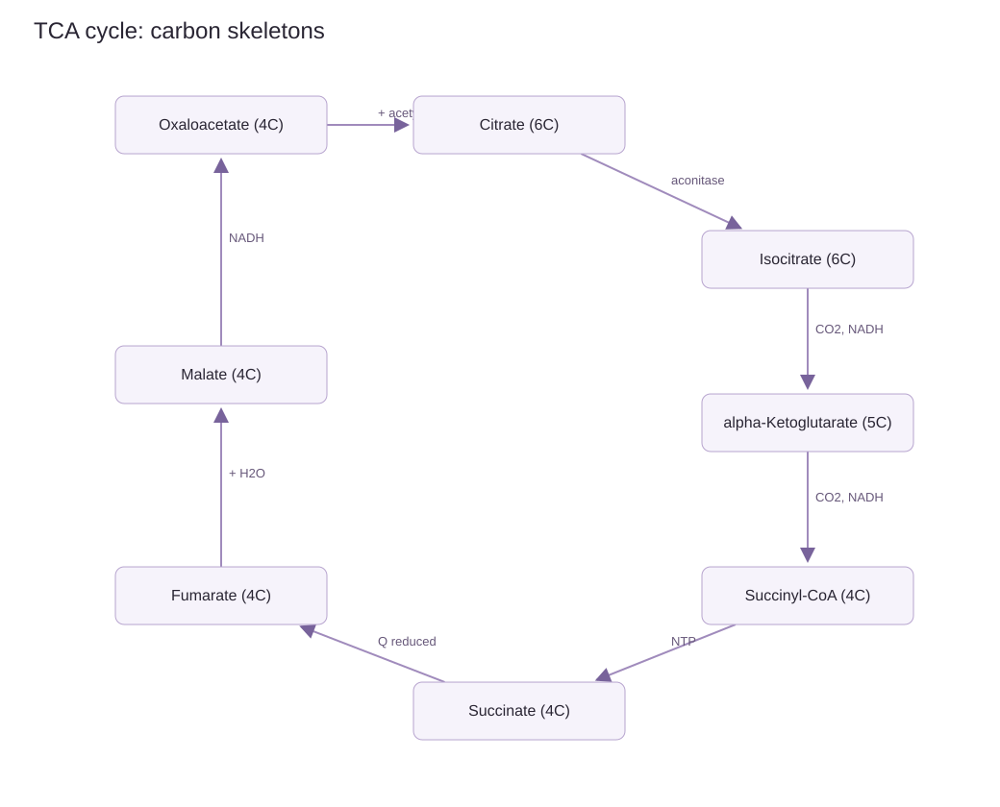

# 생리학·생화학·세포·분자·유전학

# 생리학

## 심장주기와 압력-용적 관계

### 학습목표

- 압력차로 판막 상태를 예측한다.
- 압력-용적 고리에서 심실 일을 설명한다.
- 전부하·후부하·수축력의 변화를 구분한다.

### 주기를 정의하는 기준

심장주기(cardiac cycle)는 한 박동의 시작부터 다음 박동의 같은 시점까지 일어나는 전기적·기계적 사건의 연속이다. 심전도는 전기 활성의 합성 신호이고, 수축은 세포내 칼슘 변화와 가교 순환이 만들어 내는 기계적 반응이므로 두 사건은 동시에 시작하지 않는다. 이 절에서 수축기와 이완기는 특별한 언급이 없으면 심실을 기준으로 한다. 좌우 심장은 비슷한 사건 순서를 공유하지만 폐순환과 체순환의 압력과 저항은 다르다. 따라서 좌심실 압력 수치를 그대로 우심실에 적용해서는 안 된다.

판막은 압력차에 반응하는 수동 장치다. 좌심방압이 좌심실압보다 높을 때 승모판을 통한 유입이 가능하고, 좌심실압이 대동맥압을 넘어설 때 대동맥판이 열린다. 정상적인 순방향 유동을 설명할 때 이 압력관계가 출발점이다. 판막이 열려 있다는 사실이 곧 높은 유량을 뜻하는 것은 아니다. 유량은 압력차, 유효 개구면적, 유체 관성, 시간에 따라 달라지며 판막 협착에서는 작은 개구면적 때문에 큰 압력차가 생길 수 있다.

### 충만에서 박출까지

심실이 이완하여 심실압이 심방압 아래로 떨어지면 방실판막이 열리고 빠른 충만이 시작된다. 초기 충만은 심방의 수축만으로 설명되지 않으며 심실의 능동적 이완, 탄성 반동, 심방과 심실 사이 압력차가 관여한다. 이어 충만 속도가 감소하는 이완중기(diastasis)가 나타나고, 이완기 말 심방 수축이 추가 충만에 기여한다. 심방 기여도는 심박수, 연령, 심실 순응도, 리듬에 따라 변한다. 심방세동에서 심방의 조직적인 수축이 사라지면 뻣뻣한 심실을 가진 환자에서 충만이 특히 나빠질 수 있다.

심실이 수축하여 방실판막이 닫힌 뒤 반달판막이 아직 열리지 않은 시기를 등용적수축(isovolumetric contraction)이라 한다. 네 판막이 모두 닫혀 있기 때문에 정상적 조건에서는 심실 용적 변화가 작지만 압력은 빠르게 상승한다. 이후 심실압이 대동맥압을 넘어 대동맥판이 열리면 박출이 시작된다. 심실압은 박출 내내 계속 오르는 것이 아니며, 근육 활성과 혈액 유출이 변하면서 최고점 이후 감소한다. 박출이 끝나면 대동맥 쪽에서 심실로 향하는 압력차와 짧은 역류가 판막 닫힘에 관여한다.

대동맥판이 닫힌 뒤 승모판이 다시 열리기까지는 등용적이완(isovolumetric relaxation)이다. 이완은 ATP가 필요 없는 단순한 수동 정지가 아니다. 세포질 칼슘을 근소포체로 회수하는 SERCA와 세포 밖으로 제거하는 운반체, 액틴-미오신 가교의 분리에는 에너지 의존 과정이 포함된다. 허혈로 ATP 공급이 제한되면 수축뿐 아니라 이완도 손상될 수 있다. 이완 기능장애는 박출률이 보존된 상태에서도 충만압 상승과 폐울혈을 일으킬 수 있다.

### 용적과 심박출량

이완기말용적(end-diastolic volume, EDV)에서 수축기말용적(end-systolic volume, ESV)을 빼면 일회박출량(stroke volume, SV)을 얻는다. 박출률(ejection fraction, EF)은 일회박출량을 이완기말용적으로 나눈 값이다. 같은 박출률이라도 심실 용적이 다르면 실제 박출량은 달라진다. 예를 들어 EDV가 120 mL, ESV가 50 mL인 교육용 사례에서 SV는 70 mL이고 EF는 약 0.583이다. 이 숫자는 정의를 연습하기 위한 예시이며 개인의 정상·비정상 경계값을 정하는 지침이 아니다.

심박출량(cardiac output, CO)은 심박수(HR)와 SV의 곱이다. 단위를 맞추면 회/분과 mL/회의 곱이 mL/분이 된다. 심박수를 올리면 CO가 무한히 증가하는 것은 아니다. 빈맥이 심해지면 특히 이완기 시간이 짧아져 충만과 관상관류가 제한될 수 있다. 정상상태에서 전신 정맥환류량과 심박출량은 같아야 하지만, 짧은 과도기에는 혈액이 특정 구획에 축적될 수 있다. 따라서 정맥환류와 심장 펌프 기능은 서로 독립적인 두 숫자가 아니라 순환계 전체에서 함께 결정되는 변수다.

### 압력-용적 고리와 일

압력-용적 고리(pressure-volume loop)는 가로축에 심실 용적, 세로축에 심실압을 놓는다. 충만은 아래쪽에서 오른쪽으로, 등용적수축은 오른쪽에서 위로, 박출은 위쪽에서 왼쪽으로, 등용적이완은 왼쪽에서 아래로 진행한다. 고리 내부의 면적은 한 박동에서 혈액을 내보내는 외부 일의 근사치이며, 수학적으로 닫힌 경로의 적분 W=∮P dV로 나타낸다. 수직선 구간은 dV가 거의 0이므로 압력이 높아져도 이 정의의 외부 용적 일은 작다. 그렇다고 등용적수축에 산소나 ATP가 필요 없다는 뜻은 아니다.

전부하(preload)는 심근이 수축하기 직전 받는 신장 또는 벽응력과 관련된 개념이다. EDV나 이완기말압은 임상적 대리지표지만 전부하 그 자체와 항상 같은 것은 아니다. 같은 EDV에서도 벽 두께와 형상이 다르면 섬유 신장과 벽응력이 달라질 수 있다. 후부하(afterload)는 심실이 박출 중 극복해야 할 부하이며, 동맥압 외에도 유출로 협착, 혈관 임피던스, 심실 형상이 영향을 준다. 수축력(contractility)은 부하 조건과 구분하려는 심근 고유의 활성 상태로, 단일 박출률만으로 정확히 정량화하기 어렵다.

다른 조건이 비슷할 때 전부하 증가가 박출량 증가로 이어지는 현상을 Frank-Starling 관계로 설명한다. 이 현상은 단순히 필라멘트가 길어져 더 많이 겹친다는 말만으로 충분하지 않다. 근절 길이에 따른 칼슘 민감도와 근필라멘트 상호작용도 관여한다. 수축력이 증가하면 같은 전부하와 후부하에서 ESV가 줄고 SV가 증가하는 방향으로 고리가 변할 수 있다. 후부하가 갑자기 증가하면 처음에는 박출이 줄고 ESV가 커질 수 있다. 실제 환자에서는 반사성 변화와 체액 변화가 겹치므로 한 변수만 변하는 교육용 고리와 구분해야 한다.

### 심음과 오개념

제1심음(S1)은 방실판막 닫힘을 포함한 수축기 시작 무렵 심장 구조의 진동과 관련되고, 제2심음(S2)은 반달판막 닫힘 무렵의 진동과 관련된다. 심음을 단순한 판막 판엽끼리의 충돌 소리로만 이해하면 압력과 주변 조직의 역할을 놓친다. 들리는 잡음의 시기는 압력차가 형성되는 시기와 연결해야 한다. 수축기 잡음에는 대동맥판 협착과 승모판 역류처럼 서로 다른 기전이 포함된다.

$$
SV = EDV-ESV; \quad EF=SV/EDV; \quad CO=HR\cdot SV
$$

SV: 일회박출량; EDV: 이완기말용적; ESV: 수축기말용적; EF: 박출률; CO: 심박출량; HR: 심박수

### 확인 문제

EDV 120 mL, ESV 50 mL일 때 SV는?

A. 170 mL
B. 70 mL

**정답: B**

SV는 EDV에서 ESV를 뺀 값이다.

**오답 해설**

A: 두 용적을 합하면 박출량 정의와 다르다.

## 사구체 여과와 청소율의 해석

### 학습목표

- 청소율의 단위를 유도한다.
- 여과분획과 신혈장류를 구분한다.
- 혈관 저항 변화와 여과장벽 손상의 영향을 설명한다.

### 신장이 하는 분리 작업

사구체(glomerulus)는 들세동맥으로 들어온 혈액이 모세혈관망을 지난 뒤 날세동맥으로 나가는 독특한 혈관 구조다. 여과된 액체는 보먼주머니 공간으로 들어가 세뇨관을 따라 이동한다. 신장이 배설하는 최종 소변은 단순히 혈액을 체로 거른 결과가 아니다. 여과, 재흡수, 분비를 거치며 물과 용질의 양이 크게 달라진다. 물질 x의 배설률은 여과량에서 재흡수량을 빼고 분비량을 더한 값으로 표현할 수 있다. 이 질량보존 관계를 먼저 세우면 각 표지물질의 청소율을 해석하기 쉽다.

여과장벽은 유창내피, 사구체기저막, 발세포 사이의 세극막을 포함한다. 혈구는 정상적으로 통과하지 않으며 단백질의 통과도 크기, 형태, 전하 및 장벽의 통합된 성질에 의해 제한된다. 장벽을 분자량 하나의 날카로운 기준으로 설명하면 부정확하다. 혈장단백질에 결합한 약물은 자유형 분획과 결합형 분획을 나누어 생각해야 한다. 사구체 여과액의 포도당과 전해질 농도가 혈장 수분의 농도와 유사할 수 있어도 모든 혈장 성분이 자유롭게 여과된다고 말할 수는 없다.

### Starling 힘과 조절

단순화한 여과 모형은 GFR=Kf[(Pgc-Pbs)-(πgc-πbs)]로 쓴다. Pgc는 사구체 모세혈관 정수압, Pbs는 보먼주머니 정수압, πgc와 πbs는 각 구획의 교질삼투압이다. Kf는 수력전도도와 여과면적을 포함하는 계수다. 정상적으로 여과액의 단백질 농도는 낮아 πbs를 작게 볼 수 있다. 모세혈관을 따라 물이 여과되면 남은 혈장의 단백질이 농축되어 πgc가 상승하므로, 실제 여과압은 모세혈관 길이에 따라 일정하지 않다.

들세동맥 수축은 보통 혈류와 사구체압을 줄여 GFR을 감소시키는 방향으로 작용한다. 날세동맥의 중등도 수축은 사구체압을 유지하거나 높이면서 신혈장류를 줄일 수 있다. 그러나 날세동맥 수축이 아주 심해지면 혈장류 감소와 단백질 농축에 따른 교질삼투압 증가 때문에 GFR도 줄 수 있다. 그러므로 날세동맥 수축은 언제나 여과를 증가시킨다는 명제는 옳지 않다. 요로폐색으로 보먼주머니 쪽 압력이 상승하는 경우에는 혈류가 유지되어도 여과를 방해할 수 있다.

근원성 반응(myogenic response)은 혈관벽 신장에 대한 국소 평활근 반응으로 혈류의 변동을 완화한다. 세뇨관사구체되먹임(tubuloglomerular feedback)은 치밀반(macula densa)이 관강의 NaCl 전달을 감지하고 인접 혈관과 레닌 분비에 영향을 주는 조절 과정이다. 이 과정에서 관강의 전달량, 재흡수 정도, 수송체 기능은 서로 연결된다. 치밀반에 NaCl이 적게 도달했다는 사실만으로 몸 전체의 나트륨이 반드시 부족하다고 단정할 수 없다. 순환 상태와 약물, 상류 세뇨관의 기능을 함께 해석해야 한다.

### 청소율을 유도하기

청소율(clearance)은 단위 시간에 특정 물질이 완전히 제거된 것으로 환산되는 가상의 혈장 부피다. 실제 혈장이 통째로 사라진다는 뜻이 아니다. 소변 농도를 Ux, 분당 소변량을 V, 혈장 농도를 Px라 하면 소변으로 나가는 물질량은 UxV이고, 이를 Px로 나누면 Cx=UxV/Px를 얻는다. Ux와 Px의 농도 단위가 같으면 소거되어 청소율은 mL/min 같은 부피/시간 단위를 가진다. 분모 혈장 농도는 채뇨 기간의 상태를 적절히 대표해야 한다.

자유롭게 여과되고 재흡수·분비·대사가 없는 표지물질은 청소율이 GFR과 같다. 이눌린(inulin)은 이 원리를 설명하는 대표 물질이다. 크레아티닌(creatinine)은 체내 생성이라는 편의가 있으나 소량의 세뇨관 분비가 있고, 생성량도 근육량 등에 영향을 받는다. 따라서 크레아티닌 청소율은 GFR을 약간 높게 추정할 수 있다. 혈청 크레아티닌을 이용한 추정 GFR은 별도의 방정식이며 직접 측정값과 구분해야 한다. 급격히 신기능이 변할 때는 혈중 농도가 정상상태에 도달하지 않아 해석에 제한이 있다.

신혈장류(renal plasma flow, RPF)는 신혈류(RBF)에 혈장 분율을 곱한 RPF=RBF(1-적혈구용적률)로 계산한다. 여과분획(filtration fraction, FF)은 GFR/RPF이다. RBF를 분모에 넣으면 다른 양을 계산하는 것이므로 구분해야 한다. 파라아미노마뇨산(PAH)은 적절한 낮은 농도에서 여과와 분비를 통해 상당 부분 제거되어 유효 신혈장류 추정에 쓰이는 원리를 보여준다. 추출이 완전하지 않으며 수송체 포화가 생길 수 있으므로 PAH 청소율을 모든 농도에서 실제 RPF와 같다고 하면 틀린다.

### 임상적 연결

단백뇨는 장벽 이상뿐 아니라 여과된 단백질의 세뇨관 처리 장애나 과다생산으로도 생길 수 있다. 혈뇨 역시 사구체와 요로의 여러 부위에서 기원한다. 검사 결과는 신기능 저하의 원인과 병변 위치를 서로 다른 차원에서 제공한다.

$$
C_x=\frac{U_x\dot V}{P_x}
$$

C_x: 청소율; U_x: 소변 농도; P_x: 혈장 농도; dot V: 소변 유량

### 확인 문제

UxV/Px의 차원은?

A. 질량/시간
B. 부피/시간

**정답: B**

농도끼리 소거되어 부피/시간이 남는다.

**오답 해설**

A: 질량/시간은 배설률 UxV의 차원이다.

## 레닌-안지오텐신-알도스테론계의 통합 생리

### 학습목표

- 레닌 분비 자극과 호르몬 전달 경로를 설명한다.
- 알도스테론과 ADH의 작용을 구분한다.
- RAAS 억제 후 신기능 변화의 기전을 해석한다.

### 유효 순환량을 감지하는 계통

레닌-안지오텐신-알도스테론계(renin-angiotensin-aldosterone system, RAAS)는 신장 관류, 나트륨 취급, 혈관 긴장도를 연결한다. 유효동맥혈량(effective arterial blood volume)은 동맥 순환이 조직 관류에 얼마나 적절히 기여하는가를 표현하는 기능적 개념이다. 총체액량과 동의어가 아니다. 심부전이나 간경변에서는 부종이나 복수가 있어도 신장이 받아들이는 관류 신호가 부족하여 나트륨 보존 반응이 활성화될 수 있다. 따라서 부종이 있으니 모든 체액 보존 호르몬이 억제되어야 한다는 추론은 성립하지 않는다.

레닌(renin)은 들세동맥 벽의 과립세포에서 분비되는 단백분해효소다. 관류압 저하, 치밀반에 도달하는 NaCl 신호 감소, 교감신경 β1 수용체 자극은 레닌 분비를 촉진하는 주요 경로다. 이 신호들은 단순한 한 줄의 농도계가 아니라 혈관벽과 세뇨관, 자율신경을 통합한다. 치밀반 신호는 NKCC2를 통한 NaCl 감지와 인접 세포 사이의 국소 매개물질 전달에 의존한다. 고리이뇨제가 이 수송체를 차단하면 실제 체액 변화와 더불어 감지 과정에도 영향을 줄 수 있다.

### 효소 연쇄와 수용체

간에서 주로 합성된 안지오텐시노젠(angiotensinogen)은 레닌에 의해 절단되어 안지오텐신 I이 된다. 안지오텐신전환효소(angiotensin-converting enzyme, ACE)는 이를 안지오텐신 II로 전환한다. 폐혈관 내피가 중요한 반응 장소이지만 ACE가 폐에만 존재하는 것은 아니다. ACE는 브래디키닌 분해에도 관여하므로 ACE 억제제의 효과와 부작용을 안지오텐신 II 감소만으로 모두 설명할 수 없다. 국소 조직 RAAS와 ACE 외의 생성 경로도 있어 혈중 농도만으로 모든 조직 작용을 대변하기 어렵다.

안지오텐신 II는 AT1 수용체를 통해 혈관수축, 알도스테론 분비, 신장 나트륨 재흡수, 갈증과 바소프레신 분비에 영향을 준다. AT1은 G 단백질 연결수용체이며 여러 세포내 신호를 활성화한다. 급성 혈압 조절에 도움이 되는 반응이 만성 과활성 상태에서는 심혈관 재형성과 장기 손상에 기여할 수 있다. 한 생리계가 정상상태의 보상과 질환 상태의 악화에 모두 관여할 수 있다는 점이 중요하다. ACE2-안지오텐신-(1-7) 축 등은 고전적 RAAS와 다른 방향의 조절을 제공하지만, 이를 완전히 반대인 두 스위치로 단순화하면 조직별 복잡성을 놓친다.

### 부신과 원위 네프론

알도스테론(aldosterone)은 부신겉질의 토리층(zona glomerulosa)에서 합성되는 스테로이드호르몬이다. 안지오텐신 II와 혈중 칼륨 상승이 중요한 분비 자극이다. ACTH도 영향을 줄 수 있지만 장기 조절의 중심을 코르티솔과 똑같이 설명하지 않는다. 스테로이드 합성에는 콜레스테롤 공급과 여러 효소가 필요하며, 코르티솔과 알도스테론 합성의 차이는 부신겉질 층별 효소 발현과 연결된다. 부신 전체 모델은 이런 층별 효소 분포를 직접 보여주지 못한다.

알도스테론은 원위 네프론 주세포(principal cell)에서 미네랄코르티코이드수용체(mineralocorticoid receptor, MR)를 활성화하여 ENaC, Na+/K+-ATPase 및 관련 조절단백질의 기능에 영향을 준다. 관강에서 나트륨 재흡수가 증가하면 칼륨 분비를 촉진하는 전기화학적 조건이 형성될 수 있다. 그러나 칼륨 분비량은 알도스테론 농도만으로 정해지지 않는다. 원위 나트륨 전달량, 세뇨관 유량, 혈중 칼륨, ROMK와 BK 통로의 상태가 함께 관여한다. 사이세포(intercalated cell)의 산 분비도 알도스테론 작용과 연결된다.

미네랄코르티코이드수용체는 코르티솔에도 결합할 수 있다. 표적 조직의 11β-hydroxysteroid dehydrogenase type 2는 코르티솔을 코르티손으로 전환하여 수용체 선택성을 유지하는 데 기여한다. 이 효소가 억제되거나 기능이 떨어지면 알도스테론 자체가 높지 않아도 미네랄코르티코이드 과다와 유사한 양상이 나타날 수 있다. 따라서 고혈압과 저칼륨혈증에서 레닌과 알도스테론을 함께 보는 이유는 단순한 호르몬 수치 측정을 넘어 조절 경로의 위치를 추론하기 위해서다.

### 물 조절 및 약리와의 연결

알도스테론은 나트륨 보존을 조절하고, 항이뇨호르몬(antidiuretic hormone, ADH; vasopressin)은 집합관의 물 투과성을 조절하는 핵심 호르몬이다. ADH의 V2 수용체 자극은 aquaporin-2의 관강막 삽입을 촉진한다. 물은 삼투 기울기와 투과성이 허용하는 범위에서 이동하므로 나트륨 재흡수 증가가 항상 같은 정도의 자유수 보존을 뜻하지 않는다. 혈청 나트륨 농도는 체내 나트륨 총량만의 지표가 아니라 교환 가능한 양이온과 총체수분의 관계를 반영한다.

ACE 억제제와 안지오텐신수용체차단제(angiotensin receptor blocker, ARB)는 RAAS의 서로 다른 지점을 차단한다. 사구체의 날세동맥 긴장이 줄면 사구체내압이 낮아져 치료 초기에 여과 지표가 변할 수 있다. 이는 신실질의 직접 독성과 구분해야 하지만, 심한 저관류나 특정 혈관 질환 상황에서는 임상적으로 중요한 신기능 저하가 생길 수 있다. 알도스테론 효과 감소는 칼륨 배설도 줄일 수 있으므로 칼륨과 신기능 감시가 필요하다.

### 확인 문제

부종이 있으면 RAAS는 반드시 억제되는가?

A. 아니다.
B. 그렇다.

**정답: A**

유효동맥혈량은 총체액량과 다를 수 있다.

**오답 해설**

B: 총체액 증가만으로 신장 관류 신호를 정할 수 없다.

## 네프론 분절별 물질수송과 이뇨제 표적

### 학습목표

- 관강막·바닥가쪽막의 수송을 연결한다.
- 분절별 물·전해질 처리의 차이를 설명한다.
- 이뇨제 작용점에서 전해질 변화를 추론한다.

### 여과된 물질의 행방

사구체를 통과한 물질은 세뇨관에서 재흡수되거나 분비된다. 물질의 소변 배설률은 여과부하에서 재흡수량을 빼고 분비량을 더한 값이다. 여과부하는 혈장 농도와 사구체여과율의 곱으로 계산하되, 단백질 결합과 여과 가능 분율을 고려한다. 재흡수율은 여과량의 몇 퍼센트를 회수하는지, 재흡수량은 단위 시간에 실제로 얼마를 회수하는지 나타낸다. 여과율이 변하면 같은 분율을 회수하더라도 절대량은 달라진다.

상피를 통한 이동은 세포를 통과하는 경로와 세포 사이를 지나는 경로로 나뉜다. 세포를 통과하려면 관강막 유입과 바닥가쪽막 유출이 연결되어야 한다. 관강 쪽 수송체의 이름만 알아서는 전체 재흡수의 방향을 설명할 수 없다. 세포 사이 경로는 tight junction의 분자 구성과 전압·농도차, 물의 흐름에 영향을 받는다. 각 분절의 누출성과 선택성 차이는 그 분절이 대량 회수와 정밀 조절 중 어느 역할에 적합한지를 결정한다.

### Na+/K+-ATPase가 만드는 구동력

바닥가쪽막의 Na+/K+-ATPase는 ATP를 사용하여 Na+를 세포 밖으로, K+를 안으로 이동시킨다. 낮은 세포내 Na+ 농도는 관강에서 Na+가 들어오는 여러 이차능동수송의 에너지원이다. 이 기울기에 포도당·아미노산 공동수송과 Na+/H+ 교환 등이 연결된다. Na+가 재흡수되면 전하 균형과 삼투 조건에 따라 다른 이온과 물의 이동이 따라오지만, 그 결합 정도는 분절의 물 투과성과 수송체에 따라 달라진다.

세뇨관은 ATP를 소비하는 대사 조직이다. 신장 전체 혈류가 많아도 분절마다 산소 공급과 수요가 같지는 않다. 특히 수질의 산소 환경과 활발한 용질수송은 허혈·독성 손상의 취약성과 연결된다. 산소 소비가 감소했다는 사실이 언제나 기능 개선을 뜻하지는 않는다. 여과부하가 줄었거나 수송이 손상되어 소비가 낮아진 경우도 있기 때문이다.

### 근위세뇨관의 대량 회수

근위세뇨관(proximal tubule)은 여과된 Na+와 물의 큰 부분, 대부분의 중탄산과 포도당·아미노산을 회수한다. 높은 수송능력에 적합하게 솔가장자리와 많은 미토콘드리아, 넓은 바닥가쪽막이 발달한다. 비교적 높은 물 투과성 때문에 용질 재흡수와 물 이동이 함께 일어나 관강액의 삼투농도가 혈장과 크게 벌어지지 않는 방향으로 처리된다. 이는 모든 용질의 농도가 일정하다는 뜻은 아니다. 선택적 회수에 따라 관강의 조성은 계속 바뀐다.

포도당은 Na+와 공동수송되어 세포 안으로 들어오고 바닥가쪽막의 GLUT 계통을 통해 혈액 쪽으로 이동한다. 앞쪽과 뒤쪽 분절의 수송체는 용량과 친화도에 차이가 있다. 여과부하가 수송능력을 넘어가면 포도당이 소변에 나타날 수 있다. 개별 네프론의 수송능력이 균일하지 않고 수송의 포화가 점진적이어서, 전체 신장의 관찰 곡선은 날카로운 한 점에서 꺾이지 않고 splay를 보일 수 있다.

중탄산 재흡수는 여과된 HCO3−가 그대로 관강막을 통과하는 것으로만 설명되지 않는다. 세포가 분비한 H+가 관강의 HCO3−와 반응하고, 탄산무수화효소에 의해 생성된 CO2가 세포 안으로 들어온 뒤 HCO3−가 다시 형성되어 혈액 쪽으로 이동한다. 여기서 분비된 H+가 재활용되면 순산 배설과 같은 의미가 아니다. 여과된 염기를 회수하는 과정과 새로운 중탄산을 혈액에 공급하는 과정을 구분해야 한다.

근위세뇨관은 인산과 여러 유기물질도 처리하고, 유기 음이온·양이온의 분비를 통해 약물과 대사물 제거에 관여한다. 서로 다른 약물이 같은 수송체를 이용하면 경쟁과 노출 변화가 생길 수 있다. 혈장 단백질에 결합한 약물은 자유형 여과와 수송체 분비를 구분하여 해석한다. 근위세뇨관 기능이 넓게 손상되면 포도당·인산·아미노산과 중탄산의 손실이 함께 나타나는 양상이 가능하다.

### Henle 고리의 역할 분담

Henle 고리의 내림부분은 물과 용질 투과성이 분절에 따라 다르며, 주변 수질의 높은 삼투농도에 의해 관강액이 농축될 수 있다. 굵은오름부분(thick ascending limb)은 NKCC2를 통해 Na+, K+와 Cl−를 관강에서 세포 안으로 이동시킨다. 이 분절은 물 투과성이 낮아 소금을 회수하면서 관강액을 희석할 수 있다. 수질의 농도 기울기를 형성하는 능력과 묽은 소변을 만드는 능력에 모두 중요하다.

관강 쪽 K+ 재순환은 NKCC2 작동에 필요한 K+ 가용성과 관강 양전위 형성에 기여한다. 이 전위는 Ca2+와 Mg2+ 등 일부 양이온의 세포사이 재흡수에 영향을 준다. NKCC2를 억제하는 고리이뇨제는 NaCl 회수와 수질 기울기를 감소시키고 Ca2+·Mg2+ 배설에도 영향을 줄 수 있다. 효과는 투여량뿐 아니라 표적 부위로의 약물 전달, 여과와 혈류, 하류의 보상 재흡수에 좌우된다.

### 원위세뇨관과 집합계

원위굽은세뇨관의 NCC는 Na+와 Cl− 재흡수에 관여하며 thiazide 계열의 주요 표적이다. 이 부위의 Ca2+ 처리는 NaCl 수송과 같은 통로 하나로 이루어지지 않는다. 관강막의 Ca2+ 유입과 세포내 결합·이동, 바닥가쪽막 유출이 연결되고 호르몬이 이를 조절한다. 고리이뇨제와 thiazide가 칼슘 배설에 미치는 방향이 다른 것은 작용 분절과 전압·세포내 기울기가 다르기 때문이다.

연결세뇨관과 집합관의 주세포(principal cell)는 ENaC를 통한 Na+ 회수, K+ 분비 및 물 투과성 조절에 중요하다. ENaC를 통해 양전하가 흡수되면 관강이 상대적으로 음성이 되는 조건이 형성되어 K+ 분비에 영향을 준다. ROMK와 BK 통로, 원위 Na+ 전달과 유량, aldosterone 및 혈중 K+가 함께 배설량을 결정한다. K+ 보존 효과가 있는 이뇨제도 작용점에 따라 ENaC 차단과 mineralocorticoid 수용체 차단으로 구분된다.

사이세포(intercalated cell)는 산염기 처리에 특화된 기능을 가진다. 산 분비와 중탄산 분비에 관여하는 세포 유형의 막수송체 배치가 다르며, 혈액과 관강 사이에 어떤 방향으로 산·염기 상당량이 이동하는지를 따라가야 한다. 한 분절의 이름이 같아도 주세포와 사이세포의 기능을 같은 상피세포의 단일 작업으로 합치지 않는다.

### 분절 차단 후 나타나는 보상

상류에서 Na+ 재흡수를 억제하면 하류에 도달하는 Na+와 유량이 증가한다. 하류가 이를 회수할 여지가 있으면 이뇨 효과가 일부 상쇄될 수 있고, 장기간에는 수송체와 조직 기능이 적응할 수 있다. 서로 다른 분절을 차단하는 병용은 이 원리를 이용하지만 수분·전해질 및 신기능 변화도 커질 수 있다. 원위 Na+ 전달 증가와 RAAS 활성은 K+·H+ 배설 변화와 연결된다.

소변 Na+ 농도 한 번만으로 약물 효과와 전신 Na+ 균형을 모두 알 수는 없다. 농도와 배설량은 소변 유량을 통해 구분되고, 투약 시각과 채뇨 시점에 따라 결과가 달라진다. 부종이 줄어도 혈관 내 상태와 신장 관류는 별도로 평가한다. 분절별 수송을 이해하면 여러 이뇨제의 전해질 부작용과 보상 반응을 하나의 질량보존 틀 안에서 설명할 수 있다.

### 확인 문제

NKCC2 억제 후 소변 농축능이 감소할 수 있는 주된 기전은?

A. 수질 삼투 기울기 형성의 감소
B. ADH 합성의 필수적 완전 중단
C. 집합관의 모든 물 통로 영구 파괴

**정답: A**

굵은오름부분의 NaCl 재흡수 감소가 수질 기울기에 영향을 준다.

**오답 해설**

B: 이뇨제의 분절 작용에서 ADH 합성 중단을 필연적으로 추론할 수 없다.

C: 관강 수송 억제를 모든 물 통로의 구조적 파괴와 동일시할 수 없다.

## 역류계와 소변 농축·희석

### 학습목표

- 삼투농도와 등장성·긴장도를 구분한다.
- 역류증폭과 역류교환의 역할을 설명한다.
- ADH와 자유수청소율을 연결한다.

### 농축하려면 기울기와 투과성이 모두 필요하다

신장은 물 섭취와 용질 배설의 변화에 맞추어 소변 농도를 바꾼다. 농축 소변을 만들려면 수질의 높은 삼투농도와 집합관의 적절한 물 투과성이 함께 필요하다. 기울기가 있어도 물이 통과하지 못하면 관강액은 충분히 농축되지 않고, 물 투과성이 높아도 기울기가 소실되면 농축 능력이 제한된다. ADH 농도 하나만으로 전체 농축 기능을 설명할 수 없는 이유다.

삼투농도(osmolality)는 용매 질량당 삼투 입자 수를 표현하며, 긴장도(tonicity)는 세포막을 사이에 두고 지속적인 물 이동을 만드는 유효 삼투 입자의 영향을 가리킨다. Urea처럼 세포막을 통과하는 정도가 큰 용질은 총삼투농도에 기여하면서도 조직과 시간에 따라 긴장도에 대한 영향이 다를 수 있다. 삼투농도와 Na+ 농도, 체내 Na+ 총량을 서로 같은 양으로 취급하지 않는다.

### 역류증폭의 직관

Henle 고리의 내림부분과 오름부분은 흐름 방향과 막 특성이 다르다. 굵은오름부분은 물을 거의 따라오지 않게 하면서 NaCl을 재흡수하여 주변 간질과 관강 사이의 작은 횡방향 차이를 만든다. 인접한 내림부분에서는 물 이동 등으로 주변과의 평형을 향한 변화가 일어난다. 여기에 관강액의 지속적인 흐름이 겹치면 작은 국소 차이가 고리의 길이 방향으로 누적되어 더 큰 기울기를 만들 수 있다. 이를 역류증폭(countercurrent multiplication)으로 설명한다.

고리가 한 번에 수질 전체의 농도 차이를 펌프질해 만드는 것은 아니다. 각 위치에서의 수송과 투과, 흐름이 반복되면서 기울기가 유지된다. 바깥수질과 속수질은 기여하는 수송·용질과 구조가 달라 속수질 농축을 굵은오름부분의 NKCC2만으로 모두 설명할 수 없다. 긴 고리를 가진 네프론과 짧은 고리 네프론, 집합관 및 혈관의 배열을 함께 고려해야 한다.

### Urea 재순환과 곧은혈관

집합관에서 물이 빠져나가면 관강 urea 농도가 높아질 수 있다. 속수질 집합관의 urea 투과성과 다른 네프론 분절의 수송은 urea가 수질에 머무르며 재순환하는 데 기여한다. Urea는 단순히 버려지는 질소 부산물인 동시에 수질 삼투 기울기의 중요한 성분이다. 단백질 섭취와 urea 생성·배설, 호르몬과 유량 변화는 농축 능력에 영향을 줄 수 있다.

수질의 곧은혈관(vasa recta)은 혈류를 제공하면서 용질 기울기의 과도한 소실을 줄이는 역류교환(countercurrent exchange)을 수행한다. 내림·오름 혈관 사이에서 물과 용질이 교환되어, 들어오는 혈액이 수질 용질을 모두 씻어내지 않도록 돕는다. 역류교환은 기울기의 주된 생성 장치인 역류증폭과 다르다. 수질 혈류가 과도하게 증가하면 washout이 커질 수 있지만, 혈류가 너무 적으면 조직 산소 공급이 위협받으므로 두 요구 사이의 균형이 필요하다.

### ADH와 물 통로

Vasopressin은 집합관 주세포의 V2 수용체를 통해 cAMP 계통을 활성화하고 aquaporin-2의 관강막 삽입을 촉진한다. 물은 관강에서 세포로 들어온 뒤 바닥가쪽막의 물 통로 등을 통해 간질 쪽으로 이동한다. 저장 소포의 이동에 의한 빠른 조절과 물 통로 발현량의 장기 변화는 시간 규모가 다르다. ADH가 물을 능동적으로 끌어내는 펌프가 아니라 물이 삼투 기울기를 따라 이동할 수 있는 투과 경로를 바꾸는 신호라는 점이 핵심이다.

혈장 삼투 자극과 순환량·압력 신호는 vasopressin 분비를 함께 조절한다. 심한 유효 순환량 감소에서는 삼투 자극과 다른 방향의 물 보존 반응이 나타날 수 있다. 갈증은 물 섭취를 조절하여 배설 조절과 함께 균형을 유지한다. ADH 분비가 낮거나 신장이 반응하지 못하는 상태와, 이뇨로 수질 기울기가 손상된 상태는 모두 농축 장애를 만들 수 있으나 원인과 검사 반응은 다르다.

### 묽은 소변의 형성

물 투과성이 낮은 상태에서 오름부분과 원위 분절이 용질을 재흡수하면 관강액이 희석된다. 집합관도 물을 적게 통과시키면 희석액을 충분히 재농축하지 않고 배출할 수 있다. 반대로 용질 재흡수 자체가 손상되거나 원위 전달이 적으면 물을 많이 마셨더라도 배출 가능한 자유수량이 제한될 수 있다. 신장의 희석 능력은 ADH의 낮은 분비뿐 아니라 여과와 상류·원위 수송에도 의존한다.

소변으로 배출해야 하는 용질량을 일정하게 놓으면 소변 유량과 농도는 서로 연결된다. 배설량=농도×유량이므로 같은 용질을 매우 묽게 내보낼수록 많은 물이 필요하고, 농축할수록 필요한 물은 줄어든다. 하루 최소 소변량은 용질 부하와 최대 농축 능력의 관계에 따라 달라진다. 따라서 특정한 고정 소변량을 모든 식이와 모든 환자의 필수 배설량으로 일반화할 수 없다.

### 청소율로 물 처리를 표현하기

삼투청소율(Cosm)은 Uosm×V/Posm이다. Uosm은 소변 삼투농도, Posm은 혈장 삼투농도, V는 소변 유량이다. 자유수청소율(CH2O)은 V−Cosm으로 정의하며, 혈장과 등장성인 용질 운반에 필요한 부피를 제외한 물의 순배설을 표현한다. 양수이면 혈장보다 묽은 소변을 통해 자유수를 내보내는 방향이고 음수이면 용질에 비해 물을 보존하는 방향이다.

이 계산은 총삼투 입자를 사용하므로 urea 등 전해질과 다른 용질의 영향을 포함한다. 혈청 Na+ 변화와의 관계를 평가할 때는 소변 Na+와 K+를 이용한 전해질 자유수청소율이 다른 정보를 줄 수 있다. 어떤 정의를 쓰는지에 따라 같은 소변의 해석이 달라질 수 있으므로 기호와 분모를 명확히 한다. 순간 측정값은 투약과 수액, 섭취 및 배설의 시간 변화 속에서 해석해야 한다.

### 확인 문제

Uosm=600, Posm=300 mOsm/kg, 소변 유량이 1 mL/min이면 자유수청소율은?

A. +1 mL/min
B. 2 mL/min
C. −1 mL/min

**정답: C**

Cosm=600×1/300=2이므로 CH2O=1−2=−1이다.

**오답 해설**

A: 양수와 음수의 의미를 뒤바꾼 계산이다.

B: 2는 삼투청소율이며 자유수청소율과 다르다.

## 칼륨의 세포내 분포와 신장 배설

### 학습목표

- 세포간 이동과 총체내 칼륨 변화를 구분한다.
- 원위 네프론의 분비 조절을 설명한다.
- 칼륨·나트륨·체액량 조절의 연결을 해석한다.

### 농도와 총량을 분리한다

칼륨(K+)은 주된 세포내 양이온으로 막전위와 근육·신경 기능, 효소 반응에 관여한다. 몸 전체의 많은 칼륨이 세포 안에 있기 때문에 일부만 세포 밖으로 이동해도 혈중 농도가 크게 변할 수 있다. 혈청 K+가 높다는 사실은 총체내 K+가 반드시 증가했다는 뜻이 아니며, 낮은 농도도 총량 부족과 세포내 이동을 구분해야 한다. 두 과정이 동시에 존재할 수 있다.

섭취 후 칼륨을 모두 즉시 소변으로 배설하는 것은 아니다. Insulin과 β2-adrenergic 신호 등은 Na+/K+-ATPase 및 관련 과정을 통해 세포내 분포를 조정하여 초기 상승을 완충한다. 이후 신장 배설이 장기 균형을 맞춘다. 세포내 이동을 촉진하는 조치는 혈중 농도를 바꿀 수 있지만 체내에서 칼륨을 제거한 것과는 다르다. 일시적 농도 교정과 총량 처리의 시간 범위를 구분해야 한다.

### 산염기와 세포 손상

산염기 상태는 칼륨 분포와 신장 처리에 영향을 주지만 모든 산증이 같은 정도의 세포외 이동을 만드는 것은 아니다. 유기산과 무기산, insulin 상태와 삼투 변화 및 신기능이 함께 작용한다. 단순히 H+가 하나 들어가면 K+가 하나 나온다는 고정 교환식만으로 모든 임상 상황을 설명할 수는 없다. 산혈증의 원인과 다른 대사 조건을 확인해야 한다.

고삼투 상태에서는 세포의 물 이동과 농도 변화, 칼륨 이동이 연결될 수 있다. 근육과 다른 세포의 손상은 세포내 칼륨을 방출하고, 인체의 처리 능력에 따라 혈중 농도가 상승할 수 있다. 채혈 과정의 용혈은 시험관 안에서 비슷한 수치 변화를 만들 수 있어 실제 체내 이상과 구분한다. 검체 상태를 확인하되, 임상적으로 위험한 실제 고칼륨혈증을 단순한 채혈 오류로 단정하지 않는다.

### 근위부의 회수와 원위부의 결정

여과된 K+의 큰 부분은 근위세뇨관과 Henle 고리에서 회수된다. 이 회수는 Na+와 물의 이동, 전압과 분절 투과성에 연결된다. 최종 배설량의 조절에는 연결세뇨관과 집합관 등 원위 분절의 분비·재흡수가 중요하다. 사구체여과율이 낮아져도 남은 네프론이 단위당 분비를 늘려 어느 정도 보상할 수 있으므로 혈중 농도와 GFR이 단순 비례하는 것은 아니다.

주세포의 바닥가쪽 Na+/K+-ATPase는 세포 안으로 K+를 공급하고, 관강막의 K+ 통로를 통한 분비에 필요한 기울기를 유지한다. ENaC를 통한 Na+ 재흡수는 관강의 전기적 조건을 바꾸어 K+ 분비를 촉진할 수 있다. ROMK와 BK 통로는 상황별 기여가 다르며 특히 유량과 국소 기계적 신호가 분비에 영향을 줄 수 있다. 통로의 존재와 실제 순분비량은 구동력과 유량을 포함해 해석해야 한다.

### 원위 전달량과 유량

상류에서 Na+ 재흡수를 줄이거나 관강 유량을 늘리면 원위 K+ 분비가 증가하는 조건이 형성될 수 있다. 일부 이뇨제의 저칼륨 경향은 이 원리와 RAAS 반응을 함께 고려하면 설명된다. 그러나 전체 순환량이 감소하여 여과와 원위 전달이 크게 줄면 같은 호르몬 상태에서도 배설 결과가 달라질 수 있다. 농도, 유량과 호르몬을 각각 분리하지 않고 동시에 평가한다.

K+ 섭취가 적어지면 분비를 줄이고 필요한 재흡수를 늘리는 적응이 나타난다. 일부 사이세포의 H+/K+-ATPase 등은 K+ 보존과 산염기 처리를 연결한다. 신장은 많은 양의 K+를 배설할 수도 있고 부족할 때 손실을 줄일 수도 있지만 능력과 적응 속도에 한계가 있다. 초기 정상 혈중 농도가 지속적인 결핍의 부재를 보장하지는 않는다.

### Aldosterone을 넘는 조절

혈중 K+ 상승은 부신의 aldosterone 분비를 직접 자극할 수 있고, aldosterone은 원위 Na+·K+ 처리와 관련 단백질을 조절한다. Angiotensin II와 유효 순환량 신호도 원위 기능에 영향을 준다. 같은 aldosterone 상승이라도 K+ 과다 섭취에 대한 반응과 체액량 감소에 대한 반응은 Na+ 전달과 다른 신호가 달라 배설 패턴이 같지 않을 수 있다. Aldosterone의 이름 하나로 모든 K+ 배설 변화를 설명하지 않는다.

원위굽은세뇨관은 세포 바깥 K+ 상태를 감지하여 NCC 조절에 연결하는 경로를 가진다. K+가 부족할 때 NCC를 통한 NaCl 회수가 증가하면 더 하류로 가는 Na+가 줄어 K+ 손실을 제한하는 방향으로 작용할 수 있다. 반대로 K+가 많은 상태에서 상류 회수 조절과 원위 분비 증가는 배설에 기여한다. 세포의 막전위와 Cl− 신호, kinase 계통은 이 연결의 일부다.

### 소변 검사로 원인을 추론하기

소변 K+ 농도는 농축 정도의 영향을 받으므로 배설량과 구분한다. 하루 채뇨, K+/creatinine 비 등은 상황에 따라 다른 정보를 제공한다. 채뇨의 완전성, 투여한 K+와 이뇨제, 식이와 시간 경과가 결과에 영향을 준다. 저칼륨혈증에서 신장이 충분히 보존하는지, 고칼륨혈증에서 배설이 적절한지를 현재 생리적 상황에 비추어 판단해야 한다.

과거에 쓰인 일부 기울기 지표는 소변의 삼투·Na+ 조건과 수질 처리에 관한 가정이 필요하다. 계산값을 얻었다는 사실만으로 가정이 충족되었다고 볼 수 없으며, 실제 원인 평가에서 한 지표에 과도하게 의존하지 않는다. 혈압과 체액 상태, 산염기, Mg2+와 신기능, 약물력은 K+ 장애의 감별을 서로 다른 방향에서 좁혀 준다.

### 흥분성 조직에 미치는 결과

세포외 K+가 상승하면 K+ 평형전위가 덜 음성으로 이동하고 안정막전위가 탈분극하는 방향의 영향이 생긴다. 가벼운 변화와 심한 지속 변화는 흥분성에 다른 결과를 만들 수 있다. 심한 탈분극에서는 전압개폐성 Na+ 통로의 가용성이 감소하여 전도 장애와 근력 저하가 나타날 수 있다. 저칼륨에서도 막전위뿐 아니라 통로와 재분극 과정의 변화가 부정맥 위험에 영향을 준다.

심전도 소견과 혈중 K+ 사이의 관계는 개인과 발생 속도, 다른 전해질과 질환에 따라 달라진다. 전형적 심전도 변화가 없다는 사실만으로 위험한 수치를 안심시켜서는 안 된다. 임상 평가는 증상과 심전도, 검체 신뢰성 및 원인을 병행하여 다룬다. 혈중 농도를 일시적으로 이동시키는 치료와 심장막 안정화, 체내 제거 및 원인 교정은 서로 다른 목표다.

### 확인 문제

인슐린 투여 직후 혈중 칼륨이 감소한 현상의 해석으로 적절한 것은?

A. 혈중 칼륨은 세포 내 이동의 영향을 받지 않는다.
B. 세포 내 이동으로 농도가 감소했을 수 있으며 총체내 칼륨이 같은 양만큼 즉시 감소한 것은 아니다.
C. 혈중 농도가 줄어든 양만큼 반드시 소변으로 배출되었다.

**정답: B**

농도는 세포 안팎 분포와 총량에 모두 의존한다. 이동과 체외 제거를 구별해야 한다.

**오답 해설**

A: 칼륨은 세포내외 분포 변화에 따라 혈중 농도가 변한다.

C: 혈중 농도 감소는 세포 내 이동으로도 일어나며 즉시 소변 제거를 의미하지 않는다.

## 막전위의 전기화학적 기초

### 학습목표

- Nernst 식의 부호와 변수를 해석한다.
- 막전위와 평형전위를 구분한다.
- 활동전위와 Na+/K+ 펌프의 역할을 구별한다.

### 전하 분리와 농도 차이

막전위(membrane potential, Vm)는 관례적으로 세포 안 전위에서 바깥 전위를 뺀 값이다. Vm이 음수라는 것은 세포 안이 바깥에 비해 전기적으로 낮은 전위라는 뜻이다. 세포 안의 모든 물질이 음전하를 띤다는 뜻은 아니다. 양쪽 벌크 용액은 거의 전기적 중성을 유지하고, 막 가까이에 극히 적은 전하가 분리되어 전압을 형성한다. 지질이중층은 전하 이동을 제한하는 절연체에 가깝고, 이온통로는 특정 이온이 이동할 수 있는 전도 경로를 제공한다. 이 때문에 세포막은 저항과 축전기를 함께 갖는 회로로 근사할 수 있다.

이온의 이동에는 농도 기울기에 따른 화학적 힘과 전위차에 따른 전기적 힘이 함께 작용한다. 세포 안에 칼륨이 많고 칼륨통로가 열려 있으면 칼륨은 처음에 바깥으로 나가려 한다. 양전하 유출은 세포 안을 더 음성으로 만들어 칼륨을 다시 안으로 당기는 전기적 힘을 키운다. 두 힘이 정확히 균형을 이루면 그 이온의 순이동이 0이 된다. 하지만 개별 이온은 양방향으로 계속 움직일 수 있으므로 순이동 0과 분자 운동 정지를 구분해야 한다.

### Nernst 식의 유도와 부호

이온 X의 안쪽과 바깥쪽 전기화학퍼텐셜 차이는 Δμ=RT ln([X]in/[X]out)+zFVm으로 나타낸다. R은 기체상수, T는 절대온도, z는 이온의 전하수, F는 Faraday 상수다. 평형에서는 Δμ=0이므로 EX=(RT/zF)ln([X]out/[X]in)을 얻는다. 엄밀히 농도 대신 활동도를 사용하지만 희석 용액의 교육용 근사에서는 농도를 쓴다. 온도는 섭씨가 아니라 kelvin으로 넣어야 하며, 이가이온에는 z=2를 사용한다. 음이온은 z의 부호가 음수이므로 양이온과 같은 농도비에서 전위 부호가 반대로 바뀐다.

칼륨의 세포내 농도가 바깥보다 높으면 로그 항이 음수여서 EK는 음수가 된다. 나트륨은 보통 반대 농도분포를 가지므로 ENa는 양수가 된다. 여기서 EX는 그 이온이 평형에 있을 막전위이며 실제 Vm과 같다고 보장되지 않는다. 실제 세포에는 여러 이온의 투과 경로가 동시에 열려 있고, ATP를 사용하는 수송도 일어난다. 따라서 안정막전위를 특정 이온의 농도비만으로 항상 정확히 계산할 수는 없다.

### 여러 이온의 기여

Goldman-Hodgkin-Katz 전압식은 일정한 전기장 등 특정 가정 아래 여러 일가이온의 상대적 투과도를 이용해 막전위를 근사한다. 칼륨과 나트륨은 바깥 농도가 분자에, 안 농도가 분모에 들어가지만 염화물은 음이온이어서 반대 위치에 들어간다. 통로가 열릴수록 막전위가 그 이온의 평형전위 쪽으로 이동한다는 직관은 유용하다. 그러나 이온의 유동 방향은 농도 차이만이 아니라 Vm−EX라는 구동력과 전도도에 달려 있다. 통로가 열려 있어도 Vm=EX이면 그 이온의 순전류는 작을 수 있다.

단순한 옴성 근사에서 IX=gX(Vm−EX)로 쓴다. gX는 이온 전도도다. 전류의 부호는 전기생리학의 관례를 확인해야 하며, 양전하가 밖으로 흐르는 것을 양의 막전류로 정의하는 경우가 흔하다. 염화물처럼 음이온의 실제 이동 방향과 전류 방향은 서로 반대일 수 있다. 전도도와 투과도도 동일한 물리량은 아니다. 모든 통로가 선형 저항처럼 작동하지 않으므로 이 식은 특정 전압 범위에서의 근사임을 기억해야 한다.

### 펌프와 활동전위

Na+/K+-ATPase는 보통 ATP 1분자를 사용하여 Na+ 3개를 밖으로, K+ 2개를 안으로 이동시킨다. 순양전하 하나가 밖으로 나가므로 전기발생성이 있지만, 펌프의 핵심 역할은 장기간 이온 농도 기울기를 유지하는 것이다. 신경세포 활동전위의 빠른 상승과 하강을 펌프가 매번 직접 만들지는 않는다. 빠른 파형은 전압개폐성 Na+ 통로의 활성화와 불활성화, K+ 통로 개방 등의 시간 차이가 만든다. 펌프를 차단하면 농도 기울기가 점차 소실되고 결국 흥분성도 유지되지 못한다.

탈분극(depolarization)은 막전위가 덜 음성으로 변하는 것이며, 반드시 양전위가 된다는 뜻은 아니다. 역치(threshold)를 넘으면 나트륨 유입이 더 많은 통로 활성화를 유도하는 양성되먹임이 형성된다. 이후 Na+ 통로의 불활성화와 K+ 유출 증가가 재분극을 촉진한다. 절대불응기에는 많은 Na+ 통로가 회복되지 않아 새 활동전위를 일으키기 어렵고, 상대불응기에는 평소보다 큰 자극이 필요하다. 심근과 결절세포는 통로 구성이 달라 신경세포 파형을 그대로 적용할 수 없다.

### 임상으로 이어지는 추론

세포외 칼륨 상승은 보통 EK를 덜 음성으로 만들고 안정막전위를 탈분극시키는 방향으로 작용한다. 가벼운 변화는 흥분성을 높일 수 있지만 심한 지속 탈분극은 Na+ 통로 불활성화를 증가시켜 오히려 전도와 근력에 장애를 줄 수 있다. 따라서 탈분극은 항상 흥분성 증가라는 등식은 틀린다. 탈수초화에서는 전류 누출과 막의 전기적 특성이 바뀌어 도약전도가 손상된다. 이러한 현상은 거시적 신경 모델의 형태만으로 설명할 수 없으므로, 막회로와 이온통로 시간 경과를 별도 그래프로 제시해야 한다.

$$
E_X=\frac{RT}{zF}\ln\frac{[X]_{out}}{[X]_{in}}
$$

E_X: 이온 평형전위; R: 기체상수; T: 절대온도; z: 전하수; F: Faraday 상수

### 확인 문제

활동전위의 빠른 재분극을 펌프가 매번 직접 만드는가?

A. 아니다.
B. 그렇다.

**정답: A**

빠른 파형은 주로 통로 전도도와 불활성화의 시간 변화에 의한다.

**오답 해설**

B: 펌프의 장기 농도기울기 유지 기능과 파형 생성은 다르다.

## 폐환기와 가스교환 및 환기관류 관계

### 학습목표

- 분당환기량과 폐포환기량을 구분한다.
- 산소분압과 산소함량을 구분한다.
- 환기관류 불균형과 단락의 기전을 설명한다.

### 공기가 들어가는 조건

흡기 때 가로막이 수축하여 흉강의 용적이 증가하면 흉막강압이 더 낮아지고 폐가 팽창한다. 폐포압이 대기압보다 낮아지는 동안 공기가 기도로 들어온다. 안정 호기는 대개 탄성 반동에 의한 수동 과정이지만 운동이나 기도폐색에서는 호기근 활동이 중요해질 수 있다. 폐를 확장하는 압력인 경폐압(transpulmonary pressure)은 폐포압과 흉막강압의 차이다. 폐포압 하나만으로 팽창 상태를 판단하면 흉벽과 흉막 압력의 영향을 놓친다.

순응도(compliance)는 용적 변화량을 압력 변화량으로 나눈 값으로, 어느 구간에서 측정하는지에 따라 달라진다. 폐기종에서는 탄성 반동이 줄어 순응도가 커질 수 있고 섬유화에서는 감소할 수 있다. 순응도가 높다는 말이 언제나 좋은 폐 기능을 뜻하지 않는다. 표면활성물질(surfactant)은 표면장력을 낮추고 작은 폐포의 안정화와 호흡 일 감소에 기여한다. 기도 저항은 반지름에 민감하지만, 실제 기도는 분지와 난류, 동적 압박이 있는 구조이므로 한 개의 단단한 관에 대한 식을 그대로 전폐에 적용하지 않는다.

### 사강을 빼야 하는 이유

분당환기량은 일회호흡량(VT)과 호흡수(f)의 곱이지만, 모든 공기가 가스교환에 참여하는 것은 아니다. 해부학적 사강은 전도기도의 공간이고 폐포 사강은 환기는 되지만 관류가 충분하지 않은 폐포의 기여다. 폐포환기량은 단순화하여 VA=(VT−VD)f로 표현한다. 같은 분당환기량이라도 얕고 빠르게 호흡하면 사강에 쓰이는 비율이 커져 유효 폐포환기가 줄 수 있다. 따라서 호흡수가 많다는 사실만으로 충분한 CO2 제거를 보장할 수 없다.

정상상태에서 CO2 생성량이 일정하다면 PaCO2는 폐포환기량에 대략 반비례한다. 운동, 발열, 대사 변화로 CO2 생성량이 달라지면 환기가 같아도 PaCO2가 변할 수 있다. 기도폐색, 호흡근 약화, 중추 억제는 서로 다른 기전으로 환기 부족을 일으킨다. 산소를 투여하여 산소포화도가 개선되어도 CO2 배출 장애가 해결되었다고 판단할 수 없다. 환기와 산소화는 연결되어 있지만 별도로 평가해야 하는 기능이다.

### 분압과 함량

산소분압은 용해된 산소의 분자적 상태를 반영하고, 혈액의 산소함량은 헤모글로빈에 결합한 산소와 용해 산소의 합이다. 대부분의 산소는 헤모글로빈 결합 형태로 운반되므로 심한 빈혈에서는 PaO2가 유지되어도 총산소운반량이 감소할 수 있다. 반대로 산소포화도와 산소분압은 산소해리곡선을 통해 비선형 관계를 가진다. pH, CO2, 온도, 2,3-BPG 등은 헤모글로빈의 산소 친화도와 조직 방출에 영향을 준다. 산소 전달량은 심박출량과 동맥 산소함량의 곱으로 연결해야 한다.

확산은 분압차, 막의 면적과 두께, 기체 특성에 영향을 받는다. 정상적인 조건에서는 폐포와 모세혈관의 산소 교환이 비교적 빠르지만, 막이 두꺼워지거나 통과 시간이 짧아지면 제한이 드러날 수 있다. 확산능 검사와 안정 시 산소분압은 같은 정보를 주는 검사가 아니다. 폐기종은 가스교환 면적 손실, 간질성 질환은 장벽 변화 등을 통해 서로 다른 구조적 문제를 만들 수 있다. 거시적 폐 모델만으로 이 차이를 직접 시각화할 수는 없다.

### V/Q 스펙트럼

환기관류비(ventilation-perfusion ratio, V/Q)는 한 폐 단위에 도달하는 공기와 혈류의 상대적 양이다. V/Q가 낮으면 관류에 비해 공기 공급이 부족하고, 매우 낮아져 환기가 없으면 단락(shunt)에 가까워진다. V/Q가 높으면 공기에 비해 혈류가 부족하고, 관류가 없으면 사강에 해당한다. 실제 폐는 여러 비율의 단위가 섞여 있으며 중력과 질환에 따라 분포가 달라진다. 정상 전체 평균 하나를 모든 폐포의 실제 비율로 해석해서는 안 된다.

저산소성 폐혈관수축은 국소 폐포 산소가 낮을 때 혈류를 다른 부위로 돌리는 데 기여한다. 그러나 광범위한 저산소 상태에서는 폐혈관 저항 상승에 기여할 수도 있다. 단락 혈액은 환기되는 폐포를 통과하지 않으므로 흡입산소를 높여도 저산소혈증 교정에 제한이 있을 수 있다. 반면 많은 저 V/Q 단위에서는 산소 공급 증가가 도움이 된다. 산소 반응을 하나의 진단검사처럼 절대화하지 말고 폐포 환기, 확산, 순환, 기저 질환과 함께 해석해야 한다.

### 확인 문제

같은 분당환기량에서 더 얕고 빠른 호흡의 문제는?

A. 언제나 가스교환이 좋아진다.
B. 사강 비율이 증가해 폐포환기가 줄 수 있다.

**정답: B**

VA=(VT−VD)f에서 사강 기여를 제외해야 한다.

**오답 해설**

A: 분당환기량과 유효 폐포환기량은 다르다.

## 호흡 리듬과 화학적 조절

### 학습목표

- 호흡 리듬 생성과 화학수용체 조절을 구별한다
- 중추·말초 화학수용체의 신호를 설명한다
- 이산화탄소 저류와 산소 투여의 관계를 다요인으로 설명한다

### 리듬 생성과 가스 항상성

호흡근은 신경계의 주기적인 출력을 받아 흡기와 호기를 만든다. 뇌간의 여러 신경회로가 기본 리듬과 양상을 형성하고, 화학수용체와 기계수용체, 상위 중추의 입력이 이를 조절한다. 호흡은 폐가 산소 부족을 감지할 때마다 독립적으로 수축하는 반사만이 아니다. 수면 중에도 유지되는 기본 출력과 말하기·노래·자발적 숨참기 같은 행동 조절이 함께 존재한다. 의식이 없어도 리듬이 유지될 수 있는 현상과 의식적인 호흡 변화가 가능한 현상은 서로 다른 입력이 같은 운동 출력에 모이는 결과이다.

연수의 리듬 관련 회로는 흡기 활동과 호기 전환을 조정하고 교뇌와 다른 영역의 입력은 패턴을 바꾼다. 특정 핵 하나가 정상 호흡의 모든 측면을 독립적으로 지휘한다고 단순화하기보다 연결된 신경망의 활동으로 이해한다. 출력은 횡격막과 늑간근, 상기도 근육 및 필요한 보조근에 분배된다. 상기도의 개방과 호흡펌프의 움직임이 조화되지 않으면 호흡 노력이 있어도 유효 환기가 떨어질 수 있다.

### 중추 화학수용과 이산화탄소

이산화탄소는 혈액뇌장벽을 비교적 쉽게 통과하고 중추 주변의 산염기 환경을 바꾼다. 중추 화학수용체(central chemoreceptor)는 이 변화와 연결된 수소이온 신호 등에 반응하여 환기를 조절한다. 혈중 수소이온이 이산화탄소와 같은 속도로 자유롭게 장벽을 통과한다고 설명해서는 안 된다. 동맥혈 이산화탄소 상승이 중추의 산성화와 연결되는 과정이 정상 호흡 조절에서 중요한 자극이다.

이산화탄소 생성이 일정할 때 폐포환기가 감소하면 동맥혈 PaCO2가 증가하고, 조절 회로는 호흡 출력을 높여 이를 낮추려 한다. 반응의 크기는 각성 상태, 약물, 만성 가스 이상과 신경계 상태에 따라 달라진다. 만성 고탄산혈증에서는 신장과 중추 주변의 중탄산염 변화 등 적응이 일어나 같은 PaCO2 변화에 대한 반응이 급성 상태와 다를 수 있다. 그러나 만성 질환에서 이산화탄소 반응이 항상 완전히 사라진다고 일반화하지 않는다.

### 말초 화학수용체

경동맥소체(carotid body)와 대동맥소체(aortic body)는 말초 화학수용의 주요 구조이다. 경동맥소체의 신호는 주로 혀인두신경, 대동맥소체의 신호는 주로 미주신경 경로로 중추에 전달된다. 이들은 산소뿐 아니라 이산화탄소와 산염기 변화에도 반응한다. 경동맥소체와 목동맥굴(carotid sinus)의 압수용 기능은 위치가 가깝지만 감지 변수와 역할이 다르므로 구별해야 한다.

말초의 저산소 자극은 주로 동맥혈 산소분압과 관련된다. 헤모글로빈 농도가 줄어 산소함량이 감소했더라도 PaO2가 유지되면 같은 정도의 저산소분압 반응을 예상할 수 없다. 산소운반 능력의 감소와 저산소혈증을 구별해야 하는 또 다른 이유이다. 산소분압이 낮아지는 구간에서 환기 반응은 선형으로 일정하게 커지는 것이 아니라 비선형적인 양상을 보이며, 고탄산혈증과 산증이 반응을 강화할 수 있다.

### 대사산증과 호흡 보상

대사산증에서는 말초의 수소이온 반응 등이 환기 증가에 기여하여 PaCO2를 낮추고 pH 저하를 완화한다. 이 보상은 산을 없애는 신장 기능이나 원인 치료를 대신하지 않으며 pH를 반드시 완전히 정상화하는 것도 아니다. 심한 산증에 대한 큰 호흡 노력이 호흡근 피로와 의식 저하 등으로 유지되지 못하면 PaCO2가 올라가면서 상태가 급격히 악화할 수 있다. 호흡수가 감소한 것을 불편감의 호전으로만 해석하면 위험하다.

기도 처치나 진정으로 자발적인 보상 환기가 갑자기 감소하면 산증 환자의 가스 상태가 변할 수 있다. 산소포화도만 보아서는 이 변화를 알기 어렵다. 호흡 깊이와 분당환기 및 실제 폐포환기, 이산화탄소와 산염기 상태를 함께 고려해야 한다. 같은 호흡수라도 사강과 일회호흡량이 다르면 이산화탄소 제거가 달라진다는 점이 조절 신호와 실제 결과를 연결한다.

### 수면·운동·약물

수면은 각성에 의한 호흡 자극과 상기도 근육 긴장을 바꾸어, 정상 각성 상태와 다른 호흡 취약성을 만들 수 있다. 오피오이드와 여러 진정제는 호흡 구동 및 각성 반응에 영향을 줄 수 있고, 상기도 폐쇄와 저환기는 함께 존재할 수 있다. 호흡 노력이 있는지와 실제 공기가 이동하는지를 구별해야 한다. 구동이 줄어든 중추성 문제와 출력은 있지만 기도가 막힌 문제는 평가와 처치의 표적이 다르다.

운동 중 환기는 산소 소비와 이산화탄소 생성 증가에 맞추어 조정된다. 정상적인 중등도 운동에서 PaCO2가 크게 오르기 전에 환기가 증가할 수 있어 운동성 환기를 혈중 이산화탄소 축적만으로 설명하기 어렵다. 운동 중추와 근육·관절의 입력, 대사와 화학적 조절이 함께 작용한다. 호흡곤란의 주관적 느낌 역시 가스분압 하나보다 호흡 노력과 요구, 실제 환기 사이의 관계 및 감각 입력의 영향을 받는다.

### 산소 투여와 고탄산혈증

일부 환자에서 높은 산소 노출 뒤 PaCO2가 증가하는 현상은 저산소 호흡 구동 감소 하나로만 설명되지 않는다. 저산소성 폐혈관수축의 완화에 따른 환기-관류 불일치 변화, 헤모글로빈 산소화에 따른 이산화탄소 운반 특성 변화인 Haldane 효과, 환기 변화 등이 관여할 수 있다. 각각의 비중은 환자 상태에 따라 다르다. 이 현상을 이유로 필요한 저산소혈증 치료를 단순히 회피하는 결론을 내리지 않고 목표 산소화와 환기 및 가스 상태를 함께 조절해야 한다.

호흡 조절의 임상적 평가는 신경 구동, 기도 개방, 호흡펌프의 능력, 폐의 가스교환을 구별한 뒤 통합하는 과정이다. 의식과 근력, 호흡 노력, 산소화 및 PaCO2는 각각 다른 단서를 준다. 문제가 생긴 단계와 남아 있는 보상 능력을 알면 산소 투여만으로 해결되는 상황과 환기 지지가 필요한 상황을 더 정확히 구분할 수 있다. 정상적인 음성 되먹임 회로를 이해하는 것이 호흡부전의 안전한 해석에 선행한다.

### 확인 문제

정상 PaO2를 유지하는 심한 빈혈에서 말초 화학수용 반응을 해석하면?

A. 산소함량 감소는 같은 크기의 저산소분압 자극과 동일하다.
B. 산소함량 감소와 PaO2 감소는 구별해야 한다.
C. 경동맥소체는 혈압만 감지한다.

**정답: B**

헤모글로빈 감소로 함량이 낮아져도 PaO2가 유지될 수 있다.

**오답 해설**

A: 말초 저산소 반응은 주로 동맥혈 산소분압과 관련된다.

C: 경동맥소체의 화학수용과 경동맥굴의 압수용을 혼동했다.

## 칼슘·인산과 PTH·비타민 D의 통합

### 학습목표

- 총칼슘과 이온화칼슘을 구분한다.
- PTH·비타민 D·FGF23의 작용을 연결한다.
- 혈중 칼슘과 뼈의 물질수지를 나누어 해석한다.

### 세 구획과 두 가지 임무

칼슘은 뼈의 무기질 성분이면서 세포 신호와 신경근 흥분성, 분비와 응고 등 다양한 기능에 필요하다. 체내의 큰 저장량은 뼈에 있고 세포외액의 작은 분획이 빠르게 조절된다. 세포질의 자유 Ca2+도 세포외액과 소기관 저장소에 비해 낮게 유지되어 신호의 기울기를 만든다. 혈중 농도 조절과 뼈의 장기적인 강도·무기질 함량은 연결되어 있지만 같은 질문은 아니다.

혈중 총칼슘에는 단백질 결합형과 작은 음이온에 결합한 분획, 이온화된 자유형이 포함된다. 생리적 효과와 직접 연결되는 이온화 분획은 albumin과 pH 등 조건에 따라 총농도와 다른 방향을 보일 수 있다. Albumin이 낮으면 총칼슘이 낮아도 자유형 상태가 같은 정도로 낮지 않을 수 있다. pH 변화는 단백질 결합에 영향을 주므로 빠른 산염기 변화에서 총칼슘만으로 증상을 해석하기 어렵다.

### 감지와 PTH 분비

부갑상샘 세포의 calcium-sensing receptor(CaSR)는 세포외 Ca2+ 상태를 분비 조절에 연결한다. 이온화칼슘이 낮아지면 PTH 분비가 증가하는 방향의 반응이 나타난다. PTH는 신장과 뼈를 통해 혈중 Ca2+를 유지하고 비타민 D 활성화 경로를 조절하여 장의 흡수에도 간접 영향을 준다. 같은 호르몬의 단기 분비와 장기 합성·샘 증식은 시간 규모가 다르다.

Mg2+ 상태도 PTH 분비와 작용에 영향을 줄 수 있다. 심한 Mg2+ 결핍에서는 칼슘 저하에 대한 적절한 반응이 손상될 수 있어 단순히 PTH를 측정했다는 사실만으로 조절계를 모두 이해할 수는 없다. 유전적 수용체 기능 변화와 약물도 감지·분비의 관계를 바꾼다. 칼슘이 높은데 PTH가 참고범위 안에 있다는 결과는 정상 상황에서 기대되는 억제가 적절한지와 함께 판단해야 한다.

### 신장에서의 칼슘과 인산 처리

칼슘은 여러 네프론 분절에서 회수되며 근위와 Henle 고리의 세포사이 이동, 원위 분절의 능동적 조절이 각각 기여한다. PTH는 특히 조절 가능한 분절의 칼슘 재흡수에 영향을 주고, 인산의 근위 재흡수는 줄여 소변 배설을 늘리는 방향으로 작용한다. 칼슘과 인산이 뼈에서 함께 방출되어도 신장의 차등 처리가 혈중 최종 조합을 바꾼다. 한 장기의 반응만으로 전체 농도를 예측할 수 없는 이유다.

PTH는 신장의 1α-hydroxylase 계통을 조절하여 활성 비타민 D 생성에 기여한다. 신기능이 떨어지면 인산 배설과 비타민 D 대사, 조절호르몬의 균형이 함께 변한다. 단백질 결합과 GFR, 약물과 원위 수송 상태도 소변 칼슘을 바꿀 수 있다. 소변 칼슘이 적거나 많다는 결과는 식이·체액과 신기능, 호르몬 및 채뇨 상태를 함께 평가해야 한다.

### 뼈의 재형성과 호르몬

Osteoclast는 뼈 흡수에, osteoblast 계통은 기질 형성과 무기질화 및 세포간 조절에 관여한다. PTH의 osteoclast 효과는 골모세포 계통의 RANKL·OPG 등 신호를 통한 간접 연결이 중요하다. 흡수와 형성은 재형성 단위에서 연결되지만 시간과 균형이 달라질 수 있다. 지속적으로 높은 노출과 간헐적 약리 자극은 뼈에 다른 결과를 만들 수 있으므로 PTH는 언제나 같은 방향의 뼈 파괴 호르몬이라는 설명은 충분하지 않다.

뼈의 무기질화에는 칼슘과 인산 공급뿐 아니라 유기기질과 국소 효소·억제인자, 세포 기능이 필요하다. 뼈가 적어진 상태와 기질의 무기질화가 불충분한 상태는 원리상 구분된다. 영상에서 낮은 골밀도가 보인다는 사실만으로 모든 원인을 확정하지 않는다. 연령과 호르몬, 영양과 신장, 약물 및 유전적 원인을 임상 소견과 함께 검토한다.

### 비타민 D의 활성화와 작용

비타민 D는 피부 합성과 식이 공급을 거쳐 간의 25-hydroxylation, 신장의 1α-hydroxylation 등으로 활성 형태와 연결된다. 혈중 25-hydroxyvitamin D는 저장·공급 상태를 평가하는 지표로 흔히 쓰이고, 활성 1,25-dihydroxyvitamin D는 조절호르몬과 신기능의 영향을 받는다. 두 수치를 같은 검사의 다른 이름처럼 사용해서는 안 된다. 공급 부족에서도 보상성 호르몬 반응에 따라 활성형이 같은 정도로 낮아지지 않을 수 있다.

활성 비타민 D는 장의 칼슘·인산 흡수와 여러 표적의 유전자 발현에 영향을 준다. 동시에 PTH와 다른 조절계에 되먹임을 제공한다. 대사 효소와 불활성화 경로, 결합단백질과 수용체의 차이는 개별 상태를 바꾼다. 장 흡수와 신장 회수, 뼈의 유출입이 함께 혈중 농도를 결정하므로 비타민 D의 한 작용만으로 모든 임상 결과를 단정하지 않는다.

### FGF23과 인산의 조절

뼈세포 계통에서 유래하는 FGF23은 신장의 인산 처리와 비타민 D 대사에 중요한 조절 신호다. 수용체와 Klotho 계통의 상태가 작용에 관여하며, 인산 배설을 늘리고 활성 비타민 D 공급을 낮추는 방향의 효과가 있다. PTH와 FGF23은 일부 신장 효과의 방향을 공유하면서도 유도 신호와 다른 표적 작용이 달라 서로의 단순한 복제 호르몬은 아니다.

만성콩팥병에서는 인산 부하와 배설 능력, FGF23과 PTH 및 활성 비타민 D가 상호작용한다. 시간에 따라 보상 단계와 뚜렷한 농도 이상이 달라질 수 있고, 혈중 인산이 한 번 정상이라고 조절계의 부담이 모두 정상인 것은 아니다. 뼈의 turnover와 혈관·조직의 무기질 침착 등 전신 결과를 함께 평가해야 한다. 단일 혈중 농도로 뼈 조직 상태를 정확히 분류하는 데는 한계가 있다.

### Calcitonin과 검사 해석

갑상샘 C세포에서 분비되는 calcitonin은 뼈 흡수 등 일부 과정에 영향을 주지만 성인의 일상적 칼슘 항상성에서 PTH·비타민 D와 같은 중심 비중으로 설명하지 않는다. 혈중 calcitonin은 특정 임상 평가에서 다른 의미를 가지므로 항상성을 조절하는 작용과 종양표지자 등의 사용을 구분한다. 같은 장기에 존재하는 여포세포의 갑상샘호르몬과도 분비세포와 조절계가 다르다.

칼슘 이상에서는 이온화 또는 적절히 해석한 총칼슘과 PTH의 관계, 인산과 Mg2+, 신기능과 비타민 D, 약물 및 임상 상태를 통합한다. 보정 공식을 사용해 계산한 값은 직접 측정한 이온화칼슘과 완전히 같은 검사가 아니며 특정 환자군에서 오차가 클 수 있다. 현재의 혈중 농도와 장기 물질수지, 뼈와 신장의 기능을 별개의 축으로 나누어 해석하면 원인을 더 정확히 추론할 수 있다.

### 확인 문제

FGF23 증가의 대표적 신장 효과는?

A. 인산 재흡수와 활성 비타민 D를 언제나 모두 증가시킨다.
B. PTH와 이름만 다르고 모든 표적 작용이 동일하다.
C. 인산 재흡수를 줄이고 활성 비타민 D를 낮추는 방향으로 작용한다.

**정답: C**

FGF23은 근위 인산 수송과 비타민 D 대사에 영향을 주며 PTH와 모든 기능이 같지는 않다.

**오답 해설**

A: FGF23의 대표적 방향은 인산 배설 증가와 활성 비타민 D 감소이다.

B: PTH와 일부 효과를 공유해도 유도 신호와 표적 및 비타민 D 효과가 모두 같지는 않다.

## 골격근·심근·평활근의 흥분수축연결

### 학습목표

- 세 근육 유형의 칼슘 공급과 조절 표적을 비교한다.
- 가교 순환과 이완의 ATP 요구를 설명한다.
- 수축력 조절과 전기적 불응기를 연결한다.

### 공통 수축 장치와 서로 다른 조절

근육 수축은 actin과 myosin의 상호작용이 화학 에너지를 힘과 길이 변화로 바꾸는 과정이다. 세포의 전기·화학 신호를 세포질 Ca2+와 수축 장치의 활성으로 연결하는 단계를 흥분수축연결(excitation-contraction coupling)이라 한다. 골격근과 심근, 평활근은 이 공통 목적을 공유하지만 신호의 출발점과 칼슘 공급원, 칼슘이 작용하는 조절 단백질 및 이완 기전의 상대적 비중이 다르다.

힘을 내는 것과 실제로 길이가 줄어드는 것은 같은 현상이 아니다. 외부 부하가 크면 활성화되어 힘을 내면서도 길이가 거의 변하지 않을 수 있고, 부하와 조직 배열에 따라 단축 속도와 수행하는 일이 달라진다. 근절 길이와 filament 겹침, 수동 탄성과 직렬·병렬 구조가 관찰되는 힘에 영향을 준다. Ca2+ 농도가 같다고 모든 초기 길이와 부하에서 같은 힘·속도가 나오는 것은 아니다.

### 골격근의 막 신호

신경근접합부에서 acetylcholine이 근육형 nicotinic 수용체에 결합하면 종판전위가 형성되고, 역치에 도달한 근막의 전압개폐성 통로가 활동전위를 만든다. 활동전위는 근막과 T세관을 따라 전달되어 세포 깊은 곳의 수축 장치를 비교적 빠르고 동시적으로 활성화한다. 종판전위는 국소적이고 단계적인 반응인 반면 활동전위는 재생되는 전기 신호다. 두 사건을 같은 파형으로 취급하지 않는다.

골격근 T세관의 전압감지 장치인 CaV1.1 계통은 근소포체의 RyR1과 연결되어 저장된 Ca2+ 방출을 촉진한다. 성숙 골격근의 전형적 빠른 연결에서는 이 기계적 결합이 중요하여 심근처럼 매 박동의 작은 세포외 Ca2+ 유입이 방출의 직접 방아쇠가 되는 모형과 구분된다. 그렇다고 세포외 Ca2+와 막 수송이 골격근의 장기 칼슘 균형에 전혀 필요 없다는 뜻은 아니다.

### Troponin과 가교 순환

방출된 Ca2+가 troponin C에 결합하면 troponin-tropomyosin 복합체의 상태가 변하여 actin의 myosin 결합이 허용된다. Myosin 머리는 nucleotide 상태와 구조 변화를 따라 actin에 결합하고 힘을 발생시킨 뒤 떨어지는 순환을 반복한다. ATP가 myosin에 결합하는 단계는 actin에서의 분리에 필요하고, ATP 가수분해는 머리의 다음 작동 상태를 준비한다. 인산과 ADP 방출은 힘 발생과 주기의 전환에 연결된다.

ATP가 부족하면 가교 분리가 제한될 수 있어 ATP는 수축을 시작하는 연료일 뿐 아니라 분리와 이완에도 필요하다. 수축의 전체 에너지 비용에는 가교 ATPase 외에 Ca2+ 회수와 이온 기울기 유지도 포함된다. 같은 외부 일을 수행해도 수축 방식과 근섬유 유형, 속도와 부하에 따라 산소·ATP 요구가 달라질 수 있다. 등척성 수축의 외부 용적 일이 작다고 대사 비용이 0은 아니다.

### 골격근 힘의 조절

운동단위(motor unit)는 하나의 운동신경세포와 그 지배 근섬유로 구성된다. 힘은 운동단위의 동원과 발화 빈도, 근절 길이와 피로 등에 의해 조절된다. 개별 활동전위가 일정한 성질을 갖는다는 사실과 근육 전체의 수축력이 전부 아니면 전무라는 주장은 다르다. 서로 다른 크기와 특성의 운동단위가 단계적으로 참여하고 반복 자극 사이 Ca2+가 충분히 제거되지 않으면 시간적 수축 합산이 생긴다.

골격근의 활동전위와 불응기는 기계적 연축보다 짧아 반복 자극으로 강축이 가능하다. 단축 속도와 부하의 관계는 힘 발생 장치의 주기와 상태 분포를 반영하며, 매우 큰 부하에서는 단축이 줄어든다. 피로는 ATP가 완전히 없어지는 단일 사건이 아니라 무기인산과 대사물, 이온 변화와 Ca2+ 처리, 신경·중추 조건 등 여러 수준에서 생길 수 있다. 최대 힘과 지속 능력의 감소 원인을 같은 것으로 가정하지 않는다.

### 심근의 Ca2+ 유입과 방출

심근에서는 활동전위 동안 L형 Ca2+ 통로로 들어온 Ca2+가 근소포체 RyR2를 통한 추가 방출을 유도하는 calcium-induced calcium release가 중요하다. 유입과 저장량, 방출 민감도가 각 박동의 Ca2+ transient와 힘에 영향을 준다. 심근세포는 막 사이 연결을 통해 전기적으로 연계되지만 방·실과 전도계의 구조·성질은 달라 전체 심장이 한 덩어리의 무차별적 전선처럼 작동하지는 않는다.

심근 활동전위의 지속과 긴 불응기는 연속된 강축을 제한하여 박동과 충만을 번갈아 수행하는 데 기여한다. 골격근의 강축을 심박출을 늘리는 정상 방식으로 적용할 수는 없다. 교감신경 신호는 Ca2+ 유입과 근소포체 처리, 수축 장치의 반응을 바꾸어 수축력과 이완의 시간 경과에 영향을 준다. 박동이 빨라지는 효과와 같은 박동수에서 수축력이 변하는 효과는 구분한다.

### 심근의 이완과 전해질 교환

세포질 Ca2+는 SERCA에 의해 근소포체로 돌아가고 Na+/Ca2+ exchanger 등으로 세포 밖으로 제거된다. 세포막 Ca2+ 펌프 등 다른 경로도 기여한다. Na+/Ca2+ 교환의 방향과 크기는 Na+·Ca2+ 기울기와 전위에 좌우되어 고정된 한 방향 펌프로만 설명하면 부정확하다. 세포내 Na+ 변화는 간접적으로 Ca2+ 처리와 힘을 바꿀 수 있다.

이완은 Ca2+가 감소하는 속도뿐 아니라 troponin과 가교의 상태, 세포와 기질의 수동 특성에도 영향을 받는다. 허혈과 ATP 부족은 Ca2+ 회수와 가교 분리 모두를 손상시킬 수 있다. 조직의 섬유화와 비대가 더해지면 같은 세포내 신호에서도 충만압과 이완기 기능이 달라진다. 세포 수준의 이완과 심실 전체의 순응도를 관련시키되 완전히 같은 물리량으로 취급하지 않는다.

### 평활근의 myosin 조절

평활근은 일반적으로 troponin을 중심으로 한 조절 대신 Ca2+-calmodulin과 myosin light-chain kinase(MLCK)를 통해 myosin 조절사슬 인산화를 조정한다. Myosin light-chain phosphatase(MLCP)는 반대 방향으로 작용한다. 따라서 같은 세포질 Ca2+에서도 kinase와 phosphatase의 균형이 바뀌면 힘이 달라질 수 있다. Rho kinase 등 경로의 calcium sensitization은 이 원리와 연결된다.

평활근의 Ca2+는 세포막 전압개폐성 통로와 수용체·저장소 관련 경로를 통한 유입, IP3 수용체 등을 통한 세포내 방출에서 공급된다. 혈관과 기도, 장과 방광은 조절 신호와 통로의 상대적 기여가 다르다. 같은 평활근이라는 이유로 한 통로 차단의 효과가 모든 장기에 같다고 예측하지 않는다. 신경 신호뿐 아니라 호르몬과 국소 대사물, 내피와 기계적 신장도 수축을 조절한다.

### 지속 긴장과 기능적 의미

일부 평활근은 비교적 적은 에너지 소비로 긴장을 유지하는 latch 상태 등 특성을 보인다. 인산화와 가교 주기 상태의 조합이 빠른 힘 발생과 장기 유지 사이에서 바뀔 수 있다. 이는 ATP가 전혀 필요 없는 영구 잠금이라는 뜻은 아니다. 혈관 저항과 괄약근 기능을 유지하는 데 적합한 성질이지만, 실제 조직에서는 계속되는 이온·대사 조절도 필요하다.

근육계 약물의 효과를 해석할 때에는 막의 흥분성, Ca2+ 공급과 회수, 수축 장치의 민감도 및 신경 전달 중 어느 지점을 바꾸는지 구분한다. 신경근차단으로 근육 활성의 시작이 제한된 경우와 평활근 MLCK 신호가 낮아진 경우, 심근 Ca2+ 순환이 변한 경우는 겉으로 힘이 줄어들어도 기전이 다르다. 수축과 이완의 시간, 조직의 역할과 부하를 함께 고려해야 실제 기능 변화로 연결할 수 있다.

### 확인 문제

근육 가교 순환에서 ATP 결합의 역할은?

A. myosin이 actin에서 분리되는 단계에 필요하다.
B. ATP가 없을수록 가교 분리가 더 빨라진다.
C. ATP는 가교와 무관하며 신경에서만 사용된다.

**정답: A**

ATP는 가교 분리와 주기의 준비에 필요하며 칼슘 회수에도 에너지가 요구된다.

**오답 해설**

B: ATP 결합이 부족하면 myosin의 actin 분리가 제한될 수 있다.

C: 근육 가교 ATPase와 칼슘 회수도 ATP를 이용한다.

## 위산·췌장액·담즙 분비와 소화 조절

### 학습목표

- 위산 분비의 세 신호와 억제 조절을 설명한다
- 췌장 선방세포와 관세포의 역할을 구분한다
- 담즙산 순환을 지방 흡수 및 임상질환과 연결한다

### 음식의 성질에 맞추는 분비

소화관은 음식물을 이동시키는 동시에 화학적 분해에 적합한 환경을 만든다. 위에서는 산과 효소가 단백질 소화를 시작하고, 십이지장에서는 산이 중화되며 췌장 효소와 담즙이 작용한다. 분비는 음식의 양뿐 아니라 산도, 지방과 아미노산 등의 조성에 반응한다. 미주신경, 장신경계 및 내분비·측분비 신호가 서로 연결되어 앞 구간의 처리와 뒤 구간의 수용 능력을 맞춘다.

음식을 보기만 해도 신경성 분비가 시작될 수 있고, 위의 팽창과 영양소는 추가 반응을 일으킨다. 소장에 도달한 산과 지방은 위 배출과 다음 단계의 분비를 조절한다. 이러한 단계 구분은 편리하지만 실제 식사에서는 서로 겹친다. 소화관 호르몬 하나가 한 장기에만 한 가지 작용을 한다고 정리하면 통합 조절을 이해하기 어렵다.

### 벽세포의 산 분비

위 벽세포(parietal cell)는 H⁺/K⁺-ATPase를 이용해 수소이온을 내강으로 분비한다. 세포 안의 이산화탄소와 물에서 탄산무수화효소 반응을 통해 생성된 중탄산염은 기저외측으로 이동한다. 염소의 이동과 칼륨의 재순환 등이 함께 작용하여 내강에 염산이 형성된다. 식후 일시적인 혈액의 염기 변화는 이러한 이온 이동과 연결되지만 전신 산염기 상태는 다른 장기의 조절까지 포함한다.

아세틸콜린, 가스트린(gastrin)과 히스타민(histamine)은 산 분비를 촉진하는 중요한 신호이다. 히스타민은 장크롬친화유사세포(ECL cell)에서 나와 벽세포 H2 수용체를 통해 cAMP 경로에 작용한다. 아세틸콜린과 가스트린은 칼슘 관련 신호와 연결되며 ECL 세포를 통한 간접 작용도 중요하다. 서로 다른 신호가 협동하므로 한 경로 차단의 효과가 전체 분비 기전을 이해하는 단서가 된다.

### 산 억제와 점막 보호

위 내강의 산도 변화는 D세포의 소마토스타틴(somatostatin) 등 억제성 신호를 통해 가스트린과 산 분비를 제한한다. 점액과 중탄산염, 상피 장벽, 국소 혈류 및 세포 복구가 강한 산으로부터 점막을 보호한다. 정상 위가 산에 노출되어도 곧바로 소화되어 사라지지 않는 것은 이러한 방어계가 작동하기 때문이다. 산 생성과 점막 손상은 연결되지만 완전히 같은 개념은 아니다.

프로스타글란딘은 점막 방어와 산 조절에 관여한다. 비스테로이드항염증제는 프로스타글란딘 합성을 억제하여 방어를 약화시킬 수 있다. 헬리코박터 감염은 염증과 분비 조절 및 장기적인 점막 변화를 일으킨다. 위산 분비 억제제는 H2 수용체 또는 최종 양성자펌프 등을 표적으로 하며, 점막 손상의 원인을 모두 같은 방식으로 제거하는 약물은 아니다. 산 감소와 감염 원인의 제거를 구분한다.

### 췌장 선방과 관의 분업

췌장 선방세포(acinar cell)는 단백질, 지방과 탄수화물 소화에 필요한 효소를 분비한다. 일부 단백질분해효소는 비활성 전구체로 만들어져 조기 활성화에 따른 조직 손상을 줄인다. 십이지장 솔가장자리의 엔테로펩티다아제가 트립시노겐을 트립신으로 활성화하고, 트립신이 다른 전구체의 활성화를 이어 간다. 소화효소가 어디서 활성화되는지가 췌장염의 병태생리를 이해하는 출발점이다.

관세포(ductal cell)는 중탄산염이 풍부한 액체를 분비하여 위에서 내려온 산을 중화하고 효소가 작용할 환경을 제공한다. 세크레틴(secretin)은 십이지장 산 자극과 연결되어 관 분비를 촉진한다. 콜레시스토키닌(cholecystokinin, CCK)은 지방과 아미노산 등에 반응하며 효소 분비와 담낭 수축 및 위 배출 조절에 관여한다. 신경성 자극과 호르몬의 협동을 함께 고려한다.

### 담즙산의 재순환

담즙산(bile acid)은 간에서 콜레스테롤을 바탕으로 합성되고 포합되어 담즙으로 배설된다. 소장에서 지방 소화 산물과 혼합미셀을 형성하여 수용성 환경을 통과하는 이동을 돕는다. 담즙은 지방을 효소처럼 가수분해하는 것이 아니라 효소 작용과 흡수에 유리한 물리화학적 조건을 만든다. 담즙이 부족하면 지방과 지용성 비타민 흡수가 손상될 수 있다.

담즙산은 주로 말단 회장에서 재흡수되어 문맥을 거쳐 간으로 돌아오는 장간순환(enterohepatic circulation)을 한다. 회장 질환이나 절제로 재흡수가 줄면 대장에 도달한 담즙산이 설사에 기여할 수 있다. 손실이 더 커져 체내 담즙산 풀이 충분히 유지되지 않으면 지방 흡수도 저하된다. 회장 병변의 범위에 따라 같은 담즙산 손실이 다른 양상의 문제를 일으킬 수 있다.

### 분비 장애를 증상과 연결하기

췌장 외분비 기능이 부족하면 지방변, 체중 감소와 영양 결핍이 나타날 수 있지만 대변 변화만으로 원인을 확정하지 않는다. 담즙 전달 장애와 소장 점막 질환도 유사한 흡수 장애를 일으킨다. 진단은 효소의 공급, 산의 중화, 담즙산의 이용 및 점막 흡수 중 어느 단계가 제한되는지 나누어 접근한다. 효소를 보충하는 치료와 담즙 흐름을 회복하는 치료가 다른 이유이다.

식후 복부 불편감이 있는 환자에서 위산만을 원인으로 정하면 운동 기능, 담낭과 췌장 및 점막 질환을 놓칠 수 있다. 반대로 여러 효소와 호르몬 이름을 알고 있어도 음식이 어느 구간에서 어떻게 처리되는지 연결하지 못하면 검사 선택이 어려워진다. 소화 생리는 신호의 출발점, 분비 세포, 내강 환경 및 최종 흡수라는 순서로 이해할 때 임상적 설명으로 이어진다.

### 확인 문제

췌장 관세포와 선방세포의 역할로 적절한 것은?

A. 관세포는 오직 인슐린만 분비한다.
B. 담즙산은 단백질분해효소로 지방을 절단한다.
C. 관세포의 중탄산염 분비와 선방세포의 효소 분비가 소화 환경을 함께 만든다.

**정답: C**

산 중화와 효소 공급 및 담즙의 미셀 형성은 서로 다른 단계이다.

**오답 해설**

A: 인슐린은 내분비 세포의 기능이며 관의 외분비 기능과 구분한다.

B: 담즙산은 지방 가수분해효소가 아니라 혼합미셀 형성 등에 기여한다.

# 생화학

## 효소 반응속도론과 저해의 정량적 해석

### 학습목표

- 정상상태 근사에서 Michaelis-Menten 식을 유도한다.
- Km과 해리상수를 구분한다.
- 혼합 저해 모형으로 세 저해 형식을 설명한다.

### 속도와 평형은 다른 질문이다

효소(enzyme)는 활성화 장벽을 낮춰 반응 속도를 증가시키지만 반응물과 생성물 사이의 표준 자유에너지 차이나 평형상수를 바꾸지 않는다. 반응이 빨라진다는 말은 열역학적으로 불리한 반응이 저절로 유리해진다는 뜻이 아니다. 세포에서는 반응 결합, 물질 농도, 구획화와 생성물 제거가 순방향 흐름을 결정한다. 활성부위(active site)의 상보성은 단순한 딱딱한 열쇠-자물쇠만으로 설명되지 않으며, 기질 결합 전후의 구조 변화와 전이상태 안정화가 촉매에 중요하다.

반응속도 v는 단위 시간에 생성되는 생성물 농도 또는 감소하는 기질 농도다. 초기속도(initial velocity)는 생성물 축적과 역반응의 영향을 줄이기 위해 반응 초기의 기울기를 측정한 값이다. 실험에서 시간에 따른 흡광도 변화를 직접 얻었다면, 광경로 길이와 몰흡광계수를 이용해 농도 변화로 환산해야 한다. 효소활성이 온도와 pH에 따라 변하는 이유는 반응 빈도뿐 아니라 단백질 구조와 촉매 잔기의 이온화 상태가 달라지기 때문이다. 최적 조건은 측정 환경에 의존하므로 효소 이름에 고정된 절대 숫자처럼 취급하지 않는다.

### 단일 기질 모형의 유도

가장 단순한 반응은 E+S ⇌ ES → E+P이다. 결합 속도상수를 k1, 해리 속도상수를 k−1, 생성물 형성 속도상수를 kcat이라 두고 역방향 생성물 반응은 초기속도 조건에서 작다고 가정한다. 효소-기질 복합체의 변화율은 d[ES]/dt=k1[E][S]−(k−1+kcat)[ES]이다. 초기의 짧은 과도기가 지난 뒤 [ES]가 거의 일정하다는 정상상태 근사(steady-state approximation)를 적용하면 생성과 소멸 속도가 같아진다. 이는 전체 반응이 평형에 있다는 뜻이 아니다. 생성물은 계속 만들어지고 있다.

총효소농도는 [E]T=[E]+[ES]이므로 자유효소를 [E]T−[ES]로 치환한다. 이를 정리하면 [ES]=[E]T[S]/(Km+[S])이고 Km=(k−1+kcat)/k1이다. 생성 속도 v=kcat[ES]이므로 v=Vmax[S]/(Km+[S])를 얻으며 Vmax=kcat[E]T이다. 이 유도는 효소 총량이 기질에 비해 작고, 측정 동안 기질 감소가 크지 않으며, 단순한 반응 모형이 적절하다는 조건에 의존한다. 실제 효소의 다단계 촉매 과정에서는 측정된 상수의 해석이 더 복잡해질 수 있다.

[S]=Km이면 속도가 Vmax의 절반이 된다. 따라서 Km의 실험적 의미는 해당 모형의 반포화 기질농도다. 기질 해리상수 Kd=k−1/k1와 비교하면 Km에는 kcat이 추가되어 있다. 생성물 형성 단계가 해리에 비해 매우 느린 특수 조건에서만 Km≈Kd라고 근사할 수 있다. Km이 낮으니 언제나 기질 친화도가 높다고 말하면 촉매속도의 기여를 무시한다. 서로 다른 효소를 비교할 때는 반응기전과 실험 조건도 함께 확인해야 한다.

### 저농도와 포화 영역

[S]가 Km보다 훨씬 작으면 분모를 Km으로 근사하여 v≈(Vmax/Km)[S]를 얻는다. 이 영역에서는 기질농도에 거의 비례하는 일차 반응처럼 보인다. 반대로 [S]가 Km보다 충분히 크면 v≈Vmax가 되어 기질에 대한 영차 반응처럼 보인다. 이때 기질을 더 넣어도 효소의 회전 속도가 병목이 된다. 효소량을 늘리면 Vmax는 증가하지만, 동일한 효소와 조건이라면 Km은 효소량만 늘렸다는 이유로 변하지 않는다. 단위가 농도/시간인 Vmax와 시간의 역수인 kcat도 구분해야 한다.

촉매효율 kcat/Km은 낮은 기질농도에서 효소가 기질을 처리하는 능력을 비교하는 데 유용하다. 그러나 세포내 대사 흐름을 이 숫자 하나로 정할 수는 없다. 기질 공급, 생성물 억제, 다른 효소의 활성, 구획 사이 이동과 조절이 연결되어 있기 때문이다. 대사조절에서 속도결정 단계를 영구히 한 효소에 고정하는 표현도 조심해야 한다. 경로의 제어는 조건에 따라 여러 반응에 분산될 수 있다.

### 가역 저해의 통합 모형

저해제가 자유효소와 ES 복합체에 각각 결합할 수 있는 혼합 저해(mixed inhibition)에서 α=1+[I]/Ki, α′=1+[I]/Ki′라 두면 v=Vmax[S]/(αKm+α′[S])로 표현할 수 있다. 여기서 Ki와 Ki′는 각각 자유효소와 ES에 대한 저해제의 결합을 나타내는 모형 상수다. 식을 정리하면 겉보기 Vmax는 Vmax/α′이고 겉보기 Km은 αKm/α′이다. 따라서 같은 Vmax 감소라도 Km이 증가하는지 감소하는지는 두 결합 효과의 상대적 크기에 달려 있다.

경쟁적 저해(competitive inhibition)는 단순 모형에서 저해제가 자유효소에만 결합하여 α는 증가하고 α′는 1인 경우다. 겉보기 Km은 증가하고 Vmax는 유지된다. 충분한 기질을 넣으면 저해 효과를 극복할 수 있다는 설명은 이 가역 모형과 기질농도 범위에 한정된다. 불경쟁적 저해(uncompetitive inhibition)는 ES에만 결합하여 α=1, α′>1인 경우로, 겉보기 Km과 Vmax가 같은 비율로 감소한다. Km이 감소했다고 해서 저해제가 효소를 더 좋은 촉매로 만들었다고 해석하면 안 된다.

순수 비경쟁적 저해(pure noncompetitive inhibition)는 α=α′인 특수한 혼합 저해다. Vmax는 감소하고 Km은 유지된다. 활성부위 바깥에 결합한다는 사실만으로 이 형식을 확정할 수 없다. 알로스테릭 결합은 구조적 개념이고 경쟁·혼합·불경쟁 구분은 속도론적 패턴이기 때문이다. 비가역 저해는 활성효소의 양을 시간에 따라 줄일 수 있어 가역 저해 식을 그대로 적용하기 어렵다. 약물 연구에서는 결합 가역성, 시간 의존성, 공유결합 여부를 각각 검토해야 한다.

### 실험 해석의 함정

Lineweaver-Burk 도표는 1/v 대 1/[S]를 그려 절편과 기울기를 비교한다. 직선화는 개념 설명에 편리하지만 작은 기질농도에서의 측정 오차를 크게 확대한다. 정량 추정에는 적절한 오차 모형을 둔 비선형 회귀가 더 알맞은 경우가 많다. 여러 기질농도에서 초기속도를 측정하고 저해제 농도를 바꾸어 비교해야 하며, 한 농도에서 속도가 절반이 되었다는 사실만으로 Ki를 구할 수 없다. IC50 역시 기질농도와 실험 설계에 의존하므로 Ki와 무조건 같지 않다.

$$
v=\frac{V_{max}[S]}{\alpha K_m+\alpha^{\prime}[S]}
$$

v: 초기속도; S: 기질; Vmax: 최대속도; Km: 모형의 Michaelis 상수; alpha: 1+[I]/Ki; alpha-prime: 1+[I]/Ki-prime

#### 가역 저해의 단순 모형

| 유형 | 겉보기 Km | 겉보기 Vmax |
|---|---|---|
| 경쟁 | 증가 | 유지 |
| 불경쟁 | 감소 | 감소 |
| 순수 비경쟁 | 유지 | 감소 |
| 혼합 | 증가 또는 감소 | 감소 |

단일기질 가역 저해 및 해당 모형의 가정 아래 성립

### 확인 문제

Km은 항상 기질 해리상수와 같은가?

A. 아니다.
B. 같다.

**정답: A**

Km=(k−1+kcat)/k1로 촉매속도의 영향도 받는다.

**오답 해설**

B: Kd=k−1/k1와 일반적으로 같지 않다.

## 시트르산회로의 반응·에너지·물질수지

### 학습목표

- 회로 한 바퀴의 탄소와 전자 수지를 계산한다.
- 회로의 조절과 전자전달계 의존성을 설명한다.
- 보충반응과 생합성 분기점을 연결한다.

### 산화 경로이자 생합성 허브

시트르산회로(citric acid cycle, tricarboxylic acid cycle, TCA cycle)는 acetyl-CoA의 탄소를 산화하면서 환원력을 생성하는 중심 대사경로다. 진핵세포에서 대부분의 반응은 미토콘드리아 기질에서 일어나며 succinate dehydrogenase는 안쪽막에 위치하여 전자전달계의 복합체 II로도 작용한다. 회로는 에너지 생산뿐 아니라 아미노산, 헴과 포도당신생 등으로 이어지는 중간체를 공급한다. 이처럼 분해와 합성 양쪽에 기여하는 경로를 양쪽성(amphibolic)이라고 설명한다.

Acetyl-CoA는 pyruvate의 산화적 탈탄산, 지방산 β산화, 일부 아미노산 대사 등 여러 경로에서 공급된다. Pyruvate dehydrogenase complex는 pyruvate를 acetyl-CoA로 전환하면서 CO2와 NADH를 생성하지만 TCA 자체의 여덟 반응 중 하나는 아니다. 이 복합체의 조절과 보조인자 요구는 탄수화물의 산화와 연결되며, acetyl-CoA에서 pyruvate로 직접 돌아가는 단순한 역반응은 사람의 정상 대사에서 성립하지 않는다. 경로의 입구와 회로를 구분해야 전체 수지를 정확히 계산할 수 있다.

### 여덟 반응을 화학적으로 따라가기

Citrate synthase는 2탄소 acetyl-CoA와 4탄소 oxaloacetate를 결합하여 6탄소 citrate를 만든다. CoA의 thioester 가수분해와 결합된 반응은 순방향 진행에 기여한다. Aconitase는 citrate를 isocitrate로 이성화하여 이후 산화에 적합한 배치를 만든다. Isocitrate dehydrogenase는 산화적 탈탄산을 통해 5탄소 α-ketoglutarate와 CO2, NADH를 형성한다. 이어 α-ketoglutarate dehydrogenase complex가 다시 산화적 탈탄산하여 4탄소 succinyl-CoA와 CO2, NADH를 만든다.

Succinyl-CoA synthetase는 thioester의 에너지를 이용한 기질수준 인산화와 연결되며 조직과 isoenzyme에 따라 guanine 또는 adenine nucleotide 계열과 관련된다. Succinate dehydrogenase는 succinate를 fumarate로 산화하면서 효소 결합 FAD를 환원하고 전자를 ubiquinone 계통에 전달한다. Fumarase는 물을 첨가하여 malate를 만들고, malate dehydrogenase는 malate를 oxaloacetate로 산화하면서 NADH를 생성한다. Oxaloacetate는 다시 acetyl-CoA와 결합하므로 회로의 순수 생성물로 계속 축적되는 것이 아니다.

### 수지와 탄소 추적

Acetyl-CoA 한 분자가 완전히 산화되는 회로의 순수 수지에는 CO2 두 분자, NADH 세 분자, succinate dehydrogenase 반응의 환원력 한 쌍, 기질수준 인산화 산물 하나가 포함된다. 흔히 마지막 환원력을 FADH2 한 분자로 줄여 쓰지만 자유롭게 확산하는 FADH2가 혈장으로 나오는 것은 아니다. 표준 교육용 P/O 근사를 쓰면 NADH를 약 2.5 ATP, 복합체 II 쪽 전자 유입을 약 1.5 ATP로 환산하여 회로 한 바퀴를 약 10 ATP 상당량으로 계산한다. 실제 수율은 결합 효율과 운반, 누출 등 조건에 의존한다.

첫 회전에서 나오는 CO2 두 분자를 방금 들어온 acetyl기의 두 탄소와 즉시 동일시하면 안 된다. 탄소 원자의 경로는 회로 중간체의 배치와 대칭성을 통해 추적해야 하며, 동위원소 표지를 사용하면 서로 다른 회전의 탄소 분포를 관찰할 수 있다. 회로가 두 CO2를 만든다는 전체 물질수지와 첫 회전에 어느 탄소가 빠지는지는 서로 다른 질문이다. 이 구분은 생화학의 수지 계산과 실제 원자 추적을 연결하는 데 중요하다.

### 산소 의존성과 조절

TCA 반응식 자체가 산소 분자를 직접 소비하지 않아도 회로는 호기적 대사와 밀접하다. NADH가 전자전달계에서 산화되어 NAD+가 재생되어야 여러 탈수소효소 반응이 계속 진행될 수 있기 때문이다. 산소가 부족하여 전자 수용이 제한되면 환원형 보조인자 비율이 높아져 회로 흐름이 영향을 받는다. 따라서 직접 산소를 쓰지 않는다는 이유로 혐기적으로 정상 회전이 지속된다고 설명하면 틀린다.

조절에는 기질 공급, 생성물과 에너지 상태, NADH/NAD+ 비 및 칼슘 신호가 관여한다. Isocitrate dehydrogenase와 α-ketoglutarate dehydrogenase 등은 수요와 환원 상태를 연결하는 중요 지점이다. 근육 활동 때 칼슘은 수축의 신호이면서 산화 대사 수요를 연결하는 신호가 될 수 있다. 그러나 모든 조직에서 하나의 대사물질이 모든 효소를 같은 방향으로 조절하는 것은 아니다. 효소 발현과 구획, 대사상태에 따라 실제 제어가 달라진다.

### 중간체의 유출과 보충

회로 중간체가 생합성으로 빠져나가면 보충반응(anaplerosis)이 필요하다. Pyruvate carboxylase는 biotin 의존적으로 pyruvate에서 oxaloacetate를 만드는 대표 경로이며 acetyl-CoA가 조절에 관여한다. 아미노산 대사는 α-ketoglutarate나 succinyl-CoA 등 여러 지점으로 탄소골격을 공급할 수 있다. 반대로 citrate의 세포질 이동은 지방산 합성을 위한 acetyl-CoA 공급과 연결된다. 회로를 닫힌 고리 그림으로만 그리면 이런 실제 세포의 입출구를 놓친다.

포유류에서 짝수 지방산에서 유래한 acetyl-CoA의 탄소만으로 순수하게 포도당을 만들어내는 경로는 성립하지 않는다. Acetyl-CoA가 oxaloacetate와 결합하더라도 회로 한 바퀴에서 순수 oxaloacetate가 증가하지 않기 때문이다. 홀수 지방산의 propionyl-CoA가 succinyl-CoA로 들어오는 경우와 지방의 glycerol 성분은 구분해야 한다. 이 원리는 단식, 케톤 생성과 포도당신생의 관계를 이해하는 토대다.

### 확인 문제

TCA가 산소를 직접 쓰지 않으면 산소 부족과 무관한가?

A. 그렇다.
B. 아니다.

**정답: B**

NAD+ 재생이 전자전달과 산소 수용에 의존한다.

**오답 해설**

A: 직접 반응물과 간접적 지속 조건은 다르다.

## 지단백질의 운반·대사와 지질검사

### 학습목표

- 킬로미크론·VLDL·LDL·HDL의 대사적 역할을 구분한다.
- apoB·apoC-II·apoE의 기능을 연결한다.
- 콜레스테롤 농도와 입자 수의 차이를 설명한다.

### 지질을 수용성 혈장에서 운반하기

중성지방과 cholesteryl ester는 물에 잘 녹지 않으므로 혈장에서 단백질과 인지질로 둘러싸인 지단백질(lipoprotein) 입자로 운반된다. 소수성 중심과 양친매성 표면이라는 배열은 수용성 환경에서 지질을 이동시키는 구조적 해결책이다. Apolipoprotein은 단순한 포장재가 아니라 입자의 구조 유지, 효소 조절과 수용체 인식에 관여한다. 입자의 밀도는 지질과 단백질의 상대적 구성과 관련되며 크기와 조성이 대사 중 계속 변한다.

지질검사에서 LDL-C와 HDL-C는 각각 그 분획에 담긴 콜레스테롤의 양을 뜻한다. LDL-C는 LDL 입자 수 자체가 아니며 HDL-C도 HDL 기능의 직접 측정값은 아니다. 중성지방이 많은 입자가 교환·분해되는 과정에서 입자당 콜레스테롤 양이 달라질 수 있다. 같은 콜레스테롤 농도라도 죽상경화성 입자의 수와 조성은 다를 수 있어, 임상 상황에 따라 non-HDL-C와 apoB 등 다른 지표가 추가 정보를 준다.

### 외인성 경로

소장 세포는 흡수한 지방산과 monoacylglycerol 등에서 중성지방을 다시 합성하고 apoB-48을 포함한 킬로미크론(chylomicron)을 조립한다. 식이지질은 림프를 거쳐 혈류로 전달된다. 모세혈관 내피 표면의 lipoprotein lipase(LPL)는 킬로미크론의 중성지방 분해를 도와 지방산을 조직에 공급한다. ApoC-II는 LPL 작용의 보조인자로 중요하고, 다른 조절단백질도 조직별 지방산 공급과 제거를 조정한다.

중성지방이 줄어든 잔여입자는 apoE 등의 인식을 통해 주로 간에서 제거된다. 지방을 먹은 뒤 혈중 중성지방이 증가하는 시간 경과는 섭취량과 흡수, 입자 생산 및 제거가 함께 결정한다. LPL 경로나 관련 조절의 장애에서는 중성지방이 풍부한 입자 제거가 손상될 수 있다. 심한 고중성지방혈증과 이자염의 관계를 평가할 때는 채혈 시점과 이차적 원인, 임상 양상을 함께 확인한다.

### 내인성 경로와 LDL

간은 중성지방과 콜레스테롤을 apoB-100을 포함한 VLDL로 분비한다. 혈중에서 중성지방을 잃으면서 IDL과 LDL 계통으로 전환되며 일부 잔여입자는 간에서 제거된다. LDL 수용체는 apoB-100을 포함한 입자 인식과 세포내 유입에 중요하다. 수용체의 수와 재활용, 입자 생산 및 다른 제거 경로의 변화가 혈중 농도를 바꾼다. 모든 VLDL 입자가 반드시 같은 비율로 LDL이 되는 단일 경로는 아니다.

세포내 콜레스테롤이 충분하면 합성과 유입을 줄이고 저장을 조절하는 되먹임이 작동한다. SREBP 계통과 HMG-CoA reductase, LDL 수용체 발현은 이 조절에 연결된다. Statin이 합성을 억제하면 간세포의 콜레스테롤 감지와 수용체 증가가 LDL 제거에 기여할 수 있다. PCSK9은 LDL 수용체의 분해와 관련되어 이 경로를 억제하는 치료의 표적이 된다. 합성 억제와 흡수 억제, 수용체 재활용 조절은 서로 다른 지점의 약리작용이다.

### HDL과 역방향 수송

HDL은 apoA-I와 지질을 포함하며 말초 세포에서 콜레스테롤을 받아 운반하는 과정에 관여한다. ABCA1 등을 통한 유출과 LCAT에 의한 에스터화, 간 수용체를 통한 선택적 지질 섭취 및 입자 사이 교환이 연결된다. 역콜레스테롤수송은 여러 구획과 경로의 흐름이며 혈중 HDL-C라는 저장량 하나와 같지 않다. 농도가 높아졌다는 사실만으로 수송 기능과 임상 이익이 같은 정도로 증가했다고 결론낼 수 없다.

죽상경화는 apoB 함유 입자의 동맥벽 유입과 잔류, 지질 변화와 면역반응을 포함한다. 지단백질을 좋음과 나쁨이라는 이름으로만 외우기보다, 어떤 입자가 어떤 경로로 생산되고 제거되며 동맥벽과 상호작용하는지 이해해야 한다. 유전적 수용체 결함, 갑상샘기능저하, 신증후군과 약물 등은 서로 다른 기전으로 지질 수치를 바꿀 수 있다. 검사 결과에서는 원발성 대사 이상과 이차적 원인을 함께 검토한다.

### 확인 문제

LDL-C는 LDL 입자 수 자체인가?

A. 그렇다.
B. 아니다.

**정답: B**

그 분획 입자에 포함된 콜레스테롤 양이다.

**오답 해설**

A: 입자당 콜레스테롤 양은 일정하지 않다.

## 지방산 산화·케톤체와 에너지 배분

### 학습목표

- 지방산 활성화와 카르니틴 회로를 설명한다
- 베타산화의 탄소·전자 수지를 계산한다
- 간의 케톤체 생성과 말초 이용을 연결한다

### 저장 지방에서 조직의 연료로

중성지방(triacylglycerol)은 환원도가 높은 지방산을 저장하며 같은 질량의 탄수화물보다 많은 에너지를 제공한다. 지방방울에 저장된 중성지방은 지방분해를 통해 지방산과 글리세롤로 분리된다. 유리 지방산은 혈액에서 주로 알부민과 결합하여 이동하고 조직에서 흡수되어 산화되거나 다시 에스터화된다. 글리세롤은 별도의 경로로 대사되므로 중성지방의 모든 탄소가 동일한 방식으로 처리되는 것은 아니다.

공복에서는 인슐린 감소와 관련 호르몬 신호가 지방산 동원에 유리한 조건을 만든다. 그러나 지방세포에서의 호르몬 작용을 다른 동물이나 다른 조직에서 관찰한 반응과 그대로 동일시하지 않는다. 실제 연료 공급은 지방산 방출, 조직 혈류, 흡수 및 세포 내 산화 능력의 조합이다. 혈중 지방산이 증가했다고 모든 조직이 같은 비율로 지방산 산화를 늘릴 수 있는 것은 아니다.

### 활성화와 미토콘드리아 진입

지방산은 아실-CoA 합성효소에 의해 지방아실-CoA로 활성화된다. ATP가 AMP와 피로인산으로 분해되는 반응이 결합하므로 고에너지 인산결합 두 개에 해당하는 비용을 고려한다. 장쇄 지방아실-CoA는 미토콘드리아 내막을 자유롭게 통과하지 못한다. 카르니틴팔미토일전달효소1(CPT1), 카르니틴-아실카르니틴 이동체 및 CPT2가 아실기를 전달하여 기질 안쪽의 아실-CoA를 재형성한다.

말로닐-CoA(malonyl-CoA)는 지방산 합성의 기질인 동시에 CPT1을 억제하는 조절 신호이다. 합성이 활발한 상태에서 새로 만든 지방산을 즉시 미토콘드리아로 넣어 분해하는 무익회로를 줄인다. 영양과 에너지 상태가 아세틸-CoA 카르복실화효소의 활성 및 말로닐-CoA 농도에 영향을 준다. 지방산 합성과 산화의 조절은 같은 효소를 역방향으로 돌리는 방식이 아니라 서로 다른 구획과 효소계를 연결하는 방식이다.

### 베타산화의 네 반응

미토콘드리아 베타산화(beta-oxidation)는 아실-CoA의 β탄소 부근을 산화하여 두 탄소 단위의 아세틸-CoA를 떼어 내는 반복 과정이다. 먼저 아실-CoA 탈수소효소가 이중결합을 만들며 전자를 전달한다. 이어 수화, NAD⁺ 의존 산화, 티올분해가 일어난다. 티올분해 후에는 아세틸-CoA와 두 탄소 짧아진 아실-CoA가 생겨 다음 회전에 들어간다. 첫 단계의 전자는 전자전달플라보단백질을 거쳐 호흡사슬로 전달된다.

탄소 수가 짝수인 포화 지방산의 경우 최종 네 탄소 아실-CoA가 두 아세틸-CoA로 갈라진다. 따라서 탄소 수가 16인 팔미트산에서는 일곱 번의 회전으로 여덟 아세틸-CoA가 형성된다. 회전 수와 아세틸-CoA 수를 같다고 세면 마지막 절단을 잘못 계산한다. ATP 수지를 추정할 때는 산화적 인산화의 전자 운반체당 수율에 대한 가정, TCA 회로의 수율 및 최초 활성화 비용을 명시해야 한다. 가정이 다른 수치를 섞으면 계산이 맞지 않는다.

### 불포화·홀수사슬 및 소기관의 차이

불포화 지방산의 기존 이중결합은 기본 베타산화 효소의 기질 형태와 맞지 않을 수 있어 이성질화효소나 환원효소가 추가로 필요하다. 일부 단계가 생략되거나 환원력이 소비되므로 같은 탄소 수의 포화 지방산과 수율이 다르다. 홀수사슬 지방산의 마지막에는 프로피오닐-CoA가 남으며, 비오틴과 비타민 B12 관련 반응을 거쳐 숙시닐-CoA로 전환될 수 있다. 모든 지방산이 오직 아세틸-CoA만 남기는 것은 아니다.

매우 긴 사슬 지방산의 초기 단축에는 과산화소체가 중요하다. 과산화소체의 첫 산화 단계에서 생기는 전자는 미토콘드리아처럼 직접 ATP 생성에 같은 방식으로 연결되지 않으며 과산화수소 처리도 필요하다. 가지친 지방산은 구조 때문에 추가 경로를 필요로 할 수 있다. 소기관별 기능 차이는 특정 선천 대사질환에서 신경계와 간 등 여러 장기가 손상되는 이유를 이해하는 데 중요하다.

### 간이 케톤체를 만드는 조건

간 미토콘드리아에서 지방산 산화가 증가하면 아세틸-CoA 공급이 늘어난다. 공복의 포도당신생과 산화환원 상태 변화는 TCA 회로의 처리와 기질 배분에 영향을 주어 케톤체 생성에 유리한 조건을 만든다. HMG-CoA 합성효소와 관련 반응을 통해 아세토아세트산(acetoacetate)이 생기고, 산화환원 상태에 따라 β-하이드록시부티르산(β-hydroxybutyrate)과 상호 전환된다. β-하이드록시부티르산은 화학적으로 케톤기가 없지만 생리적 연료군에서는 케톤체에 포함한다.

간은 케톤체를 혈액으로 내보내 다른 조직에 연료를 제공한다. 간은 케톤체 이용에 필요한 숙시닐-CoA:아세토아세트산 CoA 전달효소(SCOT)가 없어 자신이 생산한 케톤체를 같은 경로로 산화하지 못한다. 말초 조직은 케톤체를 아세틸-CoA로 바꾸어 이용할 수 있지만 미토콘드리아가 없는 적혈구는 이용하지 못한다. 뇌는 장기 공복에서 케톤체 이용을 늘릴 수 있어 포도당 요구와 단백질 분해 부담을 줄이는 데 도움이 된다.

### 포도당 생성과의 관계

사람에서 짝수사슬 지방산의 아세틸-CoA 탄소를 이용하여 포도당을 순생성하는 것은 일반적인 경로로 가능하지 않다. 피루브산탈수소효소 반응은 역방향으로 돌아가지 않으며 TCA 회로로 들어간 두 탄소가 순수한 옥살로아세트산 증가로 남는 것도 아니다. 그러나 지방산 산화가 제공하는 ATP와 환원력은 포도당신생을 지원한다. 지방산의 탄소가 포도당으로 바뀌는가와 지방산 산화가 포도당 생성을 돕는가는 서로 다른 질문이다.

지방산 산화 장애에서는 공복 시 에너지 공급과 케톤체 생성이 제한될 수 있다. 저혈당이 있는데 케톤 반응이 충분하지 않으면 인슐린 과다 등과 함께 지방산 이용 장애를 감별한다. 심근과 골격근의 연료 부족이나 독성 중간산물은 심근병증과 횡문근 손상으로 연결될 수 있다. 정상적인 공복 적응의 케톤체 증가와 인슐린 결핍에서 조절되지 않는 케톤산증은 생성 속도, 산 부담 및 임상 상태를 구분하여 이해한다.

$$
N_{acetyl-CoA}=\frac{n}{2},\qquad N_{cycles}=\frac{n}{2}-1
$$

n: 짝수 탄소 수의 직쇄 포화 지방산; 기본 베타산화에 적용; N_{acetyl-CoA}: 총 아세틸-CoA 생성 분자 수; N_{cycles}: 베타산화 반복 횟수

### 확인 문제

16탄소 포화 지방산의 기본 베타산화에서 회전 수와 아세틸-CoA 수는?

A. 7회전과 7분자이다.
B. 7회전과 8분자이다.
C. 8회전과 8분자이다.

**정답: B**

마지막 네 탄소 단위가 두 아세틸-CoA로 나뉘므로 회전 수는 생성물 수보다 하나 적다.

**오답 해설**

A: 마지막 절단에서 두 아세틸-CoA가 생성되는 점을 빠뜨렸다.

C: 마지막 네 탄소 절단 뒤 추가 회전이 필요하지 않다.

## 해당과정의 반응·에너지 수지와 조절

### 학습목표

- 10단계 반응의 탄소와 에너지 수지를 계산한다.
- 기질수준 인산화와 NAD+ 재생을 설명한다.
- 조직별 조절과 산소 조건을 구분한다.

### 포도당의 탄소를 분리하고 에너지를 회수한다

해당과정(glycolysis)은 세포질에서 6탄소 포도당을 두 분자의 3탄소 pyruvate로 전환하는 경로다. 초기에는 ATP를 사용하여 기질을 준비하고, 뒤에서는 두 개의 3탄소 분자에서 환원력과 ATP를 회수한다. 산소는 해당 반응의 직접 기질이 아니지만, 만들어진 NADH를 어떻게 산화하여 NAD+를 재생하는지에 따라 지속 가능한 흐름이 달라진다. 미토콘드리아가 없는 성숙 적혈구와 산화 대사가 활발한 조직은 같은 경로를 다른 맥락에서 이용한다.

경로의 전체 목적을 ATP 생성 하나로만 제한할 수는 없다. 중간체는 아미노산과 지질, 다른 생합성 경로의 탄소를 제공하고 대사 신호에도 연결된다. 포도당이 세포로 유입되는 정도, 인산화와 다른 경로로의 분배, 생성물 이용이 함께 흐름을 결정한다. 효소 하나의 발현 증가를 해당 전체 속도의 증가와 곧바로 동일시하지 않는다.

### 에너지 투자 단계

Hexokinase는 포도당을 glucose-6-phosphate로 인산화하여 ATP를 소비한다. 인산화된 당은 막을 통한 자유로운 이동이 제한되어 세포 안에 머물고, 해당과정 외에 glycogen 합성과 pentose phosphate pathway 등으로도 갈 수 있다. 간의 glucokinase는 다른 hexokinase와 조절·기질 농도 반응이 달라 식후 포도당 처리와 연결된다. 동일한 화학 반응을 촉매하더라도 isoenzyme과 조직 맥락이 기능을 바꾼다.

Phosphoglucose isomerase는 glucose-6-phosphate를 fructose-6-phosphate로 바꾼다. 이어 phosphofructokinase-1(PFK-1)이 두 번째 ATP를 사용하여 fructose-1,6-bisphosphate를 만든다. 이 단계는 해당의 조절에서 중요하다. 처음의 포도당 인산화 산물은 여러 경로로 나뉠 수 있는 반면, PFK-1 이후에는 해당 분해 방향으로의 연결이 더 뚜렷해진다. 다만 세포의 전체 대사 제어가 영구히 한 효소에만 집중되는 것은 아니다.

### 3탄소 분자로의 절단

Aldolase는 fructose-1,6-bisphosphate를 glyceraldehyde-3-phosphate와 dihydroxyacetone phosphate로 나눈다. Triose phosphate isomerase는 두 형태 사이의 전환을 촉매하여 뒤쪽 반응에 glyceraldehyde-3-phosphate가 공급되도록 한다. 따라서 포도당 한 분자에서 뒤쪽의 각 반응은 두 번 진행되는 수지를 가진다. 초기 ATP 두 분자를 소비하고 뒤쪽에서 ATP 두 개만 얻는다고 계산하면 이 대칭을 놓친 것이다.

Glyceraldehyde-3-phosphate dehydrogenase는 기질을 산화하면서 NAD+를 NADH로 환원하고 무기인산을 연결하여 1,3-bisphosphoglycerate를 만든다. ATP의 인산을 직접 떼어 붙이지 않고 산화 에너지를 고에너지 결합 형성에 연결하는 단계다. 뒤의 phosphoglycerate kinase는 이 인산을 ADP에 전달해 ATP를 만든다. 산화 반응과 인산 전달의 결합을 따라가면 ATP가 어디서 생기는지 화학적으로 이해할 수 있다.

### 두 번째 ATP와 순수지

Phosphoglycerate mutase와 enolase를 거쳐 phosphoenolpyruvate(PEP)가 형성된다. Pyruvate kinase는 PEP의 인산을 ADP에 전달하여 ATP와 pyruvate를 만든다. 생성물의 화학적 안정화가 순방향 진행에 기여한다. 두 ATP 생성 단계가 각각 3탄소 분자 두 개에서 일어나므로 총 네 ATP가 형성되고, 초기 소비 두 ATP를 빼면 포도당 한 분자당 순 ATP는 두 분자다.

Pyruvate까지의 순수지에는 NADH 두 분자도 포함된다. 그러나 세포질 NADH의 전자를 미토콘드리아로 옮기는 방식과 다른 소비 경로에 따라 산화적 ATP 회수는 달라진다. 해당 자체의 기질수준 인산화 ATP와, 해당에서 생긴 환원력의 산화로 얻는 ATP를 분리해 기록해야 한다. 포도당에서 젖산까지 진행하면 생성된 NADH가 lactate dehydrogenase 반응에서 소비되므로 두 NADH가 순수 축적되는 것은 아니다.

### NAD+ 재생과 lactate

Lactate dehydrogenase는 pyruvate를 lactate로 환원하면서 NADH를 NAD+로 되돌린다. 이 반응은 해당과정을 지속할 산화형 보조인자를 공급한다. Lactate 생성은 산소가 전혀 없을 때만 일어나는 전용 반응이 아니며, 산소가 있어도 해당 흐름과 미토콘드리아 산화, 세포간 기질 이동의 관계에 따라 발생한다. Lactate는 다른 조직의 산화 기질과 간의 포도당신생 재료로 이용될 수 있다.

혈중 lactate 농도는 생성률과 제거율의 결과다. 높은 농도를 즉시 모든 조직의 산소 결핍과 동일시하면 adrenergic 자극과 대사 변화, 간·신장 처리의 영향을 놓친다. 반대로 lactate가 정상이라고 국소 허혈을 모두 배제할 수도 없다. 산소 운반과 사용, 순환과 임상 경과를 함께 평가한다. 해당 수지의 단순 반응식과 실제 환자의 산염기 상태도 같은 차원의 설명은 아니다.

### 대사물질과 호르몬 조절

PFK-1은 에너지 상태와 여러 대사물질에 반응한다. ATP와 citrate는 특정 조건에서 억제 방향으로, AMP와 fructose-2,6-bisphosphate는 활성 방향으로 작용한다. Fructose-2,6-bisphosphate는 해당 중간체인 fructose-1,6-bisphosphate와 다른 조절물질이다. 간에서는 이를 만들고 분해하는 이중기능 효소의 조절이 insulin·glucagon 신호를 해당과 포도당신생의 상반된 조절에 연결한다.

Pyruvate kinase는 기질 공급과 feed-forward, 에너지 상태 및 조직에 따른 공유결합 조절의 영향을 받는다. 간의 공복 반응을 골격근의 모든 isoenzyme에 그대로 적용하지 않는다. 근육은 수축 수요와 Ca2+ 및 adenine nucleotide 변화에 따라 에너지 공급을 조정하고, 간은 전신 혈당 유지의 요구를 함께 수행한다. 같은 반응식이 다른 생리적 임무를 위해 조절되는 것이다.

### 특수 분기와 임상 연결

적혈구의 Rapoport-Luebering 분기는 1,3-bisphosphoglycerate에서 2,3-BPG를 형성하고 3-phosphoglycerate로 돌아갈 수 있다. 이 분기를 지나면 원래 phosphoglycerate kinase 단계에서 만들 수 있었던 ATP를 건너뛰는 비용이 있지만, 2,3-BPG는 헤모글로빈의 산소 친화도 조절에 기여한다. 에너지 최대 회수와 조직 수준의 산소 운반 조절 사이에 기능적 교환이 있는 사례다.

해당효소 결함은 적혈구의 에너지 유지와 용혈 등으로 드러날 수 있고 조직별 발현에 따라 다른 증상을 동반할 수 있다. 임상 결과는 효소 활성의 잔여량과 다른 경로의 보상, 세포 수명에 좌우된다. 대사경로 이상을 해석할 때에는 반응 앞쪽의 축적과 뒤쪽 산물의 부족, ATP와 환원력 변화 및 조직 특이성을 함께 추적한다.

### 확인 문제

포도당 한 분자에서 pyruvate 두 분자까지 해당과정의 순 ATP 수지는?

A. 0 ATP
B. 2 ATP
C. 4 ATP

**정답: B**

총 네 ATP 생성에서 초기 두 ATP 소비를 뺀다.

**오답 해설**

A: 초기 투자와 후기 기질수준 인산화를 모두 반영하지 않았다.

C: 생성량만 세고 투자량을 빼지 않은 결과다.

## 포도당신생과 공복 대사의 통합

### 학습목표

- 해당의 비가역 단계를 우회하는 반응을 설명한다.
- 주요 탄소 공급원과 에너지 비용을 계산한다.
- 간·근육·지방·신장의 역할을 연결한다.

### 공복에서도 혈당을 유지하는 이유

공복에는 외부에서 포도당이 공급되지 않아 간의 glycogen 분해와 포도당신생(gluconeogenesis)이 혈중 공급을 유지한다. 장기간의 공복과 산염기 상태 등 조건에 따라 신장의 기여도 중요해질 수 있다. 적혈구처럼 미토콘드리아가 없는 세포는 포도당 대사에 계속 의존하며, 뇌의 기질 이용은 공복 기간과 케톤 공급에 따라 달라진다. 전신 대사는 모든 조직을 한꺼번에 지방만 사용하는 상태로 바꾸는 것이 아니다.

포도당신생은 해당과정의 단순한 역반응이 아니다. 해당의 큰 자유에너지 감소와 연결되는 반응은 다른 효소와 에너지 투입을 이용해 우회한다. 두 경로는 많은 가역 반응을 공유하지만, 별도의 조절 단계가 있어 필요에 따라 서로 반대 방향의 흐름을 조정한다. 작은 기질 회로가 존재할 수는 있어도 대규모의 동시 정·역방향 흐름은 에너지를 소비하므로 생리적 조절이 필요하다.

### Pyruvate에서 PEP로

Pyruvate carboxylase는 미토콘드리아에서 pyruvate에 CO2 상당량을 붙여 oxaloacetate를 만든다. ATP와 biotin이 필요하며 acetyl-CoA가 활성 조절에 관여한다. 이 반응은 포도당신생의 입구이면서 TCA 중간체 보충반응이기도 하다. 같은 효소가 대사 상황에 따라 탄소를 다른 목적에 공급할 수 있어 효소 이름만으로 최종 경로를 확정하지 않는다.

Oxaloacetate는 안쪽막을 자유롭게 통과하지 못하므로 malate나 다른 운반 가능한 형태로 전환되거나, 구획에 따른 PEP carboxykinase(PEPCK) 경로를 통해 처리된다. PEPCK 반응은 GTP 사용과 탈탄산을 결합하여 PEP를 만든다. 탄소를 먼저 붙였다가 떼는 과정은 낭비가 아니라 불리한 pyruvate kinase 역반응을 우회하는 에너지적 설계의 일부다. 어떤 기질에서 시작하는지에 따라 세포질 환원력 요구와 운반 경로의 이용도 달라진다.

### 두 인산가수분해 우회

Fructose-1,6-bisphosphatase는 fructose-1,6-bisphosphate에서 인산을 제거하여 fructose-6-phosphate를 만든다. 이는 PFK-1 반응을 거꾸로 돌려 ATP를 생성하는 반응이 아니다. 마지막 glucose-6-phosphatase 단계도 glucose-6-phosphate를 가수분해하여 자유 포도당을 공급한다. 효소계의 조직·소기관 분포는 혈중 포도당 공급 능력을 결정한다. 골격근은 저장 glycogen을 자신의 에너지로 이용하는 데 적합하고 간처럼 자유 포도당을 혈액에 대량 방출하는 역할은 하지 않는다.

Glucose-6-phosphatase가 관여하는 처리에는 소포체 내강과 막수송도 필요하다. 따라서 세포질 대사 그림에 효소 하나만 적으면 실제 구획 이동을 놓칠 수 있다. 경로 결함은 저혈당뿐 아니라 기질 축적과 다른 경로로의 우회에 따른 대사 이상을 동반할 수 있다. 혈당 이상을 단독 현상으로 보기보다 lactate와 지질, urate 및 장기 크기 변화 등 관련 표현형을 함께 검토한다.

### 탄소 공급원과 비용

Lactate는 pyruvate로 전환되어 탄소를 공급하고, alanine 등 일부 아미노산도 pyruvate나 TCA 중간체를 통해 들어온다. 지방분해에서 나오는 glycerol은 glycerol-3-phosphate와 dihydroxyacetone phosphate를 거쳐 연결된다. 같은 지방분해에서 발생한 짝수 지방산의 acetyl-CoA 탄소는 사람에서 순수한 포도당 증가로 직접 전환되지 않지만, 지방산 산화는 필요한 ATP와 환원력 및 조절 신호를 제공한다.

Pyruvate 두 분자에서 포도당 한 분자를 만드는 표준 수지에는 ATP 네 분자와 GTP 두 분자, NADH 두 분자가 필요하다. 시작 기질이 glycerol이거나 lactate인 경우에는 경로 진입 위치와 환원력 공급이 달라 동일한 비용을 그대로 적용하지 않는다. 탄소수와 에너지, 전자 수지를 별도로 기록하면 어떤 조직이 비용을 지불하고 어떤 조직에 기질을 공급하는지 설명할 수 있다.

### Cori 회로와 alanine 이동

말초에서 포도당이 lactate로 전환되고 간에서 lactate 탄소가 포도당으로 돌아오는 연결을 Cori 회로로 설명한다. 말초는 해당으로 ATP를 얻고 간은 포도당 재합성에 더 많은 고에너지 인산을 사용한다. 전신적으로 순 ATP를 만들어내는 무상 순환이 아니라 에너지 부담과 탄소를 조직 사이에서 재배치하는 과정이다. Lactate가 간 이외 조직에서 산화되는 경로도 있으므로 모든 lactate가 반드시 이 회로를 도는 것은 아니다.

근육의 alanine은 탄소골격과 질소 이동을 연결한다. 간에서는 탄소가 포도당신생으로, 질소가 요소 대사 등으로 처리될 수 있다. 공복 기간에 따라 단백질 분해와 케톤 이용, 지방산 공급이 달라지며, 장기간의 적응은 단백질 손실을 제한하는 방향을 포함한다. 간과 신장, 근육과 지방의 기능을 별개 경로 목록이 아니라 장기간의 물질수지로 통합해야 한다.

### 상반 조절과 대사 상태

간에서 glucagon 신호는 포도당 공급을 늘리는 방향의 효소 조절과 유전자 발현에 관여하고 insulin은 식후 저장과 이용에 적합한 반응을 촉진한다. Fructose-2,6-bisphosphate는 PFK-1 활성과 fructose-1,6-bisphosphatase 억제를 연결하여 두 흐름의 조정에 중요하다. AMP가 높다는 신호는 에너지를 많이 소비하는 합성 흐름에 제약을 주고, 지방산 산화에서 생긴 acetyl-CoA는 pyruvate의 처리를 조절한다.

Ethanol 대사는 NADH/NAD+ 비를 높여 pyruvate-lactate와 oxaloacetate-malate 등 평형에 영향을 줄 수 있다. 공복과 glycogen 고갈이 겹치면 포도당신생의 탄소·산화환원 조건이 불리해져 저혈당 위험이 커질 수 있다. 영양과 간기능, 섭취 시점이 임상 결과를 바꾼다. 이 사례는 탄소 기질이 존재한다는 사실만으로 해당 탄소가 필요한 방향으로 흐를 수 있는 것은 아니라는 점을 보여준다.

### 확인 문제

Pyruvate 두 분자에서 glucose 한 분자를 합성하는 표준 에너지·환원력 요구는?

A. 4 ATP, 2 GTP, 2 NADH
B. 2 ATP 생성, NADH 순소비 없음
C. ATP 소비 없이 6 NADH만 소비

**정답: A**

우회 반응과 역방향의 환원·인산화 요구를 합친 수지다.

**오답 해설**

B: 해당의 순 ATP 생성과 포도당신생 비용을 혼동했다.

C: 기질수준의 인산 요구와 GTP 사용을 누락했다.

## 글리코젠 합성·분해와 조직별 조절

### 학습목표

- 분지 구조와 합성·분해 효소의 역할을 설명한다.
- 간과 근육의 조절 차이를 비교한다.
- 효소 결함의 대사 결과를 경로에서 추론한다.

### 저장 구조의 기능

글리코젠(glycogen)은 glucose가 주로 α-1,4 결합으로 연결되고 α-1,6 결합에서 분지하는 저장 고분자다. 많은 비환원 말단을 가지므로 여러 효소가 동시에 사슬을 늘리거나 줄일 수 있다. 분지 구조는 빠른 동원과 용해성에 기여한다. 같은 glucose 양을 자유 단당류로 저장할 때보다 삼투 입자 수를 줄일 수 있다는 이점도 있다. 그러나 글리코젠은 물과 함께 저장되므로 무게당 에너지 저장 효율은 중성지방과 다르다.

간은 혈당 유지를 위한 저장소로, 골격근은 수축에 필요한 자체 에너지 공급원으로 글리코젠을 이용한다. 단위 조직 질량당 농도와 몸 전체의 총량은 다른 양이다. 골격근의 총질량이 크기 때문에 근육 전체의 저장량은 간과 비교할 때 단순한 농도 순위와 다를 수 있다. 뇌의 성상세포 등 다른 세포에도 글리코젠이 존재하여 간과 근육에만 있는 물질은 아니다.

### 합성에 필요한 활성화

세포로 들어온 glucose는 glucose-6-phosphate로 인산화되고 phosphoglucomutase를 통해 glucose-1-phosphate로 전환된다. Glucose-1-phosphate와 UTP의 반응으로 UDP-glucose가 만들어지고, 생성된 pyrophosphate의 분해가 전체 반응의 진행에 기여한다. UDP-glucose는 glucose 단위를 전달하기에 적합한 활성화된 공여체다. 합성은 분해효소를 단순히 역방향으로 돌리는 반응이 아니다.

Glycogen synthase는 기존 사슬의 비환원 말단에 glucose를 α-1,4 결합으로 추가한다. 전형적인 합성 개시에는 glycogenin이 시작점 형성에 관여한다. Branching enzyme은 일정 길이의 사슬 일부를 옮겨 α-1,6 분지를 만든다. 따라서 synthase의 신장 기능과 branching enzyme의 가지 형성 기능을 구분해야 한다. 같은 양이 축적되어도 분지 구조가 비정상이면 용해성과 효소 접근, 세포 기능이 달라질 수 있다.

UDP-glucose 합성에 사용된 nucleotide를 재생하는 데 에너지가 필요하므로 저장에는 비용이 든다. 자유 glucose에서 시작하면 첫 인산화의 ATP 비용도 구분해야 한다. 수지를 계산할 때 출발 물질이 glucose인지 glucose-6-phosphate인지 명시하면 같은 과정에 서로 다른 ATP 수를 쓰는 혼동을 줄일 수 있다. 에너지 비용은 저장과 동원의 속도, 조절 가능성을 얻는 대가다.

### 분해와 분지 처리

Glycogen phosphorylase는 무기인산을 이용하여 α-1,4 결합을 절단하고 glucose-1-phosphate를 방출한다. 이 phosphorolysis는 물을 사용하는 단순 가수분해와 다르다. 생성물에 인산이 남아 있어 근육의 해당으로 들어갈 때 자유 glucose의 첫 ATP 소비를 피할 수 있다. 분해 산물 전체가 glucose-1-phosphate인 것은 아니며 분지점 처리에서 자유 glucose가 일부 생긴다.

Phosphorylase는 분지점 가까이에서 더 진행하지 못한다. Debranching enzyme의 transferase 기능이 사슬 일부를 옮기고 α-1,6-glucosidase 기능이 분지 결합을 처리하면 phosphorylase가 다시 접근할 수 있다. 하나의 이중기능 단백질 안의 서로 다른 촉매 작업을 구분하는 것이 중요하다. 분지 제거 결함에서는 정상 합성·분해의 중간 구조가 비정상적으로 남을 수 있다.

Glucose-1-phosphate는 glucose-6-phosphate로 전환되어 해당이나 다른 경로에 들어간다. 간은 glucose-6-phosphatase 계통을 통해 자유 glucose를 혈액에 공급할 수 있지만 근육은 저장 탄소를 주로 자체 대사에 이용한다. 혈액으로 공급되는 lactate나 alanine을 통해 근육 탄소가 간의 포도당신생과 연결될 수는 있으나 이는 근육이 저장 glucose를 그대로 혈중에 방출하는 것과 다르다.

### 공유결합 조절과 상반 반응

Glycogen synthase와 phosphorylase는 인산화 상태와 대사물질 신호에 의해 조절된다. 전형적으로 synthase는 탈인산화 상태에서, phosphorylase는 인산화된 a 형태에서 활성이 높아지는 방향의 조절을 받는다. 하지만 인산화 여부만으로 실제 속도를 완전히 정할 수는 없다. 기질과 생성물, AMP·ATP 등 조절물질, 단백질의 조직별 성질이 함께 영향을 준다.

Phosphorylase kinase는 phosphorylase를 활성화하는 인산화에 관여하고 Ca2+와 cAMP-PKA 계통의 신호를 연결한다. 근육 수축에서 Ca2+는 수축 단백질뿐 아니라 저장 에너지 동원을 촉진하는 신호가 된다. Phosphatase는 여러 표적의 인산을 제거하여 반대 방향 조절에 기여한다. 한 호르몬이 개별 효소 하나만 바꾸는 것이 아니라 합성과 분해의 여러 지점을 함께 조정할 수 있다.

### 간과 근육의 서로 다른 임무

Glucagon은 간의 저장 탄소를 혈중 공급으로 동원하는 데 관여한다. 근육에 간의 glucagon 반응을 그대로 적용해서는 안 된다. Epinephrine은 간과 근육의 adrenergic 신호를 통해 저장 동원에 기여하며, 근육에서는 수축에 따른 Ca2+와 에너지 상태가 추가 조절을 제공한다. 간에서는 혈당과 호르몬 상태가 전신의 요구를 반영하고, 근육에서는 자신의 ATP 수요가 핵심이다.

Insulin은 식후 glucose 이용과 저장을 촉진하는 여러 경로를 활성화한다. 근육의 glucose 유입 증가, 효소의 탈인산화 방향 조절과 glycogen synthase 조절 등이 연결된다. Glucose-6-phosphate는 기질인 동시에 효소 상태와 합성 흐름을 연결하는 신호가 될 수 있다. 식후 저장과 공복 동원은 분 단위의 효소 조절 외에 더 긴 시간 범위의 효소 발현과 영양 상태에도 영향을 받는다.

### 저장병의 기전적 해석

간의 자유 glucose 공급 단계가 손상되면 공복 저혈당과 저장물질 축적이 함께 나타날 수 있다. 다른 경로로의 우회는 lactate와 지질, urate 등의 변화를 동반할 수 있어 glucose만 따로 보지 않는다. 근육의 glycogen 동원 장애는 운동 시 ATP 공급 문제와 근육통, 경련이나 횡문근융해 등으로 드러날 수 있다. 평소 혈당이 유지된다는 사실과 운동근의 에너지 공급이 정상이라는 사실은 별개다.

Lysosome의 acid α-glucosidase 결함은 세포질 phosphorylase의 장애와 다른 분해 구획의 문제다. 심장과 골격근 등 조직 침범의 양상은 잔여 활성과 질환 경과에 따라 달라진다. 효소 이름이 비슷하거나 모두 glycogen이 축적된다는 이유로 같은 병태로 분류하면 임상 차이를 놓친다. 합성 구조, 세포내 위치, 분해 경로와 최종 산물의 이용을 함께 추적해야 한다.

### 확인 문제

간과 근육의 글리코젠 기능 차이를 가장 잘 설명한 것은?

A. 간은 유리 포도당을 혈중으로 공급할 수 있지만 근육의 글리코젠은 주로 해당 근육의 연료이다.
B. 근육이 간보다 항상 더 많은 유리 포도당을 혈중에 방출한다.
C. 두 조직은 공복 혈당 유지에 동일한 방식으로 기여한다.

**정답: A**

근육은 간의 glucose-6-phosphatase 계통과 같은 방식으로 저장 탄소를 혈중 유리 포도당으로 공급하지 않는다.

**오답 해설**

B: 근육은 간과 같은 유리 포도당 방출 기능을 주된 역할로 하지 않는다.

C: 간의 혈당 공급 역할과 근육 자체의 연료 이용 역할을 구별해야 한다.

## 전자전달계와 산화적 인산화의 결합

### 학습목표

- 전자 이동과 양성자 이동을 구분한다.
- 양성자구동력에서 ATP 합성으로의 에너지 전환을 설명한다.
- 억제와 탈결합의 실험적 결과를 비교한다.

### 산화환원 에너지를 막에 저장한다

산화적 인산화(oxidative phosphorylation)는 환원된 전자운반체의 전자를 산소에 전달하면서 방출되는 에너지를 막의 전기화학 기울기로 바꾸고, 그 기울기를 이용하여 ATP를 합성하는 과정이다. 전자전달계와 ATP synthase는 미토콘드리아 안쪽막에 배치되어 있다. 안쪽막이 작은 이온에 대해 무차별적으로 투과성이면 저장된 에너지가 빠르게 흩어지므로 막의 장벽 성질과 선택적 수송체가 필수적이다.

NADH가 산화되어 NAD+로 돌아가면 TCA와 여러 산화 경로에서 보조인자를 재사용할 수 있다. 이 과정에서 ATP 합성은 ADP와 무기인산 공급, 산소와 기질, 막전위 및 수송체에 의해 연결된다. 세포가 산소를 소비한다는 사실과 그 산소 소비가 모두 ATP 생성에 효율적으로 결합되었다는 사실은 다르다. 전자 흐름, 양성자 누출과 다른 산소 소비 경로를 구분해야 한다.

### 전자 운반체의 순서

복합체 I은 NADH에서 전자를 받아 FMN과 철-황 중심 등을 통해 ubiquinone으로 전달한다. 이 과정은 기질 쪽에서 막사이공간 쪽으로의 양성자 이동과 결합된다. Ubiquinone은 지용성 운반체로 안쪽막에서 움직이며 여러 전자 공급 경로를 모은다. 반면 cytochrome c는 막사이공간 쪽에서 복합체 III와 IV 사이의 전자를 전달하는 단백질이다. 두 이동성 운반체의 위치와 화학적 성질은 다르다.

복합체 II는 succinate dehydrogenase 반응에서 얻은 전자를 효소 결합 FAD와 철-황 중심 등을 거쳐 ubiquinone에 공급한다. 복합체 II 자체는 복합체 I과 같은 양성자 펌프를 수행하지 않는다. 따라서 전자가 복합체 I을 거쳐 들어오는지, 이를 건너뛰어 Q에 도달하는지에 따라 저장할 수 있는 양성자 기울기의 양이 달라진다. ATP 환산값이 NADH와 succinate 계통에서 다른 근거다.

복합체 III는 Q cycle을 포함한 전자 전달을 통해 cytochrome c를 환원하고 막을 사이에 둔 양성자 분포에 기여한다. 복합체 IV는 전달받은 전자를 최종적으로 산소에 제공하여 물을 만들고 양성자 이동과도 결합한다. 산소는 경로 전체에서 모든 효소가 직접 나누어 사용하는 반응물이라기보다 최종 전자 수용체다. 마지막 전자 수용이 막히면 앞쪽 운반체의 산화환원 상태와 다른 대사 반응까지 영향을 받는다.

### 양성자구동력의 두 성분

양성자구동력(proton-motive force)은 막을 사이에 둔 전위차와 pH 차이에 의한 에너지 성분을 포함한다. 안쪽막 바깥쪽에 양성자가 축적되면 기질은 상대적으로 음성이고 덜 산성인 상태를 유지한다. 양성자가 기질로 돌아오려는 경향에는 전기적 힘과 농도차가 함께 기여한다. 막전위만 측정하거나 pH만 측정하면 전체 에너지 저장의 한 성분만 본 것이 될 수 있다.

양성자 한 몰의 이동 자유에너지는 이동 방향에 맞춘 화학퍼텐셜 항과 전기적 항의 합으로 표현한다. 화학적 성분에는 RT ln(H+의 농도비), 전기적 성분에는 F와 전위차가 들어간다. 부호를 정할 때 어느 쪽을 출발점과 도착점으로 두었는지 먼저 명시해야 한다. 같은 물리적 현상을 막전위와 ΔpH의 정의를 바꾸어 표현하면 식의 부호는 달라질 수 있지만 예측되는 이동 방향과 에너지 보존은 같아야 한다.

### ATP synthase와 회전 촉매

ATP synthase의 막 부분 F0는 양성자 흐름과 회전을 연결하고, F1 부분은 ADP와 무기인산에서 ATP를 형성하는 촉매 부위를 가진다. 회전은 촉매 부위의 형태를 바꾸어 기질 결합, ATP 형성과 방출을 순환시킨다. 에너지를 단순히 ADP와 인산을 서로 밀어 붙이는 힘으로만 이해하기보다 단백질의 결합 상태와 생성물 방출을 포함한 촉매 주기에 연결해야 한다.

ATP를 세포질에 공급하려면 기질에서 만든 ATP와 바깥의 ADP를 교환하고 무기인산도 들여와야 한다. Adenine nucleotide translocase와 인산 수송은 막의 전기화학 조건과 연결되어 전체 비용에 영향을 준다. 이 때문에 회전 고리의 양성자 수만으로 세포질에서 얻는 ATP 수율을 완전히 계산하지 않는다. P/O 비는 사용한 정의와 가정, 전자 진입 경로 및 누출과 수송 비용을 포함한 근사량이다.

### 수요가 호흡을 조절한다

ADP가 충분히 공급되면 ATP synthase를 통한 양성자 회수가 증가하고, 전자전달계가 추가 기울기를 만드는 데 필요한 역학적 저항이 줄어 산소 소비가 증가할 수 있다. 반대로 ATP 수요가 낮고 ADP가 제한되면 기울기가 높아져 전자 흐름이 감소하는 방향으로 조절된다. 이를 기질과 산소가 충분한 실험 조건에서 호흡 조절로 관찰할 수 있다. 실제 세포에서는 Ca2+ 신호와 기질 공급, 수송 및 전사 변화도 수요에 반응한다.

미토콘드리아 기능은 산소 소비량 하나로 판단하지 않는다. 높은 소비가 효율적인 ATP 생산을 뜻할 수도 있지만 탈결합과 누출 때문일 수도 있다. 낮은 소비는 복합체 손상 외에 기질 부족이나 적은 ATP 수요, 수송 제한으로도 생긴다. 실험에서는 기초 호흡과 ATP 합성에 연결된 호흡, 누출과 최대 반응 등을 구분하고 세포 수와 생존, 정규화 방법을 확인해야 한다.

### 억제와 탈결합의 차이

전자전달을 직접 차단하면 차단점보다 앞쪽 운반체가 상대적으로 환원되고 뒤쪽은 산화되는 양상이 가능하다. 산소 소비와 ATP 형성이 감소하며 NADH 산화의 제약이 TCA와 다른 대사 흐름으로 이어진다. ATP synthase를 억제하면 양성자 회수의 주요 경로가 막혀 기울기가 올라가고, 결합된 전자 흐름도 제한될 수 있다. 두 억제는 모두 ATP를 줄이지만 일차 표적과 산화환원 변화가 다르다.

탈결합(uncoupling)은 전자전달이 만든 기울기가 ATP 합성 외의 경로로 소실되는 경우다. 적절한 기질과 산소가 있으면 전자 흐름과 산소 소비가 증가할 수 있지만 ATP 생산 효율은 낮아지고 열 발생이 커진다. 기질과 호흡계의 최대 능력, 세포 손상에 따라 실제 결과는 제한된다. 갈색지방의 UCP1은 조절된 열발생의 대표 사례이며 무제한적인 누출과 동일한 생리 상태가 아니다.

### 활성산소와 세포 운명

전자전달 중 일부 전자가 산소에 불완전하게 전달되면 superoxide 등 활성산소가 형성될 수 있다. 항산화 효소와 환원계는 이를 처리하며, 낮은 수준의 산화환원 신호와 과도한 손상은 구분해야 한다. 막전위와 전자 운반체의 환원 정도, 기질과 복합체 상태가 생성에 영향을 준다. 산소 소비가 많으면 항상 활성산소도 같은 비율로 증가한다고 단정할 수는 없다.

심한 미토콘드리아 손상은 ATP 부족, 칼슘 처리 장애와 막 투과성 변화 및 세포사멸 경로에 연결된다. 미토콘드리아는 에너지 생산 외에 대사 중간체와 신호, 세포사멸의 조절에도 관여한다. 산화적 인산화 결함의 임상 표현형이 근육과 신경계 등 에너지 요구가 큰 조직에서 두드러질 수 있지만 조직별 의존성과 유전적 배경, 잔여 기능에 따라 다양한 양상을 보인다.

### 확인 문제

기질과 산소가 충분할 때 양성자 누출 증가의 전형적인 결과 조합은?

A. ATP 효율과 P/O 비의 필수적 증가
B. 산소 소비의 모든 조건에서 완전 정지
C. ATP 효율 감소와 열발생 증가

**정답: C**

기울기가 ATP 합성 외의 경로로 소실되면 결합 효율이 낮아진다.

**오답 해설**

A: 전자전달이 유지되어도 ATP로 회수하는 비율은 낮아질 수 있다.

B: 탈결합과 전자전달 차단은 다른 기전이다.

## 아미노산 질소의 운반과 요소회로

### 학습목표

- 아미노기 전달과 암모니아 처리의 관계를 설명한다
- 요소회로의 구획과 질소·에너지 수지를 설명한다
- 고암모니아혈증을 대사 경로와 연결한다

### 탄소골격과 질소의 서로 다른 운명

아미노산은 단백질 합성의 재료이면서 에너지와 다른 분자의 전구체가 될 수 있다. 분해할 때 탄소골격은 해당과정이나 TCA 회로의 중간체, 케톤체 생성 경로 등으로 연결되지만 질소는 별도로 처리해야 한다. 탄수화물이나 지방과 달리 질소를 제거하는 부담이 있다는 점이 아미노산 대사의 중요한 특징이다. 아미노기가 남아 있는 채로 모든 탄소가 곧바로 산화되는 것은 아니며, 질소의 수집과 운반, 배설을 탄소 대사와 나누어 추적해야 한다.

아미노기전이효소(aminotransferase)는 아미노산과 α-케토산 사이에서 아미노기를 전달한다. 여러 아미노산의 질소가 글루탐산(glutamate) 계통으로 모이는 데 기여하며 피리독살인산(pyridoxal phosphate)이 보조인자로 작용한다. 아미노기전이는 그 자체가 모든 질소를 자유 암모니아로 방출하는 반응은 아니다. 글루탐산의 산화적 탈아미노화와 다른 질소 방출 반응이 이후 연결되어 간의 요소 합성 등에 질소를 제공한다. 효소가 혈중으로 유출되어 나타나는 간 손상 지표와 정상 세포 내 대사 기능도 구별한다.

### 안전한 운반 형태

암모니아와 암모늄의 분포는 pH에 따라 달라지며 과도한 축적은 특히 신경계에 해롭다. 말초 조직의 질소를 혈류로 운반할 때에는 글루타민과 알라닌 같은 형태가 중요하다. 글루타민합성효소는 글루탐산에 질소를 결합하여 글루타민을 만들고, 다른 조직의 글루타민분해효소는 이를 다시 이용할 수 있게 한다. 운반 형태로 만들었다고 질소가 사라지는 것은 아니며 최종적으로 간과 신장 등에서 처리와 배설이 필요하다.

근육에서는 아미노기의 일부를 피루브산에 전달하여 알라닌을 만들고 간으로 운반할 수 있다. 간은 알라닌의 탄소를 포도당신생 등에 이용하고 질소를 요소 생성과 연결한다. 이 포도당-알라닌 회로는 근육과 간 사이의 탄소·질소 교환을 설명한다. 글루타민은 여러 조직의 질소 운반과 생합성에도 쓰이며, 신장에서 암모늄 배설에 기여할 수 있다. 신장의 암모늄 배설은 질소 제거이면서 산 배설과 연결된 기능이므로 간의 요소 합성과 같은 반응으로 취급하지 않는다.

### 요소의 원자와 구획

요소(urea)의 두 질소는 하나가 암모니아 계통에서, 다른 하나가 아스파르트산(aspartate)에서 제공된다. 탄소는 중탄산염 계통에서 온다. 간세포의 요소회로는 미토콘드리아와 세포질에 나뉘어 진행되므로 효소만이 아니라 막을 가로지르는 중간체 운반도 필요하다. 회로라는 이름은 오르니틴(ornithine)이 재생되어 반복 사용된다는 뜻이다. 오르니틴을 매 회전마다 완전히 소모하여 요소 자체로 배설하는 과정이 아니다.

미토콘드리아의 카바모일인산합성효소 I(carbamoyl-phosphate synthetase I, CPS1)은 질소와 중탄산염을 이용하여 카바모일인산을 만드는 데 ATP를 사용한다. CPS1에는 N-아세틸글루탐산(N-acetylglutamate, NAG)의 활성화가 필요하다. NAG는 글루탐산과 acetyl-CoA에서 합성되어 질소 처리의 조절에 관여한다. 피리미딘 합성에 관여하는 세포질 CPS II와는 위치와 질소 공여체, 조절이 다르므로 이름이 비슷하다고 같은 효소로 보지 않는다.

오르니틴트랜스카바밀레이스(ornithine transcarbamylase, OTC)는 오르니틴과 카바모일인산을 시트룰린(citrulline) 생성으로 연결한다. 시트룰린이 세포질로 이동한 뒤 아스파르트산과 결합하여 아르기니노숙신산(argininosuccinate)이 만들어진다. 이 합성 단계에서는 ATP가 AMP 쪽으로 전환되는 에너지 지출이 있다. 이어 아르기니노숙신산분해효소가 아르기닌과 푸마르산(fumarate)을 만들고, 아르기네이스(arginase)는 아르기닌을 요소와 오르니틴으로 나눈다. 오르니틴은 미토콘드리아로 돌아가 회로를 계속한다.

### 에너지와 TCA 회로의 연결

요소 한 분자의 생성에는 ATP 세 분자가 사용되지만 고에너지 인산결합의 소비로 계산하면 네 개에 해당한다. 한 단계의 ATP가 AMP와 피로인산으로 전환되고 피로인산의 가수분해가 결합되기 때문이다. ATP 분자의 개수와 고에너지 결합 수를 같은 값으로 외우면 수지 계산이 어긋난다. 질소를 비교적 독성이 낮은 배설 형태로 바꾸는 과정에는 이런 에너지 비용이 필요하다.

회로에서 나오는 푸마르산은 말산과 옥살아세트산 계통으로 연결될 수 있고, 옥살아세트산의 아미노기전이는 다시 아스파르트산 공급과 연결된다. 따라서 요소회로는 TCA 회로와 완전히 분리된 폐쇄 고리가 아니다. 간의 에너지 상태와 중간체 공급, 단백질 섭취 및 이화 상태가 질소 처리 능력에 영향을 준다. 푸마르산이 나온다는 이유만으로 요소 생성의 전체 ATP 비용이 언제나 일정량 상쇄된다고 단순 계산하지 않고 실제 대사 경로와 구획을 고려한다.

### 고암모니아혈증과 경로의 위치

요소회로의 효소나 운반체 결함은 질소 처리의 병목을 만들어 고암모니아혈증을 일으킬 수 있다. 간부전이나 문맥전신단락도 다른 기전으로 간을 통한 질소 처리를 방해한다. 신생아의 수유 저하와 처짐, 구토, 의식 변화뿐 아니라 부분적인 기능 결함에서 성장 후 대사 스트레스에 의해 증상이 드러나는 경우도 가능하다. 연령 하나로 모든 유전성 대사질환을 배제하지 않는다.

고암모니아혈증은 성상세포의 글루타민 처리와 세포 부피, 신경전달 및 에너지 대사 등에 영향을 미칠 수 있다. 기전을 TCA 중간체 하나의 고갈로만 설명하면 복잡한 신경독성을 충분히 담지 못한다. 검사 해석에는 암모니아 검체 처리와 채혈 조건도 중요하다. 임상적으로 위험한 상승이 의심되면 측정의 오류 가능성과 실제 대사 응급을 함께 평가해야 하며 단순한 반복 채혈만으로 대응을 늦추어서는 안 된다.

어느 단계가 막혔는지에 따라 시트룰린과 아르기닌, 오로트산 등의 양상이 달라질 수 있다. OTC 결함에서 카바모일인산이 다른 대사 경로로 연결되어 오로트산 증가에 기여할 수 있는 현상은 구획과 기질의 흐름을 보여주는 예이다. 다만 단일 대사산물만으로 모든 진단을 확정하지 않고 아미노산 패턴과 임상, 효소·유전학적 평가를 통합한다. 정상 질소 대사를 배우는 목적은 효소 이름의 순서를 넘어 병목의 위치가 전체 대사와 환자의 증상에 미치는 영향을 이해하는 데 있다.

### 확인 문제

요소회로에서 ATP 분자 수와 고에너지 인산결합 소비 수의 관계는?

A. ATP 세 분자, 고에너지 인산결합 네 개이다.
B. 둘 다 항상 두 개이다.
C. ATP는 전혀 사용되지 않는다.

**정답: A**

CPS1 단계와 ATP→AMP 단계를 구별하면 이 수지를 얻는다.

**오답 해설**

B: ATP→AMP로 전환되는 단계의 비용을 놓쳤다.

C: 질소를 요소로 처리하는 데 에너지 비용이 필요하다.

## 퓨린·피리미딘의 합성·회수·분해

### 학습목표

- 두 염기 고리의 합성 방식을 구별한다
- 회수 경로와 신생합성의 조절을 연결한다
- 약물 표적과 질소·일탄소 대사를 설명한다

### 뉴클레오타이드의 여러 역할

뉴클레오타이드(nucleotide)는 핵산의 구성 단위이면서 에너지 전달과 신호, 활성화된 대사 중간체의 구성에 쓰인다. 염기와 당으로 이루어진 뉴클레오사이드에 인산이 연결된 구조를 구별해야 한다. ATP와 GTP, UTP와 CTP는 염기만 다른 이름이 아니라 여러 효소와 대사 반응에서 선택적으로 사용된다. DNA와 RNA의 합성에는 양뿐 아니라 각 전구체 사이의 균형이 중요하다.

세포는 신생합성(de novo synthesis)으로 염기를 만들거나 기존 염기와 뉴클레오사이드를 회수하여 이용한다. 회수(salvage)는 단순한 폐기물 처리가 아니라 에너지를 절약하고 조직별 공급을 유지하는 경로이다. 어느 경로에 의존하는지는 조직과 증식 상태, 공급과 효소 발현에 따라 다르다. 신생합성이 가능하다는 사실만으로 회수 효소의 결함이 임상적으로 중요하지 않다는 결론을 내릴 수 없다.

### PRPP와 퓨린 고리

리보스-5-인산은 오탄당인산경로와 연결되며 PRPP는 활성화된 리보스 인산으로 여러 합성·회수 반응의 기질이 된다. 퓨린 신생합성에서는 이 골격 위에 원자가 단계적으로 더해져 고리가 만들어진다. 글리신과 글루타민, 아스파르트산 및 일탄소 단위 등이 원자 공급에 관여한다. 퓨린 고리를 먼저 완성한 뒤 모든 당을 나중에 붙인다는 모형과 구별한다.

공통 중간체인 IMP에서 AMP와 GMP로 갈라지는 경로는 에너지와 질소 공급, 최종산물의 되먹임에 의해 조절된다. 각 가지가 같은 ATP 분자만을 같은 방식으로 사용하지는 않으며 가지 사이의 균형 유지가 중요하다. 공급이 늘면 전구체가 무조건 계속 쌓이는 것이 아니라 회수와 분해, 되먹임이 전체 흐름을 바꾼다. 한 효소의 활성만으로 세포 전체의 뉴클레오타이드 양을 예측하기 어렵다.

### 회수와 요산

HGPRT는 하이포잔틴과 구아닌의 회수에, 아데닌의 회수에는 다른 효소가 관여한다. 회수 반응은 PRPP를 이용하고 최종 뉴클레오타이드 공급과 신생합성의 되먹임에 영향을 준다. 회수 장애에서 단순히 사용 가능한 염기가 줄어드는 것 외에 PRPP와 신생합성의 흐름이 변할 수 있다. 효소 결함의 결과를 한 방향의 기질 축적만으로 설명하지 않는다.

퓨린 분해는 하이포잔틴과 잔틴 계통을 거쳐 사람에서 요산 생성으로 연결된다. 잔틴산화환원효소 계통은 이 과정의 중요한 표적이다. 혈중 요산은 생성과 신장·장관 배설의 균형이므로 높은 수치가 언제나 과도한 합성만을 뜻하지 않는다. 신장 기능과 약물, 식이와 세포 회전 및 대사가 함께 영향을 준다. 요산의 농도와 실제 결정 침착 질환도 동일한 정보는 아니다.

### 피리미딘의 다른 출발

피리미딘에서는 고리의 골격을 만든 뒤 PRPP와 연결하는 흐름이 중요하다. 세포질의 카바모일인산합성효소 II 계통은 글루타민을 질소 공급과 연결하며, 요소회로의 미토콘드리아 CPS1과 위치와 조절이 다르다. 비슷한 효소 이름을 같은 반응의 다른 표기처럼 외우면 질소 대사와 임상 결함을 혼동하기 쉽다.

오로트산 계통은 UMP로 연결되고 이후 다른 피리미딘 뉴클레오타이드가 만들어진다. 피리미딘 합성의 일부 반응은 미토콘드리아와 관련되므로 전체 경로를 세포질에만 존재한다고 단순화하지 않는다. 퓨린과 피리미딘의 합성과 분해는 서로 다른 중간체와 최종산물을 가지며, 모든 염기 분해가 요산을 만드는 것은 아니다. 고리 구조의 차이는 임상 대사산물 해석에도 중요하다.

### DNA 전구체와 일탄소 대사

리보뉴클레오타이드환원효소(ribonucleotide reductase)는 리보뉴클레오타이드를 디옥시 형태의 공급과 연결한다. 기질의 인산 상태와 조절은 효소의 특성에 따라 이해해야 하며, 단순히 DNA를 직접 RNA에서 변환하는 반응은 아니다. DNA 합성에 필요한 네 전구체의 균형이 깨지면 복제와 수선의 정확성에 영향을 줄 수 있다.

티미딜산합성효소(thymidylate synthase)는 dUMP를 dTMP 생성으로 연결하며 엽산 계통의 일탄소 단위와 관련된다. 산화된 엽산을 다시 환원하는 경로가 계속 작동해야 일탄소 공급이 유지된다. 엽산과 비타민 B12 상태가 DNA 합성과 혈구 형성에 영향을 주는 배경이다. 빈혈의 세포 크기라는 결과만 외우기보다 일탄소 대사와 전구체 공급의 연결을 이해한다.

### 약물과 대사 경로

항대사제는 엽산 대사와 티미딜산 합성, 퓨린 합성 및 DNA 전구체 공급의 여러 지점을 표적으로 한다. 빠르게 증식하는 종양뿐 아니라 골수와 점막 같은 정상 조직도 영향을 받을 수 있어 선택독성과 이상반응을 함께 이해해야 한다. 약물이 체내에서 활성형으로 바뀌는 과정과 불활성화 및 배설은 표적 억제만큼 실제 노출을 결정한다.

퓨린 유사체와 요산 생성 억제 약물의 병용처럼 대사 경로를 공유하는 조합은 중요한 상호작용을 만들 수 있다. 표적이 서로 다르다는 이유만으로 병용이 언제나 안전한 것은 아니다. 약물의 활성과 제거 경로 및 환자별 효소 기능을 함께 평가해야 한다. 핵산 대사는 효소 이름과 구조의 암기를 넘어 영양, 유전질환과 암 및 약리학을 연결하는 공통 기반이다.

### 확인 문제

퓨린과 피리미딘 분해가 모두 사람에서 요산 생성으로 끝나는가?

A. 아니다. 두 고리의 분해 경로와 최종산물을 구별한다.
B. 그렇다. 모든 뉴클레오타이드는 요산으로만 배설된다.

**정답: A**

퓨린의 요산 생성과 피리미딘 분해는 같은 경로가 아니다.

**오답 해설**

B: 퓨린의 요산 생성과 피리미딘 분해는 같은 경로가 아니다.

## 헴 합성·분해와 빌리루빈 대사

### 학습목표

- 헴 합성의 세포 내 구획과 조절을 설명한다
- 합성 중간산물 축적과 임상 표현형을 연결한다
- 비포합·포합 빌리루빈의 이동과 배설을 비교한다

### 헴은 여러 단백질의 기능기이다

헴(heme)은 포르피린 고리 중심에 철이 배위된 구조로 혈색소와 미오글로빈, 사이토크롬 및 여러 효소의 기능에 참여한다. 헴 합성과 철 이용 및 글로빈 합성은 서로 연결되지만 동일한 경로는 아니다. 어느 하나가 제한되어도 적혈구의 혈색소 생성이 감소할 수 있다. 헴은 필요한 기능기인 동시에 과량의 유리 형태에서는 산화적 손상에 기여할 수 있어 생산과 분해 및 운반이 조절된다.

주요 합성 조직에는 적혈구 전구세포와 간이 포함된다. 적혈구 계열은 산소 운반체를 대량 생산하고, 간은 약물 대사 효소 등 다양한 헴 단백질을 유지한다. 같은 합성 경로를 사용해도 조직별 조절이 다르므로 간에서의 유도 현상을 적혈구 계열의 조절과 완전히 동일하게 설명하지 않는다. 성숙 적혈구는 미토콘드리아가 없어 새 헴 합성을 지속하는 전구세포와 다르다.

### 미토콘드리아와 세포질을 오가는 합성

헴 합성의 첫 단계는 미토콘드리아에서 글리신과 숙시닐-CoA로 δ-아미노레불린산(ALA)을 만드는 반응이다. ALA 합성효소는 비타민 B6 유래 보조인자를 사용한다. 이후 세포질에서 ALA가 포르포빌리노겐 등으로 전환되고 고리 구조가 형성된다. 합성 후반에는 중간산물이 다시 미토콘드리아로 들어가 프로토포르피린IX가 되며 페로킬라타아제(ferrochelatase)가 철을 삽입한다. 구획 사이 이동도 합성의 일부이다.

간의 ALA 합성효소 조절에는 헴에 의한 음성 되먹임과 여러 대사 신호가 관여한다. 적혈구 계열의 조절은 철 공급과 연결된다. 합성이 막힌 위치에 따라 쌓이는 중간산물과 최종 헴 부족의 영향이 달라진다. 납은 ALA 탈수효소 및 페로킬라타아제 등 헴 경로에 영향을 줄 수 있어 빈혈과 대사 이상을 연결한다. 철이 충분하다는 사실만으로 헴이 정상적으로 합성된다고 볼 수 없다.

### 포르피린증의 표현형

포르피린증(porphyria)은 헴 합성 경로의 이상과 중간산물 축적으로 발생하는 질환군이다. 특정 유형에서는 신경내장 증상, 다른 유형에서는 광과민성 피부 증상이 중요하고 두 양상이 함께 나타날 수도 있다. 고리 구조를 가진 포르피린이 빛에 반응하여 조직 손상에 기여하는 기전과, 초기 전구물질 축적에 따른 신경계 문제를 구분한다. 모든 유형에 동일한 피부 소견이 나타나는 것은 아니다.

복통과 자율신경 증상 및 신경학적 이상이 반복되는 경우에는 임상 상황에 따라 급성 포르피린증을 고려할 수 있다. 그러나 복통만으로 드문 대사질환을 우선 확정하지 않는다. 발작 시점의 적절한 전구물질 검사, 검체 처리 및 유형별 확인이 필요하다. 일부 약물과 공복은 간의 헴 수요 및 경로 조절을 바꾸어 특정 유형의 발작을 유발할 수 있다. 유발 인자와 치료의 의미는 정확한 유형을 확인한 뒤 해석한다.

### 노화 적혈구와 빌리루빈 형성

노화한 적혈구가 대식세포에서 처리되면 글로빈은 아미노산으로 분해되고 철은 재활용된다. 헴 산소화효소(heme oxygenase)는 헴 고리를 열어 빌리베르딘, 철 및 일산화탄소를 만들고, 빌리베르딘 환원효소는 빌리루빈을 만든다. 철의 재활용과 고리 탄소의 배설은 서로 다른 경로이다. 적혈구 파괴가 늘면 간으로 들어오는 빌리루빈 부담이 증가한다.

비포합 빌리루빈(unconjugated bilirubin)은 물에 잘 녹지 않아 혈액에서 알부민과 결합하여 간으로 운반된다. 알부민 결합 상태는 콩팥 여과와 조직 이동을 제한한다. 따라서 비포합 빌리루빈 증가를 그대로 소변 빌리루빈 양성으로 연결하면 안 된다. 특정 취약 상태에서 결합되지 않은 분획과 조직 독성이 문제가 될 수 있으며, 총농도만으로 모든 위험을 똑같이 설명할 수는 없다.

### 간의 포합과 담즙 배설

간세포는 빌리루빈을 받아 UDP-글루쿠론산전달효소(UGT1A1) 등을 통해 글루쿠론산을 결합시킨다. 포합(conjugation)은 물에 대한 용해성을 높여 담즙 배설을 가능하게 한다. 이후 수송체를 통해 담세관으로 배출되고 장으로 이동한다. 생성, 간 흡수, 포합 및 배설의 어느 단계가 손상되었는지에 따라 빌리루빈 분획이 달라진다.

장에서는 빌리루빈 유래 물질이 미생물 대사를 거쳐 유로빌리노겐 등으로 변한다. 일부는 재흡수되어 간으로 돌아가고 일부는 소변이나 대변 색소 형성에 기여한다. 담즙 흐름이 막히면 장으로 전달되는 색소가 줄고 포합 빌리루빈이 혈액과 소변에 증가할 수 있다. 진한 소변과 옅은 대변의 조합은 이 흐름을 이해하면 설명할 수 있지만 증상만으로 폐쇄 위치를 확정하지 않는다.

### 황달 검사 해석

황달(jaundice)은 빌리루빈이 증가하여 피부와 공막이 노랗게 보이는 상태이다. 용혈 등 생성 증가, 포합 장애, 간세포 손상 및 담즙 정체를 나누어 생각한다. 비포합 분획이 우세하면 생성과 포합의 문제를, 포합 분획이 높으면 간세포 배설과 담즙 흐름을 검토하지만 혼합 양상도 흔하다. 직접·간접 빌리루빈은 임상 검사법의 구분으로 순수한 화학 종과 완벽히 일치하지 않을 수 있다.

AST·ALT는 주로 간세포 손상의 단서를 제공하고 ALP·GGT는 담즙 정체 평가를 보완하지만 어느 것도 간의 전체 기능을 하나로 대표하지 않는다. 알부민과 응고 관련 수치에는 합성 기능 외의 요인도 영향을 준다. 빈혈과 망상적혈구, 용혈 지표, 약물력 및 영상 결과를 함께 보면 빌리루빈의 증가가 어디서 시작되었는지 추론할 수 있다. 수치 하나를 질환 이름으로 바로 치환하는 방식보다 대사의 흐름을 따라가며 해석하는 것이 정확하다.

### 확인 문제

비포합 빌리루빈 증가와 소변 검사의 관계로 적절한 것은?

A. 알부민 결합과 낮은 수용성 때문에 증가가 곧 소변 빌리루빈 양성을 뜻하지 않는다.
B. 혈청 비포합 분획이 증가하면 반드시 그대로 많이 여과된다.
C. 포합 과정은 빌리루빈을 더 지용성으로만 만든다.

**정답: A**

간의 포합은 수용성을 높이며 비포합 분획의 혈중 운반과 여과 성질은 다르다.

**오답 해설**

B: 알부민 결합과 수용성이 여과와 배설을 제한한다.

C: 글루쿠론산 포합은 물에 대한 용해성을 높이는 방향이다.

# 세포생물학

## 수용체 신호전달과 조절의 원리

### 학습목표

- GPCR과 수용체 티로신인산화효소를 비교한다.
- 신호 증폭과 종료를 설명한다.
- 같은 전달자가 조직별로 다른 효과를 내는 이유를 설명한다.

### 결합 이후의 정보 처리

수용체(receptor)는 리간드의 존재를 세포내 변화로 연결한다. 리간드 결합과 수용체 활성화, 세포 반응은 구분해야 한다. 작용제는 활성 상태를 촉진하고 길항제는 특정 조건에서 작용제 효과를 방해하며, 수용체의 구성적 활성과 부분작용 같은 특성도 약리 해석에 중요하다. 같은 리간드가 있어도 수용체 아형, 발현량, 보조 단백질과 세포내 효소가 다르면 효과가 달라진다. 신호전달경로는 모든 세포에서 동일하게 작동하는 보편적 직선이 아니다.

막 수용체는 세포외 신호를 막을 가로질러 전달하고, 지용성 신호의 일부는 세포내 수용체를 통해 유전자 발현을 조절한다. 빠른 이온 흐름과 비교적 느린 전사 변화는 시간 규모가 다르지만 서로 연결될 수 있다. 수용체가 많다고 반응이 항상 비례해서 커지지는 않는다. 하류 효소와 기질, 피드백과 약물 노출이 제한 요인이 될 수 있다. 수용체 점유율과 최대 반응이 같은 곡선이 아닐 수 있는 이유다.

### GPCR의 전환 주기

G protein-coupled receptor(GPCR)는 막을 일곱 번 가로지르는 구조가 특징이며 이종삼합체 G 단백질과 연결된다. 활성 수용체는 Gα의 GDP-GTP 교환을 촉진하고 Gα 및 Gβγ의 신호 작용을 바꾼다. GTP 가수분해는 신호 종료의 중요한 단계이며 RGS 단백질 등이 이 과정을 조절한다. 모든 효과가 Gα 하나만으로 설명되는 것은 아니고 Gβγ도 이온통로와 효소 등에 영향을 준다. 활성화 뒤의 결합 상태와 재조립은 단순 스위치 그림보다 다양하다.

Gs는 adenylyl cyclase 활성과 cAMP 증가, PKA 활성화를 연결하는 대표 경로다. Gi 계열은 특정 상황에서 adenylyl cyclase 억제와 연결되고, Gq는 phospholipase Cβ를 통해 PIP2에서 IP3와 DAG 생성을 촉진한다. IP3는 세포내 저장소에서 칼슘 방출을, DAG와 칼슘은 PKC 등 하류 효과를 연결할 수 있다. cAMP를 만드는 효소와 분해하는 phosphodiesterase가 함께 농도와 공간 분포를 결정한다. 전달자 농도는 생산만으로 정해지지 않는다.

### 인산화효소와 세포내 네트워크

수용체 티로신인산화효소(receptor tyrosine kinase, RTK)는 활성화에 따라 티로신 인산화와 단백질 결합면을 형성한다. 여러 수용체에서 이량체화나 배열 변화가 중요하지만 인슐린수용체처럼 미리 조립된 구조를 가진 경우도 있어 모든 RTK가 똑같이 두 단량체가 만나는 방식이라고 설명하면 안 된다. 어댑터와 효소는 RAS-MAPK, PI3K-AKT 등 경로를 연결하여 증식과 생존, 대사를 조절한다. 특정 경로 활성 하나가 곧바로 특정 임상 표현형을 의미하지 않는다.

수용체 자체에 효소 활성이 없더라도 결합된 JAK 같은 효소를 통해 신호를 전달하는 수용체군이 있다. 이들은 RTK와 구분하며 STAT의 인산화와 핵 이동 등으로 전사 반응을 만들 수 있다. 핵수용체는 리간드 결합, 보조인자와 DNA 조절서열의 상호작용을 통해 유전자 발현을 조절한다. 이처럼 수용체를 막단백질 한 종류로만 이해하면 성장호르몬과 스테로이드호르몬의 작용 차이를 설명하기 어렵다.

### 증폭과 종료, 탈감작

효소 연쇄에서는 한 활성 분자가 여러 기질을 변환하여 신호가 증폭될 수 있다. 동시에 phosphatase, 전달자 분해와 격리, 수용체 내포와 재활용, 억제 단백질이 신호를 제한한다. GPCR에서는 GRK와 arrestin이 탈감작과 세포내 이동에 관여하고 arrestin 자체가 특정 신호 발판으로 작용할 수도 있다. 수용체가 내포되었다고 모든 신호가 즉시 끝나는 것은 아니다. 반복 자극에 대한 반응 감소와 약물 내성의 의미도 기전별로 구분해야 한다.

되먹임은 신호를 안정화하거나 특정 시간 패턴을 만든다. 경로 사이의 교차 연결은 하나의 표적을 억제했을 때 예상하지 못한 보상 활성화를 일으킬 수 있다. 암과 내분비 질환의 표적치료를 이해하려면 결합 표적뿐 아니라 세포의 네트워크 상태를 고려해야 한다.

### 확인 문제

cAMP 농도는 생성만으로 결정되는가?

A. 그렇다.
B. 아니다.

**정답: B**

Adenylyl cyclase에 의한 생성과 phosphodiesterase 등에 의한 분해가 함께 작용한다.

**오답 해설**

A: 분해와 구획화를 무시하면 시간·공간 신호를 설명할 수 없다.

# 분자생물학

## DNA 복제·복구와 유전체 안정성

### 학습목표

- 반보존적 복제와 방향성을 설명한다.
- 복제 오류 교정과 DNA 손상 복구를 구분한다.
- 수선 결함과 암 발생의 관계를 설명한다.

### 복제의 방향과 선도가닥

DNA polymerase는 주형에 상보적인 뉴클레오타이드를 새 가닥의 3′ 말단에 첨가하므로 합성 방향은 5′→3′이다. 두 주형 가닥이 역평행이고 복제분기점이 진행하기 때문에 한쪽은 비교적 연속적으로, 다른 쪽은 짧은 조각으로 합성된다. 선도가닥과 지연가닥의 구분은 특정 염기서열의 고유 성질이 아니라 분기점의 진행 방향과 주형의 방향 관계다. 각 새 이중가닥이 기존 가닥 하나와 새 가닥 하나를 포함하는 원리를 반보존적 복제라 한다.

Helicase는 이중가닥을 풀고, 단일가닥 결합 단백질은 노출된 주형을 안정화하며, topoisomerase는 앞쪽에 생기는 비틀림 문제를 완화한다. Primase가 제공하는 시작점과 복제 polymerase, sliding clamp 및 clamp loader는 효율적인 합성을 협력하여 수행한다. 지연가닥의 Okazaki 절편은 시작점 제거와 틈 메우기, ligase에 의한 연결을 거쳐 연속적인 가닥이 된다. 각각의 효소를 같은 기능의 복제효소로 묶지 않고 필요한 화학적 작업을 구분한다.

### 복제 개시와 말단 문제

진핵세포의 긴 염색체에는 여러 복제 시작점이 필요하며, 세포주기에 맞춘 허가와 활성화가 같은 구간의 반복 복제를 제한한다. 뉴클레오솜과 염색질 구조도 복제와 함께 재조정된다. 복제분기점의 진행이 방해받으면 손상반응과 분기점 보호, 재시작 과정이 필요하다. 복제 스트레스는 단순한 합성속도 저하를 넘어 염색체 불안정의 원인이 될 수 있다.

선형 염색체의 말단은 일반적인 시작점 제거와 보충 방식만으로 완전히 유지하기 어렵다. Telomere는 반복서열과 결합단백질로 말단을 보호하고, telomerase는 자체 RNA 주형을 이용하는 역전사효소로 말단 반복서열을 연장할 수 있다. Telomere가 짧아지는 현상과 실제 세포의 노화·사멸은 유전체 손상반응과 세포 종류, 조절 상태에 의존한다. Telomerase 활성만으로 한 세포의 악성 여부를 결정할 수는 없다.

### 오류와 손상은 기원이 다르다

복제 중 잘못 들어간 염기는 polymerase의 proofreading과 mismatch repair(MMR) 등으로 교정된다. MMR은 잘못 짝지은 염기와 일부 작은 삽입·결실을 인식하고 새 가닥의 해당 구간을 제거한 뒤 다시 합성하는 데 관여한다. 어떤 가닥을 수정할지 구분하는 과정이 중요하다. 수선이 실패하면 반복서열의 길이 변화 등이 축적될 수 있으며 특정 유전성 암과 일부 산발성 암의 분자적 특징에 연결된다.

DNA 손상은 자발적 염기 변화, 산화, 자외선, 방사선과 화학물질 등에 의해 발생한다. 손상 자체와 영구적으로 고정된 돌연변이는 구분한다. 염기가 손상되었어도 적절히 복구되면 서열 변화가 남지 않을 수 있고, 잘못 복제되거나 부정확하게 복구되면 변이가 고정될 수 있다. 손상에 대한 반응에는 수선 외에 세포주기 정지와 세포사멸도 포함되어 손상된 세포의 증식을 제한한다.

### 절제수선과 이중가닥 절단

염기절제수선(base excision repair)은 특정 손상염기를 glycosylase가 제거한 뒤 생긴 부위를 처리하고 재합성하는 경로다. 뉴클레오타이드절제수선(nucleotide excision repair)은 나선 구조를 크게 변형하는 손상 등을 포함한 구간을 절제하여 복구한다. 두 경로는 절제한다는 공통점이 있지만 손상 인식과 제거 단위가 다르다. 자외선 손상의 일부를 처리하는 수선 결함은 광과민성과 피부 종양 위험으로 드러날 수 있다.

이중가닥 절단은 상동재조합(homologous recombination, HR)이나 비상동말단연결(non-homologous end joining, NHEJ) 등으로 복구된다. HR은 상동 서열을 주형으로 이용하여 정확한 복구에 기여하고 세포주기의 주형 가용성과 관련된다. NHEJ는 말단을 직접 처리하여 연결하므로 특정 상황에서 작은 삽입·결실이 남을 수 있다. 어느 경로도 한 가지 분자로만 수행되지 않으며 손상 상태와 세포주기에 따라 선택과 결과가 달라진다.

### 암과 표적치료의 연결

수선 유전자 결함은 돌연변이 축적과 염색체 불안정을 통해 발암에 기여할 수 있다. 동시에 종양이 특정 대체 수선경로에 더 의존하게 되면 치료 표적이 생길 수 있다. 합성치사(synthetic lethality)는 두 기능 중 하나의 손실만으로는 생존하지만 둘을 함께 잃으면 생존이 제한되는 관계를 말한다. BRCA 관련 HR 장애와 PARP 억제의 관계는 이러한 개념을 임상적으로 연결하는 사례다. 실제 치료 적합성은 변이 종류와 종양, 기존 치료 및 검증된 적응을 함께 평가한다.

### 확인 문제

새 DNA 가닥의 합성 방향은?

A. 5′에서 3′
B. 3′에서 5′

**정답: A**

뉴클레오타이드는 새 가닥의 3′ 말단에 첨가된다.

**오답 해설**

B: 주형 읽기 방향과 새 가닥의 합성 방향은 다르다.

# 의학유전학 및 유전체의학

## 유전 양식과 변이 해석의 원리

### 학습목표

- 우성·열성과 병인 기전을 구분한다.
- 침투도와 표현도를 구별한다.
- 변이 검출과 질환 원인 확정을 구분한다.

### 가계도는 가설을 만드는 자료다

상염색체우성 유전은 질환 표현에 한 대립유전자의 영향이 중요한 양식을, 상염색체열성 유전은 보통 두 대립유전자의 병적 변화가 필요한 양식을 설명한다. 이 말은 우성 대립유전자가 물리적으로 더 강하거나 항상 더 흔하다는 뜻이 아니다. 우성 기전에는 haploinsufficiency, dominant-negative effect, 기능획득 등 서로 다른 분자 기전이 있다. 열성 질환도 효소 기능과 잔여 활성, 조직별 요구에 따라 표현형이 달라질 수 있다.

가계도에서 세대마다 환자가 있다고 언제나 우성이라고 확정할 수 없고, 형제에게만 나타난다고 언제나 열성인 것도 아니다. 작은 가족 크기, 새로 발생한 변이(de novo variant), 부모 생식세포 모자이크, 불완전 침투도, 입양과 정보 부족 등이 겉모습을 바꾼다. X연관 유전과 미토콘드리아 유전, 염색체 이상 등도 고려해야 한다. 유전 양식은 검사와 상담을 안내하지만 분자 검증과 임상평가를 대신하지 않는다.

### 침투도와 표현도

침투도(penetrance)는 특정 유전형을 가진 사람 중 정해진 표현형이 나타나는 비율이다. 표현도(expressivity)는 표현형이 나타난 사람에서 정도와 양상이 얼마나 다른지를 말한다. 나이에 따라 증상이 발현하면 연령의 영향을 고려한 침투도 해석이 필요하다. 임상적 질환이 아직 없다는 사실과 병적 변이가 없다는 사실을 구분해야 한다. 불완전 침투도는 단순한 예외 처리가 아니라 위험 추정과 가족 검사에 직접 영향을 준다.

환경과 다른 유전자의 수정 효과, 후성유전과 체세포 변화도 표현형을 바꿀 수 있다. 모자이크(mosaicism)는 한 수정란에서 유래한 개인 안에 유전적으로 다른 세포 집단이 존재하는 상태다. 혈액 검사에서 검출되는 변이 분율이 다른 조직의 분포를 그대로 보여주지는 않는다. 생식세포 모자이크는 부모 혈액 검사에서 변이가 보이지 않아도 재발 위험 논의에 관련될 수 있다. 정확한 위험 수치는 질환과 검사 민감도에 근거해야 하며 일괄 숫자를 부여하지 않는다.

### 변이와 병인성

유전체검사는 염기서열의 차이를 검출하지만 발견한 모든 차이가 질병 원인은 아니다. 인구 빈도, 분자 기전, 단백질 기능, 가족 내 분리, de novo 여부와 표현형 적합성 등 여러 근거를 종합한다. 의미불명변이(variant of uncertain significance, VUS)는 정보가 부족하다는 분류이지 약한 양성 또는 사실상 병적이라는 뜻이 아니다. 단일 예측 프로그램의 점수만으로 병인성을 확정하지 않는다. 분류 체계와 적용판, 증거 수준을 기록하고 재해석 가능성을 설명해야 한다.

열성 질환에서 두 변이가 검출되면 서로 다른 대립유전자에 있는 trans인지 같은 대립유전자에 있는 cis인지가 중요할 수 있다. 구조변이, 반복서열 확장, 깊은 intron 변이, 메틸화 이상 등은 일반적인 검사에서 충분히 검출되지 않을 수 있다. 음성 결과가 모든 유전적 원인의 부재를 의미하지 않는다. 검사 대상 범위와 기술적 한계, 임상 질문이 무엇이었는지를 명시해야 결과를 적절히 해석할 수 있다.

### 상담과 가족 정보

유전 정보는 개인의 진단뿐 아니라 가족과 생식 선택에 영향을 줄 수 있다. 검사 전후 상담에서는 목적, 가능한 결과와 한계, 우연히 발견될 수 있는 정보, 개인정보와 공유 문제를 논의한다. 환자의 동의와 선호는 중요하지만 구체적인 법적 의무와 검사실 정책은 적용 시점과 관할에 따라 검토해야 한다.

### 확인 문제

VUS는 사실상 병적 변이라는 뜻인가?

A. 그렇다.
B. 아니다.

**정답: B**

현재 증거가 불충분하다는 분류다.

**오답 해설**

A: 불확실성을 약한 양성으로 바꾸어 해석하면 안 된다.

## 멘델 유전과 가계도 뒤의 분자기전

### 학습목표

- 우성·열성 양상을 단백질 기능과 연결한다
- 침투도·표현도·모자이크가 가계도에 미치는 영향을 설명한다
- 조건에 따른 재발 위험 계산의 한계를 설명한다

### 유전 양상은 관찰한 표현형의 관계이다

사람은 대체로 상염색체 유전자의 사본을 부모에게서 하나씩 물려받는다. 같은 위치의 서로 다른 유전자 형태를 대립유전자(allele)라고 한다. 이형접합체(heterozygote)는 두 사본이 다르고, 동형접합체(homozygote)는 두 사본이 같다. 우성(dominant)과 열성(recessive)은 대립유전자가 물리적으로 강하거나 약하다는 뜻이 아니라 특정 유전자형에서 관찰되는 표현형의 관계이다. 임상 질환, 단백질 양, 효소 활성 등 무엇을 표현형으로 정했는지에 따라 기술 방식이 달라질 수 있다.

상염색체우성 질환에서는 한 사본의 병적 변화만으로 질환 표현형이 나타날 수 있다. 상염색체열성 질환에서는 통상 두 사본에 기능적으로 관련된 병적 변화가 필요하다. 두 변이가 꼭 같아야 하는 것은 아니다. 서로 다른 병적 변이가 부모에게서 하나씩 유래한 복합이형접합(compound heterozygosity)도 열성 질환을 일으킬 수 있다. 반대로 같은 염색체 사본에 두 변이가 있고 다른 사본이 정상이라면 두 개가 검출되었다는 이유만으로 열성 질환을 확정하지 않는다. 변이가 서로 반대 사본에 있는지인 위상(phase)이 중요하다.

### 기능상실이 우성일 때와 열성일 때

효소의 한 정상 사본이 필요한 대사 활성을 충분히 제공한다면 다른 사본의 기능상실이 임상적으로 드러나지 않을 수 있다. 이러한 상황은 많은 열성 효소 질환을 이해하는 출발점이다. 그러나 남은 정상 사본이 충분한 양의 산물을 만들지 못하면 반수체불충분(haploinsufficiency)이 생긴다. 필요한 단백질 양의 역치, 발달 시기 및 조직별 발현에 따라 하나의 기능상실 변이가 우성 표현형을 만들 수 있다.

우성음성(dominant-negative) 효과에서는 변이 산물이 정상 산물의 기능을 방해한다. 여러 소단위가 결합하는 복합체나 구조 단백질에서 정상과 변이 사슬이 함께 조립되면 단순히 정상 단백질이 절반으로 감소한 것보다 손상이 클 수 있다. 기능획득(gain of function)은 단백질의 과활성, 새로운 기능 또는 비정상적인 위치·시간의 작용을 포함한다. 따라서 우성 질환의 치료가 모두 정상 유전자 산물을 보충하는 방식으로 해결되는 것은 아니다. 독성 산물 억제와 부족한 산물 보충은 서로 다른 전략이다.

### 가계도의 기대 양상

상염색체우성 질환은 여러 세대에서 보이는 수직 전파 양상을 만들 수 있고 남녀 모두 영향을 받을 수 있다. 병적 변이의 이형접합자와 해당 변이가 없는 사람 사이에서는 각 임신에서 그 변이가 전달될 확률이 통상 절반이다. 이는 독립적인 임신마다 적용되는 확률이며 앞선 자녀의 결과가 다음 전달 확률을 바꾸지 않는다. 그러나 변이를 물려받을 확률과 실제 임상 발병 확률은 침투도가 불완전하면 같지 않다.

상염색체열성 질환에서 같은 질환 유전자의 보인자인 두 사람이 자녀를 가지면 각 임신의 유전자형은 두 병적 사본, 한 병적 사본, 병적 사본 없음으로 나뉜다. 단순 모델에서는 그 비가 1:2:1이다. 이미 환자가 아님을 안 자녀의 보인자 확률을 구할 때는 표본공간에서 환자 유전자형을 제외해야 한다. 건강한 형제의 확률을 전체 출생아의 절반으로 그대로 쓰는 오류는 조건부확률을 빠뜨린 결과이다. 실제 상담에는 나이별 침투도, 검사 범위 및 변이 분류의 확실성을 더한다.

### 침투도와 표현도

침투도(penetrance)는 특정 유전자형을 가진 사람 중 관련 표현형을 보이는 비율이다. 불완전 침투도에서는 병적 변이가 있어도 현재 관찰되는 질환 소견이 없을 수 있다. 발병이 성인기에 이르는 질환에서는 어린 보인자가 건강하다는 사실만으로 평생 비침투라고 부를 수 없다. 나이에 따른 누적 위험과 관찰 기간을 구분해야 한다. 음성 가족력은 유전 질환의 부재와 동일하지 않다.

표현도(expressivity)는 표현형이 나타난 사람들 사이에서 부위, 형태와 중증도가 얼마나 다르게 나타나는지를 뜻한다. 같은 가족의 동일 변이라도 다른 유전자, 환경 및 우연한 발달 과정이 임상 양상을 바꿀 수 있다. 침투도는 나타나는가의 문제이고 표현도는 어떻게 나타나는가의 문제이다. 둘은 구별되는 개념이지만 진료에서 동시에 작용하여 가족 구성원의 중증도를 그대로 다음 세대에 예측하기 어렵게 만든다.

### X연관 유전과 X 불활성화

X염색체의 상당 부분에서 전형적인 XY 개인은 한 사본만 가져 반접합(hemizygous) 상태이다. 따라서 X연관 열성 병적 변이가 다른 정상 사본에 의해 가려지지 않을 수 있다. 전형적인 X연관 전달에서는 아버지의 X염색체가 아들에게 전달되지 않는다. 부자 간 동일 질환이 보인다고 바로 X연관 유전을 부정하기 전에 우연한 동시 질환이나 다른 유전적 설명을 살피되, 가계도 추론의 중요한 단서로 사용한다.

XX 개인에서는 발달 초기에 X 불활성화가 일어나 세포 집단별로 주로 발현하는 X 사본이 달라진다. 편향된 불활성화와 조직별 차이 때문에 이형접합자가 증상을 보일 수 있다. 모든 X연관 질환을 남성만 발병하고 여성은 무증상이라고 정리하면 이러한 환자를 놓친다. X연관 우성과 열성의 구분 또한 모든 유전자와 표현형에서 완벽한 이분법은 아니며 실제 질환의 기전을 확인해야 한다.

### 새로운 변이와 모자이크

새로운 변이(de novo variant)는 부모 검사에서 확인되지 않으면서 자녀에게 발견되는 변이를 설명할 때 사용한다. 수정 전 생식세포에서 생기거나 수정 후 발생 과정에서 생길 수 있다. 부모 혈액에서 변이가 없더라도 생식세포 모자이크(germline mosaicism)가 있으면 재발 위험이 완전히 없어지지 않는다. 자녀의 변이가 새로운 것으로 보인다는 표현에는 부모의 어떤 조직을 어떤 민감도로 검사했는지가 포함되어야 한다.

모자이크(mosaicism)는 한 사람에게 서로 다른 유전자형의 세포 집단이 있는 상태이다. 초기 배아에서 변이가 발생하면 여러 조직에 넓게 분포할 수 있고, 나중에 발생하면 제한된 부위에 나타날 수 있다. 혈액 검사에서 낮은 변이 대립유전자 비율이 관찰될 때는 진성 모자이크뿐 아니라 기술적 오류나 후천적 혈액세포 클론을 구분한다. 검사한 조직과 실제 질환 조직의 차이는 결과 해석의 핵심이다.

### 유전 위험을 설명하는 방식

한 유전자형을 찾았다고 모든 친족의 질병 위험을 같은 숫자로 말하지 않는다. 먼저 해당 변이가 병적 원인으로 얼마나 확실한지, 어떤 유전 양상인지, 가족 구성원이 변이를 가졌는지 및 발병 연령을 확인한다. 불확실한 의미의 변이(variant of uncertain significance, VUS)는 병적 변이와 동일하게 취급하지 않는다. 유전 상담은 확률의 계산뿐 아니라 검사의 한계, 가족 내 정보의 의미 및 당사자의 선택을 이해할 수 있게 설명하는 과정이다.

### 확인 문제

침투도와 표현도의 차이를 적절히 설명한 것은?

A. 둘 다 변이의 염기서열 길이만을 뜻한다.
B. 불완전 침투도이면 병적 변이의 전달이 불가능하다.
C. 침투도는 표현형이 나타나는 비율, 표현도는 나타난 양상의 차이이다.

**정답: C**

변이의 전달, 임상적 발현의 유무 및 중증도를 구별해야 가계도를 해석할 수 있다.

**오답 해설**

A: 두 용어는 유전자형과 표현형의 관계를 설명한다.

B: 증상이 없는 보인자도 변이를 전달할 수 있다.

