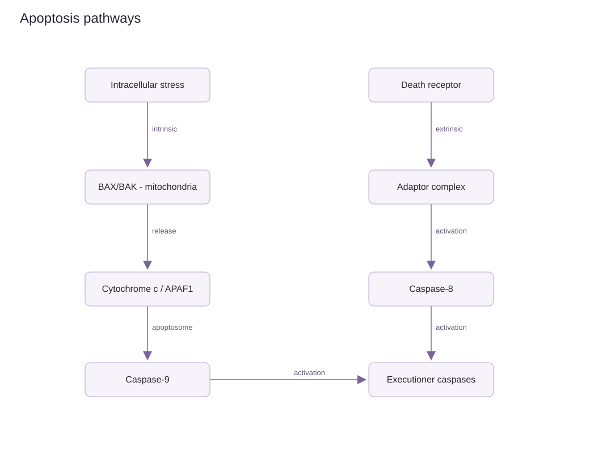
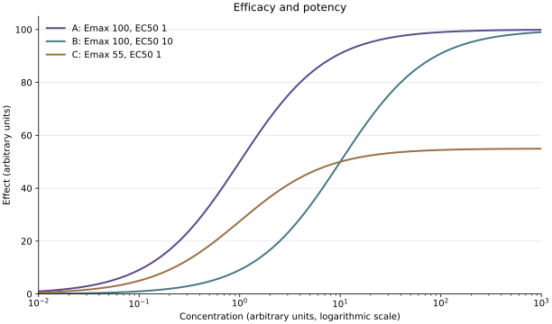

# 병리학·약리학·독성학

# 일반병리학

## 세포손상과 세포사멸의 기전

### 학습목표

- 가역적 손상과 비가역적 손상의 차이를 설명한다.
- 허혈과 재관류 손상을 연결한다.
- 세포자멸사의 내인성·외인성 경로를 구분한다.

### 스트레스에 대한 세포의 선택

세포손상(cell injury)은 유해 자극의 크기와 지속시간이 세포의 적응 능력을 넘어설 때 발생한다. 동일한 산소 부족이라도 심근세포, 신경세포, 섬유모세포가 견디는 정도는 다르다. 대사 요구량, 에너지 저장, 혈액 공급, 항산화 능력과 재생 잠재력이 다르기 때문이다. 손상의 원인을 산소 부족, 화학물질, 감염, 면역반응, 유전 이상 등으로 나누는 것은 유용하지만 실제 질환에서는 여러 원인이 겹친다. 예를 들어 감염은 미생물의 직접 손상과 숙주 염증반응, 미세순환 장애를 동시에 일으킬 수 있다.

세포가 크기나 수를 바꾸는 적응과 손상을 구분해야 한다. 비대(hypertrophy)는 개별 세포의 크기 증가, 과다형성(hyperplasia)은 세포 수 증가다. 위축(atrophy)은 크기 감소를 중심으로 하며, 화생(metaplasia)은 분화된 세포 유형이 다른 유형으로 바뀌는 현상이다. 화생은 지속 자극에 대한 보호적 이점을 줄 수 있지만 본래 기능을 잃거나 종양 발생과 관련된 환경을 만들 수 있다. 이형성(dysplasia)은 세포와 조직 배열의 비정상성을 뜻하며 화생과 동의어가 아니다. 적응이라는 이름이 붙었다고 장기적으로 무해한 것은 아니다.

### ATP 감소와 칼슘 항상성 붕괴

산화적 인산화가 억제되면 ATP가 감소한다. Na+/K+-ATPase 기능이 저하되어 세포내 나트륨이 증가하고 물이 유입되면서 세포와 소기관이 붓는다. 동시에 해당작용 의존도가 커지면 젖산 축적과 pH 감소가 일어날 수 있다. 리보솜이 거친면소포체에서 떨어지고 단백질 합성이 감소할 수 있으며, 세포막의 물집과 미세융모 소실도 보일 수 있다. 초기의 이런 변화는 원인이 제거되고 에너지 대사가 회복되면 되돌아갈 수 있어 가역적 손상으로 분류한다.

칼슘은 신호전달에 필수적이지만 세포질의 자유 칼슘 농도는 낮게 유지되어야 한다. 손상으로 세포 밖에서 칼슘이 들어오거나 소포체 저장 칼슘이 방출되면 인지질분해효소, 단백질분해효소, 핵산분해효소 등이 과도하게 활성화될 수 있다. 이들은 막과 세포골격, DNA를 손상시킨다. 미토콘드리아 기능장애는 ATP 생산 감소뿐 아니라 투과성 변화와 세포사멸 신호 방출로 이어질 수 있다. 따라서 에너지 고갈, 막손상, 칼슘 증가, 활성산소 생성은 독립된 체크리스트가 아니라 서로 강화하는 회로다.

### 비가역성과 괴사 형태

비가역적 손상의 핵심에는 회복되지 않는 미토콘드리아 기능장애와 심각한 막손상이 포함된다. 원형질막의 붕괴는 세포 성분 유출과 이온 조절 실패를 일으키고, 리소좀막 손상은 가수분해효소의 유출에 기여한다. 세포 안의 효소나 단백질이 혈액에서 측정되는 현상은 장기 손상을 추정하는 검사 원리와 연결된다. 그러나 혈중 지표 상승만으로 정확한 손상 원인, 발생 시간, 기능 상실 정도를 모두 알 수는 없다. 지표의 장기 특이성, 방출과 제거 속도, 임상 맥락을 함께 봐야 한다.

응고괴사(coagulative necrosis)는 단백질 변성으로 조직 윤곽이 한동안 보존되는 형태이며 여러 고형장기의 허혈성 손상에서 볼 수 있다. 액화괴사(liquefactive necrosis)는 효소적 소화가 우세하여 조직이 액상으로 변하는 형태로, 뇌의 허혈성 손상이나 화농성 감염과 연결된다. 건락괴사(caseous necrosis)는 결핵 등에서 관찰되는 부스러지는 형태를 가리키며, 지방괴사는 지방조직의 효소적 분해와 칼슘 비누 형성 등과 연결될 수 있다. 형태학적 이름은 병인을 추론하는 단서이지 한 질환에만 독점적으로 대응하는 바코드가 아니다.

### 세포자멸사의 두 경로

세포자멸사(apoptosis)는 세포를 비교적 질서 있게 제거하는 조절된 과정이다. 세포가 수축하고 염색질이 응축되며 막으로 둘러싸인 조각이 형성되고, 식세포가 이를 제거한다. 세포막의 인지질 비대칭성이 변하여 phosphatidylserine이 외측에 드러나는 것은 제거 신호의 하나다. 세포 내용물이 광범위하게 유출되지 않으면 주변 염증은 상대적으로 적다. 하지만 제거가 지연되면 이차적 막붕괴가 생길 수 있어 세포자멸사는 어떤 조건에서도 염증이 없다는 절대 명제는 피해야 한다.

내인성 경로(intrinsic pathway)는 성장인자 부족, DNA 손상, 소포체 스트레스 같은 세포내 신호를 미토콘드리아 경로에 연결한다. BCL-2 계열 단백질은 생존과 사멸의 균형을 조절하며, BAX와 BAK의 활성은 미토콘드리아 바깥막 투과화에 관여한다. 방출된 cytochrome c는 APAF1과 함께 apoptosome 형성을 촉진하고, 개시 caspase-9를 거쳐 실행 caspase가 활성화된다. 외인성 경로(extrinsic pathway)는 Fas 같은 사멸수용체에서 시작하여 어댑터 단백질과 caspase-8 등의 활성으로 이어진다. 두 경로는 BID 같은 연결 인자를 통해 상호작용할 수 있다.

괴사는 모두 비조절적이고 세포자멸사는 모두 생리적이라는 구분도 지나치게 단순하다. Necroptosis, pyroptosis, ferroptosis처럼 조절된 세포사멸 양식이 알려져 있으며 염증과 막손상, 철 의존성 지질과산화 등 서로 다른 특징을 가진다. 이 분류는 실제 조직에서 혼합되어 나타날 수 있고, 검사법에 따라 포착하는 과정도 다르다. TUNEL 양성이나 특정 단백질 하나의 발현만으로 모든 사멸 경로를 단정하는 것은 부적절하다.

### 재관류가 손상을 더할 수 있는 이유

허혈 조직에 혈류를 회복시키는 것은 생존 조직을 구하는 데 필수적이지만, 재관류 과정에서 활성산소, 칼슘 과부하, 염증세포 유입, 미토콘드리아 기능 변화가 추가 손상에 기여할 수 있다. 이는 혈류 회복이 필요 없다는 뜻이 아니다. 치료의 이익과 손상 기전을 서로 다른 수준에서 구분해야 한다.

### 확인 문제

Apoptosome과 직접 연결되는 개시 caspase는?

A. Caspase-8
B. Caspase-9

**정답: B**

미토콘드리아 cytochrome c-APAF1 경로가 caspase-9 활성과 연결된다.

**오답 해설**

A: Caspase-8은 대표적 사멸수용체 경로의 개시 효소다.

## 급성·만성 염증과 조직 손상

### 학습목표

- 혈관반응과 백혈구 유출의 단계를 설명한다.
- 주요 염증매개물질의 작용을 연결한다.
- 육아종성 염증과 일반 만성염증을 구분한다.

### 염증의 생물학적 과제

염증(inflammation)은 감염이나 조직손상에 대응하여 원인과 손상조직을 제거하고 회복을 준비하는 반응이다. 병원체뿐 아니라 허혈, 외상, 결정과 면역반응도 이를 유발한다. 세포는 미생물 유래 분자양상과 손상 관련 분자양상을 여러 인식수용체로 감지한다. TLR과 일부 세포질 수용체, 보체와 항체는 서로 다른 위치에서 원인 인식에 관여하며, 같은 자극이 여러 경로를 동시에 활성화할 수 있다.

염증의 보호 효과와 손상 효과는 함께 존재한다. 백혈구의 살균효소와 활성산소는 미생물을 제거하지만 주변 조직도 손상시킬 수 있다. 혈관 투과성과 응고의 국소 변화는 원인을 제한하는 데 도움이 되나, 광범위하게 활성화되면 부종과 미세순환 장애를 악화시킬 수 있다. 염증의 결과는 자극의 지속성과 크기, 숙주 방어, 침범 조직의 재생능력 및 반응을 종료하는 기전에 따라 달라진다.

### 혈관확장과 투과성

급성염증 초기에 소동맥과 미세혈관이 확장되면 국소 혈류가 증가하여 발적과 열감이 생긴다. 혈관 투과성 증가로 단백질과 액체가 조직으로 이동하면 부종이 형성된다. 염증성 삼출액(exudate)은 단순한 압력 변화로 생기는 저단백성 여출액(transudate)과 기전이 다르지만, 실제 체액검사의 판정은 부위와 사용 기준을 함께 고려한다. 단백질 이동과 혈류 정체는 백혈구가 혈관벽 가까이에 모이는 조건에도 영향을 준다.

Histamine은 내피 반응과 투과성 변화에, prostaglandin은 혈관반응과 통증·발열에, leukotriene은 백혈구 유주와 기관지 및 혈관 반응에 관여한다. Bradykinin과 보체 조각, cytokine도 중요한 매개체다. 하나의 매개체가 하나의 증상만 담당하는 구조가 아니므로 특정 증상을 모두 한 물질의 과다로 환원하지 않는다. 동일한 지질 전구체에서 염증을 촉진하거나 종료에 기여하는 여러 매개체가 만들어질 수 있다.

### 백혈구의 유출과 이동

혈관 내 백혈구는 내피 표면에서 구르기(rolling), 활성화, 단단한 부착, 혈관벽 통과를 거쳐 조직으로 나간다. Selectin 계열은 구르기에, integrin의 친화도 변화와 내피 부착분자는 단단한 부착에 중요하다. Chemokine은 이동 방향을 안내하고 integrin 활성화에도 관여한다. 내피 사이를 통과한 백혈구는 기저막을 지나 화학주성 기울기를 따라 이동한다. 유출된 세포 수는 혈중 수뿐 아니라 부착과 이동 기능에도 좌우된다.

호중구는 많은 급성 세균성 염증에서 초기에 두드러지고, 단핵구·대식세포는 후속 처리와 조절에 기여한다. 그러나 자극 종류에 따라 우세 세포가 달라지고 호중구가 오래 지속되는 상황도 있다. 호산구는 기생충과 알레르기 반응의 일부에서, 림프구는 바이러스 감염과 면역반응 등에서 중요하다. 급성과 만성은 세포 종류 하나만으로 결정되는 이름이 아니라 경과와 조직반응을 함께 기술하는 분류다.

### 포식과 살균, 손상

Opsonin은 미생물 표면을 표시하여 식세포 수용체의 인식을 돕는다. 포식소체는 리소좀과 결합하고, NADPH oxidase가 만드는 활성산소와 다양한 효소가 미생물 제거에 관여한다. 호중구의 myeloperoxidase 경로와 대식세포의 질소산화물 경로 등은 서로 다른 살균 체계를 제공한다. 미생물이 세포내에서 생존하거나 포식소체의 성숙을 방해하면 지속 감염과 만성 반응이 생길 수 있다.

백혈구 내용물이 세포 밖으로 유출되거나 조절이 실패하면 숙주 기질과 세포가 손상된다. NET 형성도 미생물 포획에 기여하는 동시에 혈전과 조직손상에 관련될 수 있다. 이 반응을 무조건 유익하거나 유해하다고 분류하지 않고 위치와 지속시간, 제거 능력을 함께 살펴야 한다. 유전적 포식세포 기능장애는 반복 감염과 특유의 염증 양상으로 드러날 수 있다.

### 만성염증과 육아종

만성염증에서는 지속되는 염증세포 침윤, 조직 파괴와 수복이 함께 나타난다. 대식세포, 림프구와 형질세포의 상호작용이 원인을 제거하려는 반응과 섬유화를 연결한다. 대식세포 활성 상태는 조직 환경에 따라 연속적으로 변하며 두 종류의 고정된 세포로만 나누어 설명하기 어렵다. 반복되는 손상과 회복은 장기의 구조를 바꾸고 기능을 저하시킬 수 있다.

육아종(granuloma)은 활성화된 대식세포가 모인 조직화된 염증 패턴으로 상피양세포와 다핵거대세포, 주변 림프구 등이 관찰될 수 있다. 감염성 원인과 비감염성 원인이 모두 가능하다. 건락괴사가 결핵을 시사할 수 있지만 형태만으로 원인균을 확정하지 않고 특수염색, 배양과 분자검사 및 임상 맥락을 대조한다. 육아조직은 상처치유 과정의 혈관·기질 풍부 조직으로 육아종과 다르다.

염증의 종료에는 자극 제거, 호중구 사멸과 제거, 매개체 분해, 항염증성 신호와 배액이 관여한다. 완전 회복, 농양 형성, 섬유화 또는 만성화는 서로 다른 결과다. 염증 수치가 낮아졌다는 사실이 조직 기능과 구조가 모두 회복되었음을 의미하지 않으므로 증상과 장기 기능, 영상 및 필요한 조직평가를 함께 해석한다.

### 확인 문제

육아종과 육아조직은 같은 구조인가?

A. 같다.
B. 다르다.

**정답: B**

육아종은 조직화된 대식세포성 염증 패턴이고 육아조직은 치유 중의 혈관·기질 풍부 조직이다.

**오답 해설**

A: 이름의 유사성이 동일한 조직 반응을 뜻하지 않는다.

## 종양의 성장 조절과 유전체·미세환경

### 학습목표

- 종양유전자와 종양억제유전자의 작용을 구분한다.
- 증식·사멸·불안정성의 상호작용을 설명한다.
- 조직 이질성과 치료 선택압을 연결한다.

### 증식 이상과 종양의 정의

종양(neoplasm)은 세포의 성장 조절 이상과 클론성 변화 등을 바탕으로 지속되는 비정상 조직 증식이다. 반응성 과다형성은 자극에 대한 조절을 일부 유지하고 자극이 사라지면 감소할 수 있는 점에서 구분된다. 그러나 한 시점의 세포 수 증가만으로 이 경계를 항상 확정할 수는 없다. 조직 구조와 세포 형태, 분자적 특성과 경과를 통합한다. 종양은 상피·간엽·혈액림프 등 기원에 따라 다른 분류와 행동 양상을 가진다.

양성과 악성의 구분에는 침윤과 전이 가능성, 조직과 세포의 분화 및 임상 경과가 중요하다. 경계가 뚜렷하고 느리게 자라는 경향은 단서지만 모든 양성 종양이 무해한 것은 아니다. 위치에 따른 압박과 호르몬 분비, 출혈은 양성 병변에서도 큰 문제를 만들 수 있다. 악성 종양도 분화도와 성장속도가 다양하므로 나쁨의 정도를 크기 하나로 평가하지 않는다.

### 성장 신호의 지속

정상 세포는 성장인자와 수용체, 세포내 신호 및 주변 조직의 조건을 통합한다. Proto-oncogene의 활성화 변화는 수용체와 RAS-MAPK, PI3K-AKT 등 경로를 지속적으로 자극하거나 전사·세포주기 조절을 바꿀 수 있다. 유전자 증폭과 염색체 재배열, 특정 기능획득 변이는 서로 다른 활성화 방식이다. 유전자가 발현되었다는 사실과 병적 활성화가 있었다는 사실은 구분한다.

종양유전자의 기능획득은 세포 수준에서 한 대립유전자의 변화로도 효과가 나타날 수 있지만, 실제 종양의 성질은 다른 조절망과 유전체 배경의 영향을 받는다. 같은 변이라도 조직 계통과 동반 변화가 다르면 의존성과 치료 반응이 달라질 수 있다. 모든 암을 공통적인 하나의 스위치로 설명할 수는 없다. 발암에서 중요한 변화와 진행 중 뒤따라온 변화도 구분해야 한다.

### 세포주기 억제와 손상 반응

RB 계통은 E2F 등과 연결되어 세포주기 진행을 조절한다. Cyclin-CDK 활성과 억제단백질, RB의 인산화 상태가 증식 신호와 연결된다. 이 장치가 손상되면 정상적인 제한 조건에서도 세포주기를 진행하는 방향으로 바뀔 수 있다. TP53 계통은 DNA 손상과 여러 스트레스에 대응하여 정지와 수선, 세포사멸 등 반응에 관여한다. TP53를 모든 손상을 직접 고치는 단일 수선효소로 부르는 것은 부정확하다.

종양억제유전자 기능 상실은 두 대립유전자 손상이 관여하는 전형적 모형으로 설명할 수 있으나 모든 유전자와 상황이 정확히 같은 규칙을 따르지는 않는다. Haploinsufficiency와 dominant-negative 효과, 후성유전 억제 등 여러 방식이 있다. 유전성 소인은 첫 변화가 체세포 전체에 이미 존재하는 조건을 만들 수 있지만 종양 발생에는 추가 변화와 조직 환경이 관여한다. 유전적 위험과 출생 시부터 암이 완성되어 있다는 주장은 다르다.

### 세포사멸·복제수명과 불안정성

종양세포는 증식 신호 외에 사멸과 노화 반응을 피하는 능력을 획득할 수 있다. BCL-2 계통 등 생존·사멸 조절의 변화는 세포 수의 증가를 촉진할 수 있으며, 빠른 분열만이 종양 성장의 유일한 원인은 아니다. Telomere 유지와 말단 보호는 장기 증식과 염색체 안정성에 관련된다. 위기와 불안정성의 단계는 유전체의 추가 재편을 만들 수 있다.

DNA 수선과 염색체 분리, 복제 점검의 결함은 변이와 구조 이상이 축적될 기회를 늘린다. 이 모든 변화가 종양에 이익을 주는 것은 아니며 생존하지 못하는 세포도 많다. 클론의 선택은 영양과 산소, 면역과 치료 등 환경에서 상대적으로 잘 살아남는 집단을 바꾼다. 유전체 불안정성을 한 방향으로 끝없이 좋아지는 진화처럼 해석하면 안 된다.

### 혈관·대사·면역 환경

종양이 커지면 산소와 영양 공급, 대사물 제거의 제한에 직면한다. 혈관신생과 주변 조직의 재구성은 생존에 기여하지만 새 혈관의 기능이 정상 혈관처럼 균일하지는 않다. 낮은 산소와 불규칙한 관류는 세포 상태와 약물 전달을 바꾼다. 같은 종양 안의 영역들이 서로 다른 조건에 놓여 있어 한 번의 조직 채취가 전체의 모든 상태를 포괄하지 못할 수 있다.

종양세포와 면역세포, 섬유모세포 및 기질은 지속적으로 상호작용한다. 면역반응은 종양을 제거하거나 선택압을 만들고, 종양은 항원제시와 억제 신호 등을 바꾸어 회피할 수 있다. 일부 염증과 기질 반응은 성장·침윤을 돕기도 한다. 면역세포가 많이 보인다는 사실만으로 효과적인 항종양 반응이 이루어지고 있다고 판단하지 않는다. 세포의 종류와 위치, 활성 상태가 중요하다.

### 침윤과 전이

침윤은 조직의 경계와 기질을 넘어 국소 확산하는 과정이며, 전이는 떨어진 부위에서 종양이 형성되는 현상을 말한다. 세포접착과 운동성, 기질 처리와 혈관·림프관 접근, 이동 중 생존과 새로운 조직 정착 등 여러 장벽이 있다. 원발 종양에서 떨어진 세포가 검출되었다고 모든 세포가 임상적 전이를 완성하는 것은 아니다. 도달과 생존, 장기 증식의 조건이 서로 다르다.

전이의 분포는 해부학적 배액과 혈류뿐 아니라 표적 장기의 환경과 세포 상호작용에 영향을 받는다. 림프절 전이와 먼장기 전이는 병기와 예후 평가에 다른 정보를 제공한다. 병기는 퍼진 범위를, 등급은 형태와 분화·증식 등의 특성을 반영하는 체계로 구분한다. 장기와 종양 유형마다 적용 기준이 다르므로 용어를 다른 암에 그대로 옮겨 쓸 수는 없다.

### 이질성과 치료 반응

종양 안에는 유전적으로 다른 하위클론과, 같은 유전체라도 다른 분화·대사 상태의 세포가 공존할 수 있다. 치료는 감수성 집단을 줄이는 동시에 내성 집단의 상대적 비율을 바꾸는 선택압이 된다. 처음부터 드물게 존재한 내성과 치료 중 새로 생긴 변화, 비유전적 적응은 구분하면서도 함께 고려한다. 반응 후 재발이 있었다는 사실만으로 단일 기전을 확정하지 않는다.

분자검사에서 표적 변화가 확인되어도 약물이 그 조직과 환자에서 유효하다는 근거가 필요하다. 표적의 존재와 약물 도달, 실제 의존성 및 하류 우회경로가 모두 관련된다. 반대로 발현이 낮다는 결과도 검체 위치와 시점, 분석의 한계를 고려한다. 병리 진단과 분자 정보, 병기와 환자의 상태를 연결하는 것이 정밀 치료의 출발점이다.

### 확인 문제

종양억제유전자와 종양유전자의 작용을 해석할 때 적절한 것은?

A. 모든 종양 관련 변이는 동일한 약물에 반응한다.
B. 암세포는 DNA 손상과 세포주기 조절의 영향을 전혀 받지 않는다.
C. 성장 신호의 과활성과 성장 억제의 소실은 서로 다른 경로로 증식을 촉진할 수 있다.

**정답: C**

종양은 여러 조절 경로의 변화가 축적된 결과이므로 유전자 이름 하나로 모든 치료 반응을 예측할 수 없다.

**오답 해설**

A: 종양 변이는 서로 다른 경로와 내성 조건에 놓이므로 같은 약물 반응을 보장하지 않는다.

B: 암에서도 손상 반응과 세포주기 조절의 잔존 및 변화가 병태생리에 관여한다.

# 계통별 병리학

## 사구체 손상의 형태와 신염·신증후군

### 학습목표

- 사구체의 세 구성요소와 손상 양상을 연결한다.
- 면역형광·광학·전자현미경의 정보를 통합한다.
- 임상 증후군과 병리 진단을 구분한다.

### 여과장벽과 지지 구조

사구체 모세혈관의 내피와 사구체기저막, 발세포와 세극막은 혈액과 여과액 사이의 장벽을 이룬다. Mesangial 세포와 기질은 모세혈관 다발의 지지와 국소 반응에 관여한다. 이 요소들은 서로 영향을 주지만 손상이 시작되는 주된 위치와 기전이 다르면 단백뇨·혈뇨와 여과율 변화의 조합도 달라진다. 한 환자에게 여러 요소의 손상이 동시에 존재할 수 있어 순수한 세 칸 분류로 모든 질환을 설명할 수는 없다.

발세포의 발돌기와 세극막, 세포골격은 단백질 통과 제한에 중요하다. 발세포 손상은 단백뇨와 연결되고, 내피와 모세혈관벽의 염증·파괴는 혈구의 통과와 여과 감소를 만들 수 있다. Mesangial 증식과 기질 증가는 지지 구조와 모세혈관 표면의 기능을 바꾼다. 세포가 늘었다는 소견과 기질이 늘었다는 소견도 구분하여 형태를 기술한다.

### 임상 증후군의 틀

신염성 양상(nephritic presentation)은 혈뇨, 사구체 여과 감소와 체액·혈압 변화 등을 중심으로 접근한다. 소변의 적혈구원주와 변형 적혈구는 사구체 기원의 출혈을 시사하는 단서가 될 수 있다. 다만 검체와 판독의 영향을 받으므로 소견 하나만으로 모든 원인을 확정하지 않는다. 단백뇨도 동반될 수 있고 심한 경우 신증후군 수준의 손실이 겹칠 수 있다.

신증후군(nephrotic syndrome)은 상당한 단백뇨와 저알부민혈증, 부종 및 관련 대사 변화 등을 포함하는 임상 조합이다. 진단명 하나의 동의어가 아니라 여러 발세포·기저막 질환과 전신 질환에서 나타날 수 있는 결과다. 단백뇨의 양이 많다는 사실과 저알부민·부종의 발생에는 시간과 합성·분포·배설이 관여한다. 혈뇨가 조금 존재한다고 신증후군성 질환을 모두 배제하지 않는다.

빠르게 진행하는 신기능 저하는 임상 경과의 표현이고, 반달체(crescent)는 병리 소견이다. 두 개념은 밀접하게 연결되지만 완전히 같은 말은 아니다. 반달체는 사구체 모세혈관벽의 심한 손상과 보먼공간의 세포 반응에 관련되며 구성과 만성성에 따라 의미가 달라진다. 원인 기전을 구분하는 검사가 치료의 긴급성과 선택에 중요하다.

### 세 가지 현미경이 답하는 질문

광학현미경은 세포 증식과 기질, 모세혈관벽 두께와 괴사, 경화 및 반달체의 분포를 보여준다. 국소성(focal)과 미만성(diffuse)은 사구체 가운데 얼마나 많은 수가 침범되었는지, 분절성(segmental)과 전반성(global)은 한 사구체 안의 어느 범위가 침범되었는지를 기술한다. 두 쌍의 용어는 서로 다른 축이므로 같은 뜻으로 바꾸어 쓰면 안 된다.

면역형광은 immunoglobulin과 보체 등의 침착 양상과 위치를 평가한다. 선상(linear) 패턴과 과립상(granular) 패턴, 적은 면역반응 소견은 서로 다른 기전의 가설을 제공한다. 전자현미경은 침착물의 위치와 초미세구조, 기저막과 발돌기 변화를 추가로 보여준다. Mesangial, 내피하와 상피하 침착은 같은 면역물질이 보인다는 공통점이 있어도 염증 반응과 임상 표현이 달라질 수 있다.

한 검사에서 보이지 않았다는 결과는 검사 범위와 표본 상태를 함께 해석해야 한다. 조직 절편에 포함된 사구체 수가 적으면 국소 병변을 놓칠 수 있고, 진행된 경화는 초기 원인의 특징을 흐릴 수 있다. 생검 결과는 병력과 혈청·소변검사 및 시간 경과를 대조해야 하는 조직 표본의 정보다. 전체 신장의 모든 부위를 같은 깊이로 관찰한 결과는 아니다.

### 면역복합체와 항체 매개 손상

면역복합체는 순환에서 형성되어 침착하거나 조직의 항원과 항체가 국소적으로 결합하여 만들어질 수 있다. 보체와 염증세포의 활성은 손상 위치에 따라 다른 정도로 유도된다. 내피하 침착은 혈액의 염증성 성분과 접근이 쉬워 염증이 두드러질 수 있고, 상피하 병변은 다른 기전을 통해 여과장벽과 발세포에 영향을 줄 수 있다. 이 구분은 경향이며 원인별 세부 기전과 중증도를 함께 고려한다.

사구체기저막의 특정 항원을 향한 항체는 선상 패턴과 심한 손상을 만들 수 있다. 일부 전신 작은혈관염에서는 심한 괴사와 반달체가 있어도 면역침착이 적은 양상(pauci-immune)이 관찰될 수 있다. 혈중 항체검사는 원인 평가를 돕지만 모든 양성과 음성이 조직 손상을 완전히 대변하지는 않는다. 감염과 약물, 전신 증상을 포함하여 원인과 장기 침범을 함께 평가한다.

### 발세포 손상과 경화 패턴

미세변화병에서는 광학 소견이 크지 않아도 전자현미경의 발돌기 변화와 심한 단백뇨가 연결될 수 있다. 발돌기 소실이라는 형태 자체가 이 질환에만 특이적인 것은 아니다. 분절성 사구체경화는 원발성 질환 외에도 네프론 감소에 대한 과여과, 유전적 결함과 여러 이차 원인에서 생길 수 있는 패턴이다. 같은 형태명이 붙었다고 병인과 치료 반응이 모두 같다고 가정하지 않는다.

막성 패턴과 증식성 패턴 등은 모세혈관벽과 세포·기질의 반응을 기술하는 틀이다. 전신 자가면역질환, 만성 감염과 약물, 종양 및 대사 질환은 원인 평가에서 상황에 따라 중요하다. 성인 단백뇨를 신장에 국한된 문제로만 보면 관련 원인을 놓칠 수 있고, 반대로 우연히 함께 존재하는 질환을 원인으로 확정하는 것도 피해야 한다. 분포와 기전, 임상 확률을 함께 평가한다.

### 단백질 손실의 전신 영향

Albumin 감소와 신장의 Na+ 보존, 모세혈관·간질 조건은 부종 형성에 함께 관여한다. 혈관 내 유효량이 감소하는 경우와 신장 자체의 Na+ 보존이 두드러지는 경우를 한 가지 모형으로만 설명하지 않는다. 소변으로 여러 단백질이 소실되면 감염 방어와 호르몬·약물 운반, 혈전·출혈 균형 등에도 영향이 있을 수 있다. 혈전 위험은 개별 단백질 하나의 농도만이 아니라 질환과 심한 정도, 염증과 움직임 등 여러 요인의 결과다.

지질 대사 변화와 영양 상태, 만성 염증과 신기능 저하는 서로 영향을 준다. 단백뇨를 줄이는 목표와 원인 질환의 조절, 체액과 혈압 관리, 혈전·감염 등 합병증의 평가를 나누어 생각한다. 생검에서 보이는 활동성 염증과 만성 경화·위축의 비율은 회복 가능성과 위험을 이해하는 데 도움을 주지만 예후를 한 번에 확정하는 수치는 아니다.

### 확인 문제

신생검에서 국소성과 분절성이라는 표현의 차이는?

A. 국소성은 침범 사구체의 비율, 분절성은 한 사구체 안의 침범 범위에 관한 표현이다.
B. 두 용어는 같은 뜻이며 서로 바꾸어 쓸 수 있다.
C. 분절성은 반드시 신장 한쪽만 침범했다는 뜻이다.

**정답: A**

사구체 사이의 분포와 사구체 내부의 분포는 별개의 축이다.

**오답 해설**

B: 국소성은 사구체 사이, 분절성은 한 사구체 내부라는 별개의 분포 축이다.

C: 분절성은 한 사구체의 일부라는 뜻이며 신장 좌우 구분이 아니다.

# 일반약리학

## 약동학의 구획 모형과 투여 설계

### 학습목표

- 분포용적과 청소율의 물리적 의미를 설명한다.
- 반감기와 정상상태의 관계를 유도한다.
- 부하용량과 유지용량에 영향을 주는 변수를 구분한다.

### 농도 곡선을 읽는 관점

약동학(pharmacokinetics, PK)은 약물이 흡수·분포·대사·배설되는 시간 경과를 다룬다. 혈중 농도는 약효를 결정하는 중요한 정보지만 표적 부위 농도와 언제나 같지는 않다. 약물이 혈액과 조직 사이에서 이동하는 속도, 단백질 결합, 활성 대사체, 수용체 결합 이후의 지연이 영향을 준다. 약력학(pharmacodynamics, PD)은 농도와 효과의 관계를 다루므로 PK와 구분하되 연결해서 해석한다. 같은 혈중 농도라도 환자별 수용체 민감도와 질환 상태에 따라 효과는 달라질 수 있다.

한 구획 모형(one-compartment model)은 약물이 체내의 가상 공간에서 균일하게 섞인 것으로 가정한다. 실제 몸이 한 개의 물주머니라는 뜻은 아니다. 다구획 모형에서는 혈액과 빠르게 평형을 이루는 중심 구획, 더 천천히 분포하는 말초 구획을 구분한다. 정맥 투여 직후 농도가 빠르게 떨어지는 분포기와 이후의 소실기를 혼동하면 반감기나 분포용적을 잘못 추정할 수 있다. 어떤 모형을 사용하는지에 따라 같은 이름의 추정량도 해석이 달라질 수 있다.

### 분포용적의 가상성

겉보기 분포용적(volume of distribution, Vd)은 체내 약물량 A를 혈장 농도 C로 나눈 Vd=A/C이다. 단위는 L처럼 부피지만 실제 해부학적 공간의 크기는 아니다. 조직에 강하게 결합하여 혈장 농도가 낮으면 계산된 Vd는 총체수분보다 훨씬 클 수 있다. 혈장 단백질에 주로 결합하고 혈관 밖으로 잘 이동하지 않는 약물은 작은 Vd를 보일 수 있다. 혈중 농도를 전체 농도로 측정했는지 자유형 농도로 측정했는지에 따라서도 해석이 달라진다.

저알부민혈증에서 단백질 결합 약물의 자유형 분율이 증가하면 전체 농도가 낮아져도 자유형 노출이 같은 방향으로 변한다고 단정할 수 없다. 동시에 청소율과 분포가 변할 수 있기 때문이다. 비만, 부종, 임신, 중환자 상태는 지용성·수용성 약물의 분포에 서로 다른 영향을 준다. 체중만 곱해서 용량을 정하는 방식은 약물과 상황별 검증이 필요하다. 이러한 이유로 치료약물농도감시(therapeutic drug monitoring, TDM)에서는 채혈 시점과 측정 농도의 종류를 반드시 확인한다.

### 청소율과 반감기의 유도

청소율(clearance, CL)은 약물 제거 속도를 농도로 나눈 값이다. 일차 소실 모형에서 제거 속도는 CL·C이며, A=Vd·C이고 Vd가 일정하면 dC/dt=−(CL/Vd)C가 된다. 적분하면 C(t)=C0 exp(−kt), k=CL/Vd를 얻는다. C가 절반이 되는 시간은 t1/2=ln2/k=0.693Vd/CL이다. 이 식은 해당 모형의 가정 아래 성립하며 다구획 분포의 모든 시점에 하나의 Vd와 반감기를 무조건 적용해서는 안 된다.

청소율은 단위 시간의 약물 질량이 아니라 부피/시간이다. 혈장 농도가 두 배이면 같은 CL에서 제거되는 질량/시간도 두 배가 된다. 포화 제거에서는 이 비례관계가 깨질 수 있다. 대사효소나 수송체의 처리 능력이 포화되는 약물은 용량을 조금 올려도 농도가 예상보다 크게 증가할 수 있다. 이를 모든 약물에 일차 소실로 가정하면 위험하다. 한 기관의 청소율은 혈류와 추출률의 곱으로 생각할 수 있으며, 높은 추출률 약물과 낮은 추출률 약물은 혈류·효소활성·단백질 결합 변화에 대한 반응이 다르다.

### 반복 투여와 정상상태

일정 속도로 정맥 주입하면 약물이 들어오는 속도와 나가는 속도가 같아지는 농도가 정상상태 농도(Css)다. 선형 모형에서 Css=주입속도/CL이다. 정상상태에 접근하는 시간 경과는 반감기에 의해 결정되며, 시작 농도가 0인 단순 모형에서 네 반감기 후 약 93.75%, 다섯 반감기 후 약 96.875%에 도달한다. 이는 지수적 접근이어서 유한 시간에 수학적으로 정확한 100%가 되는 것은 아니다. 반감기가 길면 목표 노출에 도달하는 데 오래 걸리는 이유다.

반복 간헐 투여에서는 같은 평균 노출이라도 투여 간격에 따라 최고농도와 최저농도의 차이가 달라진다. 효과가 시간에 의존하는지 최고농도에 의존하는지, 독성이 어느 농도 범위와 연관되는지가 투여 전략에 영향을 준다. 혈액 채취가 투약 직전인지, 분포가 끝나기 전인지에 따라 의미가 크게 달라지므로 검사 결과만 따로 읽지 않는다. 정상상태라는 말은 매 순간 농도가 일정하다는 뜻이 아니라 반복되는 시간 경과가 주기적으로 같아졌다는 뜻으로도 사용된다.

### 부하용량과 유지용량

목표 농도에 빨리 접근하기 위한 부하용량(loading dose)은 단순 근사에서 목표농도×Vd/F로 계산한다. F는 전신순환에 도달한 분율인 생체이용률(bioavailability)이다. 평균 농도를 유지하기 위한 단위 시간당 투여량은 목표농도×CL/F에 비례한다. 따라서 신기능 저하로 CL이 감소한 경우 유지 투여는 조정이 필요할 수 있지만, Vd 변화까지 확인하지 않고 부하용량도 같은 비율로 줄인다고 단정하면 안 된다. 이 공식은 원리 교육용이며 실제 처방에는 해당 약물의 허가사항과 검증된 투여 지침이 필요하다.

경구 투여 F는 흡수되지 않은 분율, 장벽 대사, 간 초회통과 효과의 영향을 받는다. 효소 억제와 유도, 신장 분비 수송체 경쟁, 위장관 운동 변화는 서로 다른 지점에서 노출을 바꾼다. 전구약물(prodrug)에서는 활성화 감소가 원약물 농도 상승과 반대 방향의 임상 효과를 만들 수 있다. 약물 상호작용은 농도를 올린다 또는 내린다라는 한 문장보다 어느 분자가 활성 형태이고 어느 경로가 바뀌는지를 따라가야 한다.

$$
t_{1/2}=\frac{\ln 2\,V_d}{CL}
$$

Vd: 겉보기 분포용적; CL: 청소율; t1/2: 반감기

#### 단순 투여 설계의 주요 변수

| 항목 | 근사 관계 | 주요 변수 |
|---|---|---|
| 부하용량 | 목표농도 × Vd / F | 분포용적 |
| 유지 투여속도 | 목표농도 × CL / F | 청소율 |
| 반감기 | 0.693 × Vd / CL | 분포용적 및 청소율 |

선형 단일구획 근사; 실제 약물의 처방 지침이 아님

### 확인 문제

단순 모형에서 유지 투여속도를 주로 결정하는 PK 변수는?

A. 분포용적만
B. 청소율

**정답: B**

같은 목표농도와 F에서 유지속도는 CL에 비례한다.

**오답 해설**

A: Vd는 부하용량과 시간 경과에 관여하지만 유지속도를 단독 결정하지 않는다.

## 수용체·효능·역가와 농도반응

### 학습목표

- 결합 친화도와 기능 반응을 구별한다
- 효능과 역가 및 길항의 차이를 설명한다
- 개인 반응과 집단의 반응 분포를 구분한다

### 결합에서 효과까지

약력학(pharmacodynamics)은 약물이 생체에 어떤 효과를 어떻게 만드는지를 다룬다. 약물이 표적에 결합하는 사건과 세포 신호, 조직의 기능 변화 및 환자의 결과 사이에는 여러 단계가 있다. 수용체 결합이 높다고 임상적 이득이 언제나 큰 것은 아니며 표적이 발현된 조직과 신호 환경, 보상 반응 및 질환 상태가 결과를 바꾼다. 모든 약물이 수용체 작용제인 것도 아니고 효소와 이온통로, 수송체 및 다른 물리화학적 표적도 있다.

친화도(affinity)는 결합의 성질이고 효능(efficacy)은 해당 조건에서 표적을 통해 반응을 유발하는 능력과 관련된다. 단순한 평형 모형에서 해리상수는 결합 점유와 연결되지만 실제 기능 반응의 절반을 만드는 농도와 항상 같지 않다. 신호 증폭과 수용체 여유, 다른 경로 및 시간에 따른 조절이 점유와 반응의 관계를 바꾼다. 결합곡선을 그대로 환자의 치료반응 곡선으로 읽지 않는다.

### 농도반응과 역가

단계적 농도반응곡선은 한 생물학적 계에서 농도가 바뀔 때 반응의 크기가 어떻게 달라지는지 표현한다. 최대 반응과 그 일부를 만드는 농도는 서로 다른 특성이다. 역가(potency)가 높은 약물은 특정 반응에 더 낮은 농도나 용량이 필요할 수 있지만 최대 이득과 안전성이 더 우수하다는 보장은 아니다. 두 약물을 비교할 때 같은 반응과 조건을 평가했는지 확인해야 한다.

Emax와 EC50을 이용한 모형은 포화와 반응을 이해하는 데 유용하다. 그러나 실제 곡선은 기울기와 지연, 여러 표적 및 시간에 따라 달라질 수 있다. 혈장 농도와 효과 부위 농도가 같지 않거나 세포의 후속 변화가 오래 지속되면 같은 혈장 농도에서도 시점에 따라 반응이 다를 수 있다. 약동학과 약력학을 나누어 배우되 실제 투여에서는 두 과정이 연결된다는 점을 유지한다.

### 완전·부분·역작용

완전작용제와 부분작용제의 구분은 같은 기능 계에서 나타낼 수 있는 반응에 관련된다. 부분작용제는 결합하더라도 최대 반응이 낮을 수 있고, 완전작용제가 함께 있을 때는 경쟁하여 전체 반응을 낮출 수 있다. 따라서 부분작용제를 항상 약한 치료제 또는 언제나 길항제라고만 부르면 맥락을 놓친다. 기존의 자극과 수용체 환경에 따라 임상적 결과가 달라질 수 있다.

일부 수용체는 작용제가 없어도 기저 활성을 보일 수 있다. 역작용제(inverse agonist)는 그런 활성의 방향을 낮추는 효과를 가질 수 있으며 중성 길항제와 개념이 다르다. 다만 모든 수용체와 실험에서 이 차이가 같은 임상적 중요성을 갖는 것은 아니다. 측정한 기능과 조건을 명확히 해야 분자 수준의 용어를 과도하게 확대하지 않는다.

### 길항의 여러 형태

가역적인 경쟁적 길항은 단순한 평형 조건에서 작용제 농도를 높여 극복할 수 있는 양상을 만들 수 있다. 농도반응곡선의 이동은 이런 관계를 이해하는 데 도움이 된다. 비가역 결합과 비경쟁적 억제, 다른 부위의 조절은 최대 반응과 곡선에 다른 영향을 줄 수 있다. 수용체 여유가 있는 경우 초기에는 예상한 최대 반응 감소가 뚜렷하지 않을 수도 있다.

생리적 길항은 서로 다른 수용체와 경로가 장기 기능에서 반대 효과를 내는 경우를 설명하고, 화학적 길항은 직접적인 물질의 결합과 중화 등을 다룬다. 모든 길항이 같은 수용체 결합 자리를 놓고 경쟁하는 것은 아니다. 약물 상호작용을 해석할 때 표적에서의 관계와 흡수·대사 등 노출의 변화도 구별한다. 반응이 줄었다는 현상 하나만으로 기전을 확정할 수 없다.

### 반복 노출과 조절

수용체 탈감작과 내재화, 발현 변화 및 후속 신호의 조절은 반복 투여의 반응을 바꿀 수 있다. 내성은 표적 변화 외에도 약물 노출과 보상 생리 및 행동의 영향을 받는다. 같은 용량에서 효과가 감소했다는 이유로 무조건 증량하기보다 복용과 노출, 질환 변화 및 이상반응을 확인해야 한다. 중단 뒤 반동과 금단도 정상 조절계의 적응과 연결될 수 있다.

치료 효과와 독성은 다른 표적 또는 같은 표적의 다른 조직에서 발생할 수 있다. 선택성은 농도와 용량 범위에 의존하므로 낮은 노출에서의 표적 선호가 모든 용량에서 유지된다고 가정하지 않는다. 수용체 아형의 차이와 약물의 도달, 신호의 편향 및 조직 분포가 이득과 위해를 바꾼다. 선택적이라는 단어를 부작용이 없다는 뜻으로 사용하지 않는다.

### 집단과 개인의 반응

양자적 반응(quantal response)은 정해진 사건이나 기준을 충족한 사람의 비율을 용량과 연결한다. 한 조직에서 반응 크기가 절반인 것과 집단 절반에서 사건이 나타나는 것은 다른 개념이다. ED50과 독성 지표의 의미도 어떤 반응과 집단을 정의했는지에 따라 달라진다. 치료지수는 유용한 개요지만 개별 환자의 모든 안전 여유와 모니터링 필요성을 완전히 대표하지 못한다.

환자의 연령과 장기 기능, 동반 약물과 유전 및 질환 상태는 노출과 반응을 함께 바꾼다. 시작 용량과 증량, 효과 및 독성 감시는 이런 차이를 반복하여 반영하는 과정이다. 약력학의 곡선과 수용체 모형은 실제 치료를 단순한 공식으로 대체하는 것이 아니라 왜 같은 약과 용량이 서로 다른 결과를 만드는지 설명하는 공통 언어이다.

$$
\theta=\frac{[L]}{K_D+[L]}
$$

theta: 수용체 점유 분율; [L]: 유리 리간드 농도; K_D: 단일 비협동 결합 평형의 해리상수

### 확인 문제

EC50가 더 낮은 약물을 같은 실험계에서 비교할 때 타당한 해석은?

A. 임상적 안전성이 반드시 더 높다.
B. 그 반응에 대한 역가가 더 높을 수 있다.
C. 최대효과가 반드시 더 크다.

**정답: B**

EC50는 주어진 실험계에서 반최대 반응에 필요한 농도이며 최대효과나 안전성을 따로 평가해야 한다.

**오답 해설**

A: 독성 표적과 노출 및 환자 조건을 보지 않고 안전성을 결정할 수 없다.

C: 역가와 효능의 최대 크기는 구별한다.

## 자율신경 전달과 수용체 약리

### 학습목표

- 절전·절후 전달물질과 수용체를 연결한다.
- 수용체 선택성과 장기 효과·반사를 구분한다.
- 직접 작용과 전달물질 처리 조절을 비교한다.

### 두 신경세포 연결과 예외

자율신경의 원심경로는 대개 중추의 절전신경세포와 말초 신경절의 절후신경세포로 이어진다. 교감신경과 부교감신경의 절전 말단은 acetylcholine을 분비하고 신경절의 nicotinic 수용체를 자극한다. 표적 장기에서 부교감 절후 전달은 주로 acetylcholine과 muscarinic 수용체, 교감 절후 전달은 주로 norepinephrine과 adrenergic 수용체에 연결된다. 땀샘으로 가는 일부 교감 절후 경로는 cholinergic이라는 중요한 예외를 가진다.

부신속질은 절전 cholinergic 신호를 받아 catecholamine을 혈액에 방출하는 변형된 교감 계통으로 이해할 수 있다. 혈중 호르몬은 신경말단에서 국소 방출되는 전달물질과 공간·시간 조건이 다르다. 같은 catecholamine이라도 주입 경로와 농도, 제거와 장기별 수용체 분포에 따라 효과가 달라진다. 교감과 부교감을 모든 기관에서 정반대인 두 개의 같은 크기 신호로 생각하면 안 된다.

### Cholinergic 전달의 처리

Acetylcholine은 choline과 acetyl-CoA를 재료로 합성되어 소포에 저장되고, Ca2+ 의존성 막융합으로 방출된다. Acetylcholinesterase는 시냅스 틈에서 전달물질을 빠르게 분해하며 choline은 재흡수되어 재사용된다. 수용체 직접 작용제와 분해효소 억제제는 acetylcholine 작용을 늘린다는 공통점이 있어도 적용되는 시냅스와 시간 경과, nicotinic·muscarinic 효과의 조합이 다르다.

Nicotinic 수용체는 리간드개폐성 양이온 통로다. 자율신경절의 수용체와 신경근접합부의 수용체는 구분되며 약물 반응도 같지 않다. Muscarinic 수용체는 G 단백질 연결수용체로, M2의 심장 작용과 M3의 평활근·분비샘 작용 등 조직별 차이가 중요하다. M3 신호가 혈관 내피에서 NO 생성을 촉진하면 혈관 평활근 수축과 다른 방향의 효과가 나타날 수 있어 수용체가 발현된 세포를 확인해야 한다.

### Adrenergic 합성과 제거

Catecholamine 합성은 tyrosine에서 시작하여 DOPA와 dopamine을 거쳐 norepinephrine으로 이어진다. 효소의 위치와 소포 내 반응, 부신의 추가 전환 단계가 서로 다르다. 신경말단에서 방출된 norepinephrine의 작용 종료에는 신경말단 재흡수가 특히 중요하며, 확산과 세포내·외 대사도 관여한다. Acetylcholine처럼 동일한 틈의 한 분해효소가 종료를 전담하는 구조가 아니다.

MAO와 COMT는 catecholamine 및 관련 물질의 대사에 관여한다. 재흡수 억제와 저장·방출 변화, 직접 수용체 자극은 서로 다른 약리 전략이다. 간접 작용 약물은 신경말단의 저장량과 기능, 다른 약물의 영향을 받으므로 직접 작용제와 같은 조건에서 항상 같은 반응을 내지 않는다. 약물 상호작용을 이해하려면 수용체뿐 아니라 전달물질의 합성부터 제거까지 따라가야 한다.

### α와 β 수용체의 기능

α1 수용체는 많은 혈관 평활근과 요도 출구 등에서 수축 반응에 연결된다. α2 수용체는 시냅스전 전달물질 방출 억제와 중추 조절 등 여러 위치에서 작용한다. α2 작용제가 중추 교감 출력을 낮추는 효과와 말초의 직접 효과는 위치와 약물의 중추 접근성을 고려해야 한다. 수용체 명칭 하나를 혈압이 항상 오르거나 내리는 단일 결론으로 바꾸지 않는다.

β1 수용체는 심박수와 수축력, 신장의 renin 분비 등에, β2 수용체는 기도와 일부 혈관 등의 평활근 이완에 중요하다. β3 수용체는 지방조직과 방광 등에서 다른 역할을 가진다. 장기별 수용체 분포는 상대적이며, 약물의 선택성은 용량과 농도에 따라 약해질 수 있다. β1 선택적 차단제라고 어떤 조건에서도 β2 효과가 전혀 없다고 말할 수는 없다.

### 직접 효과와 압력반사

약물이 혈관을 수축시켜 혈압을 올리면 압력수용체 반사는 심박수와 자율신경 출력을 반대 방향으로 조정할 수 있다. 이때 관찰된 심박수는 심장 수용체에 대한 직접 작용과 반사 효과의 합이다. 심장에 직접 작용하지 않는 혈관 약물도 맥박을 바꿀 수 있다. 반대로 혈관확장 후 나타나는 빈맥을 약물이 심장 β1 수용체를 직접 자극했다는 증거로 해석하면 틀릴 수 있다.

안정된 반사와 정상적인 혈관내 용적을 가정한 교과서 반응은 자율신경 장애와 출혈, 중환자 상태에서 달라질 수 있다. 같은 혈압 변화라도 장기 관류와 산소전달의 결과가 같지 않다. Catecholamine 계열의 임상 사용에서는 심박출과 혈관저항, 리듬 및 원인 병태를 함께 판단한다. 수용체표의 플러스와 마이너스만으로 실제 환자의 전체 혈역학을 대신할 수 없다.

### 차단·탈감작과 임상 관찰

수용체 길항제는 해당 장기의 기저 자율신경 긴장도에 따라 다른 크기의 변화를 만든다. β차단은 심박수와 renin 등 여러 작용을 바꾸며 약물별 선택성과 부가 성질, 제거 경로가 다르다. α1 차단은 혈관과 요도 출구에 영향을 줄 수 있고 기립성 증상과도 연결된다. Muscarinic 차단은 분비와 동공, 심박수 및 방광·장운동 등 여러 계통에서 효과를 보일 수 있다.

지속 자극은 수용체의 인산화·내포와 하류 신호 변화를 통해 반응을 약화시킬 수 있고, 장기 차단 뒤에는 반응성이 변할 수 있다. 약물 중단과 증량의 결과는 분포·반감기뿐 아니라 이러한 적응에도 영향을 받는다. 약리학적 내성과 질환의 악화, 부적절한 사용과 다른 약물의 상호작용을 구분해야 한다. 증상이 변했다는 사실만으로 곧바로 표적 수용체의 숫자가 늘거나 줄었다고 확정하지 않는다.

### 확인 문제

β2 수용체 자극이 기도 평활근을 이완시킬 수 있는 기전은?

A. 모든 조직에서 cAMP는 반드시 수축을 유발한다.
B. β2는 골격근 종판의 니코틴 수용체이다.
C. Gs-cAMP 계통이 평활근 수축 조절에 영향을 준다.

**정답: C**

동일한 두 번째 전달자도 세포의 표적 단백질과 신호 환경에 따라 다른 효과를 낸다.

**오답 해설**

A: cAMP의 효과는 조직의 표적 단백질과 신호계에 따라 다르다.

B: β2는 아드레날린성 수용체이며 신경근접합부의 니코틴 수용체와 다르다.

# 계통별 약리학

## β-Lactam계 항균제의 작용·내성과 임상 약리

### 학습목표

- 세포벽 합성과 약물 표적을 연결한다.
- 내성 기전과 억제제의 범위를 구분한다.
- 노출·감염부위·이상반응을 통합해 해석한다.

### 공통 골격과 서로 다른 약물

β-Lactam계에는 penicillin, cephalosporin, carbapenem과 monobactam 등 여러 계열이 포함된다. 공통 고리는 표적 효소와의 상호작용에 중요하지만 곁사슬과 전체 구조는 표적 친화도와 효소 안정성, 세포외피 통과와 약동학을 바꾼다. 같은 계열명이라는 이유만으로 항균 범위와 투여 경로, 배설과 이상반응이 모두 같다고 생각해서는 안 된다. 개별 약물과 병원체의 감수성 자료를 구분해야 한다.

이 약물군의 핵심 표적은 세균의 penicillin-binding proteins(PBP)다. PBP는 peptidoglycan을 완성하고 재형성하는 여러 기능을 가진 효소군이며, 약물은 특정 PBP의 촉매 기능을 공유결합성 상호작용 등으로 억제하여 세포벽 합성을 방해한다. 같은 세균 안에도 PBP가 여러 개 존재하고 약물별 결합 양상이 다르다. 세포벽 합성 억제의 결과는 성장 상태와 자가용해·스트레스 반응, 약물 접근성에 따라 달라진다.

### 세포벽 표적의 선택성과 한계

사람 세포에는 peptidoglycan 세포벽이 없으므로 선택적 표적의 근거가 된다. 그러나 사람에게 직접 같은 벽 표적이 없다는 사실이 이상반응이 전혀 없다는 뜻은 아니다. 면역반응과 장내 미생물 변화, 신장·신경계 영향 등 다른 기전이 존재한다. 세포벽이 없는 미생물과, 약물이 접근하기 어려운 표적 또는 낮은 친화도의 PBP를 가진 균에서는 이론적 표적 설명만으로 감수성을 기대할 수 없다.

활발히 분열하는 세균과 매우 느리게 성장하거나 특수 환경에 놓인 세균은 반응이 다를 수 있다. Biofilm과 고접종량, 농양의 환경 및 숙주 방어는 실제 치료 결과에 영향을 준다. 시험관의 bactericidal이라는 분류를 모든 감염부위에서 같은 시간 내에 모든 균이 사라진다는 보증으로 사용하지 않는다. 감염원 조절과 적절한 노출, 환자의 상태가 함께 필요하다.

### β-Lactamase와 표적 변화

β-Lactamase는 고리를 가수분해하여 약물이 PBP를 억제하지 못하도록 할 수 있다. 효소는 활성부위 화학과 기질 범위가 다양하며 serine 효소와 metallo-β-lactamase 등은 억제 기전이 다르다. 어떤 효소가 있는지와 얼마나 발현되는지, 다른 장벽이 함께 존재하는지에 따라 표현형이 달라진다. Penicillinase, 광범위 효소와 carbapenemase 등의 이름은 일정한 기능 범위를 표현하지만 모든 효소를 하나의 약물 감수성 표로 환원하기 어렵다.

표적 PBP의 변화는 약물 친화도를 낮춰 내성을 만들 수 있다. 일부 내성은 새로운 표적 단백질의 획득과, 일부는 기존 단백질의 변화와 연결된다. 외막 porin 감소와 efflux 증가는 약물이 표적에 도달하는 양을 줄일 수 있다. 단일 균주가 효소 생성과 투과성 저하를 함께 가지면 각 기전만으로 예상한 것보다 복잡한 감수성을 보일 수 있다. 유전자의 검출과 실제 감수성 표현형을 상보적으로 해석한다.

### 억제제 조합의 논리

β-Lactamase 억제제를 함께 사용하면 특정 효소로부터 항균제를 보호할 수 있다. 억제제의 화학 구조와 효소별 범위는 서로 달라 한 조합이 다른 모든 조합의 역할을 대신하지는 못한다. 모든 metallo 효소나 모든 표적 변화, 투과성 장애를 같은 억제제로 해결할 수 있는 것은 아니다. 조합의 성분을 각각 알고 어떤 방어 기전을 제거하려는지 이해해야 한다.

억제제가 들어 있다는 사실과 해당 균·감염에서 임상적 효과가 입증되었다는 사실도 구분한다. 감수성 판독은 개별 약물·조합과 균종, 투여 노출을 반영한 기준을 사용한다. 새로운 내성 기전과 판독 기준은 달라질 수 있으므로 오래된 계열별 암기표만으로 현재 감염의 치료를 확정하지 않는다. 검체의 원인성, 감염부위와 환자의 중증도를 함께 검토한다.

### 약력학과 약물 전달

많은 β-lactam계의 약력학적 효과는 유리 약물 농도가 MIC를 초과하는 시간과 밀접하게 관련된다. 총농도와 유리 농도, 혈장과 실제 감염부위의 노출은 서로 다르다. 투여 간격과 주입 시간의 조절은 농도곡선을 바꾸는 방법이지만 약물 안정성과 환자별 청소율, 표적과 임상 근거를 함께 고려해야 한다. 연속 또는 연장 주입이 언제나 모든 상황에서 우월하다는 일괄 결론은 적절하지 않다.

많은 약물은 신장을 통해 제거되며 여과·분비와 신기능, 투석 등의 영향을 받을 수 있다. 약물별 예외와 간담도 배설도 있어 계열 전체를 동일하게 처리하지 않는다. 중환자에서는 분포용적 증가와 청소율의 감소 또는 증가가 노출에 영향을 줄 수 있다. 신기능이 급변할 때 단일 혈청 creatinine 기반 추정의 한계를 고려한다. 정상 수치처럼 보이는 검사가 약물 노출의 적절성을 자동으로 보장하지는 않는다.

중추신경계와 뼈, 인공물 감염 등에서는 전달과 부위의 특성이 중요하다. 염증 상태와 단백질 결합, 실제 용량·경로와 감염원 조절이 효과를 바꾼다. 시험관 MIC가 같더라도 약물이 도달하는 농도가 다르면 임상 결과가 달라질 수 있다. 따라서 약물의 항균 범위와 부위별 약동학, 임상적으로 검증된 사용을 연결해야 한다.

### 과민반응과 교차반응

β-Lactam 관련 이상반응에는 즉시형과 지연형 면역반응, 비면역성 부작용이 포함된다. 환자가 과거에 알레르기가 있었다고 말하면 실제 증상과 발생 시점, 노출과 재노출, 동반 약물을 구체적으로 확인한다. 단순 오심과 면역성 발진, 호흡·순환 장애는 같은 정보가 아니다. 기록이 불명확하다고 진짜 중증 반응을 무시하거나, 반대로 모든 관련 약물을 영구적으로 동일 위험으로 분류하지 않는다.

교차반응의 가능성에는 공통 고리뿐 아니라 곁사슬 구조와 반응의 종류가 중요하다. 계열명 하나만으로 일정한 고정 백분율을 모든 환자에 적용하는 방식은 부정확하다. 병력과 위험 분류, 필요한 알레르기 평가를 통해 실제 선택 범위를 판단한다. 특정한 중증 지연반응의 병력은 가벼운 즉시형 반응의 평가와 같은 경로로 기계적으로 처리해서는 안 된다.

### 다른 이상반응과 감시

위장관 증상과 미생물군 변화, C. difficile 감염 위험은 노출과 숙주 조건에 따라 달라진다. 일부 약물의 신경독성은 높은 노출과 신기능 저하 등에서 문제가 될 수 있고, 혈구 이상과 신장·간담도 반응 등도 약물별로 검토한다. 치료 중 새 발열이나 발진이 생기면 감염 지속과 약물반응, 다른 원인을 구분한다. 새로운 증상 하나를 곧바로 치료 실패로 판단해 범위를 넓히면 원인 평가가 흐려질 수 있다.

치료의 재평가는 배양·감수성 결과와 임상 반응, 감염원 처리 및 이상반응을 연결한다. 효과가 충분하면 필요한 범위와 경로·기간을 다시 검토하고, 반응이 부족하면 노출과 진단, 농양과 폐쇄 및 다른 감염부위 등을 확인한다. 약물이 알려진 표적에 잘 결합한다는 분자적 설명과 환자의 감염이 해결된다는 임상적 결과 사이에는 여러 조건이 존재한다.

### 확인 문제

β-lactam 치료 반응이 부족할 때 타당한 해석은?

A. 감수성 외에도 감염 부위 노출과 감염원 조절 등을 평가한다.
B. 시험관에서 감수성이면 모든 환자에서 감염이 반드시 제거된다.
C. 표적 결합이 가능하면 농양이나 폐쇄는 치료와 무관하다.

**정답: A**

분자 표적 억제와 임상적 감염 해결 사이에는 약물 노출과 숙주 및 감염원 조건이 있다.

**오답 해설**

B: 감수성 검사는 감염 부위의 실제 약물 농도와 숙주 조건을 모두 대표하지 못한다.

C: 농양과 폐쇄 등의 감염원은 표적 억제와 별도로 조절이 필요할 수 있다.

## 콜린성·아드레날린성 전달과 장기 반응

### 학습목표

- 신경절·효과기의 전달물질과 수용체를 연결한다
- 직접 작용제·간접 작용제·길항제를 구분한다
- 장기 반응과 반사 반응을 함께 설명한다

### 자율신경 회로에서 약물의 위치 찾기

자율신경계(autonomic nervous system)는 중추에서 말초 효과기로 이어지는 회로와 국소 조절을 통해 순환, 분비, 소화 및 배뇨 등을 조절한다. 교감·부교감 절전섬유는 모두 아세틸콜린(acetylcholine, ACh)을 방출하여 신경절의 니코틴성 수용체에 작용한다. 대부분의 부교감 절후섬유도 ACh를 방출하지만 효과기에서는 주로 무스카린성 수용체가 관여한다. 대부분의 교감 절후섬유는 노르에피네프린(norepinephrine)을 사용한다. 교감신경의 에크린땀샘 지배에서는 콜린성 전달이 중요하다는 예외를 함께 기억한다.

부신수질의 크롬친화세포는 교감 절전섬유의 자극을 받아 카테콜아민을 혈액으로 방출한다. 신경말단의 국소 방출과 내분비성 혈중 전달은 농도 변화와 작용 범위가 다르다. 약물이 교감 효과를 보인다는 말만으로 말단을 자극하는지, 수용체에 직접 결합하는지, 재흡수를 억제하는지 알 수 없다. 회로의 어느 단계를 바꾸는지 확인하면 신경이 손상되거나 저장량이 감소했을 때 약효가 달라지는 이유를 설명할 수 있다.

### 아세틸콜린의 합성과 제거

콜린성 말단은 콜린을 세포 안으로 들이고 콜린아세틸전달효소를 이용해 ACh를 만든다. 소포에 저장된 ACh는 활동전위에 따른 칼슘 유입과 소포 융합으로 방출된다. 시냅스의 ACh는 아세틸콜린에스테라아제(acetylcholinesterase)에 의해 빠르게 분해된다. 따라서 효소 억제는 수용체를 직접 자극하지 않아도 시냅스 ACh의 작용을 늘린다. 효과는 무스카린성 장기에만 국한되지 않고 신경절이나 신경근접합부에도 나타날 수 있다.

보툴리눔독소(botulinum toxin)는 소포 융합에 필요한 단백질의 기능을 손상시켜 ACh 방출을 억제한다. 이는 무스카린성 길항제처럼 수용체를 점유하는 방식과 다르다. 신경근접합부에서의 작용은 골격근 약화로 연결되고, 자율신경성 콜린성 말단에서는 분비 기능에도 영향을 줄 수 있다. 콜린성 전달이라는 공통점과 실제 표적 부위의 차이를 함께 보아야 약물의 치료 효과와 독성을 연결할 수 있다.

### 니코틴성과 무스카린성 수용체

니코틴성 ACh 수용체는 리간드개폐 양이온통로이다. 신경절의 수용체와 골격근 신경근접합부의 수용체는 소단위 구성 및 약물 반응이 달라 각각 신경형과 근육형으로 구분한다. 골격근 이완제가 신경근접합부를 차단한다고 해서 통상 같은 정도로 모든 자율신경절이 차단되는 것은 아니다. 효과를 수용체 이름 하나로 넓게 일반화하면 선택성과 용량 의존성을 놓친다.

무스카린성 수용체는 G단백질연결수용체이다. M1·M3·M5는 주로 Gq 경로, M2·M4는 주로 Gi 경로와 연결된다. 심장의 M2 자극은 동방결절의 박동과 방실결절 전도를 낮추는 방향으로 작용한다. 여러 평활근과 샘의 M3 자극은 수축과 분비를 촉진한다. 혈관 내피의 M3 활성화는 산화질소 생성을 통해 평활근을 이완시킬 수 있어, 모든 M3 반응을 수축이라고 외우는 방식은 맞지 않는다. 정상 혈관의 직접적인 부교감 신경지배 정도와 외인성 약물에 대한 반응도 구별한다.

### 콜린성 약물의 임상 연결

직접 무스카린성 작용제와 콜린에스테라아제 억제제는 작용 위치가 다르다. 후자는 가역성, 중추신경계 침투 및 지속시간에 따라 임상 적용이 달라진다. ACh 증가로 장운동과 분비, 기관지 평활근 및 심장 반응이 동시에 변할 수 있으므로 한 장기의 이득만으로 전체 효과를 판단하지 않는다. 신경근접합부의 전달 개선과 과도한 콜린성 독성이 서로 다른 농도 범위에서 문제가 될 수 있다.

무스카린성 길항제는 구강건조, 조절 장애, 배뇨 곤란 및 장운동 감소를 일으킬 수 있다. 중추로 잘 들어가는 약물은 특히 취약한 환자에서 혼돈 등의 문제에 기여한다. 과도한 콜린성 중독에서 무스카린성 증상을 완화하는 약물이 골격근의 니코틴성 기능 장애까지 직접 해결하는 것은 아니다. 기관지 분비, 호흡근 기능 및 중추 호흡 억제를 구분하여 호흡 부전의 원인을 평가해야 한다.

### 카테콜아민의 생성과 말단 조절

노르에피네프린은 티로신에서 도파민을 거치는 합성 경로로 만들어지고 소포에 저장된다. 분비된 전달물질의 작용은 재흡수와 대사 및 확산에 의해 제한된다. 말단의 α2 수용체는 전달물질 방출을 억제하는 되먹임에 참여한다. 재흡수 억제제나 저장 소포에 영향을 주는 약물은 수용체 직접 작용제와 다른 방식으로 전달 강도를 바꾼다. 반복 노출에 따른 반응 감소는 수용체 변화뿐 아니라 전달물질 저장량의 소모로도 생길 수 있다.

아드레날린성 수용체에서 α1은 주로 Gq, α2는 Gi, β 수용체는 Gs와 연결된다. 이 구분은 신호전달의 출발점이며 조직의 최종 반응을 모두 결정하지는 않는다. 심장 β1 자극은 박동과 수축을 늘리는 방향으로, 기관지와 일부 혈관 평활근의 β2 자극은 이완 방향으로 작용한다. 같은 cAMP 증가라도 심근과 평활근에서 조절되는 표적 단백질이 달라 최종 반응이 달라질 수 있다.

### 혈압 변화와 반사 반응

혈관 α1 자극으로 말초저항과 혈압이 증가하면 압수용체 반사가 심박수를 낮추는 방향으로 작동할 수 있다. 따라서 관찰된 심박수는 약물의 심장 직접 작용과 반사 작용의 합이다. 약물이 β1을 직접 자극하는 능력이 있어도 혈압 상승에 따른 반사가 그 변화를 상쇄할 수 있다. 반대로 혈관 확장으로 혈압이 내려가면 반사성 빈맥이 나타날 수 있다. 적출 조직의 반응과 온전한 환자의 반응이 다른 중요한 이유이다.

선택성(selectivity)은 절대적인 특이성이 아니다. β1 선택성이 있는 길항제도 농도가 증가하면 다른 수용체 효과가 커질 수 있다. 기관지 반응, 말초순환, 저혈당 인지 및 기존 전도 장애는 약물 선택에 영향을 준다. α와 β 효과를 함께 가진 약물에서는 용량, 투여 경로 및 기저 혈관 긴장이 전체 순환 반응을 바꾼다. 약물군 이름만으로 개인의 혈압·심박수 변화를 한 방향으로 단정하지 않는다.

### 수용체 차단의 목적과 한계

β 차단은 심박수와 수축력 및 레닌 분비 등을 낮추는 경로로 여러 질환에 활용된다. 약물 간에는 수용체 선택성, 내인성 교감신경흥분 활성, 지용성 및 추가적인 혈관 작용 차이가 있다. α1 차단은 혈관 및 요로 평활근 반응에 영향을 주지만 기립 시 혈압 유지가 약해질 수 있다. 중추 α2 작용은 교감신경 유출을 줄여 말초 α 수용체 자극이라는 이름만으로 예상한 것과 다른 혈압 반응을 만들 수 있다.

장기 복용 중단 후 나타나는 반응은 원래 약효의 단순한 소실만이 아닐 수 있다. 수용체 적응과 기저 질환의 재출현이 겹치므로 약물의 시작뿐 아니라 유지와 중단 과정도 약리학의 일부이다. 치료 반응을 평가할 때는 표적 수용체, 효과기 조직, 반사 회로, 약동학 및 환자의 동반 질환을 차례로 연결한다. 자율신경 약리의 핵심은 장기별 작용표를 외우는 데 더해 그 표가 성립하는 조건을 이해하는 것이다.

### 확인 문제

혈관 수축 약물 투여 후 심박수가 감소할 수 있는 이유는?

A. 자율신경 약물의 효과에는 반사가 전혀 참여하지 않는다.
B. 혈압 상승에 대한 압수용체 반사가 직접 심장 효과에 더해질 수 있다.
C. 혈관 약물은 언제나 심장 수용체를 파괴한다.

**정답: B**

온전한 순환계에서 관찰된 반응은 직접 작용과 반사 및 기저 상태의 합이다.

**오답 해설**

A: 반사는 적출 조직과 생체 반응이 달라지는 핵심 요인이다.

C: 수용체 파괴가 필요한 설명이 아니며 반사성 조절로 생길 수 있다.

# 독성학

## 중독의 시간경과와 독성증후군

### 학습목표

- 노출량과 표적 장기 독성을 연결하여 설명한다
- 주요 독성증후군을 생리기전으로 구별한다
- 음이온차와 삼투질농도차의 한계를 설명한다

### 노출에서 세포 손상까지

독성학(toxicology)은 물질의 이름을 위험 목록에 배열하는 학문에 그치지 않는다. 같은 물질도 흡수량, 흡수 속도, 체내 분포, 대사산물의 생성과 제거, 표적 조직의 감수성에 따라 다른 결과를 낳는다. 노출(exposure)은 물질이 신체와 접촉한 사건이고, 흡수량(absorbed dose)은 실제 체내에 들어온 양이다. 피부에 액체가 묻은 경우 접촉면적과 시간, 피부 손상, 물질의 지용성이 흡수량을 바꾼다. 흡입 노출에서는 공기 중 농도뿐 아니라 분당환기량과 노출 지속시간이 중요하다. 따라서 환자에게 물질명만 묻고 문진을 끝내면 실제 위험을 판단할 정보가 빠진다.

급성 노출 뒤 증상이 곧 나타나지 않는다고 독성이 없다고 판단할 수 없다. 서방형 제제는 흡수가 지연되고, 일부 물질은 간에서 독성 대사산물로 전환되어야 조직 손상을 일으킨다. 초기 의식과 활력징후가 정상이어도 대사산물의 축적에 따라 산증이나 장기 손상이 뒤늦게 나타날 수 있다. 반대로 혈중 모약물(parent compound) 농도가 감소하는 동안 대사산물에 의한 독성은 심해질 수 있다. 시간에 따른 임상 변화는 노출 시각, 제형, 동시 섭취 물질, 기저 간·신장 기능과 함께 해석한다.

세포 독성의 표적에는 수용체, 이온통로, 효소, 세포막, 미토콘드리아가 있다. 수용체를 과도하게 활성화하는 독성은 정상 신호의 증폭으로 이해할 수 있지만, 미토콘드리아 호흡을 방해하는 독성은 산소 공급이 충분해도 산소 이용을 막는다. 지질과 단백질에 대한 산화 손상, 공유결합성 대사산물의 형성, 칼슘 항상성 붕괴는 여러 독성물질에 공통된 세포 손상 경로이다. 서로 다른 독물이 비슷한 임상상을 보이는 이유는 최종적으로 손상되는 생리 기능이 겹치기 때문이다.

### 독성증후군을 읽는 순서

독성증후군(toxidrome)은 특정 약리 작용을 공유하는 물질들이 만드는 임상 소견의 묶음이다. 의식 수준, 호흡수와 환기, 체온, 심박수, 혈압, 동공, 피부의 습윤도, 장음, 근긴장과 반사를 함께 관찰한다. 개별 소견 하나의 진단적 가치는 제한된다. 예를 들어 작은 동공은 오피오이드 노출을 시사하지만 다른 뇌간 질환에서도 나타날 수 있고, 심한 저산소증이나 혼합 노출은 전형적인 동공 소견을 바꾼다. 환자를 먼저 생리학적으로 안정화하면서 가능한 원인을 좁히는 방식이 필요하다.

오피오이드 독성에서는 뇌간 호흡조절 회로의 억제로 호흡수와 일회호흡량이 감소할 수 있다. 산소포화도가 처음에는 유지되더라도 이산화탄소가 축적될 수 있으므로 산소포화도만으로 환기가 충분하다고 판단하지 않는다. 진정수면제 노출도 의식과 환기를 억제하지만 동공 소견은 일정하지 않다. 혼합 노출에서는 진정 효과가 더해지고, 흡인과 저체온 같은 이차 손상이 발생한다. 중독 환자의 임상적 중증도는 얼마나 깊이 잠들어 보이는가보다 기도 보호와 환기의 유지 여부에 직접 연결된다.

교감신경흥분성 독성(sympathomimetic toxicity)은 카테콜아민 작용이 과도해져 빈맥, 고혈압, 초조, 산동, 발한, 고체온이 나타나는 양상이다. 근육 활동과 대사열 생산이 증가하고 혈관수축은 열 방출을 제한한다. 항무스카린성 독성(antimuscarinic toxicity)도 빈맥, 산동, 섬망, 체온 상승을 만들 수 있지만 땀샘의 무스카린 수용체 차단으로 피부가 건조해지기 쉽고 장운동 저하와 요폐가 동반될 수 있다. 두 증후군의 구별에 피부 습윤도와 장음이 도움이 되는 이유는 땀샘과 소화관의 신경전달 방식이 다르기 때문이다.

콜린성 독성(cholinergic toxicity)에서는 아세틸콜린 작용이 과도해진다. 무스카린 효과에 따른 기관지 분비 증가, 기관지수축, 눈물과 침 분비, 설사와 축동이 나타날 수 있고, 니코틴성 효과로 근섬유다발수축과 근력저하가 함께 나타날 수 있다. 호흡부전은 분비물 증가와 기관지수축뿐 아니라 호흡근 약화 및 중추 효과가 합쳐져 발생한다. 따라서 분비물만 감소했다고 신경근 기능까지 회복되었다고 보아서는 안 된다. 심박수 역시 수용체별 효과와 저산소증, 동시 노출의 영향을 받아 언제나 서맥으로 고정되지는 않는다.

### 검사 결과가 제공하는 정보와 제공하지 못하는 정보

중독에서 심전도는 전도와 재분극에 미치는 영향을 관찰하는 검사이다. 나트륨통로 차단은 심실 내 전도를 늦춰 QRS를 넓힐 수 있고, 일부 칼륨전류 억제는 재분극을 지연시킨다. 간격의 변화는 전해질 이상이나 기저 심장질환으로도 발생한다. 노출 물질과 시간경과를 함께 해석하고 연속적인 변화가 있는지 평가해야 한다. 혈중 약물농도도 채혈 시각과 분포 단계에 따라 의미가 달라지므로 수치만으로 조직 농도와 임상 위험을 직접 동일시하지 않는다.

음이온차(anion gap, AG)는 흔히 나트륨 농도에서 염소와 중탄산염 농도의 합을 뺀 값으로 계산한다. 측정하지 않은 음이온이 늘어나는 대사산증에서 증가할 수 있지만, 정상 범위는 검사실과 계산식에 따라 다르고 알부민 감소는 기저 음이온차를 낮춘다. 독성알코올의 산성 대사산물, 젖산, 케톤체 등은 모두 증가 원인이 될 수 있다. 그러므로 높은 음이온차는 독물의 이름을 알려주는 검사가 아니라 추가 원인을 추적하게 하는 생리학적 단서이다.

삼투질농도차(osmolal gap)는 측정한 혈청 삼투질농도와 주요 용질로 계산한 값의 차이이다. 계산식의 단위와 에탄올 포함 여부를 먼저 확인한다. 메탄올이나 에틸렌글라이콜의 모물질은 삼투질농도차를 높일 수 있으나 대사되어 산성 물질로 바뀌면 그 차이는 줄면서 음이온차가 커질 수 있다. 정상 삼투질농도차가 늦은 시점의 독성알코올 노출을 배제하지 못하는 이유이다. 반대로 삼투질농도차 증가가 항상 독성알코올을 의미하지도 않는다.

소변 면역측정 선별검사는 특정 구조를 인식하는 항체를 이용하므로 검사 패널에 포함되지 않은 물질을 검출하지 못하고 교차반응에 따른 위양성도 발생한다. 양성 결과는 최근 노출의 흔적일 수 있으며 현재 증상의 원인과 같다는 보장이 없다. 음성 결과 역시 중독을 배제하지 못한다. 노출 가능성, 임상 소견, 장기 손상 지표, 적절한 시점의 표적 검사를 통합해야 한다. 중독의 평가와 치료는 결과를 기다리는 절차와 생명 유지 처치를 동시에 수행하는 과정이다.

### 확인 문제

항무스카린성 독성과 교감신경흥분성 독성을 구별하는 데 도움이 되는 소견은?

A. 소변 선별검사 음성이면 두 독성을 모두 배제한다.
B. 피부의 건조 여부와 장운동 등 자율신경 효과의 조합이다.
C. 산동 하나만으로 두 상태를 완전히 구별할 수 있다.

**정답: B**

산동과 빈맥은 겹치지만 발한과 장운동은 작용 기전의 차이를 반영할 수 있다.

**오답 해설**

A: 선별검사의 패널과 검출 한계 때문에 음성으로 중독 전체를 배제할 수 없다.

C: 산동은 두 증후군 모두에서 나타날 수 있어 단독 감별력이 제한된다.

