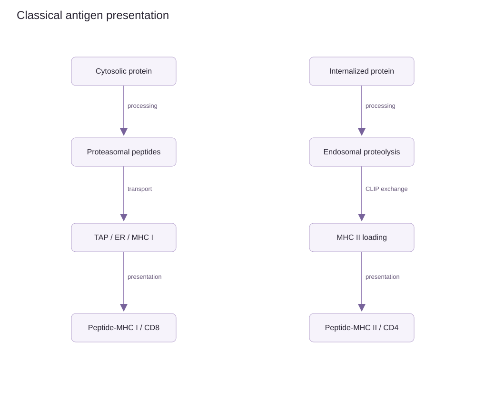

# 면역학·미생물학·기생충학

# 면역학

## 항원 가공·제시와 T세포 활성화

### 학습목표

- MHC I과 MHC II 항원제시 경로를 비교한다.
- 교차제시의 필요성을 설명한다.
- 항원 인식과 공동자극 및 관용을 연결한다.

### 무엇을 인식하는가

항원(antigen)은 면역수용체가 인식할 수 있는 분자적 구조이고, 면역원성(immunogenicity)은 실제 면역반응을 유도하는 능력이다. 두 용어는 동의어가 아니다. B세포수용체와 항체는 입체구조를 유지한 항원의 표면에 결합할 수 있지만, 통상적인 αβ T세포수용체는 MHC 분자가 제시하는 펩타이드와 MHC의 복합 표면을 인식한다. 사람의 MHC를 HLA(human leukocyte antigen)라 부른다. HLA는 매우 다형적이며 한 사람이 여러 대립유전자를 공동우성으로 발현하기 때문에 제시 가능한 펩타이드의 범위가 넓어진다.

MHC 제한성(MHC restriction)은 T세포가 펩타이드를 MHC 맥락 속에서 인식한다는 뜻이다. 이것이 각 T세포가 오직 외래 단백질만 인식하도록 완벽하게 설계되어 있다는 뜻은 아니다. 흉선 선택과 말초 관용이 자가반응의 위험을 줄이며, 이 과정에 실패하면 자가면역이 생길 수 있다. 반대로 종양 면역과 이식 면역에서는 변형된 자가, 비정상 발현, 다른 HLA에 대한 인식이 임상적으로 중요하다. 면역계의 분별은 단순히 자기라는 이름표 하나를 읽는 과정이 아니다.

### MHC I 경로

MHC class I은 대부분의 유핵세포에서 발현되며 일반적으로 CD8 T세포에 펩타이드를 제시한다. 세포질 단백질이 proteasome 등에서 분해되고, 펩타이드는 TAP 수송체를 통해 소포체로 이동할 수 있다. MHC I의 무거운 사슬과 β2-microglobulin의 조립, 펩타이드 적재에는 여러 보조 단백질이 관여한다. 적절한 펩타이드를 결합한 복합체는 골지체를 거쳐 세포 표면으로 이동한다. 이 경로를 통해 바이러스에 감염된 세포나 비정상 단백질을 만드는 세포의 내부 상태가 면역계에 드러날 수 있다.

MHC I의 발현이 줄면 CD8 T세포의 인식을 피하는 데 도움이 될 수 있지만 자연살해세포(natural killer cell, NK cell)의 억제 신호도 감소할 수 있다. NK세포는 활성화 신호와 억제 신호를 통합하며, MHC I이 없으면 무조건 죽인다는 단일 조건문으로 작동하지 않는다. 감염과 종양이 여러 면역회피 전략을 발전시킨 이유도 이러한 복수의 감시 체계와 연결된다. 표적세포 사멸은 perforin과 granzyme 또는 사멸수용체 경로 등을 통해 일어날 수 있다.

### MHC II와 교차제시

MHC class II는 수지상세포, 대식세포, B세포 등 전문 항원제시세포에서 중요하다. 외부에서 섭취한 단백질은 엔도솜·리소좀 계통에서 분해된다. 새로 합성된 MHC II의 펩타이드 결합부위는 invariant chain에 의해 조절되고, 분해 후 남은 CLIP의 교환에는 HLA-DM이 관여한다. 적재된 복합체는 주로 CD4 T세포에 제시된다. 외부 항원과 MHC II, 내부 항원과 MHC I의 대응은 기본 규칙이지만 절대적 경계는 아니다. 자가포식과 교차제시 같은 경로가 이 경계를 연결한다.

교차제시(cross-presentation)는 일부 항원제시세포가 외부에서 얻은 항원을 MHC I 경로로 제시하는 현상이다. 수지상세포 자신이 감염되지 않아도 감염세포나 종양세포의 물질을 받아 CD8 T세포 반응을 시작할 수 있어 중요하다. 실제 미경험 CD8 T세포를 활성화하는 결과는 교차초회자극(cross-priming)이라고 구분할 수 있다. 항원 제시라는 분자적 사건이 있었다고 언제나 활성화가 성공하는 것은 아니다. 공동자극과 염증성 환경이 함께 필요하다.

### 세 가지 신호와 관용

미경험 T세포의 활성화는 TCR의 펩타이드-MHC 인식, 공동자극, 분화에 영향을 주는 사이토카인 신호를 통합한다. CD28과 항원제시세포의 B7 계열 분자는 대표적 공동자극 체계다. 항원 인식이 있어도 적절한 공동자극이 부족하면 무반응(anergy)이나 관용이 유도될 수 있다. 수지상세포는 선천면역의 위험 신호를 감지한 뒤 이동과 공동자극 분자 발현을 바꾸어 조직의 사건을 림프절의 T세포 활성화로 연결한다. 항원량만으로 백신의 효과를 예측할 수 없는 이유다.

활성화 후 T세포는 클론 증식과 분화를 거친다. CD4 T세포의 기능적 분화는 사이토카인과 전사인자에 의해 조절되고, CD8 T세포는 표적세포 제거 능력을 획득한다. 반응이 끝난 뒤 많은 효과세포는 감소하고 일부 기억세포가 남는다. CTLA-4와 PD-1 같은 억제 경로는 반응을 제한하지만 위치와 작용 맥락이 동일하지 않다. 면역관문억제제의 항종양 효과와 면역관련 이상반응은 이 조절을 완화한다는 원리로 연결되며, 모든 면역 억제가 나쁜 것이라는 해석은 옳지 않다.

### 실험과 시각화

유세포분석으로 CD4, CD8, HLA 발현과 활성 표지자를 측정할 수 있지만 표지자 발현만으로 항원 특이성과 기능을 모두 알 수는 없다. 펩타이드-MHC multimer, 사이토카인 측정, 세포독성 분석은 각각 다른 측면을 평가한다.

#### 통상적 항원제시 경로

| 항목 | MHC I | MHC II |
|---|---|---|
| 주된 펩타이드 기원 | 세포질 단백질 | 내포된 단백질 |
| 대표 수용 T세포 | CD8 | CD4 |
| 대표 적재 경로 | 소포체와 TAP 연계 | 엔도솜·리소좀 연계 |

교차제시·자가포식 등 예외와 공동자극을 별도 고려

### 확인 문제

교차제시란?

A. MHC I과 II의 이름을 서로 바꾸는 과정
B. 외부 항원을 MHC I에 제시하는 과정

**정답: B**

항원제시세포가 섭취한 항원을 CD8 반응과 연결할 수 있다.

**오답 해설**

A: 분자 이름의 변경이 아니라 항원 처리 경로의 특징이다.

## 보체의 활성·증폭과 숙주 보호

### 학습목표

- 고전·렉틴·대체경로의 진입점을 구분한다.
- C3와 C5 분해산물의 기능을 설명한다.
- 조절인자 결함과 임상 양상을 연결한다.

### 세 경로가 공통 효과기로 수렴한다

보체(complement)는 혈장과 세포 표면의 여러 단백질이 연결되어 미생물 제거와 염증, 면역복합체 처리에 기여하는 계통이다. 항체 작용을 보충하는 현상에서 이름이 붙었지만 항체가 형성되기 전에도 활성화될 수 있다. 비활성 전구체와 효소, 보조인자 및 수용체가 서로 작용하고, 활성화 과정에서 생성된 단백질 조각은 원래 분자와 다른 기능을 가진다. 모든 보체단백질이 같은 종류의 단백분해효소인 것은 아니다.

고전경로와 렉틴경로, 대체경로는 활성 시작의 인식 방식이 다르지만 C3 활성화와 이후의 공통 효과로 연결된다. 대체경로는 독립적인 시작뿐 아니라 다른 경로에서 생긴 C3b를 이용한 증폭에도 기여한다. 세 경로를 완전히 분리된 세 줄로 외우면 실제 반응의 증폭과 상호작용을 놓치게 된다. 숙주 손상을 피하려면 반응이 필요한 위치에 제한되고 적절한 속도로 종료되어야 한다.

### 고전경로와 렉틴경로

고전경로에서는 C1 복합체의 인식과 효소 활성화가 초기 절단을 시작한다. 항원에 결합한 항체의 배열과 종류는 C1q 결합에 영향을 주므로 자유 항체가 혈중에 존재한다는 이유만으로 같은 반응이 항상 시작되지는 않는다. C4와 C2의 처리를 거쳐 C3를 절단하는 전환효소가 형성된다. C2 조각의 명명 관례에는 차이가 있으므로 문헌의 표기 체계를 확인하고 효소 복합체의 실제 기능을 기준으로 비교한다.

렉틴경로에서는 mannose-binding lectin이나 ficolin 등이 미생물 표면의 당 배열 등을 인식하고 관련 serine protease가 활성화된다. C4와 C2를 이용하는 하류 구조는 고전경로와 공유하지만 출발점의 인식 분자는 다르다. 항체 없이도 작동할 수 있다는 사실은 모든 당이 붙은 숙주 표면을 무차별적으로 공격한다는 뜻이 아니다. 인식의 배열과 조절 환경이 선택성에 기여한다.

### 대체경로의 표면 증폭

C3의 낮은 수준의 자발적 변화와 초기 활성화는 지속적인 감시의 출발점이 될 수 있다. 표면에 결합한 C3b는 factor B와 factor D 등의 작용을 통해 대체경로 C3 전환효소 형성에 참여한다. Properdin은 관련 복합체의 안정화에 기여한다. 생성된 추가 C3b가 다시 반응 표면을 늘리면 작은 시작 신호가 빠르게 증폭될 수 있다.

숙주 표면에서는 factor H와 factor I, 막 결합 조절분자 등이 반응을 제한한다. 표면의 화학적 성질과 조절단백질의 결합은 미생물과 숙주의 차이를 만드는 데 중요하다. 일부 미생물은 숙주 조절인자를 끌어들이거나 보체 성분의 결합·분해를 바꾸어 회피할 수 있다. 따라서 활성화 단백질의 농도만으로 실제 살균 효과를 모두 예측하지 못한다.

### C3 조각과 opsonization

C3 전환효소가 C3를 절단하면 작은 염증 매개 조각과 표면에 결합할 수 있는 큰 조각이 생성된다. C3b와 그 처리산물은 보체수용체를 통한 식세포 인식과 제거를 돕는 opsonin으로 작용한다. 항체의 Fc 수용체 경로와 보체수용체 경로는 서로 다른 인식 체계로, 함께 작용하면 표적 제거가 강화될 수 있다. 표면에 보체가 붙었다는 사실과 세포가 즉시 용해된다는 결과는 구분한다.

면역복합체에 결합한 보체는 운반과 제거에도 관여한다. 이 기능이 손상되면 침착과 염증, 자가면역 관련 양상에 기여할 수 있다. 보체는 적응면역의 조절에도 연결되며 B세포의 보조수용체 신호는 항원 인식의 문턱에 영향을 줄 수 있다. 단순한 미생물 구멍뚫기 체계보다 넓은 생물학적 역할을 가진다.

### C5와 말단경로

표면의 활성화가 충분해지면 C5를 절단하는 복합체가 형성된다. C5a는 강력한 염증·백혈구 반응과 연결되고 C5b는 말단 성분 조립의 출발점이 된다. C5b부터 C9까지의 조립은 막공격복합체(membrane attack complex, MAC)를 형성하여 일부 표적의 막을 손상시킨다. 모든 미생물이 이 경로에 같은 정도로 취약한 것은 아니며 세포벽과 막 구조, 회피 전략이 결과를 바꾼다.

C3a와 C5a 등은 염증성 효과를 나타내지만 같은 수용체와 같은 효능을 가진 단일 물질은 아니다. 과도하거나 광범위한 활성은 혈관과 조직 손상에 기여할 수 있다. 보체의 생리적 방어와 병적 염증은 활성화 여부 하나보다 위치와 크기, 지속시간 및 조절 능력의 문제로 이해해야 한다.

### 조절인자가 없을 때

CD55는 전환효소의 해체를 촉진하고 CD59는 말단 복합체의 막 손상을 제한하는 데 중요하다. C1 inhibitor는 고전·렉틴계의 초기 효소와 다른 혈장 단백분해계 조절에 관여한다. 특정 조절 결함은 용혈이나 미세혈관 손상, 부종 등 서로 다른 임상 양상을 만들 수 있다. 혈관부종이 보체 관련 조절 결함과 연결되는 경우에도 매개체와 치료 표적은 histamine 중심 알레르기 반응과 다를 수 있다.

보체 조절과 관련된 질환을 단백질 하나의 낮은 수치로만 확정하지 않는다. 생성 감소와 소비 증가, 유전적 결함과 후천적 억제, 검체 처리의 영향을 구분해야 한다. 정상 농도로 측정되어도 기능이 떨어진 단백질이 존재할 수 있다. 기능검사와 개별 성분, 유전·면역 검사 및 임상 경과가 상보적인 정보를 제공한다.

### 결핍과 검사 패턴

초기 고전경로 성분의 결함은 면역복합체 처리 이상과 관련될 수 있고, C3의 심한 기능 저하는 넓은 opsonization 장애와 반복 감염으로 드러날 수 있다. 말단경로 결함은 특히 일부 Neisseria 감염과의 연관성이 중요하다. 단백질과 유전변이, 잔여 기능에 따라 위험은 달라져 한 결핍명으로 모든 환자의 경과를 동일하게 예측하지 않는다.

고전경로와 대체경로의 용혈성 기능검사는 여러 성분이 함께 작동하는 능력을 평가한다. 한 검사만 이상인지 둘 다 이상인지의 패턴은 결함 위치의 가설을 제공하지만, 실제 결과는 소비와 검체 상태에도 영향을 받는다. 항보체 치료 중에는 표적 경로의 기능검사 해석이 달라지고 감염 예방과 감시가 관리에 포함된다. 기능 억제가 치료 목표인 상황과 선천적 결핍의 위험을 구분하면서 공통된 방어 손실도 고려해야 한다.

### 확인 문제

C3b의 주요 기능으로 가장 적절한 것은?

A. 모든 표적을 단독으로 즉시 막용해
B. 표면 opsonization과 보체 증폭에 참여
C. 항체의 유전자 재배열을 직접 수행

**정답: B**

표면 인식과 식세포 수용체, 추가 전환효소 형성에 연결된다.

**오답 해설**

A: 말단 복합체 조립과 표적의 민감성 등 추가 조건이 필요하다.

C: 유전자 재배열은 다른 분자 장치의 역할이다.

## B세포 활성화와 배중심·항체반응

### 학습목표

- BCR 신호와 T세포 도움을 연결한다.
- 체성과변이와 동형전환을 구분한다.
- 기억 B세포와 장수 형질세포의 기능을 설명한다.

### 항원 인식에서 활성화까지

B세포수용체(B-cell receptor, BCR)는 막에 고정된 immunoglobulin과 신호 전달 성분으로 이루어진다. Immunoglobulin이 항원을 결합하면 관련 신호 단백질을 통해 세포내 반응이 전달된다. 항체가 인식하는 epitope는 단백질뿐 아니라 여러 분자 형태일 수 있고, 입체적인 항원 표면을 직접 결합할 수 있다. 일반적인 TCR의 peptide-MHC 인식과 같은 방식으로 제한되는 것은 아니다.

B세포는 결합한 항원을 내부로 들여와 가공하고 MHC II에 peptide를 제시할 수 있다. 이 과정은 B세포의 항원 특이성을 T세포 도움과 연결한다. 같은 단백질 또는 결합된 항원 복합체에서 유래한 peptide를 인식하는 도움 T세포와의 만남이 중요한 경우가 많다. T세포와 B세포가 반드시 항원의 동일한 작은 부분을 같은 형태로 인식해야 하는 것은 아니다.

### T세포 의존성과 비의존성

단백질 항원의 많은 반응에서는 여포 도움 T세포(Tfh)의 CD40L-CD40 연결과 cytokine이 B세포 증식·분화 및 배중심 반응을 지원한다. 이 도움은 항원 결합만으로 설명되지 않는 활성화의 추가 조건이다. 선천면역의 신호와 항원 형태, 항원제시세포와 조직 환경도 반응의 규모와 방향을 바꾼다. 항체가 검출되었다는 사실만으로 모든 기억과 친화도 성숙이 같은 수준으로 형성되었다고 볼 수 없다.

반복되는 항원 배열과 선천 신호 등으로 유도되는 T세포 비의존성 반응도 있다. 이 반응은 항원과 B세포 집단, 연령과 환경에 따라 다른 특성을 가지며 단순히 항체가 전혀 형성되지 않는 과정이 아니다. 다당류 항원을 단백질에 결합한 접합백신은 도움 T세포를 동원하는 논리와 연결된다. 화학적으로 결합된 항원 구성과 각각의 수용체가 인식하는 부분을 구분하면 접합의 의미를 이해하기 쉽다.

### 초기 반응과 배중심

활성 B세포의 일부는 비교적 빠른 형질세포 반응으로 분화하고, 일부는 여포 안에서 배중심(germinal center) 반응에 참여한다. 초기 항체 공급과 장기적인 반응의 질 향상은 시간 범위가 다르다. 배중심에서는 증식과 유전자 변화, 항원 포획과 도움 신호를 통한 선택이 연결된다. 어두운구역과 밝은구역의 이름은 전형적인 조직 구조와 활동 차이를 나타내며, 세포가 이동하면서 반응이 유지된다.

여포수지상세포(follicular dendritic cell)는 항원을 표면에 유지하여 B세포의 항원 획득과 선택에 기여한다. 일반적인 수지상세포가 미경험 T세포에 peptide를 제시하는 역할과 구분해야 한다. B세포는 표면 항원을 얻고 Tfh에 peptide를 제시하여 생존과 증식 신호를 경쟁적으로 획득할 수 있다. 단순히 가장 세게 결합하는 세포 하나가 자동으로 남는 과정이 아니라 항원 접근과 도움, 조절에 의존하는 선택이다.

### 체성과변이와 친화도 성숙

체성과변이(somatic hypermutation)는 활성 B세포의 immunoglobulin 가변영역에 변화를 도입한다. AID가 유발하는 염기 변화와 DNA 처리 과정이 관여한다. 만들어지는 모든 변화가 유익한 것은 아니고 결합을 약화시키거나 기능을 잃게 하는 변화도 존재한다. 변이가 생기는 과정과 높은 기능을 가진 세포를 선택하는 과정을 함께 생각해야 친화도 성숙(affinity maturation)을 설명할 수 있다.

혈중 항체의 평균 친화도가 시간이 지나면서 높아질 수 있지만, 검사의 결합 신호는 농도와 epitope, 다가 결합 및 측정 조건의 영향도 받는다. Affinity는 개별 결합 부위의 성질, avidity는 여러 결합이 합쳐진 전체적 결합 특성을 설명하는 데 사용된다. IgM의 높은 다가성에 의한 효과를 가변영역 하나의 친화도가 항상 높다는 말로 바꾸어서는 안 된다.

### 동형전환은 효과기 기능을 바꾼다

동형전환(class-switch recombination)은 항원의 인식을 담당하는 가변영역을 유지하면서 무거운사슬 상수영역을 바꾸어 항체의 효과기 기능과 분포를 변화시킨다. IgM에서 IgG·IgA·IgE 등으로의 전환은 cytokine과 도움 신호, 조직 환경의 영향을 받는다. 새 항원을 인식하도록 수용체를 완전히 다시 만드는 반응과는 다르다. 체성과변이와 동형전환은 서로 연결되지만 목적과 유전자 부위가 다른 과정이다.

상수영역은 Fc 수용체와 보체, 점막 수송 및 태반 이동 등에 영향을 준다. IgA의 점막 방어와 IgE의 비만세포·기생충·알레르기 관련 기능 등은 항체 농도만으로는 설명되지 않는다. 같은 항원에 결합하는 항체라도 isotype과 아형, 당화 및 결합 특성에 따라 다른 생물학적 결과를 만들 수 있다. 동형전환 장애에서는 항체 전체가 없기보다 특정 분포와 기능이 불균형해질 수 있다.

동형전환을 배중심이 완전히 형성된 뒤에만 시작되는 반응으로 제한해서는 안 된다. T세포 도움을 받은 초기 B세포 단계에서도 전환이 시작될 수 있으며, 성숙 배중심의 친화도 선택과 전환의 시공간적 분포는 같은 현상이 아니다. 배중심에서 체성과변이가 활발하다는 사실이 모든 동형전환도 반드시 같은 장소와 시점에서 일어난다는 뜻은 아니다.

### 형질세포와 기억

형질세포(plasma cell)는 많은 항체를 분비하는 데 적합한 세포 구조를 가진다. 일부는 골수 등의 생존 환경에서 오래 유지되어 혈중 항체를 공급할 수 있다. 기억 B세포는 항원 재노출 때 반응할 수 있는 세포 집단으로 남으며, 장수 형질세포와 같은 존재는 아니다. 현재 혈중 항체가 낮아졌다는 사실과 기억세포가 모두 사라졌다는 사실을 동일시하지 않는다.

재노출 반응의 속도와 크기는 항원과 경로, 기존 항체 및 기억세포의 상태에 따라 달라진다. 높은 항체가 항원을 빨리 제거하여 새로운 B세포 자극을 바꾸는 효과도 가능하다. 접종 후 항체가 상승했다는 결과를 장기 방어의 모든 측면으로 확대하지 않고, 중화와 효과기 기능 및 세포성 반응을 포함한 보호의 근거를 구분한다. 개인의 검사값을 비교할 때에는 사용한 표준과 분석법도 확인해야 한다.

### 관용과 임상 연결

B세포는 발생과 활성화의 여러 단계에서 자기반응을 제한하는 조절을 받는다. 자기반응성의 완전한 제거가 아니라 억제와 생존, 도움 신호의 통합이 중요하다. 이 조절의 실패는 자가항체와 조직손상에 기여할 수 있지만 모든 자가항체가 동일한 병인성을 가진 것은 아니다. 항체가 표적에 도달하는지, 표적 기능을 바꾸는지와 Fc 효과 및 보체가 관여하는지에 따라 결과가 달라진다.

CD40 계통과 AID, B세포 발생·생존의 결함 등은 항체반응의 서로 다른 단계를 손상시킨다. 검사에서는 총 immunoglobulin뿐 아니라 특정 항원 반응과 세포 집단, 임상 감염 양상을 함께 평가할 수 있다. 항-B세포 치료 뒤의 세포 감소와 이미 존재하는 장수 형질세포의 항체 유지도 별개의 과정이다. 표적 세포와 반응의 시간 경과를 알면 치료 효과와 감염 위험의 차이를 설명할 수 있다.

### 확인 문제

항체 동형전환이 직접 바꾸는 주된 부분은?

A. T세포수용체의 항원 결합 부위이다.
B. 무거운사슬 상수영역과 이에 따른 효과기 기능이다.
C. 새로운 항원을 인식하도록 가변영역을 반드시 전면 교체한다.

**정답: B**

동형전환은 항체의 상수영역을 바꾸며 체성과변이 및 T세포수용체 재배열과 구별된다.

**오답 해설**

A: 동형전환은 B세포 면역글로불린 유전자에 관한 과정이다.

C: 가변영역의 변이와 선택은 동형전환의 직접 표적과 다르다.

## 과민반응의 네 기전과 임상 표현

### 학습목표

- I~IV형 과민반응의 효과기를 구분한다.
- 감작과 실제 임상 반응을 분리한다.
- 한 질환에서 여러 면역기전이 겹치는 이유를 설명한다.

### 분류의 목적과 경계

과민반응(hypersensitivity)은 면역반응이 조직손상이나 임상적 불편을 일으키는 경우를 포함한다. I~IV형 분류는 주된 면역인식과 효과기를 정리하는 틀이며, 모든 환자의 질환을 배타적인 한 칸에 넣는 완벽한 분류표는 아니다. 같은 질환에서 항체·보체·T세포 및 비면역성 자극이 함께 작용할 수 있다. 임상 시간 경과도 투여 경로와 선행 감작, 기억반응 및 표적 조직의 조건에 따라 달라진다.

알레르기는 면역기전에 의한 과민반응이라는 의미로 사용되지만 실제 임상에서 환자가 말하는 알레르기는 다양한 비면역성 불편까지 포함할 수 있다. 증상 이름과 기전을 구분하여 병력과 검사로 확인한다. 검사에서 항원에 대한 반응이 검출된 감작 상태는 실제 노출에서 질환이 나타난다는 뜻과 다르다. 검사 전 확률과 노출·증상의 재현성이 해석에 중요하다.

### I형: IgE와 비만세포

I형 반응은 IgE와 비만세포·호염기구의 활성으로 설명되는 대표적인 즉시형 기전이다. 항원에 대한 반응에서 만들어진 IgE가 고친화도 수용체에 결합하고, 다시 들어온 항원이 적절한 방식으로 수용체 결합 IgE를 연결하면 세포 활성과 매개체 방출이 일어난다. Histamine과 지질매개체, cytokine 등은 혈관과 평활근, 점액과 다른 면역세포에 서로 다른 시간 규모로 작용한다.

빠른 반응 이후에도 세포 유입과 매개체 생성이 이어지는 후기 반응이 가능하다. 호산구와 T세포 등은 지속 염증과 조직 기능 변화에 기여할 수 있다. 비염과 천식, 일부 음식·약물 알레르기는 이런 기전을 포함하지만 모든 천식이나 모든 발진이 IgE 매개는 아니다. 특이 IgE 양성을 임상 원인 확정으로 바꾸지 않고 실제 증상과 노출 맥락을 확인한다.

전신적인 비만세포 매개체 효과는 여러 장기의 반응으로 나타날 수 있다. 피부 증상만이 아니라 기도와 호흡, 순환과 위장관 상태를 함께 평가한다. 증상의 심각도는 항원량 하나만으로 결정되지 않고 보조인자와 기저질환, 흡수와 시간 경과가 관여한다. 모든 반복 노출이 처음과 같은 양상으로 나타난다고 보장할 수 없다.

### II형: 세포·조직 결합 항체

II형 반응에서는 항체가 세포 표면이나 조직에 있는 표적과 결합하여 손상을 유발하거나 기능을 바꾼다. Opsonization과 식세포 제거, 보체와 Fc 수용체를 통한 염증이 중요한 효과기일 수 있다. 표적 항원이 적혈구에 있는지 기저막이나 다른 조직에 있는지에 따라 임상 표현이 다르다. 항체가 결합한 위치와 효과기의 접근성을 함께 추적해야 한다.

항체가 수용체를 자극하거나 차단하여 기능을 바꾸는 경우에는 세포가 직접 파괴되지 않아도 질환이 생길 수 있다. Graves병의 수용체 자극과 일부 신경근접합부 질환의 전달 장애는 이러한 기능 변화의 사례다. II형을 세포독성이라는 이름으로만 외우면 자극성·차단성 항체의 기전을 충분히 설명하지 못한다. 항체 농도와 기능적 효력, 임상 활동도가 항상 같은 비율로 움직이지 않는 점도 고려한다.

### III형: 면역복합체

III형 반응은 항원-항체 복합체가 형성·침착되고 보체와 염증세포를 활성화하여 손상으로 이어지는 기전이다. 항원의 양과 지속성, 항체 특성 및 제거 능력은 복합체의 분포와 결과를 바꾼다. 신장과 혈관, 관절 등은 서로 다른 방식으로 침범될 수 있다. II형의 조직 고정 표적 항체와 III형의 복합체 형성·침착이라는 틀을 구분하되 실제 질환의 국소 형성까지 고려한다.

감염과 외래 단백질, 자가항원 등이 복합체의 재료가 될 수 있다. 보체 성분 감소는 소비를 시사할 수 있으나 합성 감소와 선천적 결함, 측정과 검체 조건도 다른 설명이다. 정상 농도라고 면역복합체 질환을 모두 배제할 수 없고, 낮은 농도만으로 원인을 확정할 수도 없다. 조직의 침착 양상과 혈청·소변, 전신 소견을 통합한다.

### IV형: T세포 매개 손상

IV형 반응은 T세포의 cytokine 및 세포독성 효과 등을 통해 염증과 손상을 일으킨다. 전형적인 지연형 반응의 시간 경과는 이미 감작된 세포의 활성과 유입, 조직 반응에 관련된다. CD4 T세포가 대식세포 등 다른 효과기를 동원하거나 CD8 T세포가 직접 표적세포를 제거하는 등 기전은 다양하다. 항체가 주된 효과기가 아니라는 공통점만으로 모든 세포반응이 동일한 형태를 보이는 것은 아니다.

접촉피부염과 일부 약물반응, 감염 관련 육아종성 염증 등은 다른 항원과 T세포 환경에서 발생한다. 같은 물질도 분자 자체와 단백질 결합, 대사물에 따라 인식 방식이 달라질 수 있다. 피부시험의 종류와 노출 경로에 따라 평가하는 면역반응이 다르므로 하나의 검사 음성으로 모든 형태의 알레르기를 배제하지 않는다. 위험한 과거 반응이 있는 환자에서 재노출의 문제는 별도의 임상 판단을 필요로 한다.

### 검사와 분류를 연결하기

즉시형 피부반응과 특이 IgE, patch test 및 세포·항체 기능검사는 서로 다른 질문에 답한다. 민감도와 특이도, 사용한 항원과 시점, 선행 치료와 피부 상태가 결과를 바꿀 수 있다. 여러 검사를 무작위로 시행하면 낮은 사전확률에서 우연한 양성을 원인으로 오해하기 쉽다. 병력으로 가능한 기전과 원인을 좁힌 뒤 목적이 분명한 검사를 선택한다.

반응의 시간만으로 분류를 확정할 수도 없다. 혈중 항체가 이미 존재하는 상황, 반복 노출과 높은 노출량, 장기 내 대사와 축적 및 기억세포의 상태가 임상 발현을 바꾼다. 원인 후보와 시간 관계, 장기 침범과 검사 근거를 함께 기록하면 불확실성을 보존하면서도 실제 위험을 관리할 수 있다. 질환명과 면역기전, 검사 결과는 관련되지만 서로의 완전한 동의어는 아니다.

### 확인 문제

수용체를 자극하는 항체에 의한 질환을 II형 기전으로 설명할 수 있는 이유는?

A. II형은 항체 없이 T세포만 작용하는 반응이기 때문이다.
B. 세포 표면의 고정 표적과 결합하여 기능을 바꿀 수 있기 때문이다.
C. II형 반응은 반드시 모든 표적세포를 직접 용해해야 하기 때문이다.

**정답: B**

항체 매개 기능 변화는 직접 세포 파괴가 없어도 발생할 수 있다.

**오답 해설**

A: T세포가 주된 효과기인 IV형과 항체 매개 II형을 혼동한 설명이다.

C: II형에는 직접 용해뿐 아니라 수용체 자극과 차단 같은 기능 변화도 포함된다.

# 세균학

## 세균 세포외피와 병원성·약물표적

### 학습목표

- 그람양성균과 음성균의 외피를 비교한다.
- 세포벽·외막·협막의 기능을 구분한다.
- 항균제 표적과 내성 기전을 연결한다.

### 세균을 단순한 작은 세포로 보지 않기

세균(bacteria)은 핵막으로 둘러싸인 핵이 없으며 유전체와 세포질막, 리보솜 등으로 생명활동을 수행한다. 그러나 모든 세균이 같은 세포벽과 모양, 대사능을 가지는 것은 아니다. 진단과 치료에서 형태는 첫 단서이며 균종, 병원성과 감수성을 완전히 결정하는 정보는 아니다. 같은 종 안에서도 독소 유전자와 내성 인자, 숙주와의 관계에 따라 임상적 의미가 달라질 수 있다. 배양 조건과 염색 상태가 형태 관찰에 영향을 준다는 점도 중요하다.

세포질막은 선택적 투과 장벽이자 물질수송과 에너지 대사의 장소다. 사람의 미토콘드리아에 있는 것과 유사한 에너지 전환 기능이 세균에서는 세포질막에 배치될 수 있다. 펩티도글리칸(peptidoglycan)은 당사슬과 펩타이드 연결을 가진 망상 구조로 삼투압에 맞서는 세포벽의 기계적 강도에 기여한다. 사람 세포에는 같은 벽이 없으므로 선택적 항균 표적이 된다. 하지만 벽이 약물표적이라는 사실만으로 모든 세균이 해당 약물에 감수성이라는 뜻은 아니다.

### 외피 구조의 차이

전형적인 그람양성균은 두꺼운 펩티도글리칸과 teichoic acid 계열 성분을 가지며, 전형적 그람음성균은 상대적으로 얇은 펩티도글리칸 바깥에 외막(outer membrane)이 있다. 그람염색은 염색액과 매염, 탈색·대조염색에 대한 외피의 반응을 이용한다. 오래된 배양이나 손상 세포, 염색 조건에 따라 결과가 달라질 수 있다. 항산균, 세포벽이 없는 Mycoplasma와 세포내 병원체 등은 이 두 범주의 단순 도식만으로 충분히 설명되지 않는다.

그람음성균 외막의 porin은 일부 친수성 물질 통과에 관여하고 외막 자체는 약물 접근의 장벽이 될 수 있다. 내막과 외막 사이의 주변세포질(periplasm)에는 여러 효소와 수송 관련 단백질이 존재한다. Lipopolysaccharide(LPS)의 lipid A는 숙주 선천면역의 중요한 자극으로 작용한다. 내독소라는 용어를 살아 있는 균이 능동적으로 분비하는 단백독소와 혼동하지 않는다. 세균 성분과 숙주 반응의 상호작용이 염증과 순환 이상을 연결한다.

### 협막·부착·생물막

협막(capsule)은 세포 외부의 구조로 식균 회피와 생존에 기여할 수 있다. 많은 협막이 다당류지만 모두 같은 화학적 성분인 것은 아니다. 항체와 보체에 의한 opsonization은 식세포가 표적을 제거하는 데 도움을 주며, 일부 협막 항원은 백신 설계와 관련된다. 부착소(adhesin)와 섬모·선모 등은 특정 숙주 표면에 결합하는 데 기여한다. 부착 능력은 감염 시작의 중요한 요소지만 해당 균이 검출되었다는 사실이 곧 조직 침범을 증명하지는 않는다.

생물막(biofilm)은 세균과 세포외기질이 표면에 형성하는 구조화된 군집이다. 인공물과 만성 감염에서 중요하며, 확산 장벽과 성장 상태의 이질성, 휴면과 스트레스 반응 등이 치료 반응에 영향을 준다. 생물막에서 치료가 어려운 현상을 모두 유전적 항균제 내성으로 부르면 부정확하다. 감수성 검사에서 측정하는 부유 세균의 MIC와 생물막 환경의 실제 노출·생존은 다를 수 있다. 감염된 기구 제거와 배액 같은 감염원 조절이 중요해지는 이유다.

### 표적과 내성의 연결

β-lactam 계열은 penicillin-binding proteins의 기능을 방해하여 펩티도글리칸 교차연결에 영향을 준다. 내성은 β-lactamase에 의한 분해, 표적 변화, 외막 투과 감소와 유출 증가 등 여러 기전으로 생길 수 있다. Glycopeptide는 다른 방식으로 세포벽 합성 과정에 작용하며 외막 접근성과 표적 말단 변화가 중요하다. 같은 벽 합성 억제제라고 작용 지점을 하나로 묶지 않는다. 약물의 시험관 효과와 환자에서의 효과는 감염부위 노출과 숙주 조건을 함께 봐야 한다.

세균은 돌연변이뿐 아니라 형질전환, 형질도입, 접합 등을 통해 유전 정보를 획득할 수 있다. Plasmid, transposon과 integron 등은 서로 다른 유전 요소이며 내성 인자의 이동과 발현을 이해하는 데 중요하다. 항균제는 내성 돌연변이가 필요에 맞춰 생기도록 명령하는 것이 아니라, 기존 또는 새로 생긴 변이 가운데 생존에 유리한 집단을 선택할 수 있다. 선택 압력과 전파가 함께 내성 역학을 바꾸므로 환자 단위의 적절한 사용과 감염관리가 연결된다.

### 확인 문제

그람음성균 외막의 존재가 치료에 영향을 줄 수 있는가?

A. 없다.
B. 있다.

**정답: B**

외막 투과와 porin, 유출 등은 약물 접근에 영향을 준다.

**오답 해설**

A: 모든 세균에 같은 투과성을 가정하면 안 된다.

## 세균 유전체 변화와 항균제 내성

### 학습목표

- 돌연변이와 수평 유전자 전달을 구분한다
- 약물 유입·배출·불활성화·표적 변화 기전을 비교한다
- 감수성 결과와 임상 실패의 관계를 설명한다

### 내성의 주체와 선택

항균제 내성(antimicrobial resistance)은 병원체가 특정 약물의 억제 또는 사멸 작용을 견디는 성질이다. 환자의 몸이 약에 익숙해졌다는 의미와 구별한다. 항균제 노출 전부터 존재하던 내성 세포가 선택될 수 있고, 집단 증식 중 새로 발생한 변이나 다른 세포에서 얻은 유전자가 기여할 수도 있다. 약물이 필요에 맞추어 세균에게 특정 변이를 만들도록 지시하는 것이 아니라, 생존과 증식의 조건을 바꾸어 집단 구성을 변화시킨다.

내재 내성(intrinsic resistance)은 특정 세균군이 본래 지닌 구조나 표적의 특성과 관련된다. 후천 내성(acquired resistance)은 원래 감수성이 있던 집단에서 변이나 유전자 획득으로 생긴다. 외막의 존재, 표적의 부재 및 약물이 세포 안으로 들어가는 방식은 약물군의 기본 항균 범위를 결정한다. 개별 균주의 후천 내성을 해석하려면 먼저 그 균종의 기본 생물학을 알아야 한다.

### 수직 전달과 수평 전달

돌연변이로 생긴 내성은 자손에게 수직으로 전달될 수 있다. 접합(conjugation)은 세균 사이의 접촉을 통해 플라스미드 등 유전물질이 이동하는 과정이다. 형질전환(transformation)은 주변의 유리 DNA를 받아들이는 방식이고, 형질도입(transduction)은 박테리오파지가 유전자 전달에 관여하는 방식이다. 이들 과정의 범위와 효율은 세균과 유전요소의 특성에 따라 다르다.

플라스미드에는 여러 내성 유전자가 함께 존재할 수 있다. 한 약물을 사용하는 선택압이 같은 유전요소에 실린 다른 내성의 유지에도 유리하게 작용할 수 있는 이유이다. 트랜스포존은 유전체 안이나 유전요소 사이에서 이동할 수 있으며, 인테그론은 유전자 카세트를 포획하고 발현하는 체계이다. 이 용어들은 모두 같은 종류의 독립 복제체를 뜻하지 않는다. 내성 유전자가 어디에 있고 어떻게 이동하는지 구분하면 병원 내 확산을 이해하는 데 도움이 된다.

### 표적까지 도달하는 농도의 감소

그람음성균의 외막은 약물이 표적에 도달하기 전에 통과해야 할 장벽이다. 포린(porin)의 감소나 구조 변화는 특정 약물의 유입을 줄일 수 있다. 유출펌프(efflux pump)는 들어온 약물을 밖으로 배출하여 세포 내 유효 농도를 낮춘다. 한 펌프가 여러 약물에 영향을 줄 수 있어 서로 다른 항균제군의 감수성이 함께 변하기도 한다. 다만 모든 교차내성을 하나의 펌프로 설명하지는 않는다.

약물 분해효소와 유입 감소가 함께 있으면 각각만 있을 때보다 내성이 커질 수 있다. 예를 들어 외막 투과성이 낮아져 적은 약물만 들어오면 주변세포질의 효소가 그 약물을 더 효과적으로 불활성화할 수 있다. 따라서 동일한 내성 유전자를 검출한 두 균주가 항상 같은 최소억제농도를 보이는 것은 아니다. 발현량, 복제수, 외막 및 다른 기전의 조합이 실제 표현형을 만든다.

### 약물 불활성화와 표적 변화

β-락타마아제(beta-lactamase)는 β-락탐 고리를 가수분해하여 약물의 활성을 낮춘다. 효소별로 분해 가능한 기질과 억제제에 대한 반응이 다르므로 β-락타마아제라는 이름만으로 모든 β-락탐약이 같은 결과를 보인다고 할 수 없다. 카바페넴 내성에도 카바페넴분해효소뿐 아니라 다른 효소와 포린 변화의 조합이 관여할 수 있다. 유전자 검사와 표현형 감수성 검사는 서로 보완한다.

표적 단백질이 변하면 약물이 결합하기 어려워진다. 페니실린결합단백질, 리보솜, DNA 회전효소 등은 해당 약물군의 작용과 내성을 연결하는 표적이다. 세균이 표적 경로를 우회하거나 대체 효소를 쓰는 방식도 있다. 이런 기전은 약물 자체를 파괴하는 것과 다르므로 분해효소 억제제를 더해도 해결되지 않을 수 있다. 병합요법의 논리는 기전의 상보성을 확인해야 성립한다.

### 감수성 검사의 질문

최소억제농도(minimum inhibitory concentration, MIC)는 정해진 실험 조건에서 육안적 증식을 억제하는 최소 농도이다. 임상적 감수성 판정은 MIC뿐 아니라 약물 노출, 투여 방식, 균종 및 감염 부위 등을 고려한 기준점에 의존한다. MIC가 낮은 약물이 모든 환자와 모든 부위에서 더 우수하다는 뜻은 아니다. 서로 다른 약물의 숫자를 단순히 크기순으로 비교하는 것도 적절하지 않다.

검사실에서 감수성으로 보고되어도 농양의 배액이 되지 않거나 감염된 기구가 남아 있으면 임상 실패가 발생할 수 있다. 약물이 해당 부위에 도달하지 못하거나 숙주 방어가 크게 손상되어도 결과가 달라진다. 반대로 검체에서 자란 균이 실제 병원체인지 집락화 또는 오염인지가 먼저 불분명할 수도 있다. 항균제 선택 전에는 배양 결과가 설명하는 감염 증후군이 실제로 존재하는지 확인한다.

### 내성과 관용을 구별하기

내성은 통상 증식 억제에 필요한 농도의 변화와 관련되지만 관용(tolerance)은 일정 농도에 노출되었을 때 사멸이 늦어지는 성질을 가리킨다. 지속생존세포(persister)는 집단의 일부가 일시적인 상태로 살아남는 현상과 연결된다. 생물막(biofilm)은 기질과 국소 환경 및 세포 상태의 이질성을 통해 약물과 숙주 방어의 효과를 떨어뜨릴 수 있다. 이러한 현상을 모두 동일한 유전적 내성으로 부르면 재발의 원인을 잘못 이해할 수 있다.

내성 관리에는 적절한 항균제 사용과 함께 감염 예방, 손 위생, 기구 관리, 검체 확보 및 전파 경로 차단이 필요하다. 경험적 치료는 환자의 중증도와 예상 병원체 및 지역 역학을 반영하고, 결과가 나오면 실제 병원체와 감수성에 맞추어 재평가한다. 넓은 범위의 약물을 계속 유지하는 것과 적절한 치료는 같은 말이 아니다. 치료의 충분성과 불필요한 선택압의 감소를 함께 판단한다.

### 확인 문제

MIC가 낮은 약물을 서로 다른 약물군 사이에서 비교할 때 옳은 것은?

A. 숫자만으로 우열을 정하지 않고 약물 노출과 감염 부위를 고려한다.
B. 숫자가 가장 작으면 항상 치료에 성공한다.
C. 감염원 조절 여부는 임상 결과에 영향을 주지 않는다.

**정답: A**

MIC는 표준 실험 조건의 지표이며 약동학·약력학과 숙주 및 감염원 조절이 임상 반응을 바꾼다.

**오답 해설**

B: 표준 검사 값은 조직 도달과 농양·숙주 조건을 모두 반영하지 않는다.

C: 농양이나 감염 기구가 남으면 감수성 약물로도 실패할 수 있다.

# 바이러스학

## 바이러스 유전체와 복제 전략

### 학습목표

- 유전체 유형에서 mRNA 생성 전략을 추론한다.
- 외피와 수용체가 감염성에 미치는 영향을 설명한다.
- 잠복·지속감염과 급성 감염을 구분한다.

### 숙주 의존성의 의미

바이러스(virus)는 독립적인 번역 체계를 갖지 않아 숙주세포의 기능을 이용해 증식한다. 유전체, capsid 및 일부 바이러스의 지질 외피가 감염 입자를 이룬다. 외피가 있다고 언제나 더 강한 병원체라는 뜻은 아니다. 외피는 진입과 면역회피에 기여할 수 있지만 환경에서의 안정성과 소독제 민감성에도 영향을 준다. 감염 부위와 전파 경로를 생각할 때 입자의 물리적 특성, 배출 양상과 숙주 행동을 함께 고려해야 한다.

숙주 범위와 조직 친화성(tropism)은 수용체 존재만으로 모두 정해지지 않는다. 진입 보조인자, 세포내 복제 허용성, 선천면역과 온도 등도 중요하다. 수용체에 결합한 뒤 세포막 융합이나 내포, 탈외피 과정을 거쳐 유전체가 복제 장소로 전달된다. 같은 수용체가 있는 모든 조직이 같은 정도로 감염되거나 손상된다고 가정하면 안 된다. 감염에 의한 직접 세포손상과 숙주 면역반응에 의한 손상을 구분하는 것도 중요하다.

### 중심 질문은 mRNA를 만드는 방법이다

모든 바이러스는 궁극적으로 숙주 리보솜이 읽을 수 있는 mRNA를 만들어야 한다. 양성가닥 RNA 바이러스의 유전체는 일반적으로 mRNA 역할을 할 수 있어 진입 후 번역을 시작하는 전략을 가진다. 음성가닥 RNA 바이러스는 먼저 상보적인 mRNA를 만들어야 하므로 기능적 RNA-dependent RNA polymerase를 감염 입자에 포함해야 한다. 이중가닥 RNA 바이러스도 전사를 위한 효소가 중요하다. 다만 구체적인 유전자 발현과 복제 과정은 바이러스군마다 달라 단순한 한 줄의 도식을 모든 군에 적용하지 않는다.

DNA 바이러스는 DNA에서 mRNA를 전사하고 유전체를 복제한다. 많은 DNA 바이러스가 핵을 이용하지만 예외가 있으며 세포질에서의 복제를 위해 필요한 효소를 더 많이 갖추는 전략도 존재한다. Retrovirus는 RNA 유전체에서 역전사효소를 이용해 DNA를 만들고 숙주 유전체에 통합된 형태를 거쳐 발현한다. Hepadnavirus는 DNA 유전체를 가지면서 RNA 중간체의 역전사를 이용하므로, 역전사라는 단어를 retrovirus에만 독점적으로 연결하면 틀린다.

### 조립·방출과 시간 경과

새 유전체와 구조단백질이 조립된 뒤 입자는 세포용해나 출아 등으로 방출된다. 외피 바이러스의 출아 위치는 바이러스 단백질의 막 이동과 숙주 막체계 이용에 연결된다. 세포 밖으로 나왔다는 사실만으로 모든 입자가 감염성을 갖는 것은 아니다. 유전체 사본 수, 입자 수와 감염성 단위는 서로 다른 측정량이다. 핵산검사 양성이 곧 같은 정도의 전염성을 의미한다고 단정하면 안 되는 이유다.

잠복(latency)은 바이러스 유전정보가 유지되지만 생산성 감염이 제한되는 상태 등을 말하며, 만성 생산성 감염과 구분한다. 재활성화는 면역 상태와 세포 환경 변화 등과 연결될 수 있다. 바이러스별 저장소와 지속 전략이 달라 혈액에서 핵산이 검출되지 않는다는 사실만으로 체내 모든 유전체가 사라졌다고 주장할 수 없다. 항바이러스 약물은 유전체 복제나 진입 등 특정 단계를 겨냥하므로 어떤 생활사 단계가 남는지를 이해해야 치료의 한계를 설명할 수 있다.

유전체 분절화는 같은 세포에서 서로 다른 계통이 감염될 때 재분절(reassortment)의 기회를 제공할 수 있고, 재조합(recombination)과는 기전이 다르다. 돌연변이 축적과 선택은 항원 변화, 약제 내성과 숙주 적응에 관여한다. 변화가 관찰되었다고 전파력이나 중증도가 자동으로 증가했다고 판단하지 않는다. 유전적 변화와 표현형, 임상 역학을 각각 검증해야 한다.

### 확인 문제

음성가닥 RNA 바이러스는 초기 mRNA 전사를 위한 효소가 필요한가?

A. 항상 숙주 리보솜이 RNA를 바로 복사한다.
B. 필요하다.

**정답: B**

숙주 리보솜은 음성가닥 유전체를 mRNA로 직접 바꾸지 못한다.

**오답 해설**

A: 번역과 RNA 전사·복제는 서로 다른 과정이다.

# 진균학

## 진균의 구조와 숙주 방어

### 학습목표

- 진균의 세포 구조를 항진균제 표적과 연결한다
- 집락화와 침습성 감염을 구별한다
- 면역결함의 종류에 따른 진균 감염 양상을 설명한다

### 진핵 병원체로서의 진균

진균(fungus)은 핵과 세포소기관을 갖는 진핵생물이다. 세균과 달리 세포막에 에르고스테롤(ergosterol)을 포함하고 세포벽에는 글루칸, 키틴, 만난 등의 성분이 있다. 사람 세포도 진핵세포이므로 진균의 대사와 숙주의 대사가 공유하는 부분이 많다. 항진균제의 선택독성이 항세균제보다 확보하기 어려운 배경이다. 에르고스테롤이나 그 합성효소, 세포벽 글루칸 합성효소처럼 숙주와 차이가 있는 구조는 치료 표적이 된다. 다만 같은 표적을 갖는 진균이라도 약물 감수성이 동일하지는 않다.

효모(yeast)는 주로 단세포 형태로 증식하고, 사상균(mold)은 균사(hypha)를 형성한다. 균사의 집합이 균사체(mycelium)이다. 일부 진균은 환경 조건과 숙주 내 조건에 따라 형태를 바꾸는 이형성(dimorphism)을 보인다. 형태는 현미경 관찰과 병인 이해에 유용하지만 형태만으로 모든 종을 확정할 수는 없다. 배양, 항원검사, 핵산검사 등을 목적에 맞게 결합한다. 조직에서 관찰한 형태와 배양 결과가 다를 때에는 배양 오염, 검체 위치, 조직 손상과의 관련성을 다시 검토한다.

### 장벽과 선천면역

정상 피부와 점막은 진균의 침입을 막는 물리적 장벽이다. 점액, 섬모 청소, 상피의 연속성, 미생물 군집의 경쟁은 노출이 곧 질병으로 이어지지 않게 한다. 피부 상재 진균이나 점막의 칸디다(Candida)는 일정 조건에서 증상 없이 존재할 수 있다. 광범위 항균제 사용은 경쟁 미생물을 바꾸고, 점막 손상은 진균이 조직으로 들어갈 통로를 만든다. 혈관 내 카테터와 인공물은 생물막(biofilm)이 형성될 표면을 제공한다. 진균 감염은 외부에서 새 병원체를 얻는 사건뿐 아니라 기존 집락의 위치와 숙주 환경이 바뀌는 사건이기도 하다.

진균 세포벽의 성분은 패턴인식수용체(pattern recognition receptor)에 의해 인식된다. 예를 들어 β-글루칸의 인식은 식세포의 활성화와 염증성 반응에 기여한다. 호중구는 균사를 포함한 진균 방어에서 중요하며 식작용, 탈과립, 산화성 살균 등을 이용한다. 대식세포는 흡입한 포자의 초기 처리와 사이토카인 생성에 관여한다. T세포 반응은 감염 부위와 병원체에 따라 중요도가 달라지고, 점막에서의 Th17 반응과 만성적인 세포내 병원체 제어에 관여하는 세포매개 면역을 구분하여 이해해야 한다.

면역저하를 하나의 상태로 묶으면 진균 감염의 위험을 정확히 설명하기 어렵다. 장기간의 중증 호중구감소는 침습성 사상균 감염의 위험을 높이고, T세포 기능 저하는 특정 기회감염에 취약하게 만든다. 스테로이드는 여러 면역 기능을 함께 억제하며, 장기이식 후 면역억제의 강도와 기간도 위험을 바꾼다. 같은 약제를 쓰더라도 점막 손상, 당뇨병, 신장 기능, 환경 노출에 따라 임상상이 달라진다. 위험 인자를 열거하는 데서 나아가 어떤 방어선이 손상되었는지 연결하는 것이 중요하다.

### 칸디다와 아스페르길루스의 대비

칸디다는 점막의 집락화에서 표재성 감염, 혈류감염과 심부 장기 감염까지 서로 다른 상태를 만들 수 있다. 중심정맥관, 복부 수술과 점막 장벽 파괴, 광범위 항균제 노출은 침습성 감염을 고려하게 하는 맥락이다. 객담이나 소변에서 칸디다가 배양되었다고 언제나 침습성 질환을 의미하지는 않는다. 검체가 채취된 부위, 환자의 증상, 숙주 위험, 다른 침범 근거를 함께 보아야 한다. 반면 혈액처럼 정상적으로 무균인 부위에서의 검출은 전혀 다른 무게로 평가된다.

아스페르길루스(Aspergillus)의 포자는 환경에서 흡입될 수 있다. 흡입한 포자가 제거되지 않고 발아하면 균사가 조직으로 퍼질 수 있으며, 침습성 질환에서는 혈관 침범으로 혈전, 허혈, 출혈이 발생할 수 있다. 그러나 아스페르길루스와 관련된 모든 질환이 침습성 감염은 아니다. 기존 폐공동 안에서 균구가 형성되거나, 기도 질환을 가진 환자에서 알레르기 반응이 중심이 되는 임상상도 있다. 동일한 진균명이 확인되어도 숙주의 구조적 폐질환과 면역 상태에 따라 병인의 중심이 달라진다.

조직병리검사는 진균의 존재뿐 아니라 조직 침범과 염증 반응을 볼 수 있다는 장점이 있다. 배양은 종 동정과 감수성 평가에 도움을 주지만 시간이 걸리고 항상 양성인 것은 아니다. 혈중 β-D-글루칸이나 갈락토만난 같은 검사는 특정 임상 맥락에서 진단에 기여하나 민감도와 특이도가 일정하지 않고 모든 진균을 같은 정도로 검출하지 않는다. 검사 양성만으로 병원체와 감염 부위를 단정하거나 검사 음성만으로 모든 침습성 진균증을 배제하는 해석을 피한다.

### 항진균제 표적과 내성의 의미

아졸계(azole)는 에르고스테롤 합성 과정의 효소를 억제하고, 폴리엔계(polyene)는 에르고스테롤과 상호작용하여 세포막 기능을 손상시킨다. 에키노칸딘계(echinocandin)는 β-1,3-D-글루칸 합성을 억제하여 세포벽에 영향을 준다. 플루시토신(flucytosine)은 진균 내에서 대사되어 핵산 대사를 방해한다. 이런 기전은 약물 선택의 출발점이지만 실제 선택에는 진균 종, 감수성, 감염 부위 도달성, 장기 기능, 약물 상호작용을 포함해야 한다.

내성은 표적의 변화, 표적 발현 증가, 유출펌프 활성 증가 등으로 발생할 수 있다. 생물막 상태는 부유하는 세포와 다른 약물 반응을 보일 수 있다. 감염된 인공물이나 장벽 손상이 유지되는 경우 약물만으로 원인이 해결되지 않을 수 있는 이유이다. 항진균 치료를 이해할 때에는 병원체의 제거, 감염원 관리, 숙주 방어의 회복이라는 세 축을 함께 생각한다. 표재성 피부 감염과 혈류감염을 동일한 치료 강도로 다루어서는 안 되는 이유도 이 세 축의 차이에서 나온다.

### 확인 문제

객담에서 Candida가 배양되었을 때 적절한 해석은?

A. 배양 양성은 항상 칸디다 폐렴의 확진이다.
B. Candida는 정상 점막에 존재할 수 없다.
C. 검체 부위와 증상, 숙주 위험 및 침습 근거를 함께 평가한다.

**정답: C**

집락화와 침습성 감염은 구별해야 하며 배양 결과의 의미는 검체와 임상 상황에 따라 다르다.

**오답 해설**

A: 객담 양성은 집락화를 반영할 수 있으므로 조직 침습을 자동 확정하지 못한다.

B: Candida는 정상 피부와 점막에 집락할 수 있다.

# 기생충학

## 말라리아 생활사와 질병 발생

### 학습목표

- 사람과 모기에서의 원충 발달 단계를 구별한다
- 재발과 혈중 원충의 지속을 구별한다
- 적혈구 침범을 빈혈 및 미세순환 장애와 연결한다

### 숙주가 바뀌면 발달 단계도 바뀐다

말라리아(malaria)는 열원충(Plasmodium)에 의한 감염병이다. 생활사에는 사람과 얼룩날개모기(Anopheles)가 관여한다. 기생충학에서 종숙주(definitive host)는 성적 생식이 일어나는 숙주를 의미하므로 열원충의 종숙주는 모기이고 사람은 중간숙주이다. 이는 어느 숙주가 더 큰 고통을 받는지나 어느 숙주에서 원충이 더 많이 증식하는지를 뜻하는 분류가 아니다. 생활사의 각 단계는 침입하는 세포, 증식 방식, 치료 표적이 다르므로 단계의 구별이 병태생리 이해에 직접 연결된다.

감염된 모기가 흡혈할 때 포자소체(sporozoite)가 사람에게 들어와 간세포를 침범한다. 간세포 내에서 증식한 뒤 분열소체(merozoite)가 혈류로 나와 적혈구를 감염시킨다. 이 초기 간 단계와 적혈구 단계는 같은 복제 과정의 장소만 바뀐 것이 아니라 세포 침입 방식과 발달 상태가 다른 단계이다. 혈액도말에서 관찰하는 원충은 주로 적혈구 내 발달 단계이며, 간에 원충이 있다는 사실을 말초혈액도말로 직접 관찰하는 것은 아니다.

적혈구 내에서는 어린 영양형인 반지형(ring form), 성숙한 영양형(trophozoite), 분열체(schizont)로 발달한다. 적혈구가 파괴되며 방출된 분열소체는 다른 적혈구를 침범한다. 일부 원충은 생식모세포(gametocyte)로 분화하여 다음 모기의 흡혈 때 옮겨갈 준비를 한다. 모기에서는 수정과 이후 발달 과정을 거쳐 다시 포자소체가 만들어져 침샘으로 이동한다. 사람에서 증상을 만드는 무성 적혈구 단계와 모기로 전파되는 생식모세포 단계를 구별하면 감염자의 증상과 전파 가능성이 항상 나란히 움직이지 않는 이유를 이해할 수 있다.

### 발열과 빈혈의 발생

적혈구 단계의 증식과 파괴는 염증매개물질의 방출을 유발하고 오한, 발열, 발한 등의 증상을 만든다. 원충의 적혈구 주기가 동기화되면 발열에 주기성이 나타날 수 있지만 초기 감염, 혼합 감염, 부분 치료, 개별 환자의 면역반응에 따라 일정하지 않다. 전형적인 주기열이 없다는 이유로 말라리아를 배제할 수 없는 이유이다. 비유행 지역에서 발열 환자를 평가할 때에는 해외 체류뿐 아니라 국내 노출 지역, 마지막 노출 시점, 예방약 복용과 수혈력 등의 맥락을 확인한다.

빈혈은 감염된 적혈구의 파괴만으로 설명되지 않는다. 비장에서 감염 적혈구와 비감염 적혈구의 제거가 증가할 수 있고, 염증에 따른 조혈 억제도 기여한다. 비장은 비정상 적혈구를 제거하는 방어기관이면서 감염 과정에서 커질 수 있는 장기이다. 혈소판 감소 역시 관찰될 수 있으나 그 소견만으로 특정 원충 종을 확정할 수는 없다. 헤모글로빈, 혈소판 수, 용혈 지표, 간·신장 기능은 원충 확인 검사와 다른 정보를 제공하며 중증도와 장기 손상을 평가하는 데 이용된다.

### 종 차이와 지속 감염

삼일열원충(P. vivax)과 난형열원충(P. ovale)은 간에 휴면소체(hypnozoite)를 남길 수 있다. 휴면소체가 다시 활성화되어 혈중 감염을 일으키는 현상을 재발(relapse)이라고 한다. 혈액 속 원충이 완전히 제거되지 않아 다시 증가하는 재연(recrudescence)과는 원인이 다르다. 새 모기 노출에 의한 재감염(reinfection)도 구별해야 한다. 치료 후 발열이 다시 나타났을 때 시간 간격 하나만으로 이들을 확정하지 않고 원충 종, 치료 내용, 약물 흡수와 순응도, 새로운 노출 가능성을 함께 평가한다.

열대열원충(P. falciparum) 감염에서는 감염 적혈구 표면 변화에 따른 혈관내피 부착과 미세혈관 내 격리(sequestration)가 중요한 병태생리이다. 순환 혈액에서 측정한 원충혈증이 조직 미세혈관에 존재하는 전체 원충 부담을 완전히 대표하지 못할 수 있다. 미세순환 장애와 염증, 대사 이상이 함께 작용하여 뇌, 신장, 폐 등의 기능 장애를 만들 수 있다. 다만 다른 원충 종도 중증 질환을 일으킬 수 있으므로 종의 이름만으로 환자의 안전성을 판단하지 않는다.

### 검사와 치료를 생활사에 연결하기

후층도말(thick smear)은 혈액을 두껍게 모아 원충을 검출하는 데 유리하고, 박층도말(thin smear)은 적혈구 형태와 원충 형태를 관찰하여 종 동정과 원충혈증 평가에 도움을 준다. 검체 제작과 판독 숙련도는 결과에 큰 영향을 미친다. 신속항원검사는 상황에 따라 빠른 단서를 제공하지만 검사 표적의 특성 때문에 종 구별과 민감도에 한계가 있고, 치료 뒤 항원 지속은 현재의 살아 있는 원충 부담과 결과가 일치하지 않게 만들 수 있다. 임상적 의심이 높은 경우 단 한 번의 음성 검사만으로 진단을 종결하지 않는다.

치료는 혈중 무성 원충의 제거, 특정 종의 간 휴면 단계 제거, 중증 장기 기능 장애의 관리라는 서로 다른 목적을 가질 수 있다. 혈중 원충을 줄이는 약제가 간 휴면소체도 반드시 제거하는 것은 아니다. 일부 간 단계 치료 약물은 G6PD 결핍에서 용혈 위험이 있어 투여 전 효소 기능 평가와 환자별 고려가 필요하다. 임신, 연령, 중증도, 감염 지역의 내성 양상은 약제 선택을 바꾼다. 생활사를 외우는 목적은 약물 이름을 단계 옆에 붙이는 데 있지 않고, 임상적 회복과 기생충학적 제거가 왜 다른 과제인지를 이해하는 데 있다.

### 확인 문제

삼일열원충의 재발을 설명하는 간 단계는?

A. 휴면소체이다.
B. 적혈구 속의 모든 원충이 곧 간 휴면소체이다.
C. 모기의 침샘에만 존재하는 사람의 간세포이다.

**정답: A**

간 휴면소체의 재활성화는 혈중 원충의 지속에 따른 재연 및 새로운 노출에 의한 재감염과 구별한다.

**오답 해설**

B: 휴면소체는 간의 별도 단계이며 적혈구 무성 단계와 다르다.

C: 모기의 침샘 단계와 사람 간의 휴면 단계를 혼동한 설명이다.

