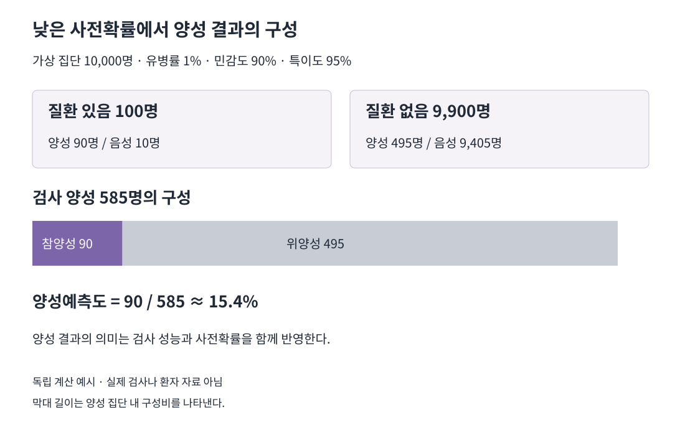
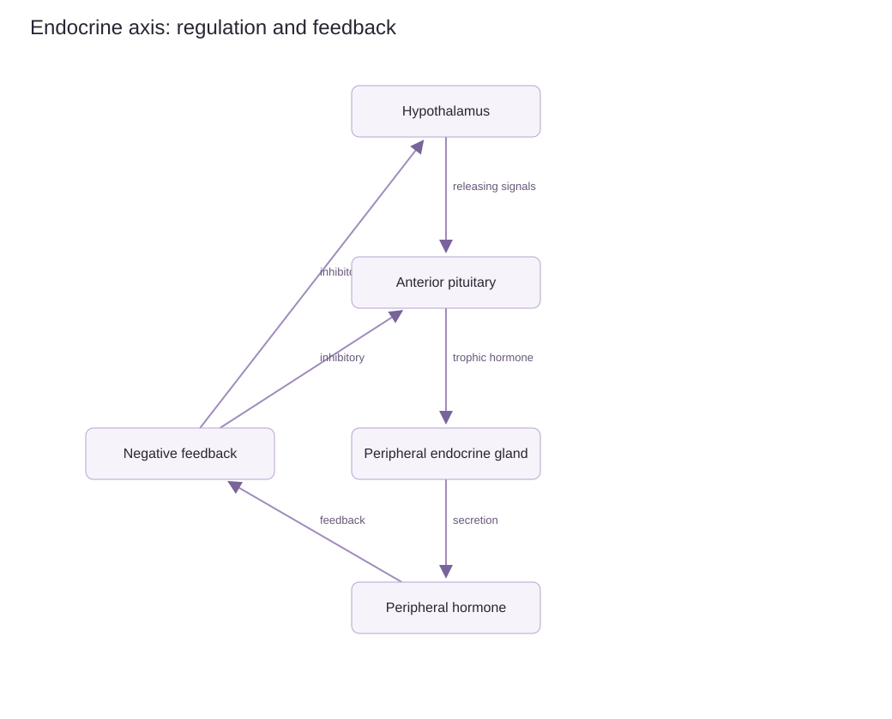

# 내과학

# 내과 총론 및 임상진단학

## 진단검사와 확률의 갱신

### 학습목표

- 사전확률과 검사후확률의 관계를 설명한다
- 우도비를 이용하여 검사 결과를 해석한다
- 검사 역치와 치료 역치의 의미를 임상 상황에 적용한다

### 진단은 정보가 추가될 때마다 갱신된다

환자가 호소하는 증상은 하나의 질환과 일대일로 대응하지 않는다. 흉통은 심근허혈, 폐와 흉막 질환, 식도 질환, 근골격계 문제 등에서 나타날 수 있다. 진단은 문진과 진찰, 검사에서 얻은 정보를 이용하여 가능한 원인들의 확률을 바꾸는 과정이다. 사전확률(pretest probability)은 특정 검사를 시행하기 직전 그 질환이 있을 것으로 추정하는 확률이다. 이는 그 환자가 속한 집단의 유병률에서 출발하더라도 연령, 위험 인자, 증상 양상, 선행 정보에 따라 달라진다.

사전확률을 숫자로 완벽하게 표현하지 못하더라도 낮음, 중간, 높음으로 구분하는 사고는 검사 선택에 영향을 준다. 다만 이런 범주는 질환과 검증된 진단경로에 따라 정의가 다르다. 어떤 질환의 점수체계를 다른 질환이나 다른 환자군에 그대로 적용해서는 안 된다. 특히 외래의 안정된 환자에서 검증한 경로가 혈역학적으로 불안정한 응급환자에게 같은 의미를 갖는 것은 아니다. 확률 추정은 환자의 긴급도 평가를 대체하지 않는다.

### 민감도와 특이도에서 예측도로

민감도(sensitivity)는 실제 질환이 있는 사람 중 검사 양성인 비율이고, 특이도(specificity)는 질환이 없는 사람 중 검사 음성인 비율이다. 검사 결과를 받아든 환자에게 중요한 질문은 양성인 경우 실제 질환이 있을 확률, 음성인 경우 질환이 없을 확률이다. 이들은 각각 양성예측도와 음성예측도이며 사전확률의 영향을 직접 받는다. 민감도가 높다는 설명만으로 양성 결과가 곧 확진이라고 해석하는 것은 서로 다른 조건부확률을 바꿔 읽는 오류이다.

가령 유병률이 1%인 집단에서 민감도 90%, 특이도 95%인 검사를 10,000명에게 시행한다고 하자. 질환이 있는 100명 중 약 90명이 양성이 되고, 질환이 없는 9,900명 중 약 495명이 양성이 된다. 양성인 사람 전체 585명 중 실제 질환자는 약 15.4%이다. 검사의 성능이 변하지 않아도 유병률이 낮은 집단에서는 위양성 수가 참양성 수보다 많을 수 있다. 무증상 인구에 검사를 넓힐수록 임상적 해석이 쉬워진다는 생각이 성립하지 않는 이유이다.

민감도와 특이도 역시 모든 환경에서 변하지 않는 물리 상수는 아니다. 환자군의 중증도, 동반 질환, 기준검사의 정의, 검사 역치와 표본 처리 방식이 관찰된 성능에 영향을 준다. 중증 질환자와 명백한 건강인만을 비교한 연구는 실제 경계선 환자가 많은 진료 환경보다 우수한 성능을 보일 수 있다. 진단 연구를 읽을 때에는 검사 숫자와 함께 연구 대상, 참조표준(reference standard), 맹검 여부, 대상자 누락을 검토한다.

### 우도비와 베이즈 정리

양성우도비(positive likelihood ratio, LR+)는 민감도를 1에서 특이도를 뺀 값으로 나눈 것이다. 음성우도비(LR−)는 1에서 민감도를 뺀 값을 특이도로 나눈 것이다. 이 값은 검사 결과가 질환이 있을 때와 없을 때 얼마나 다르게 나타나는지를 비교한다. 우도비를 이용하려면 확률을 오즈(odds)로 바꾸어야 한다. 확률을 p라고 하면 오즈는 p/(1−p)이며, 검사후오즈는 사전오즈에 해당 결과의 우도비를 곱해 구한다. 마지막으로 오즈를 1에 오즈를 더한 값으로 나누면 확률로 돌아온다.

사전확률이 20%라면 사전오즈는 0.25이다. 어떤 검사 결과의 우도비가 5라면 검사후오즈는 1.25이고 검사후확률은 약 55.6%이다. 같은 결과를 사전확률 1%인 환자에게 적용하면 검사후확률은 약 4.8%에 그친다. 반대로 사전확률 50%에서 음성우도비가 0.1인 결과를 얻어도 검사후확률은 약 9.1%이다. 음성이라는 단어 자체보다 그 결과가 얼마나 확률을 낮추었고 남은 위험이 임상적으로 수용 가능한지가 중요하다.

여러 검사의 우도비를 단순히 연속해서 곱하려면 질환 상태를 조건으로 각 검사 결과가 독립이라는 가정이 필요하다. 같은 생물학적 현상을 거의 동일한 방법으로 측정하는 검사들은 정보가 겹친다. 하나의 영상 소견과 그 소견을 바탕으로 작성한 판독 점수를 독립된 두 증거처럼 계산하면 확신을 과장한다. 반복검사의 시점이 바뀌면서 질환 자체가 진행하는 경우에도 첫 검사와 두 번째 검사가 동일한 상태를 평가한다고 볼 수 없다.

### 검사 역치와 치료 역치

질환 가능성이 매우 낮고 검사 자체의 위해가 이득보다 크다면 검사를 하지 않는 선택이 합리적일 수 있다. 이 경계가 검사 역치(test threshold)이다. 반대로 가능성이 충분히 높고 지연의 위해가 크며 치료의 순이득이 예상되면 확진 전 치료를 시작할 수 있는데, 그 경계를 치료 역치(treatment threshold)라고 한다. 두 역치는 질환의 중증도, 치료 부작용, 시간 민감성, 환자의 선호에 따라 달라진다. 모든 질환에 적용되는 고정 백분율이 존재하는 것은 아니다.

검사는 결과에 따라 실제 행동이 달라질 때 가치가 크다. 어느 결과가 나와도 같은 결정을 내릴 상황이라면 검사 목적을 다시 확인해야 한다. 한편 진단명 결정 외에도 병기 평가, 예후 추정, 치료 부작용 감시처럼 다른 목적의 검사가 있다. 검사를 주문하기 전에 묻는 임상 질문을 명확히 하면 양성 결과의 과잉 해석과 불필요한 연쇄검사를 줄일 수 있다. 진단의 종료는 가능한 모든 질환이 사라지는 순간이 아니라, 남은 불확실성과 후속 관찰 계획을 포함하여 안전한 의사결정을 할 수 있는 시점이다.

### 확인 문제

사전확률 20%, 양성우도비 5에서 검사후확률은 약 얼마인가?

A. 25%이다.
B. 55.6%이다.
C. 100%이다.

**정답: B**

사전오즈 0.2/0.8=0.25에 5를 곱하면 1.25이고 확률은 1.25/2.25이다.

**오답 해설**

A: 0.25는 사전오즈이며 검사후확률로 환산하는 단계가 남아 있다.

C: 양성우도비는 확률에 직접 곱하지 않으며 결과도 100%가 아니다.

# 순환기내과

## 심부전의 병태생리와 임상평가

### 학습목표

- 울혈과 저관류를 구분한다.
- 박출률 분류와 충만압을 연결한다.
- 증상·진찰·영상·생체표지자를 통합한다.

### 심부전은 임상증후군이다

심부전(heart failure, HF)은 심장의 구조 또는 기능 이상으로 증상과 징후가 나타나는 임상증후군이다. 심박출을 유지하기 위해 비정상적으로 높은 충만압이 필요하거나, 조직 요구에 맞는 혈류를 제공하기 어려운 상태를 포함한다. 박출률이 낮다는 영상 소견과 증상이 있는 심부전은 구분하며, 박출률이 보존되어도 심부전이 존재할 수 있다. 진단은 증상만이 아니라 심장 이상과 울혈 또는 충만압 증가의 근거를 연결해야 한다.

허혈성 심장질환, 고혈압, 판막질환과 심근질환, 독성·대사성 손상 등 원인은 다양하다. 빈혈과 갑상샘질환, 빈맥과 감염은 새로운 악화를 유발하거나 기존 질환의 부담을 드러낼 수 있다. 원인 질환과 현재 악화의 유발요인을 구분하면 치료 가능한 문제를 찾는 데 도움이 된다. 같은 증후군이라도 원인과 부하, 시간 경과에 따라 구조와 치료 반응은 달라진다.

### 울혈과 신경호르몬 보상

좌심실 충만압 상승은 좌심방과 폐정맥계의 압력 증가로 이어져 호흡곤란과 폐울혈에 기여한다. 우심계 압력 상승은 전신 정맥울혈과 간울혈, 말초부종에 연결될 수 있다. 좌심실과 우심실은 중격과 심낭, 폐순환을 통해 상호작용하므로 양쪽 문제를 완전히 독립된 질환으로 취급하지 않는다. 부종의 정도만으로 심박출량이나 전체 체액량을 정확히 알 수는 없다.

교감신경과 RAAS 활성은 단기적으로 혈압과 관류를 보상하지만 지속되면 혈관수축, 나트륨 보존과 재형성 부담을 늘릴 수 있다. 심근의 비대와 섬유화, 세포 기능 변화는 장기 경과에 관여한다. Natriuretic peptide 계통은 벽응력 증가에 반응하여 혈관과 신장의 조절에 참여한다. 반응이 존재하더라도 병적 보상을 충분히 상쇄하지 못할 수 있다. 심부전 약물치료가 즉각적인 수축력 증가 외에 만성 조절계의 부담을 줄이는 방향을 포함하는 이유다.

### 박출률과 기능의 여러 축

박출률은 일회박출량을 이완기말용적으로 나눈 값으로 부하와 심실 형상의 영향을 받는다. 좌심실 박출률에 따른 분류에서는 40% 이하를 HFrEF, 41~49%를 HFmrEF, 50% 이상을 HFpEF 범주로 나눈다. 범주 명칭만으로 임상증후군이 확진되는 것은 아니며, 특히 박출률이 낮지 않은 경우 충만압 증가의 객관적 근거가 중요하다. 이전에 낮았던 박출률이 호전된 경우도 과거 질환 경과를 함께 기록한다.

이완 기능은 능동적 이완과 수동적인 탄성, 충만 시간과 심방 기능에 영향을 받는다. 작은 용적의 뻣뻣한 심실은 박출률을 유지하면서도 충만압이 높을 수 있다. 판막 역류에서는 총박출량과 실제 앞쪽 순환으로 나가는 양의 관계가 달라질 수 있다. 따라서 EF를 심장 전체 건강의 단일 점수로 해석하지 않고 심실 크기와 벽, 판막 및 우심실, 이완기 지표와 임상 상태를 함께 평가한다.

### 증상과 신체진찰

운동 시 호흡곤란과 피로는 흔하지만 비특이적이다. 기좌호흡과 야간 발작성 호흡곤란, 체중 변화와 부종의 경과는 울혈을 추론하는 단서다. 폐질환과 비만, 운동 저하와 빈혈도 비슷한 증상을 만들 수 있어 호흡곤란의 원인을 하나로 단정하지 않는다. 갑작스러운 악화에서는 급성 관상동맥질환, 부정맥, 혈압 변화와 감염, 폐색전증 및 약물·식이·복약 문제 등을 검토한다.

목정맥압은 우심방압을 추정하는 진찰 소견이며 폐수포음과 부종, 심음 및 말초 관류가 서로 다른 정보를 준다. 정상 청진만으로 만성 심부전을 배제하지 못하고, 수포음만으로 심인성 부종을 확정할 수도 없다. 차가운 말단과 의식 변화, 소변량 감소 등은 저관류 평가에 중요하다. 혈압이 유지되어도 장기 관류가 충분하지 않을 수 있으므로 울혈과 관류의 두 축을 함께 판단한다.

### 검사와 감별

심전도는 리듬과 전도, 허혈·과거 손상 등의 단서를 제공하고 흉부영상은 심장 크기와 폐울혈 및 다른 폐질환 평가에 기여한다. 심초음파는 수축·이완 기능, 판막과 심낭, 압력 추정 및 우심실 정보를 제공한다. 필요한 경우 원인 확인을 위한 관상동맥 평가와 심장 MRI, 침윤성 질환이나 유전성 원인 검사를 선택한다. 모든 환자에게 동일한 정밀검사를 일괄 시행하기보다 임상 질문을 명확히 한다.

BNP와 NT-proBNP는 벽응력과 연관된 지표로 진단을 보조한다. 나이, 신기능과 심방세동 등에서 높아질 수 있고 비만에서는 낮게 측정될 수 있어 값 하나로 모든 상황을 확정하거나 배제하지 않는다. 신기능과 전해질, 혈색소와 철 상태, 간기능 및 원인에 맞는 내분비 평가도 관리에 중요하다. 검사 결과는 이뇨와 약물 조정 전후의 시간 경과를 함께 기록한다.

### 치료 목표와 장기 관리

치료 목표는 증상과 울혈 완화, 입원·사망 위험 감소, 기능과 삶의 질 유지 및 원인 교정이다. 박출률 감소 심부전 치료의 핵심 약물군은 ARNI를 중심으로 한 RAAS 조절, 근거가 있는 β차단제, MRA와 SGLT2 억제제다. 각 계열의 적응과 금기, 혈압·신기능·칼륨 및 임상 안정성을 평가하며, 한 계열의 최대용량 도달 여부만으로 나머지 계열의 필요성을 판단하지 않는다. 급성 불안정 상태의 조치와 안정된 만성기의 시작·증량은 구분한다.

이뇨는 울혈 완화에 기여하지만 제거되는 체액량과 장기적인 예후 개선 기전은 같지 않다. 판막·허혈·부정맥 치료와 기기치료, 재활 및 진행성 심부전 평가가 필요한 환자도 있다. 퇴원과 외래 추적에서는 증상과 체중, 혈압과 복약, 검사 결과 및 악화 시 행동 계획을 연결한다. 박출률이나 증상이 개선되어도 원인과 재발 위험을 재평가하고 지속 관리의 필요성을 함께 판단한다.

### 확인 문제

박출률이 보존되면 심부전이 배제되는가?

A. 아니다.
B. 그렇다.

**정답: A**

높은 충만압과 이완 기능 문제로 심부전이 존재할 수 있다.

**오답 해설**

B: EF는 심장 기능의 모든 측면을 대표하지 않는다.

## 심부전의 혈역학·진단과 치료 표적

### 학습목표

- 박출률과 충만압·심박출량을 구분한다
- 울혈과 저관류의 기전을 진찰 및 검사와 연결한다
- 증상 완화와 질병 경과 개선 치료의 목적을 비교한다

### 심부전은 원인이 다양한 임상 증후군이다

심부전(heart failure, HF)은 심장의 구조적 또는 기능적 이상으로 적절한 혈액 공급을 유지하지 못하거나, 이를 유지하기 위해 비정상적으로 높은 충만압이 필요한 임상 증후군이다. 심장이 완전히 멈춘 상태를 뜻하지 않는다. 안정 시 심박출량이 유지되어도 운동 시 필요한 증가가 제한되거나 폐정맥압이 상승하여 증상이 생길 수 있다. 같은 호흡곤란이라도 좌심실의 수축 기능, 이완 기능, 판막, 심낭 및 우심실 중 어떤 요소가 중요한지 다르다.

허혈성 심장질환, 고혈압, 판막질환, 심근병증, 빈맥 및 독성 손상 등은 서로 다른 경로로 심부전에 이를 수 있다. 원인을 찾는 작업은 증후군을 진단한 뒤의 부가 절차가 아니다. 교정할 수 있는 허혈, 판막 이상 또는 지속 빈맥을 발견하면 질병 경과가 달라질 수 있다. 가족력이나 전도 장애와 심실부정맥의 양상은 유전성 심근병증을 생각하게 하는 단서가 될 수 있다.

### 박출률·충만압·심박출량

좌심실 박출률(left ventricular ejection fraction, LVEF)은 이완기말용적 중 한 번의 수축으로 박출되는 비율이다. 절대 박출량이나 조직에 실제 전달되는 유량과 같지 않다. 작은 심실은 박출률이 보존되어도 일회박출량이 적을 수 있고, 확장된 심실은 박출률이 낮더라도 안정 시 일정한 일회박출량을 유지할 수 있다. 전부하와 후부하 및 판막 역류는 측정된 박출률에도 영향을 준다.

박출률감소 심부전(HFrEF)과 박출률보존 심부전(HFpEF)의 구분은 예후와 치료 근거를 정리하는 데 유용하지만 기전 전체를 양분하지는 않는다. HFrEF에서도 이완 장애가 흔하고 HFpEF에서도 심근 기능, 혈관 반응 및 우심실의 이상이 관여한다. HFpEF에서는 심실 순응도 감소와 이완 지연으로 작은 용적 증가에도 충만압이 크게 오를 수 있다. 비만, 고혈압, 심방세동, 콩팥 기능 저하와 운동 시 혈역학이 함께 영향을 준다.

### 보상 기전이 장기 손상으로 이어지는 과정

심박출량이 감소하면 교감신경과 RAAS가 활성화되어 심박수, 혈관 긴장 및 나트륨·물 보존이 증가한다. 초기에는 혈압과 관류 유지에 도움이 되지만 지속되면 후부하와 울혈 및 심근 산소 요구량을 늘릴 수 있다. 안지오텐신과 알도스테론의 신호는 섬유화와 구조 재형성에도 관여한다. 이러한 장기 효과는 신경호르몬계를 억제하는 치료가 단순한 혈압 저하 이상의 목적을 갖는 이유이다.

심실벽 응력과 용적 변화는 심근의 형태와 유전자 발현 및 세포외기질을 바꾼다. 나트륨이뇨펩타이드는 벽의 늘어남에 반응하여 나트륨 배설과 혈관 작용에 참여하지만 질환이 진행하면 그 보상만으로 균형을 회복하지 못한다. 울혈 자체도 콩팥정맥압과 복압을 높여 콩팥 기능을 악화시킬 수 있다. 심장과 콩팥의 상호작용을 오직 동맥 관류 저하만으로 설명하면 정맥 울혈의 역할을 놓친다.

### 증상과 진찰에서 압력과 관류를 추정한다

운동 시 호흡곤란, 기좌호흡과 야간 발작성 호흡곤란은 폐순환의 압력 변화와 관련될 수 있다. 말초 부종, 체중 증가, 경정맥압 상승 및 간 울혈은 전신 정맥계의 부담을 시사한다. 그러나 부종은 정맥질환이나 저알부민혈증에서도 발생하고, 폐 수포음은 모든 만성 심부전에서 뚜렷하지 않다. 하나의 소견으로 확정하기보다 시간 경과와 여러 근거가 같은 혈역학적 설명을 지지하는지 본다.

저관류에서는 차가운 말초, 의식 변화, 소변 감소 또는 좁아진 맥압 등이 나타날 수 있다. 혈압이 정상 범위라고 모든 장기의 관류가 충분하다는 뜻은 아니다. 급성 악화에서는 울혈의 유무와 저관류의 유무를 각각 평가한다. 이 두 축은 수액, 이뇨, 혈관 작용 및 순환 보조가 필요한 이유를 구분하는 데 도움을 준다. 울혈이 있는 환자의 크레아티닌 상승을 곧바로 수액 부족으로 해석하면 부담을 더할 수 있다.

### 검사 선택과 해석

심전도는 허혈, 빈맥, 전도 장애 및 심실 비대 등의 단서를 제공한다. 심초음파는 박출률과 심장 방의 크기, 판막, 우심실 및 충만 관련 지표를 통합한다. 정상 박출률만 확인하고 심부전을 배제하지 않는다. 흉부 영상은 폐 울혈과 흉수 및 다른 호흡곤란 원인을 평가하고, 혈액검사는 빈혈, 전해질, 콩팥·간 기능과 유발 요인을 살핀다. 필요에 따라 심근의 침윤성 질환이나 허혈 및 혈역학을 추가 평가한다.

BNP와 NT-proBNP는 심장벽 스트레스와 관련된 표지자이며 진단과 위험 평가를 돕는다. 콩팥 기능, 연령, 심방세동 및 비만 등이 수치 해석에 영향을 준다. 수치 상승은 증후군의 맥락 없이 곧바로 좌심실 수축부전으로 확정되는 것이 아니고, 낮은 값의 배제력도 환자 조건에 따라 달라진다. 네프릴리신 억제가 BNP의 대사에 영향을 줄 수 있으므로 치료 중 표지자 변화의 의미도 구분한다.

### 만성 HFrEF의 치료 표적

만성 HFrEF 치료에서는 울혈 완화와 장기 예후 개선을 함께 추구한다. 이뇨제는 나트륨과 물을 배출하여 호흡곤란과 부종을 줄이는 데 중요하다. 그러나 부종 감소만으로 심근 재형성과 질병 경과를 개선하는 치료가 충분히 제공되었다고 볼 수 없다. 체중, 증상과 진찰뿐 아니라 혈압, 콩팥 기능 및 전해질을 추적하여 이득과 부작용을 평가한다.

질병 경과 개선의 주요 약물군에는 안지오텐신 경로 조절 약물, 근거가 있는 β 차단제, 미네랄코르티코이드 수용체 길항제 및 SGLT2 억제제가 포함된다. ARNI는 안지오텐신 수용체 차단과 네프릴리신 억제를 결합한다. 약물군마다 혈압, 칼륨, 콩팥 기능 및 체액량에 미치는 영향이 달라 환자의 상태에 맞는 시작과 조정이 필요하다. 한 계열의 목표 용량에 도달할 때까지 다른 모든 계열을 반드시 미루어야 한다는 식의 기계적 순서는 약물군의 상보적 목적을 반영하지 못한다.

급성 쇼크나 심한 저관류에서의 약물 조정은 안정된 만성 외래 환자의 치료와 다르다. 안정 시 예후를 개선하는 약물이 어떤 급성 상태에서도 즉시 같은 방식으로 투여되어야 하는 것은 아니다. 전도 장애, 지속적인 낮은 박출률과 부정맥 위험 등에서는 적절한 환자에 대해 기기 치료를 평가한다. 재혈관화, 판막 중재 및 진행성 심부전 치료 역시 원인과 기대 이득을 검토하여 선택한다.

### HFpEF와 회복된 박출률의 해석

HFpEF에서는 울혈 관리, 혈압 및 동반 질환의 치료와 함께 해당 환자군에서 효과가 입증된 약물을 고려한다. HFrEF에서 유익했던 모든 약물을 같은 근거 수준으로 그대로 옮기지 않는다. 호흡곤란에는 비만, 폐 질환, 빈혈과 운동 능력 저하가 함께 기여할 수 있어 심장 외 요소를 교정하는 것도 중요하다. 반복 입원과 생활 기능을 포함하여 치료 목표를 정한다.

치료 후 박출률이 개선된 환자는 처음부터 정상 심장을 가졌던 사람과 같지 않다. 개선은 치료 효과일 수 있으며 기저 질환이나 재발 위험이 남을 수 있다. 증상이 없어졌거나 초음파 수치가 좋아졌다는 이유만으로 모든 약물이 더 이상 필요 없다고 판단하지 않는다. 장기 추적에서는 원인, 심장 구조, 부정맥, 기능과 약물 내약성을 함께 평가한다.

### 악화의 유발 요인과 학습 증례

안정적이던 환자에게 급격한 체중 증가와 기좌호흡이 생기면 복약·식이 변화뿐 아니라 감염, 허혈, 부정맥, 혈압 변화 및 콩팥 기능 저하를 살핀다. 증상이 같은 울혈이라도 원인에 따라 추가 치료가 달라진다. 진통제 등 새 약물이 나트륨 보존이나 콩팥 기능에 영향을 주었는지도 확인한다. 환자가 집에서 관찰할 변화와 진료를 받아야 할 증상을 이해하도록 설명하는 일은 재입원 예방의 일부이다.

호흡곤란과 발목 부종이 있는 고령 환자에서 박출률이 보존되고 심방세동과 고혈압이 동반되었다면, 박출률 하나만으로 심부전을 배제하거나 곧바로 HFpEF로 확정하지 않는다. 충만압을 지지하는 근거, 판막과 우심실 상태, 나트륨이뇨펩타이드 및 폐·콩팥·빈혈의 기여를 평가한다. 최종 진단은 증상을 실제 구조와 기능 이상으로 설명하고 다른 원인을 검토한 결과이어야 한다.

### 확인 문제

박출률이 보존된 호흡곤란 환자에서 적절한 판단은?

A. 충만압과 구조·기능 이상 및 다른 호흡곤란 원인을 함께 평가한다.
B. 박출률만으로 심부전을 배제한다.
C. 박출률만으로 HFpEF를 확정한다.

**정답: A**

박출률은 용적의 비율이며 증후군의 존재와 원인을 단독으로 결정하지 않는다.

**오답 해설**

B: 충만압 상승과 운동 시 기능 제한은 박출률 보존 상태에서도 가능하다.

C: 증상과 충만압을 뒷받침하는 근거 및 감별이 필요하다.

## 급성관상동맥증후군의 기전과 초기 판단

### 학습목표

- 심근손상과 심근경색을 구별한다
- 혈전과 허혈의 시간경과를 연결한다
- 심전도·트로포닌·혈역학을 통합한다

### 공급 감소와 세포 손상

급성관상동맥증후군(acute coronary syndrome, ACS)은 급성 관상동맥 허혈과 관련된 임상 상태들을 다룬다. 전형적으로 죽상경화판의 파열이나 미란 뒤 혈소판 활성과 응고가 촉진되어 혈류가 감소한다. 그러나 혈관의 연축과 색전, 자발성 박리 등 다른 기전도 급성 허혈을 만들 수 있다. 흉통의 존재와 혈관이 막힌 기전, 심근세포의 손상을 각각 구별하여 평가해야 한다.

혈류 감소는 산소 공급과 에너지 생성의 불균형을 만든다. 수축과 이완의 변화, 전기적 불안정과 세포막 손상은 시간과 정도에 따라 나타날 수 있다. 통증이 줄었다는 사실만으로 혈류가 완전히 회복되거나 손상이 끝났다고 확정할 수 없다. 심근의 생존은 폐색 위치와 범위, 측부순환과 요구량 및 경과 시간의 영향을 받는다. 처음부터 모든 영역이 같은 속도로 괴사하는 것은 아니다.

### 심근손상과 경색

심장 트로포닌(cardiac troponin)은 심근세포 손상의 중요한 지표이다. 상승은 급성 허혈 외에도 심부전과 심근염, 심한 전신 질환 등에서 나타날 수 있다. 급성 손상을 판단하는 시간적 변화와, 그 손상이 허혈 때문에 발생했다는 근거는 다른 질문이다. 트로포닌 양성을 곧바로 혈전성 관상동맥 폐색의 확진으로 바꾸어서는 안 된다.

심근경색(myocardial infarction)은 심근손상과 함께 허혈을 지지하는 임상·심전도·영상 등의 근거를 통합하여 판단한다. 산소 공급과 수요의 불균형에 따른 경색과 급성 죽상혈전성 사건은 원인 치료와 항혈전 전략이 다를 수 있다. 기저 신장질환에서 수치가 높게 유지되는 상황도 기준과 변화, 증상을 함께 해석한다. 검사의 이름보다 채혈 시점과 사용한 분석법, 검사실 기준이 중요하다.

### 증상과 긴급도

가슴의 압박과 조임, 운동과 관련된 악화 및 팔과 턱 등으로의 불편이 단서가 될 수 있지만 모든 환자가 전형적인 흉통을 호소하지는 않는다. 호흡곤란과 식은땀, 오심과 실신 및 기능 저하로 나타날 수 있다. 고령과 당뇨병, 의사소통의 제한 등은 표현과 인지에 영향을 준다. 비전형적이라는 표현을 낮은 위험이라는 뜻으로 사용하지 않는다.

저혈압과 의식 변화, 지속 흉통과 심한 호흡곤란, 새 부정맥은 초기 우선순위를 바꾸는 소견이다. 관상동맥질환의 과거력이 있어도 대동맥질환과 폐색전증 등 다른 위험 원인을 놓치지 않아야 한다. 흉벽을 누르면 아프다는 소견 하나나 제산제 반응만으로 허혈을 배제하는 방식은 불충분하다. 병력과 위험, 실제 생리적 안정성을 함께 평가한다.

### 심전도의 시간과 해부

심전도는 손상 전류와 재분극 변화, 전도와 리듬의 정보를 준다. ST분절 상승과 그 밖의 변화는 허혈의 위치와 긴급한 재관류 판단에 중요하지만 한 장의 정상 심전도가 모든 ACS를 배제하지는 않는다. 증상과 시간에 따라 변화가 나타날 수 있어 반복 평가가 필요할 수 있다. 추가 유도와 이전 심전도의 비교는 임상 상황에 맞는 정보를 제공한다.

ST분절 상승이 없는 상태에서도 심각한 허혈과 혈역학적 위험이 있을 수 있다. 반대로 ST 상승은 심근경색 외의 원인에서도 가능하다. 증후군 분류는 검사를 기다리는 순서표만이 아니라 현재의 위험과 개입의 긴급도를 정하는 과정이다. 재관류가 긴급하게 필요한 상황에서 트로포닌 결과의 완성만을 기다려 판단을 늦추지 않는다.

### 치료 원리의 구별

항혈소판제는 혈소판 활성과 응집에, 항응고제는 응고 경로에 작용하며 서로 완전한 대체제가 아니다. 효과와 출혈 위험, 다른 항응고 적응과 신장 기능 및 계획하는 시술을 함께 고려한다. 두 약물군을 사용한다는 일반 원칙만으로 모든 환자에서 약제와 기간이 같다고 가정해서는 안 된다. 출혈과 허혈의 위험은 치료 과정에서도 변할 수 있다.

재관류와 재혈관화는 혈류의 회복을 목표로 하며 혈관 해부와 임상 분류, 시간과 시설 및 환자 상태에 따라 전략이 달라진다. 관상동맥중재술과 우회수술, 특정 상황의 혈전용해는 같은 방법이 아니다. 적응과 금기, 실제 시행 가능성을 검토해야 한다. 쇼크에서 원인 혈관을 다루는 판단과 안정된 다혈관질환의 계획을 기계적으로 동일하게 적용하지 않는다.

### 합병증과 이후 관리

심실 부정맥과 전도 이상, 심부전과 쇼크 및 기계적 합병증은 서로 다른 기전과 대응을 요구한다. 새 심잡음과 급격한 순환 악화, 재발 흉통 등은 원인 재평가의 단서이다. 혈관을 성공적으로 열었다는 사실만으로 모든 심근과 순환 기능이 즉시 회복되는 것은 아니다. 감시와 영상, 장기 기능 및 치료 반응을 계속 통합한다.

퇴원 이후에는 지질과 혈압, 당뇨병과 흡연 등 위험인자 관리, 약물의 효과와 위해 및 심장재활이 연결된다. 처방 목록을 전달하는 것과 환자가 실제로 복용하고 기능을 회복하는 것은 다르다. 증상 재발의 대응과 출혈 및 이상반응, 추적 검사와 진료의 책임을 구체적으로 설명한다. 급성 사건의 치료와 장기적인 이차예방은 하나의 연속된 진료 과정이다.

### 확인 문제

트로포닌 상승만으로 급성 죽상혈전성 폐색이 확정되는가?

A. 아니다. 급성 손상과 허혈 근거 및 다른 원인을 통합한다.
B. 그렇다. 모든 상승은 같은 기전의 관상동맥 혈전이다.

**정답: A**

심근손상의 표지자와 허혈성 원인 확정은 다른 질문이다.

**오답 해설**

B: 심근손상의 표지자와 허혈성 원인 확정은 다른 질문이다.

# 호흡기내과

## 천식의 염증·기도역학과 진단

### 학습목표

- 가변적 기류제한과 기도과민성을 설명한다.
- 임상 증상과 객관적 기능평가를 연결한다.
- 증상조절과 악화위험, 중증도를 구분한다.

### 가변적인 기도질환

천식(asthma)은 만성 기도염증을 배경으로 다양한 시간과 강도의 호흡기 증상 및 가변적 호기 기류제한을 보이는 이질적인 질환이다. 천명, 호흡곤란과 가슴답답함, 기침이 밤이나 운동·감염·알레르겐 노출에 따라 달라질 수 있다. 모든 환자가 같은 염증 유형을 가지거나 항상 천명음을 보이는 것은 아니다. 증상이 없는 시점의 진찰과 폐기능이 뚜렷한 이상을 보이지 않을 수 있어 시간적 양상이 중요하다.

기도 평활근 수축, 점막 부종과 점액은 기도 내경과 저항을 변화시킨다. 만성 경과에서 기도벽 구조가 변하는 재형성(remodeling)은 지속적 기류제한에 기여할 수 있다. 기도과민성은 자극에 대한 수축 반응이 증가한 성질로, 증상과 염증 및 구조 변화와 관련되지만 이들 개념과 완전히 같은 뜻은 아니다. 한 기능검사 결과만으로 전체 병태를 대표하지 않는다.

### 염증 표현형과 유발인자

일부 환자에서는 type 2 염증과 IL-4, IL-5, IL-13 및 IgE·호산구 관련 경로가 중요하다. 기도 상피의 alarmin 신호와 선천림프구, 적응면역이 서로 연결된다. 다른 환자에서는 호중구성 또는 적은 과립구의 양상이 관찰될 수 있고, 흡연과 비만, 감염과 직업 노출 등 여러 맥락이 영향을 준다. 혈액 호산구와 호기산화질소는 특정 염증의 단서를 주지만 검사 조건과 치료에 따라 변할 수 있다.

알레르겐 감작은 관련 노출에서 증상이 유발될 가능성을 해석하는 자료이며 감작검사 양성만으로 모든 증상의 원인을 확정하지 않는다. 운동과 찬 공기, 바이러스 감염과 자극성 연기, 일부 약물은 서로 다른 기전으로 증상을 악화시킬 수 있다. 직업 관련성은 작업일과 휴일, 특정 공정과 보호조치, 증상 시작의 시간 관계를 살핀다. 유발인자를 발견하면 노출 관리와 치료 반응 평가를 연결할 수 있다.

### 폐기능과 진단의 확인

Spirometry에서는 호기 유량과 용적, FEV1과 FVC의 관계 및 곡선의 질을 평가한다. 기관지확장제 전후 변화는 가변적 기류제한을 입증하는 방법의 하나다. 반응이 한 번 없었다고 천식을 배제하지는 않으며, 증상 시점이나 반복 검사, 최고호기유량 변동과 상황에 맞는 유발검사 등을 고려한다. 검사마다 적용 조건과 판정 기준이 달라 동일한 변화율을 모든 연령과 검사에 그대로 적용하지 않는다.

기침만 두드러지는 환자에서는 상기도 질환, 역류, 약물과 다른 호산구성 기도질환을 포함하여 감별한다. 성대·후두의 유도성 폐쇄, 심장질환과 기관지확장증 등도 비슷한 증상을 만들 수 있다. 진단명이 오래전에 붙었다는 이유만으로 확인 과정을 생략하지 않고 기존의 객관적 근거와 현재 양상을 대조한다. 이미 치료 중인 경우에는 치료가 가변성을 줄였을 가능성을 감안한다.

### 조절 상태와 중증도

현재의 증상 빈도와 야간 각성, 활동 제한 및 증상완화제 사용은 조절 상태의 여러 측면이다. 향후 악화 위험은 현재 증상이 적어도 존재할 수 있다. 이전 중증 악화와 폐기능, 염증 및 약물 사용 방식, 흡연과 동반질환 등이 추가 정보를 준다. 조절이 나쁘다는 말이 곧 처음부터 중증 천식이라는 뜻은 아니다. 흡입기 사용과 순응도, 진단과 노출 및 동반질환 문제를 먼저 검토해야 한다.

중증도는 적절한 치료와 관리 아래 조절을 유지하는 데 필요한 부담과 반응을 바탕으로 평가한다. 상기도 질환과 비만, 수면 문제와 심리사회적 요인은 증상과 관리에 영향을 줄 수 있다. 환자가 약물을 처방받았다는 사실과 실제로 적절하게 사용한다는 사실은 다르므로 기구를 직접 사용하는 모습을 관찰하는 것이 유용하다. 의사소통과 비용, 접근성도 치료 실패의 원인을 이해하는 데 포함된다.

### 치료의 기전적 구분

흡입 corticosteroid는 기도염증을 조절하는 중심 약물군이고, β2 작용제는 평활근 이완을 통해 기류제한과 증상을 완화한다. 지속시간이 긴 약물과 빠른 완화용 약물은 역할과 조합이 다르며, 각 성분의 작용만으로 특정 흡입기 조합의 사용법을 임의로 결정할 수 없다. 항무스카린제, leukotriene 경로 약물과 일부 생물학적 제제는 환자 특성과 치료 단계에 따라 다른 표적을 제공한다.

악화에서는 말하기와 호흡 노력, 의식과 산소화, 호기 유량 및 초기 반응으로 상태를 평가한다. 심한 폐색에서 공기 이동이 매우 감소하면 천명음이 오히려 약해질 수 있어 조용한 청진을 호전으로 오해하지 않는다. 장기 관리에서는 환자 교육, 흡입기 기술과 노출 관리, 개별 행동계획 및 추적평가를 연결한다. 약물 단계의 변경은 진단과 실제 사용, 악화 위험 및 반응을 재검토한 뒤 결정한다.

### 확인 문제

심한 호흡곤란에서 천명음이 약하면 항상 호전인가?

A. 그렇다.
B. 아니다.

**정답: B**

공기 이동이 매우 적어져 천명이 약해질 수도 있다.

**오답 해설**

A: 청진 소리만으로 중증도를 결정하면 안 된다.

## COPD의 기도·폐실질 변화와 기능 평가

### 학습목표

- 작은기도 병변과 폐기종을 호기 유량에 연결한다
- 폐활량검사와 증상·악화 위험을 구별한다
- 기관지확장과 재활 및 예방의 목적을 설명한다

### 같은 유량 제한의 다른 구조

만성폐쇄성폐질환(chronic obstructive pulmonary disease, COPD)은 만성 호흡기 증상과 지속적인 기류 제한을 중심으로 평가하는 이질적인 질환이다. 작은기도의 염증과 재형성, 점액 및 폐포 구조의 손상은 서로 다른 비중으로 함께 존재할 수 있다. 기침과 가래가 많다는 임상 표현과 폐기종이라는 조직·영상의 변화는 같은 개념이 아니다. 환자마다 어떤 구조와 기능이 중심적으로 손상되었는지를 평가한다.

폐기종(emphysema)에서는 폐포벽과 지지 구조의 소실로 탄성 반동과 가스교환 표면이 영향을 받는다. 호기 때 기도를 열어 두는 주변의 견인도 줄어 기도가 쉽게 좁아질 수 있다. 작은기도 저항 증가와 반동 감소가 결합하면 특히 강한 호기에서 유량이 제한된다. 힘을 더 주어 내쉬어도 같은 비율로 유량이 늘지 않는 생리적 배경이다.

### 공기 가둠과 호흡 부담

호기 시간이 충분하지 않거나 기도가 일찍 닫히면 공기가 남아 폐용적이 증가할 수 있다. 운동 중 호흡수가 늘면 다음 흡기 전 배출 시간이 짧아져 동적 과팽창(dynamic hyperinflation)이 심해질 수 있다. 횡격막의 길이와 작동 조건이 불리해지고 흡기 전에 극복해야 할 부담이 커질 수 있다. 운동 중 숨참은 산소포화도 하나만으로 설명되지 않는다.

환기와 관류의 불일치, 가스교환 표면과 폐혈관 변화는 저산소혈증에 기여할 수 있다. 환기 능력과 부하, 중추 조절 및 대사 요구의 관계가 이산화탄소 상태에 영향을 준다. 모든 COPD 환자가 같은 정도의 이산화탄소 저류를 갖는 것은 아니다. 심한 호흡곤란이 있어도 산소화가 유지될 수 있고, 증상 표현이 적어도 중요한 가스 이상이 있을 수 있다.

### 노출과 개인의 경과

흡연은 중요한 위험이지만 모든 환자가 흡연자이거나 모든 흡연자가 같은 질환 경과를 보이는 것은 아니다. 직업성 분진과 연기, 실내외 오염과 폐 발달 및 유전적 요인이 관여할 수 있다. 성장기의 폐기능 수준과 이후 감소 속도가 함께 성인의 기능을 결정한다. 노출력과 증상, 가족력 및 다른 질환을 포함하여 원인과 감별을 평가한다.

천식과 기관지확장증, 심부전과 다른 폐질환은 증상과 검사 소견이 겹칠 수 있다. 기관지확장제에 대한 반응이 있다는 이유만으로 COPD를 배제하거나 반응이 없다는 이유로 천식을 모두 배제하는 단순화는 적절하지 않다. 한 번의 가역성 검사와 장기적인 질환 분류를 동일시하지 않는다. 병력과 기능의 변화, 영상과 임상적 특징을 통합한다.

### 진단과 다차원 평가

폐활량검사(spirometry)는 지속적인 기류 제한을 확인하는 중심 검사이다. 기관지확장제 후의 FEV1/FVC를 적절한 증상과 위험 맥락에서 해석한다. 사용한 진단 기준의 판본과 고정비율의 연령 관련 한계, 경계값과 반복 측정의 문제를 알아야 한다. 검사의 노력과 기술이 부적절하면 진단 자체가 왜곡될 수 있어 수치만 복사하지 않고 품질을 확인한다.

FEV1의 저하 정도는 중요한 기능 정보지만 증상과 악화 및 전신 부담 전체를 대표하지 않는다. 운동 능력과 호흡곤란, 악화 병력과 입원, 산소화와 동반 질환을 별도로 평가한다. 영상의 폐기종과 유량 저하, 환자가 느끼는 제한이 일치하지 않을 때에는 폐용적과 확산능 및 다른 원인을 추가로 고려할 수 있다. 검사 사이의 불일치를 잘못된 환자 표현으로 취급하지 않는다.

### 안정기 관리

흡연 중단과 유해노출 감소는 원인 환경을 다루며, 기관지확장제는 기도 긴장과 호흡 부담에 작용한다. 흡입치료의 효과는 약물 선택뿐 아니라 실제 흡입기 조작과 흡기 능력, 접근성과 복용에 영향을 받는다. 처방을 늘리기 전에 사용법과 실행을 확인해야 한다. 약의 이름이 같아도 장치와 투여 조건이 다르면 실제 노출이 달라질 수 있다.

흡입 스테로이드는 모든 환자에게 같은 이득을 주는 기본 약제로 단순화할 수 없다. 악화 위험과 관련 지표, 천식의 동반 및 폐렴 등 위해를 고려하여 선택한다. 구체적인 조합과 변경은 적용 지침과 환자의 반응 및 부작용에 따라 조정한다. 기관지확장과 항염증, 악화 예방의 목표를 구별하면 약물 역할을 더 정확히 이해할 수 있다.

폐재활과 영양, 신체활동 및 예방접종과 동반 질환의 관리는 약물 외의 중요한 치료이다. 호흡곤란 때문에 활동을 줄이면 근력과 지구력이 저하되어 같은 활동이 더 힘들어지는 악순환이 생길 수 있다. 재활은 이런 기능 제한과 대처를 다루며 단순히 폐기능 수치만 바꾸려는 과정이 아니다. 장기 산소치료는 특정한 저산소 상태에서 평가하는 치료로 모든 숨참에 동일하게 적용하지 않는다.

### 급성 악화와 추적

평소보다 호흡곤란과 기침·가래가 악화한 경우에는 감염과 환경, 복약 문제뿐 아니라 폐렴과 심부전, 폐색전증 등 다른 원인을 고려한다. 기존 COPD라는 진단이 새 급성 원인을 배제하지 않는다. 호흡 노력과 의식, 산소화와 환기 및 순환을 평가하여 호흡 지지와 치료의 강도를 정한다. 산소를 투여한 뒤에도 이산화탄소와 환기의 평가가 필요할 수 있다.

악화 이후에는 치료 반응과 기능 회복, 재발 위험과 실제 흡입치료를 다시 평가한다. 입원 중 좋아진 상태가 집의 활동과 돌봄 조건에서도 유지되는지 확인한다. COPD의 관리는 기류 제한의 진단에서 끝나지 않고 노출과 구조, 기능과 악화 및 삶의 질을 장기적으로 연결하는 과정이다.

### 확인 문제

FEV1 저하 정도가 COPD의 모든 부담을 대표하는가?

A. 그렇다. 같은 FEV1이면 모든 환자의 치료 요구가 같다.
B. 아니다. 증상·악화·기능·동반 질환을 별도로 평가한다.

**정답: B**

유량 제한과 실제 증상·악화 위험은 서로 다른 평가 축이다.

**오답 해설**

A: 유량 제한과 실제 증상·악화 위험은 서로 다른 평가 축이다.

# 소화기내과

## 소화와 흡수장애의 기전

### 학습목표

- 관강 내 소화와 점막 흡수 및 흡수 후 운반의 장애를 구별한다
- 회장 질환이 담즙산과 비타민 B12 대사에 미치는 영향을 설명한다
- 흡수장애 검사 결과를 생리학적으로 해석한다

### 영양분이 혈액에 이르기까지

음식물의 섭취와 영양분의 흡수는 같은 과정이 아니다. 섭취한 고분자는 위장관 내에서 분해되고, 소장 표면에 접근하여 상피세포로 들어간 뒤 혈관이나 림프관으로 운반되어야 한다. 소화장애(maldigestion)는 관강 내 또는 솔가장자리에서 영양분을 흡수 가능한 형태로 만드는 과정의 장애이고, 흡수장애(malabsorption)는 상피를 통한 이동과 이후 운반을 포함한 장애를 가리킨다. 임상에서는 두 현상이 함께 나타나므로 원인을 관강, 점막, 흡수 후 운반으로 나누어 생각하면 병인을 정리하기 쉽다.

소장의 넓은 흡수면적은 윤상주름, 융모(villus), 미세융모(microvillus)의 여러 수준에서 만들어진다. 성숙 상피세포는 융모 쪽으로 이동하면서 소화효소와 수송체 기능을 갖추고, 음와(crypt)에는 증식과 분비 기능이 두드러지는 세포가 존재한다. 융모 손상과 표면적 감소는 여러 영양분의 흡수를 동시에 떨어뜨릴 수 있지만, 특정 솔가장자리 효소의 부족은 비교적 선택적인 흡수장애를 일으킨다. 면적, 효소, 수송체라는 서로 다른 요소를 한 가지 기능으로 합치지 않는다.

### 지방 소화의 연속 과정

지방은 수용성 환경에서 효소와 접촉해야 하므로 지방 방울의 분산과 담즙산의 작용이 중요하다. 췌장 리파아제와 보조인자는 중성지방을 분해하고, 담즙산은 분해산물과 지용성 물질이 혼합미셀을 이루게 하여 상피 표면에 도달하도록 돕는다. 미셀 전체가 그대로 림프관으로 들어가는 것은 아니다. 지방산과 모노아실글리세롤 등이 상피세포로 이동한 뒤 재합성되고, 긴사슬 지방은 주로 지질단백 형태로 포장되어 림프 경로로 운반된다.

췌장 외분비 기능이 부족하면 지방을 분해하는 효소 공급이 감소하여 지방변(steatorrhea), 체중 감소, 지용성 비타민 결핍이 발생할 수 있다. 담즙 분비의 심한 저하나 담즙산 풀의 감소도 효소 자체가 정상이더라도 지방 흡수를 방해한다. 림프 흐름이 막히는 질환에서는 상피에 들어간 지방의 운반이 문제가 된다. 지방변이라는 같은 결과를 관찰해도 췌장, 간담도, 소장 점막, 림프계 중 어느 단계가 손상되었는지는 별도로 확인해야 한다.

### 담즙산과 회장

담즙산의 상당 부분은 말단 회장에서 재흡수되어 간으로 돌아오는 장간순환(enterohepatic circulation)을 이룬다. 회장 질환이나 절제는 이 회수를 방해한다. 재흡수되지 않은 담즙산이 대장에 도달하면 수분·전해질 분비를 촉진하여 설사를 일으킬 수 있다. 회장 기능 손실이 크고 담즙산의 손실을 간 합성이 보충하지 못하면 담즙산 풀이 줄어 지방 흡수까지 손상된다. 따라서 같은 회장 손상에서도 담즙산이 대장에 과도하게 도달하는 효과와 관강 내 담즙산 부족의 효과가 서로 다른 비중으로 나타날 수 있다.

비타민 B12는 위에서 분비되는 내인자(intrinsic factor)와 결합한 상태로 말단 회장의 수용체를 통해 흡수된다. 위의 내인자 생성 장애와 회장 질환은 서로 다른 위치에서 같은 영양소 결핍을 만들 수 있다. 간 저장량이 있어 결핍 증상은 원인 발생 직후보다 늦게 드러날 수 있다. 위 수술, 자가면역성 위 질환, 회장 절제 같은 병력은 빈혈과 신경학적 증상을 함께 해석하는 단서이다. 소장 흡수 부위의 차이는 왜 특정 수술 후 특정 영양소를 장기간 관찰해야 하는지를 설명한다.

### 탄수화물과 단백질

이당류는 솔가장자리 효소에 의해 단당류로 분해된 뒤 흡수된다. 락타아제(lactase)가 부족하면 분해되지 않은 유당이 관강의 삼투질 부하를 높이고 대장 미생물에 의해 발효되어 가스와 유기산을 만든다. 복부 팽만과 설사는 이 두 과정의 결과이다. 유당 흡수장애가 있어도 섭취량, 다른 음식과의 동시 섭취, 개인의 감수성에 따라 증상은 다르다. 효소 활성의 감소와 실제 증상인 불내성(intolerance)을 동일하게 취급하지 않는 이유이다.

단백질 소화는 위와 췌장의 단백분해효소, 소장 표면과 세포 내 펩티다아제의 연속 작용으로 진행된다. 흡수는 유리 아미노산만의 통로로 이루어지지 않으며 작은 펩티드의 수송과 세포 내 분해도 중요하다. 전반적인 점막 손상에서는 단백질 흡수 저하뿐 아니라 장관으로 단백질이 소실되는 단백소실장병증이 동반될 수 있다. 혈청 알부민 감소를 보면 섭취, 합성, 신장 소실, 염증과 분포 변화까지 비교해야 하며 낮은 알부민을 바로 소장 흡수장애로 확정할 수 없다.

### 검사와 영양 상태의 해석

대변 지방 검사는 지방 소화·흡수 장애의 존재를 평가하는 데 도움을 주지만 원인 장기를 단독으로 확정하지 못한다. 대변 엘라스타아제는 췌장 외분비 기능을 평가하는 단서이며, 묽은 변에서는 희석으로 낮게 측정될 수 있으므로 검체 성상에 주의한다. 내시경에서 점막이 육안으로 정상처럼 보여도 조직 수준의 변화가 존재할 수 있다. 반대로 점막 생검만으로 췌장의 효소 분비나 림프 운반 기능을 충분히 평가할 수는 없다.

체중 변화와 근육량, 빈혈의 양상, 철·엽산·B12, 지용성 비타민 및 전해질 상태는 기능적 영향을 드러낸다. 검사 하나를 정상화하는 것과 원인을 해결하는 것은 다르다. 영양소를 보충하면서도 관강 내 소화가 충분한지, 점막 질환이 지속되는지, 수술 후 해부학적 변화가 어떤지를 평가해야 한다. 흡수장애는 설사의 동의어가 아니며 설사가 뚜렷하지 않아도 영양결핍으로 나타날 수 있다. 증상의 강도와 장기적인 영양 손상을 별도로 관찰하는 것이 중요하다.

### 확인 문제

회장 손상 뒤 설사와 지방 흡수장애가 생길 수 있는 이유는?

A. 회장은 담즙산 순환에 전혀 관여하지 않는다.
B. 모든 지방은 미셀 전체의 형태로 그대로 림프관에 들어간다.
C. 담즙산의 대장 유입과 담즙산 풀의 감소가 서로 다른 비중으로 기여할 수 있다.

**정답: C**

회장 담즙산 회수의 장애는 대장 분비와 관강 내 지방 처리에 각각 영향을 줄 수 있다.

**오답 해설**

A: 말단 회장은 담즙산 재흡수와 장간순환에 중요하다.

B: 지방 분해산물의 상피 이동과 세포 내 재합성·지질단백 운반을 미셀 통째 흡수와 구별한다.

## 크론병과 궤양성 대장염의 기전·평가

### 학습목표

- 침범 위치와 염증 깊이에 따른 증상을 설명한다
- 활동성 염증·합병증·기능성 증상을 구분한다
- 관해 유도와 유지 및 수술의 목적을 비교한다

### 점막 장벽과 만성 면역 반응

염증성 장질환(inflammatory bowel disease, IBD)은 크론병(Crohn disease)과 궤양성 대장염(ulcerative colitis)을 중심으로 하는 만성 염증 질환군이다. 유전적 감수성, 장내 미생물, 상피 장벽 및 면역 반응이 상호작용한다. 특정 음식 하나나 단순한 심리적 스트레스만으로 전체 병인을 설명하지 않는다. 스트레스가 증상과 생활 기능에 영향을 줄 수 있다는 사실과 만성 염증의 발생 원인은 구분해야 한다.

정상 장은 많은 미생물과 음식 항원에 노출되면서도 장벽을 유지하고 필요한 방어를 수행한다. IBD에서는 장벽 손상과 염증 반응이 서로 증폭될 수 있다. 염증세포의 사이토카인, 상피세포 손상 및 회복 과정의 변화가 궤양과 출혈, 흡수 장애로 연결된다. 장내 미생물의 차이가 관찰된다고 해서 언제나 단일 병원체의 감염과 같은 질환이라고 볼 수는 없다.

### 침범 위치와 깊이

궤양성 대장염은 통상 직장에서 시작해 대장에 연속적인 점막 염증을 보이는 양상이 특징이다. 혈변, 점액변, 배변 절박감과 잔변감은 점막의 염증 및 직장 기능 변화와 연결된다. 치료와 병력에 따라 전형적 분포가 달라 보일 수 있으므로 모든 예외를 즉시 다른 질환으로 분류하지 않는다. 심한 염증에서는 장의 확장과 전신 독성 같은 합병증이 문제가 될 수 있다.

크론병은 입에서 항문까지 여러 부위를 침범할 수 있고 병변 사이에 상대적으로 보존된 구간이 존재할 수 있다. 장벽 전층의 염증은 누공, 농양과 협착을 설명하는 중요한 특징이다. 회장 침범이나 절제는 담즙산 및 비타민 B12 관련 문제와 연결될 수 있다. 장관의 염증 위치뿐 아니라 항문주위 병변과 장관 밖 합병증을 확인해야 전체 질환 부담을 이해할 수 있다.

### 증상과 염증이 일치하지 않는 경우

설사, 복통과 체중 감소는 염증의 활동성을 시사할 수 있지만 증상 강도가 염증 정도와 항상 비례하지 않는다. 섬유성 협착, 담즙산 흡수 장애, 수술 후 구조 변화 및 기능성 장 증상이 남을 수 있다. 반대로 증상이 비교적 약해도 점막 염증이나 영양 문제가 진행할 수 있다. 증상만을 근거로 면역억제 치료를 계속 강화하거나, 증상이 좋아졌다는 이유로 염증 평가를 끝내지 않는다.

장관 밖에서는 관절, 피부와 눈의 염증이 동반될 수 있다. 일부는 장 염증과 함께 변하고 일부는 별도의 경과를 보인다. 체중 감소와 빈혈은 출혈, 섭취 감소, 흡수 장애 및 만성 염증이 함께 만드는 결과일 수 있다. 청소년에서는 성장과 사춘기 진행을 관찰해야 하며, 성인에서도 근육량과 영양 결핍이 질환 부담의 중요한 부분이다.

### 진단 검사의 조합

진단에는 병력, 혈액·대변 검사, 내시경과 조직검사 및 적절한 영상이 필요하다. 감염성 장염, 장결핵, 약물 손상, 허혈성 질환 및 다른 염증성 질환을 감별한다. 특히 면역억제 치료 전에는 감염 가능성을 검토해야 한다. 임상 배경에 따라 병변 분포와 조직 소견이 비슷하게 나타날 수 있어 단일 검사 결과만으로 모든 감별이 끝나지 않는다.

대변 칼프로텍틴(calprotectin)은 장관 염증을 평가하는 비침습적 지표로 사용할 수 있지만 IBD에만 특이적인 검사는 아니다. 감염이나 다른 염증도 영향을 줄 수 있으며 병변의 위치와 검사 조건에 따라 해석이 달라진다. CRP와 빈혈·알부민 역시 활동성과 합병증을 보완하지만 정상 결과가 모든 국소 염증을 배제하지는 않는다. 검사 수치의 변화가 임상 경과와 같은 방향인지 함께 평가한다.

내시경은 점막 분포와 궤양 및 치유 상태를 보여 주고 조직검사는 만성 염증의 구조적 특징과 다른 원인을 평가한다. 육아종은 크론병을 지지할 수 있지만 모든 환자에서 발견되지 않으며 결핵 등 감별이 필요하다. 소장이나 장벽 밖의 농양·누공을 평가하려면 단면 영상이 추가될 수 있다. 심한 급성 대장염에서 검사의 범위와 방식은 천공 위험 등 환자의 상태를 반영해야 한다.

### 치료 목표와 약물군

관해 유도(induction)는 현재의 활동성 염증을 가라앉히는 목표이고, 관해 유지(maintenance)는 재발과 합병증을 줄이는 목표이다. 같은 약물이 두 목적에 모두 적합한 것은 아니다. 스테로이드는 특정 상황의 염증 억제에 유용하지만 장기 유지 치료의 위험을 따로 고려해야 한다. 증상 호전과 함께 객관적 염증 조절 및 삶의 질, 성장과 영양 상태를 목표로 삼는다.

아미노살리실산 제제, 면역조절제, 생물학적 제제 및 표적 소분자 약물 등은 질환 종류와 위치, 중증도 및 이전 반응에 따라 역할이 다르다. 궤양성 대장염에서의 효과를 크론병의 모든 형태에 그대로 적용하지 않는다. 항TNF, 세포 이동 경로 및 사이토카인 신호를 표적으로 하는 치료는 각각의 면역기전에 연결되지만 감염과 다른 부작용을 함께 평가해야 한다. 약물의 선택은 가장 강하다는 인상보다 환자의 질환 위험과 근거 및 내약성에 기반한다.

### 협착·농양·수술

복통과 구토가 있는 크론병 환자에서는 활동성 염증에 의한 부종과 섬유성 협착을 구분하려고 노력한다. 이미 형성된 고정 섬유성 협착은 염증 억제만으로 충분히 해결되지 않을 수 있다. 농양에서는 감염원 조절과 항균 치료 및 시술·수술의 필요성을 평가한다. 합병증을 확인하지 않은 채 면역억제만 강화하면 다른 위험을 만들 수 있다.

크론병 수술은 필요한 병변과 합병증을 치료하지만 질환의 평생 재발 가능성을 없애는 것은 아니다. 궤양성 대장염에서 대장을 제거하는 수술은 대장 염증의 원천을 없앨 수 있으나 수술 후 기능과 일부 장외 질환 및 합병증은 별도로 평가한다. 수술을 약물 치료의 단순 실패로만 설명하지 않고 삶의 질과 장기 위험을 함께 고려하는 치료 선택으로 다룬다.

### 장기 추적과 학습 증례

추적에서는 재발, 영양, 빈혈, 골 건강, 감염 위험 및 치료 독성을 평가한다. 만성 대장 염증의 범위와 기간 및 동반 위험에 따라 종양 감시가 필요할 수 있다. 예방접종과 잠복 감염 평가 등은 면역억제의 시작과 연계해 검토한다. 임신을 계획하는 환자에서는 임의 중단의 위험과 약물별 근거를 개별적으로 살펴야 한다.

오래된 크론병 환자에게 복통이 생겼지만 염증 표지자가 뚜렷이 상승하지 않았다면, 정상 수치를 이유로 증상을 무시하거나 무조건 염증 재발로 진단하지 않는다. 협착, 농양, 담즙산 관련 설사, 기능성 증상 및 약물·감염 등을 병력과 적절한 검사로 나누어 평가한다. IBD 진료의 핵심은 증상이 생겼을 때마다 같은 치료를 반복하는 것이 아니라 현재 증상의 기전을 다시 확인하는 것이다.

### 확인 문제

크론병에서 복통이 지속될 때 적절한 접근은?

A. 모든 복통은 반드시 점막 염증의 증가이다.
B. 혈액 염증 표지자가 정상이면 증상 원인은 존재하지 않는다.
C. 염증뿐 아니라 협착·농양·흡수 및 기능성 원인을 나누어 평가한다.

**정답: C**

증상과 염증은 항상 비례하지 않으므로 기전에 맞는 검사가 필요하다.

**오답 해설**

A: 섬유성 협착 등은 다른 설명을 필요로 한다.

B: 국소 병변과 비염증성 원인이 있어 정상 수치가 모든 문제를 배제하지 않는다.

# 간담췌 질환

## 간경변과 문맥고혈압의 병태생리

### 학습목표

- 섬유화·재생과 간내 저항의 관계를 설명한다.
- 복수·정맥류·간성뇌증의 기전을 구분한다.
- 간세포 손상과 합성기능 검사를 나누어 해석한다.

### 구조 재편이 혈류와 기능을 바꾼다

간경변(cirrhosis)은 만성 손상에 따른 섬유화와 재생결절, 정상 구조의 재편을 특징으로 한다. 만성 바이러스간염, 알코올과 대사성 간질환, 담즙정체와 면역성 질환 등 다양한 원인으로 진행할 수 있다. 염증과 세포 손상은 별세포 활성화와 세포외기질 축적, 혈관 변화로 연결된다. 섬유화는 단순히 정상 간세포가 줄어든 빈 공간을 채우는 현상보다 복잡한 재구성 과정이다.

간내 혈류 저항에는 구조적 장애와 가역적 긴장 변화가 모두 관여한다. 내장혈관 확장과 혈류 유입의 변화는 문맥계의 부담을 더한다. 문맥압 증가와 간 기능 저하는 관련되지만 같은 축이 아니므로 합성기능이 상대적으로 보존된 상태에서도 중요한 문맥고혈압이 존재할 수 있다. 문맥고혈압은 간경변 외의 앞·뒤 문맥계 또는 혈관 질환에서도 생길 수 있어 혈류 경로에 따라 원인을 구분한다.

### 보상과 비보상

보상 상태에서는 임상적으로 큰 합병증 없이 기능을 유지할 수 있지만 문맥고혈압과 장기 위험은 남을 수 있다. 복수와 정맥류 출혈, 간성뇌증 등 비보상을 나타내는 사건은 예후와 관리 전략에 중요한 전환점이다. 원인 제거와 질환 조절로 경과가 달라질 수 있으므로 간경변 진단을 받았다는 사실만으로 이후 과정이 모두 고정되어 있다고 보지 않는다. 간암과 감염, 신장 및 영양 문제의 평가가 장기 관리에 포함된다.

황달과 근육량 감소, 피부 소견과 비장비대 등은 진단의 단서지만 단독으로 확진하지 않는다. 혈소판 감소는 비장과 문맥 변화 외에도 골수 억제와 약물, 감염 등으로 생길 수 있다. 초음파와 다른 영상, 탄성도 및 원인검사를 임상 상황에 맞추어 결합한다. 비침습적 검사로 평가할 수 있는 범위와 조직검사가 답할 수 있는 질문을 구분한다.

### 복수와 순환·신장 반응

간경변의 복수는 문맥압과 내장혈관 확장, 유효동맥혈량 감소에 대한 신장 나트륨 보존 등 여러 기전이 연결되어 생긴다. 저알부민혈증은 기여하지만 복수를 혈장 단백질 저하 하나로 모두 설명할 수는 없다. RAAS와 교감신경, 바소프레신 반응은 나트륨과 수분 처리를 바꾸고 저나트륨혈증이나 신장 기능 변화에 연결될 수 있다. 체액이 많아 보이면서 유효 관류가 부족한 상태가 공존한다.

새 복수나 임상 악화에서는 체액의 성상과 감염 여부를 포함한 원인 평가가 필요하다. 복수액의 세포와 배양, albumin 등은 각각 다른 정보를 제공한다. 자발성 세균성복막염은 전형적인 심한 복통과 발열 없이도 신기능 저하와 의식 변화 등으로 나타날 수 있다. 복수 관리에서는 나트륨 조절과 이뇨, 필요한 배액 및 원인·합병증 치료의 균형을 맞추고 신기능과 전해질 경과를 확인한다.

### 정맥류와 출혈

문맥계와 전신정맥계 사이의 측부혈행은 압력을 우회하지만 식도·위 등의 정맥류를 형성할 수 있다. 크기와 형태, 압력과 임상 상태 등은 출혈 위험에 영향을 준다. 식도정맥류가 있다고 모든 상부위장관 출혈이 정맥류성인 것은 아니므로 다른 원인을 함께 평가한다. 출혈의 급성 안정화와 원인 지혈, 감염과 재출혈 예방 및 장기 문맥압 관리는 서로 연결되지만 구분되는 치료 목표다.

비선택적 β차단과 내시경 결찰은 특정 상황에서 문맥고혈압과 정맥류 관리에 사용되는 서로 다른 접근이다. 혈관작용 약물과 내시경, 선택적 문맥전신단락 시술 등은 출혈과 위험도에 따라 역할이 달라진다. 단락은 문맥압을 낮추는 대신 간을 우회하는 혈류를 늘릴 수 있어 간성뇌증 등 결과를 함께 고려한다. 모든 환자에게 한 가지 전략을 동일하게 적용할 수는 없다.

### 간성뇌증과 검사 해석

간성뇌증은 간 기능과 문맥전신우회에 관련된 신경정신 증후군으로, 암모니아를 비롯한 여러 물질과 염증·뇌 기능 변화가 관여한다. 의식 변화가 있으면 출혈과 감염, 변비와 약물, 탈수와 전해질 이상 등 유발인자를 평가하고 다른 뇌·대사 원인도 검토한다. 혈중 암모니아 수치 하나로 임상 중증도를 정밀하게 결정하거나 모든 의식 변화를 간성뇌증으로 확정할 수는 없다.

AST·ALT는 주로 세포 손상의 정보를, albumin과 PT/INR 등은 합성 및 다른 생리적 영향을 포함한 정보를 준다. 진행된 질환에서 aminotransferase가 크게 높지 않아도 기능 손상이 심할 수 있다. INR 연장을 전체 혈전·출혈 균형의 단일 지표로 사용하기도 어렵다. 간경변에서는 응고촉진과 억제 성분이 함께 변하고 혈소판과 내피, 흐름도 영향을 주어 출혈과 혈전 위험이 공존할 수 있다.

### 확인 문제

간경변의 복수는 저알부민혈증만으로 설명되는가?

A. 아니다.
B. 그렇다.

**정답: A**

문맥압·내장순환·신장 나트륨 보존이 함께 관여한다.

**오답 해설**

B: 한 기전만으로 순환과 신장 변화를 설명할 수 없다.

# 신장내과

## 만성콩팥병의 평가와 위험 층화

### 학습목표

- 만성성과 신장손상 지표를 구분한다.
- GFR과 알부민뇨를 함께 해석한다.
- 원인·합병증·진행위험을 별개의 축으로 평가한다.

### 만성 질환을 증명하기

만성콩팥병(chronic kidney disease, CKD)은 건강에 영향을 주는 신장 구조 또는 기능의 이상이 만성적으로 존재하는 상태다. 만성콩팥병은 원인과 사구체여과율, 알부민뇨를 함께 분류한다. 최소 3개월의 만성성 확인이 중요하며, 한 번 낮은 eGFR이나 높은 알부민뇨가 나왔다는 사실만으로 만성이라고 단정하지 않는다. 급성신손상이나 급성 신장질환이 겹칠 수 있기 때문이다. 과거 검사, 영상, 병리와 병력, 반복 측정이 만성성을 판단하는 근거가 된다.

GFR 60 mL/min/1.73 m² 미만의 지속적 저하 또는 알부민뇨 등 신장손상의 근거는 CKD 평가의 중심이다. GFR이 60 이상이어도 지속적인 구조 이상이나 손상 지표가 있으면 CKD일 수 있다. 반대로 G1·G2 범주에 해당하는 GFR 수치만으로 다른 손상 근거 없이 CKD라고 부르면 안 된다. 원인(cause), GFR 범주(G), 알부민뇨 범주(A)를 함께 기술하는 CGA 접근은 하나의 숫자보다 환자의 질환과 위험을 더 잘 표현한다.

### 추정 지표의 한계

크레아티닌은 근육량, 식이, 생성과 분비의 영향을 받는다. 근육량이 적은 환자에서 혈청 크레아티닌이 낮다고 신기능이 반드시 좋다고 할 수 없다. Cystatin C도 신기능 외 영향을 받을 수 있으므로 완벽한 단독 표지자는 아니다. 적절한 상황에서 두 표지자를 결합한 추정은 정확도를 개선할 수 있다. 약물 용량 조절이나 특수 체격에서는 체표면적 보정된 eGFR과 실제 mL/min 단위의 여과 추정값을 구분할 필요가 있다. 식과 단위를 확인하지 않고 숫자를 그대로 옮기면 오류가 생긴다.

소변 알부민-크레아티닌비(urine albumin-to-creatinine ratio, ACR)는 소변 농축 정도의 영향을 일부 보정해 알부민 배설을 평가한다. 그러나 분모의 크레아티닌 배설량 자체도 개인차가 있고, 운동·발열·감염 등 일시적 요인이 결과에 영향을 줄 수 있다. 단백뇨와 알부민뇨는 완전히 같은 용어가 아니며, 경쇄 등 비알부민 단백질이 중요한 질환에서는 추가 평가가 필요하다. 반복 측정과 원인에 맞는 검사 선택이 중요하다.

### 네프론 감소와 진행

네프론 수가 줄면 남은 네프론의 단일 네프론 여과가 증가하여 전체 기능을 보상할 수 있다. 장기적으로 사구체내압 증가와 단백질 누출, 염증·섬유화가 추가 손상에 기여할 수 있다. 모든 CKD가 같은 속도로 악화되는 것은 아니다. 원인, 알부민뇨, 혈압, 대사 상태, 반복 급성 손상, 치료 반응이 경과를 바꾼다. 작은 신장이 만성성의 단서가 될 수 있으나 일부 질환에서는 크기가 유지되거나 커질 수 있어 영상 크기 하나로 원인과 시기를 확정하지 않는다.

기능 저하는 수분·전해질 배설뿐 아니라 내분비 기능에도 영향을 준다. Erythropoietin 생성 감소와 철 이용 이상은 빈혈에, 인산 처리와 활성 비타민 D 및 PTH 변화는 CKD-무기질골장애에 연결된다. 대사성 산증, 체액 과다, 고칼륨혈증은 중증도와 상황에 따라 나타날 수 있다. 각각은 별도의 감별과 치료 평가가 필요하며 단순히 신장이 나빠서라는 이유로 모든 이상을 설명하면 다른 질환을 놓칠 수 있다.

### 치료와 관리

치료는 원인 질환, 진행 억제, 심혈관 위험 감소, 합병증 관리, 신대체요법 준비를 함께 고려한다. RAAS 차단과 SGLT2 억제 등은 특정 환자군에서 중요한 근거를 갖지만 적용 조건과 감시, 금기는 개별 지침 검증이 필요하다. 투석 시작은 eGFR 하나의 고정값만으로 결정하는 것이 아니라 증상, 조절되지 않는 합병증, 영양과 전반적 상태 및 환자 가치가 관련된다.

만성 신손상의 조직학적 소견에는 사구체 경화, 세뇨관 위축과 간질 섬유화 등이 포함된다. 이러한 소견은 기능 저하의 만성성을 뒷받침하지만 병변의 분포와 특수 소견에 따라 원인 해석이 달라진다. 영상에서 신장의 크기와 피질 두께를 평가할 때에는 좌우 차이와 폐쇄, 낭종 및 혈관 이상을 함께 관찰한다. 정상 크기의 신장이라고 만성 질환을 배제할 수 없고, 작은 신장이라고 특정 원인을 단정할 수도 없다.

### 확인 문제

한 번 낮은 eGFR만으로 만성성을 확정할 수 있는가?

A. 있다.
B. 없다.

**정답: B**

최소 3개월의 경과 또는 만성성을 뒷받침하는 근거가 중요하다.

**오답 해설**

A: 급성신손상과 급성 신장질환을 구분해야 한다.

## 급성콩팥손상의 기능·구조와 원인 평가

### 학습목표

- 크레아티닌과 소변량의 시간적 한계를 설명한다
- 관류·실질·폐쇄 원인을 통합한다
- 합병증과 원인 치료의 우선순위를 구별한다

### 급성 변화의 기준점

급성콩팥손상(acute kidney injury, AKI)은 짧은 시간에 신장 기능이 나빠지는 임상 상태를 평가하는 개념이다. 혈청 크레아티닌의 변화와 소변량은 중요한 지표지만 신장의 모든 구조 손상을 직접 보여주는 검사는 아니다. 과거의 신기능과 변화한 시간, 급성 질환의 맥락을 확인해야 한다. 한 번의 높은 크레아티닌만으로 급성과 만성을 확정할 수 없고 만성콩팥병에 급성 손상이 겹칠 수도 있다.

크레아티닌은 생성과 분포, 여과와 일부 세뇨관 처리의 영향을 받는다. 여과율이 갑자기 감소해도 혈중 농도가 새 평형에 도달하기까지 시간이 걸릴 수 있다. 급격히 변하는 상태에서 평형을 가정한 추정 사구체여과율을 실제 현재 여과율처럼 정밀하게 해석하지 않는다. 근육량과 체액 변화, 특정 약물은 수치에 영향을 주어 손상과 농도 사이의 관계를 바꿀 수 있다.

### 소변량과 체액

소변량 감소는 신장 관류와 여과, 세뇨관의 수분 처리 및 배출 경로에 영향을 받는다. 소변이 적다고 모두 세뇨관 괴사인 것은 아니고, 소변이 유지된다고 중요한 손상이 없는 것도 아니다. 도뇨관의 막힘과 측정 누락 등 기술적 문제도 확인해야 한다. 시간당 소변과 누적 체액, 섭취와 다른 손실을 함께 해석한다.

체액 과다는 폐와 심장, 조직의 상태에 영향을 줄 수 있고, 저혈량은 관류를 제한할 수 있다. 부종이 보이는 환자도 혈역학적으로 유효한 순환이 부족할 수 있어 몸 전체의 수분과 관류를 동일시하지 않는다. 혈압과 정맥 울혈, 심장 기능과 호흡, 실제 손실을 통합한다. AKI라는 이름만으로 모든 환자에게 같은 양의 수액을 투여하는 접근은 적절하지 않다.

### 관류와 실질 손상의 연속성

신전성 요인은 신장에 도달하는 유효 관류의 감소를 중심으로 설명한다. 그러나 관류 문제가 오래 지속되면 실질 손상이 겹칠 수 있어 완전히 분리된 칸만으로 모든 환자를 분류하기 어렵다. 패혈증의 신장 손상은 거시적 혈압 저하 하나 외에도 미세순환과 염증, 세포 대사 및 다른 요인의 영향을 받는다. 혈압이 정상이라는 이유로 모든 관류와 신장 상태가 정상이라고 판단하지 않는다.

실질 원인에는 세뇨관과 간질, 사구체와 혈관의 손상이 포함된다. 허혈과 독성 노출, 면역과 감염 및 약물은 서로 다른 위치에서 손상을 만들 수 있다. 최근 약제와 조영제, 수술과 저혈압, 전신 증상 및 소변 소견은 원인 평가의 단서이다. 특정 노출 뒤 수치가 올랐다는 시간적 연관과 그 노출이 실제 원인이라는 확정은 구별해야 한다.

### 폐쇄와 영상

요로 폐쇄는 신장 이후의 배출을 방해하며 위치와 양측성, 남은 신장 기능에 따라 결과가 달라진다. 방광과 전립선, 요관과 골반의 원인 및 이전 수술 등을 고려한다. 초기 폐쇄와 특정 조건에서는 확장이 뚜렷하지 않을 수 있으므로 영상 하나의 정상 소견을 임상적 의심과 비교해야 한다. 반대로 수신증이 보인다고 현재 모든 기능저하가 폐쇄 때문이라고 자동 확정하지 않는다.

폐쇄가 의심되면 방광의 팽만과 배출, 도뇨관 상태 및 필요한 초음파 등을 평가한다. 감염이 동반된 폐쇄는 배출 경로 확보와 감염 치료를 함께 고려해야 하는 상황이다. 원인과 위치, 환자 상태에 맞는 전문 평가를 연결한다. 배액 뒤에는 소변량과 체액·전해질의 변화를 관찰해야 하며 관을 넣었다는 사실만으로 후속 관리가 끝나는 것은 아니다.

### 소변과 검사 해석

혈뇨와 단백뇨, 원주 및 침사 소견은 손상 위치와 원인의 가설을 좁히는 데 도움을 준다. 검체의 신선도와 채취 방식, 오염과 판독의 한계를 고려한다. 적혈구원주와 전신 소견이 있으면 단순 탈수 외의 사구체 원인을 검토해야 한다. 소변 소견이 적다는 이유만으로 모든 실질 손상을 배제할 수도 없다.

소변 나트륨과 분획배설률 등의 지표는 세뇨관 처리에 관한 단서를 제공하지만 이뇨제와 만성 신기능, 패혈증과 원인 질환 등에 영향을 받는다. 하나의 경계값을 신전성과 실질 손상의 완벽한 확진 기준으로 쓰면 오류가 생긴다. 선택한 검사가 어떤 가정 아래 의미가 있는지 확인하고 병력과 진찰, 소변 및 영상의 조합으로 판단한다.

### 관리와 회복

관리는 원인과 혈역학의 교정, 신독성 노출과 약물 용량의 재검토, 체액과 전해질 및 산염기 이상을 함께 다룬다. 빠르게 변하는 신기능에서는 평소 용량과 일반적인 계산값이 실제 약물 제거를 충분히 반영하지 못할 수 있다. 필요한 약물은 효과와 독성 및 농도 감시를 고려하여 조정한다. 이뇨로 소변량이 늘었다는 사실이 신장 조직의 회복과 같지는 않다.

위험한 고칼륨혈증과 심한 산염기 이상, 조절되지 않는 체액 과다 및 요독성 합병증 등은 긴급한 대응과 신대체요법의 평가에 영향을 준다. 크레아티닌 한 수치만으로 모든 시작 시점을 결정하지 않는다. 회복 뒤에도 기준 신기능으로 돌아왔는지와 잔여 단백뇨, 혈압 및 이후 만성 위험을 추적한다. 급성 사건의 종료와 장기적인 신장 건강의 회복은 구별하여 확인해야 한다.

### 확인 문제

급성 질환에서 크레아티닌이 아직 크게 오르지 않았다는 사실의 해석으로 적절한 것은?

A. 초기 손상에서도 변화가 지연될 수 있어 시간 경과와 소변량·임상 상태를 함께 본다.
B. 급성콩팥손상을 확실히 배제한다.
C. 콩팥의 모든 구조가 정상임을 증명한다.

**정답: A**

크레아티닌은 기능 변화와 생성·분포 등의 영향을 받으며 손상 직후 즉시 평형에 도달하지 않는다.

**오답 해설**

B: 초기 기능 저하가 수치에 늦게 반영될 수 있으므로 단일 값으로 배제하지 않는다.

C: 기능 표지자의 정상 범위 값이 미세 구조의 정상성을 직접 증명하지 않는다.

# 체액·전해질 및 산염기 평형

## 산염기 장애의 기전과 단계적 해석

### 학습목표

- 산혈증과 산증을 구분한다.
- 완충계와 호흡·신장 조절의 역할을 설명한다.
- 음이온차와 보상 반응으로 혼합장애를 추론한다.

### 상태와 과정을 구분하기

산혈증(acidemia)은 혈액 pH가 기준 범위 아래로 내려간 상태이며, 산증(acidosis)은 pH를 낮추는 방향으로 작용하는 생리적 과정이다. 알칼리혈증과 알칼리증도 같은 방식으로 구분한다. 서로 반대 방향의 과정이 동시에 존재하면 pH가 기준 범위에 있어도 중요한 혼합장애가 있을 수 있다. 그러므로 pH가 정상인지 확인하는 것만으로 분석을 끝내서는 안 된다. 검체가 동맥혈인지 정맥혈인지, 채혈과 분석 사이 지연이나 공기 혼입이 있었는지, 측정값과 계산값이 무엇인지도 먼저 확인한다.

중탄산 완충계는 CO2+H2O ⇌ H2CO3 ⇌ H++HCO3−로 나타낸다. 탄산무수화효소(carbonic anhydrase)는 반응 속도를 높이며 폐와 신장은 각각 CO2와 비휘발성 산 배설에 관여한다. 완충은 산을 영원히 없애는 작업이 아니라 즉각적인 자유 수소이온 변화를 줄이는 과정이다. 장기적인 균형에는 산의 생성과 배설이 맞아야 한다. 혈액의 단백질과 인산, 세포내 완충과 뼈도 관여하므로 혈장 중탄산만이 유일한 완충제인 것은 아니다.

### Henderson-Hasselbalch 관계

일반 완충식은 pH=pKa+log([염기형]/[산형])이다. 혈액의 중탄산계에서는 적절한 단위와 온도 조건에서 pH≈6.1+log([HCO3−]/(0.03×PaCO2))로 나타낸다. HCO3−는 보통 mmol/L, PaCO2는 mmHg로 넣고, 0.03은 해당 조건의 CO2 용해계수 근사다. 분모는 기체압 그 자체가 아니라 용해된 CO2 농도를 표현한다. 이 식은 세 변수의 화학적 관계를 보여주지만 장애의 원인을 자동으로 알려주지는 않는다. 혈액가스 기기의 HCO3−가 계산값인 경우 세 값이 서로 완전히 독립된 측정치라고 생각하면 안 된다.

환기가 감소하여 PaCO2가 상승하면 호흡성 산증 방향으로, 과환기로 PaCO2가 감소하면 호흡성 알칼리증 방향으로 움직인다. 신장은 여과된 중탄산을 재흡수하고, 적정산과 암모늄 배설을 통해 새로운 중탄산을 공급한다. 여과된 중탄산의 회수는 이미 존재하던 염기를 잃지 않는 과정이고 순산 배설에 따른 새 중탄산 공급은 별개의 회계 항목이다. 암모늄 배설에는 근위세뇨관 대사, 수질 재순환, 집합관 수송이 연결되므로 한 종류의 수소펌프만으로 설명할 수 없다.

### 일차 장애와 보상

분석은 pH의 방향을 확인한 뒤 HCO3−와 PaCO2 중 어느 변화가 그 방향을 설명하는지 판단하는 데서 시작한다. 이어 예상되는 보상 범위와 실제 값을 비교한다. 보상은 일차 장애를 일으킨 원인을 제거하는 치료가 아니며, 적절한 보상만으로 pH가 반대쪽 장애 방향까지 넘어갔다면 추가 일차 장애를 의심해야 한다. 급성 호흡성 변화와 만성 변화는 신장 적응 시간이 달라 동일한 PaCO2 상승에도 중탄산 변화가 다를 수 있다. 보상 공식을 적용할 때는 급성·만성 기준과 검증된 오차 범위를 명시해야 한다.

대사성 산증에서 과환기가 나타나더라도 PaCO2가 낮다는 이유만으로 독립적인 호흡성 알칼리증이라고 부르면 안 된다. 반대로 PaCO2가 정상범위에 있다는 사실이 적절한 반응이라는 뜻도 아니다. 중탄산이 크게 낮아졌는데 환기 반응이 부족하면 혼합 호흡성 산증이 동반될 수 있다. 호흡근 피로, 중추신경 억제, 기도질환과 인공호흡기 설정이 이 판단에 영향을 준다. 숫자는 환자의 호흡 노력과 의식 상태를 대신하지 못한다.

### 음이온차와 알부민

혈장의 전기적 중성에 따라 측정된 양이온과 음이온의 차이는 측정하지 않은 이온의 순효과를 반영한다. 흔히 쓰는 음이온차(anion gap, AG)는 Na+−(Cl−+HCO3−)이며 칼륨을 포함하는 정의도 있다. 따라서 참고범위를 비교할 때 정의와 검사실 방법을 확인해야 한다. 알부민은 주요 비측정 음이온이므로 저알부민혈증에서는 AG가 낮아지고, 산 축적이 있어도 증가가 덜 두드러질 수 있다. 보정 AG는 이 영향을 고려하는 도구지만 실제 검체와 임상 맥락을 대체하지 않는다.

젖산이나 케톤 같은 비측정 음이온이 축적되면 높은 AG 대사성 산증이 생길 수 있다. 중탄산이 장관이나 신장으로 소실되고 염화물이 상대적으로 증가하면 정상 AG 또는 고염소성 대사성 산증을 설명할 수 있다. 두 과정이 동시에 존재할 수 있으므로 AG 증가량과 중탄산 감소량의 관계를 보는 것이 도움이 된다. 다만 기저 중탄산, 시간 경과, 수액 투여, 신장 배설의 변화 때문에 고정된 비율만으로 혼합장애를 확정하지 않는다.

### 사례를 통한 통합

교육용 사례에서 지속 설사 환자의 중탄산이 낮고 염화물이 높다면 장관 염기 소실을 고려한다. 같은 환자에게 순환저하와 젖산 상승이 겹치면 AG가 증가하는 추가 기전이 생길 수 있다. 환자가 더 졸려지고 호흡이 얕아진다면 보상 실패도 함께 평가해야 한다. 이처럼 원인, 보상, 합병증은 여러 축으로 나누어 해석한다.

#### 증례: 설사 후 산염기 변화

지속 설사 후 어지럼과 빈맥 낮은 HCO3−와 상대적 Cl− 상승 순환저하와 젖산 상승 동반

장관 염기 소실과 추가 젖산 축적을 구분하여 혼합 기전을 고려한다. 수치만으로 모든 원인과 치료를 확정하지 않는다.

### 확인 문제

pH가 참고범위이면 혼합 산염기 장애가 없는가?

A. 없다.
B. 아니다.

**정답: B**

반대 방향의 과정이 동시에 있으면 pH 변화가 상쇄될 수 있다.

**오답 해설**

A: 상태값 하나로 여러 생리적 과정을 배제할 수 없다.

## 산염기 평형의 기전과 혈액가스 해석

### 학습목표

- 완충·환기·콩팥 조절의 시간척도를 비교한다
- 일차 장애와 보상 및 혼합 장애를 구분한다
- 음이온차와 소변검사의 한계를 설명한다

### 수소이온 농도를 일정하게 유지하는 세 단계

산염기 평형(acid–base balance)은 대사로 발생한 산을 처리하면서 단백질과 세포 기능에 적합한 수소이온 농도를 유지하는 과정이다. pH는 수소이온 활성도의 음의 상용로그이므로 수치의 변화가 작아 보여도 수소이온의 비율 변화는 작지 않을 수 있다. 효소의 촉매부위, 혈색소, 막통로는 이온화 상태에 따라 기능이 달라진다. 혈액 pH 이상은 특정 장기의 수치 변화에 그치지 않고 심근 수축, 혈관 긴장, 신경 흥분성 및 약물의 조직 분포에 영향을 준다.

화학적 완충은 산을 없애는 과정이 아니다. 완충계(buffer system)는 유리 수소이온을 결합하거나 방출하여 즉각적인 pH 변화를 줄인다. 중탄산염, 혈색소, 단백질 및 인산염이 여기에 참여한다. 이후 폐가 이산화탄소를 배출하고 콩팥이 비휘발성 산을 배설하며 소모된 중탄산염을 보충해야 산 부담이 해소된다. 따라서 완충액이 충분해 초기 pH가 비교적 보존되었다고 해서 산 생성이나 배설 장애가 없다는 결론을 내릴 수 없다.

### 중탄산염과 이산화탄소의 비

혈액에서 이산화탄소는 물과 반응해 탄산을 형성하고 수소이온과 중탄산염으로 해리한다. 탄산무수화효소(carbonic anhydrase)는 이 반응의 평형에 도달하는 속도를 높인다. Henderson–Hasselbalch 관계는 pH가 중탄산염 농도와 용해된 이산화탄소 농도의 비에 의해 결정됨을 보여 준다. 중탄산염이 감소하면 같은 이산화탄소분압에서 pH가 낮아지고, 환기가 증가해 이산화탄소분압이 내려가면 그 하강이 완화된다. 동맥혈 이산화탄소분압은 이산화탄소 생성과 폐포환기의 균형으로 결정되므로 단순한 호흡수만으로 예측할 수 없다.

혈액가스 장비는 pH와 이산화탄소분압을 측정하고 이 관계로 중탄산염을 계산하는 경우가 많다. 생화학 검사에서 측정한 총 이산화탄소는 대부분 중탄산염을 반영하지만 동일한 측정값은 아니다. 두 결과가 크게 다르면 채혈 시간, 검체 처리, 동맥혈과 정맥혈의 차이 및 계산·측정 방식을 살펴본다. 세 값이 서로 독립적인 세 근거라고 생각하면 같은 관계를 중복하여 해석하게 된다.

### 중탄산염 회수와 새로운 염기의 생성

콩팥은 여과된 중탄산염 대부분을 세뇨관에서 회수한다. 근위세뇨관 내강으로 분비된 수소이온은 여과된 중탄산염과 반응하고, 생성된 이산화탄소가 세포 안으로 들어가 다시 중탄산염을 형성한다. 이때 혈액으로 돌아가는 중탄산염은 이미 여과된 것을 되찾는 것이므로 새로운 중탄산염의 순생성과 구분한다. 여과 중탄산염을 소변으로 잃으면 그만큼 체내 염기 저장량이 줄어든다.

새로운 중탄산염을 체내에 보충하려면 수소이온이 적정산(titratable acid)이나 암모늄(ammonium) 형태로 소변에 실제 배설되어야 한다. 근위세뇨관의 글루타민 대사는 암모늄 생성과 연결되고, 수질의 암모니아 재순환 및 집합관의 수소이온 분비가 최종 배설을 돕는다. 소변의 유리 수소이온 양은 제한적이므로 산성 소변을 만들었다는 사실만으로 충분한 총 산 배설을 입증할 수 없다. 소변 pH가 낮더라도 암모늄 배설이 부족하면 대사산증이 지속될 수 있다.

### 일차 장애와 보상을 읽는 순서

혈액의 산성화인 산혈증(acidemia)은 측정 상태이고, 산증(acidosis)은 pH를 낮추는 병태생리 과정이다. 서로 반대되는 장애가 동반되면 pH가 정상에 가까울 수도 있다. 먼저 pH 방향을 확인한 뒤 중탄산염과 이산화탄소분압 중 어느 변화가 그 방향을 설명하는지 판단한다. 중탄산염 감소가 일차이면 대사산증, 이산화탄소분압 상승이 일차이면 호흡산증을 생각한다. 이어 나머지 변수의 변화가 예상되는 보상 방향과 크기에 맞는지 살펴본다.

보상은 원인 질환을 없애지 않는다. 대사산증의 과호흡은 혈액을 덜 산성으로 만들지만 조직 저관류나 케톤 생성을 해결하지 못한다. 단순 장애에서 보상은 일반적으로 반대 방향의 일차 장애가 생긴 것처럼 pH를 과도하게 넘어 교정하지 않는다. 보상 범위를 벗어나는 값은 혼합 장애, 발생 시점의 차이 또는 예측식 적용 조건의 불일치를 시사한다. 급성 호흡산증의 화학적 완충과 만성 호흡산증의 콩팥 적응은 시간척도가 달라 같은 이산화탄소분압에서도 중탄산염이 다를 수 있다.

### 음이온차와 혼합 대사 장애

혈장에는 측정되지 않는 이온이 있어도 전체 양전하와 음전하가 균형을 이룬다. 음이온차(anion gap)는 통상 나트륨 농도에서 염소와 중탄산염 농도의 합을 뺀 값이다. 젖산이나 케톤 음이온이 축적되면 중탄산염 감소를 염소 증가가 모두 대신하지 못하여 차이가 커진다. 반대로 장관으로 중탄산염을 잃거나 콩팥의 산 배설에 문제가 생기면 염소가 상대적으로 증가하는 정상 음이온차 대사산증이 나타날 수 있다.

알부민은 중요한 미측정 음이온이다. 저알부민혈증에서는 기저 음이온차가 낮아져 병적 산 음이온의 증가가 가려질 수 있다. 검사실의 기준 범위와 알부민을 함께 고려하며, 음이온차 상승을 곧바로 특정 원인으로 확정하지 않는다. 음이온차 증가와 중탄산염 감소의 상대적 크기는 다른 대사 장애의 동반 여부를 추정하는 데 도움이 되지만 기준값, 수액 투여 및 배설의 변화에 영향을 받는다. 임상 경과와 무관하게 하나의 비율만으로 혼합 장애를 진단하지 않는다.

### 정상 음이온차 산증의 감별

설사에 의한 중탄산염 소실에서는 정상 콩팥이 암모늄 배설을 증가시켜 산 부담에 대응한다. 콩팥세뇨관산증(renal tubular acidosis, RTA)은 여과 기능 저하만으로 설명되지 않는 중탄산염 회수 또는 산 배설의 장애이다. 근위형에서는 중탄산염 회수 역치가 낮아지고, 원위형에서는 원위 산성화가 손상된다. 제4형에서는 알도스테론의 부족이나 작용 저하 및 고칼륨혈증과 연관된 암모늄 배설 저하가 중요하다. 칼륨 방향과 임상 배경을 함께 보아야 한다.

소변 음이온차는 소변 나트륨과 칼륨의 합에서 염소를 뺀 간접 지표로 사용할 수 있다. 암모늄이 염소와 함께 많이 배설되는 조건에서는 음의 값이 신장성 보상을 시사한다. 그러나 암모늄이 케톤 음이온 등 다른 음이온과 함께 배설되거나 원위 나트륨 전달이 매우 낮으면 이 추론이 흔들린다. 소변검사 한 항목이 직접 측정한 암모늄 배설량을 언제나 대신하는 것은 아니다.

### 임상 통합

구토와 설사가 함께 있는 환자에서는 위산 소실에 의한 알칼리증과 장관 중탄산염 소실에 의한 산증이 동시에 작용할 수 있다. 감염성 쇼크에서는 젖산 생성, 콩팥 배설 장애, 환기 변화 및 수액의 염소 부담이 시간에 따라 바뀐다. 최초 혈액가스만 해석하고 끝내면 치료 중 새로 발생하는 장애를 놓친다. 산염기 평가는 검체의 정확성, 임상 상황, 일차 과정, 보상, 음이온차 및 시간 경과를 하나의 설명으로 연결하는 작업이다.

$$
AG=[Na^+]-([Cl^-]+[HCO_3^-])
$$

AG: 칼륨을 포함하지 않는 관례의 음이온차; [Na^+], [Cl^-], [HCO_3^-]: 같은 농도 단위로 표현한 혈장 이온 농도

### 확인 문제

소변 pH가 낮으면 산 배설을 어떻게 해석하는가?

A. 산성화는 확인되지만 총 암모늄 배설이 충분한지는 별도로 평가한다.
B. 콩팥의 순산 배설이 언제나 정상이다.
C. 모든 콩팥세뇨관산증이 배제된다.

**정답: A**

유리 수소이온 농도와 하루 배설되는 산의 총량은 같지 않다.

**오답 해설**

B: 적은 양의 산성 소변도 가능하여 pH만으로 충분한 총량을 입증하지 못한다.

C: 제4형 등에서는 소변 pH가 낮아도 암모늄 배설 저하가 있을 수 있다.

## 나트륨 농도와 물 균형 장애

### 학습목표

- 나트륨 농도와 체내 나트륨 양을 구분한다
- 삼투질농도와 긴장도의 차이를 설명한다
- 저나트륨혈증의 소변검사와 체액 평가를 통합한다

### 농도와 총량을 구분하는 출발점

혈청 나트륨 농도는 체내 나트륨 저장량을 직접 나타내는 계기판이 아니다. 물에 비해 교환 가능한 나트륨과 칼륨이 어느 정도 존재하는지에 영향을 받는 농도이다. 부종이 있는 심부전 환자는 체내 나트륨 총량이 증가해도 물이 더 많이 축적되면 저나트륨혈증(hyponatremia)을 보일 수 있다. 반대로 물을 충분히 마시지 못한 환자는 체내 나트륨이 늘지 않아도 고나트륨혈증(hypernatremia)이 생긴다. 농도 장애와 세포외액량 장애를 구분한 뒤 서로 연결해야 한다.

나트륨염은 세포외액의 주요 유효 삼투질이므로 나트륨 농도 변화는 세포 안팎의 물 이동에 큰 영향을 준다. 그러나 혈당이 크게 오르면 세포외 포도당이 물을 세포 밖으로 이동시켜 나트륨 농도를 낮출 수 있다. 이때 낮은 나트륨 수치만 보고 저긴장성 상태로 판단하면 안 된다. 특정 측정법에서 심한 고지질혈증이나 고단백혈증이 물 분획 추정에 영향을 주는 가성저나트륨혈증도 실제 물 이동과 구별한다.

### 삼투질농도와 긴장도

삼투질농도(osmolality)는 용매 질량당 삼투 입자의 수를 나타내며 입자의 종류를 가리지 않는다. 긴장도(tonicity)는 세포막을 사이에 두고 지속적인 물 이동을 일으키는 유효 삼투질의 효과이다. 요소는 측정 삼투질농도에 기여하지만 많은 조직에서 막을 통과하므로 정상 상태의 지속적인 세포 용적 효과는 나트륨염이나 세포외 포도당과 다르다. 따라서 측정 삼투질농도가 높다는 정보만으로 뇌세포가 어떤 방향으로 부피 변화를 겪는지 완전히 설명할 수 없다.

급격한 저긴장성 상태에서는 물이 뇌세포로 들어가 두통, 구역, 의식 변화 또는 발작이 생길 수 있다. 시간이 지나면 뇌세포가 전해질과 유기 삼투질을 줄여 부피를 조절한다. 이 적응은 만성 저나트륨혈증의 초기 부종을 완화하지만, 세포외 긴장도가 급격히 올라갈 때 세포가 물을 잃기 쉬운 상태를 만든다. 증상의 유무뿐 아니라 발생 속도와 지속 기간을 평가하는 이유가 여기에 있다.

### 항이뇨호르몬과 갈증

항이뇨호르몬인 바소프레신(arginine vasopressin, AVP)은 집합관의 V2 수용체를 통해 수분 통과성을 높인다. 물을 보존하는 능력은 호르몬 분비뿐 아니라 콩팥 수질의 농도 기울기, 세뇨관 기능 및 충분한 용질 배설에 의존한다. 혈장 긴장도가 낮아지면 정상적으로 AVP가 억제되어 묽은 소변을 배출한다. 통증, 구역, 저혈압 또는 유효 동맥혈량 감소는 삼투 자극과 별개로 분비를 촉진할 수 있다.

물을 배출하려면 희석 가능한 소변의 양뿐 아니라 하루 배설할 용질도 필요하다. 단백질과 염분 섭취가 매우 적으면 최대한 묽은 소변을 만들어도 배설할 물의 총량이 제한될 수 있다. 이러한 환자에게 용질이 공급되거나 AVP 자극이 해소되면 소변이 갑자기 많아져 나트륨 농도가 예상보다 빠르게 변할 수 있다. 처방한 수액량만으로 교정 속도를 계산하는 방식은 이 동적인 소변 변화를 충분히 반영하지 못한다.

### 저나트륨혈증의 해석

저나트륨혈증을 평가할 때는 먼저 실제 저긴장성 상태인지 확인하고, 신경학적 증상과 순환 상태를 동시에 살핀다. 소변 삼투질농도는 콩팥이 물을 희석하여 배출하고 있는지 보여 준다. 충분히 묽어지지 않은 소변은 AVP 작용이나 희석 기능의 제약을 시사하지만 원인을 단독으로 정하지는 못한다. 이후 소변 나트륨, 약물, 식사, 콩팥 기능 및 내분비 상태를 종합한다.

소변 나트륨이 낮으면 콩팥이 나트륨을 보존하고 있을 가능성이 있으나, 그 배경은 출혈이나 구토에 의한 실제 체액 감소일 수도 있고 심부전과 같은 유효 동맥혈량 감소일 수도 있다. 이뇨제, 최근 수액 투여, 콩팥 기능 장애 및 섭취량은 해석을 바꾼다. 부종이나 피부 긴장도 같은 진찰 소견도 단독으로 정확한 분류를 보장하지 않는다. 병력과 반복 측정에서 서로 맞는 설명을 찾는다.

### 부적절한 항이뇨와 감별

부적절항이뇨증후군(syndrome of inappropriate antidiuresis, SIAD)은 저긴장성 상태에서 적절히 억제되어야 할 항이뇨가 지속되는 상황을 설명한다. 중추신경계 질환, 폐 질환, 악성 종양 및 약물 등이 배경이 될 수 있다. 진단 전에 부신 기능 저하, 관련 갑상샘 기능 이상, 콩팥 기능 장애와 체액 상태를 평가해야 한다. 혈액과 소변 수치가 한 번 비슷하게 보인다는 이유로 모든 저나트륨혈증을 SIAD로 부르지 않는다.

부신 기능 저하에서는 코르티솔 결핍에 따른 AVP 조절 변화가 물 배설을 제한할 수 있다. 원발성 부신 기능 저하에서 동반되는 미네랄코르티코이드 부족은 나트륨 소실과 칼륨 증가에도 기여한다. 반면 이차성 부신 기능 저하에서는 알도스테론 조절이 상대적으로 보존될 수 있다. 같은 저나트륨혈증이라도 원인과 동반 전해질 양상이 달라지므로 내분비 축의 위치까지 생각해야 한다.

### 고나트륨혈증과 물 접근성

고나트륨혈증은 물의 순소실, 불충분한 섭취 또는 드물게 과도한 나트륨 공급으로 발생한다. 의식이 명료하고 갈증이 정상이며 물을 자유롭게 얻을 수 있는 사람에서는 갈증이 중요한 방어기전이다. 영유아, 인지장애 환자, 중환자에서는 물에 접근하는 능력이 제한되어 같은 수분 손실이 더 큰 문제를 일으킨다. 콩팥 외 수분 손실과 소변을 통한 손실을 나누어 살핀다.

소변량이 많다고 모두 요붕증은 아니다. 고혈당이나 요소 배설 증가에 의한 삼투성 이뇨에서는 용질이 물을 끌고 나간다. AVP 분비 또는 반응의 장애에서는 적절히 농축되지 않은 소변이 특징이지만, 물 섭취와 콩팥 기능 및 치료의 영향을 함께 봐야 한다. 물 부족 추정식은 출발점이며 진행 중인 발한, 호흡, 소변 손실을 대신하지 못한다. 치료 과정의 핵심은 신경학적 상태와 반복 측정으로 실제 변화 속도를 확인하는 것이다.

### 확인 문제

부종이 있는 심부전 환자의 저나트륨혈증을 설명할 수 있는 것은?

A. 체내 나트륨 총량은 반드시 감소한다.
B. 나트륨 농도는 물의 양과 무관하다.
C. 체내 나트륨이 늘어도 그에 비해 물이 더 증가할 수 있다.

**정답: C**

나트륨 농도와 저장량을 구분하고 물 보존과 유효 동맥혈량을 함께 평가한다.

**오답 해설**

A: 부종 환자에서는 나트륨 총량 증가와 저농도가 공존할 수 있다.

B: 나트륨 농도는 교환 가능한 양과 체내 물의 관계에 영향을 받는다.

## 칼륨의 분포·배설과 농도 이상

### 학습목표

- 세포내외 이동과 체내 칼륨 총량 변화를 구분한다
- 원위 네프론의 칼륨 분비 조절을 설명한다
- 검체 오류와 임상 위험을 함께 평가한다

### 작은 세포외 구획의 의미

칼륨(potassium, K)은 대부분 세포 안에 존재하며 세포외액의 작은 분획이 신경과 근육의 전기적 성질에 큰 영향을 준다. 혈청 칼륨은 체내 총량뿐 아니라 세포내외 분포에 좌우된다. 설사나 이뇨제로 총량이 부족한 사람도 산증, 인슐린 결핍 또는 조직 손상으로 일시적으로 높은 혈청 농도를 보일 수 있다. 정상 수치가 충분한 저장량을 보증하지 않으며, 높은 수치가 항상 과도한 섭취를 뜻하지도 않는다.

안정막전위는 여러 이온의 투과성과 농도 차에 의해 결정되며 안정 시 칼륨 투과성이 중요하다. 세포외 칼륨이 증가하면 칼륨의 평형전위가 덜 음성이 되는 방향으로 변한다. 심한 지속 탈분극은 전압의존 나트륨통로의 이용 가능성을 낮춰 전도 장애와 근력 저하를 일으킬 수 있다. 단순히 칼륨이 높으면 모든 세포가 더 잘 흥분한다고 설명하면 중증 고칼륨혈증의 전도 억제를 이해하기 어렵다.

### 빠른 분포 조절

Na⁺/K⁺-ATPase는 에너지를 사용해 나트륨을 밖으로, 칼륨을 안으로 운반한다. 식후 인슐린 분비는 섭취된 칼륨을 일시적으로 세포 안에 수용하게 하여 콩팥 배설이 이루어질 시간을 확보한다. β2 아드레날린 수용체 자극도 세포 내 이동을 촉진할 수 있다. 세포 안으로 이동시켜 혈중 농도를 낮추는 조치는 체내 칼륨을 제거하는 조치와 구별한다. 효과가 소실되거나 세포에서 다시 나오면 농도가 재상승할 수 있다.

산염기 상태와 칼륨 이동은 서로 연결되지만 모든 산증이 같은 칼륨 이동을 일으키는 것은 아니다. 산의 종류, 인슐린, 삼투압, 조직 파괴 및 콩팥 배설이 함께 작용한다. 고혈당 위기에서는 삼투성 이뇨로 총 칼륨이 손실되면서도 세포외 이동으로 혈청 농도가 높아질 수 있다. 수소이온과 칼륨이 언제나 단순한 일대일 교환을 한다는 규칙은 실제 환자의 수치를 설명하기에 부족하다.

### 콩팥을 통한 최종 조절

여과된 칼륨은 근위세뇨관과 헨레고리에서 상당 부분 재흡수된다. 최종 배설량의 가변적인 조절은 후기 원위세뇨관과 집합관에서 중요하다. 주세포(principal cell)의 기저외측 Na⁺/K⁺-ATPase가 칼륨을 세포 안으로 들이고, 내강측 칼륨통로가 분비 경로를 제공한다. 상피나트륨통로(ENaC)를 통한 나트륨 흡수는 내강을 상대적으로 음성으로 만들어 칼륨 분비에 유리한 전기적 조건을 만든다.

알도스테론은 이러한 수송계의 발현과 활성을 조절한다. 그러나 호르몬이 충분해도 원위부로 전달되는 나트륨과 소변 유량이 크게 감소하면 칼륨 배설 능력이 제한될 수 있다. 반대로 원위 나트륨 전달과 유량이 증가하면 분비가 촉진될 수 있다. 루프이뇨제와 티아지드이뇨제에 의한 칼륨 소실은 원위 전달, 체액 감소 및 호르몬 반응이 결합한 결과이다. 칼륨보존이뇨제는 ENaC 또는 미네랄코르티코이드 수용체를 억제하여 이 과정을 줄인다.

### 저칼륨혈증의 원인 추론

저칼륨혈증(hypokalemia)은 섭취 부족, 세포 내 이동, 장관 소실 및 콩팥 소실로 나누어 생각한다. 섭취 부족만으로 심한 저하가 생기는 경우에는 흔히 다른 손실 요인이 함께 있다. 설사는 직접 장관 손실을 일으키며, 구토에서는 위액의 칼륨 손실 외에도 체액 감소와 알칼리증 및 이차적인 콩팥 소실이 중요할 수 있다. 같은 위장관 증상이라도 산염기 양상과 소변 칼륨의 의미가 달라진다.

소변 칼륨 검사는 저칼륨혈증 상황에서 콩팥이 적절히 보존하고 있는지 판단하는 데 도움을 준다. 농도만 보면 소변 희석 정도에 영향을 받으므로 채뇨 조건과 크레아티닌 대비 값 또는 일정 시간 배설량의 의미를 이해한다. 이뇨제의 최근 사용, 수액, 섭취량과 치료가 결과를 바꿀 수 있다. 저마그네슘혈증은 칼륨의 콩팥 소실을 지속시켜 칼륨만 보충했을 때 교정이 잘 되지 않는 배경이 된다.

### 고칼륨혈증과 검체 확인

고칼륨혈증(hyperkalemia)에서는 배설 장애, 세포외 이동, 과도한 공급 및 검체에서 생긴 가성 상승을 구분한다. 용혈된 검체에서는 세포의 칼륨이 혈청으로 유출된다. 채혈 과정, 심한 혈소판증가나 백혈구증가 및 검체 처리 지연도 특정 조건에서 영향을 줄 수 있다. 결과가 임상 상황과 맞지 않으면 적절한 검체로 확인하되, 위험한 심전도 변화나 불안정성이 있으면 재검 결과만 기다리며 대응을 지연하지 않는다.

심전도 변화는 칼륨 농도만으로 결정되지 않는다. 변화 속도, 칼슘과 산염기 상태, 기저 심장질환 및 약물이 관여한다. 전형적인 모양이 없다고 안전하다고 단정하지 않으며, 혈중 농도와 신경근 증상 및 순환 상태를 함께 평가한다. 치료는 심근막 안정화, 세포 내 이동, 체외 제거 및 원인 교정이라는 서로 다른 목적을 가진다. 혈액에서 칼륨이 내려갔다는 한 번의 결과만으로 최종 제거가 끝났다고 해석해서는 안 된다.

### 약물과 질환의 연결

RAAS 억제제, 미네랄코르티코이드 수용체 길항제 및 일부 항균제는 서로 다른 경로로 칼륨 배설을 낮출 수 있다. 콩팥 기능 저하, 탈수 또는 다른 약물이 겹치면 평소 안정적이던 처방에서도 농도가 변할 수 있다. 약물 목록에는 처방약뿐 아니라 보충제와 염분 대체제도 포함한다. 칼륨 장애의 재발을 막으려면 현재 수치의 교정과 함께 변화의 원인을 설명할 수 있어야 한다.

### 확인 문제

고칼륨혈증에서 칼륨을 세포 안으로 이동시킨 후 필요한 판단은?

A. 원인 약물과 콩팥 기능은 더 확인할 필요가 없다.
B. 실제 체외 제거와 재상승 가능성을 별도로 평가한다.
C. 체내 칼륨이 모두 제거되었다고 결론낸다.

**정답: B**

세포 내 이동은 빠르게 혈중 농도를 바꾸지만 총량을 제거하지 않는다.

**오답 해설**

A: 배설 장애와 약물의 영향이 남으면 재발할 수 있다.

C: 분포 변화와 배설은 다른 과정이므로 다시 올라갈 수 있다.

# 내분비내과

## 당뇨병의 병태생리와 진단 원리

### 학습목표

- 인슐린 분비와 인슐린 저항성을 구분한다.
- 진단검사의 생리적 차이와 한계를 설명한다.
- 고혈당의 급성·만성 영향을 연결한다.

### 정상 포도당 조절의 출발점

당뇨병(diabetes mellitus)은 인슐린 분비나 작용의 장애 등으로 만성 고혈당이 나타나는 이질적인 질환군이다. 식후에는 이자 β세포의 인슐린 분비가 증가하여 간의 포도당 생성을 억제하고 근육과 지방조직에서 포도당 이용 및 저장을 촉진한다. 공복에는 간의 글리코젠분해와 포도당신생이 혈중 공급을 유지하며, 글루카곤과 여러 길항호르몬이 조절에 관여한다. 식후 혈당은 음식의 탄수화물 양만으로 정해지지 않고 위배출, 장호르몬, 간대사, 인슐린 감수성과 분비의 시간적 조합에 의해 결정된다.

β세포에서 포도당 대사가 증가하면 ATP/ADP 비가 변하고 ATP 민감성 K+ 통로의 활성 감소, 막 탈분극, 전압개폐성 Ca2+ 통로 개방을 통해 인슐린 과립 방출이 촉진된다. 실제 분비에는 대사성 증폭 경로와 incretin 효과도 기여한다. 인슐린수용체는 수용체 티로신인산화효소 계열로, IRS-PI3K-AKT 등의 경로를 통해 여러 대사 작용을 연결한다. 근육과 지방조직에서 GLUT4의 막 이동은 중요한 기전이지만 모든 조직의 포도당 유입이 인슐린 의존적이라는 뜻은 아니다.

### 분류와 질환의 이질성

1형당뇨병에서는 대개 면역매개 β세포 파괴에 의해 인슐린 결핍이 진행한다. 2형당뇨병에서는 인슐린 저항성과 상대적 분비 부족이 함께 관여하며 시간에 따라 β세포 기능이 변한다. 나이, 비만 여부 하나만으로 유형을 확정하면 성인 발병 자가면역성 당뇨병이나 단일유전자 질환 등을 놓칠 수 있다. 이자질환, 내분비질환, 약물, 임신과 관련된 고혈당도 구분해야 한다. C-peptide와 자가항체 검사는 분류를 돕지만 채혈 당시 혈당과 질병 경과, 검사 특성을 함께 해석한다.

인슐린 저항성은 근육의 포도당 처리 감소만을 뜻하지 않는다. 간 포도당 생성 억제의 실패, 지방분해 증가, 이소성 지방 축적과 염증성 신호 등 여러 장기의 변화가 연결된다. β세포는 초기에는 더 많은 인슐린을 분비하여 혈당을 보상할 수 있으므로 인슐린 농도가 높다는 사실이 정상 조절을 보장하지 않는다. 또한 혈중 인슐린 농도는 분비와 제거의 결과이므로 한 번의 농도로 저항성 정도를 정확히 정할 수 없다.

### 진단 기준과 검사의 차이

당뇨병의 진단에는 혈장포도당과 표준화된 당화혈색소를 사용한다. 비임신 성인의 대표 진단 기준은 표준화된 HbA1c 6.5% 이상, 공복혈장포도당 126 mg/dL 이상, 75 g 경구포도당부하 2시간 혈장포도당 200 mg/dL 이상, 또는 전형적 고혈당 증상을 동반한 무작위혈장포도당 200 mg/dL 이상이다. 명백한 고혈당 상태가 아닌 경우에는 반복 또는 다른 진단검사를 통한 확인 원칙을 적용한다. 임신성 당뇨병은 별도 기준을 사용한다. 이 수치를 치료 목표나 응급치료 시작 수치와 혼동해서는 안 된다.

HbA1c는 적혈구의 당화 정도를 이용한 시간 통합 지표이므로 즉시 혈당과 다르다. 적혈구 수명이 변하는 용혈이나 최근 출혈·수혈, 특정 혈색소 이상 등에서는 해석이 달라질 수 있다. 공복혈당은 간 포도당 생성과 공복 조절을, 부하 후 혈당은 분비와 말초 처리의 동적 반응을 추가로 반영한다. 서로 다른 검사가 항상 같은 사람을 진단하는 것은 아니다. 수치가 불일치하면 오류로 단정하지 말고 검체, 검사조건, 교란요인과 반복 확인을 고려한다.

### 합병증의 기전과 통합 치료 사고

심한 고혈당은 소변 포도당 배설과 삼투이뇨를 통해 다뇨·갈증·탈수를 일으킬 수 있다. 인슐린 결핍이 심하면 지방분해와 케톤 생성이 증가하여 산증으로 이어질 수 있고, 다른 경우에는 현저한 고삼투 상태가 중요하다. 만성 고혈당은 단백질 당화, 산화스트레스, 대사 및 염증 경로를 통해 미세혈관 손상에 기여한다. 그러나 대혈관 위험은 혈당만으로 결정되지 않고 혈압, 지질, 흡연, 콩팥 상태 등 여러 요인에 좌우된다.

치료는 혈당 숫자 하나를 낮추는 작업보다 넓다. 영양·신체활동·자가관리교육과 함께 저혈당 위험, 심혈관질환, 심부전, 만성콩팥병, 체중, 비용과 접근성을 고려해야 한다. 인슐린과 경구·주사 약물은 기전과 적응이 다르며 실제 선택 순서는 최신 국내 지침과 허가사항을 대조해야 한다.

### 확인 문제

최근 수혈이 HbA1c 해석에 영향을 줄 수 있는가?

A. 전혀 없다.
B. 있다.

**정답: B**

적혈구의 구성과 수명 변화는 당화 지표에 영향을 준다.

**오답 해설**

A: HbA1c가 모든 상황에서 혈당을 완벽히 반영하는 것은 아니다.

## 당뇨병 케톤산증과 고삼투압 위기

### 학습목표

- 인슐린 결핍과 케톤·고혈당의 발생을 연결한다
- 혈중 칼륨과 총체내 저장의 차이를 설명한다
- 수액·인슐린·전해질과 유발요인 치료의 역할을 구별한다

### 서로 연결되지만 다른 대사 상태

당뇨병케톤산증(diabetic ketoacidosis, DKA)은 인슐린의 부족과 길항호르몬 증가가 지방분해와 간의 케톤 생성, 고혈당과 대사산증을 만드는 상태이다. 고삼투압고혈당상태(hyperosmolar hyperglycemic state, HHS)는 심한 고혈당과 고삼투압 및 탈수를 중심으로 하며, 케톤 생성을 충분히 억제할 잔여 인슐린 작용이 있을 수 있다. 실제 환자에게는 두 양상이 겹칠 수 있어 배타적인 두 칸만으로 분류하지 않는다.

인슐린 결핍은 말초의 포도당 이용과 간의 생성 억제를 제한한다. 지방조직의 지방분해로 나온 지방산은 간에서 케톤체 생성으로 연결된다. 케톤은 에너지 기질이지만 과도한 산성 물질의 생성과 처리 불균형은 산증을 만든다. 혈당이 얼마나 높은지와 산증의 심함은 같은 변수는 아니다. 특정 약물과 임신 등에서는 혈당이 전형적으로 높지 않은 상황에서도 케톤산증이 가능하다.

### 삼투성 이뇨와 악순환

포도당의 요중 배설은 삼투성 이뇨를 일으켜 수분과 전해질 손실을 증가시킨다. 구토와 섭취 감소, 갈증을 충족하기 어려운 환경은 탈수를 가중한다. 관류와 신장 기능이 나빠지면 포도당과 산성 물질의 처리도 영향을 받아 대사 이상이 악화할 수 있다. 고혈당을 혈액 속 당의 숫자만으로 보면 순환과 신장의 위험을 놓치게 된다.

고삼투압은 세포 안팎의 물 이동에 영향을 주며 의식과 신경학적 상태를 바꿀 수 있다. 측정 나트륨은 고혈당에 따른 물 이동과 실제 수분·전해질 손실을 함께 반영한다. 치료 중 혈당이 내려가면서 나트륨이 변하는 현상도 이 관계 안에서 해석해야 한다. 단일 수치의 증가나 감소를 언제나 같은 의미의 호전과 악화로 읽지 않는다.

### 칼륨과 치료의 순서

소변과 구토 등으로 총체내 칼륨은 부족해질 수 있지만 인슐린 결핍과 세포외 이동, 산염기 및 신장 기능의 영향으로 혈중 칼륨은 정상 또는 높게 나타날 수 있다. 초기 혈중 농도가 높다는 사실이 저장량이 충분하다는 증거는 아니다. 수액과 인슐린 치료 및 신장 기능 변화가 세포 이동과 배설을 바꾸면 혈중 농도가 빠르게 떨어질 수 있다.

칼륨이 심하게 낮은 상태에서는 인슐린에 따른 추가 세포 내 이동이 부정맥과 근육 기능의 위험을 키울 수 있다. 따라서 인슐린의 필요성과 전해질 안전을 함께 평가하여 투여 순서와 보충, 감시를 정한다. 정상처럼 보이는 초기 수치 하나만 확인하고 이후 관찰을 끝내면 안 된다. 신장 기능과 소변량, 심전도 및 반복 전해질 검사가 다른 정보를 준다.

### 진단과 감별

진단에서는 혈당과 케톤, 산염기 및 삼투 상태를 통합한다. 혈중 β-하이드록시부티르산과 소변의 니트로프루시드 반응은 측정하는 케톤 성분이 달라 같은 검사가 아니다. 치료 중 케톤의 비율이 바뀌면 소변 결과가 실제 회복과 다르게 보일 수 있다. 검사의 기전과 채취 시점, 임상 반응을 함께 해석한다.

음이온차 증가와 산증은 젖산과 신부전, 독성 노출 및 다른 케톤산증에서도 가능하다. 혼합 산염기 장애가 있으면 pH 하나만으로 상태를 단순 분류하기 어렵다. 고혈당이 있다고 모든 의식 변화의 원인이 대사 위기라고 확정하지 않고 감염과 뇌혈관질환, 약물과 다른 원인을 고려한다. 증상과 생리적 이상을 충분히 설명하는지 확인해야 한다.

### 치료의 여러 목적

수액은 순환과 수분 부족을 다루고 신장의 배설 조건을 개선한다. 인슐린은 포도당뿐 아니라 지방분해와 케톤 생성을 억제하는 데 중요하다. 전해질 보충과 감시는 치료 중 변화의 안전을 확보하며 감염과 복약 중단, 급성 심혈관질환 등 유발요인의 치료가 함께 필요하다. 어느 한 요소가 나머지를 모두 대신하지 않는다.

혈당이 내려왔다고 케톤산증과 고삼투압이 모두 해결된 것은 아니다. 케톤 생성 억제를 유지하면서 저혈당을 피하기 위해 포도당 공급을 조정하는 단계가 필요할 수 있다. 수액과 인슐린의 속도, 전해질 및 의식과 삼투 변화는 검증된 프로토콜과 환자 상태에 맞추어 반복 조정한다. 심장과 신장 기능이 제한된 환자에게 모든 일반 처방을 같은 양으로 적용해서는 안 된다.

### 회복과 재발 예방

정맥 치료에서 유지 치료로 전환할 때에는 대사 위기의 해소와 실제 섭취, 기저 인슐린 및 투여의 연속성을 고려한다. 공백이 생기면 다시 케톤 생성과 고혈당이 나타날 수 있다. 환자가 구토를 멈추었다는 사실과 안전한 퇴원이 가능하다는 판단은 다르다. 원인과 치료의 실행 가능성, 재악화의 위험을 함께 평가한다.

인슐린과 측정기기의 접근성, 주사 방법과 비용, 질병 때의 대응 및 심리사회적 장벽을 확인한다. 복약 누락을 비난하는 것만으로 재발 위험이 해결되지는 않는다. 새 증상과 케톤 확인, 도움을 요청할 조건 및 추적 진료를 구체적으로 설명한다. 대사 위기의 치료는 급성 수치를 정상화하는 과정과 다시 같은 위기에 빠지지 않도록 조건을 바꾸는 과정을 함께 포함한다.

### 확인 문제

당뇨병 케톤산증에서 혈청 칼륨이 높을 때 체내 칼륨 총량의 해석은?

A. 총량이 반드시 과다하다.
B. 인슐린 치료를 시작해도 혈청 칼륨은 변하지 않는다.
C. 소변 손실 때문에 총량이 감소한 상태일 수 있다.

**정답: C**

세포외 이동과 총량 손실이 동시에 일어나며 치료 중 세포 내 이동으로 농도가 내려갈 수 있다.

**오답 해설**

A: 혈청 농도와 총량은 서로 다른 변수이다.

B: 인슐린과 산염기·삼투 상태 변화는 칼륨 분포를 바꾼다.

## 시상하부-뇌하수체 축과 되먹임

### 학습목표

- 전엽과 후엽의 해부·분비 차이를 설명한다.
- 말초호르몬과 조절호르몬을 함께 해석한다.
- 박동성·일주기 분비의 검사 영향을 설명한다.

### 전엽과 후엽은 연결 방식이 다르다

뇌하수체(pituitary gland)는 시상하부와 밀접하게 연결되지만 전엽과 후엽은 발생과 조직, 전달 방식이 다르다. 전엽은 시상하부 조절인자가 문맥혈관계를 통해 도달하여 내분비세포의 분비를 조절한다. 후엽에서 방출되는 vasopressin과 oxytocin은 주로 시상하부 신경세포에서 합성되어 축삭을 통해 이동하고 신경말단에서 방출된다. 따라서 후엽을 두 호르몬의 주된 합성 장소라고 표현하면 부정확하다. 저장과 방출 장소, 합성 장소를 구분해야 한다.

전엽의 ACTH, TSH, LH와 FSH는 말초 내분비기관을 조절하는 축을 이룬다. GH는 여러 조직과 간의 IGF-1 등을 통해 성장·대사 효과를 나타내며, prolactin은 유즙 생성과 관련된다. 모든 호르몬이 완전히 같은 세 단계 구조를 가지는 것은 아니다. 특히 prolactin은 시상하부 dopamine의 지속적 억제 조절이 특징적이어서 뇌하수체줄기 장애가 다른 호르몬 결핍과 함께 prolactin 상승을 일으킬 수 있다.

### 음성되먹임으로 위치를 추론하기

말초호르몬은 대개 시상하부와 뇌하수체에 음성되먹임을 제공한다. 말초기관 자체의 기능 저하에서는 말초호르몬이 낮아지고 해당 조절호르몬이 높아지는 방향을 기대할 수 있다. 반면 중추 조절의 장애에서는 말초호르몬이 낮은데 조절호르몬이 충분히 상승하지 않을 수 있다. 이때 조절호르몬 수치가 참고범위 안에 있어도 생리적으로 적절하다는 뜻은 아니다. 현재 말초호르몬 상태에 비추어 부적절하게 정상인 값을 인식하는 것이 중요하다.

이 관계를 한 번의 검사에 기계적으로 적용해서는 안 된다. 급성질환, 약물, 분석 간섭과 단백질 결합 변화, 분비의 시간 패턴이 결과에 영향을 준다. 총호르몬과 자유호르몬의 의미도 다르다. 검사 항체가 인식하는 면역반응성과 실제 생물학적 활성이 완전히 일치하지 않는 상황도 있을 수 있다. 임상상과 검사 결과가 크게 어긋나면 드문 질환을 확정하기 전에 검체와 측정 문제를 함께 검토한다.

### 시간 패턴과 동적 검사

호르몬은 일정한 수도꼭지처럼 분비되지 않는다. GnRH의 박동성은 생식축 유지에 중요하고 지속 자극과 박동 자극은 다른 결과를 만들 수 있다. ACTH-코르티솔 축은 일주기와 스트레스의 영향을 받으며 GH도 박동성 분비가 뚜렷하다. 따라서 무작위 단일 농도가 하루 전체 분비나 기능을 잘 대표하지 못하는 경우가 있다. 검사 시각과 수면, 급성 스트레스와 투약을 기록해야 한다.

동적 검사는 축을 자극하거나 억제한 뒤 반응을 평가하여 기저 농도만으로 알기 어려운 예비능과 조절 상태를 살핀다. 각 검사에는 적응과 금기, 검체 채취 시점, 분석법에 따른 판정 기준이 있다.

### 확인 문제

후엽에서 방출되는 ADH의 주요 합성 장소는?

A. 후엽의 독립 내분비세포
B. 시상하부 신경세포

**정답: B**

합성 후 축삭으로 이동하여 후엽에서 방출된다.

**오답 해설**

A: 저장·방출 장소와 합성 장소를 혼동한 설명이다.

## 갑상샘호르몬의 합성·작용과 조절

### 학습목표

- 여포세포의 극성과 호르몬 합성 단계를 설명한다.
- 혈중 결합단백질과 탈요오드효소의 역할을 구분한다.
- 갑상샘기능항진과 갑상샘중독증을 구분한다.

### 여포는 세포 바깥에 호르몬을 저장한다

갑상샘(thyroid gland)은 여포세포가 둘러싼 구형 여포로 조직된다. 여포의 안쪽에는 thyroglobulin이 풍부한 콜로이드가 있으며, 세포의 바닥가쪽 면은 모세혈관과, 꼭대기 면은 여포강과 접한다. 이 극성은 혈액에서 요오드를 받아 여포강에서 단백질을 요오드화한 뒤 호르몬을 혈액으로 내보내는 방향성을 만든다. 여포사이의 C세포가 분비하는 calcitonin은 여포세포의 T3·T4와 다른 세포 및 조절 체계에 속한다.

갑상샘호르몬의 주요 분자는 thyroxine(T4)과 triiodothyronine(T3)이다. T4는 요오드 네 개, T3는 세 개를 가진다. 혈중 공급과 조직 활성의 관계에는 말초 전환이 중요하여 갑상샘에서 분비되는 양만으로 각 조직의 활성호르몬 노출이 정해지지 않는다. 갑상샘호르몬은 발생과 성장, 신경계 성숙 및 성인의 에너지 대사와 심혈관 기능 등 광범위한 과정에 영향을 준다.

### 요오드 포획과 유기화

혈액의 iodide는 여포세포 바닥가쪽 막의 sodium-iodide symporter(NIS)를 통해 유입된다. 이 이차능동수송은 Na+/K+-ATPase가 유지하는 나트륨 기울기에 의존한다. 꼭대기 면을 통한 여포강 이동에는 pendrin 등 운반체가 관여한다. 여포강 쪽에서 thyroid peroxidase(TPO)와 과산화수소 생성계가 iodide 산화와 thyroglobulin의 tyrosine 잔기 요오드화를 연결한다. 단백질에 결합하는 이 과정을 유기화(organification)라 한다.

Tyrosine에 요오드가 하나 붙으면 monoiodotyrosine(MIT), 두 개 붙으면 diiodotyrosine(DIT)이 된다. 요오드화 잔기의 결합으로 T3 또는 T4에 해당하는 부분이 형성되지만 이때도 thyroglobulin에 연결되어 저장된다. 필요에 따라 콜로이드가 세포 안으로 흡수되고 단백질분해를 거쳐 자유로운 호르몬이 방출된다. 남은 MIT와 DIT에서 요오드를 회수하는 반응은 T4를 T3로 바꾸는 말초 탈요오드 반응과 구분한다.

### 혈중 수송과 조직 활성

T3와 T4의 대부분은 thyroxine-binding globulin, transthyretin과 albumin 등 단백질에 결합한다. 결합형은 저장·완충 역할을 하며 자유형과 평형을 이룬다. 결합단백질의 양이 변하면 총호르몬 농도가 변해도 자유형과 생리 상태가 같은 정도로 변하지 않을 수 있다. 임신이나 특정 약물, 간 상태에서 총농도를 해석할 때 이 점이 중요하다. 자유호르몬 검사도 분석법과 간섭의 영향을 받을 수 있어 임상상과 불일치하는 값은 재검토한다.

탈요오드효소(deiodinase)는 T4의 활성화와 불활성화에 관여한다. Type 1과 type 2는 T3 생성에 기여하고 type 3은 불활성화 방향의 반응에 중요하다. 조직별 효소 발현과 수송체, 수용체가 다르므로 혈중 호르몬 하나가 모든 조직의 신호를 완전히 대표하지는 않는다. T3는 핵수용체를 통해 전사 조절에 영향을 주며, 효과의 시간 경과에는 유전자 발현과 단백질 교체가 관련된다.

### 되먹임과 요오드의 조절

시상하부 TRH는 뇌하수체 TSH 분비를 자극하고, TSH는 여포세포 수용체를 통해 호르몬 합성과 분비 및 샘의 성장에 영향을 준다. 말초 호르몬은 음성되먹임을 제공한다. 원발성 기능저하에서는 자유호르몬 감소에 대한 TSH 상승이 예상되지만 중추성 장애에서는 그러한 반응이 부족할 수 있다. 정상범위 안의 TSH가 모든 상황에서 기능 정상의 증거가 되는 것은 아니다.

요오드 공급 부족과 과다는 서로 다른 방식으로 기능에 영향을 준다. 급격한 과다 요오드는 유기화를 일시적으로 억제할 수 있고, 정상 조직은 적응을 통해 기능을 유지할 수 있다. 자율적으로 기능하는 조직이나 특정 기저질환에서는 요오드 노출 후 호르몬 과다가 나타날 수도 있다. 따라서 요오드는 많을수록 항상 기능항진을, 적을수록 항상 같은 정도의 기능저하를 만드는 선형 자극이 아니다.

### 호르몬 과다의 발생 위치

갑상샘중독증(thyrotoxicosis)은 조직에 과도한 갑상샘호르몬 효과가 있는 상태를 뜻한다. 갑상샘기능항진증(hyperthyroidism)은 샘 자체의 합성과 분비가 증가한 경우로 그 원인의 일부다. Graves병과 자율기능 결절은 합성 증가를, 파괴성 갑상샘염은 저장호르몬의 유출을 통해 중독증을 만들 수 있다. 외부 호르몬 섭취도 다른 원인이 된다. 기전 차이는 방사성요오드 섭취와 혈류, 항체 및 치료 반응의 해석에 연결된다.

Thionamide 계열은 합성 경로를 억제하므로 이미 만들어져 유출되는 호르몬만이 주된 문제인 상황에서는 효과가 다르다. 교감신경 증상 완화와 호르몬 생성 억제, 원인 치료는 각각 다른 목표다. 갑상샘 비대의 유무와 기능 상태도 별개여서 큰 샘이 반드시 기능항진이라는 뜻은 아니다. 진찰, TSH와 자유호르몬, 원인에 맞는 항체·영상 검사를 통합하여 기능과 구조를 나누어 평가한다.

### 확인 문제

파괴성 갑상샘염의 호르몬 유출은 반드시 합성 증가를 뜻하는가?

A. 아니다.
B. 그렇다.

**정답: A**

저장된 호르몬의 유출도 갑상샘중독증을 만들 수 있다.

**오답 해설**

B: 기능항진과 중독증은 구분해야 한다.

# 혈액내과

## 빈혈의 기전별 접근과 망상적혈구

### 학습목표

- 농도와 적혈구 총량을 구분한다.
- 생산 감소와 손실·파괴 증가를 구분한다.
- MCV와 망상적혈구를 함께 해석한다.

### 빈혈은 원인명이 아니다

빈혈(anemia)은 혈액의 산소운반과 관련된 적혈구 또는 혈색소의 감소 상태를 표현하며 원인 질환을 뜻하지 않는다. 혈색소 농도는 적혈구량뿐 아니라 혈장량의 영향을 받는다. 급성 출혈 직후에는 혈액과 혈장이 함께 소실되어 농도 변화가 처음부터 손실량을 그대로 반영하지 않을 수 있고, 수액과 시간 경과에 따라 달라진다. 반대로 탈수는 농축 때문에 감소를 가릴 수 있다. 나이, 성별, 임신과 검사실 기준을 확인하고 숫자와 순환 상태를 함께 평가한다.

증상은 빈혈의 정도 외에도 발생 속도, 심폐 예비능과 동반질환에 좌우된다. 만성적으로 적응한 환자와 갑자기 출혈한 환자는 같은 혈색소에서 다른 모습을 보일 수 있다. 창백, 빈맥, 운동 시 호흡곤란 등은 비특이적이며, 황달·비장비대·출혈 징후·신경학적 소견은 원인 추론에 도움을 준다. 혈색소 수치만 보고 출혈 원인이나 골수 질환을 대신 진단해서는 안 된다.

### 골수 반응을 먼저 보기

망상적혈구(reticulocyte)는 최근 골수에서 나온 미성숙 적혈구로, 적혈구 생산 반응을 추정하는 데 유용하다. 빈혈에서 적혈구 총수가 줄면 단순 백분율이 상대적으로 높아 보일 수 있으므로 절대수와 상황에 맞는 보정을 고려한다. 심한 빈혈에서는 조기 방출과 말초 성숙 시간 변화도 해석에 영향을 준다. 급성 출혈이나 용혈 직후에는 골수 반응이 나타날 시간이 필요하므로 처음 낮은 값이라고 생산 장애로 즉시 확정하지 않는다.

적절히 증가한 골수 반응은 손실이나 파괴 증가를, 부족한 반응은 생산 감소를 시사할 수 있다. 그러나 용혈과 철 결핍, 신장질환 등이 함께 있으면 전형적 반응이 약해질 수 있다. 신장의 erythropoietin, 철과 비타민 공급, 염증과 골수 환경이 생산을 결정한다.

### 크기 지표와 원인

평균적혈구용적(mean corpuscular volume, MCV)은 평균 크기를 보여준다. 소구성에서는 철 결핍과 thalassemia 등, 대구성에서는 DNA 합성 장애와 간질환·약물 등 여러 원인을 고려한다. 하지만 평균값은 서로 다른 세포 집단의 혼합을 가릴 수 있다. 철 결핍과 비타민 B12 결핍이 함께 있으면 MCV가 참고범위에 놓일 수도 있다. 적혈구 분포폭과 말초도말, 다른 혈구계열의 이상을 함께 확인하면 평균값의 한계를 보완할 수 있다.

철 검사는 저장량뿐 아니라 염증과 이용 가능성에 영향을 받는다. Ferritin은 저장 철을 반영하는 단서이지만 급성기 반응물질이므로 염증에서 상승할 수 있다. 낮은 transferrin saturation의 의미도 다른 지표와 맥락을 함께 봐야 한다. 용혈에서는 LDH, bilirubin, haptoglobin과 도말 소견 등을 종합하지만 각각 다른 이유로 변할 수 있다. 원인을 확인하지 않고 철분이나 수혈로 수치만 교정하면 출혈 병변과 기저 질환을 놓칠 수 있다. 구체 치료 문턱과 용량은 별도 지침 대조가 필요한 범위다.

#### 증례: 정상 MCV의 혼합 결핍

영양섭취 부족과 만성 출혈 가능성 빈혈이 있지만 MCV는 참고범위 정상 MCV가 철 및 B12 결핍을 배제하는가?

평균값에서 작은 적혈구와 큰 적혈구가 상쇄될 수 있다. 골수반응, 도말과 적절한 추가 검사로 원인을 평가한다.

### 확인 문제

혼합 결핍에서 정상 MCV가 원인 부재를 보장하는가?

A. 그렇다.
B. 아니다.

**정답: B**

작고 큰 세포 집단이 평균값에서 상쇄될 수 있다.

**오답 해설**

A: 평균 크기가 모든 적혈구의 크기를 나타내지 않는다.

## 혈소판·응고·섬유소용해의 통합

### 학습목표

- 혈소판 부착·활성화·응집을 구분한다.
- 세포 표면의 응고효소 복합체 형성을 설명한다.
- PT·aPTT와 임상 출혈 양상의 관계를 해석한다.

### 지혈과 혈전의 경계

지혈(hemostasis)은 혈관 손상 부위를 막으면서 나머지 혈관의 흐름은 유지하는 조절된 반응이다. 혈관벽, 혈소판, 응고인자와 항응고·섬유소용해 체계가 서로 영향을 준다. 일차지혈과 이차지혈의 구분은 혈소판 마개와 fibrin 형성을 이해하는 데 유용하지만 생체에서는 순차적으로 완전히 분리되지 않는다. 활성 혈소판은 응고 반응의 표면을 제공하고 thrombin은 혈소판을 다시 활성화한다.

정상 내피는 nitric oxide와 prostacyclin, 여러 항응고 표면분자 등을 통해 불필요한 혈전 형성을 제한한다. 손상으로 내피 아래 기질이 드러나면 혈소판 부착이 시작되고 tissue factor에 대한 혈액 노출은 응고 개시와 연결된다. 병적 혈전은 이러한 반응이 부적절한 위치와 범위에서 발생한 경우다. 혈소판 수와 응고시간이 각각 정상이어도 내피·흐름·기능 이상에 따라 혈전이나 출혈이 생길 수 있다.

### 부착에서 응집까지

Von Willebrand factor(vWF)는 손상 기질과 혈소판 GPIb-IX-V 복합체의 연결에 관여하며 높은 전단 조건에서 특히 중요하다. 콜라겐과 그 수용체 등의 자극은 혈소판의 형태 변화와 과립 방출, integrin 활성화를 유도한다. ADP와 thromboxane A2, thrombin 등은 반응을 증폭한다. 활성화된 GPIIb/IIIa, 즉 integrin αIIbβ3는 fibrinogen 등 리간드를 통해 혈소판 사이의 연결을 돕는다. 따라서 부착 수용체와 응집 수용체의 장애는 구분해야 한다.

혈소판의 막 인지질 재배열은 음전하 표면을 제공하여 칼슘 의존적인 응고 복합체 형성을 돕는다. 과립 내용물과 막수용체, 세포골격 및 대사 이상은 수가 유지되어도 기능 장애를 일으킬 수 있다. Aspirin은 cyclooxygenase 경로를, P2Y12 억제제는 ADP 수용체 경로를 표적으로 하므로 약물성 기능장애를 평가할 때 실제 복용력을 확인한다. 항혈소판제와 항응고제는 표적이 다르지만 병용하면 출혈 위험이 함께 변한다.

### Thrombin 생성의 증폭

Tissue factor와 활성 VII 인자의 복합체는 X 인자와 IX 인자의 활성화에 기여한다. 활성 IX와 보조인자 VIII, 활성 X와 보조인자 V는 각각 적절한 인지질 표면에서 효율적인 복합체를 형성한다. 활성 X를 포함한 prothrombinase는 prothrombin을 thrombin으로 전환한다. Thrombin은 fibrinogen을 fibrin으로 전환하고 혈소판과 여러 인자를 활성화하여 반응을 증폭한다. XIII 인자 활성화에 따른 교차결합은 fibrin 망의 안정성에 기여한다.

전통적인 내인성·외인성 경로 그림은 검사실의 PT와 aPTT를 해석하는 데 유용하지만 생체 지혈을 두 독립된 파이프로 설명하지는 못한다. 예를 들어 XII 인자 결핍은 aPTT를 연장할 수 있어도 전형적인 중증 출혈을 일으키는 인자 결핍과 임상상이 다르다. VIII·IX 인자의 부족은 표면에서의 효율적 증폭을 손상시켜 혈우병성 출혈과 연결된다. 반응을 시작할 수 있는지와 충분한 thrombin을 유지할 수 있는지는 다른 문제다.

### 항응고와 용해

Antithrombin은 thrombin과 활성 X 등 여러 효소의 활성을 제한한다. Thrombin이 thrombomodulin과 결합하면 protein C 활성화를 촉진하고, 활성 protein C는 protein S 등의 도움을 받아 V와 VIII 보조인자를 불활성화한다. Tissue factor pathway inhibitor도 개시 단계의 조절에 관여한다. 이러한 억제는 혈액이 손상 부위를 넘어 광범위하게 굳는 것을 제한하는 데 필요하다.

Plasminogen은 tPA 등에 의해 plasmin으로 전환되어 fibrin을 분해한다. 반응은 PAI 계열과 α2-antiplasmin 등 억제체에 의해 조절된다. D-dimer는 교차결합된 fibrin의 분해와 관련된 산물이며 혈전이 만들어지고 처리된다는 단서를 제공한다. 그러나 감염, 수술, 임신과 여러 염증 상태에서도 상승할 수 있어 양성만으로 특정 혈전을 확정하지 않는다. 임상확률과 검사의 적용 조건이 필요하다.

### 출혈 양상과 검사

혈소판·vWF 관련 장애는 점막 출혈, 점상출혈과 쉽게 드는 멍으로, 중증 응고인자 장애는 깊은 혈종과 관절출혈로 나타나는 경향이 있다. 이 구분은 절대적이지 않으며 복합 장애와 중증도에 따라 겹친다. PT와 aPTT는 정해진 시약 조건에서 fibrin 형성까지의 시간을 측정하므로 혈소판 기능과 모든 응고 장애를 포함하지 않는다. XIII 인자 결핍처럼 통상 응고시간이 뚜렷하게 연장되지 않을 수 있는 질환도 있다.

혼합검사에서는 환자 혈장과 정상 혈장을 섞어 시간의 교정 여부를 살핀다. 교정은 인자 부족을, 불충분한 교정은 억제인자나 약물 효과를 시사할 수 있으나 시간 의존성과 검사 조건을 고려해야 한다. Lupus anticoagulant처럼 시험관 응고시간을 연장하면서 임상적으로 혈전 위험과 관련되는 상황도 있어 검사명과 생체 효과를 혼동하지 않는다. 출혈 부위와 시점, 가족력, 약물력 및 추가 인자·기능 검사를 통합한다.

#### 지혈 기능과 검사

| 과정 | 주요 요소 | 관련 평가의 예 |
|---|---|---|
| 혈소판 부착 | vWF와 GPIb 계열 | vWF 및 혈소판 기능 평가 |
| 혈소판 응집 | 활성 αIIbβ3와 fibrinogen | 응집 기능 검사 |
| 응고효소 복합체 | 효소·보조인자·인지질·칼슘 | PT·aPTT 및 개별 인자 평가 |
| fibrin 안정화 | 활성 XIII 인자 | 통상 응고시간과 별도 평가가 필요할 수 있음 |
| 섬유소용해 | plasminogen·plasmin과 조절인자 | 임상 맥락을 포함한 fibrin 분해 지표 |

검사 하나가 지혈 기능 전체를 대표하지 않는다.

### 확인 문제

정상 PT·aPTT는 모든 출혈성 질환을 배제하는가?

A. 그렇다.
B. 아니다.

**정답: B**

혈소판 기능과 일부 인자 장애는 통상 응고시간으로 충분히 평가되지 않는다.

**오답 해설**

A: 검사실 응고시간은 지혈의 일부 조건만 평가한다.

# 종양내과

## 암의 병기·분화도·치료반응

### 학습목표

- 병기와 조직학적 분화도의 차이를 설명한다
- 예후인자와 예측인자를 구별한다
- 종양 반응과 환자 중심 치료목표의 관계를 설명한다

### 암 진단의 여러 차원

암이라는 진단은 출발점이다. 치료를 결정하려면 종양의 기원 장기와 조직형, 퍼진 범위, 생물학적 특성, 환자의 전신 상태를 알아야 한다. 같은 장기에서 발생한 종양도 조직형과 분자적 특성이 다르면 약물 반응과 자연경과가 달라질 수 있다. 반대로 서로 다른 장기의 종양에서 같은 분자 표적이 관찰될 수 있다. 그러나 특정 유전자 이상이 있다는 사실만으로 모든 장기와 상황에서 같은 치료 효과를 가정할 수는 없다. 표적의 존재와 실제 치료 효과 사이에는 암의 계통, 동반 이상, 약물 도달과 내성 경로가 개입한다.

조직검사는 악성 여부와 조직형을 판단하고 추가 검사를 위한 검체를 제공한다. 생검 위치는 대표성뿐 아니라 시술 위험과 이후 수술 계획에 영향을 준다. 괴사 부위만 채취하면 진단이 어려울 수 있고, 작은 검체는 종양 내부의 이질성(heterogeneity)을 충분히 반영하지 못할 수 있다. 병리 결과가 영상이나 임상 경과와 맞지 않는다면 어느 한쪽을 무조건 버리는 대신 검체의 대표성, 판독, 감별진단과 추가 평가 필요성을 검토한다.

### 병기와 등급

병기(stage)는 종양이 해부학적으로 어느 범위까지 퍼졌는지를 표현하는 틀이다. TNM 체계에서 T는 원발종양의 크기나 국소 침범 범위, N은 국소 림프절 침범, M은 원격 전이를 나타낸다. T가 언제나 단순한 직경 순서만을 의미하지는 않고, N도 모든 암에서 양성 림프절 개수만으로 정해지지 않는다. 장기별 규칙과 적용 판본을 확인해야 한다. 혈액암이나 일부 중추신경계 종양처럼 다른 분류 체계를 쓰는 경우도 있으므로 모든 악성종양을 같은 TNM 표에 억지로 넣지 않는다.

조직학적 등급(grade)은 세포와 조직의 분화, 핵의 이상, 유사분열, 괴사 등 종양별 기준에 따라 생물학적 특성을 평가한다. 저분화는 대체로 정상 조직의 구조와 기능을 덜 유지하는 상태를 의미한다. 병기는 퍼진 범위이고 등급은 현미경적 성격이라는 차이가 있다. 작은 범위의 고등급 암과 넓게 퍼진 저등급 암은 모두 가능하다. 일부 예후 병기에는 분자표지자나 등급이 함께 반영되지만, 그 사실이 두 개념의 정의를 같게 만들지는 않는다.

임상병기(clinical stage)는 치료 전 진찰, 영상, 생검 등으로 평가하고, 병리병기(pathologic stage)는 절제한 종양과 림프절에서 얻은 정보를 추가하여 평가한다. 수술 전 치료를 받은 뒤의 평가는 치료 이전과 다른 상태를 반영하므로 그 사실을 구분하여 기록한다. 진단 당시 병기와 치료 뒤 반응 평가, 이후 재발의 범위 역시 서로 다른 시간축의 정보이다. 기록에서 시점이 사라지면 치료 전 종양 부담과 현재 상태가 섞여 예후와 치료 효과를 잘못 해석하게 된다.

### 예후인자와 예측인자

예후인자(prognostic factor)는 질환의 결과와 관련된 특성이며, 예측인자(predictive factor)는 특정 치료의 상대적 효과와 관련된 특성이다. 어떤 표지자가 전체적으로 나쁜 경과와 관련되면서 동시에 표적치료의 이득을 예측할 수 있다. 한 연구에서 치료받은 환자들의 결과만 비교하여 표지자가 치료 효과를 예측한다고 단정하면 예후의 영향과 치료 반응의 영향을 구별하기 어렵다. 치료군과 비교군 사이에서 표지자에 따라 효과 차이가 달라지는지를 검토해야 한다.

종양표지자(tumor marker)는 암세포나 숙주 반응과 관련된 물질 또는 분자적 특성이다. 혈중 수치가 증가해도 양성 질환이 원인일 수 있고, 암이 있어도 증가하지 않을 수 있다. 따라서 하나의 혈중 표지자를 모든 암의 선별검사나 확진검사로 사용할 수 없다. 치료 전 증가되어 있던 표지자의 연속 측정은 경과 판단에 도움이 될 수 있지만 검사 방법, 장기 기능, 염증과 다른 원인의 영향을 고려해야 한다. 표지자의 변화와 영상 및 증상의 변화가 일치하지 않는 경우 그 이유를 검토한다.

### 국소치료와 전신치료의 목적

수술과 방사선치료는 특정 부위의 종양을 제어하는 국소치료이다. 전신치료는 혈류를 통해 약물이 도달하는 부위의 종양을 표적으로 하지만 모든 전이 부위와 세포에 동일하게 작용하는 것은 아니다. 종양의 약물 감수성, 혈관 분포, 장벽, 미세환경과 내성이 효과를 제한한다. 영상에서 모든 병변을 제거한 뒤에도 보이지 않는 미세전이가 남아 있을 수 있어 수술 후 보조치료(adjuvant therapy)를 고려하는 생물학적 근거가 된다.

선행치료(neoadjuvant therapy)는 수술 등의 확정적 국소치료 전에 시행하여 종양 축소, 절제 가능성 향상, 전신질환 조기 제어 등의 목적을 추구한다. 치료 순서는 단순히 약을 먼저 쓰는가의 문제가 아니라 어떤 정보를 얻고 어떤 위험을 먼저 줄이려는가에 관한 결정이다. 완치를 목표로 하는 치료와 질병 조절 및 증상 완화를 목표로 하는 치료는 기대하는 이득과 허용 가능한 위해가 다를 수 있다. 완화의료는 어느 시점에서든 증상과 삶의 질을 다루며 항암치료가 끝난 뒤에만 시작되는 개념이 아니다.

### 반응평가와 환자에게 중요한 결과

영상에서 종양 크기가 줄어드는 반응은 중요한 정보지만 생존 연장이나 삶의 질 개선과 언제나 같은 뜻은 아니다. 세포 사멸 뒤 섬유화가 남아 크기 변화가 작을 수 있고, 치료 종류에 따라 염증성 변화가 측정을 복잡하게 할 수 있다. 재현 가능한 반응평가를 위해서는 같은 병변과 검사 방법, 평가 시점을 일관되게 다루어야 한다. 영상 반응, 재발까지의 시간, 전체 생존, 증상 부담은 각각 다른 결과변수이며 하나의 지표가 나머지를 완전히 대신하지 않는다.

치료 계획에는 종양의 특성뿐 아니라 수행능력(performance status), 장기 기능, 동반 질환, 약물 상호작용, 환자의 목표가 포함된다. 종양을 더 많이 줄이는 치료가 모든 환자에게 더 큰 순이득을 제공하는 것은 아니다. 예상 효과의 크기와 발생 가능성, 부작용의 강도와 회복성, 통원과 입원 부담을 함께 설명해야 한다. 종양학의 의사결정은 병기표의 한 칸에 약제를 자동 연결하는 과정이 아니라 암의 생물학과 환자의 상태를 함께 해석하는 과정이다.

### 확인 문제

암의 병기와 등급을 구별한 설명은?

A. 병기는 퍼진 범위, 등급은 종양별 기준에 따른 조직학적 성격을 다룬다.
B. 높은 등급은 반드시 원격전이가 있다는 뜻이다.
C. 작은 종양은 언제나 저등급이다.

**정답: A**

해부학적 범위와 현미경적 성격은 별개의 축이며 일부 예후 병기에서는 함께 반영될 수 있다.

**오답 해설**

B: 등급은 조직학적 성격이며 원격전이의 존재를 직접 정의하지 않는다.

C: 작은 종양도 고등급일 수 있어 크기와 등급을 동일시할 수 없다.

## DNA 손상복구와 종양의 유전체 불안정성

### 학습목표

- 손상 유형에 따른 복구 경로를 비교한다
- 생식세포 변이와 종양 체세포 변이의 의미를 구분한다
- 합성치사와 치료 내성의 원리를 설명한다

### DNA 손상과 돌연변이는 다르다

DNA 손상(damage)은 염기의 화학적 변화, 가닥 절단 또는 구조적 이상을 포함한다. 돌연변이(mutation)는 복제 후 유지되는 염기서열 등의 변화이다. 손상이 정확히 복구되면 영구적인 서열 변화가 남지 않을 수 있고, 손상을 통과하는 복제나 잘못된 복구는 변이를 고정할 수 있다. 종양의 유전체 불안정성은 손상의 발생률뿐 아니라 복구, 세포주기 점검 및 손상된 세포의 생존 선택이 함께 만든 결과이다.

세포에는 내인성 활성산소, 복제 오류 및 외인성 자극 등 다양한 손상원이 존재한다. 모든 손상을 한 경로로 처리하지 않는다. 손상의 크기와 형태, 복제 시점 및 자매염색분체의 사용 가능성이 복구 방법에 영향을 준다. 복구 단백질이 하나 줄었다는 사실만으로 모든 종류의 DNA 손상이 같은 정도로 축적된다고 추론하지 않는다.

### 작은 염기 손상과 부피가 큰 손상

염기절제복구(base excision repair, BER)는 손상 염기를 인식하는 DNA 글리코실화효소에서 시작해 염기가 빠진 자리의 처리, 재합성 및 연결로 이어진다. 산화나 탈아미노화로 변한 일부 염기와 같은 비교적 작은 손상이 대상이 된다. 뉴클레오타이드절제복구(nucleotide excision repair, NER)는 DNA 나선을 왜곡하는 부피가 큰 손상을 포함한 짧은 구간을 제거한 뒤 채운다. 두 경로는 이름이 비슷해도 최초 인식과 절제 단위가 다르다.

복제 중 틀리게 짝지어진 염기나 작은 삽입·결실 고리는 불일치복구(mismatch repair, MMR)의 대상이다. 이 경로가 손상되면 반복서열에서 길이 변화가 축적되는 미세부수체불안정성(microsatellite instability, MSI)이 나타날 수 있다. MMR 단백질 발현 소실과 MSI 검사는 관련되어 있지만 같은 측정법은 아니다. 단백질 염색은 발현 여부를 보고, 분자검사는 반복서열의 변화를 평가한다.

### 이중가닥 절단과 복구 선택

DNA 이중가닥 절단은 양 가닥의 연속성이 끊어진 상태로 염색체 안정성에 큰 위협이 된다. 상동재조합복구(homologous recombination repair)는 자매염색분체 등 상동 주형의 정보를 이용할 수 있을 때 정확한 복구에 유리하다. BRCA1·BRCA2를 포함한 여러 단백질이 손상 처리와 재조합 과정에 관여한다. 세포주기의 위치가 중요하므로 모든 세포에서 언제나 같은 방식으로 이용되는 경로가 아니다.

비상동말단연결(non-homologous end joining, NHEJ)은 긴 상동 주형 없이 절단 말단을 연결한다. 신속한 연결에 도움이 되지만 말단 처리 과정에서 서열의 손실이나 변화가 생길 수 있다. 이 경로를 항상 완전히 부정확하다고 단정하는 것도 지나치다. 복구 결과는 말단의 상태와 처리 방식에 따라 달라진다. 잘못된 염색체 사이의 연결은 전좌와 같은 구조 변화를 만들 수 있어 종양 발생의 기전과 연결된다.

### 점검점과 종양 선택

DNA 손상 신호는 세포주기 진행을 늦추고 복구 시간을 확보하며, 손상이 심하면 세포사멸이나 노화를 유도할 수 있다. 이 점검 기능이 손상되면 변이가 많은 세포가 증식할 가능성이 높아진다. 그러나 복구 결함이 있는 모든 세포가 종양으로 자라는 것은 아니다. 생존에 필요한 최소 기능, 주변 미세환경 및 추가적인 증식 조절 변화가 함께 선택된다.

종양억제유전자의 한 병적 사본을 생식세포 수준에서 가진 사람은 각 세포가 이미 하나의 위험 요인을 가진 상태에서 출발할 수 있다. 종양 세포에서 반대 사본의 소실이나 다른 기능 억제가 추가되면 해당 경로가 크게 저하될 수 있다. 가족에서는 우성 위험 전달처럼 보여도 세포 수준에서는 두 사본의 기능 소실이 중요한 경우가 있다는 점을 구분한다. 모든 유전성 종양이 동일한 두 단계 모델로 설명되는 것은 아니다.

### 유전성 위험과 종양 검사

종양 조직에서 BRCA 변이를 찾았다고 그 변이가 반드시 전신의 생식세포 계열에 존재한다고 말할 수 없다. 종양 발생 중 생긴 체세포 변이일 수 있으며, 정상 조직을 이용한 적절한 검사가 유전성 여부의 확인에 필요할 수 있다. 반대로 생식세포 병적 변이를 가진 사람의 모든 종양이 언제나 같은 복구 결함을 보이는 것도 아니다. 환자의 유전 위험과 현재 종양의 기능 상태는 연결되지만 서로 다른 질문이다.

MMR 결함 역시 유전성 원인과 후천적인 유전자 발현 억제 등으로 발생할 수 있다. 따라서 MSI 또는 단백질 소실을 확인한 뒤에는 나이, 가족력, 소실 패턴과 추가 검사를 통합한다. 종양 검사 결과를 바로 가족 전체의 확정 진단으로 옮기지 않는다. 변이의 병원성 분류와 검체의 종양 함량 및 검사 범위도 결과의 신뢰도를 바꾼다.

### 합성치사의 논리

합성치사(synthetic lethality)는 각각의 단일 기능 저하에서는 세포가 생존할 수 있지만 두 기능의 손상이 결합하면 생존이 어려워지는 관계이다. 특정 복구 경로가 손상된 종양에서 보완 경로를 억제하면 상대적으로 큰 약물 효과를 얻을 수 있다. PARP 억제와 상동재조합복구 결함의 관계가 대표적인 임상 연결이다. 이 효과는 단순히 정상 세포에는 DNA 손상이 전혀 없다는 전제에서 성립하는 것은 아니다.

약물 반응에는 실제 복구 기능의 손상 정도, 약물의 작용 및 종양의 다른 변화가 관여한다. 치료 도중 복구 기능을 되살리는 추가 변이, 약물 유출 또는 대체 경로 변화로 내성이 생길 수 있다. 처음의 유전체 표지가 치료 전 기간의 반응을 보장하지 않는 이유이다. 분자 표지를 치료 선택에 이용할 때에는 검출된 변화, 기능적 결과 및 해당 임상 상황의 근거를 구분해 판단한다.

### 확인 문제

종양에서 BRCA 병적 변이를 검출했을 때 적절한 해석은?

A. 모든 DNA 복구 경로가 완전히 소실되었다는 뜻이다.
B. 유전성 여부와 종양의 복구 기능을 구분하여 추가 평가한다.
C. 모든 친족이 같은 변이를 가졌다는 확정이다.

**정답: B**

종양 체세포 변화와 생식세포 변화는 다르며 BRCA는 모든 복구 경로를 하나로 대표하지 않는다.

**오답 해설**

A: 복구 경로는 손상 종류별로 나뉘며 다른 경로가 남을 수 있다.

C: 정상 조직 검사와 가족 평가 없이 친족의 유전자형을 확정할 수 없다.

# 감염내과

## 항균제 선택과 미생물검사의 통합

### 학습목표

- 감염과 집락화를 구분한다.
- 경험적 치료와 표적 치료를 연결한다.
- 감수성 결과와 실제 치료 성공의 차이를 설명한다.

### 균이 검출되었다는 사실의 의미

감염(infection)은 미생물의 존재와 숙주 손상 및 반응을 임상적으로 연결해 판단한다. 집락화(colonization)는 미생물이 존재하지만 해당 부위의 질환 원인이라는 근거가 없는 상태를 포함하고, 오염(contamination)은 채취나 처리 과정에서 검체에 섞인 경우를 말한다. 배양 양성만으로 항균제 적응을 확정하지 않는다. 검체가 어느 부위에서 어떤 방식으로 얻어졌는지, 원래 무균 부위인지, 염증과 증상이 맞는지 확인해야 한다. 반대로 배양 음성도 항균제 선행이나 채취 문제 때문에 감염을 배제하지 못할 수 있다.

좋은 검체는 치료 선택의 출발점이다. 가능하고 치료를 지연시키지 않는 상황에서는 항균제 투여 전에 적절한 검체를 얻는 것이 원인 확인에 도움이 된다. 그러나 심각한 감염에서 모든 검사가 끝날 때까지 필요한 치료를 지연하는 것은 별개의 위해다. 임상적 긴급도와 검사 수율을 함께 고려해야 한다. 채취 시각과 선행 투약, 의심 감염부위를 기록하면 미생물 결과를 더 정확히 해석할 수 있다.

### 경험적 선택의 논리

경험적 항균제는 추정 감염부위, 가능한 병원체, 환자의 중증도와 면역 상태, 최근 항균제와 의료 노출, 지역 내성 자료를 바탕으로 고른다. 광범위라는 말이 항상 더 효과적이라는 뜻은 아니다. 필요한 병원체를 포괄하면서 불필요한 독성과 내성 선택 압력을 줄이는 것이 목적이다. 농양, 감염된 기구와 폐쇄가 있으면 감염원 조절(source control)이 중요하며 약제 교체만으로 해결되지 않을 수 있다.

약물이 시험관에서 균을 억제하더라도 실제 감염부위에 충분한 노출이 도달해야 한다. 중추신경계, 뼈, 전립샘 등 부위 특성과 단백질 결합, 배설, 신기능 변화가 영향을 준다. 최소억제농도(minimum inhibitory concentration, MIC)는 표준 조건에서의 억제 지표이며 환자의 투여량 자체가 아니다. 감수성 범주의 해석에는 균종과 약물, 투여 노출, 판독 기준의 판이 관련된다. 검사 결과를 기준 없이 숫자 크기만 비교하면 안 된다.

### 재평가와 축소

배양과 감수성, 영상, 임상 경과가 나오면 진단과 치료를 다시 검토한다. 원인과 감염부위가 명확해지면 더 좁은 표적 치료로 조정할 수 있고, 감염 근거가 약해지면 중단도 고려해야 한다. 이는 초기 선택이 틀렸다는 비난이 아니라 새 정보를 반영하는 과정이다. 발열이 지속된다는 이유만으로 무조건 범위를 넓히기보다 농양과 다른 감염원, 비감염성 발열, 약물반응, 적절한 노출과 시간 경과를 확인한다.

치료 기간은 병원체 이름 하나보다 감염부위와 감염원 조절, 환자 상태와 반응에 따라 달라진다. 경구 전환 가능성, 치료 관련 이상반응과 C. difficile 감염, 상호작용도 검토한다. 이 절에서는 실제 처방에 필요한 약물별 용량·기간과 국내 내성률을 미검증 상태로 남긴다. 항균제 관리의 핵심은 덜 쓰는 것 자체가 아니라 필요한 환자에게 적절한 약을 적절한 노출과 기간으로 사용하는 것이다.

### 확인 문제

배양 양성만으로 항균제 적응을 확정하는가?

A. 아니다.
B. 그렇다.

**정답: A**

집락화·오염과 실제 감염을 구분해야 한다.

**오답 해설**

B: 균의 검출과 질환의 원인임은 다른 판단이다.

## 결핵의 감염·면역·활동성 질환

### 학습목표

- 잠복 감염과 활동성 결핵의 차이를 설명한다
- 면역학적 검사와 병원체 검사의 질문을 구분한다
- 육아종 및 공동 형성의 임상적 의미를 해석한다

### 균의 진입과 숙주 반응

결핵(tuberculosis, TB)은 결핵균군의 감염으로 발생하며 폐뿐 아니라 여러 장기를 침범할 수 있다. 공기 중으로 배출된 감염성 입자가 흡입되어 폐포에 도달하면 대식세포가 균을 포식한다. 결핵균은 세포 내 생존에 유리한 성질을 지녀 초기 포식이 곧바로 제거를 의미하지 않는다. 이후 항원 제시와 T세포 반응이 형성되면서 숙주의 억제 능력과 균의 지속 사이에 다양한 상태가 생긴다.

세포매개면역은 감염 억제에 중요하지만 염증성 조직 손상에도 관여한다. 대식세포가 상피모양세포와 거대세포를 포함하는 육아종(granuloma)을 형성하고 주변 림프구가 반응한다. 건락괴사(caseous necrosis)는 중요한 병리 소견이지만 모든 검체에서 보이는 것은 아니며 다른 질환에서도 유사한 양상이 나타날 수 있다. 조직 모양을 병원체의 직접 증거와 구분하면서 미생물 검사 및 임상 상황과 연결한다.

### 잠복과 활동성의 차이

잠복결핵감염(latent tuberculosis infection, LTBI)은 감염의 면역학적 근거가 있으나 활동성 질환을 시사하는 임상적 증거가 없는 상태를 가리킨다. 활동성 결핵은 균 증식과 조직 침범으로 임상 질환이 발생한 상태이다. 잠복 상태의 사람을 활동성 폐결핵 환자와 같은 전염원으로 취급하지 않는다. 반면 활동성 질환의 증상은 서서히 시작하거나 뚜렷하지 않을 수 있어 증상이 약하다는 이유만으로 배제하지 않는다.

감염 후 발병 위험은 숙주 면역 상태와 시간에 따라 달라진다. HIV 감염, 면역억제 치료 및 일부 만성 질환은 위험 평가에 중요하다. TNF는 육아종의 유지와 관련되므로 TNF 억제 치료 전후의 결핵 평가는 단순한 검사 행정이 아니라 면역기전과 연결된다. 초기 감염 직후 발병하는 경우와 억제되어 있던 감염이 후에 발병하는 경우 모두 가능하며 가계 내 접촉력, 이전 치료 및 노출 환경을 묻는다.

### 폐와 폐외 결핵

폐결핵에서는 기침, 객담, 발열, 식은땀, 체중 감소 또는 객혈이 나타날 수 있다. 공동(cavity)은 괴사 조직이 기도와 연결되어 배출되면서 형성될 수 있고, 기도와 연결된 병변의 균 배출은 전파 평가에 중요하다. 영상에서 특정 부위의 병변이 전형적일 수 있어도 면역 상태나 연령에 따라 양상이 달라진다. 영상 소견만으로 결핵을 확정하거나 배제하기보다 병원체 검사와 연결한다.

혈행성 전파는 여러 장기의 병변과 속립성 양상을 만들 수 있다. 결핵수막염에서는 중추신경계 합병증, 척추결핵에서는 뼈 파괴와 신경 압박, 비뇨생식기 결핵에서는 요로 증상이 문제가 된다. 폐외 결핵은 침범 부위에 적합한 검체를 얻는 것이 중요하다. 폐외라는 이유만으로 동반 폐병변이나 후두 침범에 따른 전파 가능성 평가를 생략하지 않는다.

### 면역학적 검사가 답하는 질문

투베르쿨린피부검사(tuberculin skin test, TST)와 인터페론감마분비검사(interferon-gamma release assay, IGRA)는 결핵 항원에 대한 숙주 면역 반응을 이용한다. 양성은 감염 평가의 근거가 되지만 살아 있는 균의 위치와 양, 활동성 질환 여부 또는 약제 감수성을 직접 알려 주지 않는다. 감염 가능성이 낮은 사람에게 무분별하게 검사하면 양성 결과의 해석이 어려워질 수 있다.

BCG 접종과 비결핵항산균은 검사 종류에 따라 해석에 다른 영향을 줄 수 있다. 면역억제 상태나 감염 초기에는 음성이 활동성 결핵을 배제하지 못한다. 특히 활동성 질환이 의심되는 환자에서는 면역학적 검사 결과만으로 검체 검사와 영상 평가를 중단하지 않는다. 잠복 감염의 치료를 고려할 때 활동성 질환을 먼저 평가하는 이유는 질환 상태에 따라 필요한 치료가 다르기 때문이다.

### 도말·배양·분자검사의 역할

항산균 도말은 신속하게 균을 시각화하지만 검체 내 균량의 영향을 받으며 결핵균과 비결핵항산균을 확실히 구별하지 못한다. 배양은 살아 있는 균을 검출하고 균 동정 및 약제감수성 평가에 연결되지만 시간이 걸린다. 핵산증폭검사(nucleic acid amplification test, NAAT)는 결핵균 유전물질과 일부 내성 관련 표지를 빠르게 찾을 수 있다. 각 검사가 양성일 때 의미하는 대상이 서로 다르다.

음성 결과의 해석에는 검체의 질, 채취 부위와 시기, 균량 및 선행 치료를 고려한다. 객담이 적절하지 않거나 폐외 병변만 있다면 단일 음성 검사가 질환 전체를 배제하기 어렵다. 반대로 유전물질의 검출은 특정 상황에서 생존 균의 존재와 완전히 동일하지 않다. 검사를 반복하거나 다른 검체를 선택할 때는 같은 정보를 늘리는지, 다른 질문에 답하는지 구분한다.

### 치료 원리와 추적의 목표

활동성 결핵 치료에 여러 약제를 조합하는 이유는 서로 다른 균 집단에 작용하고 내성균의 선택을 억제하기 위해서이다. 특정 약제의 내성 여부, 이전 치료력, 침범 부위, 상호작용 및 숙주 상태가 치료 구성에 영향을 준다. 증상이 좋아졌다고 균 제거가 완료되었다고 볼 수 없으며, 복약 지속과 부작용 관리가 치료 효과에 직결된다. 약제 감수성을 모른 채 단일 약제만 덧붙이는 접근은 내성 문제를 악화시킬 수 있다.

추적에서는 증상과 체중, 검체 검사, 약물 독성 및 실제 복약을 함께 살핀다. 간질환, 임신, 콩팥 기능 저하, HIV 치료 등은 약제 선택과 모니터링을 바꿀 수 있다. 감염 관리에서는 환자의 치료와 함께 전파 가능성, 환경 및 접촉자의 위험을 평가한다. 결핵 진료는 한 사람의 영상 개선만을 목표로 하는 과정이 아니라 재발과 내성 및 추가 감염을 줄이는 연속적인 관리이다.

### 확인 문제

IGRA 양성 결과가 직접 알려 주는 것은?

A. 결핵 항원에 대한 면역 반응의 근거이다.
B. 활동성 폐결핵의 확정이다.
C. 원인 균의 약제 감수성이다.

**정답: A**

면역 반응 검사는 감염 평가를 돕지만 활동성과 약제 감수성을 직접 측정하지 않는다.

**오답 해설**

B: 활동성은 임상·영상 및 적절한 병원체 검사를 통합한다.

C: 감수성 평가는 균 또는 내성 표지를 대상으로 한 별도 검사이다.

# 류마티스내과

## 관절염의 패턴과 염증성 질환 접근

### 학습목표

- 관절통과 관절염, 관절주위 통증을 구분한다.
- 급성 단관절염에서 감염과 결정질환을 평가한다.
- 분포·기간·관절외 소견으로 감별을 구성한다.

### 통증의 해부학적 위치

관절통(arthralgia)은 환자의 통증 경험이고 관절염(arthritis)은 활막 염증 등 관절의 염증성 상태를 포함한다. 힘줄과 점액낭, 인대와 근육의 통증은 관절 주변에서 비슷하게 느껴질 수 있다. 능동운동과 수동운동의 차이, 국소 압통과 부종, 운동 범위 및 저항운동을 함께 관찰하면 발생 위치를 추론하는 데 도움이 된다. 방사통과 신경병성 통증도 감별에 포함한다.

염증성 양상에서는 부종과 열감, 안정 시 통증과 아침 강직 등이 단서가 될 수 있고, 기계적 부하는 다른 패턴을 만들 수 있다. 그러나 강직 시간 하나로 모든 염증성·퇴행성 질환을 나누지는 못한다. 증상의 기간과 일중 변화, 사용과 휴식의 관계 및 실제 관찰 소견을 함께 기술한다. 고령이나 면역저하에서는 감염의 전형적 염증 소견이 덜 뚜렷할 수 있다.

### 수와 분포가 주는 정보

단관절·소수관절·다관절의 구분, 대칭성과 상하지의 크고 작은 관절 분포, 축성 침범은 감별의 틀을 제공한다. 류마티스관절염은 전형적인 손 관절과 대칭성 활막염 등으로 접근할 수 있지만 모든 환자가 처음부터 완전한 패턴을 보이지 않는다. 척추관절염에서는 염증성 허리통증과 부착부염, 손발가락염 및 피부·장·눈 소견이 연결될 수 있다. 발병 초기에는 시간에 따른 진화가 진단 정보를 추가한다.

발진과 건선, 구강궤양, 광과민, Raynaud 현상과 근력 저하, 안구·구강 건조와 전신증상은 관절 외 질환 범위를 평가하는 단서다. 감염 전후의 시간 관계와 성접촉, 여행과 직업·약물력도 상황에 따라 중요하다. 한 소견이 특정 질환에 흔하더라도 전체 증후군과 맞는지 검토하고 흔한 동반질환을 모두 한 자가면역질환에 귀속시키지 않는다.

### 급성 단관절염

갑자기 붓고 아픈 관절에서는 감염성 관절염과 결정관절염 등 신속한 평가가 필요한 원인을 고려한다. 외상과 관절 내 출혈, 기존 관절질환 악화도 가능하다. 인공관절, 면역억제와 최근 시술, 피부 감염과 균혈증 위험은 검사 전 확률을 바꾼다. 발열이 없거나 혈액 염증 수치가 낮다는 이유만으로 감염을 배제하지 않는다.

관절천자액의 세포수와 감별, Gram 염색과 배양, 결정 검사는 서로 다른 질문에 답한다. 염증성 액체의 백혈구 수는 여러 원인에서 겹치며 단일 수치로 감염 여부를 완벽히 분리할 수 없다. 결정을 발견해도 감염이 동시에 존재할 수 있다. 배양 음성도 선행 항균제와 검체량, 균의 특성 등에 영향을 받으므로 임상 상태와 함께 해석한다.

### 면역검사의 사용

류마티스인자와 anti-CCP, ANA 및 질환 관련 항체는 임상 의심에 맞추어 선택한다. 자가항체가 있다는 사실과 활동성 자가면역질환 진단은 같지 않다. 사전확률이 낮은 집단에서 많은 검사를 시행하면 우연한 양성으로 불필요한 후속 평가가 생길 수 있다. 항체 역가와 패턴, 검사법 및 다른 임상·검사 근거를 통합한다. 음성 결과도 모든 염증성 관절질환을 배제하지 못한다.

CRP와 ESR은 염증을 보조적으로 평가하지만 감염과 종양, 빈혈과 연령 등 여러 요인의 영향을 받는다. 초음파는 활막과 삼출, 힘줄·부착부의 평가를, MRI는 연부조직과 뼈속 변화 등을 추가로 보여줄 수 있다. 영상의 민감한 이상이 곧 현재 증상의 원인 또는 확정 진단이라는 뜻은 아니다. 장기 경과에서는 환자의 기능과 증상, 진찰과 검사 변화를 함께 추적한다.

### 치료를 결정하는 축

통증 완화와 염증 조절, 구조 손상 예방과 기능 보존은 서로 다른 치료 목표다. 감염을 평가하지 않은 급성 관절염에서 면역억제를 기계적으로 적용하면 원인 치료가 지연될 수 있다. 만성 염증성 질환에서는 질환조절약물과 동반질환 관리, 운동·재활과 예방조치가 연결된다. 약물 선택은 질환의 유형과 활동도, 장기 침범, 감염과 생식 관련 고려 및 환자의 선호를 함께 반영한다.

### 확인 문제

관절액에서 결정이 보이면 감염이 배제되는가?

A. 그렇다.
B. 아니다.

**정답: B**

결정관절염과 감염이 함께 존재할 수 있다.

**오답 해설**

A: 결정 소견을 배양과 임상평가의 대체로 사용할 수 없다.

# 알레르기내과

## 아나필락시스의 전신 반응과 인지

### 학습목표

- 국소 알레르기와 전신 생명위협 반응을 구별한다
- 피부 소견이 없는 반응도 설명한다
- 치료 우선순위와 재평가의 필요성을 설명한다

### 전신적 매개체 효과

아나필락시스(anaphylaxis)는 빠르게 발생하여 생명을 위협할 수 있는 전신 과민반응이다. 비만세포와 호염기구 등의 활성으로 나온 매개체는 혈관 확장과 투과성 증가, 기도 및 평활근과 점막에 영향을 준다. 혈압과 기도, 환기의 이상이 동시에 또는 다른 순서로 나타날 수 있다. 피부 발진이 심하다는 사실만으로 중증도를 판단하거나 피부 소견이 없다는 이유로 반응을 배제해서는 안 된다.

IgE 매개 반응은 항원에 의한 수용체 결합 IgE의 교차연결과 세포 활성으로 설명할 수 있다. 그러나 임상적 아나필락시스가 모두 같은 면역 인식 경로만으로 발생하는 것은 아니다. 급성기의 인지와 치료는 기전 검사가 완성되기를 기다리는 과정이 아니다. 원인 후보와 노출 경로, 시간 관계 및 장기 증상을 함께 보면서 즉시 위험을 평가한다.

### 기도·호흡·순환

상기도의 부종은 목소리 변화와 삼킴 및 호흡의 어려움으로, 하기도의 수축은 천명과 호흡곤란으로 나타날 수 있다. 혈관 확장과 혈장 유출은 유효 순환량과 정맥 환류를 낮추어 어지럼과 저혈압, 의식 변화를 만들 수 있다. 복통과 구토 같은 위장관 증상도 반응의 일부일 수 있다. 환자가 말할 수 있다는 사실만으로 이후 기도 악화의 가능성을 모두 배제하지 않는다.

노출 뒤 두드러기만 생긴 경우와 기도 또는 순환 이상이 생긴 경우는 같은 위험 상태로 취급하지 않는다. 반응의 진행 속도와 장기 침범, 기저질환 및 치료 반응을 반복하여 평가한다. 실신과 천식 악화, 다른 쇼크 및 비면역성 반응은 감별에 포함되지만 감별 목록을 정리하느라 필요한 초기 처치를 늦추어서는 안 된다. 피부 증상이 없더라도 노출과 급성 기도·순환 소견의 조합은 중요하다.

### 치료의 우선순위

에피네프린(epinephrine)은 아나필락시스에서 중심적인 응급 약물이며, 혈관과 심장 및 기도에 대한 작용이 생명위협 생리를 다룬다. 항히스타민제는 일부 피부 증상에 도움을 줄 수 있지만 기도 폐쇄와 쇼크를 치료하는 에피네프린의 대체제가 아니다. 스테로이드 역시 즉각적인 기도·순환 회복을 보장하는 약물이 아니다. 보조 약물의 투여가 핵심 치료와 도움 요청을 지연시키지 않도록 한다.

원인 노출의 중단과 도움 요청, 적절한 자세 및 기도·산소화와 순환 지지가 함께 필요하다. 갑자기 일어서거나 걷는 행동은 순환이 불안정한 환자에게 위험할 수 있다. 호흡 상태와 임신 및 구토 등 상황에 맞는 자세를 선택하면서 혈역학을 유지한다. 구체적인 투여량과 반복, 고급 기도 및 정맥 치료는 환자와 상황에 맞는 응급 프로토콜과 숙련된 진료로 연결해야 한다.

초기 에피네프린은 대퇴 전외측의 근육내 투여가 우선되는 경로이다. 정맥 일시주입은 농도와 용량 오류 및 심혈관 위해의 위험이 있어 일반적인 초기 근육내 투여와 같은 방법으로 취급하지 않는다. 지속되거나 반복되는 생명위협 반응은 감시와 전문적인 소생 치료가 가능한 환경에서 재평가한다.

### 호전 뒤의 위험

초기 증상이 줄어도 재발하거나 지속되는 반응이 가능하다. 관찰의 강도와 기간은 초기 중증도와 치료 요구, 기저질환과 실제 재진료 접근성 등에 따라 판단한다. 모든 환자가 같은 시간 뒤 안전하다고 단정할 수는 없다. 피부 증상의 호전만으로 순환과 기도의 안정이 확인된 것은 아니므로 여러 장기의 반응을 함께 재평가한다.

혈중 트립타아제(tryptase)는 적절한 시점의 검사에서 비만세포 활성 평가에 도움이 될 수 있지만 정상 결과가 모든 아나필락시스를 배제하지는 않는다. 발생 후 시간과 기저값, 원인과 반응의 특성이 결과에 영향을 준다. 검사는 임상 진단과 응급 처치를 대신하지 않으며 후속 원인 평가의 자료로 이용한다. 원인이 확정되지 않은 상태를 확정된 알레르기 표지로 영구 기록하지 않도록 근거를 구분한다.

### 재발 예방과 교육

퇴원과 후속 진료에서는 가능한 원인과 회피의 범위, 재노출 위험 및 추가 알레르기 평가를 연결한다. 식품과 약물, 곤충 등 원인에 따라 확인 방법과 예방 전략이 다르다. 무작위로 많은 알레르기 검사를 시행하여 양성 항목을 모두 원인으로 간주하면 불필요한 제한과 실제 위험 누락이 함께 생길 수 있다. 노출과 증상의 시간 및 재현성을 중심으로 평가한다.

필요한 환자에게는 응급 약물의 소지와 실제 사용법, 주변 사람의 도움 및 응급 연락 계획을 교육한다. 기구를 처방했다는 사실만으로 사용할 수 있다고 보장하지 않으므로 보관과 유효기간, 조작을 확인한다. 환자와 보호자가 다시 자기 말과 동작으로 설명하도록 하면 오해를 찾을 수 있다. 예방은 원인명을 알려주는 데서 끝나지 않고 다음 반응에서 적절한 행동이 가능하도록 준비하는 과정이다.

### 확인 문제

항히스타민제가 아나필락시스의 에피네프린을 대신하는가?

A. 그렇다. 발진이 줄면 쇼크 치료도 끝난다.
B. 아니다. 피부 증상 완화와 기도·순환 응급치료는 다르다.

**정답: B**

항히스타민제는 생명위협 기도·순환 이상을 치료하는 에피네프린의 대체제가 아니다.

**오답 해설**

A: 항히스타민제는 생명위협 기도·순환 이상을 치료하는 에피네프린의 대체제가 아니다.

