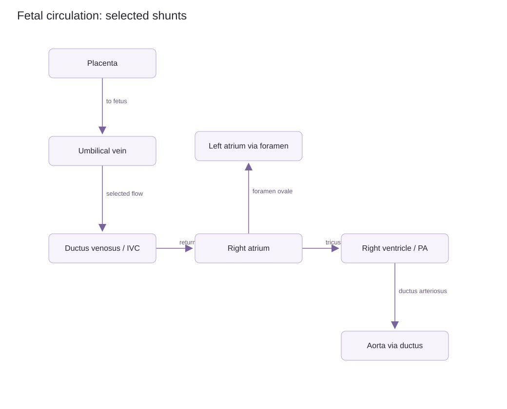

# 산부인과·생식의학·소아·신생아

# 산과학

## 정상 임신의 모체 적응과 태반 기능

### 학습목표

- 임신의 혈역학적 변화를 설명한다.
- 태반의 교환과 호르몬 기능을 구분한다.
- 생리적 변화와 병적 소견의 해석 원리를 설명한다.

### 임신은 여러 장기의 적응이다

임신 중 모체는 태아와 태반의 요구에 맞추어 심혈관, 호흡, 신장, 내분비와 대사를 조절한다. 혈장량과 적혈구량이 모두 증가할 수 있으나 증가 비율이 달라 혈액 희석에 따른 혈색소 농도 변화가 나타날 수 있다. 심박출량과 혈관 저항의 변화는 임신 시기와 자세, 개인 상태에 따라 달라진다. 이러한 생리적 적응을 안다고 모든 빈혈이나 호흡곤란을 정상 임신으로 처리해서는 안 된다. 출혈, 심폐질환과 혈전색전증 등은 별도 평가가 필요하다.

커진 자궁은 누운 자세에서 큰정맥을 압박하여 정맥환류에 영향을 줄 수 있다. 신혈류와 여과의 변화는 검사 수치의 기준 해석에 영향을 준다. 임신에서 평소 정상으로 보이는 크레아티닌 값도 비임신 기준과 같은 의미가 아닐 수 있다. 단백뇨와 혈압 변화는 임신 시점 및 다른 장기 소견과 함께 해석한다. 특정 수치의 진단 기준은 현재 산과 지침에 따라 명시해야 하며 이 생리 절에서 임의로 생성하지 않는다.

### 태반은 단순한 필터가 아니다

태반(placenta)은 모체와 태아 사이의 교환면과 내분비 기능을 갖는 기관이다. 모체 혈액은 융모 사이 공간으로, 태아 혈액은 융모 내부 혈관으로 흐르며 정상적으로 두 혈류가 하나의 혈관 안에서 직접 섞이는 구조는 아니다. 산소와 영양분의 이동은 농도·분압차와 수송체, 교환면 및 혈류에 영향을 받는다. 약물이 태반을 통과하는 정도도 분자 특성과 단백질 결합, 수송과 대사 등에 따라 달라진다. 태반이 존재한다는 사실은 모든 독성물질과 감염으로부터 완전히 보호한다는 뜻이 아니다.

hCG는 초기 임신에서 황체 기능 유지와 연결되고, 이후 태반의 스테로이드 합성과 다른 호르몬 기능이 중요해진다. Progesterone과 estrogen, human placental lactogen 등은 자궁과 유방, 대사 적응에 서로 다른 역할을 한다. 태아-태반 단위는 일부 호르몬 전구물질의 공급과 대사에서 협력한다. 호르몬을 분비하는 위치와 최종 작용기관을 구분하면 임신 검사, 태반 기능, 내분비 변화의 관계를 이해하기 쉽다.

### 가스교환과 대사

임신에서 환기 변화는 CO2와 산염기 상태에 영향을 주며 신장 보상이 함께 일어난다. 산소 소비도 변하므로 모체의 호흡 문제는 태아 산소 공급과 연결될 수 있다. 임신 후반의 인슐린 저항성 증가는 태아에 에너지 기질을 공급하는 적응의 일부지만, β세포 보상이 충분하지 않으면 고혈당이 나타날 수 있다. 임신성 당뇨병은 비임신 성인의 진단 기준을 그대로 적용하지 않으며 별도 검증된 검사 전략이 필요하다.

응고계 변화는 분만 시 출혈에 대비하는 측면이 있지만 혈전성 사건의 위험과도 관련된다. 생리적 부종이 흔하다는 사실만으로 한쪽 다리의 통증·종창이나 갑작스러운 호흡곤란을 안심시키면 안 된다. 산전진료에서는 정상 적응, 위험요인, 새로운 증상을 함께 평가한다. 성인 자궁 3D 모델은 비임신 상태의 위치 설명에만 사용하며 태아·태반이나 임신 자궁을 포함한 모델로 표시하지 않는다. 임신 주수별 변화는 별도의 발생·산과 도식이 필요하다.

### 확인 문제

태반에서 모체·태아 혈류는 보통 하나의 혈관에서 직접 섞이는가?

A. 그렇다.
B. 아니다.

**정답: B**

모체 융모간 공간과 태아 융모혈관을 통한 교환 구조를 구분한다.

**오답 해설**

A: 교환을 혈관 내 직접 혼합과 동일시하면 안 된다.

# 부인과학

## 비정상 자궁출혈의 병태생리와 평가

### 학습목표

- 출혈의 위치와 임신 관련 원인을 먼저 구별한다
- 구조적 원인과 배란·지혈 장애를 연결한다
- 검사 목적과 치료 목표를 구분한다

### 출혈이라는 증상에서 출발하기

비정상 자궁출혈(abnormal uterine bleeding, AUB)은 월경의 빈도와 규칙성, 지속기간 또는 출혈량이 정상적인 양상에서 벗어난 경우를 다루는 증상 범주이다. 하나의 조직학적 진단명이 아니므로 출혈을 멈추는 처치와 원인을 밝히는 평가를 구별해야 한다. 환자가 질출혈이라고 표현해도 출혈원이 외음부와 질, 자궁경부, 자궁내막 중 어디인지 확인해야 하며 요로와 직장의 출혈이 혼동될 수도 있다. 먼저 출혈의 실제 위치와 긴급도를 파악한다.

생식 가능성이 있는 환자에서는 임신 관련 출혈을 별도로 고려한다. 임신 초기의 출혈과 자궁외임신, 임신 소실 등은 비임신 자궁출혈의 분류와 다른 평가가 필요하다. 환자의 주기 기억이나 피임 사용만으로 임신 가능성을 완전히 배제할 수는 없다. 심한 출혈에서는 원인 분류를 완성하기 전에 순환 상태와 증상성 빈혈, 지속 출혈을 평가해야 한다. 정상 혈압이 출혈의 위험을 모두 배제하지 않는다는 원칙은 이 상황에서도 적용된다.

### 정상 내막과 배란의 역할

정상 배란주기에서 에스트로겐은 내막 증식에, 배란 뒤 황체의 프로게스테론은 분비성 변화와 내막 조절에 관여한다. 황체 기능이 소실되어 호르몬이 감소하면 혈관과 기질, 염증 및 단백분해의 국소 변화가 조직 탈락으로 연결된다. 지혈과 재생이 조절되면서 출혈이 끝난다. 월경은 단순히 혈관이 터지는 현상이 아니라 내분비 변화와 국소 지혈·염증·조직 재생이 시간에 맞추어 진행되는 과정이다.

무배란에서는 정상적인 황체기 프로게스테론 노출이 형성되지 않을 수 있다. 에스트로겐 자극이 지속되는 정도와 내막 상태에 따라 불규칙하고 때로 많은 출혈이 발생한다. 그러나 모든 무배란 환자가 같은 호르몬 농도와 내막 두께를 보이는 것은 아니다. 에너지 부족과 시상하부 억제에 의한 저에스트로겐 상태, 다낭난소증후군과 관련된 만성 무배란은 같은 무월경이나 불규칙 출혈로 표현되어도 생리가 다르다.

### 원인 분류를 기전에 연결하기

PALM-COEIN 분류는 비임신 생식연령 자궁출혈의 원인을 정리하는 틀이다. PALM은 용종(polyp), 자궁선근증(adenomyosis), 평활근종(leiomyoma), 악성종양과 내막증식증(malignancy and hyperplasia)을 포함한다. COEIN은 응고장애(coagulopathy), 배란장애(ovulatory dysfunction), 내막 원인(endometrial), 의인성(iatrogenic), 기타 미분류 원인을 다룬다. 분류는 평가의 누락을 줄이는 도구이며 한 환자에게 원인이 하나만 존재한다고 가정하는 규칙은 아니다.

평활근종은 위치에 따라 자궁강과 내막에 미치는 영향이 다르다. 근종이 관찰되었다는 사실만으로 모든 출혈을 그 병변 탓으로 확정하면 안 된다. 자궁선근증은 자궁근층 내의 내막성 조직과 관련된 질환으로 통증과 자궁 변화가 동반될 수 있고, 용종은 자궁강의 국소 병변으로 나타날 수 있다. 구조적 이상은 크기뿐 아니라 위치와 증상, 내막과의 관계를 평가해야 한다. 우연한 영상 소견과 증상의 실제 원인을 구별한다.

초경 무렵부터 심한 출혈이 있었거나 코피와 멍, 시술 뒤 과도한 출혈 및 가족력이 있다면 전신 지혈 장애를 고려한다. 항응고제와 호르몬 약물, 자궁 내 장치 등도 출혈 양상에 영향을 줄 수 있다. 처방약뿐 아니라 복용 시점과 누락, 다른 약제의 병용을 확인한다. 내막의 국소 지혈 이상은 다른 원인을 충분히 평가한 뒤 고려하는 범주이며, 영상에서 뚜렷한 종괴가 없다는 사실만으로 모든 평가가 끝나는 것은 아니다.

### 병력과 검사 선택

문진에서는 마지막 월경과 주기 변화, 출혈 지속기간, 생리용품 사용과 넘침, 혈괴, 야간 교체, 일상과 수면에 미치는 영향을 구체적으로 확인한다. 눈으로 추정한 혈액량은 정확하지 않을 수 있고 만성 출혈에 적응한 환자는 부담을 과소평가할 수 있다. 피로와 운동 시 호흡곤란 등 빈혈 증상, 골반통과 성교 후 출혈, 약물 및 가족력도 중요하다. 출혈량의 숫자만이 아니라 삶의 질과 환자의 우선순위를 평가한다.

혈액검사는 빈혈과 필요에 따른 철 상태, 임신 여부 및 의심되는 전신 원인을 평가한다. 모든 환자에게 같은 호르몬 검사를 일괄 시행하기보다 병력과 진찰에서 제기된 질문에 맞추어 선택한다. 초음파는 자궁과 부속기의 형태를 평가하고 자궁경검사는 자궁강 내부 병변의 직접 관찰과 표적 평가에 도움이 된다. 영상은 세포의 이형성 여부를 모두 판정하는 검사가 아니며 조직검사는 전체 자궁의 모든 위치를 균등하게 대표하지 못할 수 있다.

내막 평가의 필요성과 방식은 연령과 폐경 여부, 출혈 양상과 지속, 위험요인 및 기존 치료 반응을 고려하여 정한다. 폐경 후 새 출혈은 생식연령의 불규칙 주기와 같은 맥락으로 취급하지 않는다. 음성 검사 뒤에도 출혈이 지속되거나 임상적 의심이 남으면 표본의 적절성과 놓친 국소 병변을 다시 생각해야 한다. 검사 한 번의 정상 결과와 이후 평가가 불필요하다는 판단은 구별한다.

### 치료 목표와 추적

치료는 급성 출혈의 안정화, 장기적인 출혈 감소, 빈혈과 철 결핍의 교정, 원인 질환의 관리라는 여러 목적을 가진다. 약물은 내막과 호르몬 환경 또는 지혈 과정에 영향을 줄 수 있고, 시술과 수술은 병변 및 자궁 구조를 대상으로 한다. 선택에는 원인뿐 아니라 금기와 부작용, 피임과 향후 임신 계획, 환자의 선호를 포함해야 한다. 같은 출혈 감소 효과라도 생식 기능과 회복 부담에 미치는 영향은 다를 수 있다.

치료 뒤에는 출혈 양상과 기능, 빈혈 회복, 이상반응을 추적한다. 증상이 줄었더라도 원인 평가가 필요한 위험이 사라진 것은 아니며, 반대로 출혈량 수치의 작은 변화만으로 환자의 실질적인 이득을 무시해서도 안 된다. 치료 실패에서는 복용과 약물 노출, 원인 분류와 동반 질환, 자궁강 병변과 내막 평가의 적절성을 재검토한다. 증상 조절과 원인에 대한 안전한 관찰을 함께 유지하는 것이 장기 관리의 핵심이다.

### 확인 문제

출혈량이 줄었다면 원인 평가를 항상 끝내도 되는가?

A. 아니다. 위험요인과 지속·재발 양상에 따라 원인 평가가 필요하다.
B. 그렇다. 증상 감소는 내막 병변이 없다는 증거이다.

**정답: A**

내막 위험과 출혈의 증상 변화는 별도로 판단한다.

**오답 해설**

B: 치료 반응만으로 악성 또는 구조적 원인을 배제할 수 없다.

## 자궁내막증식증과 종양 위험

### 학습목표

- 호르몬 자극과 내막 증식의 관계를 설명한다
- 영상의 두께와 조직학적 진단을 구별한다
- 동반 암과 추후 진행 위험을 구분한다

### 내막 증식의 생리적 맥락

자궁내막은 난소 호르몬에 반응하여 주기적으로 성장과 분화, 탈락을 겪는다. 에스트로겐에 의한 증식과 프로게스테론에 의한 조절은 정상 배란주기의 시간축 안에서 이해해야 한다. 자궁내막증식증(endometrial hyperplasia)은 단순히 내막이 두껍게 보인다는 영상 표현이 아니라 조직의 샘과 기질, 세포 특성을 평가하는 병리학적 범주이다. 정상 주기의 두꺼운 내막과 병적 증식은 같은 말이 아니다.

지속적인 에스트로겐 자극에 비해 프로게스테론의 조절이 부족한 환경은 내막 증식에 기여할 수 있다. 만성 무배란과 일부 호르몬 노출, 비만과 관련된 대사·호르몬 환경 등이 원인 평가에 중요하다. 다만 위험인자가 있다는 사실만으로 조직 진단이 확정되지는 않는다. 반대로 전형적인 위험인자가 없다는 이유로 지속적인 비정상 출혈의 평가를 생략해서도 안 된다. 개인의 증상과 폐경 여부 및 기존 검사 결과를 함께 해석한다.

### 이형성과 전암성 변화

조직평가는 샘의 밀도와 배열, 세포의 이형성 및 다른 병변과의 감별을 포함한다. 이형성이 없는 증식과 전암성 병변은 자연경과와 관리가 같지 않다. 자궁내막상피내종양(endometrial intraepithelial neoplasia, EIN)이라는 개념은 특정 기준에 따라 종양성 위험을 평가하는 틀이며, 모든 비정상 내막을 같은 단계로 부르는 명칭이 아니다. 분류체계와 진단 기준의 시점을 명확히 해야 연구와 병리 결과를 올바르게 비교할 수 있다.

전암성 병변 진단에서 중요한 질문은 앞으로 암으로 진행할 위험뿐 아니라 이미 다른 부위에 암이 함께 있는지이다. 작은 생검은 전체 내막을 균일하게 관찰하지 못하여 동반 병변을 놓칠 수 있다. 이후 절제 표본에서 암이 확인되는 경우가 모두 생검 이후 짧은 기간에 새로 진행한 것을 뜻하지 않는다. 동시 존재와 시간에 따른 진행이라는 두 위험을 구별하면 추가 평가와 추적의 목적을 더 정확히 설명할 수 있다.

### 영상과 조직의 서로 다른 질문

초음파의 내막 두께는 폐경 여부와 주기 시점, 호르몬 사용 및 검사의 적절성에 따라 해석이 달라진다. 두께가 증가했다는 사실만으로 세포 이형성을 확인할 수 없고, 특정 기준 아래의 두께가 모든 임상 상황에서 모든 질환을 배제하는 것도 아니다. 특히 지속되거나 반복되는 출혈은 한 번의 영상 결과와 별도로 평가해야 한다. 국소 병변과 전체적인 내막 변화도 구별한다.

조직검체에서는 채취된 양과 부위, 생검 방법, 선행 호르몬 치료가 해석에 영향을 준다. 검체가 불충분하다는 결과를 음성으로 바꾸어 읽지 않는다. 임상과 조직 소견이 불일치하면 표본의 대표성과 자궁강의 국소 병변을 다시 고려하고 필요에 맞는 추가 평가를 선택한다. 병리학적 분류는 영상과 경쟁하는 결과가 아니라 서로 다른 수준의 정보를 제공한다.

### 관리의 목표

관리에서는 현재 암의 존재를 충분히 평가하면서 병변의 퇴행과 재발 위험을 조절하고, 생식 계획과 치료 위해를 함께 다룬다. 프로게스틴을 이용한 치료는 내막의 호르몬 환경에 작용하는 접근이고, 수술은 자궁 조직을 제거하여 진단과 치료에 기여할 수 있다. 모든 환자에게 동일한 방법을 자동 적용하는 것이 아니라 이형성 및 위험, 동반 질환, 임신 계획과 추적 가능성을 고려한다.

생식 기능을 보존하는 접근은 치료를 적게 한다는 뜻이 아니라 병변의 반응과 동반 암의 가능성을 더 면밀히 평가해야 하는 별도의 전략이다. 출혈이 줄어든 것과 조직학적 퇴행은 같지 않으므로 계획된 재평가가 중요하다. 치료 뒤 호전되더라도 유발 환경이 지속되면 재발 위험이 남을 수 있다. 체중과 대사 상태, 배란 기능과 호르몬 노출을 함께 관리하되 생활 변화만으로 필요한 조직 평가를 대신하지 않는다.

상담에서는 현재 진단의 의미와 표본의 한계, 치료 선택이 임신 가능성과 일상에 미치는 영향, 추적의 목적을 구체적으로 설명한다. 암이 아니라고만 말하면 동반 암과 진행 위험이 가려지고, 곧 암이 된다고 단정하면 실제 위험의 차이가 사라진다. 병변의 조직학적 특성과 현재 확인된 근거에 맞추어 불확실성을 설명해야 환자가 치료와 추적의 이유를 이해할 수 있다.

### 확인 문제

초음파에서 두꺼운 내막이 보이면 증식증이 확진되는가?

A. 그렇다. 영상의 두께가 세포 이형성을 직접 보여준다.
B. 아니다. 주기·폐경 상태를 고려하고 필요한 조직 평가를 구별한다.

**정답: B**

두께와 조직의 샘 배열·세포 이형성은 다른 정보이다.

**오답 해설**

A: 두께와 조직의 샘 배열·세포 이형성은 다른 정보이다.

# 생식의학

## 난소주기와 시상하부–뇌하수체 조절

### 학습목표

- 두 세포·두 성선자극호르몬 모형을 설명한다
- 난포 선택과 배란 및 황체의 변화를 연결한다
- 난소 호르몬과 자궁내막 반응을 구별한다

### 서로 연결된 두 주기

난소주기(ovarian cycle)는 난포의 성장과 배란, 황체 형성과 퇴화의 연속이다. 자궁내막 주기는 난소 호르몬의 변화에 반응하여 내막이 증식하고 분비성으로 바뀌며 탈락하는 과정이다. 두 주기는 연결되어 있지만 같은 장기의 변화가 아니다. 월경 출혈이 있다는 사실만으로 그 주기에 정상 배란이 있었다고 확인할 수 없고, 난소 호르몬 분비만으로 자궁내막의 모든 구조적 상태를 알 수는 없다. 출혈 양상은 생식내분비 기능을 평가하는 중요한 정보이지만 독립적인 배란검사를 대신하지 않는다.

시상하부의 성선자극호르몬방출호르몬(gonadotropin-releasing hormone, GnRH)은 박동성으로 분비되어 뇌하수체의 황체형성호르몬(luteinizing hormone, LH)과 난포자극호르몬(follicle-stimulating hormone, FSH) 분비를 조절한다. 박동의 빈도와 진폭, 뇌하수체의 민감도, 난소에서 오는 되먹임이 분비 양상을 바꾼다. 지속 자극은 생리적 박동과 다른 효과를 낼 수 있어 GnRH를 단순히 많을수록 성선 기능이 커지는 신호로 이해하면 약리 작용을 설명하기 어렵다.

### 두 세포와 두 호르몬

난포의 난포막세포(theca cell)는 LH에 반응하여 안드로겐 합성에 기여하고, 과립막세포(granulosa cell)는 FSH에 반응하여 아로마타아제(aromatase) 등을 통해 안드로겐을 에스트로겐으로 전환한다. 이 협력이 두 세포·두 성선자극호르몬 모형이다. 세포 사이의 물질 이동과 효소 발현 차이가 중요하며, 한 세포가 모든 스테로이드 합성 단계를 같은 정도로 수행한다고 설명하지 않는다. 성숙 단계에 따라 수용체와 효소 발현이 바뀌므로 배란 전후의 기능도 고정되어 있지 않다.

원시난포에서 시작되는 초기 성장은 배란 주기보다 훨씬 긴 시간에 걸치며, 모든 단계가 당장 그 주기의 FSH 상승으로 새로 시작되는 것은 아니다. 주기 중 선택되는 난포군과 우성난포의 발달을 설명할 때 초기 난포 동원과 후기 성선자극호르몬 의존성 성장을 구별한다. 성장하는 난포에서 분비되는 에스트라디올과 인히빈(inhibin)은 FSH 분비를 낮추는 데 기여한다. 상대적으로 FSH에 민감하고 성장 조건이 유리한 우성난포가 계속 발달하는 동안 다른 난포는 퇴화할 수 있다.

### 양성 되먹임과 배란

대부분의 주기에서 에스트라디올은 성선자극호르몬 분비를 억제하는 음성 되먹임에 관여한다. 그러나 배란 전 우성난포에서 충분히 높고 지속적인 에스트라디올 자극이 형성되면 조절 회로가 양성 되먹임 양상으로 바뀌어 LH 급증(surge)에 기여한다. 이는 단지 어느 순간의 수치가 높다는 것뿐 아니라 신호의 지속과 회로의 준비 상태에 관련된 현상이다. 에스트로겐이 언제나 LH를 억제한다는 설명도, 언제나 촉진한다는 설명도 주기의 시간축을 놓친 것이다.

LH 급증은 난자의 감수분열 재개와 난포의 성숙 변화, 난포벽의 재형성 및 황체화에 관여한다. 배란은 내부 압력만으로 난포가 기계적으로 터지는 사건이 아니라 단백분해, 국소 염증성 신호, 혈류와 세포 기능 변화가 통합된 과정이다. 배란 뒤 남은 난포 조직은 황체(corpus luteum)로 바뀌고 프로게스테론 분비가 증가한다. 배란 시점은 주기 길이와 개인 내 변동에 영향을 받으므로 모든 사람에게 월경 시작 후 특정 날짜로 고정할 수 없다.

### 황체와 임신 신호

프로게스테론은 에스트로겐으로 증식한 자궁내막을 분비성 상태로 전환하고, 자궁경부 점액과 체온 등에도 영향을 준다. 황체기에는 에스트라디올과 프로게스테론, 인히빈 A 등이 되먹임에 관여한다. 인히빈 A와 인히빈 B는 같은 이름의 물질이 단순히 늘었다 줄었다 하는 것만이 아니라 분비 우세 시기와 임상적 용도가 다른 관련 단백질이다. 난소 기능은 스테로이드만이 아니라 이런 펩티드 신호를 함께 포함한 체계이다.

임신이 성립하여 초기 영양막에서 사람융모성성선자극호르몬(human chorionic gonadotropin, hCG) 신호가 형성되면 황체의 스테로이드 생산이 유지된다. hCG는 LH 수용체와 관련된 작용을 통해 이 기능을 지지한다. 수정 자체가 난소에 신경 신호를 보내 황체를 유지시키는 것은 아니다. 임신 신호가 유지되지 않으면 황체 기능이 감소하고 난소 호르몬이 떨어지며 내막의 탈락과 다음 난포군 발달에 필요한 FSH 변화가 이어진다.

### 임상에서 주기를 해석하기

주기 평가에서 호르몬 수치는 채혈한 시점에 따라 의미가 다르다. 배란 전과 황체기의 프로게스테론을 같은 기준으로 비교하면 생리적 차이를 질환으로 오인할 수 있다. 하나의 LH나 FSH 값으로 GnRH 박동을 직접 측정한 것처럼 해석해서도 안 된다. 호르몬 약제, 임신, 수유, 에너지 부족과 과도한 운동, 시상하부·뇌하수체 질환, 난소의 상태가 서로 다른 지점에서 같은 무월경 증상을 만들 수 있다.

무배란에서는 정상적인 황체기 프로게스테론 노출이 형성되지 않을 수 있어 출혈이 불규칙해지고 내막이 지속적인 에스트로겐 자극을 받는 상황이 생길 수 있다. 반면 저에스트로겐 상태에서는 내막 증식 자체가 적을 수 있다. 월경이 없다는 결과가 같더라도 두 상태의 생리와 장기 위험은 다르다. 생식의학의 내분비 해석은 증상을 난소 기능만으로 환원하지 않고 시상하부, 뇌하수체, 난소와 자궁의 연결을 순서대로 평가하는 과정이다.

### 확인 문제

배란 전 LH 급증과 연결되는 되먹임은?

A. 배란은 매번 월경 시작 후 동일한 날짜에 반드시 일어난다.
B. 충분히 높고 지속적인 에스트라디올 신호에 따른 양성 되먹임이다.
C. 에스트라디올은 모든 시점에서 LH를 같은 정도로 억제한다.

**정답: B**

되먹임의 방향은 주기의 시점과 신호의 지속 등에 따라 달라지며 배란 날짜도 변동한다.

**오답 해설**

A: 난포기와 주기의 길이는 변동하며 모든 사람의 배란 날짜가 고정되지는 않는다.

C: 에스트라디올의 되먹임 방향은 배란 전후 조건에 따라 바뀐다.

# 소아청소년과학

## 성장·발달 평가의 원리

### 학습목표

- 성장곡선의 연속 변화를 해석한다.
- 성장과 발달의 차이를 설명한다.
- 정상 변이와 평가가 필요한 변화를 구분한다.

### 한 점보다 궤적이 중요하다

성장(growth)은 신체 크기의 변화이고 발달(development)은 기능과 능력의 획득을 포함한다. 체중, 길이 또는 키, 머리둘레를 적절한 방법으로 반복 측정하고 연령과 성별에 맞는 성장도표에 표시한다. 백분위수는 같은 기준집단에서의 상대적 위치이며 건강 점수나 능력의 순위가 아니다. 한 번 작은 값이 나왔다는 사실보다 이전 측정과의 추세, 측정오차, 가족적 체격과 전신 상태가 중요하다. 키 측정 자세와 장비 차이만으로도 성장 속도가 왜곡될 수 있다.

체중과 선형성장은 같은 속도로 변하지 않으며 질환과 영양 문제에 대한 반응도 다를 수 있다. 섭취 부족에서는 체중 변화가 먼저 드러날 수 있지만 모든 성장장애를 같은 순서로 설명하지 않는다. 내분비질환, 만성 염증, 흡수장애, 유전 및 골격 질환은 서로 다른 패턴을 만들 수 있다. 머리둘레도 측정 추세와 가족력, 신경학적 소견을 함께 평가해야 한다. 하나의 백분위 경계만으로 정밀검사 여부를 일괄 결정하는 방식은 불충분하다.

### 발달 영역과 퇴행

발달은 대근육, 소근육, 언어, 인지와 사회적 상호작용 등 여러 영역으로 나누어 볼 수 있다. 영역들은 서로 영향을 주지만 반드시 같은 속도로 진행되지 않는다. 선별검사는 추가 평가가 필요한 아이를 찾는 도구이며 확진검사와 다르다. 보호자의 관찰, 진료 중 직접 관찰, 청각과 시각, 운동과 신경 상태, 생활 환경을 종합한다. 조산아에서는 발달 해석에 교정연령이 필요한 시기가 있으므로 적용 기준을 확인해야 한다.

아직 획득하지 못한 능력과 이미 하던 능력을 잃는 퇴행(regression)은 구분해야 한다. 퇴행은 신경계나 대사성 질환 등을 포함한 평가가 필요한 중요한 단서다. 언어 지연을 단순히 말이 늦는 가족력으로만 설명하거나 보호자 양육의 탓으로 돌리면 원인을 놓칠 수 있다. 반대로 정상 범위의 개인차를 모두 질환으로 명명하면 불필요한 불안을 만든다. 평가의 목적은 낙인이 아니라 지원과 원인 확인이다.

### 영양과 환경을 함께 보기

수유와 식사력에서는 양뿐 아니라 방식, 음식 다양성, 식사 시간, 삼킴과 구토, 돌봄 자원과 경제적 접근성을 확인한다. 생후와 성장 단계에 따른 영양 요구가 다르므로 성인 식단 기준을 축소하여 적용하지 않는다. 만성질환은 섭취·흡수·대사 요구를 바꿀 수 있고, 발달 문제는 식사 행동과 상호작용할 수 있다. 신체 성장과 심리사회적 환경을 별개로 나누지 않고 함께 평가하는 것이 중요하다.

성장도표는 사용한 판과 기준집단, 연령 계산을 명시해야 한다. 한국 소아청소년 성장도표와 WHO 도표는 적용 범위와 구성에 차이가 있을 수 있으므로 동일한 백분위처럼 섞지 않는다.

### 확인 문제

성장 백분위는 건강 점수인가?

A. 아니다.
B. 그렇다.

**정답: A**

기준집단에서의 상대적 위치를 나타낸다.

**오답 해설**

B: 한 점을 건강 우열로 해석하면 추세와 맥락을 놓친다.

# 신생아학

## 출생 전후 순환과 호흡의 전환

### 학습목표

- 태아순환의 세 우회로를 설명한다.
- 첫 호흡과 제대 결찰의 혈역학적 효과를 연결한다.
- 정상 전환과 병적 지속의 차이를 설명한다.

### 태아의 산소 공급 경로

태아는 폐보다 태반에서 가스교환을 수행한다. 산소화된 혈액은 제대정맥을 통해 태아로 들어오고, 정맥관(ductus venosus), 타원구멍(foramen ovale), 동맥관(ductus arteriosus)은 혈류의 우회와 분배에 중요한 역할을 한다. 제대동맥은 태아에서 태반으로 혈액을 보낸다. 동맥과 정맥이라는 이름은 산소 함량이 아니라 심장에서 나가는지 돌아오는지의 방향을 기준으로 이해해야 한다. 태아의 여러 구획에서 혈액은 서로 다른 정도로 혼합되므로 전 태아혈액이 같은 산소 함량을 가지는 것은 아니다.

태아 폐혈관 저항이 높아 폐로 흐르는 혈류 비율은 출생 후와 다르다. 타원구멍은 우심방에서 좌심방으로의 흐름을 허용하고, 동맥관은 폐동맥과 대동맥 사이를 연결한다. 이러한 통로는 정상 태아 생리에서 필요한 구조다. 출생 후에는 같은 연결이 조건에 따라 병적 단락이나 특정 선천심장질환의 생존에 중요한 통로가 될 수 있다. 구조의 의미는 시기와 압력관계에 따라 달라진다.

### 첫 호흡이 바꾸는 저항

출생 후 폐가 팽창하고 산소화가 시작되면 폐혈관 저항이 감소하여 폐혈류가 증가한다. 폐정맥환류 증가는 좌심방 충만과 압력을 바꾸며 타원구멍의 기능적 닫힘에 기여한다. 제대순환이 끊기면 낮은 저항의 태반 순환이 제거되어 전신순환의 부하가 변한다. 호흡 시작과 제대 결찰은 서로 다른 조작이지만 정맥환류와 심장 부하를 통해 상호작용한다. 실제 전환은 한순간에 완결되는 단일 스위치가 아니다.

동맥관의 수축에는 산소와 prostaglandin 신호 변화가 관여한다. 기능적으로 혈류가 줄어드는 시점과 조직학적으로 폐쇄되는 시점은 다르다. 미숙아에서는 전환과 관의 반응이 다를 수 있고, 감염과 호흡 질환 등도 영향을 준다. 폐혈관 저항이 충분히 떨어지지 않으면 태아형 우좌단락이 지속되어 산소화에 문제가 생길 수 있다. 동맥관 또는 타원구멍이 보인다는 사실만으로 모든 저산소혈증의 원인을 결정하지 않는다.

### 폐액과 표면활성물질

태아 폐는 액체로 채워져 있으며 출생 전후 흡수와 제거가 일어나 공기 호흡으로 전환한다. 표면활성물질은 폐포 표면장력을 줄여 팽창과 안정성을 돕는다. 미숙한 폐에서는 부족과 구조적 미성숙이 호흡장애에 기여할 수 있다. 호흡곤란의 원인은 표면활성물질 부족 외에도 폐액 처리 지연, 감염, 공기누출, 선천기형과 심장질환 등 다양하다. 호흡수와 흉곽 움직임, 산소화, 청진과 영상·검사 정보를 통합해야 한다.

신생아의 체온 조절과 포도당 공급도 전환에 중요하다. 작은 체격과 표면적, 저장 에너지와 미숙성은 열손실과 대사 요구에 영향을 준다. 저체온은 산소와 에너지 소비를 늘려 호흡순환의 부담을 키울 수 있다.

### 확인 문제

제대동맥이란 명칭은 무엇을 기준으로 하는가?

A. 산소가 항상 많은 혈액
B. 태아 심장에서 나가는 방향

**정답: B**

동맥과 정맥은 흐름 방향에 따른 이름이다.

**오답 해설**

A: 산소 함량은 태아순환에서 일반 성인 도식과 다를 수 있다.

## 신생아 빌리루빈 대사와 황달

### 학습목표

- 빌리루빈 생성·포합·배설을 설명한다
- 신생아의 비포합 빌리루빈 증가 요인을 구별한다
- 총수치와 신경독성 위험 및 담즙정체를 구분한다

### 헤모글로빈에서 담즙색소로

빌리루빈(bilirubin)은 헴의 분해 과정에서 만들어지는 색소이다. 노화하거나 손상된 적혈구의 처리 등으로 생긴 헴은 빌리베르딘을 거쳐 빌리루빈으로 전환된다. 비포합 빌리루빈(unconjugated bilirubin)은 물에 잘 녹지 않아 혈중에서 주로 알부민과 결합하여 운반된다. 간세포는 이를 받아들여 글루쿠론산 포합을 통해 수용성을 높인 뒤 담즙으로 배출한다. 생성이 늘거나 간의 처리와 배설이 감소하면 혈중 수치가 높아질 수 있다.

신생아는 적혈구 양과 수명, 출생 후 대사 전환, 간의 포합 기능이 성인과 다르다. 이 때문에 생리적인 출생 후 변화만으로도 빌리루빈이 상승할 수 있다. 그러나 신생아에게 흔하다는 사실은 모든 황달이 생리적이라는 뜻이 아니다. 용혈, 출혈의 흡수, 감염, 간담도 질환, 대사질환과 섭취 부족 등은 서로 다른 기전으로 수치를 높인다. 언제 시작했고 얼마나 빠르게 증가하며 어떤 분획이 증가하는지를 알아야 원인을 구별할 수 있다.

### 생성 증가와 장간순환

면역성 용혈이나 적혈구 효소·막의 이상은 적혈구 파괴와 빌리루빈 생성을 증가시킬 수 있다. 큰 멍이나 두혈종에서 혈액이 흡수되는 과정도 헴 분해 부담을 높인다. 빈혈이 뚜렷하지 않다고 모든 용혈을 배제할 수는 없으며, 혈액형과 면역검사, 망상적혈구, 말초혈액 소견 등을 상황에 따라 함께 해석한다. 한 검사에서 이상이 없다는 이유로 빠른 수치 상승의 원인을 생리적 변화로 단정하지 않는다.

장으로 배출된 포합 빌리루빈은 탈포합된 뒤 다시 흡수될 수 있어 장간순환이 형성된다. 초기 수유가 충분하지 않아 장 통과와 배변이 감소하면 이 재흡수와 탈수 등이 황달에 기여할 수 있다. 충분한 섭취 여부는 수유 횟수 하나보다 실제 젖 전달, 체중 변화, 소변과 대변 양상 등으로 평가한다. 섭취 부족과 관련된 초기 황달과 충분히 성장하는 모유수유아에서 지속될 수 있는 양상을 구별하되, 모유수유라는 사실만으로 다른 원인을 배제하지 않는다.

### 포합 기능과 담즙정체

포합효소의 성숙, 간세포의 유입과 배출 기능은 빌리루빈 처리에 관여한다. 비포합 빌리루빈 상승과 포합 빌리루빈 상승은 원인과 위험의 방향이 다를 수 있다. 담즙정체에서는 담즙 배출이 방해되어 직접반응 또는 포합 분획이 증가할 수 있고, 이는 단순한 생리적 황달로 다루어서는 안 되는 단서이다. 무담즙성 옅은 변과 진한 소변, 간비대와 성장 문제는 간담도 평가의 중요성을 높인다.

검사에서 말하는 직접반응 빌리루빈(direct-reacting bilirubin)은 측정법상의 범주이므로 순수한 포합 빌리루빈과 완전히 같은 물질 집합을 의미하지 않을 수 있다. 총 빌리루빈만으로 분획과 원인을 알 수 없고, 피부 색만으로도 정확한 혈중 농도를 알 수 없다. 경피 측정은 상황에 따라 선별과 추적에 유용하지만 높은 값이나 치료 판단이 필요한 상황에서는 혈청 측정과 임상 평가가 중요하다. 검사법과 시점이 다른 값을 단순한 연속 숫자로만 비교하지 않는다.

### 빌리루빈과 신경계

비포합 빌리루빈의 신경독성은 총수치 하나로만 결정되지 않는다. 알부민에 결합하지 않은 분획, 결합 능력과 약물의 영향, 미숙성과 전신 상태, 감염과 임상적 불안정 등이 위험에 관여한다. 총수치가 같아도 환자별 위험이 다른 배경이다. 높은 비포합 빌리루빈이 중추신경계에 독성을 미치면 급성 빌리루빈뇌병증이 발생할 수 있고, 심한 손상 뒤에는 운동과 청각 기능 등에 지속적인 장애가 남을 수 있다.

초기 신경학적 변화는 수유 저하나 처짐처럼 비특이적으로 보일 수 있고, 진행하면 근긴장과 자세, 울음 등에서 이상이 나타날 수 있다. 이런 소견을 기다렸다 치료를 결정하는 것이 예방의 목적은 아니다. 재태연령과 생후 시간, 수치의 경과, 동반 위험을 이용하여 신경 손상이 발생하기 전에 개입할 필요성을 판단한다. 치료 기준이 생후 일수 하나나 모든 신생아에게 동일한 고정 수치로 정해지지 않는 이유이다.

### 광선치료의 원리와 경과

광선치료(phototherapy)는 피부에 도달한 빛으로 빌리루빈의 구조와 광화학적 성질을 바꾸어 간의 포합에 덜 의존하는 제거 경로를 만든다. 몸을 따뜻하게 하거나 황색을 눈에 덜 보이게 하는 치료가 아니다. 효과는 빛의 파장과 조사 강도, 노출된 피부 면적, 실제 치료 시간 등에 영향을 받는다. 생성 속도가 매우 빠르면 적절한 광선치료 중에도 수치가 올라갈 수 있어 반응만 보지 않고 용혈과 다른 원인을 함께 평가해야 한다.

치료 뒤 수치가 떨어졌다는 사실과 다시 상승할 위험이 사라졌다는 사실은 다르다. 치료를 시작한 시점과 용혈 여부, 재태연령, 치료 중단 시 수치와 경과는 추적 계획에 영향을 준다. 퇴원 후에도 수유와 체중, 황달 진행, 추적 측정 가능성을 함께 고려한다. 신생아 황달은 간의 대사 성숙이라는 정상 생리, 적혈구와 면역학, 수유와 장 기능, 신경독성이라는 여러 영역을 연결하여 이해해야 하는 임상 문제이다.

### 확인 문제

신생아 황달의 위험을 총 빌리루빈 하나로 결정하기 어려운 이유는?

A. 모든 황달은 생리적이므로 검사가 필요하지 않기 때문이다.
B. 광선치료는 빌리루빈을 늘려 작용하기 때문이다.
C. 생후 시간, 재태연령, 결합 능력과 전신 상태 등이 위험에 관여하기 때문이다.

**정답: C**

수치의 경과와 분획 및 환자별 위험을 함께 평가하며 광선치료는 빌리루빈의 제거 경로를 변화시킨다.

**오답 해설**

A: 용혈·감염·담즙정체 등 병적 원인을 구별해야 한다.

B: 광선치료는 빌리루빈의 광화학적 변화를 통해 제거를 돕는다.

