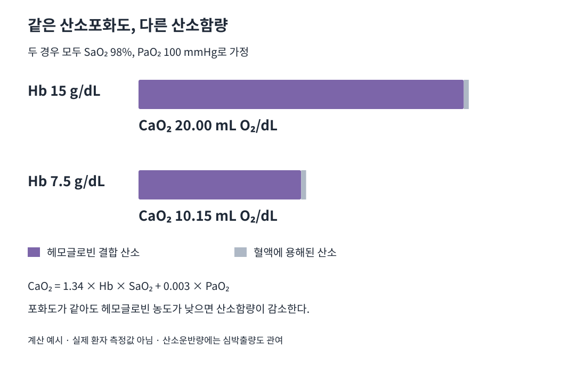

# 기타 임상의학·진단 분야

# 피부과학

## 피부병변의 형태와 분포

### 학습목표

- 일차병변과 이차변화를 구분한다.
- 형태·배열·분포를 통합해 기술한다.
- 관찰 소견에서 감별진단을 구성한다.

### 병명보다 먼저 형태를 기술한다

피부병변은 형태, 색, 크기와 경계, 표면과 촉감, 배열과 분포를 조합하여 기록한다. 같은 질환도 시기와 부위, 치료 및 긁음에 따라 모양이 달라지고, 다른 질환이 비슷한 형태를 만들 수 있다. 병변이 처음 생긴 모습과 이후 변화를 구분하면 감염, 염증과 종양의 감별에 도움이 된다. 병력을 들을 때에는 발생 부위와 시간, 확산 양상, 가려움과 통증, 접촉물질·약물·전신증상을 확인한다.

피부색에 따라 홍반과 자반, 창백의 시각적 표현이 달라질 수 있다. 조명과 주변 정상 피부를 확인하고 열감과 부종, 압통 및 촉진 소견을 함께 평가한다. 사진은 크기 기준과 촬영 조건, 위치 정보가 없으면 비교에 제한이 있다. 색 하나만으로 염증이나 산소화 상태를 판정하지 않는다.

### 일차병변

반점(macule)은 만져지는 융기 없이 색이 달라진 병변이다. 구진(papule)은 고형의 융기이며, 판(plaque)은 넓게 솟은 병변을 설명한다. 결절(nodule)은 보다 깊은 진피나 피하 조직까지 포함할 수 있는 고형 병변이다. 용어별 크기 경계는 문헌과 분류 관례에 차이가 있으므로 실제 크기를 단위와 함께 적는 것이 유용하다. 표면의 넓이와 조직 안의 깊이는 별도로 평가한다.

소수포(vesicle)와 대수포(bulla)는 액체를 포함한 병변이며 농포(pustule)는 고름성 내용물을 가진다. 농포가 있다는 사실만으로 세균감염을 확정할 수는 없다. 팽진(wheal)은 진피 부종에 의한 일시적인 융기로 위치와 형태가 변할 수 있다. 한 부위의 병변이 얼마나 지속되는지 묻는 것은 두드러기와 비슷하게 보이는 다른 염증을 구분하는 데 도움이 된다.

### 이차변화와 피부 깊이

인설(scale)은 각질의 탈락이 두드러진 표면 변화이고, 가피(crust)는 삼출액이나 혈액 등이 마르면서 형성된다. 미란(erosion)은 표피의 소실을, 궤양(ulcer)은 더 깊은 조직 손실을 포함한다. 손상이 진피를 침범하면 회복 후 흉터가 남을 가능성과 연관된다. 긁음 자국, 균열, 태선화와 위축도 원래 병변과 행동 및 만성 경과를 해석하는 단서다.

수포가 터진 뒤에는 액체가 담긴 구조가 사라지고 미란과 가피만 남을 수 있다. 장기간 긁은 병변에서는 일차 형태보다 두꺼워진 피부와 긁힌 흔적이 두드러질 수 있다. 따라서 현재 모양만으로 발생 순서를 뒤집어 추론하지 않도록 초기 사진과 병력을 참고한다. 표면 병변 외에 점막과 손발톱, 털의 변화도 질환 범위를 규정한다.

### 배열과 분포

선형 배열은 외부 접촉, 긁음과 발생학적 분포 등 여러 기전에서 나타날 수 있다. 환상 병변은 가장자리의 활동성과 인설, 중심부 변화에 따라 감별이 달라진다. 군집성, 망상, 표적 모양 등은 형태학적 기술이며 그 자체가 확진명은 아니다. 병변을 눌렀을 때 색이 사라지는지 관찰하면 혈관 확장과 혈관 밖 출혈을 구분하는 데 도움을 받을 수 있다.

노출부와 가려지는 부위, 굴측과 신측, 피부주름과 말단, 좌우 대칭성을 살핀다. 신경분절을 따르는 수포는 신경 분포와 연결되지만 면역 상태와 전신 확산 여부도 평가한다. 약물발진이 의심되면 시작과 증량, 중단 이후 변화 및 다른 원인을 시간축으로 정리한다. 전신 질환의 피부 소견에서는 발열과 점막 침범, 피부 통증과 수포·박리, 순환 상태 등 동반 소견이 중증도 판단에 중요하다.

### 검체 선택

곰팡이 검사를 위한 인설 채취, 세균·바이러스 검체와 피부생검은 서로 다른 질문에 답한다. 생검은 병변의 나이와 부위, 깊이, 기존 치료에 따라 진단 수율이 달라질 수 있다. 면역형광 검사가 필요한 경우에는 검체 위치와 보관 방식도 따로 고려한다. 임상 사진과 분포, 감별진단을 병리 의뢰에 전달하면 조직 소견을 적절한 맥락에서 해석하는 데 도움이 된다.

### 확인 문제

농포가 보이면 세균감염이 확진되는가?

A. 그렇다.
B. 아니다.

**정답: B**

고름성 내용물은 여러 염증 과정에서 나타날 수 있다.

**오답 해설**

A: 형태 소견과 병인 확정은 다른 판단이다.

# 안과학

## 안구 광학·망막과 시각경로

### 학습목표

- 각막·수정체·망막의 역할을 연결한다.
- 시야와 망막 투사의 방향을 설명한다.
- 구심성 동공경로와 시각 인식을 구분한다.

### 빛을 망막에 모으기

각막과 수정체는 들어오는 빛을 굴절시켜 망막에 상을 형성한다. 각막은 공기와의 굴절률 차이 때문에 큰 굴절력을 제공하고, 수정체는 모양을 바꾸어 가까운 물체에 초점을 맞추는 조절(accommodation)에 기여한다. 섬모체근과 소대, 수정체의 탄성은 이 과정에서 연결된다. 노화로 조절 능력이 감소하는 노안과 수정체 혼탁으로 빛이 산란하는 백내장은 기전이 다르다.

근시는 눈의 굴절계에 비해 망막 위치가 뒤에 있거나 굴절력이 커 먼 물체의 초점이 망막 앞에 맺히는 상태로 설명한다. 원시와 난시는 다른 광학적 불일치를 가진다. 시력 저하가 굴절 이상으로 설명되는지 확인하려면 교정 상태와 검사 조건을 고려한다. 핀홀을 통한 개선은 굴절 관련 원인을 시사할 수 있지만 모든 안질환을 배제하는 검사는 아니다.

### 망막의 신호 변환

빛은 망막의 여러 층을 지나 광수용체에 도달하고, 광수용체에서 시작된 신호는 양극세포와 신경절세포 등으로 전달된다. 가로세포와 무축삭세포는 주변 정보와 시간·공간 대비 처리에 관여한다. 중심오목은 정밀 시각과 연결되고 주변 망막은 다른 시각 기능에 기여한다. 막대세포와 원뿔세포는 광민감도와 색각, 분포가 달라 어두운 환경과 중심 시력의 특성이 구분된다.

광수용체는 빛을 받으면 일반적인 신경세포의 단순 흥분 그림과 달리 과분극하는 방향으로 반응한다. 광색소와 transducin, phosphodiesterase를 거쳐 cGMP 농도가 감소하면 양이온 통로의 개방이 줄어든다. 이에 따른 전달물질 방출 변화는 ON·OFF 양극세포 경로에서 서로 다르게 해석된다. 망막은 빛의 위치를 그대로 전달하기만 하는 수동 스크린이 아니라 초기 시각 처리를 수행하는 신경조직이다.

### 시야의 투사와 교차

왼쪽 시야는 두 눈의 오른쪽 망막에, 위쪽 시야는 아래쪽 망막에 투사된다. 각 눈의 코쪽 망막 신경절세포 축삭은 시각교차에서 교차하고 관자쪽 망막 축삭은 같은 쪽으로 진행한다. 그 결과 한쪽 시각로는 주로 반대쪽 시야 정보를 전달한다. 한 눈의 문제와 두 눈에서 같은 쪽 시야가 손상되는 문제를 구분하면 시각교차 앞뒤의 병변 위치를 추정할 수 있다.

시각교차의 중심부 손상은 양쪽 코쪽 망막의 교차 섬유에 영향을 주어 양관자쪽 시야 장애를 만들 수 있다. 시각교차 뒤 병변은 동측성 반맹 등으로 나타날 수 있으며, 시각부챗살의 주행과 피질의 배열에 따라 사분맹 등 다른 패턴이 가능하다. 실제 검사에서는 주시와 협조, 굴절과 망막 상태를 확인하고 시야 결손을 해부학과 연결한다. 시력과 시야는 서로 다른 기능이므로 한쪽이 보존되었다고 다른 쪽이 정상이라는 뜻은 아니다.

### 동공과 진찰의 통합

빛반사의 구심경로는 망막과 시신경을 통해 중간뇌의 관련 회로에 도달하고, 양측 부교감 출력이 동안신경과 섬모체신경절을 거쳐 동공 수축에 관여한다. 이 경로는 시각피질에서 의식적으로 보는 과정과 완전히 같지 않다. 상대구심동공운동장애는 양쪽 구심 입력의 비대칭을 나타내며 동공 크기 차이 자체와 구분한다. 산동과 축동을 해석할 때는 약물과 자율신경, 홍채 상태도 고려한다.

시력, 동공, 안구운동과 안압, 앞부분과 안저 검사는 서로 보완적이다. 급성 시력 소실에서 통증 유무와 시간 경과, 단안 또는 양안, 신경학적 증상이 감별에 중요하다. 빨간 눈이라는 표면 소견만으로 결막의 경한 질환으로 결론내리지 않고 각막과 전방, 안압 및 시력을 함께 평가한다. 매체가 혼탁하여 안저를 볼 수 없다는 결과는 망막을 정상으로 확인한 것과 다르다.

### 확인 문제

빛을 받은 광수용체의 전형적 전위 변화는?

A. 과분극
B. 항상 활동전위 폭발

**정답: A**

cGMP 감소와 양이온 통로 개방 감소가 과분극을 만든다.

**오답 해설**

B: 광수용체 신호를 일반적인 활동전위 그림과 동일시하면 안 된다.

# 이비인후과학

## 청각 전달과 난청의 분류

### 학습목표

- 외이·중이·내이의 역할을 구분한다.
- 유모세포의 기계전기 변환을 설명한다.
- 전음성·감각신경성 난청과 청력검사를 연결한다.

### 공기의 진동을 내이로 전달하기

외이도는 소리를 고막에 전달하고, 중이의 이소골은 고막의 진동을 등자뼈 발판을 통해 안뜰창으로 전달한다. 중이 구조는 공기와 내이 액체 사이의 임피던스 차이로 생기는 전달 손실을 줄이는 데 기여한다. 고막과 이소골의 움직임이 제한되면 내이가 보존되어도 청력 저하가 생길 수 있다. 이관은 중이와 코인두를 연결하여 환기와 압력 조절에 관여하며, 기능 이상은 중이 질환과 연결된다.

소리는 시간에 따른 압력 변화이며 주파수와 강도, 복합 파형을 가진다. 주파수는 음높이와 관련되고 소리 강도의 표시는 로그 척도를 사용한다. 청력검사에서 사용하는 dB HL은 주파수별 기준 역치를 반영하는 척도로 물리적 음압의 dB SPL과 같은 숫자로 직접 대응하지 않는다. 검사 결과를 읽을 때 축과 단위, 측정 조건을 확인해야 한다.

### 달팽이관의 주파수 분석

기저막은 위치별 기계적 성질이 달라 높은 주파수에 대한 반응은 바닥쪽에서, 낮은 주파수 반응은 꼭대기쪽에서 두드러진다. 이러한 위치 배열은 청각경로의 주파수 지도를 형성하는 토대다. Corti 기관의 유모세포 다발이 휘어지면 기계적으로 조절되는 통로가 열리고 전기적 반응으로 전환된다. 내림프의 이온 환경과 전위는 이 반응을 가능하게 하는 중요한 조건이다.

속유모세포는 청각 구심 신호 전달에, 바깥유모세포는 기계적 증폭과 주파수 선택성에 중요한 역할을 한다. 유모세포 손상은 같은 소리 역치 변화 외에도 말소리 구분과 소음 속 청취에 영향을 줄 수 있다. 이음향방사(otoacoustic emission)는 바깥유모세포 기능과 관련된 정보를 제공하지만 이를 단독으로 청각 전체의 정상 판정으로 사용할 수는 없다. 중이 전달 상태와 검사 환경도 측정에 영향을 준다.

### 전음성과 감각신경성 난청

전음성 난청(conductive hearing loss)은 외이·중이를 통한 전달 장애와 관련되고, 감각신경성 난청(sensorineural hearing loss)은 달팽이관과 청각신경 경로의 장애를 포함한다. 두 성분이 함께 있으면 혼합성 난청이다. 귀지와 고막·중이 질환, 이소골 문제는 전음성 원인의 예이고, 소음과 노화 및 일부 약물, 내이·신경 질환은 감각신경성 원인이 될 수 있다. 난청의 좌우와 발병 속도는 원인과 평가의 시급성을 바꾼다.

순음청력검사는 공기전도와 뼈전도 역치를 비교한다. 적절한 조건에서 공기-뼈 차이는 전음 성분을 시사하며, 뼈전도도 떨어지면 내이 이후의 성분을 고려한다. 반대쪽 귀로 소리가 전달될 수 있어 차폐(masking)가 필요한 상황이 있다. 어음청력검사는 소리의 검출 외에 말소리 인지 능력에 관한 정보를 제공한다. 역치와 어음인지가 불일치하면 검사 신뢰성과 원인 병변을 함께 검토한다.

### 진찰과 추가 검사

이경검사는 외이도와 고막의 상태를 확인하고, 고실도검사는 중이의 압력·순응 특성을 평가한다. Rinne와 Weber 음차검사는 전음과 감각신경 성분의 비대칭을 추정하는 침상검사지만 정밀 청력검사를 대신하지는 못한다. 검사 음차의 주파수와 기술, 난청의 정도와 양측성에 따라 해석의 한계가 생길 수 있다. 고막이 정상으로 보여도 내이와 신경 질환은 남아 있을 수 있다.

갑작스러운 청력 변화에서는 귀 먹먹함만 보고 단순 이관 문제로 판단하지 않고 실제 청력과 내이·신경 증상을 평가한다. 이명은 난청과 함께 나타날 수 있지만 하나의 원인만을 뜻하지 않으며, 박동성과 신경학적 동반 증상 등 특성에 따라 감별이 달라진다. 소아에서는 청각 문제가 언어발달에 영향을 줄 수 있어 보호자 관찰과 발달, 선별 및 확진검사를 연결하는 평가가 필요하다.

### 확인 문제

공기전도와 뼈전도 역치의 비교가 주로 돕는 구분은?

A. 모든 청력장애 원인의 확진
B. 전음 성분의 평가

**정답: B**

적절한 검사 조건의 공기-뼈 차이는 전달 장애를 시사한다.

**오답 해설**

A: 정확한 원인과 전체 경로는 다른 검사 및 임상상과 통합한다.

# 응급의학

## 산소화·환기·산소운반의 구별

### 학습목표

- 산소분압과 산소함량 및 산소운반량을 구별한다
- 분당환기와 폐포환기의 차이를 설명한다
- 정상 산소포화도에서 조직 저산소증이 발생하는 기전을 설명한다

### 서로 다른 생리변수

산소화(oxygenation)는 폐에서 산소가 혈액으로 이동하여 동맥혈이 산소를 얻는 과정이다. 환기(ventilation)는 공기가 폐로 드나들어 산소를 공급하고 이산화탄소를 제거하는 과정이다. 산소운반(oxygen delivery)은 혈액이 조직에 산소를 가져가는 과정이다. 이 세 과정은 연결되어 있지만 같은 변수로 측정되지 않는다. 산소를 투여하여 동맥혈 산소포화도를 높여도 폐포환기가 부족하면 이산화탄소가 축적될 수 있다. 산소화가 충분해도 빈혈이나 저심박출량이 심하면 조직에 전달되는 산소가 부족할 수 있다.

동맥혈 산소분압(PaO2)은 혈액에 녹아 있는 산소의 분압이다. 헤모글로빈에 결합한 산소의 총량을 직접 나타내지 않는다. 산소포화도(SaO2)는 산소와 결합한 헤모글로빈의 비율과 관련된 값이고, 동맥혈 산소함량(CaO2)은 혈액 단위 부피에 들어 있는 산소량이다. 일반적인 조건에서 산소의 대부분은 헤모글로빈에 결합한 상태로 운반되므로 혈액의 산소함량은 헤모글로빈 농도의 영향을 크게 받는다. 산소분압이 정상이라는 사실만으로 산소함량이 정상이라고 결론지을 수 없다.

### 산소함량과 단위

동맥혈 산소함량은 흔히 CaO2 = 1.34 × Hb × SaO2 + 0.003 × PaO2로 근사한다. Hb의 단위는 g/dL, SaO2는 0에서 1 사이의 분율, PaO2는 mmHg이며 결과는 mL O2/dL이다. 1.34는 임상 계산에 사용하는 헤모글로빈 1g당 산소결합량의 근삿값이고, 0.003은 혈액에서 산소의 용해와 관련된 계수이다. 포화도 98%를 계산식에 넣을 때 98을 그대로 넣으면 100배의 오류가 생긴다. 계수의 값만 외우지 않고 단위를 함께 다루어야 한다.

헤모글로빈이 15g/dL이고 포화도가 0.98이라면 결합 산소만 약 19.7mL/dL이다. 산소분압이 100mmHg일 때 용해 산소의 기여는 약 0.3mL/dL이다. 헤모글로빈이 절반으로 감소하고 포화도와 산소분압이 같다면 결합 산소도 거의 절반으로 감소한다. 맥박산소측정기가 정상에 가까운 수치를 보여도 심한 빈혈이 조직 산소 공급을 위협할 수 있는 이유이다. 이 계산은 이상헤모글로빈이나 측정법의 문제가 있는 상황에서는 추가 해석이 필요하다.

산소운반량(DO2)은 심박출량과 동맥혈 산소함량의 곱이다. 심박출량을 L/min, 산소함량을 mL/dL로 사용하면 DO2 = CO × CaO2 × 10으로 단위를 맞춘다. 예를 들어 심박출량 5L/min과 산소함량 20mL/dL은 약 1,000mL/min의 산소운반량을 만든다. 이는 전신에 운반하는 양이지 전신이 모두 소비한 양은 아니다. 실제 산소소비량(VO2)은 심박출량과 동정맥 산소함량 차이를 이용한 Fick 원리로 연결되며, 이때에도 부피 단위 변환이 필요하다.

### 조직의 추출과 미세순환

조직은 운반된 산소의 일부를 추출한다. 공급이 줄면 추출률을 높여 산소소비를 일정 범위에서 유지할 수 있지만 그 능력에는 한계가 있다. 산소운반량이 더 감소하여 수요를 충족하지 못하면 산화적 인산화가 제한되고 세포 기능이 손상된다. 전신 평균값이 충분해 보여도 특정 장기의 혈류가 줄거나 미세혈관에서 분포가 불균일하면 국소 저산소증이 발생할 수 있다. 혈압과 전신 심박출량을 확인하는 것만으로 모든 조직의 미세순환을 직접 측정한 것은 아니다.

정맥혈 산소포화도는 산소 공급과 소비의 균형에 대한 간접 정보를 준다. 낮은 값은 추출이 증가한 상황에서 나타날 수 있지만 높은 값이 언제나 조직 상태가 양호함을 뜻하지 않는다. 미세순환의 우회, 추출 장애, 세포의 산소 이용 장애가 있으면 산소가 충분히 사용되지 않은 채 정맥으로 돌아올 수 있다. 중심정맥혈과 혼합정맥혈은 채혈 위치와 대표하는 장기 구성이 달라 동일한 검체처럼 취급하지 않는다. 단일 수치보다는 임상 소견과 시간에 따른 변화를 함께 해석한다.

### 환기와 이산화탄소

분당환기량은 일회호흡량과 호흡수의 곱이다. 그러나 일회호흡량 전체가 가스교환에 참여하는 것은 아니다. 전도기도 등의 사강(dead space)을 제외한 부분이 폐포환기에 기여한다. 단순화하면 폐포환기량은 일회호흡량에서 사강량을 뺀 뒤 호흡수를 곱한다. 같은 분당환기량이라도 얕고 빠른 호흡은 각 호흡에서 사강이 차지하는 비율을 높여 유효 폐포환기를 줄일 수 있다. 호흡수만 정상이라고 환기가 충분하다고 판단하지 않는 이유이다.

이산화탄소 생성량이 일정하고 정상상태에 가깝다면 동맥혈 이산화탄소분압(PaCO2)은 폐포환기량에 반비례한다. 저환기에서 PaCO2가 올라가며, 대사산증에 대한 보상성 과환기는 PaCO2를 낮춘다. 이산화탄소가 낮다는 결과가 항상 폐 기능이 좋다는 뜻은 아니다. 통증, 불안, 중추신경계 자극, 저산소증, 산증 등이 호흡 구동을 증가시킬 수 있다. 호기말 이산화탄소도 환기뿐 아니라 폐혈류와 사강의 영향을 받으므로 PaCO2와 항상 같지 않다.

### 응급 평가의 통합

응급환자의 호흡 평가에서는 기도 개방, 호흡 노력, 흉곽 운동, 호흡음, 의식 수준, 산소화, 환기를 함께 본다. 호흡 노력이 감소한 것은 회복일 수도 있지만 탈진이나 중추 억제의 결과일 수도 있다. 산소 투여 뒤 산소포화도가 좋아져도 의식이 나빠지고 호흡이 얕아지면 환기 장애를 재평가해야 한다. 말초 관류가 나쁘거나 움직임이 심할 때 맥박산소측정 신호의 신뢰성이 떨어질 수 있어 파형과 임상 상태를 함께 확인한다.

조직 저산소증의 치료는 손상된 단계에 맞추어야 한다. 낮은 흡입 산소나 가스교환 장애에서는 산소화 개선이 중요하고, 기도 폐쇄와 저환기에서는 환기의 확보가 필요하다. 심한 출혈이나 저심박출량에서는 순환과 산소운반 능력의 회복이 핵심이다. 젖산 상승은 산소 공급 부족의 단서가 될 수 있으나 생성 증가와 제거 감소의 다른 원인도 있어 하나의 값으로 원인을 확정할 수 없다. 산소화, 운반, 소비를 나누어 본 뒤 다시 연결하는 것이 생리학에 근거한 소생 평가이다.

### 확인 문제

정상 산소포화도에서 심한 빈혈이 위험할 수 있는 이유는?

A. 산소운반량은 심박출량과 무관하기 때문이다.
B. 헤모글로빈 농도 감소로 산소함량과 운반량이 감소할 수 있기 때문이다.
C. 포화도 98%는 헤모글로빈 농도가 항상 정상이라는 뜻이기 때문이다.

**정답: B**

산소함량은 헤모글로빈 농도와 포화도 및 용해 산소에 의존하고 운반량에는 혈류도 관여한다.

**오답 해설**

A: DO2는 심박출량과 동맥혈 산소함량의 곱에 의존한다.

C: 포화도는 결합 비율에 관한 값으로 헤모글로빈 농도를 보증하지 않는다.

# 마취통증의학

## 국소마취의 신경생리와 약물 특성

### 학습목표

- 국소마취제의 나트륨통로 차단을 설명한다
- 산도와 신경 구조가 차단에 미치는 영향을 설명한다
- 국소 효과와 전신 독성을 구별한다

### 활동전위의 전파를 멈추는 원리

국소마취제(local anesthetic)는 전압개폐성 나트륨통로의 기능을 억제하여 신경의 활동전위 생성과 전파를 제한한다. 신경섬유를 절단하거나 신경전달물질을 모두 고갈시키는 작용과 다르다. 적절한 부위에 충분한 농도가 도달하면 통증 자극이 중추로 전달되는 과정이 가역적으로 차단된다. 약물이 사라지고 통로 기능이 회복되면 전도가 돌아올 수 있다. 의식 소실은 국소마취가 성립하는 필수 조건이 아니며, 진정제나 전신마취제를 함께 쓰는 경우 그 효과를 구별하여 평가한다.

통로 차단은 약물 농도뿐 아니라 통로가 어떤 기능 상태에 있는지의 영향을 받는다. 많은 국소마취제는 열려 있거나 불활성화된 통로에 대한 결합이 유리하여 반복해서 활성화되는 신경에서 차단이 누적되는 사용의존성(use dependence)을 보인다. 신경섬유 종류와 발화 양상이 다른 조직에서 효과가 다르게 나타날 수 있는 배경이다. 같은 원리는 신경 외 조직의 전압개폐성 통로에도 영향을 줄 수 있어 전신 독성과 연결된다.

### 약물이 신경막에 도달하기까지

일반적인 국소마취제는 지용성 방향족 부분과 친수성 아민 부분이 중간 연결로 이어진 구조를 가진다. 에스터형과 아미드형의 구분은 연결부 구조에 따른 것이며 대사 경향과 이상반응을 이해하는 데 유용하다. 많은 약물은 약염기로 존재하여 비이온화형과 양이온형 사이에 평형을 이룬다. 비이온화형은 지질막을 통과하는 데 유리하고, 세포 내에서 이온화된 형태가 통로 차단에 중요하게 관여하는 모형으로 설명할 수 있다. 실제 막 투과와 결합에는 약물별 특성도 관여한다.

조직이 산성화되면 세포외에서 비이온화형의 분율이 감소하여 신경막을 통과하는 양이 줄 수 있다. 염증 부위에서 마취가 불충분할 수 있는 한 가지 이유이다. 그러나 감염 부위의 국소마취 실패를 산도 하나로만 설명할 수는 없다. 혈류 변화와 약물 제거, 통각 과민, 부종과 해부학적 접근의 어려움도 관여한다. 효과가 부족할 때 같은 부위에 약물을 반복 주입하는 것만으로 문제를 해결하려 하면 누적 전신 노출이 커질 수 있다.

말초신경은 여러 신경섬유가 결합조직 층으로 둘러싸인 구조이다. 주입한 약물은 이 장벽을 지나 목표 섬유에 도달해야 한다. 신경 주위의 분포, 해부학적 변이, 주입 위치, 농도와 용량, 국소 혈류가 효과의 시작과 범위를 바꾼다. 신경 안으로 약물을 넣는 것이 더 좋은 차단이라는 뜻은 아니며, 기계적 손상과 허혈, 약물에 의한 신경독성 위험을 함께 고려해야 한다. 해부학을 확인하는 목적은 표적에 접근하면서 손상을 줄이는 데 있다.

### 차등 차단과 임상적 평가

자율신경, 통증과 온도, 촉각과 운동 기능의 차단은 동시에 같은 정도로 나타나지 않을 수 있다. 섬유 직경, 수초, 발화 특성, 신경 내 위치, 약물 농도와 노출 길이가 감수성에 관여한다. 흔히 제시하는 차단 순서는 이해를 돕지만 모든 시술과 약물에서 절대적인 법칙은 아니다. 환자가 다리를 움직일 수 있다는 사실만으로 통증 차단이 전혀 없다고 할 수 없고, 피부의 감각 저하만으로 수술 자극에 대한 차단이 충분하다고 보장할 수도 없다.

척수강내마취와 경막외마취는 약물이 놓이는 해부학적 공간과 확산 조건이 다르다. 교감신경 차단에 따른 혈관 확장은 정맥 환류와 혈압을 낮출 수 있고, 차단 범위가 높아지면 호흡과 순환에 대한 영향이 커질 수 있다. 감각 차단 수준, 운동 기능, 의식과 호흡, 혈압과 심박수는 서로 다른 정보를 준다. 국소 또는 부위마취가 전신마취보다 항상 생리학적 영향이 작다고 일반화하지 않고 실제 차단 범위와 환자 상태를 평가한다.

### 효과 지속과 전신 노출

약물의 지용성, 단백결합, 혈류와 주입 부위는 효과 지속에 영향을 준다. 혈관수축제를 함께 사용하면 일부 상황에서 흡수가 늦어질 수 있지만, 모든 부위와 환자에서 같은 이득을 주는 것은 아니다. 총 투여량뿐 아니라 혈관 내 오주입과 빠른 흡수는 급격한 전신 농도 상승을 일으킬 수 있다. 서로 다른 국소마취제를 섞거나 여러 부위에 사용한 경우에도 각각의 이름을 별개로 보지 말고 전체 노출을 고려해야 한다.

국소마취제 전신독성(local anesthetic systemic toxicity, LAST)은 중추신경계와 심혈관계에 영향을 줄 수 있다. 입 주위 이상감각, 이명, 이상한 맛, 초조나 경련 같은 신경학적 소견이 나타날 수 있고, 전도 장애와 부정맥, 수축력 저하, 순환 붕괴가 발생할 수 있다. 전형적인 전구증상이 항상 순서대로 나타나지는 않으며 진정 또는 전신마취 상태에서는 초기 신경학적 증상을 확인하기 어려울 수 있다. 따라서 증상 설명만으로 감시를 대신할 수 없다.

효과와 위해를 함께 평가하려면 투여 시점, 약물 종류와 총량, 주입 위치, 병용 약물, 간 기능과 심장 상태를 기록해야 한다. 시술 뒤 새로 발생한 신경학적 이상이 약물 효과인지, 신경 손상이나 혈종 등 다른 합병증인지도 구별해야 한다. 약물의 정상적인 소실에 맞추어 기능이 돌아오는지 시간경과를 관찰하는 것이 중요하다. 국소마취의 원리는 단순한 통증 감각 차단이지만 안전한 적용은 신경해부, 전기생리, 약동학과 전신 생리를 함께 요구한다.

### 확인 문제

염증 부위의 국소마취가 불충분할 수 있는 한 이유는?

A. 국소마취제는 신경을 영구 절단해야 작용하기 때문이다.
B. 국소마취는 의식 소실이 있어야만 성립하기 때문이다.
C. 산성화로 세포외 비이온화형 분율이 줄어 막 투과가 불리해질 수 있다.

**정답: C**

약염기의 이온화와 막 투과가 영향을 받지만 혈류와 통각 과민 등 다른 요인도 함께 작용한다.

**오답 해설**

A: 국소마취는 전압개폐성 통로의 가역적 억제이며 신경 절단이 아니다.

B: 의식이 유지된 상태에서도 국소 전도 차단이 가능하다.

# 중환자의학

## 쇼크와 산소전달의 생리학적 접근

### 학습목표

- 혈압과 조직관류를 구분한다.
- 쇼크의 네 기전을 비교한다.
- 동적 재평가와 수액 반응성의 의미를 설명한다.

### 압력이 있어도 관류가 충분하지 않을 수 있다

쇼크(shock)는 조직의 산소 공급과 이용이 생리적 요구를 충족하지 못하는 순환부전 상태로 이해할 수 있다. 저혈압은 중요한 단서지만 쇼크와 완전히 같은 말은 아니다. 보상성 혈관수축이 혈압을 유지하는 동안 이미 장기 관류가 불충분할 수 있고, 평소 혈압이 높은 환자는 같은 숫자에서도 다른 상태일 수 있다. 의식, 피부관류, 소변량, 호흡, 젖산의 경과와 혈역학 정보를 함께 평가한다. 한 번 측정한 혈압이나 젖산만으로 모든 조직의 상태를 대표하지 않는다.

산소전달량(DO2)은 심박출량과 동맥 산소함량의 곱이다. 심박출량은 심박수와 일회박출량, 산소함량은 혈색소와 포화도 및 용해 산소에 좌우된다. 이 식은 혈압이 회복되어도 심박출량이나 산소운반이 부족할 수 있음을 보여준다. 조직은 산소추출률을 바꾸어 일부 보상하지만 한계가 있고, 미세순환과 세포 이용 장애도 영향을 준다. 젖산 상승은 저관류 외에 생성 증가와 제거 감소 등 여러 기전을 가질 수 있으므로 산소 부족의 완전한 동의어로 해석하지 않는다.

### 기전별 분류

저혈량성 쇼크는 순환량 감소로 전부하와 심박출이 제한되는 기전을 중심으로 한다. 심인성 쇼크는 펌프 기능 장애가 핵심이고, 폐쇄성 쇼크는 심장 충만이나 유출을 방해하는 기계적 문제와 관련된다. 분포성 쇼크는 혈관 긴장과 혈류 분배의 변화가 중요하다. 실제 환자에서는 출혈과 심근 손상, 감염과 심기능 저하처럼 여러 기전이 섞일 수 있다. 분류를 했다는 이유로 다른 원인을 더 평가하지 않는 것은 위험하다.

진찰과 초음파는 심실 기능, 심낭, 우심실 부하, 큰정맥과 폐 소견 등을 통합하는 데 도움이 된다. 그러나 작은 정맥이나 낮은 충만압 하나만으로 수액이 필요하다고 단정하지 않는다. 정적 충만 지표와 수액에 대한 박출 반응은 다른 질문이다. 양압환기, 자발호흡, 부정맥과 우심실 기능은 여러 지표의 해석 조건을 바꾼다. 어떤 지표가 어떤 상황에서 검증되었는지 확인해야 한다.

### 반응성과 필요성의 차이

수액 반응성(fluid responsiveness)은 적절한 전부하 증가에 박출량이 증가하는지를 뜻한다. 반응성이 있다는 사실만으로 반드시 수액을 투여해야 하는 것은 아니다. 실제 저관류의 존재, 기대 이익, 폐울혈과 조직부종 등 위해를 함께 평가해야 한다. 수동 다리올리기와 같은 가역적 조작은 적용 조건과 적절한 실시간 박출 측정이 충족되어야 의미가 있다. 단순 혈압 변화만으로 같은 검사를 대체할 수 없는 경우가 있다.

치료 후에는 목표 지표의 변화와 부작용을 다시 확인하고 가설을 갱신한다. 수액, 혈관작용제, 심근수축제, 기계적 처치와 감염원 조절은 원인과 생리에 따라 역할이 다르다. 원인 치료를 놓친 채 숫자만 맞추는 접근은 불충분하다.

### 확인 문제

수액 반응성이 있으면 반드시 수액을 주어야 하는가?

A. 아니다.
B. 그렇다.

**정답: A**

실제 저관류와 기대 이익·울혈 위험을 함께 판단한다.

**오답 해설**

B: 박출 반응과 치료 필요성은 다른 질문이다.

# 재활의학

## 근력·근긴장과 운동기능 평가

### 학습목표

- 근력과 기능 수행의 차이를 설명한다
- 상위·하위운동신경원 손상의 소견을 구별한다
- 경직과 구축 및 운동학습의 관계를 설명한다

### 운동 수행의 여러 구성 요소

환자가 팔을 들어 올리지 못할 때 원인은 근육이 힘을 내지 못하는 것만이 아니다. 통증과 관절 운동 제한, 감각 저하, 운동계획의 장애, 균형과 주의의 문제, 심폐 지구력 저하가 수행을 제한할 수 있다. 근력(strength)은 힘을 발생시키는 능력이고, 기능(function)은 실제 환경에서 과제를 수행하는 능력이다. 근력이 개선되어도 과제 수행이 바로 회복되지 않을 수 있으며, 보상 전략과 보조기구로 근력 변화 없이 기능이 좋아질 수도 있다.

평가에서는 자발적 움직임과 수동 관절운동을 구별한다. 능동운동 범위가 작지만 수동운동 범위가 충분하면 근력, 통증, 운동조절의 문제를 생각할 수 있다. 수동 범위까지 제한되면 관절과 연부조직의 구조적 제한이나 긴장 증가가 기여할 수 있다. 자세와 측정 방법, 통증과 이해 정도는 결과에 영향을 준다. 단순히 정상 또는 비정상으로 나누는 것보다 어떤 조건에서 무엇이 제한되는지 기록해야 치료 목표가 구체화된다.

### 상위운동신경원과 하위운동신경원

상위운동신경원(upper motor neuron)은 피질과 뇌간 등에서 척수와 말초 운동 출력을 조절하는 하행 회로에 관련된다. 손상 뒤 약화와 선택적 운동조절 저하, 반사 변화와 병적 반사가 나타날 수 있다. 하위운동신경원(lower motor neuron)은 앞뿔세포와 그 축삭을 포함하여 근육으로 직접 출력을 전달한다. 손상에서는 근육의 탈신경과 관련된 약화, 반사 저하, 위축 및 근섬유다발수축 등이 나타날 수 있다. 이런 구분은 병변 위치를 추정하는 틀이지만 모든 소견이 초기부터 완성된 모습으로 나타나지는 않는다.

급성 중추신경계 손상에서는 처음에 저긴장과 반사 저하를 보인 뒤 시간이 지나 긴장과 반사가 증가할 수 있다. 반대로 말초신경 질환도 분포와 손상 정도에 따라 감각과 운동 소견이 다르게 나타난다. 진찰 한 번의 긴장도만으로 중추와 말초를 확정하지 않고 시간경과, 반사, 감각, 뇌신경 소견과 분포를 통합한다. 근육 질환과 신경근접합부 질환도 서로 다른 피로성과 분포를 만들 수 있어 감별이 필요하다.

### 근긴장과 경직

근긴장(tone)은 수동 움직임에서 느끼는 저항과 관련된 임상 개념이다. 신경 반사뿐 아니라 근육과 힘줄, 관절의 수동 기계적 특성이 함께 기여한다. 경직(spasticity)은 전형적으로 신장 속도에 의존하여 저항이 증가하는 상위운동신경원 증후군의 한 요소이다. 빠르게 움직일 때와 천천히 움직일 때 반응이 다른지 관찰하면 신경성 요소와 비신경성 요소를 구별하는 데 도움이 된다. 모든 뻣뻣함을 경직이라고 부르면 치료 표적이 흐려진다.

구축(contracture)은 근육·힘줄·관절 등의 구조적 변화로 수동 운동범위가 지속적으로 제한되는 상태이다. 신경성 긴장을 낮추어도 이미 생긴 구조적 제한은 그대로 남을 수 있다. 경직과 구축은 함께 존재할 수 있으며, 장기간의 부동과 특정 자세의 유지가 조직 변화를 촉진할 수 있다. 운동범위, 피부 상태, 통증과 기능 과제를 반복 평가하여 어느 요소가 현재 활동을 제한하는지 판단해야 한다.

경직을 줄이는 것 자체가 언제나 기능 향상을 뜻하지는 않는다. 일부 환자는 증가한 신전 긴장을 서기나 이동의 보조로 이용할 수 있고, 긴장 감소 뒤 숨겨져 있던 약화가 더 드러날 수 있다. 반면 과도한 긴장이 통증과 위생 관리, 수면과 관절 움직임을 방해할 수 있다. 치료 목표는 점수의 감소만이 아니라 환자에게 중요한 과제와 돌봄 부담의 개선이어야 한다. 남아 있는 자발적 힘과 감각을 함께 평가하는 이유이다.

### 운동학습과 회복

신경계 회복에는 손상 자체의 생물학적 변화와 경험에 따른 회로 재조직, 보상 전략 학습이 함께 관여한다. 반복은 중요하지만 과제와 무관한 움직임을 기계적으로 많이 수행하는 것만으로 모든 기능이 회복되는 것은 아니다. 목표 과제의 특성, 적절한 난이도, 피드백과 연습 분포, 피로와 통증이 학습에 영향을 준다. 실제로 물건을 잡고 옮기는 능력은 손가락 근력뿐 아니라 감각과 시각, 팔과 몸통의 조절을 요구한다.

보상은 회복의 반대말로만 취급할 수 없다. 남아 있는 능력과 보조기구를 이용하여 안전한 활동을 확보하는 것은 중요한 재활 목표이다. 다만 특정 보상이 통증과 과사용을 만들거나 다른 회복 기회를 제한하는지도 평가한다. 기능적 이득과 장기적인 신체 부담을 함께 보고 전략을 조정한다. 과제 수준의 변화가 실제 가정과 지역사회 환경으로 이어지는지는 환경 장벽과 보호자 지원에도 영향을 받는다.

### 활동과 참여로 연결하기

재활 평가는 신체 기능의 손상에서 끝나지 않고 옷 입기와 식사, 이동 같은 활동, 학업과 직업 및 사회적 참여로 이어진다. 같은 근력과 관절범위를 가진 사람도 주거 환경과 직업 요구, 보조기구 접근성에 따라 필요한 치료가 다르다. 치료사는 기능 수행을 분석하고 환자와 함께 우선순위를 정해야 한다. 신경학적 진찰이 어디가 손상되었는지를 묻는다면 재활적 평가는 그 손상 속에서 무엇을 할 수 있고 무엇이 가능해져야 하는지를 함께 묻는다.

### 확인 문제

경직을 줄였는데 기능이 좋아지지 않을 수 있는 이유는?

A. 구축과 약화 등 다른 제한이 남거나 기존 긴장을 보조적으로 사용했을 수 있다.
B. 모든 수동 저항은 동일한 신경성 경직이기 때문이다.
C. 경직 점수와 모든 일상 기능은 완전한 일대일 관계이기 때문이다.

**정답: A**

신경성 긴장과 구조적 제한 및 실제 기능 과제는 별도로 평가해야 한다.

**오답 해설**

B: 수동 저항에는 신경성 긴장과 근육·관절의 구조적 특성이 함께 관여한다.

C: 경직 감소와 일상 기능 향상은 일대일 대응이 아니므로 실제 과제를 평가한다.

# 가정의학

## 건강검진의 이득·위해와 추적

### 학습목표

- 선별과 진단 평가를 구별한다
- 조기진단시간·기간 편향과 과잉진단을 설명한다
- 검진의 절대이득과 후속 과정의 위해를 함께 해석한다

### 증상이 없는 사람을 검사한다는 의미

선별검사(screening)는 증상이 없는 대상자 중 질환 또는 위험의 가능성이 높아 추가 평가가 필요한 사람을 찾는 과정이다. 증상이 있는 환자에서 원인을 찾는 진단 평가와 목적과 출발 확률이 다르다. 검진에서 음성이었더라도 이후 새 증상이 생기면 별도의 진단 평가가 필요하다. 반대로 검진 양성은 곧 질환의 확진을 뜻하지 않으며 확인 검사와 상담이 이어져야 한다. 검사 자체와 결과 이후의 과정까지 포함해야 하나의 검진 프로그램이 된다.

질환이 중요하고 조기에 발견 가능하다는 사실만으로 선별검사가 유익해지는 것은 아니다. 발견 뒤의 개입이 환자에게 중요한 결과를 개선해야 하며, 위양성과 과잉진단 및 치료의 위해가 이득을 상쇄하지 않아야 한다. 검사의 민감도와 특이도뿐 아니라 대상 집단과 간격, 확인 경로와 치료 접근성이 결과를 결정한다. 정확한 기계가 있다는 사실과 효과적인 건강검진 체계가 있다는 사실은 구별한다.

### 생존기간이 길어져도 사망이 늦춰지지 않을 수 있다

조기진단시간 편향(lead-time bias)은 진단 시점이 앞당겨져 진단부터 사망까지의 기간이 길어 보이는 현상이다. 증상으로 70세에 진단하고 75세에 사망한 질환을 검진으로 67세에 발견했는데 사망은 75세로 같다고 하자. 진단 후 생존기간은 5년에서 8년으로 늘지만 생명이 연장된 것은 아니다. 따라서 검진 발견 환자의 진단 후 생존율만으로 검진의 생명 연장 효과를 확정할 수 없다.

기간 편향(length bias)은 느리게 진행하여 검출 가능한 무증상 기간이 긴 질환이 선별에서 더 잘 발견되는 현상이다. 빠른 질환은 검사 사이에 증상으로 나타날 수 있다. 검진으로 발견한 종양의 평균 예후가 좋아 보이는 것이 검진 자체의 효과 외에 원래의 생물학적 차이를 반영할 수 있는 이유이다. 검진 참여자와 비참여자의 건강행태와 의료 이용 차이 역시 관찰연구의 비교를 왜곡할 수 있다.

### 과잉진단과 위양성

과잉진단(overdiagnosis)은 검사 오류로 존재하지 않는 병을 만들어내는 것과 다르다. 병리학적 정의에는 맞지만 그 사람의 생애 동안 증상이나 사망을 일으키지 않았을 병변을 발견하는 경우이다. 이런 병변의 진단과 치료는 불안과 비용, 시술 합병증을 만들 수 있다. 개별 환자에서 치료하지 않은 미래를 직접 관찰할 수 없으므로 과잉진단 여부를 즉시 확정하기 어렵다는 점도 중요하다.

위양성(false positive)은 질환이 없는데 선별 결과가 양성인 경우이다. 반복 검사와 영상, 생검이 이어지면서 신체적 위해와 불안이 발생할 수 있다. 유병률이 낮은 집단에서는 좋은 성능의 검사도 양성 가운데 질환자의 비율이 낮을 수 있다. 많은 검사를 동시에 시행하면 적어도 하나의 비정상 결과를 받을 가능성이 높아진다. 정상 참고범위 밖의 수치가 모두 임상적으로 중요한 질환은 아니므로 개별 결과를 사전확률과 검사 목적에 연결한다.

### 결과변수와 절대이득

검진의 평가는 발견한 병변 수나 초기 병기 비율만으로 끝내지 않는다. 질환별 사망, 전체 사망, 중대한 이환과 삶의 질, 검사와 치료의 위해를 함께 본다. 관찰 기간이 짧으면 이득이 나타나기 전에 위해만 측정되거나, 반대로 추적 누락으로 위해가 과소평가될 수 있다. 검진의 효과가 드러나는 데 필요한 시간과 대상자의 기대수명 및 동반 질환이 적용 가능성에 영향을 준다.

상대위험 감소가 같아도 기저 위험이 낮으면 절대이득은 작다. 가상의 검진이 일정 기간 질환 사망 위험을 1%에서 0.8%로 줄인다면 상대 감소는 20%이지만 절대 감소는 0.2%포인트이다. 이 수치를 설명할 때에는 같은 기간의 위양성, 추가 시술과 치료 위해를 함께 제시해야 한다. 서로 다른 기간과 집단의 숫자를 나란히 놓고 어느 검진이 더 좋다고 단순 비교하면 해석이 어긋난다.

### 대상과 간격

검진 대상은 연령과 성별, 장기 보유 상태, 가족력과 유전적 위험, 과거 검사 및 질환력에 따라 달라질 수 있다. 평균 위험군에 대한 프로그램을 고위험 유전 증후군의 추적에 그대로 적용해서는 안 된다. 과거의 이상 소견 뒤 시행하는 추적검사도 일반 인구의 선별과 다른 목적을 가진다. 검진 시작과 종료, 간격은 국가와 지침에 따라 다를 수 있어 실제 적용에서는 해당 시점의 국내 기준과 환자 위험을 확인한다.

검사 간격을 짧게 하면 모든 문제가 해결되는 것은 아니다. 빠르게 진행하는 질환의 일부를 더 일찍 발견할 가능성이 있는 반면 위양성과 누적 노출, 과잉진단이 증가할 수 있다. 병변의 자연경과와 검출 성능, 위해와 자원 사이의 균형이 필요하다. 연속 음성 결과가 위험을 낮출 수는 있어도 이후 질환이 영원히 발생하지 않는다는 보장은 아니다. 검진의 한계를 이해시키면서 새 증상에 대한 평가 경로를 알려야 한다.

### 상담과 결과의 연결

공유의사결정(shared decision making)에서는 검진의 목표와 가능한 이득, 위해, 불확실성을 이해 가능한 숫자와 표현으로 설명한다. 같은 확률이라도 암 진단에 대한 불안, 시술에 대한 부담, 생명 연장과 삶의 질에 대한 가치가 다를 수 있다. 환자의 선호는 설명을 생략한 채 동의 여부만 묻는 절차로 확인되지 않는다. 검사하지 않는 선택을 포함한 합리적인 선택지를 설명하고 질문할 기회를 제공한다.

검진 양성 뒤 결과 전달이 지연되거나 확인 검사가 누락되면 검사의 잠재적 이득이 실현되지 않는다. 의뢰와 회신, 확인 검사, 치료 연결의 책임과 시점을 정하고 완료 여부를 추적해야 한다. 음성 결과에서도 중요한 다른 이상이나 증상과의 불일치를 검토한다. 가정의학의 건강검진은 검사 항목의 수를 늘리는 일이 아니라 개인의 위험과 선호에 맞는 예방을 선택하고 결과 이후의 진료를 끝까지 연결하는 과정이다.

### 확인 문제

진단이 3년 빨라지고 사망 시점이 같다면 생존 연장을 입증하는가?

A. 아니다. 진단 후 생존기간만 늘어나는 조기진단시간 편향일 수 있다.
B. 그렇다. 진단 후 생존기간이 늘면 언제나 사망이 늦춰진다.

**정답: A**

진단 시점과 사망 시점을 구별해야 검진 효과를 평가할 수 있다.

**오답 해설**

B: 진단 시점이 앞당겨진 것만으로 실제 생명 연장을 입증하지 못한다.

## 건강행동 상담과 지속적 변화

### 학습목표

- 의존과 생활환경을 행동 변화에 연결한다
- 동기와 자신감 및 실행계획을 구별한다
- 재시도를 장기 치료의 일부로 설명한다

### 정보 제공에서 실행 지원으로

건강행동 상담은 위험을 알려주는 일과 실제 생활에서 변화를 실행하도록 돕는 일을 함께 포함한다. 흡연과 음주, 식사와 신체활동, 수면은 지식만이 아니라 의존과 습관, 정서, 경제적 조건과 일의 환경에 영향을 받는다. 이미 위험을 잘 아는 환자도 실행하기 어려울 수 있다. 행동이 바뀌지 않았다는 사실을 곧바로 의지나 이해의 부족으로 해석하면 필요한 지원을 찾기 어렵다.

상담의 출발점은 현재 행동의 구체적인 양상과 환자가 생각하는 이득과 불편, 이전 시도와 그 결과이다. 같은 흡연량이라도 기상 직후의 사용, 금단과 스트레스 대처, 가족과 직장 환경이 다를 수 있다. 무엇을 얼마나 하는지와 왜 계속하게 되는지를 함께 확인한다. 위험과 보호 요인은 개인에게만 있지 않으므로 가족의 지지와 안전한 운동 공간, 식품 접근성과 근무 형태도 임상적으로 의미 있는 정보이다.

### 중요도와 자신감

변화가 중요하다고 느끼는 정도와 실제로 해낼 수 있다고 생각하는 자신감은 다르다. 중요도는 높지만 실패 경험 때문에 자신감이 낮은 환자에게 위험을 더 강조하는 설명만 반복하면 도움이 제한될 수 있다. 작은 성공 경험과 장애물 해결, 필요한 약물과 지원 서비스가 더 적절할 수 있다. 반대로 자신감은 높아도 현재 변화의 필요성을 느끼지 못한다면 환자의 목표와 위험을 연결하는 대화가 필요하다.

동기강화적 접근은 환자의 양가감정을 탐색하고 스스로 표현하는 변화의 이유를 구체화한다. 개방형 질문과 반영, 요약은 단순한 친절 표현이 아니라 환자의 관점과 실행 장벽을 정확히 파악하는 방법이다. 선택권을 존중하는 것은 의학적 권고를 생략한다는 뜻이 아니다. 임상적으로 중요한 위험과 도움이 되는 방법을 분명하게 설명하면서 환자의 준비와 선호를 확인한다.

### 의존과 치료

니코틴 의존에서는 반복 노출에 따른 신경 적응과 보상, 금단이 사용을 유지하는 데 관여한다. 중단 뒤 불편을 의지로만 견뎌야 한다는 설명은 의존의 생물학을 놓친다. 행동 지원과 적절한 약물치료는 서로 다른 부분을 다룰 수 있으며, 약제 선택에는 금기와 임신 여부, 동반 질환 및 상호작용을 포함해야 한다. 구체적인 처방은 환자별 평가에 근거한다.

음주 상담에서도 고위험 사용과 의존, 금단 위험을 구별해야 한다. 장기간 많은 양을 사용한 환자가 갑자기 중단할 때의 위험은 가벼운 절주 목표와 같은 방식으로 다룰 수 없다. 현재 사용량과 마지막 사용, 과거 금단과 경련, 동반 질환 및 안전한 지지 환경을 평가한다. 생활 습관이라는 표현 때문에 의학적 위험과 치료 필요성이 작아지는 것은 아니다.

### 실행 가능한 계획

구체적인 계획은 무엇을 언제 어디에서 얼마나 바꿀지와 어려움이 생겼을 때의 대응을 포함한다. 신체활동을 늘리겠다는 목표는 근무 후 어느 요일에 어느 장소에서 어떤 강도로 시작할지로 구체화할 수 있다. 초기 목표는 현재 기능과 안전, 자신감에 맞추어 정한다. 통증이나 심폐 증상이 있는 환자에게 무조건 운동량만 늘리도록 권고하기보다 적절한 평가와 가능한 활동을 연결한다.

행동의 단서를 바꾸고 필요한 물품과 시간을 준비하는 것은 실행을 돕는다. 흡연을 유발하는 상황에서 대체 행동을 정하거나, 식품 구매 단계에서 선택을 조정하고, 약 복용을 기존 일과와 연결할 수 있다. 단기 목표와 장기 목표를 구분하면 처음부터 완벽한 수행을 요구하여 중단하는 문제를 줄일 수 있다. 기록은 비난의 자료가 아니라 실제 장벽과 성공 조건을 찾는 정보로 사용한다.

### 추적과 재시도

추적에서는 목표 달성 여부뿐 아니라 어떤 상황에서 유지되었고 어디서 어려웠는지 확인한다. 효과가 적으면 목표와 지원, 치료 강도를 조정한다. 재사용이나 이전 행동으로의 복귀는 위험을 다시 평가해야 하는 사건이면서 계획을 수정할 자료이다. 한 번의 실패로 치료 관계를 끝내거나 이전의 성공을 모두 무효로 보지 않는다.

예방 상담의 결과는 장기적으로 나타날 수 있으며 반복적인 짧은 접촉이 누적될 수 있다. 환자에게 중요한 기능과 증상, 검사 변화와 치료 부담을 함께 검토하면 장기 목표를 일상적 이득과 연결할 수 있다. 의사의 역할은 목표를 대신 정해 통보하는 것만이 아니라 근거 있는 선택지를 설명하고 안전성과 실행 조건을 함께 조정하는 것이다. 행동 변화는 진료실의 한 번의 결심이 아니라 생활 속에서 연습하고 수정하는 지속적 과정이다.

### 확인 문제

위험을 잘 아는데 실행이 어려운 환자에게 필요한 접근은?

A. 의존과 환경, 자신감 및 실행 장벽을 평가한다.
B. 위험 설명만 더 반복하면 모든 장애물이 해결된다.

**정답: A**

지식과 실행 능력은 같지 않으며 생물학적·환경적 지원이 필요할 수 있다.

**오답 해설**

B: 지식과 실행 능력은 같지 않으며 생물학적·환경적 지원이 필요할 수 있다.

# 노인의학

## 섬망의 인지생리와 유발요인

### 학습목표

- 급성 인지 변화와 기존 인지기능을 구별한다
- 소인과 유발요인의 상호작용을 설명한다
- 저활동성 섬망과 다요인 관리의 중요성을 설명한다

### 섬망은 시간에 따른 변화이다

섬망(delirium)은 주의와 인식의 급성 장애를 중심으로 하며, 인지 기능과 각성 수준의 변화가 시간에 따라 변동하는 임상 증후군이다. 같은 날에도 대화가 비교적 잘 되는 때와 혼란이 심해지는 때가 번갈아 나타날 수 있다. 한 번의 면담에서 질문에 몇 개 답했다는 사실만으로 최근의 변화를 배제할 수 없다. 진단의 핵심 정보에는 현재 소견뿐 아니라 언제부터 평소와 달라졌는지, 어느 정도 변동하는지가 포함된다.

치매(dementia)는 대체로 더 긴 시간축에서 진행하는 인지 기능 저하를 다루는 개념이다. 두 상태는 상호 배타적이지 않으며 기존 인지장애가 있는 환자에게 섬망이 겹칠 수 있다. 갑자기 악화한 증상을 원래 치매가 있기 때문이라고만 설명하면 가역적인 유발요인을 놓칠 수 있다. 반대로 급성기 검사 점수만으로 이전부터 있던 인지 기능의 수준을 정확히 확정할 수도 없다. 가족과 돌봄 제공자가 전하는 평소의 기능과 변화 시점은 중요한 임상 자료이다.

### 소인과 유발요인의 균형

섬망의 위험은 뇌의 취약성과 급성 생리적 부담의 상호작용으로 이해할 수 있다. 고령, 기존 인지장애, 감각 저하, 기능 저하와 여러 동반 질환은 예비능을 낮출 수 있다. 취약성이 큰 환자에서는 비교적 작은 감염이나 수면 손상, 약물 변화도 큰 인지 변화를 일으킬 수 있다. 반대로 기저 기능이 좋던 환자에게 섬망이 생겼다면 심한 급성 질환이나 큰 독성 부담을 더 적극적으로 평가해야 할 수 있다. 어느 경우든 나이만으로 원인을 설명하지 않는다.

감염, 저산소증, 혈역학적 이상, 전해질과 대사 장애, 통증, 요폐, 변비, 탈수, 약물 독성과 금단은 서로 다른 경로로 섬망에 기여할 수 있다. 하나의 원인을 찾았다고 나머지가 사라지는 것은 아니다. 수술 후 환자에게 통증과 수면 부족, 약물 영향과 감염이 동시에 존재할 수 있다. 따라서 평가를 단일 검사 양성에 고정하지 않고 증상의 발생과 약물·환경·생리 변화의 시간 관계를 확인한다.

### 주의와 각성의 관찰

주의(attention)는 정보를 선택하고 유지하며 전환하는 능력이다. 대화를 따라오지 못하거나 간단한 과제를 지속하지 못하는 모습은 주의 장애의 단서가 된다. 그러나 청력 저하, 언어 차이, 피로, 교육 수준과 기존 인지기능도 수행에 영향을 준다. 검사 지시를 듣지 못한 상태를 곧바로 인지 장애로 해석하지 않도록 안경과 보청기, 통역 등 필요한 조건을 갖춘다. 환자의 불충분한 반응이 의지 부족이라는 가정도 피한다.

과활동성 섬망은 초조와 안절부절못함, 환각이나 행동 변화로 쉽게 눈에 띌 수 있다. 저활동성 섬망은 처짐, 느린 반응, 활동과 식사 감소처럼 조용한 모습으로 나타나 놓치기 쉽다. 조용히 누워 있다는 이유로 정신 상태가 정상이라고 판단해서는 안 된다. 혼합형에서는 두 양상이 바뀌어 나타날 수 있다. 반복 관찰이 중요한 이유는 섬망이 한 시점의 성격이나 태도가 아니라 변동하는 뇌 기능 상태이기 때문이다.

### 약물과 환경

항콜린성 효과가 있는 약물은 주의와 기억을 포함한 중추 기능에 영향을 줄 수 있고, 진정제와 오피오이드는 용량과 환자 상태에 따라 의식과 호흡에 영향을 준다. 신장이나 간 기능 변화로 이전에 잘 견디던 용량에서도 노출이 증가할 수 있다. 최근 새로 시작한 약뿐 아니라 중단한 약, 필요 시 투여 약, 일반의약품과 복합제까지 검토해야 한다. 금단에 의한 섬망은 단순한 진정제 과다와 다른 원인과 치료 방향을 가진다.

낯선 환경, 낮밤 구별의 약화, 반복되는 야간 처치와 소음, 움직임 제한은 지남력과 수면을 방해할 수 있다. 탈수나 감각 정보의 부족은 이런 부담을 더한다. 환경은 급성 질환의 원인을 대체하는 설명이 아니지만 회복을 방해하거나 증상을 악화시키는 요소이다. 친숙한 사람의 도움, 날짜와 장소의 단서, 적절한 낮 활동과 밤 휴식, 감각 보조, 안전한 움직임은 환자별 필요에 맞추어 통합한다.

### 원인 치료와 안전

섬망 관리는 원인 평가와 생리적 안정, 비약물적 지지를 함께 진행한다. 감염과 저산소증, 통증과 배설 문제 등을 교정하면서 새로운 약물 부작용과 불필요한 제한이 추가되지 않도록 한다. 초조를 억제한 결과가 섬망의 원인 해결과 같지는 않다. 진정되어 조용해진 환자에서도 호흡과 연하, 낙상 위험, 주의 상태를 다시 평가해야 한다. 신체적 제한 역시 불편과 공포를 늘리거나 손상을 유발할 수 있어 단순한 편의 수단으로 사용할 수 없다.

의사소통에서는 짧고 분명한 설명과 반복적인 안심, 한 번에 한 가지 요청이 도움이 될 수 있다. 환각이나 혼란을 논쟁으로 바로잡으려 하기보다 고통과 안전을 평가하고 원인을 다룬다. 급성 질환이 호전되어도 인지 회복이 즉시 끝나지 않을 수 있으며, 지속되는 변화는 다시 평가해야 한다. 퇴원 시에는 이전 기능, 급성기 변화와 남은 문제를 전달하여 추적 관찰이 이어지게 한다. 섬망은 노인의 피할 수 없는 행동 변화가 아니라 원인을 찾아야 하는 급성 뇌 기능 장애이다.

### 확인 문제

기존 치매 환자가 갑자기 처지고 대화를 따라오지 못할 때 적절한 접근은?

A. 저활동성 섬망과 급성 유발요인이 겹쳤을 가능성을 평가한다.
B. 조용하므로 섬망은 배제한다.
C. 기존 치매가 있으면 급성 원인 평가는 불필요하다.

**정답: A**

섬망은 치매에 겹칠 수 있고 저활동성 양상은 눈에 덜 띄어 반복 관찰과 평소 상태 확인이 중요하다.

**오답 해설**

B: 저활동성 섬망에서는 조용하고 처진 모습이 나타날 수 있다.

C: 치매 환자에게도 가역적 유발요인에 의한 급성 섬망이 겹칠 수 있다.

# 완화의료

## 완화의료의 증상 평가와 목표 설정

### 학습목표

- 질환 치료와 완화의료의 병행을 설명한다
- 증상의 강도와 원인 및 기능 영향을 구별한다
- 환자의 가치와 치료 결정을 연결한다

### 고통을 줄이는 임상 목표

완화의료(palliative care)는 중대한 질환과 관련된 환자와 가족의 고통을 평가하고 완화하여 삶의 질을 지지하는 진료이다. 질환을 겨냥한 치료를 모두 중단한 뒤에만 시작하는 서비스로 제한되지 않는다. 항암치료와 심부전 치료 등 질환 중심 진료와 함께 증상과 기능, 심리·사회적 부담을 다룰 수 있다. 완치를 기대하기 어렵다는 사실과 할 수 있는 진료가 없다는 판단은 같은 말이 아니다.

고통은 통증 같은 신체 증상뿐 아니라 불안과 우울, 관계와 돌봄, 경제적 부담 및 실존적 문제와 연결된다. 이 요소들이 신체 증상을 가짜로 만든다는 뜻이 아니라 실제 경험과 대처, 치료 부담을 바꾼다는 뜻이다. 한 증상이 심할 때에도 환자가 가장 중요하게 여기는 문제가 다를 수 있다. 환자와 가족이 말할 시간을 확보하고 기능과 우선순위를 확인하는 것이 평가의 일부이다.

### 증상을 구조적으로 평가하기

통증에서는 위치와 시간 양상, 유발과 완화 인자, 강도와 성격, 수면과 활동에 미치는 영향을 묻는다. 통각수용성 통증과 신경병성 기전이 함께 있을 수 있고 기존 치료의 효과와 이상반응도 원인 추정에 중요하다. 강도 점수는 반복 평가에 유용하지만 환자의 경험 전체를 대신하지 않는다. 같은 점수라도 움직임과 수면, 돌봄 활동의 제한이 다를 수 있다.

호흡곤란은 산소포화도와 완전히 같은 변수는 아니다. 저산소증과 기도 및 폐질환, 순환 문제, 호흡근의 부담과 불안 등이 관여할 수 있다. 원인 치료가 가능한지 평가하면서 자세와 환경, 호흡 지원과 적절한 증상 조절을 함께 고려한다. 증상을 완화하려는 치료와 원인을 평가하는 과정은 반드시 서로를 배제하지 않는다. 특정 수치가 정상이라는 이유로 환자가 느끼는 고통을 부정하지 않는다.

오심과 변비, 식욕 저하와 피로 역시 약물과 질환, 대사 및 환경 등 여러 원인이 겹칠 수 있다. 모든 증상에 같은 약을 추가하기보다 복용 약과 배설, 섭취와 기능을 검토한다. 한 증상을 조절하는 약물이 다른 증상을 악화시킬 수 있어 치료 뒤 재평가가 필요하다. 환자의 치료 목표가 달라지면 검사의 부담과 결과가 실제 결정을 바꿀 가능성도 다시 판단해야 한다.

### 기능과 인지, 돌봄 환경

기능 저하는 질환 진행뿐 아니라 가역적인 통증과 약물 영향, 탈수와 감염, 우울 및 환경 장벽으로도 생길 수 있다. 돌봄 제공자의 피로와 자원은 집에서 치료를 유지할 수 있는지를 바꾼다. 약물 처방이 의학적으로 적절해도 실제 투여와 관찰을 수행할 사람이 없으면 계획이 작동하지 않을 수 있다. 진료 장소와 연락 경로, 응급 상황의 대응을 현실적인 환경에 맞추어 정한다.

의사결정능력(decision-making capacity)은 특정 결정과 시점에서 정보를 이해하고 자신의 상황에 적용하며 선택을 표현할 수 있는지에 관한 임상 평가이다. 고령이나 진단명만으로 능력의 유무를 단정하지 않는다. 섬망과 약물, 통증 및 감각 문제는 일시적으로 의사소통을 방해할 수 있다. 가능한 지원으로 환자의 참여를 높이고 필요한 경우 적절한 대리 결정 과정을 연결한다. 구체적인 법적 요건은 적용되는 제도와 별도로 확인해야 한다.

### 목표에 근거한 선택

치료목표 대화는 소생술 여부 하나를 묻는 절차로 축소할 수 없다. 환자가 질환과 예후를 어떻게 이해하는지, 무엇이 가장 중요하고 어떤 부담을 감수할 수 있는지 확인한다. 예후는 불확실성을 포함하므로 정확한 날짜를 보장하기보다 가능한 경과와 우려, 준비해야 할 문제를 설명한다. 정보를 얼마나 듣고 싶은지와 가족의 참여 방식도 환자에게 확인하는 것이 중요하다.

어떤 치료가 수명을 늘릴 가능성이 있더라도 그 크기와 소요 기간, 부작용과 입원 부담이 환자의 목표와 맞는지 검토한다. 반대로 증상 완화 치료가 환자에게 의미 있는 활동과 관계를 유지하는 데 큰 이득을 줄 수 있다. 선택은 포기와 적극 치료라는 단순한 두 칸이 아니라 목표에 맞는 개별 처치를 조합하는 과정이다. 결정의 이유와 재평가 조건을 기록해야 진료팀이 바뀌어도 일관성을 유지할 수 있다.

### 지속적인 관찰

증상 조절 뒤에는 강도 감소뿐 아니라 각성과 호흡, 낙상과 변비 등 이상반응, 실제 기능을 확인한다. 의사표현이 어려운 환자에서는 행동과 표정, 생리적 변화 및 가족의 관찰을 활용하되 해석의 한계를 함께 인식한다. 조용해졌다는 사실만으로 고통이 해결되었다고 보장할 수 없다. 치료의 이득과 위해를 반복 평가하는 원칙은 완화의료에서도 동일하다.

질환이 진행하면 목표와 우선순위도 변할 수 있다. 이전에 선택한 치료를 다시 논의하는 것은 일관성이 없는 행동이 아니라 상태 변화에 맞춘 진료이다. 가족의 상실과 애도에 대한 지원도 돌봄의 연속성에 포함된다. 완화의료는 불확실한 경과 속에서도 무엇을 평가하고 어떤 고통을 줄이며 누구에게 어떻게 도움을 연결할지 구체화하는 의학적 실천이다.

### 확인 문제

완화의료는 질환 치료가 모두 끝난 뒤에만 시작하는가?

A. 그렇다. 치료 중에는 증상과 삶의 질을 다룰 수 없다.
B. 아니다. 질환 중심 치료와 병행하여 고통을 줄일 수 있다.

**정답: B**

조기 통합이 가능하며 완치 목표와 증상 완화는 상호 배타적이지 않다.

**오답 해설**

A: 조기 통합이 가능하며 완치 목표와 증상 완화는 상호 배타적이지 않다.

# 직업환경의학

## 직업력과 노출의 시간·강도 평가

### 학습목표

- 직업명과 실제 작업 노출을 구별한다
- 노출 경로와 시간 관계를 질환 기전에 연결한다
- 개인 보호구와 상위 수준의 예방을 구분한다

### 직업명만으로는 노출을 알 수 없다

직업력은 현재의 회사와 직종을 묻는 데서 끝나지 않는다. 같은 공장에서 일해도 공정과 작업 위치, 사용 물질과 환기, 작업시간에 따라 노출은 크게 다를 수 있다. 정규직과 도급·하청, 임시 작업과 정비·청소는 서로 다른 위험을 갖는다. 어떤 일을 실제로 했고 무엇을 어떻게 사용했는지를 구체적으로 확인해야 직업명 뒤의 생물학적 노출을 추정할 수 있다.

현재 작업뿐 아니라 과거 직장과 담당 공정, 기간과 이직의 이유를 시간 순서로 정리한다. 질환에 따라 노출과 발병 사이의 잠복기가 길 수 있어 현재 환경이 안전하다는 사실만으로 과거의 관련성을 배제하지 않는다. 취미와 부업, 가정에서의 물질 사용 및 가족 작업복을 통한 간접 노출도 다른 원인과 혼합 요인을 평가하는 데 필요하다. 직업성 여부를 판단하기 전에 전체 노출 경로를 보아야 한다.

### 물질·경로·시간

흡입과 피부, 섭취 및 손상에 의한 노출은 체내 흡수와 표적 장기에 다른 영향을 준다. 공기 농도가 낮아도 피부 흡수가 중요할 수 있고, 장갑을 끼었다고 모든 화학물질에 대한 장벽이 확보되는 것은 아니다. 물질과 제형, 온도와 작업 방식, 접촉 시간과 피부 상태가 실제 흡수량을 바꾼다. 냄새가 나지 않는다는 사실도 무노출을 보장하지 않는다.

평균 노출과 짧은 고농도 노출은 같은 총량처럼 보여도 독성 결과가 다를 수 있다. 급성 자극과 감작, 장기간 축적과 발암 등은 시간과 강도를 다르게 반영한다. 작업장 측정값이 어느 시점과 작업을 대표하며 측정 방법의 한계가 무엇인지 알아야 한다. 평소 공정의 평균값으로 비정상적인 누출과 정비 작업의 노출까지 모두 설명할 수는 없다.

### 증상과 작업의 관계

증상이 작업 중 시작하는지와 퇴근·휴일·휴가 때 어떻게 변하는지는 중요한 단서이다. 그러나 직업성 질환이 모두 휴일마다 완전히 좋아지는 것은 아니다. 손상이 지속되거나 감작 이후 반응이 남을 수 있고 지연성 증상도 가능하다. 반대로 작업 중 악화된다는 사실만으로 특정 물질이 원인이라고 확정할 수도 없다. 자세와 신체부담, 수면과 스트레스 및 비직업성 질환이 함께 관여할 수 있다.

동료에게 비슷한 증상이 있는지와 공정 변경, 새 원료 및 사고 이력은 집단 노출의 가능성을 보여준다. 동료가 괜찮다는 이유로 개인의 감수성과 실제 작업 차이를 무시하지 않는다. 노출과 증상의 선후 관계, 가능한 기전과 대체 원인을 함께 평가한다. 질환이 생긴 뒤 직장을 떠난 사람이 조사에서 빠지는 경우에는 현재 노동자만의 건강 상태로 위험을 과소평가할 수 있다.

### 환경 측정과 생물학적 감시

작업환경 측정은 외부 노출의 정보를 주고, 생물학적 지표는 흡수된 물질과 대사산물 또는 반응의 일부를 반영할 수 있다. 둘은 같은 검사가 아니다. 지표의 반감기와 채취 시점, 신장 기능과 대사, 다른 노출과 생활 요인이 결과에 영향을 준다. 정상 생물학적 지표가 과거의 모든 고노출을 배제하는 것도 아니고, 높은 값이 현재 질환의 단독 원인임을 바로 입증하는 것도 아니다.

노출기준은 건강 보호와 관리에 사용되는 기준이지만 모든 개인에게 위험이 0이 되는 경계로 해석해서는 안 된다. 평균 기준과 단시간 기준, 혼합 노출과 감작물질 등의 문제를 구별하고 적용 연도와 제도를 확인해야 한다. 의학적 관련성과 행정·법적 인정 요건은 관련되지만 같은 질문은 아니다. 평가 기록에는 사실과 추정, 근거 및 남은 불확실성을 구분한다.

### 예방의 우선순위

유해요인 제거와 대체, 밀폐·국소배기 등 공학적 관리, 작업 절차와 시간 조정, 개인 보호구는 서로 다른 수준의 예방이다. 보호구는 중요한 수단이지만 오염원이 그대로인 상태에서 착용만 강조하면 설비와 공정의 문제를 놓칠 수 있다. 보호구의 선택과 적합성, 유지와 교체, 실제 착용 가능성도 확인해야 한다. 서류상 지급과 실제 보호 효과는 같지 않다.

원인 질환의 치료와 함께 노출 감소 및 복귀 조건을 계획한다. 증상이 줄었다고 같은 노출에 재진입해도 안전하다고 자동 판단하지 않으며, 직무 조정과 대체 작업 및 추적이 필요할 수 있다. 노동자의 생계와 고용상 불이익 우려는 정보 공개와 치료 선택에 영향을 준다. 비밀보장과 필요한 정보 공유의 범위를 설명하고 당사자의 참여를 지지해야 한다.

직업환경의학의 병력은 개인의 질병을 작업이라는 실제 환경에 놓는 과정이다. 진찰과 검사, 노출 자료와 현장 정보가 서로 보완되어야 한다. 질환을 개인의 취약성 탓으로만 돌리거나 모든 증상을 직업 하나의 원인으로 환원하는 접근은 모두 제한적이다. 예방 가능한 위험을 찾고 건강을 유지할 수 있는 조건을 구체화하는 것이 평가의 실질적인 목적이다.

### 확인 문제

개인 보호구 지급만으로 노출 관리가 충분한가?

A. 아니다. 제거·대체와 공학적 관리 등 상위 수단도 평가한다.
B. 그렇다. 보호구가 있으면 공정의 노출은 평가하지 않아도 된다.

**정답: A**

지급과 실제 보호 효과는 다르며 오염원과 공정 관리가 중요하다.

**오답 해설**

B: 지급과 실제 보호 효과는 다르며 오염원과 공정 관리가 중요하다.

# 영상의학

## MRI 신호와 확산영상의 원리

### 학습목표

- T1·T2·T2별 이완을 구별한다
- 영상의 강조와 조직 특성을 구별한다
- 확산강조영상과 ADC를 함께 해석하는 이유를 설명한다

### 신호는 조직과 촬영 방식이 함께 만든다

자기공명영상(magnetic resonance imaging, MRI)은 자기장 속 핵스핀의 집단적 자화와 고주파 자극 뒤의 변화를 이용하여 신호를 얻는다. 임상 MRI에서는 인체에 풍부한 수소의 신호가 주로 이용된다. 정자기장 안의 순자화에 고주파 펄스를 가하면 자화의 방향과 위상 관계가 변하고, 수신 코일은 시간에 따라 변하는 신호를 감지한다. MRI의 밝기는 조직에 고정된 색이 아니라 조직 특성과 촬영 변수, 신호 처리의 결과이다.

경사자기장은 위치에 따라 자기장과 공명 조건이 달라지게 하여 공간 정보를 신호에 부여한다. 단면 선택, 위상 부호화, 주파수 부호화는 공간을 구별하는 핵심 요소이다. 측정 신호에서 영상을 재구성하므로 움직임, 금속, 자장 불균일은 단순히 해상도를 낮추는 것뿐 아니라 위치 왜곡과 신호 소실을 만들 수 있다. MRI에 이온화방사선이 없다는 사실과 강한 자기장 및 고주파 에너지에 대한 안전성 평가는 별개의 문제이다.

### T1과 T2

T1은 종자화(longitudinal magnetization)가 평형 상태로 회복되는 시간 특성을 설명한다. T2는 횡자화(transverse magnetization)의 위상 일치가 소실되는 시간 특성을 설명한다. 두 과정은 하나가 끝난 뒤 다른 하나가 시작되는 순차적 사건이 아니라 동시에 일어날 수 있다. T2별(T2*)에는 조직 자체의 상호작용에 따른 탈위상화뿐 아니라 자장 불균일 등 추가적인 탈위상화가 포함된다. 따라서 T2와 T2*를 같은 물리량으로 취급하지 않는다.

T1강조영상과 T2강조영상의 강조(weighting)는 조직 간 신호 차이가 어떤 특성에 더 민감하게 나타나도록 촬영했는지를 뜻한다. 반복시간(TR), 에코시간(TE), 뒤집기각과 펄스열의 종류에 따라 대비가 달라진다. 단순한 스핀에코 모형에서는 비교적 짧은 TR과 TE가 T1 차이를 강조하고, 긴 TR과 TE는 T2 차이를 강조하는 데 쓰인다. 실제 임상에는 더 복잡한 펄스열이 많아 두 변수만으로 모든 영상을 분류할 수 없다.

자유로운 물은 일반적인 T2강조영상에서 밝고 T1강조영상에서 어두운 경향이 있다. 그러나 단백질 농도, 혈액 분해산물, 지방, 흐름, 조영제와 촬영 방식은 신호를 바꾼다. 특정 병변이 T2에서 밝다는 것은 흔히 수분 상태 변화와 관련된 단서이지 염증이나 종양 중 하나를 확정하는 표지는 아니다. 같은 단면의 여러 시퀀스를 비교하면 하나의 밝기 정보에만 의존할 때 생기는 오류를 줄일 수 있다.

### 지방과 액체 신호를 억제하는 이유

지방억제는 지방의 밝은 신호를 줄여 부종과 조영증강 등을 더 잘 구별하게 한다. 신호를 줄이는 원리는 주파수 차이를 이용하는 방법, 반전회복을 이용하는 방법, 물과 지방의 성분을 분리하는 방법 등으로 다르다. 자기장 불균일이나 금속 주변에서는 방법에 따라 억제가 불완전해질 수 있다. 억제가 실패한 부위의 밝은 신호를 곧바로 병변으로 해석하지 않고 시퀀스 특성과 분포를 확인한다.

액체감쇠반전회복(fluid-attenuated inversion recovery, FLAIR)은 반전시간을 조절하여 뇌척수액과 같은 특정 액체 신호를 억제하는 기법이다. 주변의 밝은 뇌척수액에 가려질 수 있는 병변을 더 잘 보이게 하는 목적이 있다. 그러나 모든 종류의 물 신호가 완전히 사라지는 것은 아니다. 단백질, 혈액, 흐름과 기술적 요인은 억제 상태에 영향을 준다. FLAIR 고신호 역시 임상과 다른 영상 소견을 함께 해석해야 한다.

### 확산강조영상과 ADC

확산강조영상(diffusion-weighted imaging, DWI)은 물 분자의 미세한 이동에 민감한 경사를 사용한다. 확산에 대한 민감도를 나타내는 b값이 커지면 물 이동에 따른 신호 감쇠가 커지는 경향이 있다. 제한된 이동을 보이는 부위는 높은 b값 영상에서 상대적으로 높은 신호를 유지할 수 있다. 다만 DWI에는 T2 성분도 관여하므로 밝다는 이유만으로 확산제한을 확정하지 않는다.

겉보기확산계수(apparent diffusion coefficient, ADC)는 서로 다른 확산 가중에서의 신호 변화를 이용하여 계산하는 값이다. 단순한 모형에서는 S(b) = S(0) × exp(−b × ADC)로 표현하며, 신호 감쇠의 기울기로 ADC를 추정한다. DWI 고신호와 ADC 저하가 함께 있으면 확산제한을 지지한다. DWI는 밝지만 ADC가 감소하지 않은 경우 T2 투과효과(T2 shine-through)를 고려한다. 실제 조직의 복잡한 확산과 관류 효과 때문에 ADC는 순수한 물리적 자유확산계수와 동일하지 않다.

급성 허혈에서는 에너지 고갈과 이온 항상성 장애가 세포성 부종과 물 이동 환경의 변화를 일으켜 확산영상에 빠른 변화가 나타날 수 있다. 그러나 확산제한은 허혈만의 소견이 아니며 일부 감염, 고세포성 종양과 다른 병변에서도 나타난다. 병변 위치와 혈관 분포, 다른 시퀀스, 시간경과를 통합해야 한다. ADC는 병변의 연령과 치료에 따라 변할 수 있어 단일 수치를 모든 시점에서 같은 의미로 해석하지 않는다.

### 조영증강과 판독의 통합

가돌리늄 기반 조영제는 주변 수소핵의 이완 특성을 변화시켜 영상 대비를 만든다. 조영증강은 혈관 분포와 투과성, 세포외 공간과 촬영 시점에 영향을 받는다. 증강이 있다는 사실만으로 악성을 확정할 수 없고, 증강이 적다고 모든 병변이 양성인 것도 아니다. 조영 전후 같은 조건의 영상을 비교하고 필요하면 감산영상 등을 이용하여 원래 높은 신호와 실제 증강을 구별한다.

MRI 판독은 해부학적 위치를 정한 뒤 신호, 확산, 출혈과 석회화의 가능성, 조영 양상, 주변 효과와 시간 변화를 통합하는 과정이다. 시퀀스 이름을 암기하는 것보다 그 영상이 어떤 물리적 질문에 답하는지 이해하는 것이 중요하다. 정상 해부학 모델은 병변의 위치와 주변 관계를 설명하는 데 도움이 되지만 실제 MRI의 조직 신호와 확산 특성을 정적 표면 메시가 제공하지는 않는다. 영상의 신호 정보와 입체 해부의 위치 정보를 연결하면서 두 자료의 성격을 구별해야 한다.

### 확인 문제

DWI 고신호를 해석할 때 ADC를 함께 보는 이유는?

A. T2 성분에 의한 고신호와 확산제한을 구별하는 데 도움이 되기 때문이다.
B. DWI 고신호는 언제나 급성 허혈이기 때문이다.
C. ADC는 뼈의 방사선 밀도만 측정하기 때문이다.

**정답: A**

DWI 고신호와 ADC 저하가 확산제한을 지지하지만 원인은 여러 가지이므로 다른 영상과 임상을 통합한다.

**오답 해설**

B: 감염과 일부 종양 등에서도 확산제한이 가능하고 T2 투과효과도 고려한다.

C: ADC는 MRI 신호 감쇠로 추정하는 물 이동 관련 값이다.

# 핵의학

## 방사성추적자의 분포와 기능영상

### 학습목표

- 물리적 붕괴와 생물학적 제거를 구별한다
- 섭취와 대사 및 배설의 정보를 해석한다
- 생리적 섭취와 질환의 비특이적 섭취를 구별한다

### 표지가 붙은 물질의 움직임을 본다

핵의학 영상은 방사성핵종으로 표지한 물질이 몸 안에서 어디로 이동하고 얼마나 남는지를 검출하여 기능과 분포의 정보를 얻는다. CT가 주로 X선 감쇠를, MRI가 자화와 이완 등의 특성을 이용하는 것과 측정 대상이 다르다. 영상의 높은 신호는 해당 부위에 추적자가 많다는 의미에서 출발하며, 그것이 어떤 생리 또는 질환을 뜻하는지는 추적자의 성질과 검사 조건에 따라 해석해야 한다.

추적자는 혈류와 세포막 수송, 수용체 결합, 대사적 포획 및 배설 등 서로 다른 과정을 반영할 수 있다. 같은 장기에서도 어떤 추적자를 사용했는지에 따라 신호의 의미가 다르다. 섭취가 높다는 사실만으로 대사가 언제나 증가했다고 말하거나 모든 추적자 영상에서 같은 정상 분포를 기대하면 안 된다. 투여량과 주입의 적절성, 촬영 시점, 전처치와 약물도 결과에 영향을 준다.

### 두 가지 시간 과정

물리적 반감기(physical half-life)는 방사성 붕괴에 의해 방사능이 절반이 되는 시간이다. 생물학적 반감기(biological half-life)는 물질이 생체의 특정 구획에서 제거되는 시간 특성을 설명한다. 둘이 함께 작용하여 실제 관찰되는 방사능 감소가 달라진다. 단순한 일차 제거와 단일 구획을 가정할 때에는 유효 반감기를 계산할 수 있지만, 복잡한 장기 분포와 여러 구획의 교환을 언제나 그 모형 하나로 표현할 수는 없다.

활성의 시간 변화는 방사성 붕괴 외에 흡수와 재분포, 배설을 포함한다. 주입 직후의 혈류 정보와 나중의 조직 잔류 정보는 같은 의미가 아니다. 동적 영상은 시간에 따른 곡선으로 유입과 배출을 평가할 수 있고, 정적 영상은 특정 시간창의 분포를 보여준다. 촬영을 늦게 했을 때 신호가 낮다는 사실만으로 처음의 유입도 낮았다고 확정할 수 없다.

### SPECT와 PET

감마카메라는 방출된 광자를 검출하며 SPECT는 여러 방향의 정보를 이용하여 단층 분포를 재구성한다. PET에서는 양전자와 전자의 소멸에 따른 광자 쌍의 동시 검출을 이용한다. 두 방식은 사용하는 핵종과 검출 원리, 재구성과 해상도에서 차이가 있다. 장비 이름 자체가 특정 질환에 대한 민감도와 특이도를 고정해 주는 것은 아니며 추적자와 임상 질문을 함께 알아야 한다.

PET/CT나 SPECT/CT는 기능적 분포를 해부학적 위치와 연결하는 데 도움을 준다. 두 자료가 완전히 같은 순간에 같은 호흡 상태로 얻어진 것은 아닐 수 있어 위치 불일치와 움직임의 영향을 검토한다. 감쇠 보정과 재구성 과정도 인공물을 만들 수 있다. 숫자와 색지도가 정밀해 보여도 환자의 움직임과 기술 조건을 확인하는 과정은 생략할 수 없다.

### 높은 섭취가 뜻하는 것

포도당 유사 추적자를 사용하는 영상에서 염증세포도 높은 이용과 섭취를 보일 수 있다. 높은 신호를 모든 상황에서 암으로 확정하지 않으며, 일부 종양은 성질과 크기 및 치료 상태에 따라 신호가 높지 않을 수도 있다. 수술과 방사선치료 뒤의 염증, 감염과 정상 생리적 활동은 감별에 영향을 준다. 신호의 강도와 형태, 해부학적 위치 및 촬영 시점을 함께 해석한다.

정량화 지표는 투여량과 체격 보정, 혈당과 대기시간, 장비 및 재구성 조건 등에 영향을 받을 수 있다. 서로 다른 조건의 검사에서 수치만 비교하면 실제 질환 변화와 측정 차이를 혼동할 수 있다. 작은 병변에서는 부분용적 효과로 실제 농도가 낮게 보일 수 있다. 하나의 절단값을 모든 장기와 병변, 모든 장비에 보편적 확진 기준으로 적용하지 않는다.

### 환자 준비와 안전

검사 전 준비는 추적자의 경로와 질문에 맞추어 정한다. 금식과 혈당, 약물 중단 여부 및 수분 섭취와 배뇨는 검사 종류에 따라 의미가 다르다. 임신과 수유, 신장 기능과 이동 능력 등도 안전과 결과의 질에 영향을 준다. 모든 핵의학 검사에 같은 준비와 중단 시간을 적용할 수 없으므로 검사별 기준을 확인해야 한다.

기능영상은 병변의 위치만이 아니라 장기가 실제로 작동하는 방식을 평가하는 강점이 있다. 하지만 신호의 생리학적 비특이성과 기술적 한계가 있어 임상과 다른 영상, 필요에 따른 조직 결과를 통합한다. 정상 표면 3D 모델은 장기 위치를 설명할 수 있지만 추적자의 실제 농도 분포와 시간 변화를 포함하지 않는다. 해부학적 맥락과 기능적 측정 자료를 연결하면서 두 정보의 범위를 구별해야 한다.

### 확인 문제

PET에서 높은 섭취는 항상 암을 의미하는가?

A. 그렇다. 신호가 높으면 조직 확인은 항상 불필요하다.
B. 아니다. 추적자와 생리적·염증성 원인을 함께 해석한다.

**정답: B**

염증과 정상 활동도 높은 섭취를 보일 수 있어 신호만으로 확진하지 않는다.

**오답 해설**

A: 염증과 정상 활동도 높은 섭취를 보일 수 있어 신호만으로 확진하지 않는다.

# 방사선종양학

## 방사선의 세포 효과와 분할치료

### 학습목표

- 흡수선량과 생물학적 효과를 구별한다
- DNA 손상과 산소 효과를 설명한다
- 종양 제어와 정상 조직의 손상을 함께 고려한다

### 에너지의 침착에서 세포 반응으로

방사선치료는 이온화방사선이 조직에 에너지를 전달하여 종양을 제어하는 치료이다. 흡수선량(absorbed dose)의 단위인 그레이(gray, Gy)는 질량당 흡수 에너지로 정의된다. 같은 흡수선량이 모든 조직과 모든 방사선 종류에서 같은 생물학적 결과를 만드는 것은 아니다. 에너지의 미세한 공간 분포와 세포 상태, 산소와 시간 구조가 반응에 영향을 준다. 선량이라는 물리량과 세포가 살아남아 증식하는 능력이라는 생물학적 결과를 구별해야 한다.

방사선은 DNA에 직접 손상을 주거나 물의 방사선분해로 생긴 반응성 물질을 통해 간접적으로 영향을 줄 수 있다. 단일가닥 손상과 염기 변화, 이중가닥 절단 등 여러 손상이 발생하며, 세포의 복구와 세포주기 조절, 사멸 경로가 결과를 바꾼다. 세포가 조사 직후 모양을 유지한다고 증식 능력까지 보존된 것은 아니다. 여러 차례 분열하려 할 때 드러나는 생식적 사멸과 즉각적인 세포 소실은 다른 관찰 결과이다.

### 생존곡선과 시간

세포 생존은 조사 뒤 장기간 증식하여 집락을 만들 수 있는 능력으로 평가할 수 있다. 선형-이차 모형은 특정 조건에서 생존분율의 로그와 선량 사이 관계를 선형 항과 제곱 항으로 표현한다. 이 모형은 분할선량과 조직 반응을 이해하는 데 유용하지만 모든 선량 범위와 방사선 종류, 생물학적 조건을 완벽히 설명하는 법칙은 아니다. 계산값을 사용할 때 적용 범위와 시간에 관한 가정을 확인한다.

총선량을 여러 번으로 나누는 분할치료(fractionation)는 정상 조직의 회복과 종양 제어의 균형을 조정한다. 분할 사이의 손상 복구와 세포주기 재분포, 종양의 재산소화와 재증식은 치료 효과에 영향을 준다. 총선량만 같으면 분할 크기와 전체 기간이 달라도 결과가 언제나 같다는 설명은 성립하지 않는다. 치료 기간의 연장과 누락도 종양과 정상 조직에 서로 다른 영향을 줄 수 있다.

### 산소와 종양 미세환경

일부 방사선에서는 산소가 라디칼에 의한 손상을 더 고정된 형태로 만드는 데 기여하여 산소 상태가 세포 반응을 바꾼다. 저산소성 종양 영역은 관류와 확산, 산소 소비의 조건에 따라 생길 수 있으며 그 분포는 시간에 따라 변할 수 있다. 종양이 작다고 항상 모든 세포에 산소가 충분한 것도 아니고 큰 종양이 모두 균일하게 저산소인 것도 아니다. 미세환경과 조사 방식의 차이를 함께 고려한다.

방사선치료 후 종양 크기가 즉시 줄지 않는다고 모든 세포가 저항성을 보인다고 판단하지 않는다. 괴사와 염증, 섬유화가 영상에 남을 수 있고 병변의 반응 속도도 다르다. 반대로 초기 축소만으로 장기 제어를 확정할 수 없다. 영상과 증상, 적절한 시점의 경과를 통합해야 한다. 조사 뒤 조직 변화는 재발의 감별에도 영향을 주므로 치료 부위와 기간, 선량 분포를 알아야 한다.

### 치료계획과 정상 조직

치료계획에서는 종양의 범위뿐 아니라 미세 침범 가능성과 움직임, 위치 재현의 불확실성을 고려하여 표적을 정의한다. 정상 조직과 위험장기(organs at risk)는 허용 가능한 손상과 기능을 기준으로 함께 평가한다. 같은 평균 선량이라도 선량의 분포와 장기 내부 구조에 따라 위해가 달라질 수 있다. 특정 구조의 작은 부위 손상이 큰 기능 손실을 만드는 경우와 손상 범위의 비율이 더 중요한 경우를 구별한다.

영상 유도와 고정, 호흡과 장기 움직임의 관리는 계획한 선량을 실제 환자에게 재현하기 위한 과정이다. 정밀한 기계가 있어도 환자의 위치와 움직임, 해부학적 변화가 맞지 않으면 계획과 실제 노출이 달라질 수 있다. 체중 감소나 종양 축소 등 치료 중 변화가 큰 경우에도 재평가가 필요할 수 있다. 계획의 수치와 반복 치료 과정의 품질을 함께 관리해야 한다.

### 급성과 후기 반응

점막과 피부, 골수처럼 세포 교체가 활발한 조직은 치료 중 또는 비교적 이른 시기에 증상을 보일 수 있다. 후기 손상에는 섬유화와 혈관 및 기능 변화 등 다른 과정이 관여하며 오랜 기간 뒤 드러날 수 있다. 급성 증상이 적었다고 모든 후기 위험이 없다고 할 수 없다. 분할선량과 총선량, 조사 부피와 동반 치료, 환자의 기저 기능을 함께 고려한다.

방사선종양학의 목표는 종양세포를 가능한 많이 조사하는 단순한 최대화가 아니라 종양 제어와 정상 조직 기능 사이에서 적절한 치료비를 확보하는 것이다. 완치 목적과 증상 완화 목적은 기대하는 시간과 결과가 다를 수 있다. 통증과 출혈, 압박 증상의 완화도 중요한 치료 결과이며 환자의 전신 상태와 부담을 함께 평가한다. 치료 뒤의 장기 관찰은 재발뿐 아니라 기능과 후기 합병증을 포함해야 한다.

### 확인 문제

총선량이 같으면 분할 크기가 달라도 항상 효과가 같은가?

A. 아니다. 복구와 재증식 및 조직 특성에 따라 달라질 수 있다.
B. 그렇다. 시간과 분할은 생물학적 효과와 무관하다.

**정답: A**

물리적 총선량과 시간 구조를 포함한 생물학적 효과는 구별한다.

**오답 해설**

B: 물리적 총선량과 시간 구조를 포함한 생물학적 효과는 구별한다.

# 진단검사의학

## 검사 전 과정과 결과 해석의 품질

### 학습목표

- 검사 전·분석·검사 후 오류를 구분한다.
- 용혈과 검체 조건의 영향을 설명한다.
- 참고구간과 의사결정 기준을 구별한다.

### 검사실에 도착하기 전에 생기는 변화

검사 결과는 환자의 생물학적 상태뿐 아니라 환자 준비, 채취와 운송, 분석 및 보고 과정의 영향을 받는다. 공복 여부, 채혈 시간, 자세, 운동과 약물은 검사별로 다른 영향을 줄 수 있다. 채혈관 종류와 첨가제, 혼합, 보관 온도와 지연도 중요하다. 검체에 적힌 환자 정보가 틀리면 분석 장비가 아무리 정확해도 잘못된 환자에 대한 정밀한 숫자를 만들 뿐이다. 품질관리는 기계의 오차만 관리하는 작업이 아니다.

용혈(hemolysis)은 세포 성분의 유출과 분석 간섭을 통해 칼륨, LDH 등 여러 결과에 영향을 줄 수 있다. 체내 용혈과 채혈 과정의 시험관내 용혈은 임상적 의미가 다르다. 검체가 용혈되었다고 모든 항목이 같은 방향과 크기로 변하는 것은 아니며, 장비와 검사법에 따른 간섭 한계를 확인해야 한다. 의심스러운 결과가 나오면 환자 상태와 검체 주석을 함께 검토하고 필요한 재채취를 고려한다. 비정상 수치를 무조건 검체 오류로 처리하는 것도 실제 위험을 놓칠 수 있다.

### 분석 성능의 언어

정확도(accuracy)와 정밀도(precision)는 구분한다. 반복 측정값이 가깝다고 참값에 가까운 것은 아니며, 일정한 체계오차가 있으면 정밀하지만 편향된 결과를 얻을 수 있다. 검출한계와 정량한계는 같은 개념이 아니고, 보고 가능한 측정범위 바깥의 값에는 희석과 추가 처리 등이 필요할 수 있다. 서로 다른 검사실의 숫자를 비교할 때 단위, 측정법과 보정체계가 같은지 확인해야 한다.

면역검사에는 이종항체나 특정 보충제, 교차반응 등 다양한 간섭이 있을 수 있다. 결과가 임상상과 크게 어긋나면 흔하지 않은 생리 상태를 확정하기 전에 분석 간섭을 검토할 가치가 있다. 같은 검체를 다른 방법으로 측정하거나 검사실과 논의하는 접근이 도움이 될 수 있다. 모든 결과 불일치를 한 가지 간섭 원인으로 설명해서는 안 되며, 복용량과 시점, 검사법별 특성을 확인해야 한다.

### 참고구간과 변화량

참고구간(reference interval)은 정의된 기준집단의 측정값 분포를 바탕으로 만든다. 흔히 중앙의 일정 비율을 포함하지만 질환 진단의 절대 경계와 동일하지 않다. 질환이 없어도 일부 건강인은 구간 밖에 있고, 질환이 있어도 구간 안에 있을 수 있다. 나이, 성별, 임신과 검사방법에 따라 적절한 구간이 달라질 수 있다. 많은 검사를 동시에 하면 우연히 구간을 벗어나는 값이 나올 가능성이 커지므로 사전 임상 질문이 중요하다.

개인의 연속 검사에서는 집단 참고구간뿐 아니라 이전 값과의 변화도 살핀다. 생물학적 변동과 분석 변동이 있기 때문에 작은 차이가 언제나 질환 진행을 의미하지 않는다. 반대로 구간 안에서의 큰 변화가 임상적으로 중요할 수 있다. 급성 변화의 시간 경과와 검체 조건을 확인해야 하며, 변화량 비교를 위해 같은 방법과 단위를 유지하는 것이 유리하다. 참고변화값을 사용할 때에는 해당 분석과 집단의 가정이 적절한지 검토한다.

### 보고 이후의 책임

위급 결과의 통보는 숫자를 전산에 올리는 것으로 끝나지 않는다. 누가 결과를 받았고 어떤 조치를 할지 확인하는 체계가 필요하다. 퇴원 뒤 나온 배양이나 병리 결과도 확인 책임을 명시해야 한다. 진단검사의학은 검사실 내부의 품질과 임상적 사용의 품질을 연결하는 분야다.

### 확인 문제

정밀도가 좋으면 체계오차가 없다는 뜻인가?

A. 그렇다.
B. 아니다.

**정답: B**

반복값이 가까워도 일정한 편향을 가질 수 있다.

**오답 해설**

A: 정확도와 정밀도는 구분해야 한다.

# 수혈의학

## 성분수혈과 면역학적 적합성

### 학습목표

- 적혈구와 혈장 수혈의 ABO 적합성 방향을 설명한다
- 용혈성 반응과 다른 수혈반응을 구별한다
- 백혈구제거·세척·방사선조사의 목적을 구분한다

### 부족한 기능을 성분으로 보충한다

수혈은 혈액의 여러 기능 중 필요한 기능을 보충하는 치료이다. 적혈구제제는 주로 산소운반 능력을, 혈소판제제는 일차 지혈을, 혈장제제는 여러 응고인자를 제공한다. 이들은 같은 붉은 액체의 서로 다른 용량이 아니다. 수혈 적응을 결정할 때에는 검사 수치뿐 아니라 활동성 출혈과 혈역학, 증상, 원인 치료 가능성, 대체 수단을 함께 고려한다. 혈색소가 낮다는 사실과 당장 적혈구를 투여해야 한다는 결정 사이에는 환자의 산소 공급과 위험에 관한 평가가 필요하다.

적혈구 수혈은 빈혈의 원인을 교정하지 않으므로 철 결핍, 출혈, 용혈과 조혈 장애의 평가가 이어져야 한다. 혈장 역시 단순한 영양 보충이나 모든 저혈압의 용적 보충제로 이해해서는 안 된다. 필요한 성분과 예상 효과, 투여 뒤 평가할 결과를 정해야 위해에 비해 이득이 있는지 판단할 수 있다. 여러 성분을 함께 투여하는 대량출혈 상황에서는 산소운반과 지혈의 회복을 동시에 다룬다.

### ABO 적합성의 방향

적혈구 표면의 A와 B 항원 및 혈장 속 항체의 관계가 ABO 적합성의 기본이다. 적혈구제제에서는 공여 적혈구의 항원이 수혜자의 혈장 항체와 반응하는지가 중요하다. O형 적혈구는 A와 B 항원이 없어 일부 응급 상황에서 활용되지만 다른 혈액형 항원과 잔여 성분, 환자별 항체까지 모두 사라지는 것은 아니다. ABO라는 한 체계에서의 장점이 모든 면역학적 조건을 충족한다는 의미는 아니다.

혈장제제에서는 공여 혈장 속 항체가 수혜자의 적혈구 항원을 공격할 가능성을 생각해야 하므로 적합성의 방향이 적혈구제제와 다르다. AB형 혈장에는 통상 항-A와 항-B가 없지만 O형 혈장에는 이 항체들이 존재할 수 있다. 적혈구 수혈에서 외운 공여 관계를 혈장에 그대로 적용하면 오류가 생긴다. 혈소판제제도 적혈구 항원과 잔여 혈장 및 제제별 특성을 고려하므로 적합성을 단순한 한 문장으로 환원하지 않는다.

ABO 외에도 Rh를 비롯한 여러 적혈구 항원이 있다. 과거 수혈과 임신으로 동종항체(alloantibody)가 형성될 수 있으며, 시간이 지나 검사에서 잘 검출되지 않다가 재노출 뒤 증가할 수도 있다. 항체선별검사와 교차시험은 이런 반응 위험을 줄이는 과정이다. 과거 항체 기록과 정확한 환자 식별이 중요한 이유이다. 검사가 정교해도 다른 사람의 검체를 사용하거나 잘못된 환자에게 제제를 연결하면 적합성 평가의 전제가 무너진다.

### 급성과 지연성 용혈

면역성 급성 용혈성 수혈반응에서는 항체와 공여 적혈구 항원의 반응 및 보체 활성 등이 적혈구 파괴를 일으킬 수 있다. 발열과 오한, 통증, 저혈압, 혈색소뇨, 신장 손상과 응고 이상이 나타날 수 있으나 모든 소견이 처음부터 함께 나타나는 것은 아니다. 마취 중인 환자는 통증이나 불안감을 표현하지 못하므로 출혈 양상과 혈역학 변화 등이 중요한 단서가 될 수 있다. 수혈 중 새 이상을 단순한 수술 반응으로만 설명하지 않는다.

지연성 용혈성 수혈반응은 재노출 뒤 항체 반응이 증가하여 수혈 후 한동안 지나 헤모글로빈이 기대보다 감소하고 황달이나 용혈 소견이 나타나는 양상이다. 즉시 발생하지 않았다고 수혈과 무관하다고 판단할 수 없다. 직접항글로불린검사(direct antiglobulin test, DAT)는 적혈구에 결합한 면역글로불린이나 보체를 평가하지만 양성 그 자체가 임상적 용혈의 정도를 정하지는 않는다. 혈액형과 항체 검사, 혈색소 변화와 용혈 지표를 함께 해석한다.

### 발열과 호흡곤란의 감별

발열성 비용혈성 수혈반응은 수혈 중 또는 뒤 발열을 보일 수 있지만 발열이 생겼다는 이유만으로 이 비교적 양성인 범주를 먼저 확정해서는 안 된다. 급성 용혈, 세균 오염과 감염, 다른 급성 질환도 감별해야 한다. 두드러기 중심의 알레르기 반응과 기도·순환을 위협하는 아나필락시스도 중증도가 다르다. 새로운 반응이 의심되면 수혈을 중단하고 환자 상태와 환자·제제 식별을 확인하며 필요한 진료와 수혈 관련 평가가 신속하게 이어져야 한다.

수혈관련순환과부하(transfusion-associated circulatory overload, TACO)는 혈관 내 용적 부담과 심혈관·신장 기능의 관계에서 이해하는 폐부종이다. 수혈관련급성폐손상(transfusion-related acute lung injury, TRALI)은 주로 폐혈관의 염증성 투과성 증가와 관련된 별개의 병태생리이다. 두 상태 모두 저산소증과 양측 폐 음영을 보일 수 있어 영상 한 장으로 확정하기 어렵다. 체액 균형과 혈역학, 심장 기능, 발생 시점, 동반 염증과 다른 원인을 통합한다. 모든 수혈 뒤 호흡곤란을 단순 용적 과다로 취급하면 서로 다른 기전을 놓칠 수 있다.

### 제제 처리는 서로 다른 위해를 줄인다

백혈구제거(leukoreduction)는 제제 내 백혈구를 줄여 일부 발열성 반응과 백혈구 관련 위험을 낮추는 목적이 있다. 방사선조사(irradiation)는 잔존 림프구의 증식 능력을 억제하여 수혈관련이식편대숙주병을 예방하려는 처리이다. 세척(washing)은 혈장 성분 등을 줄이는 데 이용된다. 어느 한 처리를 했다고 나머지 처리의 목적이 모두 충족되지는 않는다. 방사선조사는 제제의 모든 병원체를 제거하는 멸균과 같지 않다.

환자에게 필요한 특수 처리는 면역 상태와 병력, 제제 종류 및 기관 기준에 따라 달라진다. 투여 전 요구 사항이 정확히 전달되고 실제 제제에 적용되었는지 확인해야 한다. 수혈 후에는 기대한 혈액학적·임상적 반응과 지연성 합병증을 관찰한다. 수혈의 안전은 공여자 검사만으로 성립하는 것이 아니라 적응 결정, 검체 채취, 적합성 평가, 보관과 운반, 투여와 감시가 연결된 과정에서 만들어진다.

### 확인 문제

적혈구 수혈과 혈장 수혈의 ABO 적합성 방향이 다른 이유는?

A. 백혈구제거는 모든 ABO 항체를 제거하기 때문이다.
B. 적혈구제제에서는 공여 항원, 혈장에서는 공여 항체와 수혜 적혈구의 관계가 중요하기 때문이다.
C. O형 혈장에는 항-A와 항-B가 절대로 없기 때문이다.

**정답: B**

제제별로 항원과 항체가 어느 쪽에 있는지를 구별해야 하며 특수 처리는 목적이 서로 다르다.

**오답 해설**

A: 백혈구제거는 혈장 항체 전체 제거를 목적으로 하는 처리가 아니다.

C: O형 혈장에는 항-A와 항-B가 존재할 수 있어 적혈구의 공여 관계와 다르다.

# 진단병리학

## 병리검체와 진단의 범위

### 학습목표

- 검체 채취와 고정이 진단에 미치는 영향을 설명한다
- 형태·면역염색·분자검사의 역할을 구별한다
- 절제연과 병기 및 표본의 한계를 해석한다

### 검체가 진단의 출발점이다

진단병리학은 세포와 조직의 구조, 분자적 특성을 이용하여 질환을 분류하고 진료에 필요한 정보를 제공한다. 현미경 판독의 정확성은 검체의 채취 부위와 양, 보존과 처리에서 시작된다. 괴사 부위만 채취하거나 중요한 병변이 표본 밖에 있으면 정교한 염색을 해도 진단 정보가 제한될 수 있다. 임상 질문과 영상상 위치, 선행 치료와 병력을 병리과에 전달하는 이유이다.

검체의 환자 식별과 부위, 방향 표시는 조직이 환자와 연결되는 기본 조건이다. 좌우 또는 절제연의 방향이 잘못 전달되면 세포의 진단이 맞아도 수술 후 의사결정이 틀어질 수 있다. 검체가 채취된 시점과 고정까지의 시간, 고정 방법은 형태와 단백질 및 핵산 분석에 영향을 준다. 모든 검사를 동일한 처리로 수행할 수 있는 것은 아니므로 필요한 검사를 예상하여 적절한 경로로 보낸다.

### 육안검사와 절편

육안검사는 검체의 크기와 형태, 병변 위치와 절제연, 주변 구조를 관찰하고 어느 부위를 조직 절편으로 만들지 선택하는 과정이다. 큰 장기의 모든 세포를 현미경으로 보는 것이 아니므로 표본 추출 전략이 중요하다. 종양의 가장 깊은 침범과 의심되는 절제연, 이질적인 부위를 적절히 포함해야 한다. 사진과 방향 표시, 블록의 위치 기록은 현미경 소견을 실제 해부학과 다시 연결하게 한다.

통상 조직 처리는 고정과 포매, 얇은 절편과 염색을 거친다. 절단 방향과 조직의 접힘, 압착 및 열 손상은 관찰을 어렵게 할 수 있다. 세침흡인 검체의 세포학과 바늘 또는 절제 조직의 조직학은 제공하는 구조 정보가 다르다. 세포가 악성처럼 보이는지와 조직의 침윤 관계를 확인하는 질문이 같은 방식으로 해결되는 것은 아니다.

### 형태와 추가 검사

형태학은 세포의 배열과 핵, 기질과 염증, 괴사 및 침윤을 통합하여 감별진단을 세우는 중심이다. 면역조직화학은 특정 단백질의 발현을 확인하여 세포 계통과 진단, 치료 관련 표지자 평가를 돕는다. 양성 염색 하나가 항상 특정 종양에만 존재하는 것은 아니므로 패널과 내부 대조, 염색 위치와 강도 및 형태의 일치성을 해석한다. 염색을 많이 했다는 사실만으로 진단의 확실성이 자동으로 커지지 않는다.

분자검사는 변이와 융합, 증폭 등 특정 이상을 평가할 수 있다. 검출된 이상이 진단을 지지하는지, 치료 반응을 예측하는지, 의미가 불확실한지를 구별한다. 종양 함량과 검체의 질, 검사 범위와 검출한계가 결과를 바꾼다. 검사에 포함되지 않은 변이를 음성으로 배제한 것처럼 표현해서는 안 된다. 형태와 임상 정보에 맞지 않는 결과는 검체와 기술적 조건을 포함하여 재검토한다.

### 절제연과 병기

절제연(margin)은 절제된 조직의 경계와 병변의 관계이다. 절제연에 종양이 보이는지와 얼마나 떨어져 있는지의 임상 의미는 장기와 수술, 종양 종류에 따라 다르다. 검체 수축과 소작, 방향 표시 및 표본 추출도 측정과 해석에 영향을 준다. 병리 절제연이 음성이어도 환자 몸 전체에 종양이 전혀 없다는 뜻은 아니며 미세전이와 다른 부위의 질환은 별도의 문제이다.

병기 평가에는 원발종양의 침범 범위와 림프절, 원격 병변 등의 정보가 필요하다. 병리검체는 관찰한 범위에서 중요한 자료를 제공하지만 제출하지 않은 장기와 림프절의 상태를 직접 알 수 없다. 선행 치료 뒤에는 살아 있는 종양과 치료 반응의 분포가 변할 수 있어 치료 전과 같은 방식으로 수치만 비교하지 않는다. 병기 체계의 장기별 규칙과 적용 판본 및 치료 시점을 확인해야 한다.

### 동결절편과 최종 진단

수술 중 동결절편은 제한된 시간에 필요한 특정 질문에 답하도록 시행한다. 신속성의 장점이 있지만 동결과 표본 추출의 한계가 있고 모든 종양의 세부 분류와 분자 정보까지 즉시 확정하는 검사는 아니다. 수술 중 답해야 하는 질문을 분명하게 전달하고, 최종 고정 조직에서 추가로 확인될 수 있는 불확실성을 이해해야 한다. 동결과 최종 결과의 차이는 표본과 처리 및 추가 정보의 영향을 검토한다.

병리 보고서는 진단명만이 아니라 검체와 위치, 조직형과 등급, 침범과 절제연, 림프절 및 필요한 표지자 정보를 구조적으로 전달한다. 임상적 판단에 필요한 항목이 없는 경우 그것이 정상인지 평가 불가인지 기록 누락인지 확인해야 한다. 병리 진단과 임상·영상이 불일치하면 검체의 대표성과 감별, 추가 검사의 필요성을 함께 검토한다. 조직은 강력한 근거이지만 환자의 전체 질환을 표본 하나가 무조건 완전히 대표하는 것은 아니다.

### 확인 문제

음성 절제연이 뜻하는 범위는?

A. 평가한 조직 경계에서 종양이 확인되지 않았다는 의미이다.
B. 몸 전체에 어떤 종양세포도 없음을 보장한다.

**정답: A**

절제연 검사는 제출된 조직의 경계 정보이며 원격 미세전이 전체를 평가하지 않는다.

**오답 해설**

B: 절제연 검사는 제출된 조직의 경계 정보이며 원격 미세전이 전체를 평가하지 않는다.

# 임상영양학

## 기아 적응과 재급식의 대사

### 학습목표

- 공복과 장기 영양결핍의 연료 변화를 설명한다
- 재급식에서 인·칼륨·마그네슘 변화의 기전을 설명한다
- 체중과 알부민만으로 영양상태를 판단할 수 없는 이유를 설명한다

### 영양상태는 체중 하나로 정해지지 않는다

영양상태는 에너지와 단백질의 섭취, 흡수와 이용, 염증과 질환 부담, 신체 구성 및 기능의 결과이다. 체중은 지방과 근육, 체액이 합쳐진 값이므로 부종이 생기면 근육이 줄어도 체중 감소가 가려질 수 있다. 비만한 환자도 근육량과 단백질 섭취가 부족할 수 있다. 현재 체중과 함께 평소 체중에서의 변화, 섭취 감소 기간, 삼킴과 소화 기능, 활동과 근력을 평가해야 한다.

혈청 알부민은 간의 합성과 체액 분포, 염증, 신장과 장관 소실 등에 영향을 받는다. 영양 부족이 있는 환자에서 낮을 수 있지만 그 수치 하나를 단백질 저장량의 직접 측정치처럼 사용하면 안 된다. 급성 염증에서 낮은 알부민을 단순히 식사량 부족 탓으로 돌리면 질환의 생리를 놓친다. 영양 평가는 병력과 신체 구성, 기능과 질환의 맥락을 통합하는 과정이며 검사 수치는 그 일부이다.

### 공복의 연료 전환

식후에는 인슐린 작용이 저장과 합성을 촉진하고, 공복에는 간의 글리코젠 분해와 포도당신생이 혈당을 지지한다. 공복이 길어져 간의 글리코젠 공급이 감소하면 젖산, 글리세롤과 아미노산 등의 탄소가 포도당 공급에 더 중요해진다. 지방조직의 지방분해는 지방산과 글리세롤을 제공한다. 지방산은 여러 조직의 에너지원이고, 간에서는 케톤체 생성의 기질과 에너지를 제공한다. 지방산의 탄소가 사람에서 일반적으로 순 포도당 생성의 주 공급원이 되는 것은 아니다.

장기 기아에서는 뇌의 케톤체 이용이 증가하여 포도당 요구와 단백질 소모를 줄이는 적응이 나타난다. 그렇다고 단백질 손실이 완전히 멈추거나 포도당이 불필요해지는 것은 아니다. 적혈구처럼 미토콘드리아가 없는 세포는 계속 해당과정에 의존한다. 심한 감염과 외상에서는 염증과 스트레스호르몬에 따른 이화작용이 더해져 건강한 사람의 단순 기아 적응과 다른 양상을 보일 수 있다. 충분한 열량을 공급했다고 질환에 따른 근육 분해가 즉시 사라지지 않는 이유이다.

### 총저장량과 혈중 농도

영양결핍이 오래 지속되면 인, 칼륨, 마그네슘의 총체내 저장량이 줄 수 있다. 혈중 농도는 세포 안팎의 이동과 신장 처리에 의해 유지되기도 하므로 공급 전 검사값이 정상이라는 이유만으로 저장량이 충분하다고 확정할 수 없다. 혈중 농도와 총량은 서로 다른 변수이다. 이후 탄수화물 공급으로 인슐린 분비가 증가하면 세포 내 대사와 이온 이동이 바뀌어 숨겨져 있던 결핍이 드러날 수 있다.

재급식(refeeding)에서 인슐린은 포도당 이용과 합성을 촉진하고 칼륨 등의 세포 내 이동을 증가시킨다. 인산은 ATP 생성과 인산화 중간체 및 여러 생합성 반응에 필요하여 요구가 커진다. 심한 저인산혈증은 근육과 호흡 기능, 심장 및 신경계에 영향을 줄 수 있고, 칼륨과 마그네슘 이상은 부정맥 위험을 높일 수 있다. 이런 변화는 한 전해질만 보충하면 끝나는 단순 결핍 문제가 아니라 대사 전환 전체의 문제이다.

### 티아민과 체액

티아민(thiamine)은 피루브산 탈수소효소와 α-케토글루타르산 탈수소효소 등 탄수화물 산화에 중요한 효소 반응의 보조인자이다. 저장이 부족한 상태에서 탄수화물 부하가 늘면 결핍의 임상적 영향이 드러날 수 있다. 신경학적 이상과 젖산 대사의 변화 등을 이해할 때 에너지 섭취량뿐 아니라 미량영양소의 역할을 생각해야 한다. 재급식 평가가 열량 계산에만 머물러서는 안 되는 배경이다.

인슐린과 신장의 반응은 나트륨과 수분 저류에도 영향을 줄 수 있다. 체중이 빠르게 늘어나는 것이 항상 근육과 영양 저장의 회복을 뜻하지 않으며, 체액 과다가 심장과 호흡에 부담을 줄 수 있다. 기존 심장·신장 기능, 정맥 수액과 약물에 포함된 수분, 영양 공급 경로의 체액을 함께 계산해야 한다. 영양제가 들어가는 양과 환자가 실제로 이용하는 영양소의 양, 체내에 축적되는 체액은 각각 구별하여 평가한다.

### 공급 경로와 감시

경구 섭취가 가능한지, 삼킴이 안전한지, 위장관 기능이 유지되는지를 먼저 평가하여 공급 경로를 선택한다. 경장영양은 소화관을 이용하고 정맥영양은 혈관으로 영양소를 제공하므로 각각 다른 접근과 합병증을 가진다. 경관으로 공급한다고 흡인 위험이 모두 사라지는 것은 아니고, 정맥영양이 소화관 기능 회복을 대신하는 것도 아니다. 영양 요구량의 추정에는 체격과 질환, 대사 상태 및 실제 공급 가능성이 관여한다.

재급식 위험이 있는 환자에서는 공급 전 위험 평가와 전해질·체액 및 비타민 상태의 고려, 공급 시작 뒤 반복 감시가 연결되어야 한다. 구체적인 시작량과 증량 속도, 보충 처방은 환자의 위험과 장기 기능, 임상 상황에 맞추어 정한다. 공급 직전 검사만 정상인 것으로 확인하고 이후 관찰을 끝내면 대사 변화가 발생하는 시기를 놓칠 수 있다. 증상, 심전도와 필요한 혈액검사, 수분 균형과 체중 변화를 함께 추적한다.

영양 치료의 결과는 공급한 열량의 숫자뿐 아니라 기능과 회복으로 평가한다. 근력과 활동의 회복에는 적절한 단백질과 에너지 공급 외에도 질환 조절과 재활 자극이 필요하다. 과도한 공급도 고혈당과 대사 부담을 만들 수 있으므로 부족을 피하는 것과 무조건 많이 주는 것은 다르다. 영양 치료는 정상 대사와 질환의 대사, 환자의 실제 섭취와 기능을 연결하여 반복 조정하는 치료이다.

### 확인 문제

장기 영양결핍 환자의 공급 전 혈중 인산이 정상일 때 적절한 해석은?

A. 체내 인산 저장이 충분함을 확정한다.
B. 재급식에서는 인슐린과 전해질 이동이 전혀 변하지 않는다.
C. 총저장량 부족이 가려질 수 있어 재급식 뒤 변화도 관찰한다.

**정답: C**

혈중 농도는 총량과 같지 않고 재급식의 대사 전환에서 세포 내 이동과 요구가 달라질 수 있다.

**오답 해설**

A: 혈중 농도가 정상이더라도 총체내 저장량 결핍이 존재할 수 있다.

B: 재급식은 인슐린과 세포 내 전해질 이동 및 대사 요구를 변화시킨다.

